# 12 - 深入 createAgent Tool 执行链路：ToolNode、消息回注与 Agent Loop 终止

上一小节最后，咱们在 `AgentNode.#invokeModel()` 中执行到了这里：

```typescript
const response = await modelWithTools.invoke(
    messages,
    config
)

return response
```

代码路径在：

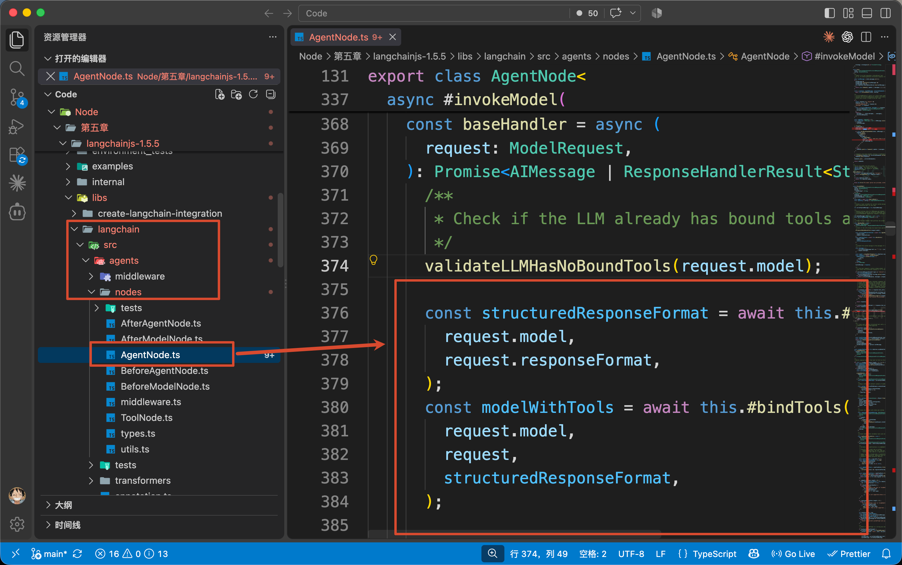

`modelWithTools.invoke()` 调用模型以后，返回了一条包含 Tool Call 的 `AIMessage`：

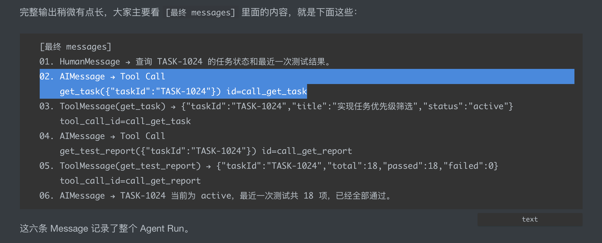

不过，上一节的源码只追到了模型返回这里，`get_task` 还没有真正执行。

因此，咱们就继续在同一个 `AgentNode.ts`，从 `modelWithTools.invoke()` 的返回值接着往下看。

`baseHandler` 返回 `AIMessage` 以后，`#invokeModel()` 会继续把它返回给 `AgentNode.#run()`：

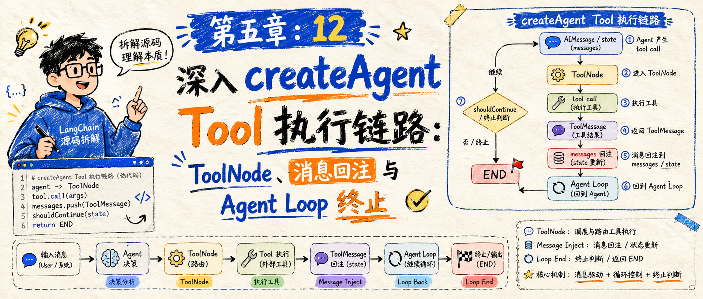

回到 `#run()`，对应的是下面这段代码：

```typescript
const {
    response,
    lastAiMessage,
    collectedCommands
} = await this.#invokeModel(state, config)
```

也给大家放张截图，省得找不到代码位置：

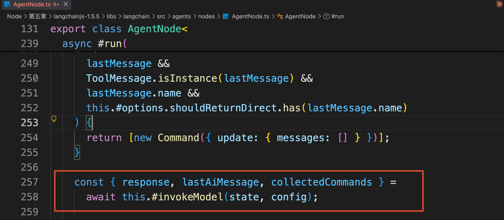

现在，`response` 中保存的就是刚才那条 `AIMessage`。

接下来，源码需要使用这条消息完成后半段执行逻辑

## 从 `AgentNode.#run()` 继续往下
### 第一步：把模型返回的 Tool Call 写入 State
咱们这次的代码案例第一次模型调用返回：

```latex
[AIMessage 1]
get_task({"taskId":"TASK-1024"}) id=call_get_task
```

模型集成包会把 LLM 厂商接口返回的数据整理成 `AIMessage`。

对于一次 Tool Call，最重要的是下面三个字段：

```javascript
{
    name: 'get_task',
    args: { taskId: 'TASK-1024' },
    id: 'call_get_task'
}
```

+ `name` 表示模型要调用哪个 Tool
+ `args` 是模型生成的参数
+ `id` 则是本次 Tool Call 的唯一标识。

现在，`#run()` 已经拿到了 `#invokeModel()` 返回的 `response`。

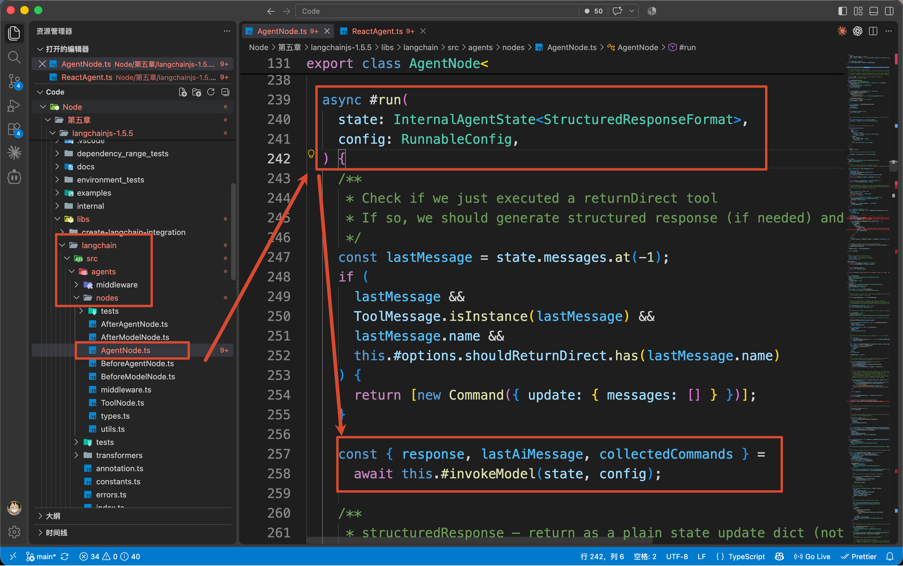

不过，`response` 不一定永远都是 `AIMessage`。Middleware 或结构化输出也可能返回其他类型的结果。

所以，源码会先找出本轮真正的 `AIMessage`：

```typescript
const aiMessage = AIMessage.isInstance(response)
    ? response
    : lastAiMessage
```

这里的 `lastAiMessage`，是 `#invokeModel()` 在经过 Middleware 包装调用时记录的最后一条 AIMessage。

咱们这个案例没有改写模型返回值，因此 `response` 本身就是 `AIMessage`。

也就是说，现在的 `aiMessage` 保存的大致就是下面这样：

```json
AIMessage {
    content: '',
    tool_calls: [
        {
            name: 'get_task',
            args: {
                taskId: 'TASK-1024'
            },
            id: 'call_get_task',
            type: 'tool_call'
        }
    ]
}
```

但是，这条消息现在还只是 `#run()` 里面的一个变量，并没有进入 Agent State。

如果不把它写进 State，后面的 Graph 路由就看不到模型选择了哪个 Tool

LangGraph 的 Node 不会在方法里直接修改 State，而是返回一份 “需要怎样更新 State” 的说明，再由 Graph 统一处理。

这里返回的更新说明，就是 `Command`：

```typescript
commands.push(
    new Command({
        update: {
            messages: [aiMessage]
        }
    })
)
```

这段代码表达的意思是：**把本轮模型生成的 **`aiMessage`**，更新到 Agent State 的 **`messages`** 中。**

不过这里有一个小坑哈

不知道大家还记不记得，在调用模型以前，`State.messages` 中已经保存了一条 `HumanMessage`。

但是这次提交的更新中，只有刚刚生成的 `AIMessage` ，也就是：

+ 原来的 State.messages： [HumanMessage]
+ 本次 update.messages：  [AIMessage]

如果这是一次普通的对象赋值，新的数组就会覆盖旧数组，原来的 `HumanMessage` 也会消失。

但是，LangGraph 更新 State 时并没有把原消息覆盖掉。

这就和 `messages` 字段使用的 `MessagesValue` 有关了。

因为上一小节看到的 Agent State 中，`messages` 使用的是 `MessagesValue`：

```typescript
state: new StateSchema({
    messages: MessagesValue,
    ...stateFields
})
```

`MessagesValue` 带有 Message Reducer。

Graph 收到这次更新以后，不会用新的数组覆盖原有消息，而是把 `AIMessage` 合并到已有的 `messages` 中。

所以，第一轮 `model_request` 执行完成以后，State 变成：

```javascript
const state = {
    messages: [
        {
            HumanMessage：查询 TASK-1024...
        },
        {
            AIMessage：调用 get_task，id=call_get_task
        }
    ]
}
```

这就是第一条 AIMessage 写入 Agent State 的过程。

生成了一个流程图，大致就是下面这样（图片由 GPT-IMAGE-2 生成，所以一些小的线条可能会不太准确）

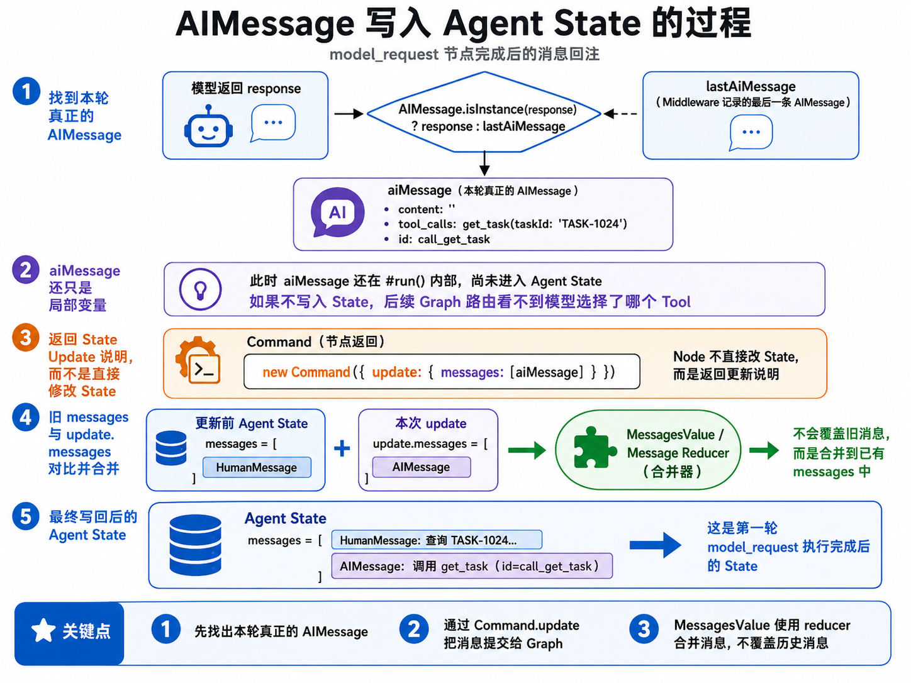

那么到这里，模型已经提出了调用要求了，但是 `get_task` 还没有真正执行

Graph 接下来需要根据这条 AIMessage，决定进入哪个 Node。

### 第二步：把 AIMessage 路由到 ToolNode
`model_request` 执行完成以后，Graph 会进入第 10 小节看过的 `#createModelRouter()`。

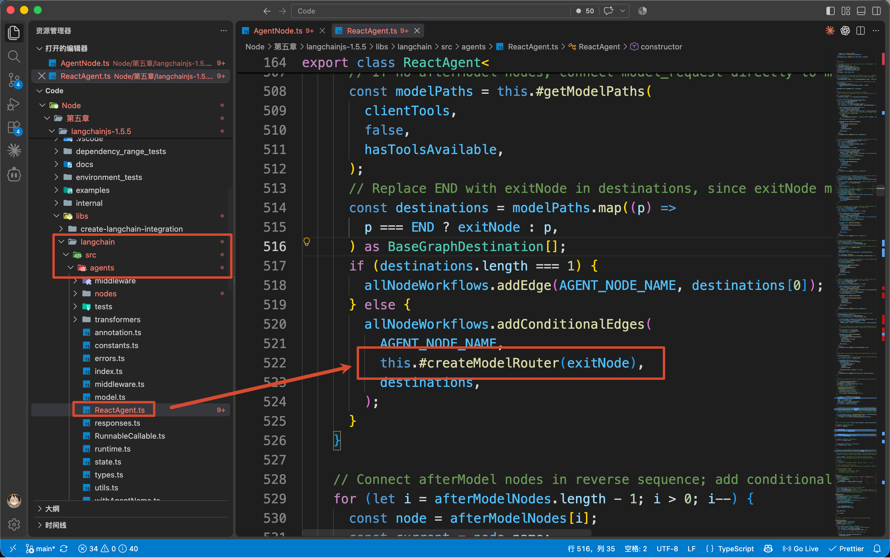

路由读取最后一条 `AIMessage`，发现里面存在普通 Tool Call，于是进入 `tools`。

当前 `langchain` 默认使用 `v2` Tool 行为。

> LangChain 的 `createAgent()` 提供了两种 Tool Call 调度方式：
>
> + `v1`：把包含所有 Tool Call 的整条 `AIMessage` 交给一次 `ToolNode`。`ToolNode` 会在内部通过 `Promise.all()` 并发执行这些 Tool Call。
> + `v2`：把每个 Tool Call 拆成独立的 `Send` 任务，分别交给 `ToolNode` 执行。
>

因为是 `v2` 嘛， 所以他会为每个 Tool Call 创建一条 `Send`：

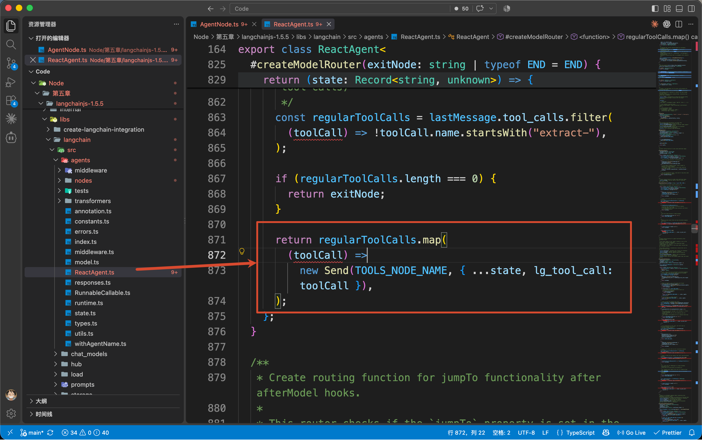

`Send` 可以理解为：**把指定数据发送给某个 Graph Node 执行。**

当前只有一个 Tool Call，因此发给 `tools` 的关键数据就是：

```javascript
{
    lg_tool_call: {
        name: 'get_task',
        args: { taskId: 'TASK-1024' },
        id: 'call_get_task'
    }
}
```

这里的 `lg_tool_call` 是 LangChain 内部使用的字段

如果模型在同一条 AIMessage 中返回多个 Tool Call，默认 `v2` 会为每个调用创建一个 `Send`，让 LangGraph 分别调度这些 Tool 任务。

`Send` 只是把 Tool Call 交给了 `tools` Node，真正的业务函数仍然没有执行。

接下来继续进入 `ToolNode` 内部。

### 第三步：找到 Tool 并执行
接下来打开：`libs/langchain/src/agents/nodes/ToolNode.ts`

搜索：

```latex
protected async run(
```

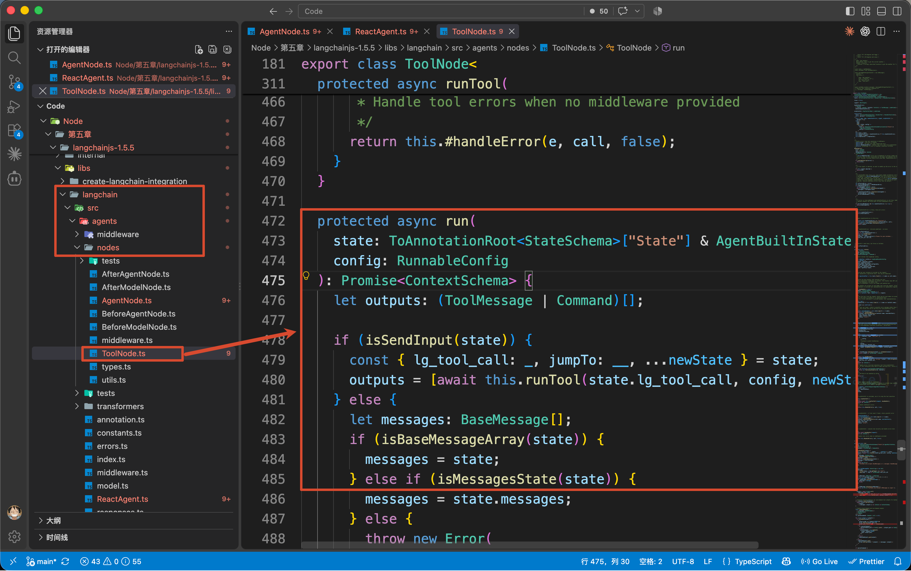

`ToolNode` 先判断收到的是否是刚才的 `Send` 数据：

```typescript
if (isSendInput(state)) {
    outputs = [
        await this.runTool(
            state.lg_tool_call,
            config,
            newState
        )
    ]
}
```

所以，真正负责执行单个 Tool Call 的方法是：

```javascript
this.runTool()
```

继续向上找到 `runTool()` 这个方法

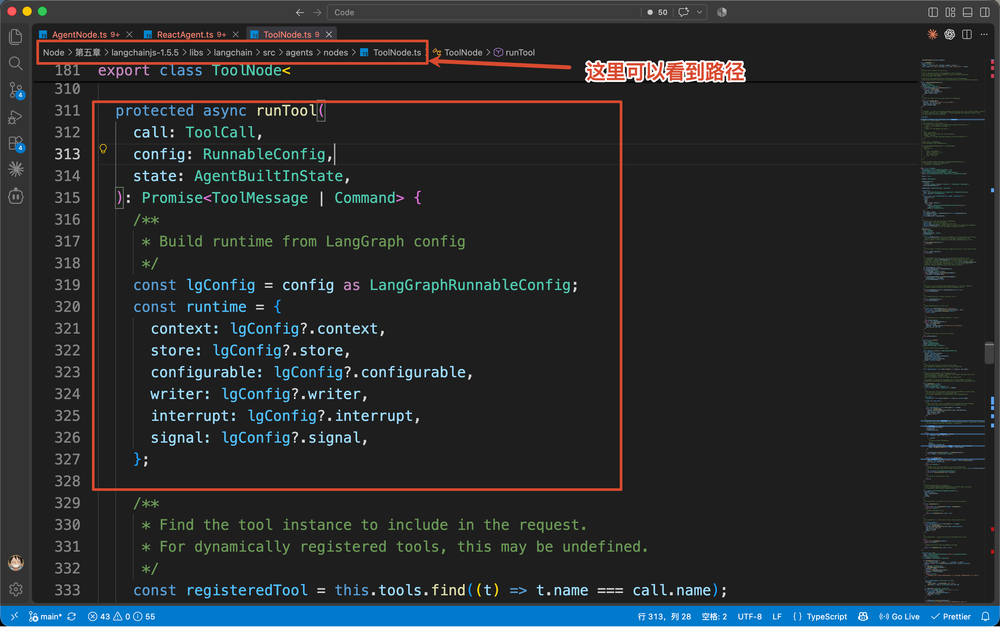

他会先根据 Tool 名称查找注册实例：

```typescript
const registeredTool = this.tools.find(
    (tool) => tool.name === call.name
)
```

当前 `call.name` 是：`get_task` 

因此，源码会找到咱们在 `agent-run-trace.js` 中定义的 `getTask`。

随后，`ToolNode` 会整理 `ToolRuntime`，把 State、Context、Store、Signal 和当前 `toolCallId` 等数据交给 Tool。

真正执行 Tool 的代码是：

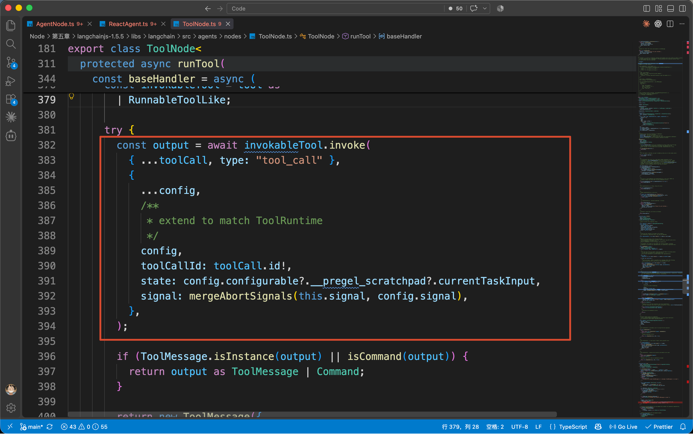

这里的 `invokableTool.invoke()` 会按照 Tool 定义的 Zod Schema 校验 `args`，校验通过以后，再执行咱们写在 `tool()` 中的业务函数。

这里 `get_task` 返回一个普通 JavaScript 对象：

```javascript
{
    taskId: 'TASK-1024',
    title: '实现任务优先级筛选',
    status: 'active'
}
```

这个对象还不能直接放进模型上下文。

因此，`ToolNode` 会把普通返回值包装成 `ToolMessage`：

```typescript
return new ToolMessage({
    name: invokableTool.name,
    content:
        typeof output === "string"
            ? output
            : JSON.stringify(output),
    tool_call_id: toolCall.id
})
```

最终得到的 `ToolMessage` 大概就是这样：

```json
{
  "type": "tool",
  "name": "get_task",
  "tool_call_id": "call_get_task",
  "content": {
    "taskId": "TASK-1024",
    "status": "active"
  }
}
```

到这里，Tool 的业务函数已经执行完成，但是这次 Tool Call 还差最后一步。

程序需要先把 Tool Result 写回 Agent State，后面的模型调用才能读到这份结果。

### 第四步：把 ToolMessage 写回 State
`ToolNode.run()` 最后会返回：

```typescript
return {
    messages: outputs
}
```

这里的 `outputs` 就包含刚刚生成的 `ToolMessage`。

与 `AgentNode` 返回 AIMessage 时一样，Graph 会通过 `MessagesValue` 把新的 ToolMessage 合并进 Agent State。

于是，State 变成：

```json
const state = {
    messages: [
        {
            HumanMessage: '查询 TASK-1024'
        },
        {
            AIMessage: '调用 get_task'
        },
        {
            ToolMessage: 'get_task 执行结果'
        }
    ]
}
```

到这里，模型提出的 `get_task` Tool Call 已经完整执行结束，调用要求和执行结果都进入了 Agent State。

## ToolMessage 回注以后，Agent Loop 怎样继续并结束
接下来，`tools` Node 会沿着上一小节讲过的 Edge 返回 `loopEntryNode`。

因为咱们没有 `beforeModel`，所以：

```latex
loopEntryNode = model_request
```

Graph 再次进入 `AgentNode.#run()`，重新构建下一轮 `ModelRequest`。

这一次，程序打印的是：

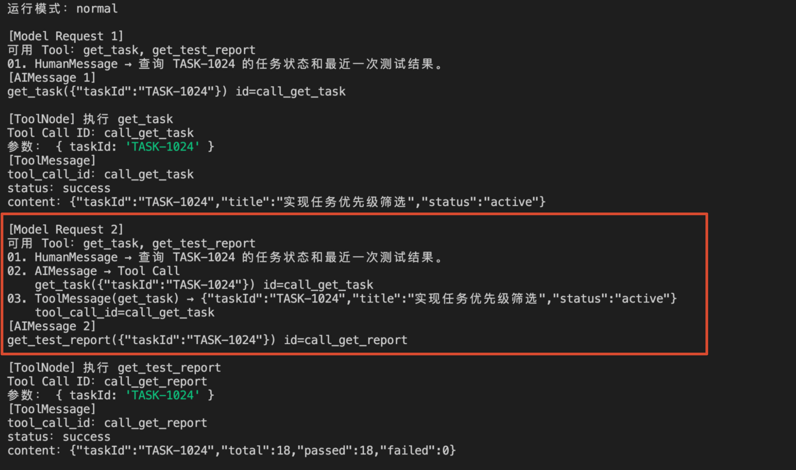

这就是所谓的 **消息回注**。

他并不是把 Tool Result 单独再发一次请求，而是先把 `ToolMessage` 写入 Agent State。

下一轮调用模型时，`AgentNode` 会读取更新后的完整 `messages`，让模型同时看到：用户原来问了什么、模型刚才决定调用什么、Tool 最终返回了什么

对比上面的打印，大概就是下面这样：

```latex
[Model Request 2]
01. HumanMessage → 用户问题
02. AIMessage → 调用 get_task
03. ToolMessage → get_task 执行结果
```

模型看完这些信息，才继续决定下一步。

在这段案例代码里面，第二次模型调用又返回了：`get_test_report({"taskId":"TASK-1024"})`

于是相同流程再执行一次

到第三次 Model Request 时，模型已经能看到五条消息：

```latex
HumanMessage
AIMessage(get_task)
ToolMessage(get_task result)
AIMessage(get_test_report)
ToolMessage(get_test_report result)
```

所以他终于可以根据两份 Tool Result 生成最终答案。

到这里，Agent Loop 已经完整运行了两轮 Tool 调用。

接下来只剩最后一个问题：**模型生成最终答案以后，这个循环怎样停下来？**

### 模型不再返回 Tool Call 时，循环正常结束
第三次模型调用返回：

```latex
TASK-1024 当前为 active，最近一次测试共 18 项，已经全部通过。
```

这仍然是一条 `AIMessage`，但是里面已经没有 `tool_calls`。

`AgentNode` 会照常把他写入 State。随后，Graph 再次进入 `#createModelRouter()`：

```typescript
if (
    !AIMessage.isInstance(lastMessage) ||
    !lastMessage.tool_calls ||
    lastMessage.tool_calls.length === 0
) {
    return exitNode
}
```

路由发现最后一条 AIMessage 没有 Tool Call，于是进入 `exitNode`。

因为没有设计 `afterAgent`，所以：

```latex
exitNode = END
```

Graph 执行结束，`agent.invoke()` 返回最终 State。

因此，一个普通 Agent Loop 最主要的停止条件并不是模型返回了某个 `finished: true`：

> 即：**模型返回一条不包含 Tool Call 的 AIMessage，路由就把他视为最终回答，并结束当前 Agent Loop。**
>

## Tool 调用失败以后，Agent 怎样修正错误
最后，再验证一次错误链路。

运行：

```bash
npm run trace:error
```

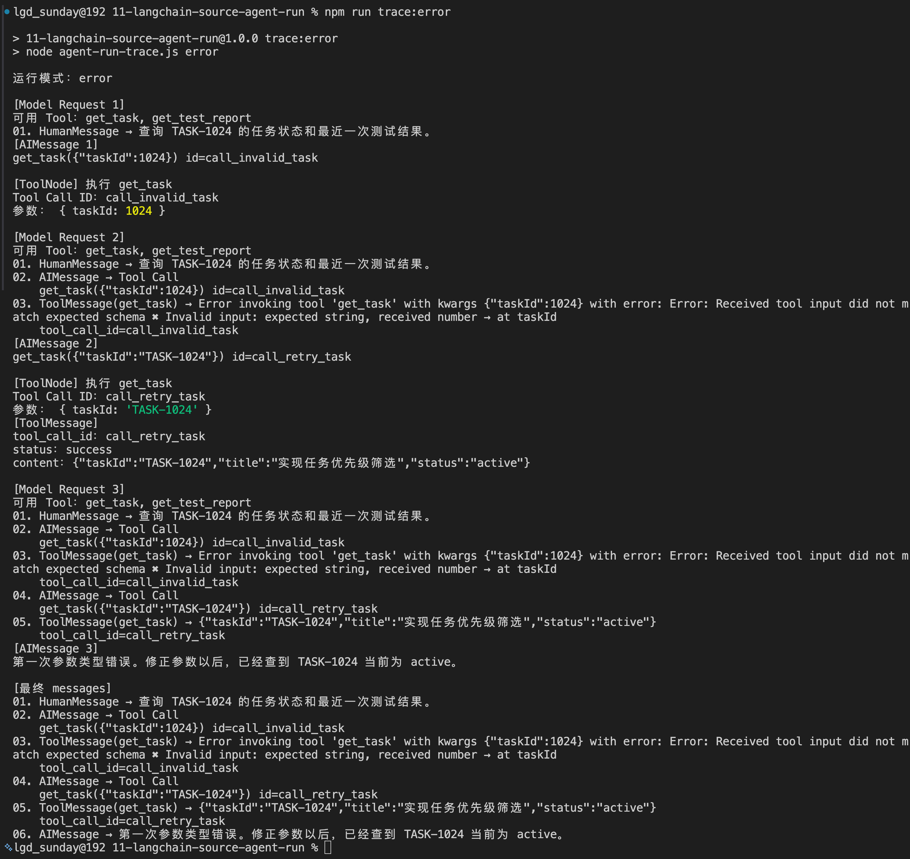

这次，模拟模型第一次把 `taskId` 错误地生成为数字：

```latex
get_task({"taskId":1024})
```

但是 `get_task` 的 Schema 要求：

```javascript
z.object({
    taskId: z.string()
})
```

所以，`invokableTool.invoke()` 在执行真正的业务函数以前就会校验失败。

`ToolNode` 会把这类参数解析错误转换成可回传的 Tool 错误，最终生成一条 `ToolMessage`：

```latex
ToolMessage(get_task) 
→ Error invoking tool 'get_task' with kwargs {"taskId":1024}
with error: Error: Received tool input did not match expected schema 
✖ Invalid input: expected string, received number → at taskId
```

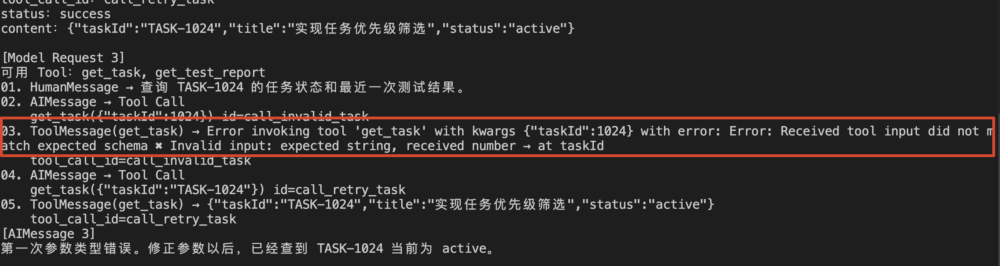

随后，这条错误 ToolMessage 仍然会写回 `messages`，并进入下一轮 Model Request。

源码看到这里以后，排查 Agent Tool 问题就有了一条比较明确的路径。

如果模型根本看不到 Tool，先检查 `AgentNode.#bindTools()` 以及当前 `ModelRequest.tools`。

如果 AIMessage 已经出现 Tool Call，但是 Tool 没有执行，就检查 `#createModelRouter()` 是否进入了 `tools`，以及 `ToolNode` 收到的 `lg_tool_call`。

如果 Tool 已经执行，但是模型看不到结果，就检查 `ToolMessage.tool_call_id`、`ToolNode.run()` 返回的 `messages`，以及 Agent State 使用的 Message Reducer。

如果 Agent 一直循环，就看最后一条 AIMessage 是否始终包含 Tool Call，再检查终止路由和 `recursionLimit`。

这比只盯着最终一句回答排查，要有效得多。

## 总结
这一小节，咱们从上一节返回的第一条 AIMessage 开始，跟踪了 Tool Call 后面的完整执行链路。

模型返回的 AIMessage 会通过 `MessagesValue` 写入 State。如果其中存在 Tool Call，条件路由就把调用发送给 `ToolNode`。

`ToolNode` 根据名称找到 Tool，校验参数并执行，再把普通返回值包装成带有 `tool_call_id` 的 ToolMessage。ToolMessage 写回 State 以后，下一轮 Model Request 就能同时看到用户问题、Tool Call 和 Tool Result。

模型不再返回 Tool Call 时，路由进入 `END`，Agent Loop 正常结束；如果始终无法结束，LangGraph 的 `recursionLimit` 会阻止流程无限运行。

到这里，`createAgent()` 的构建和执行链路就全部串起来了

第 09 到第 12 小节，咱们分别拆解了 `createAgent()` 的构建过程、Graph 控制流、模型调用和 Tool 执行链路。

那么下一小节，咱们就不再看源码了，看看 LangChian 的生态。

看一下 Deep Agents、LangSmith 和 Integration Packages 分别解决什么问题，以及 LangChain 自己的能力边界到底在哪里。

> 更新：2026-08-27 21:04 · 原文：<https://www.yuque.com/lgdsunday/ab1dy3/fuvn5pp5cg8rbcol>
