# 13 - LangChain 生态边界：Deep Agents、LangSmith 与 Integration Packages

上一小节，咱们已经把 `createAgent()` 的源码执行链路完整走了一遍。

从 `Model Request` 到 `AIMessage`，再从 `ToolNode`、`ToolMessage` 一直看到 Agent Loop 结束。

讲到这里，LangChain 本身的主线其实已经说清楚了。

但是，大家继续翻 LangChain 官方文档时，还会看到很多其他一些概念

比如：`LangGraph`、`Deep Agents`、`LangSmith`，以及一大堆 `@langchain/xxx` 开头的 `Integration Packages`。

这些东西本质上都属于 LangChain 生态，就和 Vue 中的 `vue/core` 和 `vue-router、vuex、pinia` 差不多的意思

所以，咱们一定要记住：**一个框架真正强大的地方，往往不只是框架本身，而是围绕它逐渐形成的整个生态。**

所以，这一小节，咱们就来看看 langchain 的生态～～

## LangChain 生态
咱们先看一下这些组件之间的大致关系：

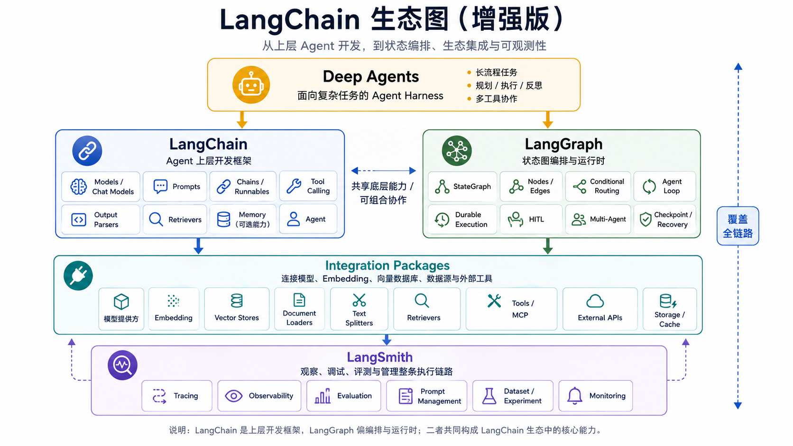

这个图代表了不同的库（统称为 LangChian 生态库）的不同作用：

+ `LangChain` 提供 `createAgent()`、Tool、Message 和 Middleware 等上层开发入口
+ `LangGraph` 负责状态、节点、路由、持久化执行等底层编排能力（前面看到的 `createAgent()`，内部就是使用 LangGraph 编译出了一张 Graph）
+ `Deep Agents` 建立在 LangChain 和 LangGraph 的能力之上，为复杂、长时间运行的任务准备了一套更完整的 Agent 执行环境
+ `LangSmith` 不负责执行 Agent。它负责记录、观察、调试和评估 Agent 的运行过程
+ Integration Packages 负责连接 DeepSeek、OpenAI、Anthropic、向量数据库等外部服务

不同的库有不同的作用，并且 **通常情况下，一个库只解决一类问题**

接下来，咱们一个一个来看

## Deep Agents：复杂任务的 Agent Harness
先看 `[Deep Agents](https://docs.langchain.com/oss/javascript/deepagents/overview)`。

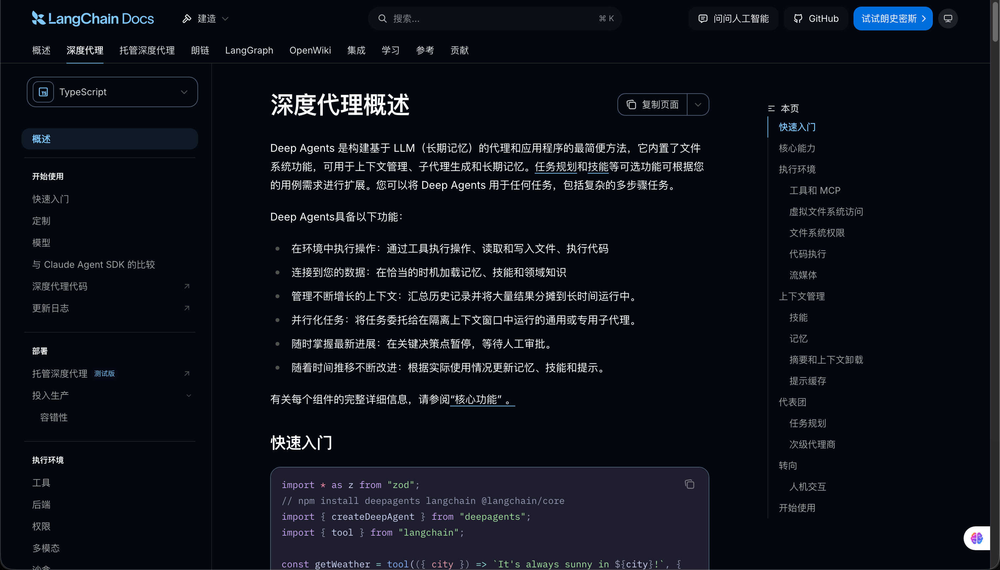

在第四章里面，咱们自己实现过一个 AI 编程 Agent。

为了让他完成一个相对复杂的代码任务，项目里加入了任务计划、独立 Workspace、文件读写、测试执行、失败后的 Replan 和高风险操作人工确认。

这些东西都不是基础 Agent Loop 实现的。

因为如果任务只需要查询订单、读取测试报告或者调用几个业务接口，Agent Loop 就够用了。

但是，如果 Agent 要持续执行几十步任务，还要管理大量文件、拆分子任务和控制上下文，那么仅靠 Agent Loop 就不行了

而 Deep Agents 解决的就是这个问题。

Deep Agents 在官方被称为 `Agent Harness`。

这里的 Harness 可以理解成：**围绕基础 Agent Loop 准备好的一整套任务执行环境。**

不过大家不要被新的概念吓到哈。

在 AI 时代，每天都会冒出来各种各样的概念，其实这些概念没那么复杂，大部分都是 “新瓶装老酒”

而 Deep Agents 也一样。

它的底层仍然是大家已经学过的模型调用、Tool Calling 和 Agent Loop。

只不过，他在这套 Loop 外面继续补充了任务计划、文件系统、上下文压缩、Skills、Subagents、长期记忆、权限和 Human-in-the-loop 等能力。

关系大概是这样的：

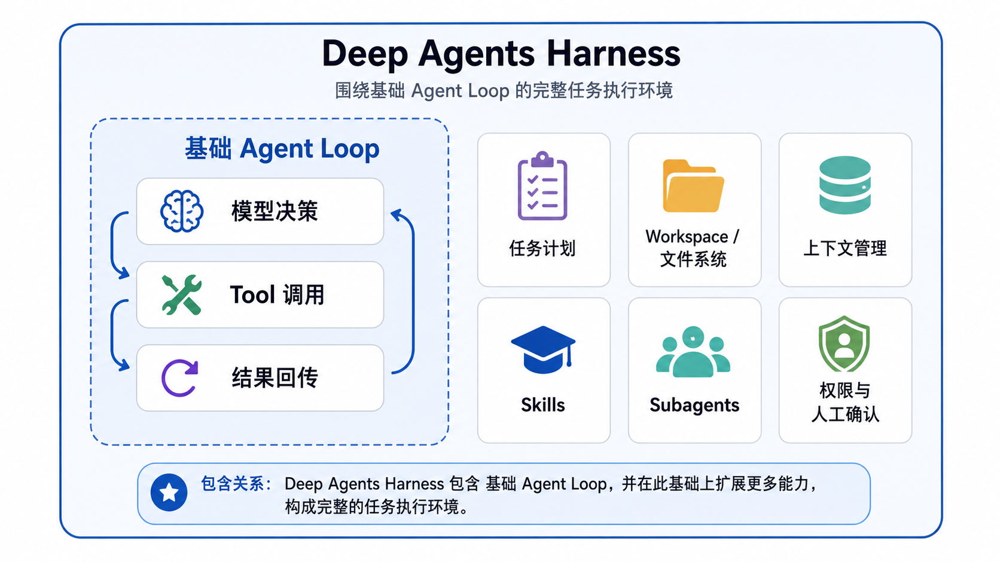

因此，Deep Agent 的价值是：**当项目本身就是复杂任务 Agent 时，不需要每次都从零搭建这些通用的外围能力。**

不过，这也意味着 Deep Agents 带有更强的设计倾向。

如果咱们只是实现一个查询订单的客服 Agent，直接使用 LangChain 里面 `createAgent()` 那一套就可以了（就好比咱们只做一个父子传参，没必要引入 `pinia` 一样）

如果业务流程中每一步都必须由程序明确控制，比如退款审批、资金操作或者发布流程，那么直接使用 LangGraph 构建确定性工作流，通常比让 Deep Agents 自主安排全部步骤更加合适。

只有当任务确实需要计划、Workspace、Skills 或 Subagents 时，Deep Agents 的价值才会真正体现出来。

第八章会通过企业调研 Agent，专门实现这些能力。这一节只需要先记住他的生态位置：

> **Deep Agents 不是新一代 Agent Loop，而是建立在 LangChain 和 LangGraph 之上的复杂任务 Agent Harness。**
>

## LangSmith：把 Agent 的执行过程记录下来
接下来是 `[LangSmith](https://docs.langchain.com/langsmith/observability)`。

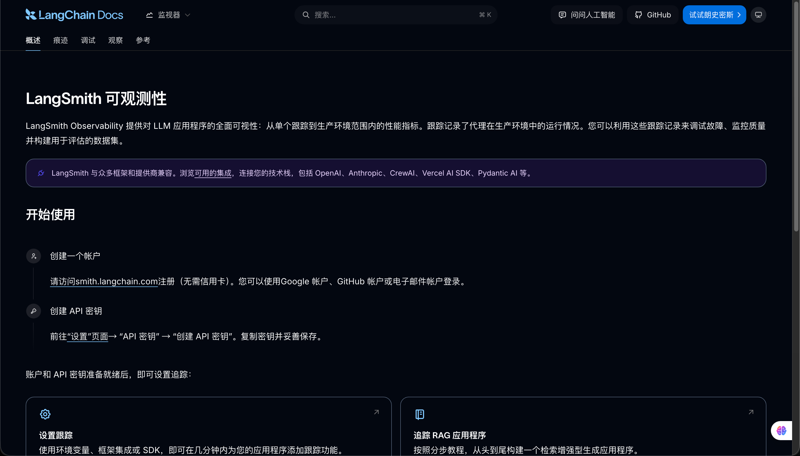

前面运行 Agent 时，咱们一直在控制台中打印 `AIMessage`、Tool Call 和 Tool Result。

不过这种方式在学习的时候可以，但是，如果是在企业项目里面，光依靠控制台的日志，肯定是不行的。

比如，某次 Agent 最终得出了错误结论。

咱们需要继续确定：模型当时收到了哪些 Messages，能够看到哪些 Tool，为什么选择了 `get_task`，Tool 参数是什么，中间调用了几次模型，每一步用了多长时间。

如果这些数据散落在不同的日志中，排查起来会特别麻烦。

所以，这个时候就需要用到 `LangSmith`

LangSmith 里面有一个 Trace 的东西，就是用来记录这条完整执行链路的。

在 LangSmith 中，一次用户请求通常会形成一条 `Trace`。Trace 内部的模型调用、Tool 调用和其他步骤，则分别记录成不同的 `Run`。

例如，第 04 小节实现的研发任务风险分析 Agent，大致会形成下面的结构：

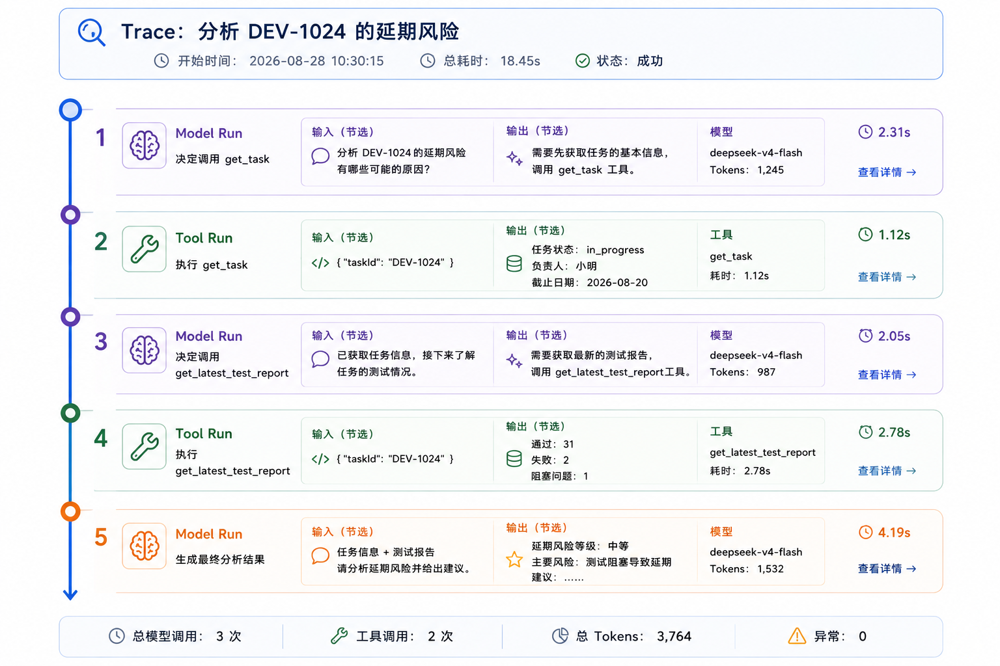

这样打开一次 Trace，就能顺着整条链路检查每一步的输入、输出、耗时和异常。

### 实操一次
LangChain 和 LangGraph 已经内置了 LangSmith Tracing 集成，所以使用起来很简单

`LangSmith` 可以集成不同的 LLM，[这里有集成名单](https://docs.langchain.com/langsmith/integrations)

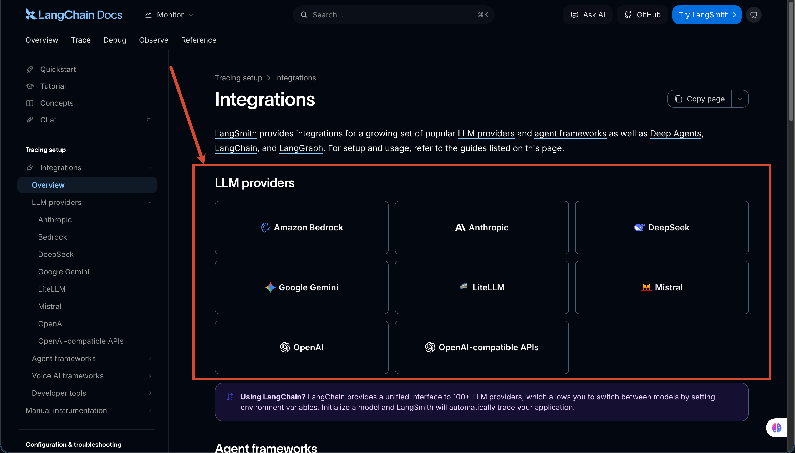

咱们就选择 `DeepSeek` 就可以：

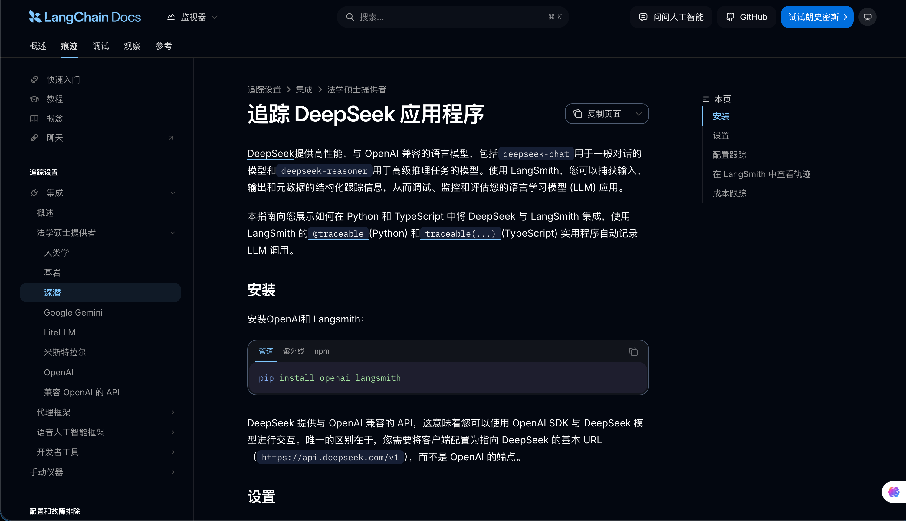

这里需要配置一些 `API-KEY` 

除了 `DEEPSEEK_API_KEY` 之外，还需要 `LANGSMITH_API_KEY`

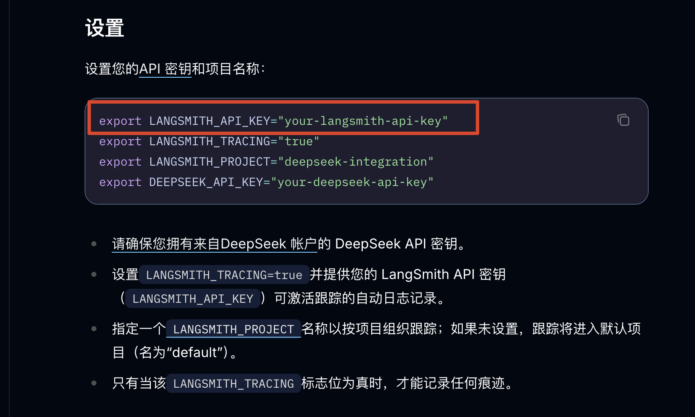

咱们需要打开 [lang smith 的官网](https://smith.langchain.com/) 并且完成登录（可以用 Github 账号登录）

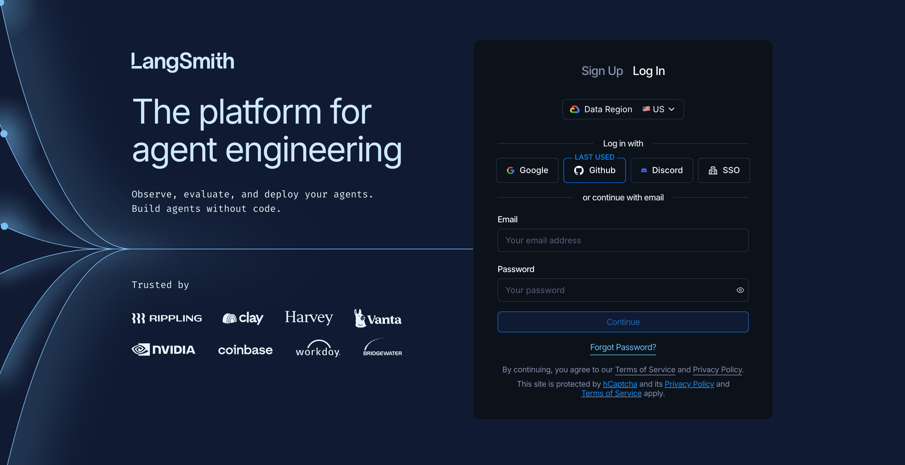

然后点击左下角的 `settings` 来配置对应的 key

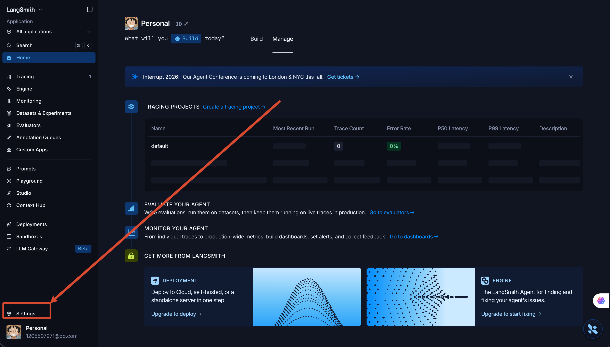

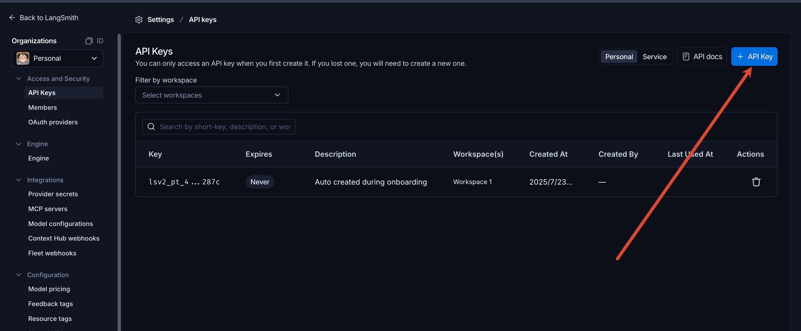

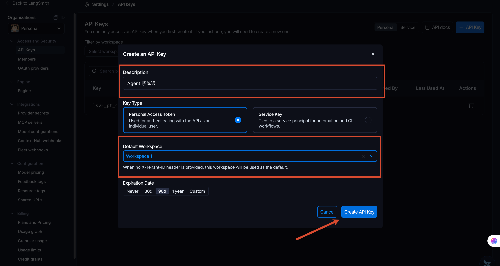

 配置好之后，打开 `/Code/Node/第五章/04-langchain-create-agent/.env`，增加下面三个环境变量，把 `LANGSMITH_API_KEY` 写上就行 ：

```latex
LANGSMITH_TRACING=true
LANGSMITH_API_KEY=你的 LangSmith API Key
LANGSMITH_PROJECT=agent-course-chapter-5
```

如果一个 API Key 关联了多个 Workspace（上图注册的时候就有），还需要配置，不过咱们这里不需要，那就不用管了：

```latex
LANGSMITH_WORKSPACE_ID=你的 Workspace ID
```

然后，按照原来的方式运行项目：

```bash
npm run demo
```

Agent 的执行结果不会发生变化。

但是，LangChain 会把这次调用产生的 Trace 发送到 LangSmith。

重新打开 [LangSmith](https://smith.langchain.com/) 的网页，进入 `agent-course-chapter-5` Project，就可以找到刚才的 Trace。

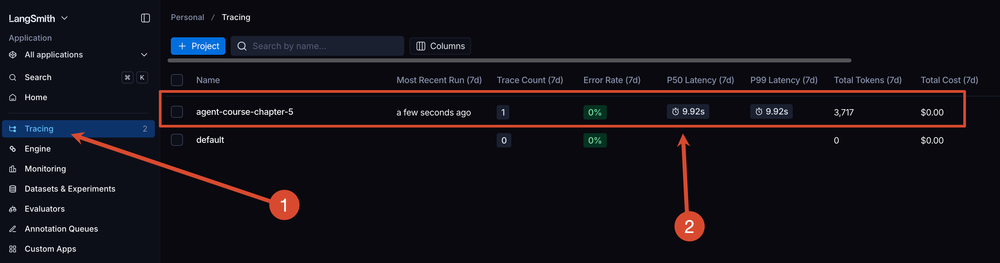

点开之后就长成下面这样：

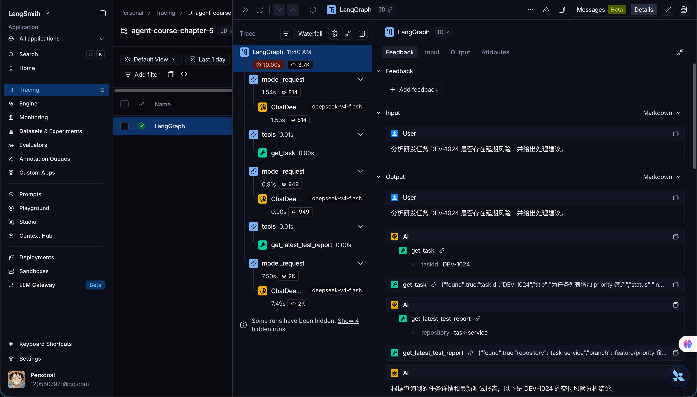

这里展示的是一套父子级关系

这就是 LangSmith 在当前项目中的第一个价值：**不是再运行一次 Agent，而是让已经发生的 Agent Run 可以被完整查看。**

除了 Trace，LangSmith 还提供 Dataset 和 Evaluation。

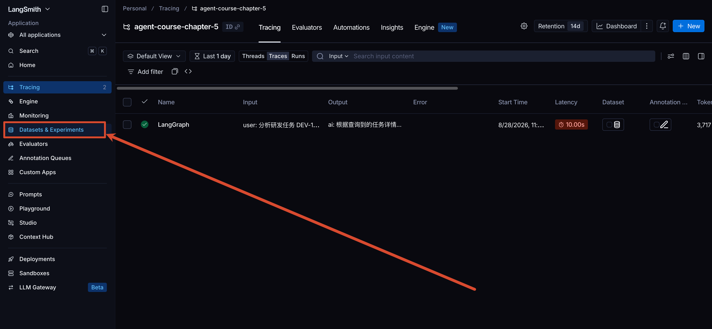

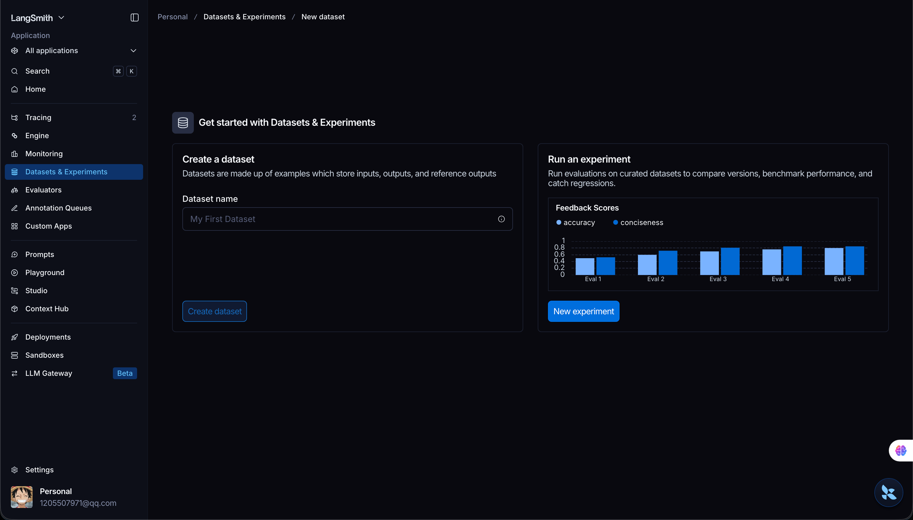

Trace 主要回答的是：这一次请求为什么出错？

Evaluation 解决的则是：准备一批测试问题以后，新版本 Agent 的正确率有没有下降？

咱们在后面（预计第十章）会专门建立 Agent 数据集，评估最终答案、Tool 选择、参数和执行轨迹。

所以这里就不展开讲了，只需要先明确：**LangSmith 就是一个独立的可观测与评估平台，就可以了。**

即使项目没有使用 LangChain，也可以通过 LangSmith SDK 或 OpenTelemetry 接入 Trace。反过来，使用 LangChain 也不代表必须使用 LangSmith。就和 `vite` 不一定非要绑定 `vue` 使用一样

## Integration Packages：连接外部服务的适配层
最后，再来看 `[Integration Packages](https://docs.langchain.com/oss/javascript/integrations/providers/overview)`。

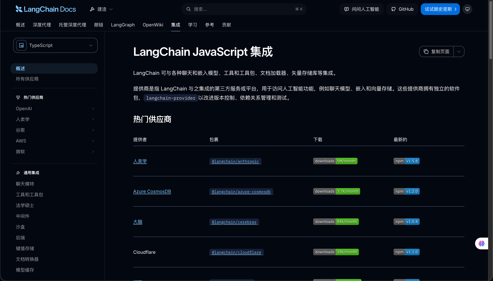

这个概念在第 03 小节已经出现过，当时咱们使用的是：

```javascript
import { ChatDeepSeek } from '@langchain/deepseek'
```

`@langchain/deepseek` 负责把 LangChain 的 Message、Tool Schema 和调用参数，转换成 DeepSeek API 能够处理的数据，再把 DeepSeek 返回的结果整理成统一的 `AIMessage`。

如果换成其他模型，中间的 Integration Package 也会发生变化，比如可能会是下面这些：

```latex
@langchain/openai
@langchain/anthropic
@langchain/google
@langchain/ollama
```

而且 Integration Packages 不只连接 Chat Model。

Embedding 模型、Document Loader、Retriever、向量数据库和外部 Tool，也可以通过对应的集成包接入 LangChain。

官方把这些集成拆成独立包，主要是为了让不同供应商可以独立管理依赖、版本和测试。

LangChain 的 Integration Package 通常会依赖某个范围的 `@langchain/core`。如果单独升级其中一个包，可能出现同一个项目中存在多份 Core，或者类型和运行时接口不兼容的问题。

如果遇到这类问题，那么可以先执行：

```bash
npm ls langchain @langchain/core @langchain/deepseek
```

确认项目到底安装了哪些版本，以及 `@langchain/core` 是否被重复安装。

生产项目中，建议锁定已经验证过的准确版本，不要让不同 Integration Packages 在每次安装时自动跨越大版本升级。

还有一点也特别重要。

Integration Package 统一的是调用接口，不是模型能力。

即使两个模型都可以通过 `invoke()` 调用，他们对 Tool Calling、Structured Output、多模态输入、Token Usage 和流式输出的支持也可能不同。

有些国产模型提供 OpenAI Compatible API，可以使用 `@langchain/openai` 连接。但是，“接口格式兼容” 不代表所有高级能力和 OpenAI 完全一致。

因此，咱们在真实项目里仍然需要验证当前模型是否支持所需能力，不能因为代码中使用的都是 `ChatModel.invoke()`，就默认可以无成本替换。

## 总结
说了这么多，最后咱们通过具体需求来判断。

| 项目需求 | 主要选择 | 原因 |
| --- | --- | --- |
| 模型根据问题调用几个业务 Tool | LangChain `createAgent()` | 已经提供标准 Agent Loop、Tool 执行和 Middleware |
| 流程包含明确状态、固定分支和业务审批 | LangGraph | 应用程序需要直接控制 Node、State 和 Edge |
| Agent 需要长期规划、Workspace、Skills 和 Subagents | Deep Agents | 已经提供复杂任务所需的 Harness 能力 |
| 需要查看执行轨迹、定位问题和建立评估 | LangSmith | 负责 Trace、观测和 Evaluation，不参与业务执行 |
| 需要连接具体模型或向量数据库 | Integration Package | 负责把供应商能力适配到 LangChain 公共接口 |


一个 Deep Agents 项目仍然需要 Integration Package 连接模型，底层仍然会使用 LangGraph 执行任务，也可以把 Trace 发送到 LangSmith。

一个普通 `createAgent()` 项目同样可以接入 LangSmith，但完全不需要使用 Deep Agents。

LangChain 生态可以帮助咱们组织模型、Tool、State 和执行流程，但是，他不会自动替代业务系统中的权限、租户隔离、参数校验、事务、幂等和审计。

Deep Agents 提供文件系统能力，也不代表模型可以直接在生产服务器上随意执行命令。需要运行代码时，仍然要使用隔离的 Sandbox，并限制可以访问的文件、网络和凭证。

LangSmith 能够记录 Trace，也不代表数据合规问题自动解决了。

到这里，第五章对 LangChain 的讲解就完成了。

下一小节会对整个第五章做一次总结，然后就开始 第六章的内容啦～

> 更新：2026-08-28 11:54 · 原文：<https://www.yuque.com/lgdsunday/ab1dy3/currd6gbgwfv1kud>
