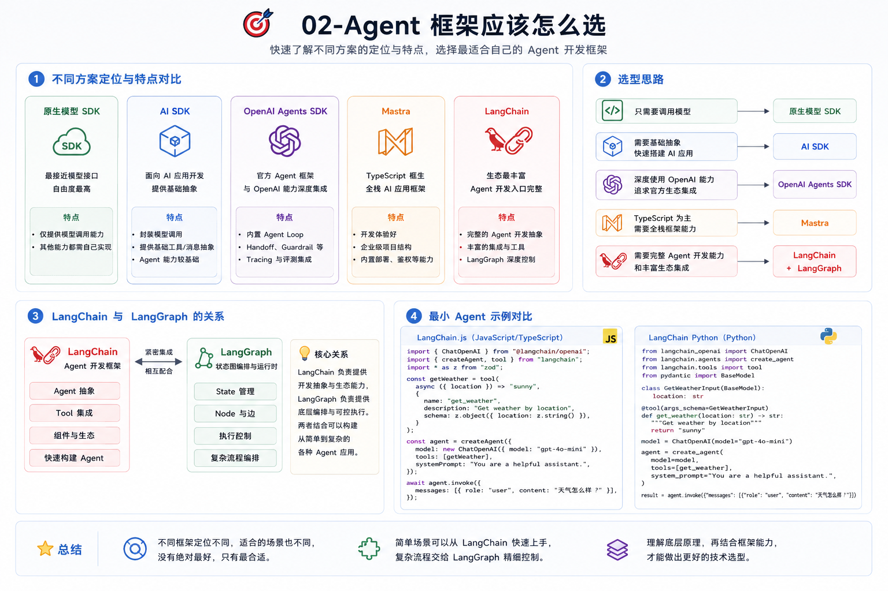
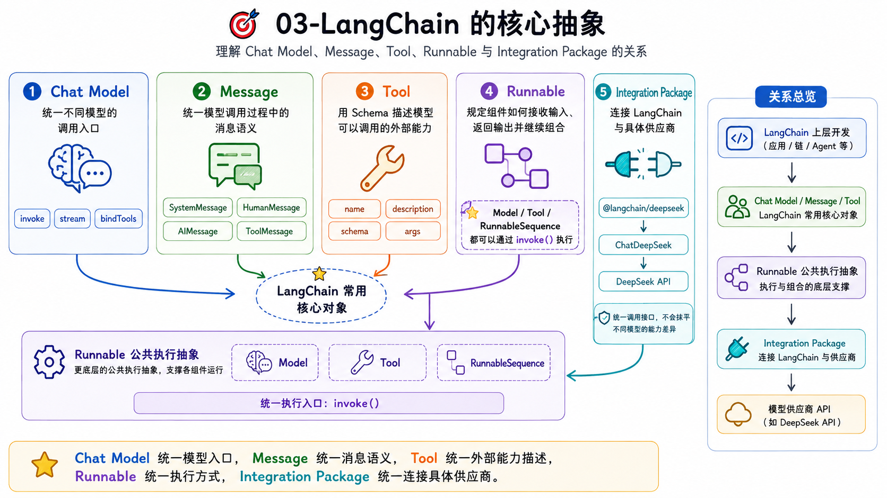
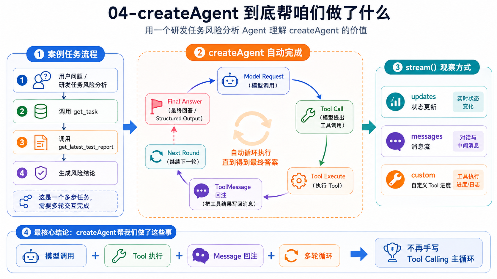
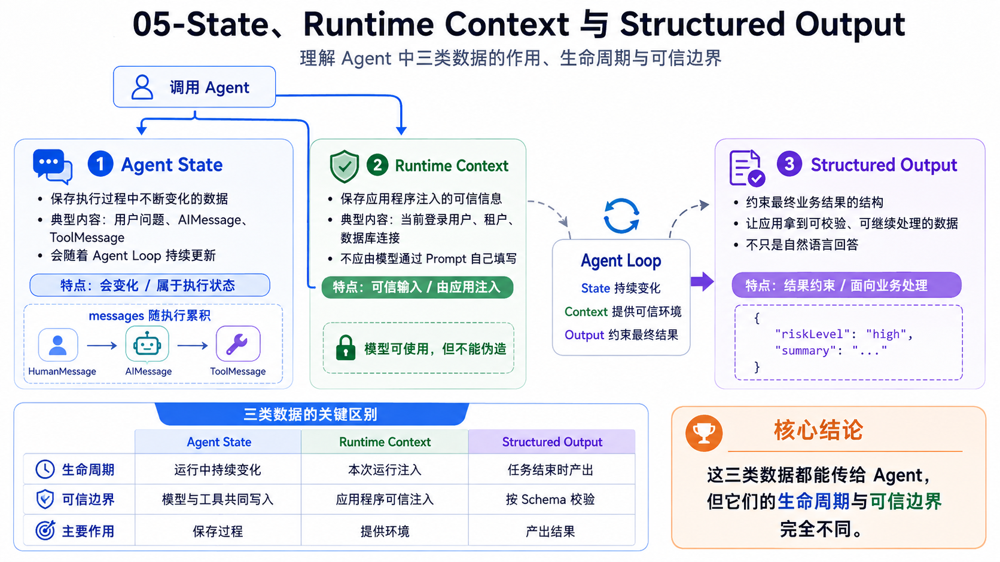
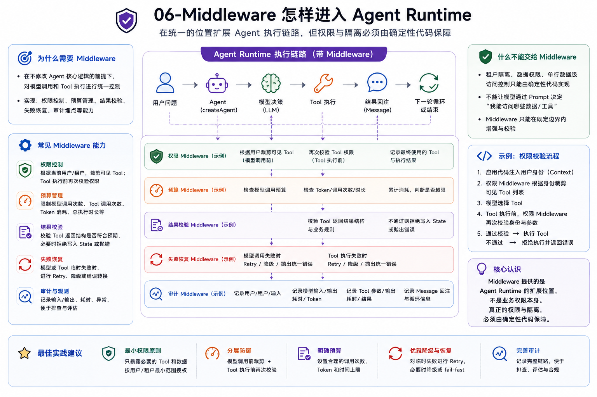
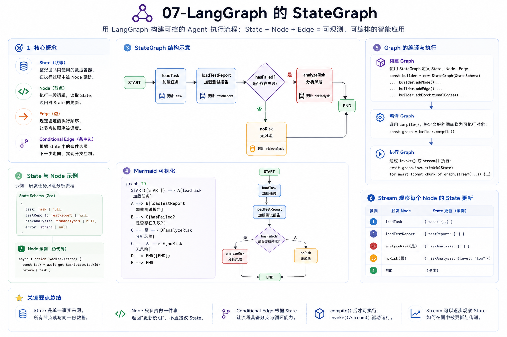
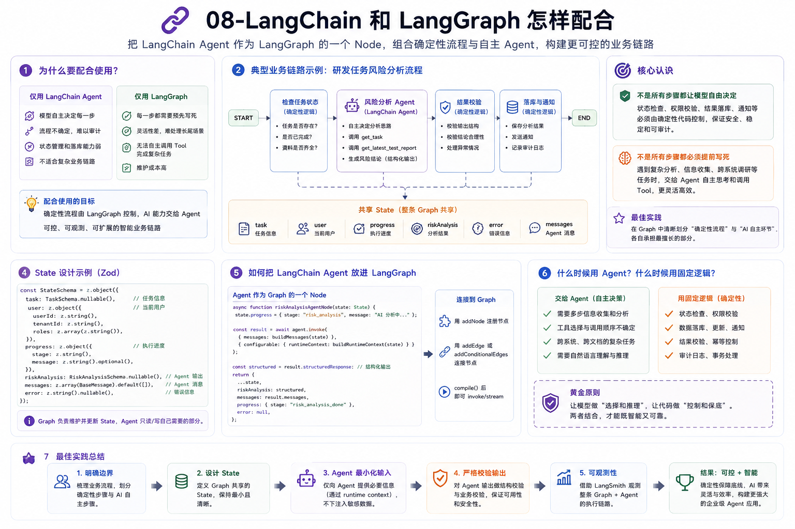
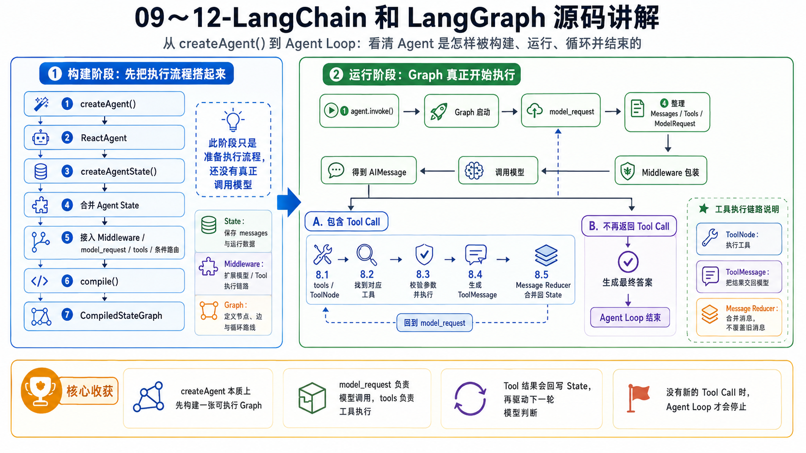
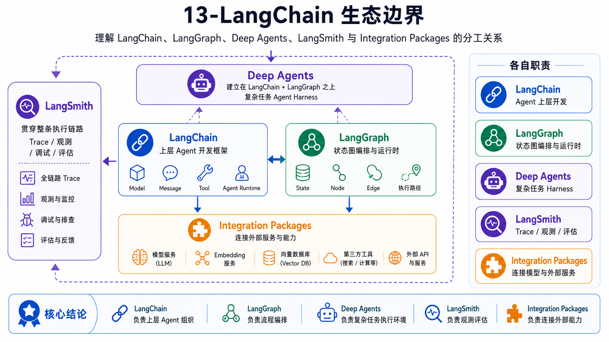

# 14 - 第五章总结：LangChain 与 LangGraph 学到的内容如何在简历和面试中体现

到这里，第五章就结束了。

不过，这一章和前面几章不太一样，那就是这一章没项目。。。

回顾一下整章的内容，咱们其实主要做的就是两件事：

+ 第一：是使用 LangChain 和 LangGraph 重新理解 Agent 框架到底帮咱们解决了什么。
+ 第二：从 `createAgent()` 开始，阅读源码，把 State 构建、Graph 编译、模型调用、Tool 执行和 Agent Loop 终止的整个串了起来。

所以，这一章的价值并不在于简历上又多了一个项目。

它真正解决的其实是：

+ 第一：掌握 **框架使用能力、Agent 架构判断和源码排查能力。**
+ 第二：面试被问到源码的东西，可以回答出来（现在有些大厂已经开始在卷源码了）

那么接下来，咱们先把第五章学过的内容捋一遍，再看这些东西到底咋写。

## 第五章都学了啥
第一小节是章介绍，这里就不单独回顾了。从第二小节开始。

### 02-Agent 框架应该怎么选


第五章一开始，咱们先是比较了模型 SDK、AI SDK、OpenAI Agents SDK、Mastra 和 LangChain 等不同方案。

这里要做的是明确不同的框架大致特点是什么。

原生模型 SDK 更接近模型接口，但是 Agent Loop、Tool 执行和状态管理都要自己实现。

LangChain 提供了完整的 Agent 开发入口，LangGraph 则让应用程序能够进一步控制 State、Node 和执行路径。

这一节还对照了 LangChain.js 和 LangChain Python 的最小 Agent 写法。两边的核心概念基本一致，区别主要来自语言生态、包结构和类型系统。

### 03-LangChain 的核心抽象


第三小节开始拆解 LangChain 最常用的几个对象：Chat Model、Message、Tool、Runnable 和 Integration Package。

Chat Model 统一不同模型的调用入口，Message 统一模型调用过程中的消息语义，Tool 用 Schema 描述模型可以调用的外部能力。

Runnable 则规定了组件接收输入、返回输出和继续组合的方式，所以 Model、Tool 和 RunnableSequence 都可以通过 `invoke()` 执行。

Integration Package 位于 LangChain 与具体供应商之间。例如 `@langchain/deepseek` 负责连接 DeepSeek API，但它统一的是调用接口，不会抹平不同模型之间的能力差异。

### 04-createAgent 到底帮咱们做了什么


第四小节使用 `createAgent()` 实现了一个研发任务风险分析 Agent。

Agent 会先调用 `get_task` 查询任务，再使用返回的 `repository` 调用 `get_latest_test_report`，最后根据任务和测试报告生成风险结论。

通过 `stream()` 的不同模式，咱们分别观察了状态更新、Message 流和自定义 Tool 进度。

这里最重要的是理解 `createAgent()` 已经替咱们完成了模型调用、Tool 执行、Message 回注和多轮循环。

### 05-State、Runtime Context 与 Structured Output


第五小节解决的是 Agent 中不同数据应该放在哪里。

用户问题、AIMessage 和 ToolMessage 属于 Agent State，会随着执行过程不断变化。

当前登录用户、租户、数据库连接等可信信息属于 Runtime Context，由应用程序在调用 Agent 时注入，不能让模型通过 Prompt 自己填写。

Structured Output 则负责约束最终业务结果，让应用程序拿到可以校验和继续处理的数据，而不是只能解析一段自然语言。

这三类数据看起来都能传给 Agent，但是生命周期和可信边界则是完全不同的。

### 06-Middleware 怎样进入 Agent Runtime


第六小节继续使用 Middleware，把权限、预算、结果校验和失败恢复接入 Agent 执行链路。

模型调用以前，可以根据当前用户身份裁剪可见 Tool；Tool 真正执行以前，还要再次校验权限。

Tool 返回以后，Middleware 可以验证结果结构；模型或 Tool 临时失败时，也可以在统一位置进行 Retry 或错误转换。

这一节最核心的认识是：**Middleware 提供的是 Agent Runtime 的扩展位置，不是业务权限本身。**

真正的租户隔离和权限判断，仍然要由确定性代码完成。

### 07-LangGraph 的 StateGraph


第七小节第一次直接使用 LangGraph 创建 Graph。

State 保存整张图共同使用的数据，Node 负责执行某一步逻辑，Edge 规定固定顺序，Conditional Edge 根据 State 选择不同分支。

调用 `compile()` 以后，定义好的图结构才会变成可以通过 `invoke()` 或 `stream()` 执行的 CompiledStateGraph。

咱们还通过 Mermaid 把 Graph 画了出来，并使用 Stream 观察每个 Node 对 State 做了什么更新。

### 08-LangChain 和 LangGraph 怎样配合


学完 LangGraph 基础以后，咱们就需要把 LangChain Agent 作为 LangGraph 中的一个 Node，组合成一条同时包含确定性流程和自主 Agent 的业务链路。

固定的状态检查和结果落库由 Graph 控制，需要模型分析和调用 Tool 的部分再交给 Agent。

这一小节的核心是大家需要知道：**不是所有业务步骤都应该让模型自由决定，也不是所有步骤都必须提前写死。**

### 09～12- LangChain 和 LangGraph 源码讲解


这四节，咱们从下载并锁定源码版本开始，从 `createAgent()` 开始，一直看到  `ReactAgent`，核心是理清楚了一个 Agent 是怎样构建并运行起来的。

构建时，源码先组织 Agent State，再接入 Middleware、`model_request`、`tools` 和条件路由，最后通过 `compile()` 生成内部可执行的 Graph。**这一阶段是在准备执行流程，还没有真正调用模型。**

当应用程序执行 `agent.invoke()`，Graph 才开始运行。模型节点整理 Messages、Tools 等输入，经过 Middleware 后调用模型，得到 `AIMessage`。

如果 AIMessage 中包含 Tool Call，Graph 就会进入 Tool 执行链路。`ToolNode` 找到对应工具、校验参数并执行，再把结果整理成 `ToolMessage`，通过 Message Reducer 合并回 State，保留之前的用户消息和调用记录。

随后，模型读取工具结果，决定继续调用 Tool，还是生成最终答案。在本章的普通调用流程中，模型不再返回 Tool Call，Agent Loop 就会结束。

到这里，咱们掌握的就不只是 `createAgent()` 怎么用了，还掌握了 **模型怎样提出调用、工具怎样执行、结果怎样回到模型，以及整个循环为什么能够持续运行和最终停止。**

### 13-LangChain 生态边界


最后一小节咱们捋了一下整个 LangChain 的生态。知道了

Deep Agents 是建立在 LangChain 和 LangGraph 之上的复杂任务 Agent Harness，LangSmith 负责 Trace、观测与评估，Integration Packages 则负责连接模型、Embedding、向量数据库等外部服务。

## 简历应该怎么写
因为第五章没有大型项目，所以如果要体现在简历上，那么需要从 技能特长 这方面入手

可以参考下面这版：

```latex
• 了解 LangChain.js 源码理解 `createAgent()` 的 Graph 构建、Middleware 接入与 Agent Loop 执行机制，能够沿模型调用、Tool 执行、消息回注和循环终止链路，排查工具未执行、结果未回传等运行问题。

• 熟悉 LangChain.js Agent 开发体系，掌握 Chat Model、Message、Tool、Runnable、Structured Output、Runtime Context、State 与 Middleware 等核心能力，能够基于 createAgent 实现模型决策、Tool 调用、结果回注和多轮执行。

• 熟悉 LangGraph 状态化编排，能够使用 State、Node、Edge 与 Conditional Edge 组合确定性业务流程和自主 Agent，并通过 Stream 观察节点执行与 State 更新。

• 了解 LangChain createAgent 的核心实现，能够沿 ReactAgent、AgentNode、ToolNode 和 CompiledStateGraph 定位 Agent State 构建、Middleware 编排、模型调用、ToolMessage 回注与循环终止问题。
```

这几条就够了。

除此之外，大家也可以把现有的这些知识补充到之前的业务项目里面。

比如，在某个项目的「负责内容」里面写：

```latex
• 使用 LangChain.js createAgent 重构模型与 Tool 的多轮执行链路，通过 Runtime Context 传递用户和租户身份，并利用 Middleware 统一处理 Tool 权限、结果校验、调用预算与失败重试。

• 使用 LangGraph 将资料准备、Agent 分析、人工审批和结果落库编排为状态图，通过 Conditional Edge 根据业务状态选择执行分支，避免把确定性业务规则交给模型临时判断。
```

## 面试可能会问什么
第五章的面试问题，通常会从“你为什么使用 LangChain”开始，再继续追问 LangGraph、Middleware 和 `createAgent()` 原理。

下面这些问题建议大家重点准备。

### 为什么要使用 LangChain？
这就和手写 HTML、CSS、JS 和 使用 `vue ｜｜ react` 进行项目开发是一个道理

手写 Agent Runtime 当然也可以，但是模型适配、Message 转换、Tool Schema、循环执行、流式输出和 Middleware 扩展都需要自己维护，很容易出错，并且麻烦。

LangChain 提供了统一的 Model、Message、Tool 和 Runnable 抽象，`createAgent()` 又实现了标准 Agent Loop。

因此，如果只是一个简单的 Tool Calling Agent ，那么可以直接使用 LangChain 减少重复代码，就和只写一个 `.html` 文件似的，没必要

只有业务需要特殊状态、执行策略或者安全边界时，再通过 Middleware、LangGraph 或者自研 Runtime 扩展。

### LangChain 和 LangGraph 有什么区别？
LangChain 更偏向 Agent 的上层开发能力，提供 Model、Tool、Message、Middleware 和 `createAgent()` 等入口。

LangGraph 更偏向状态化编排。应用程序可以直接定义 State、Node、Edge 和 Conditional Edge，明确控制流程怎样执行、在哪里分支以及什么时候结束。

`createAgent()` 内部本身就是使用 LangGraph 构建的。但是，业务代码不一定需要直接使用 LangGraph。只有当流程中存在固定步骤、状态分支、持久化或者人工中断时，直接操作 Graph 才更有价值。

### 说一下你看了 LangChain 的哪些源码内容？
直接从 createAgent() 开始说。

整个 LangChain 的使用，就是从 `createAgent() ` 开始的。

在构建阶段，`createAgent()` 会创建 `ReactAgent`，合并 Agent State Schema，把 Middleware 生命周期 Hook 转换成 Node，再加入 `model_request`、`tools` 和条件路由，最后编译成 CompiledStateGraph。

运行阶段，Graph 先进入模型节点。`AgentNode` 组装 Model Request、绑定 Tool 并调用模型。

模型返回 Tool Call 后，Graph 路由到 `ToolNode`。Tool 执行结果被包装成 ToolMessage 写回 State，再进入下一轮模型调用。直到模型返回不含 Tool Call 的 AIMessage，Graph 才进入 `END`。

### State、Messages 和 Runtime Context 有什么区别？
Messages 是 Agent State 中的一部分，主要保存 HumanMessage、AIMessage 和 ToolMessage 等对话与执行轨迹。

State 可以继续保存计划、结构化中间结果和 Middleware 状态，会随着 Graph 执行不断更新。

Runtime Context 保存当前调用所需的可信配置，例如用户身份、租户 ID 和数据库连接。它由应用程序注入，通常不会像 State 一样被 Reducer 更新或者通过 Checkpointer 自动持久化。

### Agent Loop 是怎样结束的？
普通 `createAgent()` 不依赖模型返回一个统一的 `finished: true`。

条件路由会检查最后一条 AIMessage。如果其中还有 Tool Call，就继续进入 `tools`；如果没有 Tool Call，则把当前 AIMessage 视为最终回答并进入结束节点。

如果模型一直要求调用 Tool，`recursionLimit` 会作为运行时保护，避免 Graph 无限执行。

## 总结：下一章开始学习 Agent Memory
最近好多同学面试，都被问到了 Agent 内存管理、长期记忆、短期记忆 的问题了。

正好咱们下一章也要往这方面学习了，学习 Agent Memory、Checkpointer、Store、会话恢复和 Agentic RAG。

咱们下一章见～

> 更新：2026-08-30 11:25 · 原文：<https://www.yuque.com/lgdsunday/ab1dy3/prt3gn3c6yw9v8hw>
