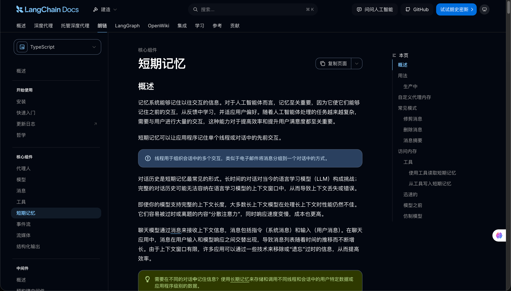
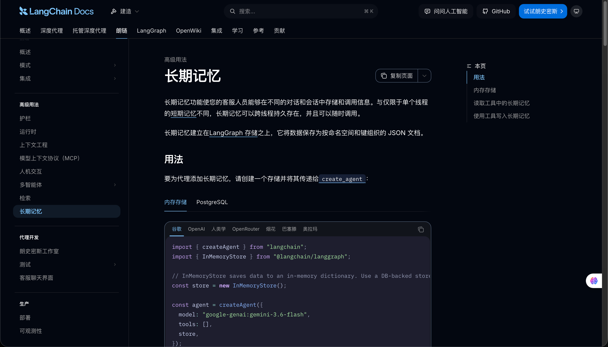
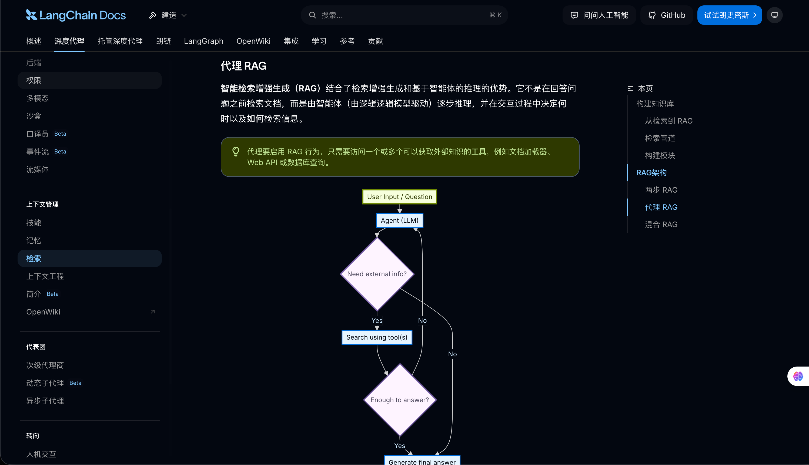

# 01-章介绍：从保存聊天记录，到让 Agent 真正用上记忆

最近很多同学面试，都被问到 Agent 内存管理、会话恢复 等功能场景。

大家可以想一下，当一次任务结束之后，**用户下次再来访问，Agent 如何才能用到之前访问的信息呢？**

很多同学可能会觉得，这有什么难的？把聊天记录保存下来就行，重新发给 agent 不就可以了吗？

**可没那么简单**

咱们一起来看看

## Agent 记忆
在第二章的企业知识库项目里面，咱们其实已经可以在页面上保存和显示历史问答了。

比如，用户先问：“退款金额超过审核阈值以后，客服应该怎么处理？”

知识库根据企业资料给出回答。

然后，用户继续说：“把刚才的回答整理成三条操作建议。”

大家觉得，这时候模型能看到“刚才的回答”吗？

咱们看一下第二章前端发送问题时写的代码，有这么一句：

```typescript
turn.result = await queryKnowledge(activeToken.value, submittedQuestion)
```

这里传入的是当前身份凭证和本轮问题，没有上一轮的问答内容。

虽然页面通过 `localStorage` 保留了历史，但后端仍然只根据本轮问题检索资料，再把问题和检索结果交给模型。

所以，用户明明能在页面上看到上一条回答，模型这次却并没有收到这些信息。

因此，咱们需要知道的是：**保存聊天记录只能让数据存在。但是如果要让 Agent 使用记忆，还得解决 “什么时候读取这些数据、读取哪些数据、如何怎样交给模型” 的问题。**

这就是咱们第六章要学习的：`Agent Memory`，也就是 Agent 的记忆。

这部分会使用 `Thread` 和 `Checkpointer` 实现。

在 LangChain 的 [短期记忆](https://docs.langchain.com/oss/javascript/langchain/short-term-memory) 设计中，记忆属于当前会话。



而这里的 **“短期” 指的是使用范围，不是只能临时放在内存里，一会就删了的那个短期。**

对话能够一直进行以后，消息会越来越多。

大家可以回忆下咱们在第一章讲过的 Context Budget，基于这个，咱们可以继续实现自动摘要与上下文压缩，既：**不把所有历史都发给模型。**

然后，咱们再处理新会话。

比如，用户明确要求：“请记住，我希望回答先给结论，再解释原因。”

下一次新建对话时，系统应该能够读取这份偏好，而不是要求用户重新说一遍。

这就需要使用 `Store` 管理[跨会话的长期记忆](https://docs.langchain.com/oss/javascript/langchain/long-term-memory)。



但是这里还会有很多的问题，比如：

> “以后回答简短一点”和“这一次简短一点”，能作为一个事情保存吗？
>
> 用户后来改变了偏好，旧记忆应该怎么处理？
>
> 用户要求忘记某件事以后，它还会不会从历史消息里再次被提取出来？
>

所以，咱们还会继续完成记忆提取、更新、去重、过期和删除，再根据当前问题召回真正需要的信息。

不同用户、不同租户的记忆，也必须分开处理。

所以咱们还会把 Memory 和  [Agentic RAG](https://docs.langchain.com/oss/javascript/deepagents/retrieval#agentic-rag) 结合起来，Memory 为 Agent 提供用户和会话背景，Agentic RAG 负责按需检索外部知识。



同时，咱们在第二章学的 Embedding、混合检索和 Rerank 也都会在这里使用到

OK ，其他的就不多说了，从下一小节，咱们就开始来看本章的内容～

> 更新：2026-09-01 10:56 · 原文：<https://www.yuque.com/lgdsunday/ab1dy3/ch1ndpzrl6gclsqu>
