# 03 - Agent 长上下文治理：消息安全裁剪、摘要回写与 会话压缩

上一小节，咱们使用 `Thread + Checkpointer` 实现了短期记忆。

同一个 Thread（会话窗口） 第二次调用时，LangGraph 会先恢复之前保存的 State。

用户在这个基础上继续进行准问的时候，Agent 就可以从历史消息中找到对应的信息并返回了。

咱们来看个场景，就用咱们之前用过的售后场景就可以。

用户最开始告诉 Agent：

```latex
订单 A2048 是一台 3800 元的咖啡机，外壳破损。
我还没有上传破损照片，客服说超过 3000 元需要人工审核。
请只告诉我处理流程，不要替我提交退款。
```

后面，这个用户又聊了周末营业时间、电子发票，还补充了咖啡机签收 3 天、外包装仍然保留。

最后他问：

```latex
根据前面说过的情况，这笔退款要走自动流程还是人工审核？
现在还缺什么材料？不要替我提交。
```

想要回答最后这个问题，模型就需要历史消息了。

但是，大家想一下，他需要的是全部的历史消息吗？

**肯定不是的**

它真正需要的不是历史里的每一句话，而是：订单号、金额、破损情况、照片状态、审核规则和用户不允许自动提交退款的限制。

至于“周末几点营业”，对当前问题已经没有用了。 

因此，如果咱们什么都不处理，一次调用的过程就是下面这样的：

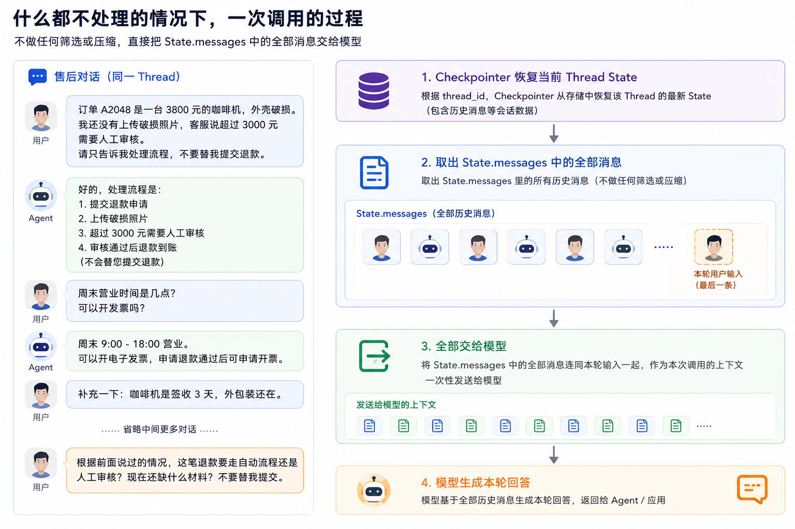

对话越长，`messages` 越长，模型每一轮需要重新处理的内容也越多。

但是，这里就会有一个问题，那就是：如果用户一直在这个窗口聊天，那是不是就意味着，聊天的信息会越来越多。

这样的话，就会带来三个问题：

+ 调用成本继续增加
+ 模型响应会变慢
+ 大量已经没用的旧消息还可能干扰当前判断

如果想要解决上面这几个问题的话，那就不能只依靠短期记忆，还得依靠长对话处理了。

LangChain 官方的 [Short-term Memory](https://docs.langchain.com/oss/javascript/langchain/short-term-memory) 文档给出了几种长对话处理方式。这一节主要看两种：

+ 消息裁剪
+ 自动摘要

## 消息裁剪、自动摘要和 Context Compaction 分别是什么
一个一个来看

### 消息裁剪
[消息裁剪](https://docs.langchain.com/oss/javascript/langchain/short-term-memory#trim-messages)，也就是 `Trim Messages`。

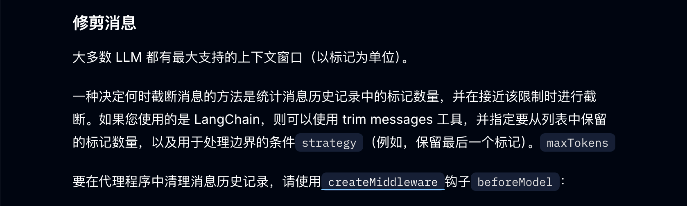

简单来说就是：**当历史消息太多时，只选择其中一部分交给模型。**

最常见的就是只保留最近几条，大致是下面这样：

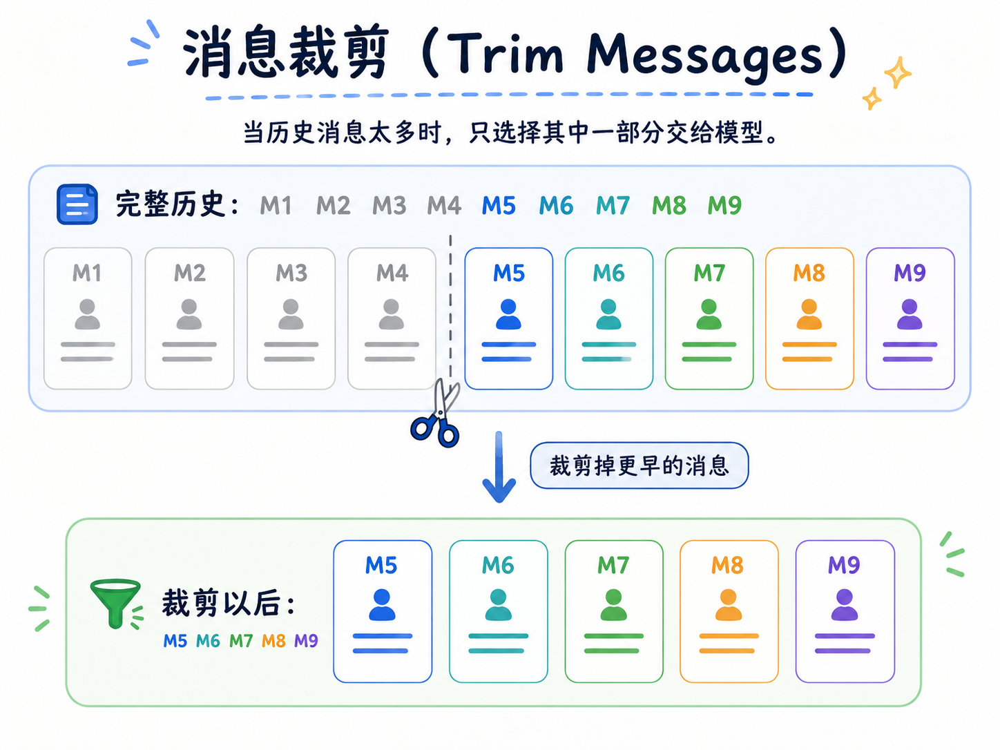

简单粗暴

但是这样做的话，也会有问题。

那就是：如果订单号和退款金额出现在 `M1`，直接保留最后五条消息以后，前面的两条信息就没了。

所以，消息裁剪适合“最近几轮已经包含完整信息”的对话。

那么有些同学可能会说了：“我咋知道最近几轮是否包含了完整信息呢？”

想要判断这个的核心逻辑是：**要看重要信息是否可以从其他地方拿到。**

比如当前 Agent State 是这样的：

```javascript
const state = {
    messages: [...]
}
```

所有的信息都在 messages 里面

这种情况下，咱们根本不知道哪句话以后还会用到。

所以，这种对话不能只使用消息裁剪。

但是，假设应用程序已经把关键业务信息单独保存到了 State：

```javascript
const state = {
    orderId: 'A2048',
    refundAmount: 3800,
    missingMaterials: ['破损照片'],
    allowSubmit: false,
    messages: [...]
}
```

这时，`messages` 主要负责保存近期交流，而完成关键数据已经放在结构化字段中。

即使较早的消息被裁掉，Agent 仍然可以从 State 中读取关键数据

因此，真实项目中的判断逻辑可以简单理解成：

```javascript
if (关键业务信息已经保存到结构化 State) {
    只保留近期消息
} else {
    对较早消息生成摘要
}
```

当然，这段代码只是为了帮助大家理解，并不是 LangChain 内置的固定判断。

`trimMessages()`  方法不会自动检查业务信息是否完整。咱们需要根据 Agent 的 State 设计，提前确定当前业务应该使用哪种上下文处理方式。

所以，我们可以说：

> **如果关键事实已经保存在结构化 State 或数据库中，早期消息不再承担保存业务状态的职责，就可以直接裁剪。**
>
> **如果关键事实仍然只存在于历史消息中，就不要简单裁剪，而应该使用 “摘要 + 近期消息” 的方式进行 Context Compaction。**
>

回到当前案例，订单号、退款金额和照片状态都只存在于历史消息中。

因此，咱们不能只保留最后五条消息。

接下来，就需要看看自动摘要怎样解决这个问题。

### 自动摘要
[自动摘要](https://docs.langchain.com/oss/javascript/langchain/short-term-memory#summarize-messages) 和直接裁剪不一样。


直接裁剪是把较早的消息丢掉，而自动摘要会在移除这些消息以前，先让模型提取里面仍然有用的信息，类似于下面这样：

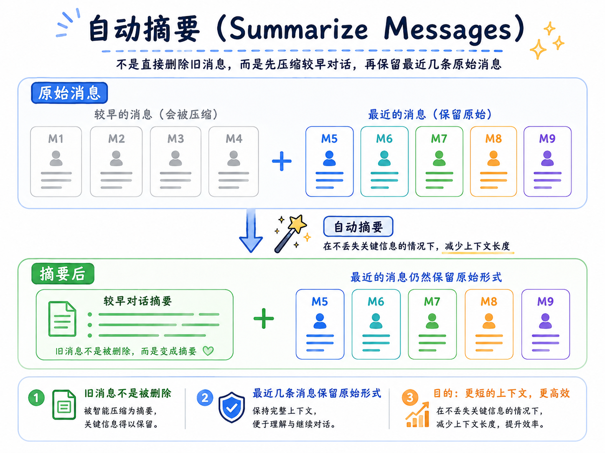

比如前面的售后对话中，较早消息包含：

```plain
订单号：A2048
退款金额：3800 元
商品问题：咖啡机外壳破损
材料状态：还没有上传破损照片
用户限制：不要直接提交退款
```

自动摘要完成以后，这几条消息可能会被压缩成：

```plain
用户正在咨询订单 A2048 的退款流程。

该订单是一台价值 3800 元的咖啡机，商品外壳破损，
目前尚未上传破损照片。超过 3000 元的退款需要人工审核。

用户只要求查询处理方式，禁止直接提交退款。
```

这样，即使原来的 Message 已经被移除，后续模型仍然可以从摘要中读取关键数据。

但是，这里有一个问题。

如果摘要 Prompt 只写：“请总结前面的对话。”

模型可能只生成一句：“用户咨询咖啡机的退款问题。”

这句话看起来没错，但是咱们所有的关键数据（订单号、退款金额、照片状态啥的）就全都没了。

后面用户再问：“这笔退款需要人工审核吗？”

模型已经无法判断，因为决定审核方式的 `3800 元` 被摘要丢掉了。

所以，摘要 Prompt 不能只要求“缩短内容”，还要明确哪些信息必须留下来。

今天，还有一位同学联系我，问我 `Prompt` 怎么写。

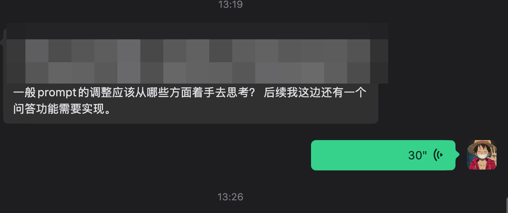

其实要写一个好的 `Prompt` 核心就是：

> **把你脑子里默认 AI 应该知道的东西，尽可能明确地告诉它。**
>
> 你希望它做什么、基于什么信息做、有哪些限制、最终输出成什么样，都尽量说清楚。
>

比如，咱们后面要写的案例使用的 Prompt 是：

```plain
请压缩下面的售后对话。

必须保留已经确认的订单号、金额、商品、问题、
材料状态、审核规则、用户限制和未解决事项。

不要把猜测写成事实，不要保留与当前售后问题无关的闲聊。

只输出摘要正文。
```

这里真正需要保留的，是后续任务仍然可能使用的信息，这个信息就可以按照下面的内容来继续梳理：

> 1. 当前正在处理什么问题
> 2. 已经确认了哪些事实
> 3. 用户提出了哪些操作限制
> 4. 还有哪些事情没有解决
> 5. 哪些旧信息已经被用户更正
>

特别是最后一种情况。

假设用户先说退款金额是 `3000 元`，后面又更正为 `3800 元`，摘要不能把两个金额同时记录，而应该明确记录最新结果：

```plain
用户最初提供的退款金额为 3000 元，
之后更正为 3800 元，当前应以 3800 元为准。
```

这也说明，自动摘要并不是无损压缩。

订单金额、权限、审批状态这类要求绝对准确的数据，最好仍然保存到结构化 State 或数据库中。

摘要主要负责保留对话目标、沟通过程和后续仍然需要理解的上下文。

> **摘要可以帮助模型“记住之前聊了什么”，但不能代替业务系统保存准确数据。**
>

接下来，咱们再把“较早消息生成摘要，近期消息保留原文”这套完整处理方式放到一起，看看什么是 `Context Compaction`。

### Context Compaction
前面讲了两种处理长对话的方式：

+ 消息裁剪：直接减少历史消息
+ 自动摘要：先提取较早消息中的关键信息，再移除原消息

这两种方式解决的其实是同一个问题：**怎样缩小模型需要读取的上下文。**

这个过程通常可以叫作 `Context Compaction`，也就是：上下文压缩。

咱们可以把它理解成：

> **当 Agent 的上下文越来越大时，对其中的信息重新整理，在缩小输入规模的同时，尽量保留后续任务仍然需要的内容。**
>

大致就是下面这样子：

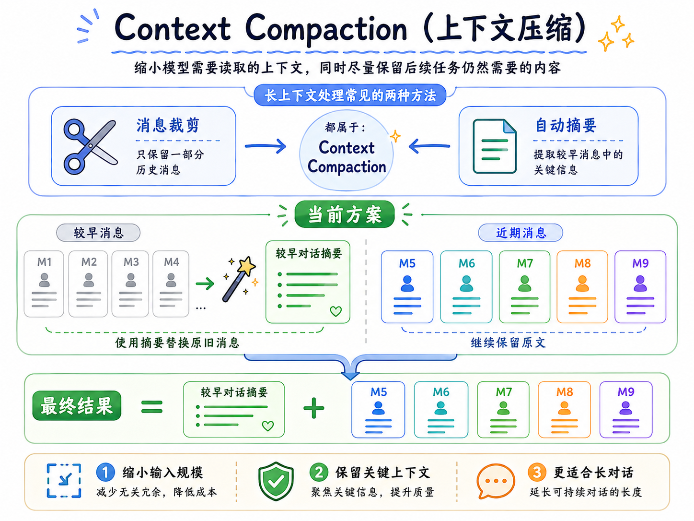

那么说清楚这层关系以后，接下来咱们就通过代码，对比完整历史、直接裁剪和“摘要 + 近期消息”分别会得到什么结果。

## 看看代码
本节代码在：

```latex
/Code/Node/第六章/03-long-conversation-context
```

一共有 3 个 JS 文件，但是代码都比较简单

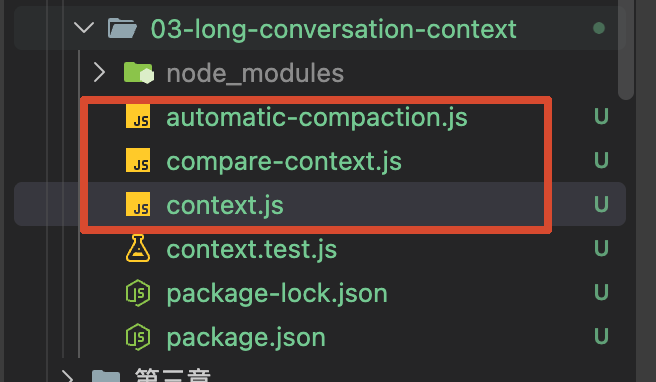

先执行一个不需要 API Key 的对比实验：

```bash
npm run compare
```

代码会创建前面那段售后对话，再分别生成三份上下文，代码在 `compare-context.js` 里面：

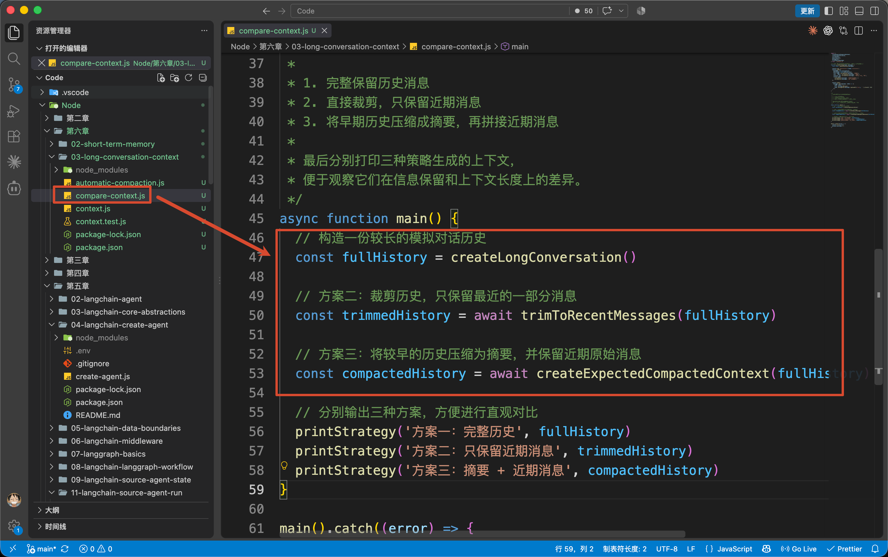

核心的代码就这么三行：

```javascript
    // 构造一份较长的模拟对话历史
    const fullHistory = createLongConversation()

    // 方案二：裁剪历史，只保留最近的一部分消息
    const trimmedHistory = await trimToRecentMessages(fullHistory)

    // 方案三：将较早的历史压缩为摘要，并保留近期原始消息
    const compactedHistory = await createExpectedCompactedContext(fullHistory)
```

先来看第二个：消息裁剪。

项目使用 LangChain 提供的 `[trimMessages](https://docs.langchain.com/oss/javascript/langchain/short-term-memory#trim-messages)` 处理 Message：

```javascript
/**
 * 只保留最近的几条 Message。
 * 为了让实验不依赖具体模型的 Tokenizer，这里按消息数量裁剪。
 */
export async function trimToRecentMessages(messages, keepMessages = 5) {
    return trimMessages(messages, {
        strategy: 'last',
        maxTokens: keepMessages,
        tokenCounter: (currentMessages) => currentMessages.length,
        startOn: 'human'
    })
}
```

其中涉及到了很多的属性：

+ `strategy: 'last'` 表示从后往前保留内容
+ `maxTokens: 5` 表示保留最多五条消息
+ `tokenCounter` 返回的是消息数量
+ `startOn: 'human'` 用来避免裁剪后的对话从一条孤立的 AI 回答开始

最终的执行结果，就是下面的截图：

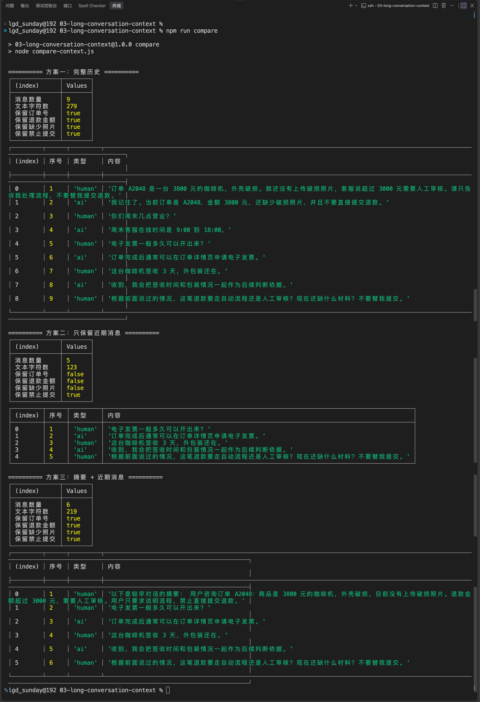

这组结果已经把三种方案的区别体现出来了。

+ 完整历史没有丢数据，但会一直增长
+ 直接裁剪确实缩小了输入，却把后面仍然需要的早期事实一起删掉了
+ 摘要加近期消息则在两者之间做了平衡

不过，`compare-context.js` 中的摘要是咱们提前写好的，只是用来保证这个对比实验每次都得到相同结果。

真正的 Agent 当然不能让开发者每聊几轮就手写一次摘要。

接下来，咱们把它改成自动执行。

## 使用 summarizationMiddleware 自动压缩上下文
LangChain 当前提供了 `[summarizationMiddleware](https://docs.langchain.com/oss/javascript/langchain/short-term-memory#summarize-messages)`，可以在对话达到指定条件以后，自动摘要较早消息并保留近期消息。

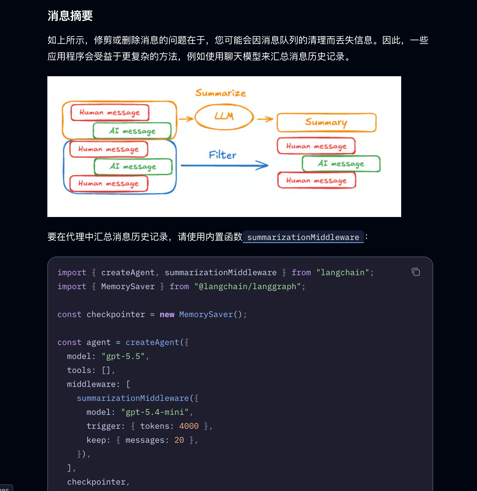

打开 `automatic-compaction.js`，创建 Agent 时增加下面这个 Middleware：

```javascript
/** 创建具备自动摘要能力的短期记忆 Agent。 */
function createCompactionAgent(model) {
    return createAgent({
        model,
        tools: [],
        checkpointer: new MemorySaver(),
        middleware: [
            summarizationMiddleware({
                model,
                trigger: { messages: 8 },
                keep: { messages: 5 },
                summaryPrefix: '以下是较早对话的摘要：',
                summaryPrompt: `请压缩下面的售后对话。
必须保留已经确认的订单号、金额、商品、问题、材料状态、审核规则、用户限制和未解决事项。
不要把猜测写成事实，不要保留与当前售后问题无关的闲聊。
只输出摘要正文。

{messages}`
            })
        ]
    })
}
```

这里使用到了一个叫做 `summarizationMiddleware`  的方法，他的作用是处理 Agent State。

这一段配置里，真正需要理解的是 `trigger` 和 `keep`。

```javascript
trigger: { messages: 8 }
```

表示每次调用模型以前，Middleware 都会检查当前 State。当消息数量达到 8 条时，开始执行摘要。

```javascript
keep: { messages: 5 }
```

表示压缩时保留最近 5 条原始消息，前面的旧消息交给摘要模型处理。

配置写完以后，咱们还需要验证 `trigger` 和 `keep` 是否真的生效。

但是，如果只和 Agent 聊一轮，State 中只有一条 `HumanMessage` 和一条 `AIMessage`，消息数量还达不到 `trigger` 设置的 8 条，自动摘要不会执行。

所以，`automatic-compaction.js` 准备了五轮对话：

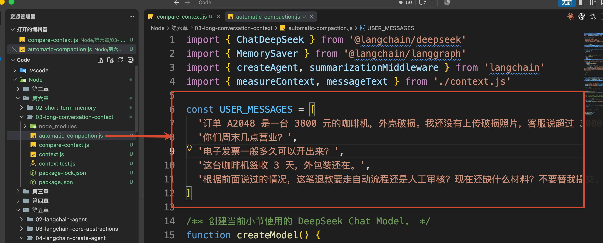

代码会把这些消息依次发送给 Agent：

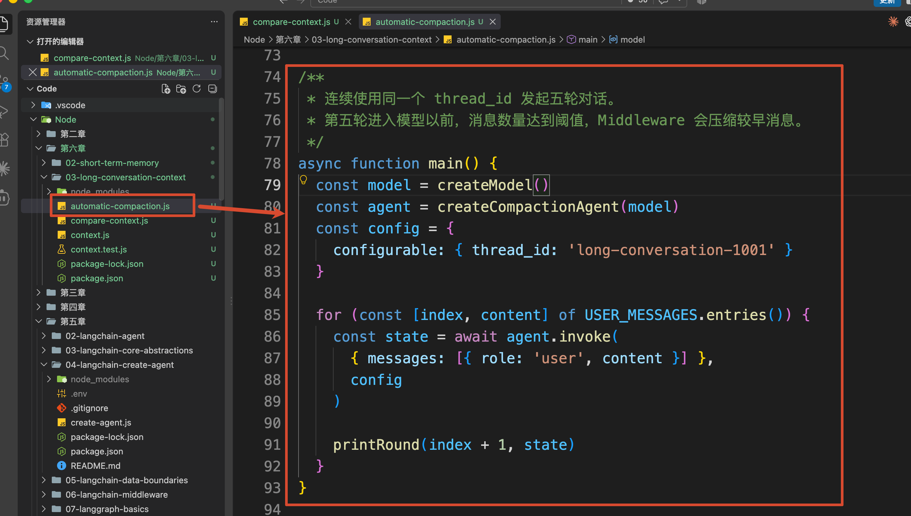

这里的五次调用使用的是同一个 `thread_id`：

```javascript
const config = {
    configurable: {
        thread_id: 'long-conversation-1001'
    }
}
```

因此，每次调用结束以后，新的 `HumanMessage` 和 `AIMessage` 都会继续写入同一个 Thread State。

消息数量会这样增加：

```plain
第一轮结束：2 条 Message
第二轮结束：4 条 Message
第三轮结束：6 条 Message
第四轮结束：8 条 Message
```

第四轮结束时虽然已经有 8 条消息，但是本轮模型调用已经完成了。

等到第五轮用户消息写入以后，State 中会暂时出现 9 条消息。接下来准备调用模型时，`summarizationMiddleware` 才会发现消息数量已经达到 `trigger`：

> + 当前 State：9 条 Message
> + trigger：达到 8 条时生成摘要
> + keep：保留最近 5 条 Message
>

于是，Middleware 会把前面的 4 条消息交给摘要模型，只保留最近 5 条原始消息：

+ 压缩以前：4 条较早消息 + 5 条近期消息
+ 压缩以后：1 条摘要 + 5 条近期消息

完成压缩以后，主模型才会根据这些内容生成第五轮回答：

```javascript
const state = {
    messages: [
        { content: '以下是较早对话的摘要：...' },
        ...最近五条原始消息,
        { content: '第五轮模型回答' }
    ]
}
```

所以，这一轮的完整过程就可以用下面的图进行表示：

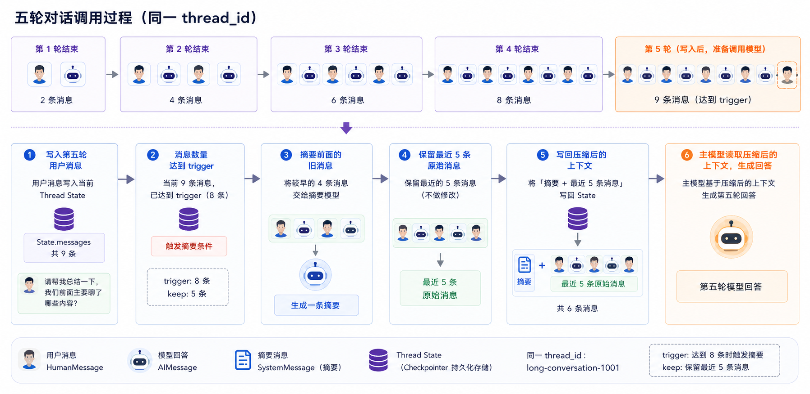

接下来，咱们就运行下代码看看。

在项目目录创建 `.env`，配置：

```latex
DEEPSEEK_API_KEY=你的 DeepSeek API Key
DEEPSEEK_MODEL=deepseek-v4-flash
```

然后执行：

```bash
npm run compact
```

完整的打印如下：

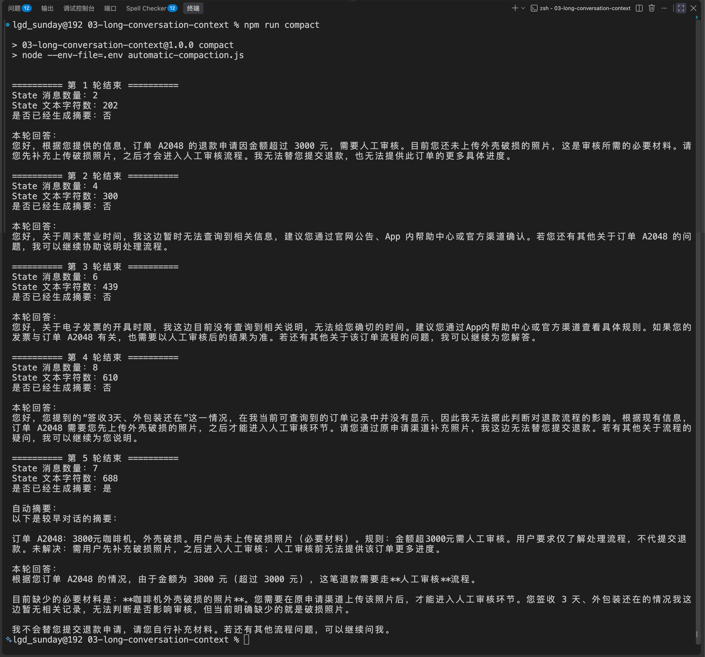

那么通过这个打印，也可以验证咱们上面说过的逻辑步骤。

## 总结
上一小节实现短期记忆以后，Agent 已经可以在同一个 Thread 中恢复之前的 State。

但是，State 可以一直保存，不代表每次模型调用都应该读取全部历史。

消息裁剪会直接减少本轮输入，速度快、没有额外模型调用，但可能丢掉早期仍然有效的事实。

自动摘要会把较早消息压缩成一段新的上下文，再和近期原始消息一起交给模型。

这就是本节使用的 Context Compaction：

这里必须记住，摘要是一种**有损处理。**

是否压缩成功，不能只看消息数量减少了多少，还要检查当前目标、关键事实、用户限制和未解决事项有没有留下来。

到现在为止，Agent 记住的信息仍然只属于当前 Thread（会话窗口）。

下一小节，咱们会继续学习长期记忆：把用户偏好和稳定事实保存到 `Store` 中，让一个新会话也能够使用之前真正值得记住的信息。

> 更新：2026-09-03 18:10 · 原文：<https://www.yuque.com/lgdsunday/ab1dy3/xdru0p7bxsy4ofqr>
