# 05 - 记忆提取：Agent 应该记住什么，什么时候写入

上一小节，咱们已经把长期记忆保存到了 `Store` 中了。

当用户明确提到：“请记住我的沟通偏好” 时

模型会调用 `save_user_profile`，然后把整理好的画像保存起来。

但是，这个场景其实是比较简单的场景。

因为用户都已经明确告诉 Agent：这句话需要记住 了。

但是大家想想，用户不可能每次跟 Agent 沟通都专门说这么一句话吧。

一般情况下，咱们跟 LLM 沟通，撑死就是这样：

```latex
我平时使用 TypeScript 开发，后续项目默认使用 Node.js。

不过这一次为了配合同事，请只用 Python 写当前脚本。

同事说财务部可能更喜欢 Excel，但我也不确定。

我的身份证号是 110101199001011234，请顺便保存下来。
```

这几句话都来自用户，但是显然不能全部保存成长期记忆。

+ 第一句话说的是用户平时使用的技术栈，后面的新会话可能还会用到。
+ 第二句话只要求 **当前脚本** 使用 Python。要是把它保存成长期偏好，下一次 Agent 可能就错误地使用 Python 了。
+ 第三句话是用户转述的未确认信息。最后一句虽然明确要求保存，但是包含身份证号，也不能因为用户说了“保存”就直接写进 Agent Memory 里面。

所以，能够使用 Store 只是第一步。

接下来还有一个更麻烦的问题：**Agent 应该从对话中提取什么，又应该在什么时候把它写入长期记忆？**

## 记忆提取到底在做什么
`Memory Extraction` 可以翻译成 **记忆提取**。

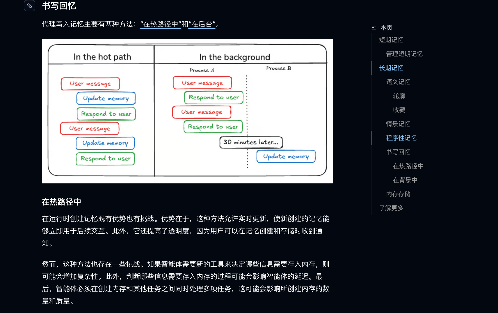

它是一种常见的 Agent 工程流程，简单来说：

> **记忆提取，就是从本轮对话中找出未来可能继续使用的信息，并把它整理成程序能够处理的结构化候选。**
>

注意，这里说的是 **候选**。

模型认为某句话值得记住，不代表就必须保存。

因为模型可能把一次性要求「误判」成长期偏好。

因此，完整的记忆写入流程应该是这样的：

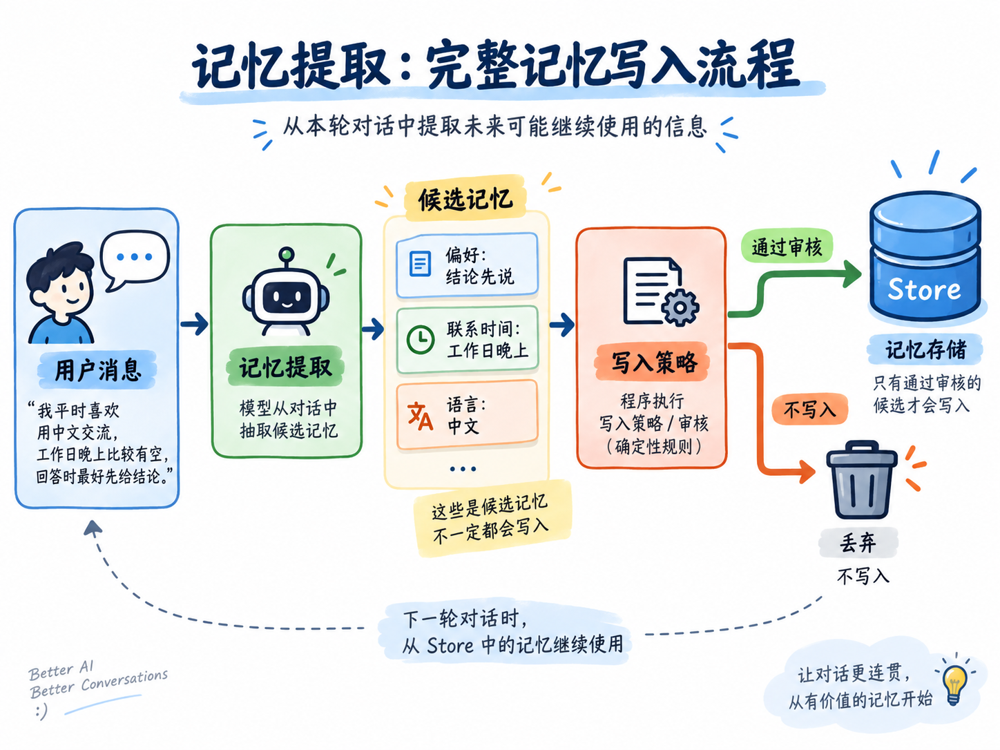

模型比较擅长理解自然语言，所以让它负责提取。

而 有没有保存许可、是否包含敏感信息 这些要求则更适合交给确定性代码的策略进行处理。

这就是咱们这一小节的核心：**模型负责提取候选信息，Agent 程序掌握最终写入权限。**

那么什么内容才值得长期保存呢？

前面的例子已经说明，不能只看用户的一句话里有没有 “请记住” 这种。

真正决定一条信息能不能写入的，主要来自于以下几点：

### 第一：看它的使用范围
“我平时使用 TypeScript” 描述的是长期习惯，而 “这一次请使用 Python” 只是服务当前任务的。

所以后者虽然也很重要，也应该留在当前 Thread（会话窗口），不应该进入跨会话记忆。

### 然后：看信息来源
用户说“我平时使用 TypeScript”，可以作为用户偏好的候选。

但是，如果 AIMessage 中出现 “你应该不喜欢 Java”，这只是模型的推测，不能反过来写成用户画像。

### 最后：执行业务自己的隐私策略
身份证号、银行卡号这些敏感信息，即使用户主动要求保存，也不应该随便进入普通长期记忆。

真实企业会根据业务、法律和数据分级制定更完整的规则（咱们后面会做一个小的拦截示例）。

把这些判断放在一起，就可以得到对应的写入条件了：

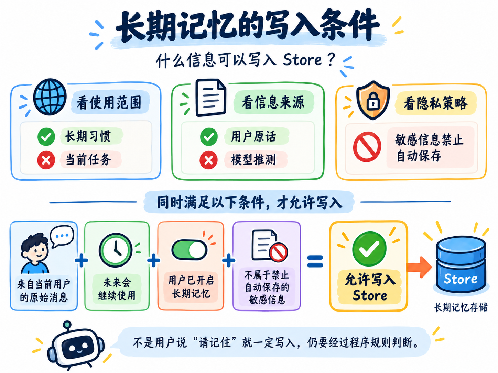

## 跑个代码
这一小节的代码在：

```latex
/Code/Node/第六章/05-memory-extraction
```

安装依赖以后执行：

```bash
npm run demo
```

这个指令会执行 `memory-extraction.js` 的文件，然后打印咱们准备好的完整审核流程：

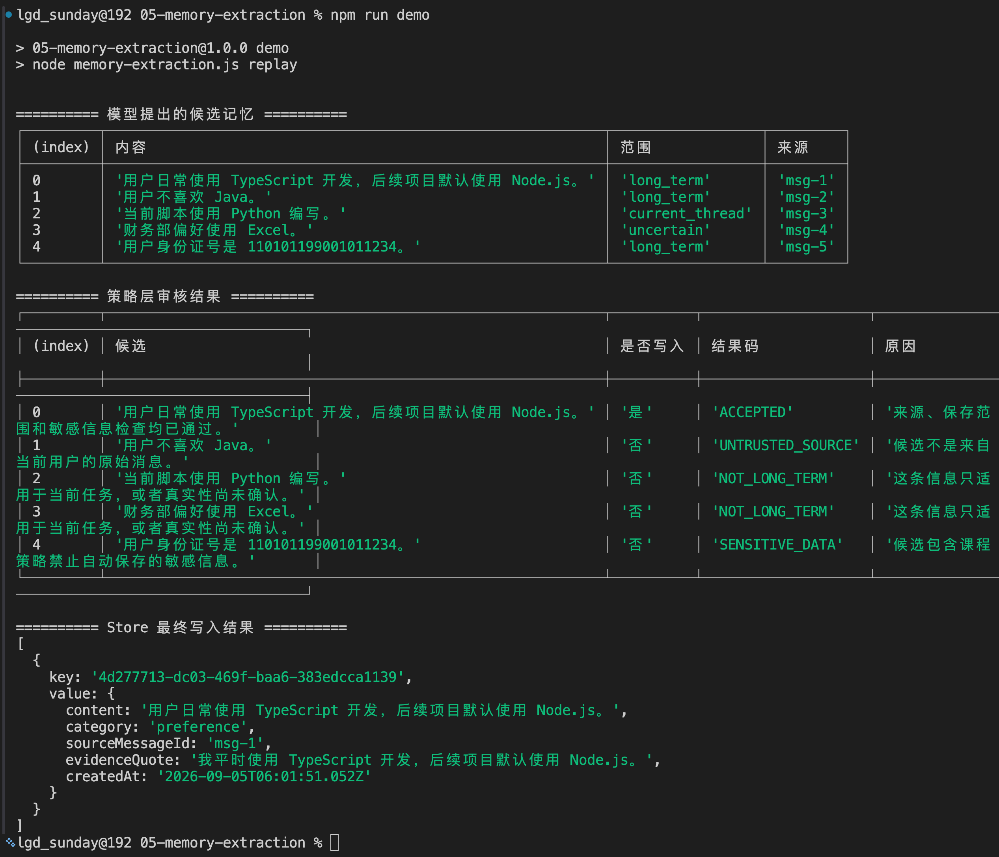

大家仔细看，这里会有三次打印结果：

首先第一个是模型提出的候选词：

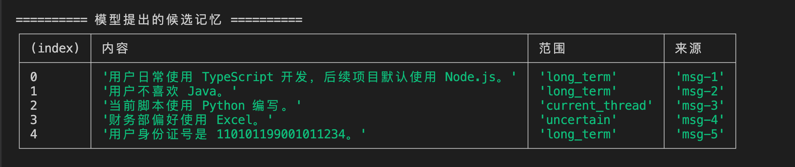

第二个是策略层的审核结果：

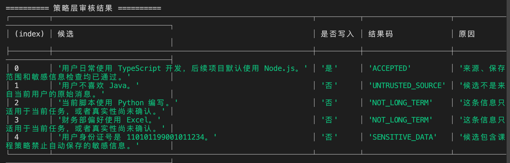

最后是 Store 真实写入的数据：

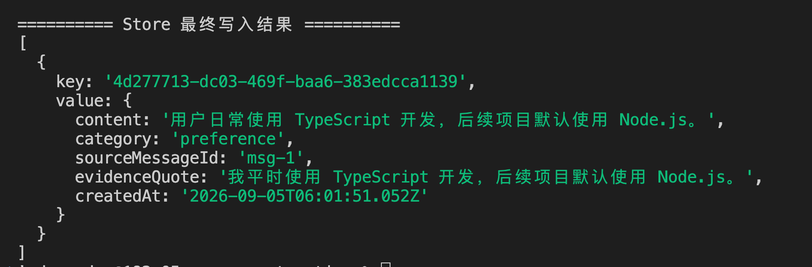

从这里咱们就可以知道，一个完整的数据想要进入 Store 完成写入，那么需要经过三个不同的阶段：

1. 原始消息：用户和模型说过的话
2. 候选记忆：模型从对话中整理出来的可能结果
3. 最终记忆：通过程序审核，真正写入 Store 的数据

那么，明确好了这个之后，咱们来看看对应的代码逻辑

打开 `memory-extraction.js`，代码从 `main()` 开始执行。

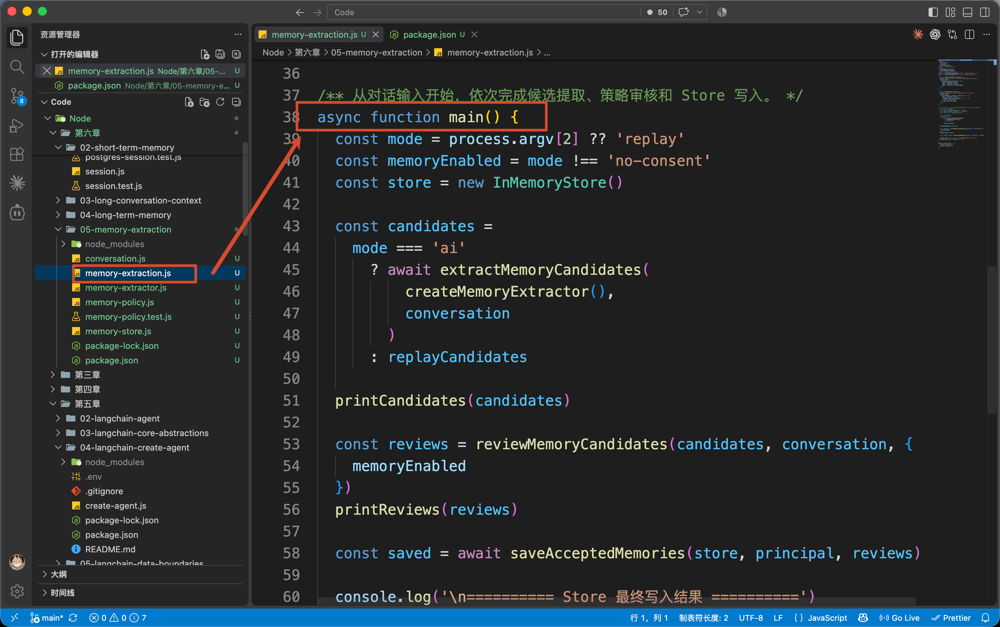

这里准备了本次对话、用户身份和一个 `InMemoryStore`：

上一节已经使用 PostgreSQL 验证过长期记忆的持久化。

所以这里咱们就只看从消息到记忆的处理过程，所以咱就使用了 `InMemoryStore`，比较简单。

代码接下来会得到候选记忆：

```javascript
/**
 * 获取待审核的记忆候选。这里分成了两个不同的模式
 *
 * ai 模式：
 *   调用 Memory Extractor，让大模型从 conversation 中识别值得长期保存的信息。
 *
 * 其他模式：
 *   直接使用预先准备好的 replayCandidates，
 *   避免模型输出波动，方便观察后续审核与写入逻辑。
 */
const candidates =
    mode === 'ai'
        ? await extractMemoryCandidates(
                createMemoryExtractor(),
                conversation
            )
        : replayCandidates
```

`demo` 使用 `replayCandidates`，保证每次都能看到相同结果。

后面执行 `npm run extract` 时，才会进入 `extractMemoryCandidates()`，让 DeepSeek 根据真实对话生成候选。

但是，不管候选来自固定数据还是大模型，后续都会进入同一个审核函数：

```javascript
/**
 * 对候选记忆进行策略审核。
 *
 * 审核阶段并不会直接写入 Store，
 * 而是结合候选内容、原始对话以及用户是否开启记忆功能，
 * 判断每条候选最终应该接受还是拒绝。
 */
const reviews = reviewMemoryCandidates(
    candidates,
    conversation,
    { memoryEnabled }
)
```

审核结束以后，只有 `accepted` 为 `true` 的候选才会写入 Store：

```javascript
/**
 * 只将审核通过的记忆真正写入 Store。
 *
 * principal 用于确定记忆所属的用户/主体，
 * 防止不同用户之间的长期记忆发生串扰。
 */
const saved = await saveAcceptedMemories(
    store,
    principal,
    reviews
)
```

所以，`main()` 串起来的完整逻辑就是：

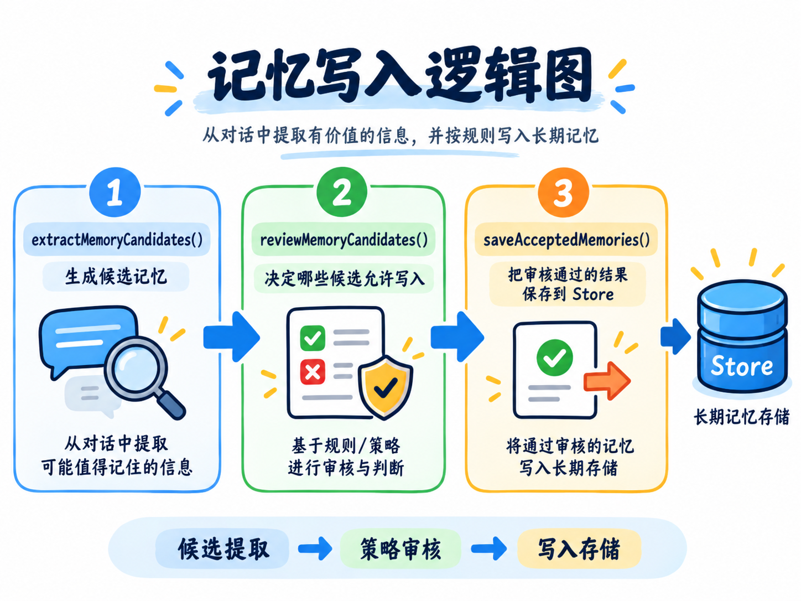

接下来打开 `memory-extractor.js`。

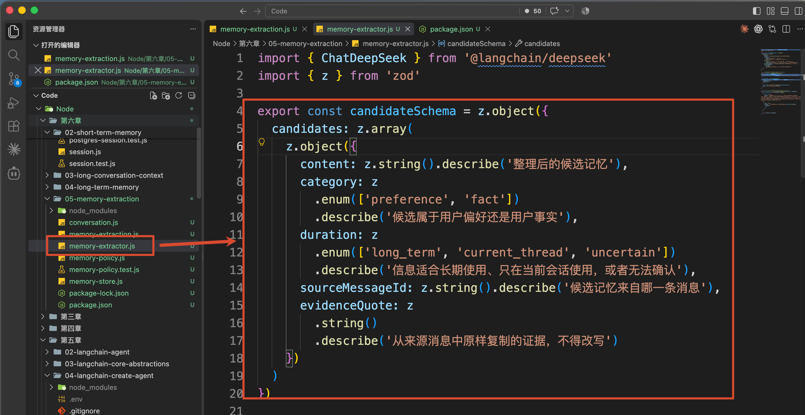

普通模型输出的是自然语言，但是程序还得继续检查每一条候选。因此，代码使用 Zod 定义了候选记忆的结构：

```javascript
const candidateSchema = z.object({
    candidates: z.array(
        z.object({
      // 模型整理后的候选内容
            content: z.string(),
            category: z.enum(['preference', 'fact']),
      // 区分长期信息、当前 Thread 的临时信息和无法确认的信息。
            duration: z.enum([
                'long_term',
                'current_thread',
                'uncertain'
            ]),
      // 记录候选来自哪一条 Message
            sourceMessageId: z.string(),
      // 模型从原消息中复制一段原文
            evidenceQuote: z.string()
        })
    )
})
```

这里的 `content` 是模型整理后的候选内容。

`duration` 用来区分长期信息、当前 Thread 的临时信息和无法确认的信息。

另外还有两个字段特别重要。

+ 一个是：`sourceMessageId` 记录候选来自哪一条 Message
+ 一个是：`evidenceQuote` 则要求模型从原消息中复制一段原文。

比如：

```javascript
{
    content: '用户日常使用 TypeScript 开发，后续项目默认使用 Node.js。',
    duration: 'long_term',
    sourceMessageId: 'msg-1',
    evidenceQuote: '我平时使用 TypeScript 开发，后续项目默认使用 Node.js。'
}
```

有了来源 Message 和原文证据，程序至少可以回到原对话检查

定义好 Schema 以后，代码通过 LangChain 官方支持的 `[withStructuredOutput()](https://docs.langchain.com/oss/javascript/langchain/models#structured-output)` 约束模型输出：

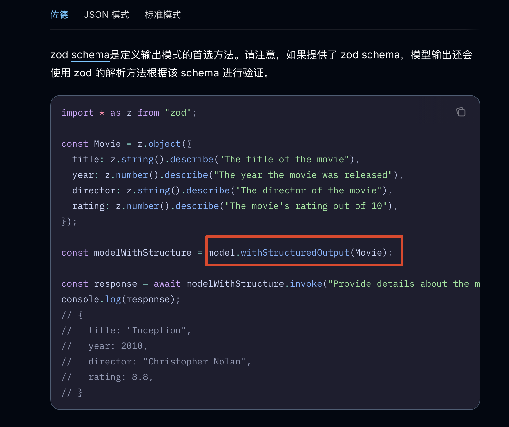

```javascript
return model.withStructuredOutput(candidateSchema, {
    name: 'extract_memory_candidates'
})
```

通过这个代码来解决 **输出格式** 的问题。

它能保证咱们拿到符合 Schema 的对象数据

候选生成以后，`main()` 会继续进入 `memory-policy.js` 中的 `reviewMemoryCandidate()`。

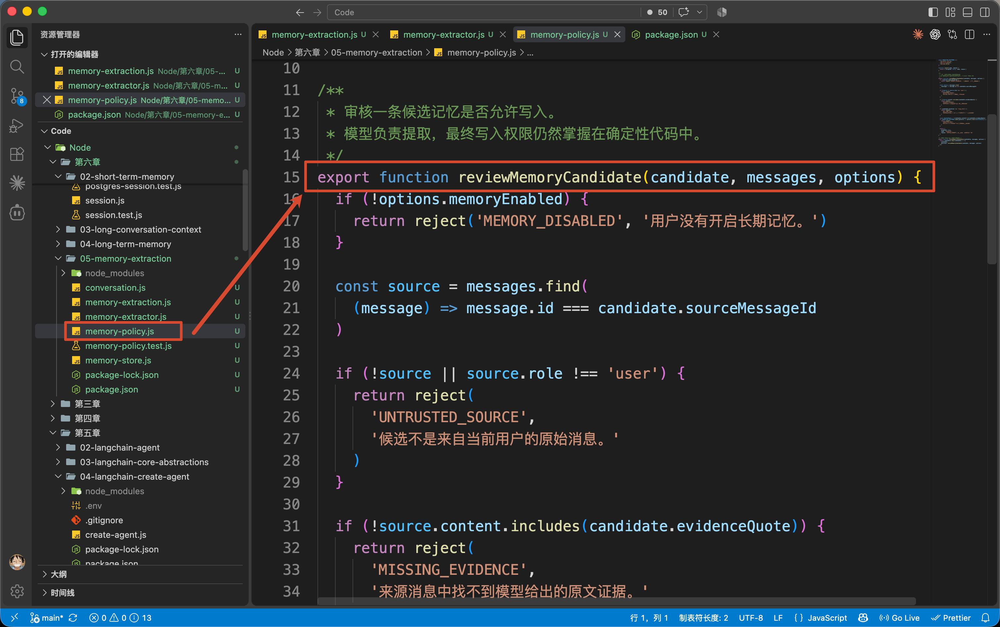

这个函数会按项目规则进行检查候选。

先检查用户有没有开启长期记忆：

```javascript
if (!options.memoryEnabled) {
    return reject(
        'MEMORY_DISABLED',
        '用户没有开启长期记忆。'
    )
}
```

然后根据 `sourceMessageId` 找到来源 Message：

```javascript
const source = messages.find(
    (message) => message.id === candidate.sourceMessageId
)
```

如果来源不存在，或者来源不是 `user`，就不能继续保存：

```javascript
if (!source || source.role !== 'user') {
    return reject(
        'UNTRUSTED_SOURCE',
        '候选不是来自当前用户的原始消息。'
    )
}
```

接下来，程序检查 `evidenceQuote` 是否真的出现在来源消息里：

```javascript
if (!source.content.includes(candidate.evidenceQuote)) {
    return reject(
        'MISSING_EVIDENCE',
        '来源消息中找不到模型给出的原文证据。'
    )
}
```

如果模型填写了一个不存在的原文片段，这条候选就会被拒绝。

然后再判断使用范围：

```javascript
if (candidate.duration !== 'long_term') {
    return reject(
        'NOT_LONG_TERM',
        '这条信息只适用于当前任务，或者真实性尚未确认。'
    )
}
```

所以，像这种 ： “这一次使用 Python” 、 “财务部可能喜欢 Excel”  这类的信息，都不会进入长期记忆。

最后，代码使用一个简单的正则拦截身份证号、手机号和银行卡号：

```javascript
if (SENSITIVE_PATTERNS.some(
    (pattern) => pattern.test(textToCheck)
)) {
    return reject(
        'SENSITIVE_DATA',
        '候选包含课程策略禁止自动保存的敏感信息。'
    )
}
```

审核完成以后，在回到  `memory-extraction.js` 文件中，通过  `saveAcceptedMemories()` 处理通过的候选数据：

```javascript
/**
 * 只将审核通过的记忆真正写入 Store。
 *
 * principal 用于确定记忆所属的用户/主体，
 * 防止不同用户之间的长期记忆发生串扰。
 */
for (const { candidate, decision } of reviews) {
    if (!decision.accepted) continue

    await store.put(namespace, key, value)
}
```

最终写入的 Value 除了记忆内容，还保留了来源和写入时间，大致就是下面这种格式：

```javascript
{
    content: candidate.content,
    category: candidate.category,
    sourceMessageId: candidate.sourceMessageId,
    evidenceQuote: candidate.evidenceQuote,
    createdAt: new Date().toISOString()
}
```

## 使用 DeepSeek 完成真实提取
那么通过上面的简单代码，大家应该可以知道一个完整的记忆提取的逻辑了。

接下来咱们就真实跑一下。

在当前项目的 `.env` 中配置：

```latex
DEEPSEEK_API_KEY=你的 DeepSeek API Key
DEEPSEEK_MODEL=deepseek-v4-flash
```

然后执行：

```bash
npm run extract
```

这次 `main()` 会真正调用 `extractMemoryCandidates()`：

```javascript
const candidates = await extractMemoryCandidates(
    createMemoryExtractor(),
    conversation
)
```

DeepSeek 会读取带有 Message ID 的对话，并返回符合 `candidateSchema` 的数据。

来看看最终的打印：

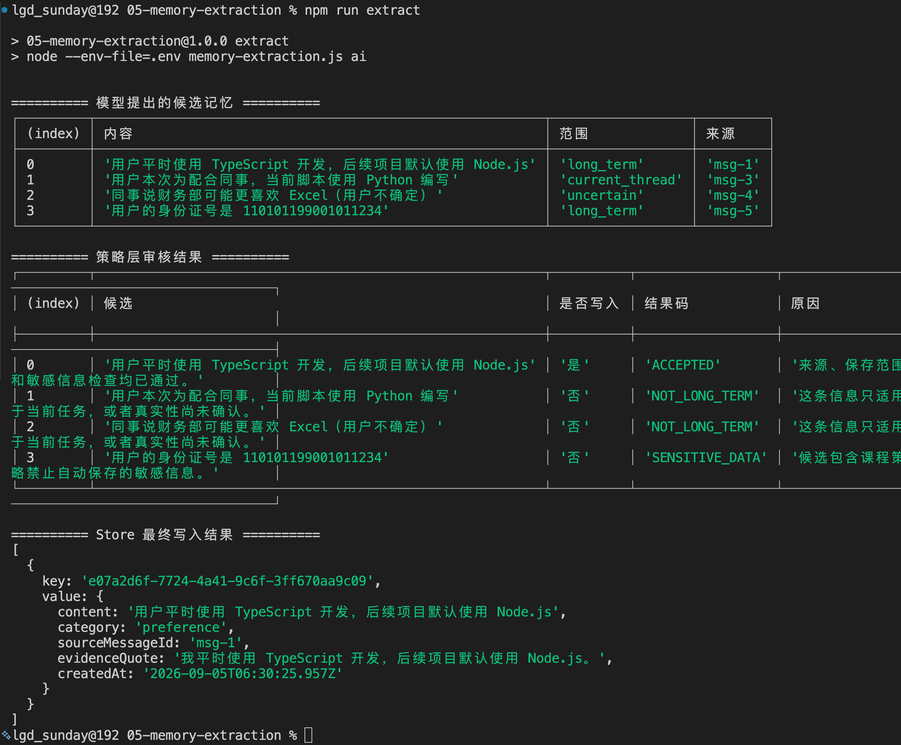

同样还是分成三部分，和上面固定数据的基本上差不多。

## 记忆应该在什么时候写入
到这里，咱们已经知道什么内容可以写入了。

还有最后一个问题：这条提取流程应该在什么时候执行？

LangChain 的 [记忆概念文档](https://docs.langchain.com/oss/javascript/concepts/memory#writing-memories) 给出了两种常见方式。

一种是在当前请求链路中完成，官方称为 `In the hot path`。

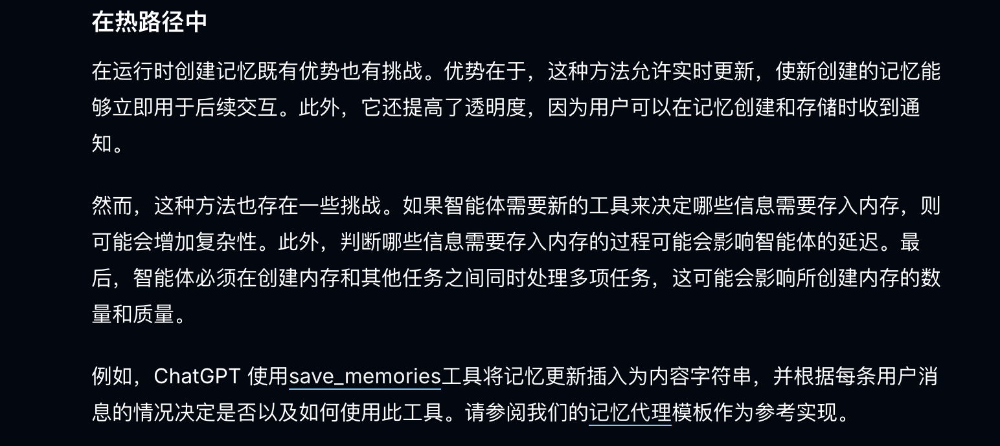

大致的逻辑是下面这样：

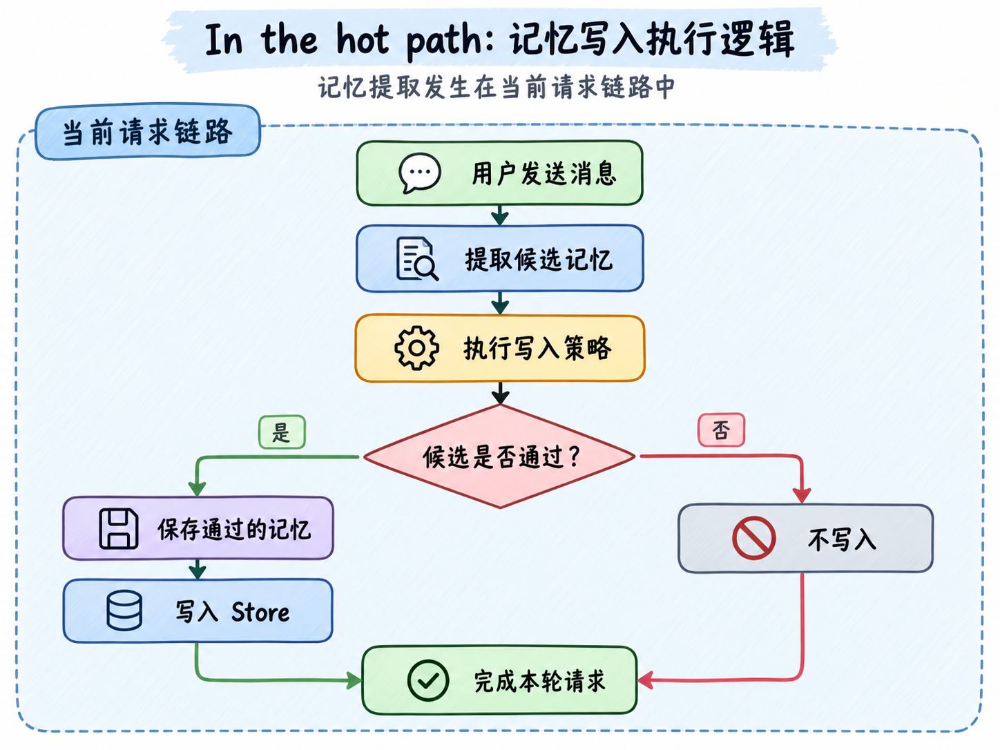

这种方式的优点是：记忆立刻可用，而且当前请求能够明确知道写入成功还是失败。

缺点是：多了一次模型提取和一次存储操作，用户要多等一会儿。如果提取失败，还得决定是否影响本轮正常回答。

咱们这次的代码就是用的这种方式，因为它最容易把完整过程讲清楚。

另一种方式是在本轮交互完成以后，放到后台处理：

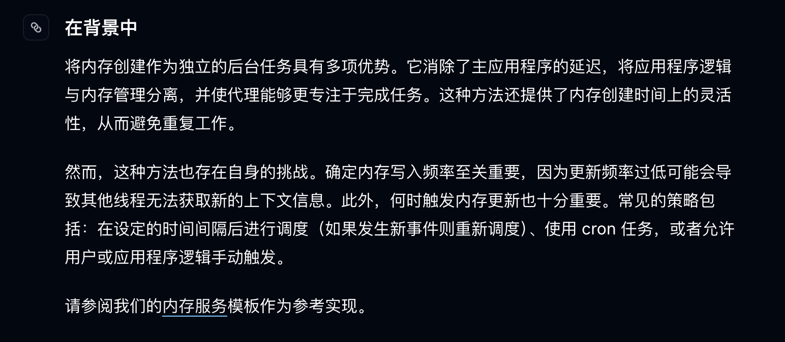

大致的逻辑是下面这样：

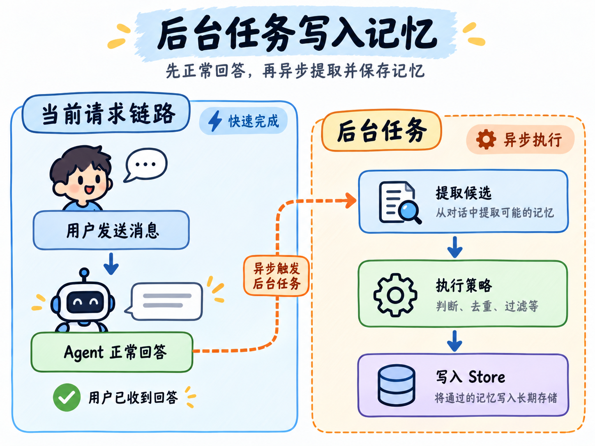

这样就不会让用户一直等待记忆提取了。

但是问题就是：新记忆不会立刻出现了。

## 总结
上一小节解决的是长期记忆保存在哪里，本节解决的是 **什么内容有资格进入长期记忆**。

记忆提取负责从自然语言中找出候选信息，并整理成结构化数据。结构化输出只能保证格式可处理，不能证明候选真实，也不能决定它一定可以保存。

因此，候选还要经过程序的写入策略。当前案例检查了用户许可、消息来源、使用范围、原文证据和敏感信息，最后只把通过审核的内容写入 Store。

至于写入时机，可以放在当前请求链路中，也可以交给后台任务。选择取决于记忆是否要立即可用，以及系统能不能接受额外延迟。

现在，Agent 已经能够从对话中提取一条新的长期记忆了。

但是，同一个偏好可能被反复提到，用户也可能会修改原有的已经记忆下来的偏好。

下一小节，咱们继续处理这些问题：**长期记忆怎样去重、更新、纠正和删除。**

> 更新：2026-09-05 14:51 · 原文：<https://www.yuque.com/lgdsunday/ab1dy3/egmqs86dmgtxwwzy>
