# 06 - 记忆更新与遗忘：去重、冲突修正、过期与删除

上一小节，咱们已经可以从对话中提取出一条候选记忆，然后经过程序审核，把真正值得长期保存的信息写入 Store。

不过，大家回头看一下上一节的 `saveAcceptedMemories()`。

每保存一条记忆，它都会调用 `randomUUID()` 生成一个新的 Key：

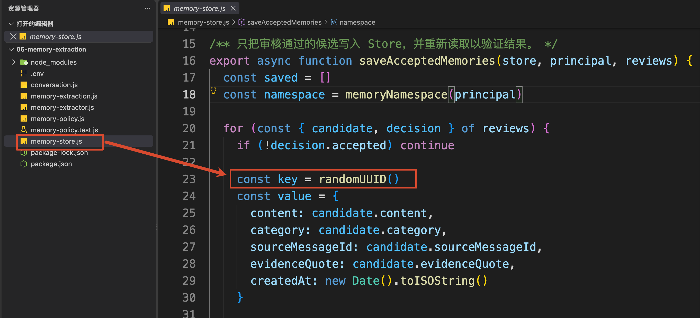

这样保存一条新信息当然没有问题。

但是，假设用户今天说：“以后默认使用 Node.js。”

明天又说：“后面的例子还是用 nodejs 吧。”

两句话都可以通过审核，也都会使用一个新的 Key 保存。

结果就是：同一个偏好，Store 里出现了两条。

如果仅仅只是重复，问题还不算特别严重。

假如过几天用户又说：“修改一下之前的偏好，以后默认使用 Python。”

现在 Store 里就会同时出现 “默认使用 Node.js” 和 “默认使用 Python” 两条冲突的内容。

那么，下一次 Agent 读取记忆的时候，到底应该相信哪一条呢？是吧。

> 那有同学可能会说，这不简单吗？
>
> 用户最后一次说的，肯定是最新的呀，直接覆盖不就可以了吗？
>
> 没有那么简单哈
>

这就是这一小节要解决的问题：**当新的候选记忆出现以后，不能每次都直接新增。程序还要结合已有记忆，决定这一次到底应该怎么处理。**

## 什么是语义记忆
根据 LangChain 官方的 [Memory Overview](https://docs.langchain.com/oss/javascript/concepts/memory#semantic-memory) 的描述，用户事实、用户偏好这一类长期记忆属于 `Semantic Memory`，也就是 **语义记忆**。

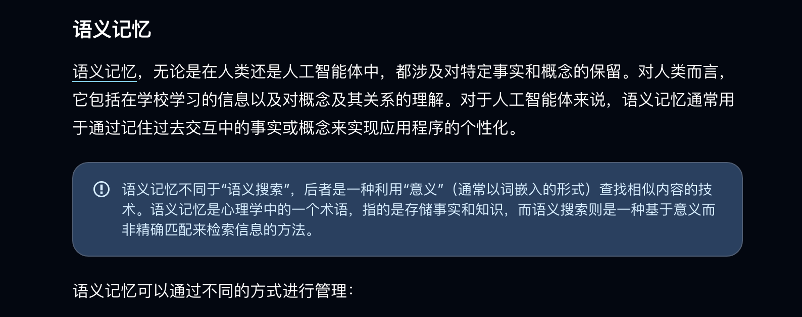

比如：

```latex
用户默认使用 Node.js
用户习惯使用 TypeScript
用户希望先看结论
```

这些信息描述的是“这个用户有什么事实和偏好”，所以都是语义记忆。

官方文档又给出了两种常见的组织方式：

+ `Profile（轮廓）`：把用户信息整理成一份持续更新的画像  
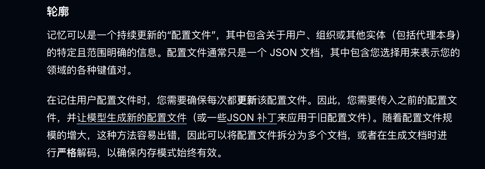
+ `Collection（收藏）`：把不同信息拆成多条独立记忆，后续继续新增、更新或者删除  
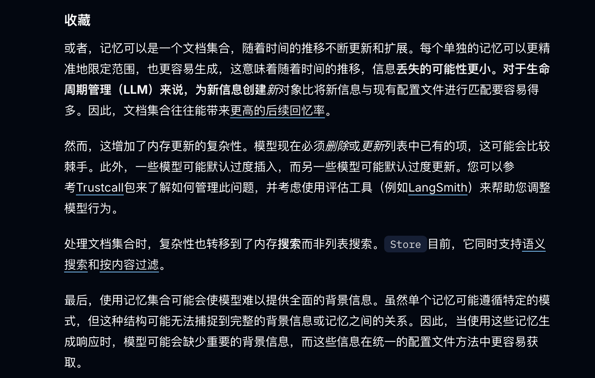

上一节中，咱们使用随机 UUID 保存每一条候选，其实就更接近 `Collection（收藏）` 的方式。

这种方式新增很方便，但是它也有对应的维护问题，那就是：**当新的信息不断出现时，模型可能会过度新增，也可能错误更新已有内容。因此，应用程序需要继续处理已有记录的更新和删除。**

咱们现在遇到的，正是这个问题。

## 新信息出现以后，到底应该怎么处理
现在再回到前面的三个输入：

```latex
1 - 以后默认使用 Node.js。
2 - 后面的例子还是用 nodejs 吧。
3 - 修改一下之前的偏好，以后默认使用 Python。
```

它们都在描述同一个 `key` ，我们把这个 `key` 叫做： `preferred_runtime`

因为是同一个 `Kry`，所以最终会找到同一条已有记忆。

接下来，程序需要比较新值和旧值。

+ 如果还没有旧记录，就执行新增。
+ 如果新旧值相同，就不需要再次写入。咱们通常会把这种处理叫作 **去重**。
+ 如果新旧值不同，则说明已有记忆可能需要更新。但是这里要 **注意**：我说的是有可能需要更新

跟大家举个例子：比如下面两句话的意思就是完全不同的

+ 第一句话：这一次请用 Python 写脚本。
+ 第二句话：修改一下之前的偏好，以后默认使用 Python。


第一句只影响当前 Thread（会话窗口 -- 短期记忆），第二句才是在修改长期记忆。

因此，咱们需要先判断信息的使用范围。只有长期偏好真的发生变化时，才进入更新流程。

如果之前保存的是“以后默认使用 Node.js”，现在用户又说“以后默认改用 Python”，那么同一个偏好就出现了两个不同的值。

这时候，程序需要先判断：**用户是真的要修改长期偏好，还是只想在当前这次任务中使用 Python？**

这就是所谓的**冲突修正：发现新旧信息不一致以后，判断是否需要更新已有记忆。**

冲突修改会包含一个过程，大致是这样的：`发现新旧值不一致  -->> 确认用户是否真的要更新 -->> 更新已有记忆 ` 

**冲突只是程序观察到的现象，更新才是最后执行的操作。**

除了新增、不变和更新，还有两种变化需要处理。

**一种是信息到了有效期。**

比如：

```latex
我这两天出差，到 9 月 7 日结束前，请只通过邮件联系我。
```

这条要求可以跨会话使用，但是到了 9 月 8 日就应该失效。

因此，咱们再去实现 Agent 的时候，得增加一个 `expiresAt`。读取记忆时，如果当前时间已经超过有效期，就不再把它交给模型。

**另一种是用户主动要求删除**

比如下面这样：

```latex
删除我的默认运行环境偏好，以后不要自动记住这个了。
```

这里不仅要删除当前内容，还要处理后半句“以后不要自动记住”。

否则后台任务再次读取旧对话时，可能又把已经删除的偏好保存回来。

那么说到这里，这些基本概念应该都说清楚的，再给大家捋捋，大致就是下面这样：

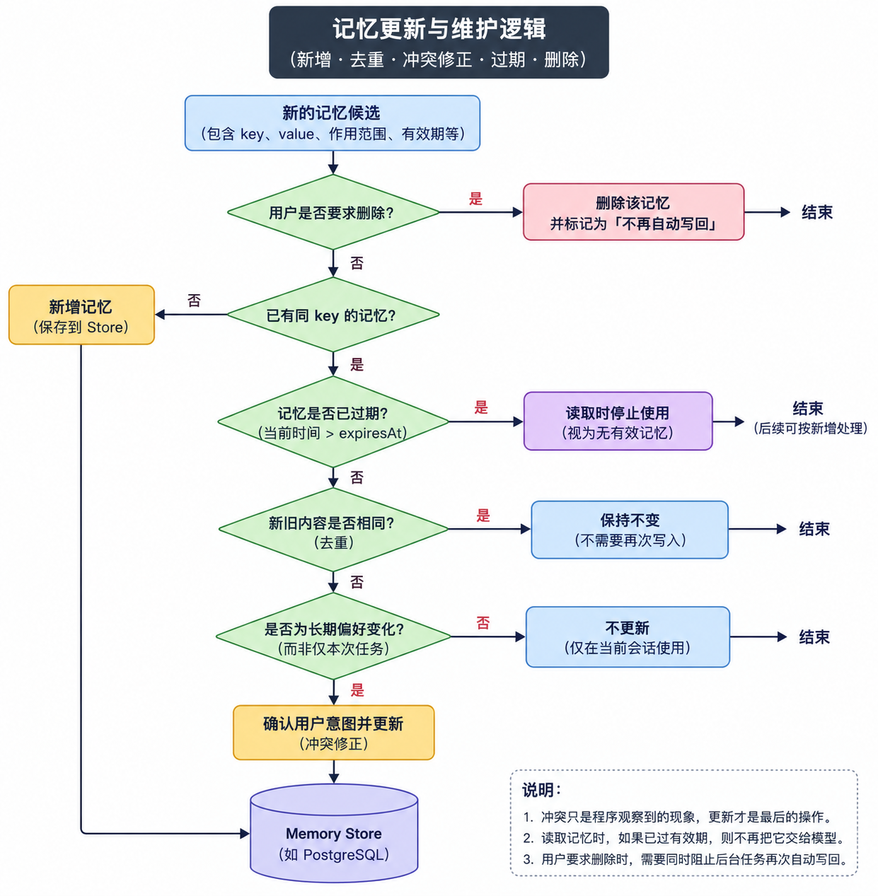

接下来，咱们通过代码看看这套处理是怎么完成的。

## 跑个代码
本节代码在：

```latex
/Code/Node/第六章/06-memory-lifecycle
```

安装依赖以后执行：

```bash
npm run demo
```

打印内容如下：

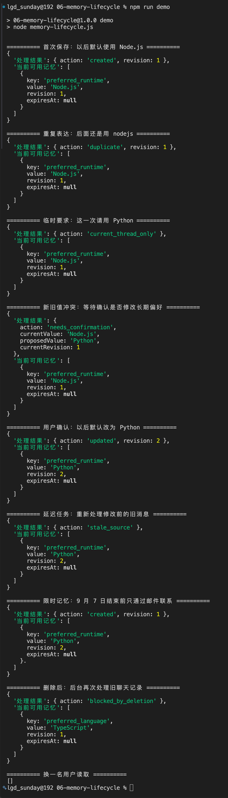

整体的打印比较超，简化之后，就是下面这样：

```latex
首次保存：created
重复表达：duplicate
临时要求：current_thread_only
新旧值不同：needs_confirmation
用户确认：updated
旧消息晚到：stale_source
到达有效期：读取结果为 null
用户删除：deleted
删除后旧候选再次到达：blocked_by_deletion
```

这里几乎打印出了整个记忆更新的各种不同的状态，咱们一点点来看。

首先打开 `memory-lifecycle.js`，从 `main()` 开始看。

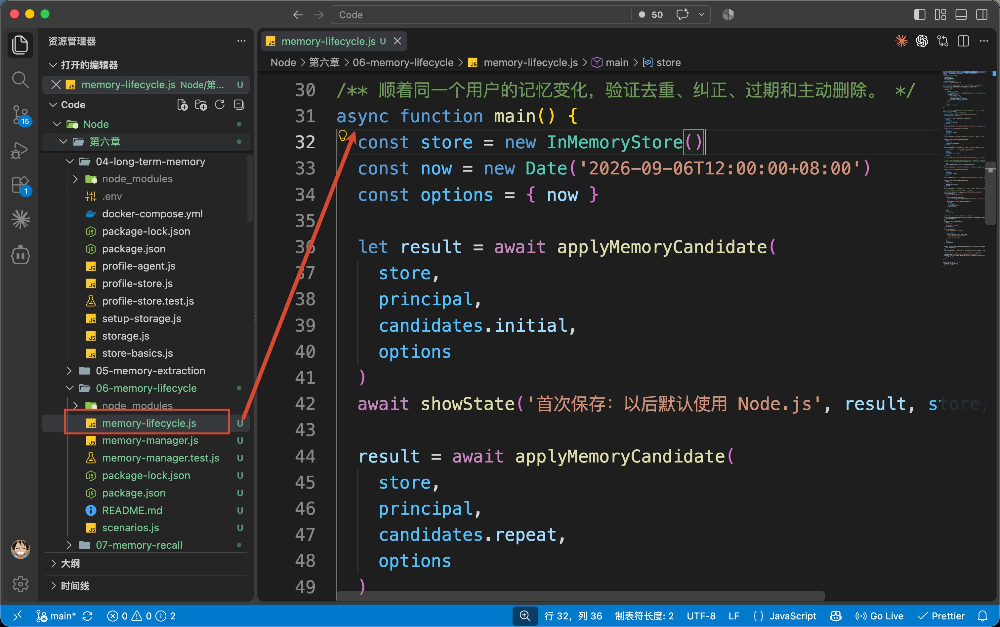

`main()` 先创建 Store，并保存第一条候选：

```javascript
const store = new InMemoryStore()
const now = new Date('2026-09-06T12:00:00+08:00')
const options = { now }

// 负责记忆维护的核心代码
let result = await applyMemoryCandidate(
    store,
  // 登录用户
    principal,
  // 测试数据
    candidates.initial,
    options
)
```

这里的 `principal` 是当前登录用户的模拟身份。

`now` 是案例固定的测试时间，后面验证记忆过期时会用到。这样大家无论哪天运行，都能看到相同结果。

真正负责维护记忆的是 `applyMemoryCandidate()`。

它每次都会接收一条新候选，然后判断这次应该新增、保持不变，还是更新

然后是  `candidates.initial` 他是从 `scenarios.js` 中导入的一组测试数据，每一项都用来模拟一条从用户对话中提取出来的信息。

其中，`initial` 表示案例中的第一条信息，比如：

```latex
以后默认使用 Node.js。
```

此时，这条信息还没有写入 Store。咱们还得判断它应该被新增、更新，还是直接忽略，所以咱们先把它叫作 **候选记忆**。

打开 `scenarios.js`，可以看到 `candidates.initial` 的完整内容：

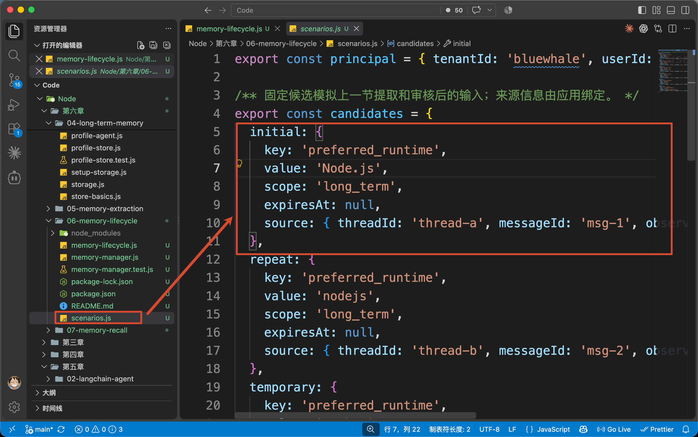

+ `key` 和 `value` 表示这是一条 “默认运行环境为 Node.js” 的用户画像。
+ `scope: 'long_term'` 表示它需要跨会话使用
+ `expiresAt: null` 表示没有预设有效期
+ `source` 记录这条偏好来自哪一次对话，以及用户是什么时候说的。

然后咱们回到 `main()` 的调用里面，咱们看 `applyMemoryCandidate()` 方法，这个方法在  `memory-manager.js` 中

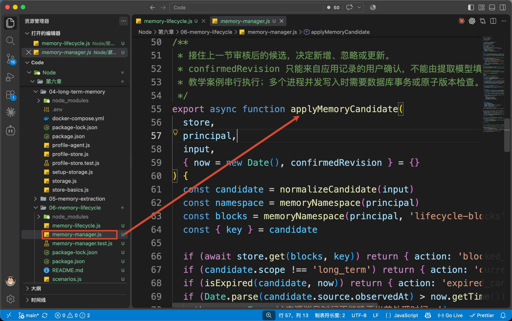

进入 `memory-manager.js`，`applyMemoryCandidate()` 会先用用户身份和 Key 查询已有记录：

```javascript
// 查询当前已经保存的同 key 记忆
const item = await store.get(namespace, key)
const current = item?.value
```

第一次没有旧记录，所以代码会执行：

```javascript
// 写入最终通过生命周期检查的长期记忆
await store.put(namespace, key, memory)
```

这和时候，就触发了咱们第一次的打印：

```plain
终端打印 created，版本是 revision: 1
```

完整内容如下

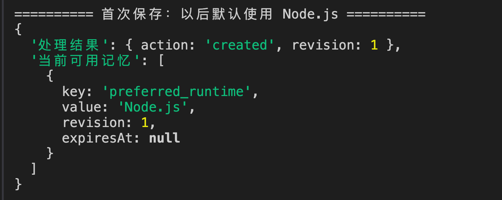

然后，`main()` 继续处理第二条候选：“后面的例子还是用 nodejs 吧。”

在比较以前，`normalizeCandidate()` 会把 `nodejs`、`Node.js` 这些已知写法统一成 `Node.js`。

然后再和已有值比较：

```javascript
// value 和 expiresAt 都没有变化：
// 认为是完全相同的记忆，不重复写入，也不增加 revision
if (
    current.value === candidate.value &&
    current.expiresAt === candidate.expiresAt
) {
    return {
        action: 'duplicate',
        revision: current.revision
    }
}
```

新旧内容相同，函数直接返回 `duplicate`，不会再次执行 `store.put()`。

所以，Store 里仍然只有一条 Node.js 偏好，版本也没有增加。

这就是咱们的去重方式：**先把同一个字段的已知写法统一，再判断值是否相同。**

它适合运行环境、语言、回答风格这类结构明确的画像字段场景下。

处理完重复候选，回到 `main()` 继续往下。

接下来传入的是：“这一次请用 Python。” 

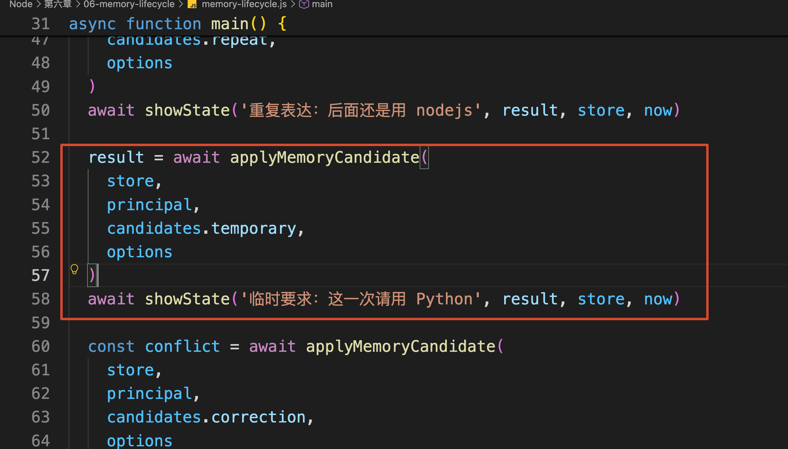

> PS：每次 `showState` 执行都会有一次打印，这个大家应该可以看出来吧
>
> 根据咱们的打印逻辑梳理代码，每一段 `applyMemoryCandidate` + `showState` 就表示了一段完整的打印。
>
> 这里给大家看下 `showState` 的代码：
>
> 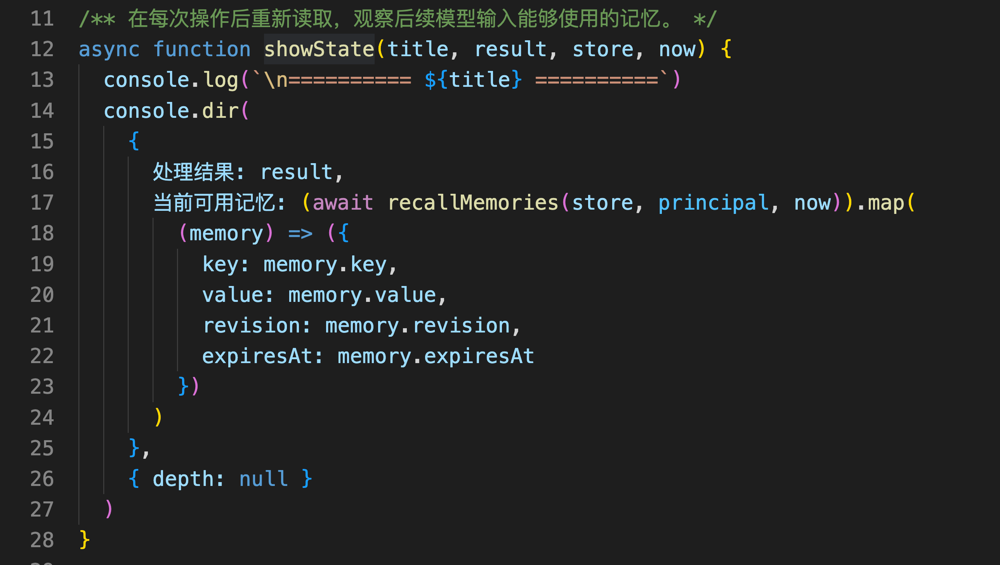
>

这条候选的 `scope` 是 `current_thread`，所以 `applyMemoryCandidate()` 会直接返回：

```javascript
// 2. Scope 检查：
// 只有 long_term 类型的候选才允许进入长期 Store，
// 当前 Thread 临时信息只在当前会话中使用
if (candidate.scope !== 'long_term') {
    return { action: 'current_thread_only' }
}
```

这次要求会影响当前任务，但是不会修改 Store 里的长期偏好。

处理完临时要求以后，`main()` 会继续把 `candidates.correction` 传给 `applyMemoryCandidate()`。这条候选信息把 `preferred_runtime` 的值设置成了 `Python`，并且将 `scope` 设置成了 `long_term`，表示这次准备修改长期偏好。

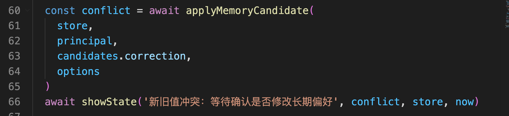

这次传入的是 `candidates.correction`：

```javascript
const conflict = await applyMemoryCandidate(
    store,
    principal,
    candidates.correction,
    options
)
```

`candidates.correction` 中的 `key` 仍然是 `preferred_runtime`，但是 `value` 已经变成了 `Python`，`scope` 也是 `long_term`。

所以，`applyMemoryCandidate()` 查询 Store 以后，看到的是下面这个情况：

```latex
已经保存的长期偏好：Node.js
这次准备保存的长期偏好：Python
```

新旧值不一样，说明用户的长期偏好可能发生了变化。

但是，咱们现在还不能直接把 Node.js 覆盖成 Python。

因为在这次调用中，咱们还没有传入用户的确认结果。

所以函数会先停止写入，并返回：

```javascript
{
    action: 'needs_confirmation',
    currentValue: 'Node.js',
    proposedValue: 'Python',
    currentRevision: 1
}
```

这里的 `needs_confirmation` 表示：**发现了新旧偏好不一致，需要先询问用户是否真的要修改。**

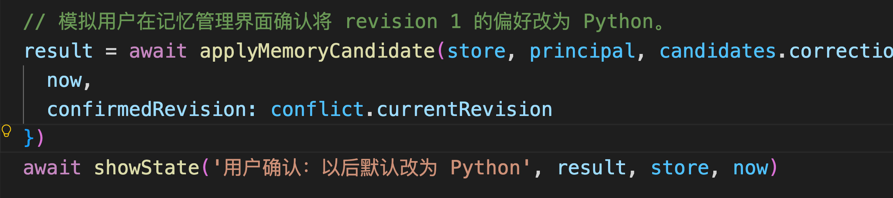

应用程序可以根据返回的 `currentValue` 和 `proposedValue`，在页面上向用户展示（通过 Human-in-the-loop 就可以实现）：“是否将默认运行环境从 Node.js 修改为 Python？”

咱们这里就图省事，假装用户已经确认了

这里要注意，这两次咱们调用传入的都是 `candidates.correction`，区别在于第二次多传了一个 `confirmedRevision`。

```latex
第一次调用：没有确认结果，只返回 needs_confirmation
第二次调用：携带 confirmedRevision，真正执行更新
```

`confirmedRevision: 1` 表示：用户确认修改的是刚才看到的第 1 版 Node.js 偏好。

版本检查通过以后，代码使用原来的 Namespace 和 `preferred_runtime` Key 执行 `put()`。

最终，原来的记忆被更新，`preferred_runtime` 从 Node.js 变成 Python，版本增加到 2：

```javascript
{
    处理结果: {
        action: 'updated',
        revision: 2
    },
    当前可用记忆: [
        {
            key: 'preferred_runtime',
            value: 'Python',
            revision: 2,
            expiresAt: null
        }
    ]
}
```

然后继续往下。

Python 偏好更新完成以后，`main()` 又把前面使用过的 `candidates.repeat` 传入了一次：

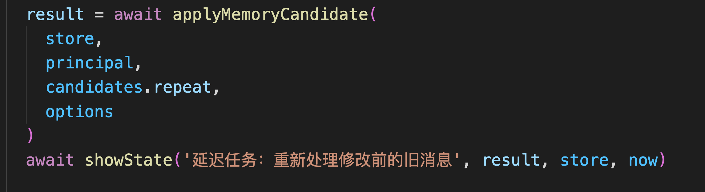

为了验证旧信息会不会覆盖新记忆，咱们故意把 9 月 2 日生成的 `candidates.repeat` 再次传入 `applyMemoryCandidate()`。

此时 Store 中已经保存了用户 9 月 3 日确认的 Python 偏好。

所以说，如果程序只看任务的执行顺序，这条 **后执行的旧任务就可能把 Python 错误地改回 Node.js。**

这也是为什么在这一小节开头，咱们说 **不能直接覆盖的原因**

所以，咱们就必须比较新旧记忆的来源时间：

```javascript
if (sourceTime < previousTime) {
    return { action: 'stale_source' }
}
```

旧候选来自 9 月 2 日，当前 Python 偏好来自 9 月 3 日，因此函数返回 `stale_source`，Store 里的 Python 保持不变。

这也是前面保留 `source` 的原因。

处理完默认运行环境，`main()` 接着保存一条联系偏好：

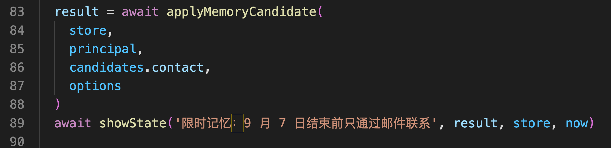

数据如下：

```javascript
{
    key: 'contact_window',
    value: '出差期间只通过邮件联系',
    expiresAt: '2026-09-08T00:00:00+08:00'
}
```

用户要求只在 9 月 7 日结束前使用，所以从 9 月 8 日零点开始，这条记忆就已经失效。

保存完成以后，`main()` 把测试时间推进到这个时间点，再调用：

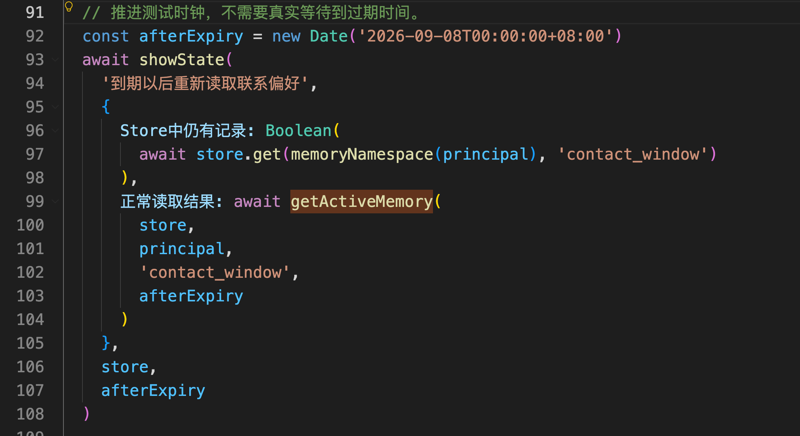

上面有一个核心逻辑 `getActiveMemory`

```javascript
await getActiveMemory(
    store,
    principal,
    'contact_window',
    afterExpiry
)
```

进入 `memory-manager.js` 的 `getActiveMemory()`，可以看到它并不是查到记录就直接返回，他大概经历了三步流程：

```javascript
// 1. 先检查生命周期阻断记录。
//
// 用户删除某条记忆后，会在 lifecycle-blocks Namespace
// 中留下对应的阻断记录。
//
// 即使正常 Memory Namespace 中还残留旧数据，
// 只要 block 存在，这条记忆就不应该再次对外可见。
const item = await store.get(
    memoryNamespace(principal),
    key
)

// 2. 从当前用户正常的 Memory Namespace 中读取记忆
const item = await store.get(memoryNamespace(principal), key)

// 3. 以下两种情况都视为“当前没有可用记忆”：
//
// - Store 中根本不存在这条记忆
// - 记忆虽然仍然存在，但 expiresAt 已经过期
//
// 过期数据这里采用读取时过滤，
// 是否进行物理清理可以交给独立的 GC / Cleanup 机制处理。
if (!item || isExpired(item.value, now)) {
    return null
}

// 返回统一的 Active Memory 结构：
// key 来自 Store 索引，其余字段来自实际保存的 Memory Value
return { key, ...item.value }
```

`isExpired()` 会检查 `expiresAt`。一旦到达截止时间，就返回 `null`。

所以终端里会出现下面这个结果：

```javascript
{
    Store中仍有记录: true,
    正常读取结果: null
}
```

记录仍然保存在 Store，但是 Agent 的正常读取入口已经拿不到它了。

**这就是“失效”和“物理删除”的区别。**

最后，`main()` 调用 `forgetMemory()` 删除默认运行环境偏好：

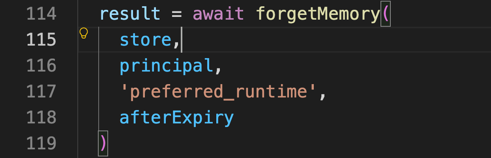

如果用户只说“删除这条偏好”，调用 Store 的 `delete()` 就可以移除当前记录：

```javascript
await store.delete(
    memoryNamespace(principal),
    key
)
```

不过这里要注意，`preferred_runtime` 只表示要处理的记忆字段，也就是“默认运行环境”。

`forgetMemory()` 接收到这个字段以后，会执行两个操作：

1. 删除已经保存的默认运行环境偏好。
2. 保存一条阻断标记，禁止系统以后自动写入这项偏好。

前面的一条好处理，第二条就会比较麻烦。

因此，咱们为了处理第二条就得在 `forgetMemory()` 中保存一条控制信息：

```javascript
await store.put(blocks, key, {
    blockedAt: now.toISOString()
})
```

简单理解，就是为当前用户记下来：

```latex
preferred_runtime 已经被禁止自动保存
```

然后，程序再删除原来的记忆正文。

这样的话，以后再出现 `preferred_runtime` 就不会在执行自动保存操作了。

为了验证这一步，咱们在删除以后又提交了一次旧的 Python 候选

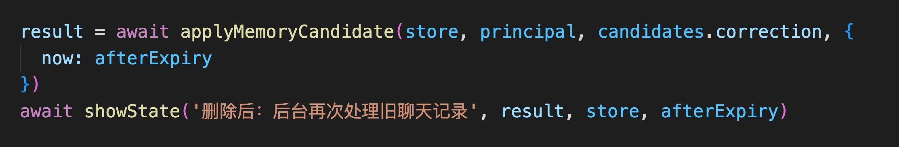

`applyMemoryCandidate()` 会先检查禁止写入记录：

```javascript
if (await store.get(blocks, key)) {
    return {
        action: 'blocked_by_deletion'
    }
}
```

最终返回 `blocked_by_deletion`，旧偏好没有再次写回 Store。

## 总结
这一小节的内容是真的不少，主要就是讲了 用户偏好这种语义记忆 的场景。

+ 新旧内容相同，本例保持当前记录不变
+ 长期偏好真的发生变化，确认以后更新
+ 旧消息延迟到达，不能覆盖更新结果
+ 对于带有时间限制的信息，读取时需要检查有效期
+ 用户主动要求忘记时，则按照要求删除，并决定是否继续允许自动保存。

其中，固定 Key、确认修改、`expiresAt` 和禁止自动写回，都是当前项目为了维护用户画像设计的规则，不是 LangChain 自动提供的记忆策略。

LangGraph Store 负责把数据保存下来。

**至于一条记忆什么时候应该更新、什么时候应该停止使用，最终仍然由 Agent 应用根据业务规则决定。**

不过，仍然有效的记忆也不代表每次回答都需要使用。

下一节，咱们继续解决记忆召回的问题：怎样从已有记忆中，挑出本次回答真正需要的信息。

> 更新：2026-09-07 17:02 · 原文：<https://www.yuque.com/lgdsunday/ab1dy3/sugynzs9umecczfb>
