# 08 - Agentic RAG：按需检索、多轮补查与证据判断

上一小节，咱们实现了记忆召回。

Agent 可以根据当前问题，从长期记忆中找到需要召回的记忆内容。

看到这里大家想想，这个玩意是不是有点像咱们之前学过的 RAG 啊。

大家还记得 RAG 的定义是啥吗？

RAG 的全称是 `Retrieval-Augmented Generation`，也就是 **检索增强生成**。（忘记的同学，请回顾第二章内容～～）

简单来说就是：**先根据用户问题，从外部知识库中找到相关资料，再把这些资料交给大模型生成答案。**

比如，用户问：“退款金额超过多少元需要人工审核？”

RAG 会先从企业知识库中找到退款规则，再让模型根据规则回答。

这么看下来，记忆召回和 RAG 的处理方式确实很像哈：

+ **记忆召回**：根据当前问题，查找相关的用户记忆
+ **RAG**：根据当前问题，查找相关的企业知识

它们都是先“找资料”，再把找到的内容交给模型。

但是，两者查询的数据不一样。

长期记忆保存的是 **当前用户过去留下的信息**，比如：用户偏好、历史经历和已经确认过的事实 等等的。

RAG 查询的则是 **外部知识库中的资料**，比如：退款规则、产品手册和企业制度 等等的。

咱们做个测试，大家觉得下面两个内容哪个属于 长期记忆，哪个属于知识库资料呢？

```plain
内容一：用户以前买过一台 3500 元的咖啡机
内容二：退款金额超过 2000 元需要人工审核
```

应该还挺好分辨的吧。

---

-----------  人工分割线  -----------  

---

公布答案：其中内容一属于长期记忆，内容二属于企业知识库

那如果用户现在问：“我之前买的那台咖啡机，申请退款时需要人工审核吗？”

想要回答这个问题，Agent 就要同时完成两件事：

+ 第一：从长期记忆中找到咖啡机订单和退款金额
+ 第二：再从企业知识库中查询人工审核规则

这也是为什么学完记忆召回以后，咱们还要继续学习 `Agentic RAG`。

咱们在前面实现的 RAG 的时候，检索流程基本是程序提前写好的，大致就是下面这样：

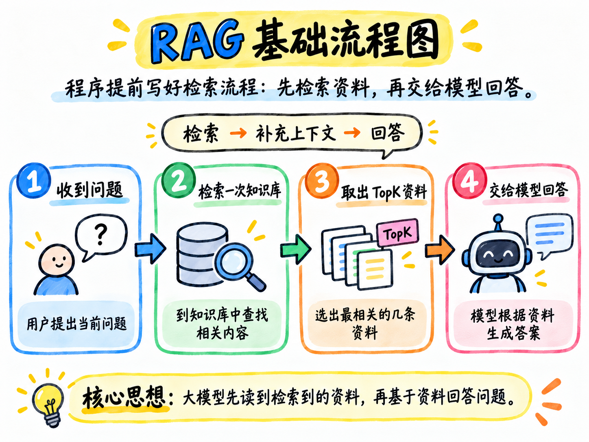

这样的流程处理目标明确的简单问题时，没有问题。

但是，实际开发中用户经常会把多个问题放在一句话里。比如：“订单 A2026 的咖啡机退款金额是 3500 元，需要人工审核吗？准备材料时还要注意什么？”

想要完整回答这个问题，至少需要两类资料：

+ 退款金额对应的人工审核规则
+ 咖啡机退款需要提交的材料

如果第一次只查到了人工审核规则，Agent 不能直接生成答案。

它还要知道：**当前资料只能回答前半个问题，退款材料还没有找到，需要继续检索。**

这就不再是简单的“检索一次，然后回答”了。

咱们需要让 Agent 根据当前问题和已经找到的资料，继续判断：这次需要查询知识库吗？应该查询哪类资料？当前资料够不够？不够的话，下一步还要查什么？始终查不到时，是追问用户还是拒绝回答？

你看，还挺复杂的吧

而这些事情，正好是 Agent 擅长解决的。

第四章和第五章已经讲过，Agent 不只是生成一次回答。它可以读取当前 State，选择 Action，观察执行结果，再决定下一步。

现在，咱们把 RAG 的检索能力交给 Agent，让“检索一次就回答”的固定流程，变成“检查证据、按需补查、资料齐全再回答”的执行过程。

而这个过程就是 `Agentic RAG` 。

所以我们可以简单理解 `Agentic RAG` 指的就是：**利用 Agent 来辅助检索增强生成（RAG）的过程。**

说得再直白一点：**RAG 负责提供外部知识，Agent 负责决定怎样使用检索能力**

到这里，咱们已经分别学过 RAG、Agent Loop、LangGraph 和记忆召回。

这一小节，就把这些知识连接起来，看看 Agent 怎样完成按需检索、多轮补查、证据判断和资料不足时的拒答。

## Agentic RAG 的实际工作流程
上面已经通过实际问题看到了，`Agentic RAG` 解决的就是：**固定的一次检索，不一定能够拿到回答复杂问题所需的全部证据** 的问题

LangChain 官方的 [Agentic RAG 介绍](https://docs.langchain.com/oss/javascript/langgraph/agentic-rag) 里面给出了具体的执行流程，大致是三步：

+ Agent 可以先判断是否需要调用检索能力
+ 拿到资料以后判断是否相关
+ 如果不相关，可以改写查询并重新检索

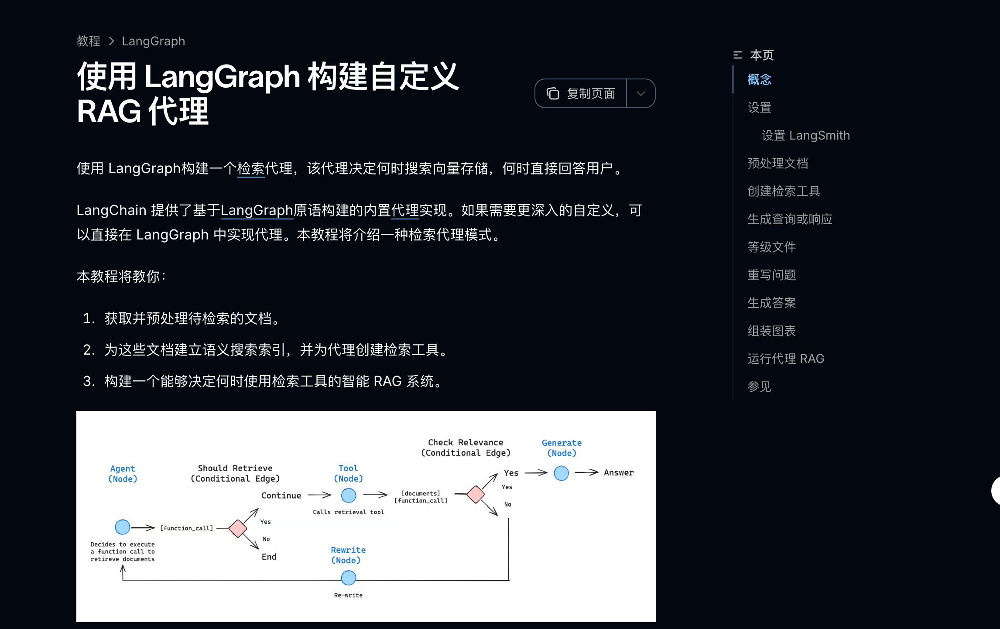

普通 RAG 和 Agentic RAG 的区别，大致是下面这样：

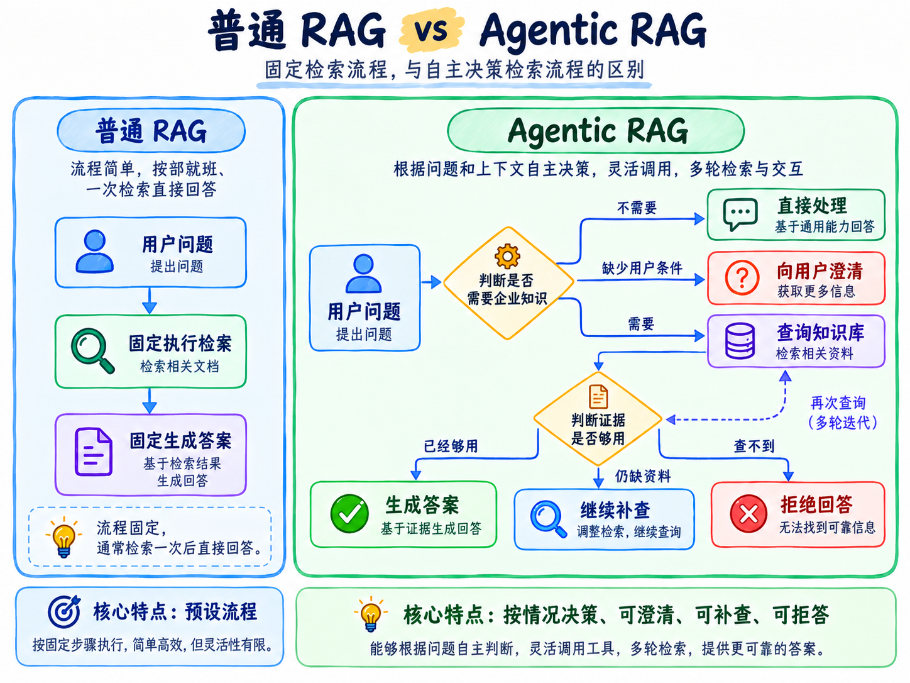

流程说清楚以后，接下来咱们来看看代码

## 代码流程
本节代码在：

```latex
/Code/Node/第六章/08-agentic-rag
```

别忘了配置 `.env` ：

```latex
DEEPSEEK_API_KEY=你的 DeepSeek API Key
DEEPSEEK_MODEL=deepseek-v4-flash
```

然后执行：

```bash
npm run demo
```

先看下整体的打印：

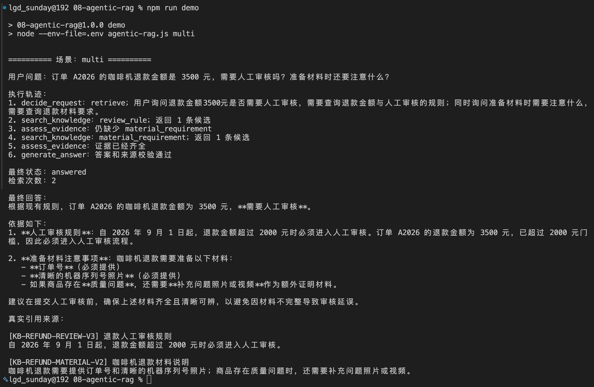

然后咱们一点点来分析哈，整个打印从一个问题开始：

```latex
订单 A2026 的咖啡机退款金额是 3500 元，需要人工审核吗？准备材料时还要注意什么？
```

最终回答的具体文字可能不同，但是中间的核心轨迹应该是下面这样的：

```latex
1. decide_request：需要查询企业知识
2. search_knowledge：查询退款人工审核规则
3. assess_evidence：仍然缺少退款材料要求
4. search_knowledge：继续查询咖啡机退款材料
5. assess_evidence：证据已经齐全
6. generate_answer：答案和来源校验通过
```

最后，终端还会打印：

```latex
最终状态：answered
检索次数：2
```

以及本次真正使用的两个来源：

```latex
[KB-REFUND-REVIEW-V3] 退款人工审核规则
退款金额超过 2000 元时必须进入人工审核。

[KB-REFUND-MATERIAL-V2] 咖啡机退款材料说明
需要提供订单号和清晰的机器序列号照片……
```

那么根据上面的内容，咱们可以发现，整个检索进行了两次。

+ 第一次检索「是否需要人工审核」，通过 `review_rule` 完成
+ 第二次检索「需要准备什么材料」，通过 `material_requirement` 完成

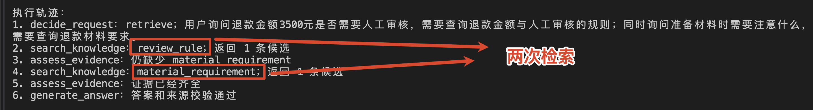

等两次检索全部完成之后，才进入答案生成。

这就是本节所说的 **多轮补查**，即：**每轮检索完成以后都判断还缺什么，只在确实缺少证据时继续查询。**

那么这个功能怎么去实现的呢？咱们一起来看看

## 从 main() 看完整执行流程
打开 `agentic-rag.js` 文件，查看 `main()`  方法，这个方法主要做了三件事：

```javascript
/**
 * 创建 Agentic RAG Graph。
 *
 * services：Graph 中各节点需要使用的模型服务
 * principal：当前用户/租户等身份上下文
 * now：当前时间，用于需要时间判断的业务逻辑
 * maxSearches：限制最多执行 3 次检索，避免 Agent 无限搜索
 */
const graph = createAgenticRagGraph({
  // 准备负责检索决策和答案生成的模型
    services: createModelServices(),
  // 应用认证以后得到的当前用户身份
    principal,
    now,
  // 一次问题最多允许检索三轮
    maxSearches: 3
})

// 以当前场景的问题作为初始 State 输入，启动整个 Graph。
// Graph 会根据内部路由完成检索、判断、补充搜索和回答生成等流程
const result = await graph.invoke({
    question: scenario.question
})

// 输出场景名称、原始问题以及 Graph 最终执行结果，便于观察不同场景的运行路径
printResult(scenarioName, scenario.question, result)
```

+ `createModelServices()` 准备负责检索决策和答案生成的模型。
+ `principal` 是应用认证以后得到的当前用户身份
+ `maxSearches: 3` 表示一次问题最多允许检索三轮

然后，程序把用户问题交给 Graph 执行，最后打印运行轨迹和答案。

这里需要注意，上面有两个核心的方法：

+ `createAgenticRagGraph()`  他的作用是：创建并返回一张可以执行的 Graph
+ `graph.invoke()` 他的作用是：把用户问题交给这张 Graph，正式开始执行

所以，想知道用户问题进入 Graph 以后去了哪里，咱们就要打开 `workflow.js`，查看 `createAgenticRagGraph()` 创建了哪些执行步骤，又是怎样把这些步骤连接起来的。

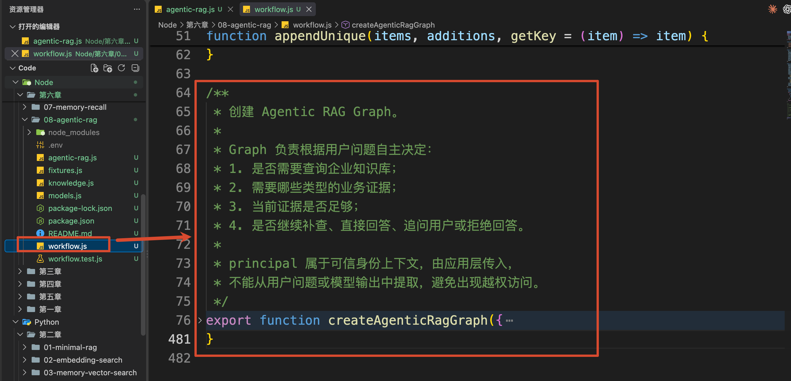

这里面的代码相当长，带着完整注释 400 多行

咱们先看这个函数最后返回的内容：

```javascript
    return (
        new StateGraph(AgenticRagState)
            // 注册 Graph 中的各个执行节点
            .addNode('decide_request', decideRequest)
            .addNode('search_knowledge', retrieveMissingEvidence)
            .addNode('assess_evidence', gradeEvidence)
            .addNode('generate_answer', generateAnswer)
            .addNode('direct_answer', directAnswer)
            .addNode('clarify_user', clarifyUser)
            .addNode('refuse_answer', refuseAnswer)

            // Graph 从请求分析节点开始执行
            .addEdge(START, 'decide_request')

            // 根据模型的请求分类结果，
            // 动态进入直接回答、追问用户或知识库检索分支。
            .addConditionalEdges('decide_request', routeAfterDecision, [
                'direct_answer',
                'clarify_user',
                'search_knowledge'
            ])

            // 每次知识库检索完成后，都必须重新审核当前累计证据。
            .addEdge('search_knowledge', 'assess_evidence')

            // 根据证据完整度和搜索预算，
            // 动态决定生成答案、继续补查或拒绝回答。
            .addConditionalEdges('assess_evidence', routeAfterAssessment, [
                'generate_answer',
                'search_knowledge',
                'refuse_answer'
            ])

            // 四种最终结果节点执行完成后结束本次 Graph Run。
            .addEdge('generate_answer', END)
            .addEdge('direct_answer', END)
            .addEdge('clarify_user', END)
            .addEdge('refuse_answer', END)

            // 将 StateGraph 编译成可以 invoke 的可执行 Graph。
            .compile()
    )
```

这段代码看起来有点长，不过结构并不复杂。

`new StateGraph(AgenticRagState)` 先创建一张 Graph。

`AgenticRagState` 规定了执行过程中要保存哪些数据，比如用户问题、需要的证据、已经找到的候选资料和最终答案。

接下来的 `addNode()`，是在这张 Graph 中注册可以执行的步骤：

```javascript
.addNode('decide_request', decideRequest)
```

其中，`decide_request` 是 Node 的名字，`decideRequest` 是进入这个 Node 时真正执行的函数。

按照相同的方式，代码一共注册了七个 Node，分别负责：判断请求、查询知识库、检查证据、生成答案、直接回答、追问用户和拒绝回答。

Node 创建完以后，还要使用 Edge 规定执行顺序。

第一条 Edge 是：

```javascript
.addEdge(START, 'decide_request')
```

意思是 Graph 启动以后，第一步一定进入 `decide_request`。

但是，`decide_request` 执行完成以后，下一步并不固定，所以这里使用了 `addConditionalEdges()`：

```javascript
.addConditionalEdges(
    'decide_request',
    routeAfterDecision,
    [
        'direct_answer',
        'clarify_user',
        'search_knowledge'
    ]
)
```

`routeAfterDecision()` 会读取刚才得到的决策结果：不需要知识库就进入 `direct_answer`，缺少用户条件就进入 `clarify_user`，需要企业资料才进入 `search_knowledge`。

查询资料以后，流程固定进入 `assess_evidence` 检查证据：

```javascript
.addEdge('search_knowledge', 'assess_evidence')
```

检查完成以后，再根据 `missingEvidence` 决定是生成答案、继续补查，还是因为资料不足而拒绝回答。

整个执行流程，大致就是下图所示这样

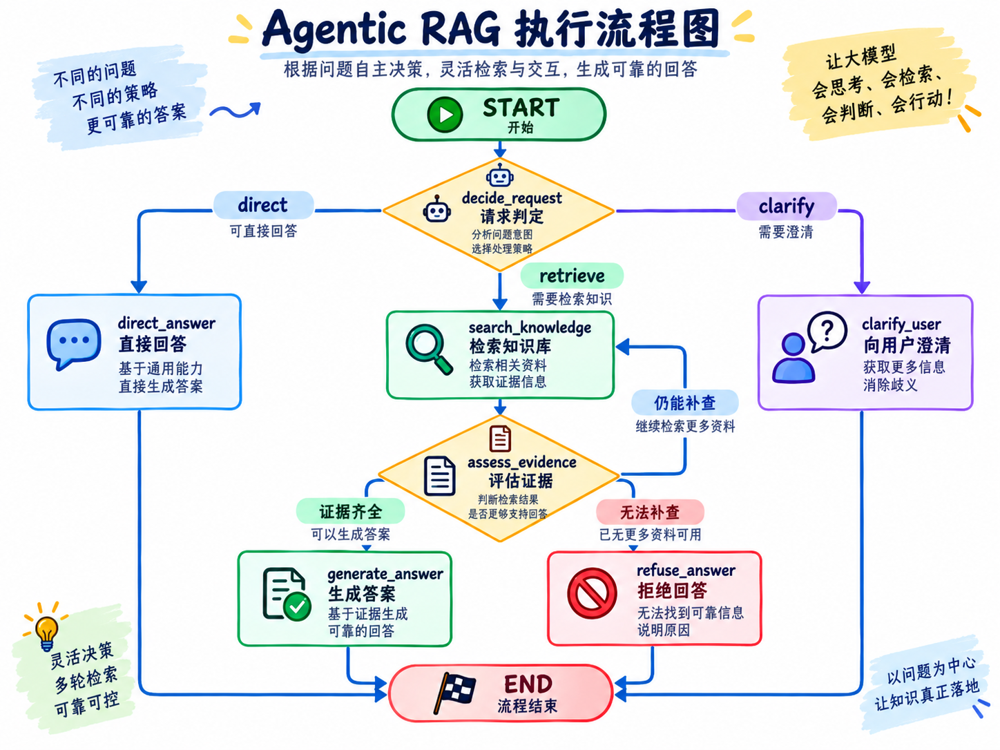

这张图，大家就可以理解为是上面那段 `addNode()`、`addEdge()` 和 `addConditionalEdges()` 代码的简化表示。

最后的 `compile()` 会把它编译成一张可以执行的 Graph，再返回给 `main()` 中的 `graph`。

现在，Graph 是怎么创建出来的已经清楚了。

接下来咱们就看刚才的 `demo` 场景，看看用户问题进入 `decide_request` 以后，每个 Node 具体做了什么。

### 第一步：先决定是否需要检索
前面已经看到，Graph 启动以后会先进入 `decide_request`。

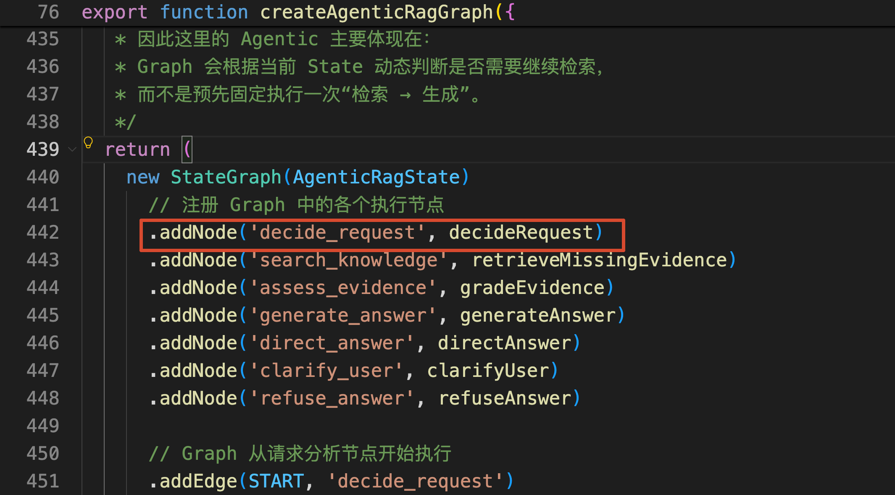

`decide_request` 只是 Node 的名字。进入这个 Node 时，真正执行的是 `decideRequest()`：

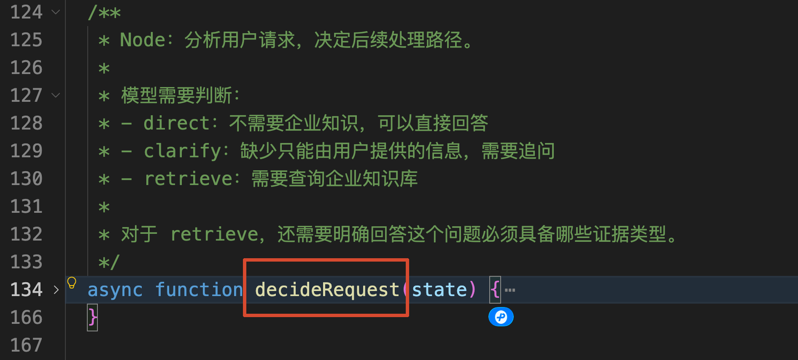

把这个函数精简一下，核心代码是：

```javascript
async function decideRequest(state) {
    const decision = await services.decide(state.question)
  // 去除模型可能返回的重复证据类型，
    // 后续会按照这些类型逐项判断证据是否齐全。
    const requiredEvidence = [
        ...new Set(decision.requiredEvidence)
    ]

    return {
        route: decision.route,
        requiredEvidence,
        missingEvidence: requiredEvidence,
        clarificationQuestion: decision.clarificationQuestion
    }
}
```

此时，State 中已经有 `graph.invoke()` 传进来的用户问题：

```javascript
{
    question: `订单 A2026 的咖啡机退款金额是 3500 元，
    需要人工审核吗？准备材料时还要注意什么？`
}
```

所以，`decideRequest()` 做的第一件事，就是把 `state.question` 交给 `services.decide()`，让模型先判断两件事：

+ 这个问题需不需要查询知识库？
+ 如果需要，完整回答它要查询哪几类资料？

那么，模型怎么知道应该返回哪些字段呢？

继续打开 `models.js`。

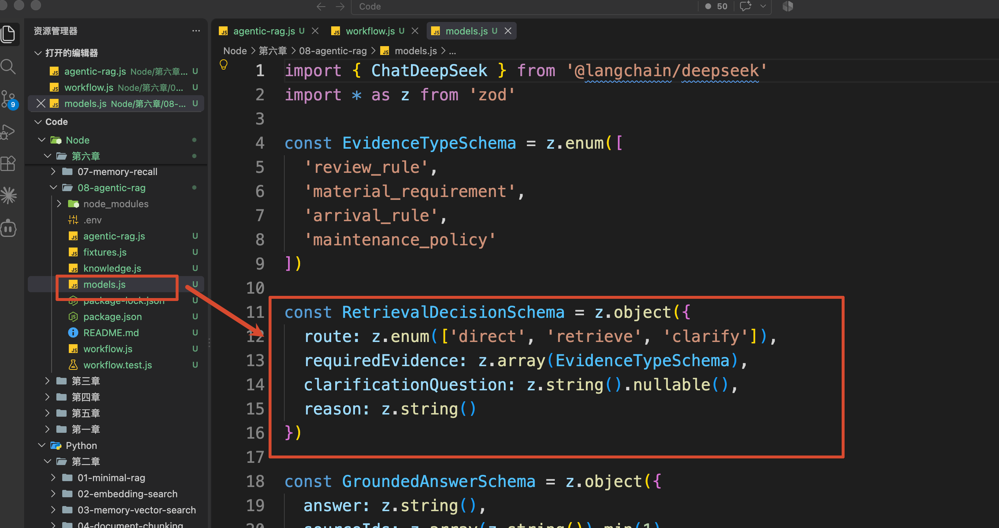

这里先使用 Zod 定义了模型的返回结构：

```javascript
const RetrievalDecisionSchema = z.object({
    route: z.enum(['direct', 'retrieve', 'clarify']),
    requiredEvidence: z.array(EvidenceTypeSchema),
    clarificationQuestion: z.string().nullable(),
    reason: z.string()
})
```

然后，在 `createModelServices` 方法中

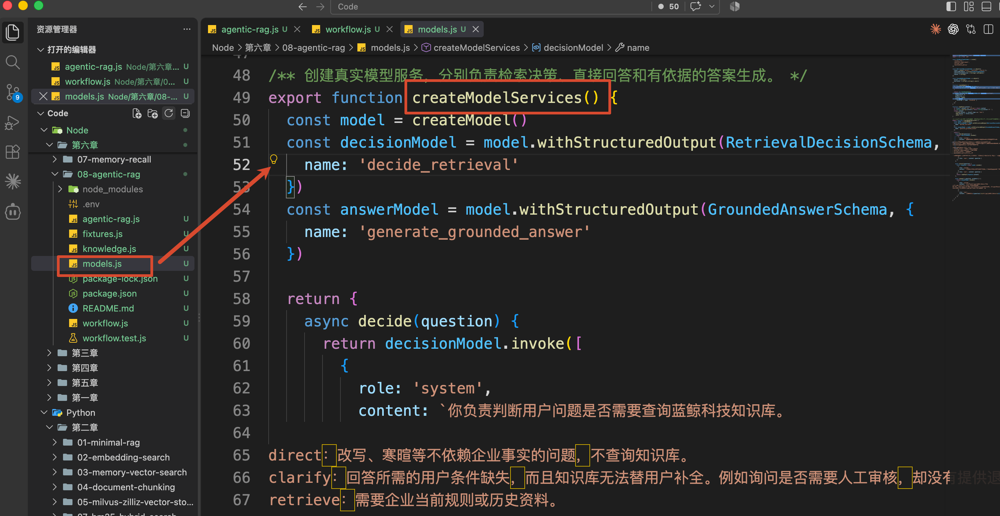

通过 `withStructuredOutput()` 要求模型按照这份结构返回结果：

```javascript
const decisionModel = model.withStructuredOutput(
    RetrievalDecisionSchema,
    { name: 'decide_retrieval' }
)
```

不过，Schema 只规定了“返回哪些字段”，并不能解释这些字段的业务含义。

所以，调用 `decisionModel.invoke()` 时，System Message 还会继续告诉模型一大堆的信息

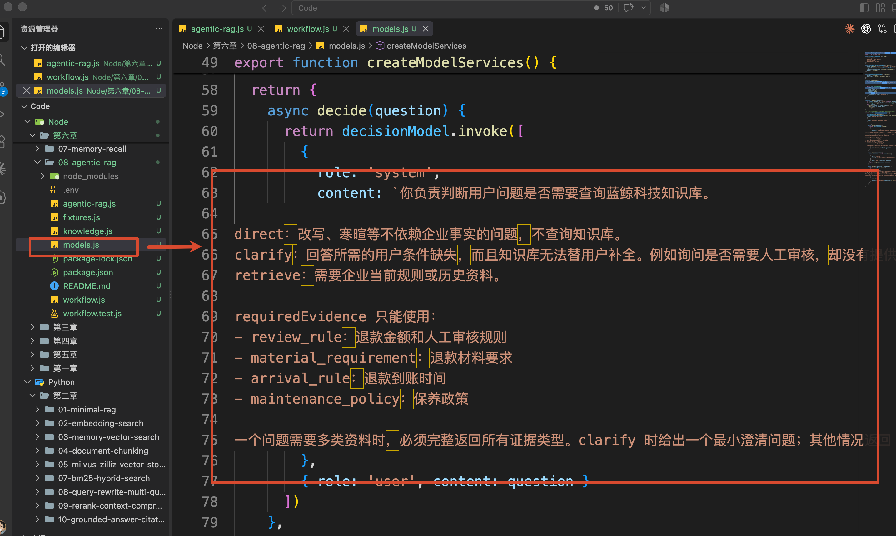

这里会涉及到好多的字段解释

```latex
direct：不依赖企业事实，不查询知识库
retrieve：需要查询企业当前规则
clarify：缺少只能由用户提供的条件

review_rule：人工审核规则
material_requirement：退款材料要求
arrival_rule：退款到账时间
maintenance_policy：保养政策
```

也就是说，Schema 负责限制返回格式，System Message 负责说明应该怎样判断。

所以，下面这个对象 就是 `services.decide(state.question)` 返回的决策对象：

```javascript
{
    route: 'retrieve',
    requiredEvidence: [
        'review_rule',
        'material_requirement'
    ],
    clarificationQuestion: null,
    reason: '问题需要当前审核规则和退款材料要求'
}
```

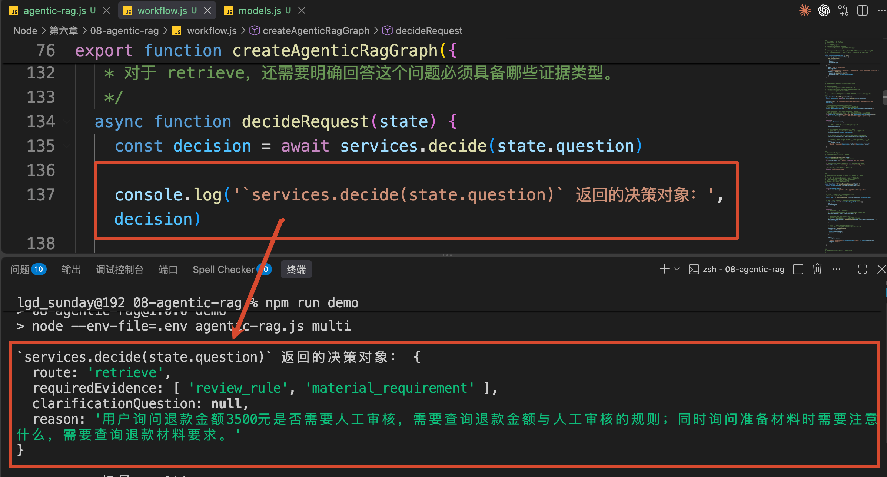

这里的四个字段分别解决四个问题。

`route` 决定接下来走哪条处理路线：

+ direct：不需要企业知识，直接处理
+ retrieve：需要查询知识库
+ clarify：缺少只能由用户提供的条件，先追问用户

`requiredEvidence` 表示完整回答当前问题需要哪些证据：

+ review_rule：退款金额与人工审核规则
+ material_requirement：退款需要准备的材料

`clarificationQuestion` 保存需要追问用户的问题。当前问题已经提供了订单和退款金额，不需要追问，所以它是 `null`。

`reason` 用来记录本次判断的原因，方便咱们查看执行轨迹。真正控制 Graph 路由的是 `route`，不是这段说明文字。

拿到模型的决策以后，`decideRequest()` 会把结果写入 Graph State。

由于检索还没有开始，`requiredEvidence` 中的两类证据现在都缺少，所以程序会同时把它们放进 `missingEvidence`：

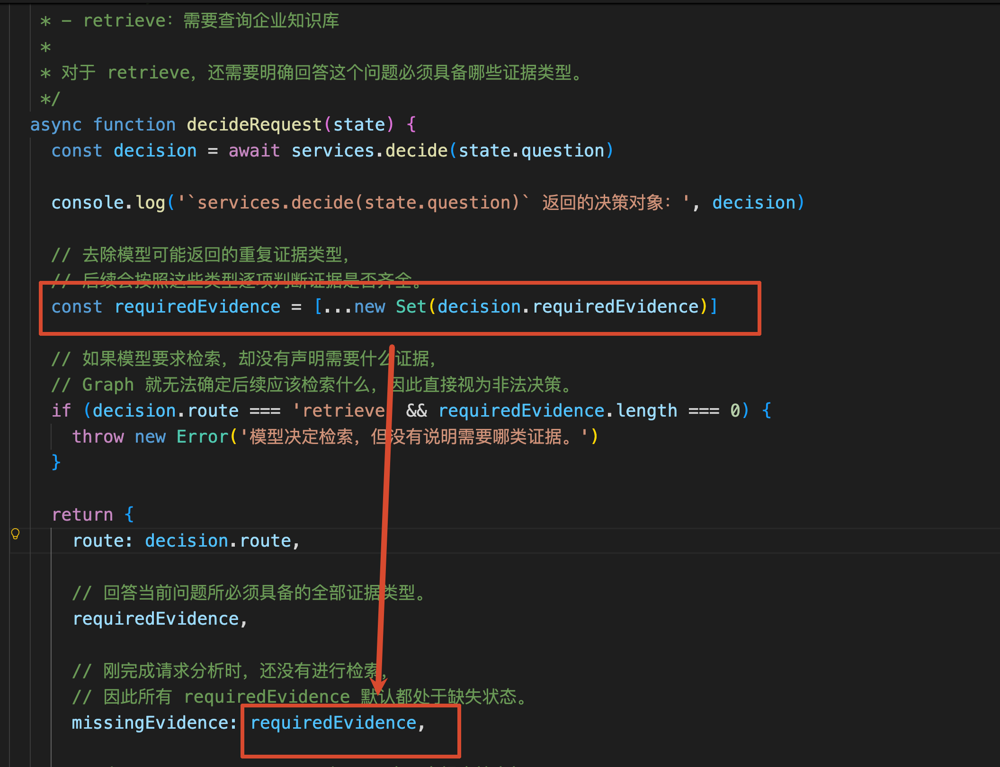

到这里，程序已经知道：下一步需要查询知识库，当前还缺少人工审核规则和退款材料要求。

随后，`routeAfterDecision()` 会读取 `state.route`：

```javascript
/**
 * Conditional Edge：
 * 根据请求分析结果选择下一节点。
 */
function routeAfterDecision(state) {
    // 普通知识问题，不需要进入 RAG 流程。
    if (state.route === 'direct') return 'direct_answer'

    // 缺少只能由用户提供的信息，暂停检索并向用户追问。
    if (state.route === 'clarify') return 'clarify_user'

    // 其余情况进入企业知识库检索流程。
    return 'search_knowledge'
}
```

当前的 `route` 是 `retrieve`，所以 Graph 下一步进入 `search_knowledge`，开始查询第一类缺失证据。

### 第二步：每次只补当前缺少的证据
条件路由发现 `route` 是 `retrieve`，接下来会进入 `search_knowledge` Node。

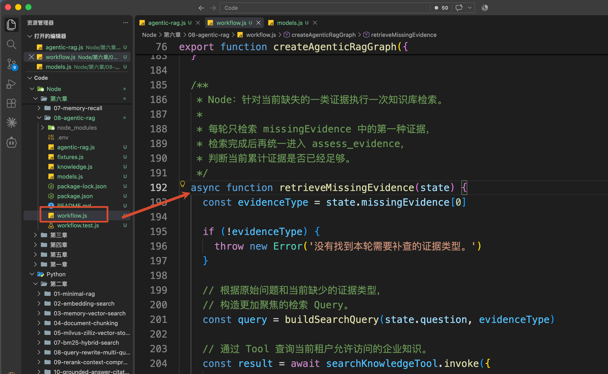

这个 Node 先读取 `missingEvidence[0]`：

```javascript
const evidenceType = state.missingEvidence[0]
```

第一次拿到的是：`review_rule`

然后，程序根据这类数据生成一个更聚焦的检索问题，再调用 `searchKnowledgeTool`：

```javascript
// 根据原始问题和当前缺少的证据类型，
// 构造更加聚焦的检索 Query。
const query = buildSearchQuery(
    state.question,
    evidenceType
)
// 通过 Tool 查询当前租户允许访问的企业知识。
const result = await searchKnowledgeTool.invoke({
    query,
    evidenceType
})
```

这里的 `searchKnowledgeTool` 就是 Agent 可以使用的企业知识检索能力。

第一次检索完成以后，State 中会增加从 `searchKnowledgeTool.invoke` 中检索出来的 `result` 数据

`result` 数据大致就是下面这样：

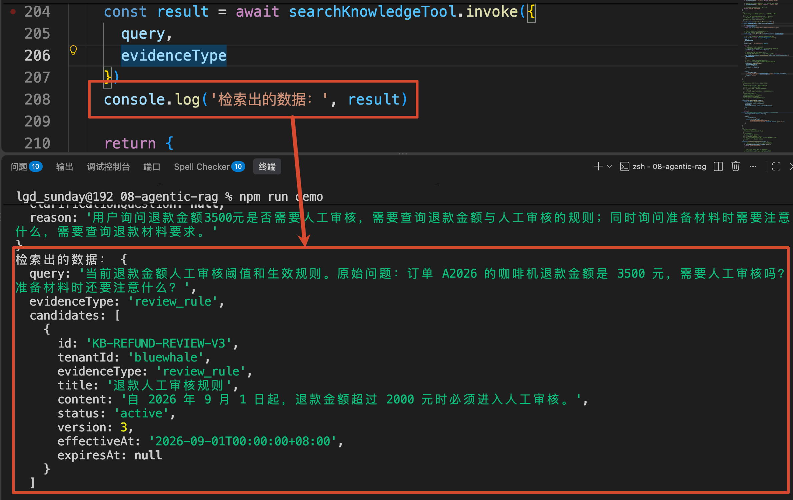

这和数据是会出现多条的哈：

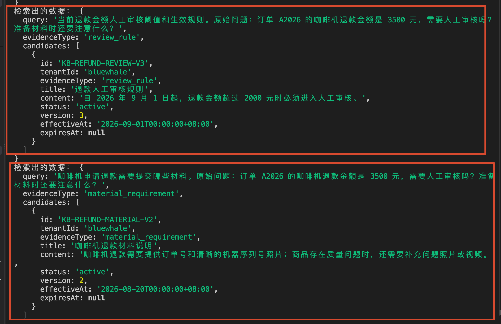

注意，现在它仍然只是 **候选资料**。

能不能真的用于回答，还要经过下一步判断。

### 第三步：判断现有证据够不够
检索完成以后，Graph 会进入 `assess_evidence`。

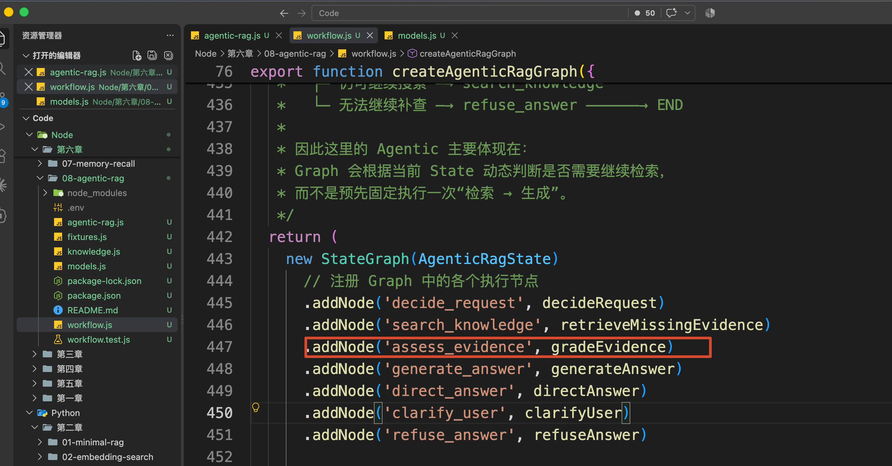

对应的代码是：

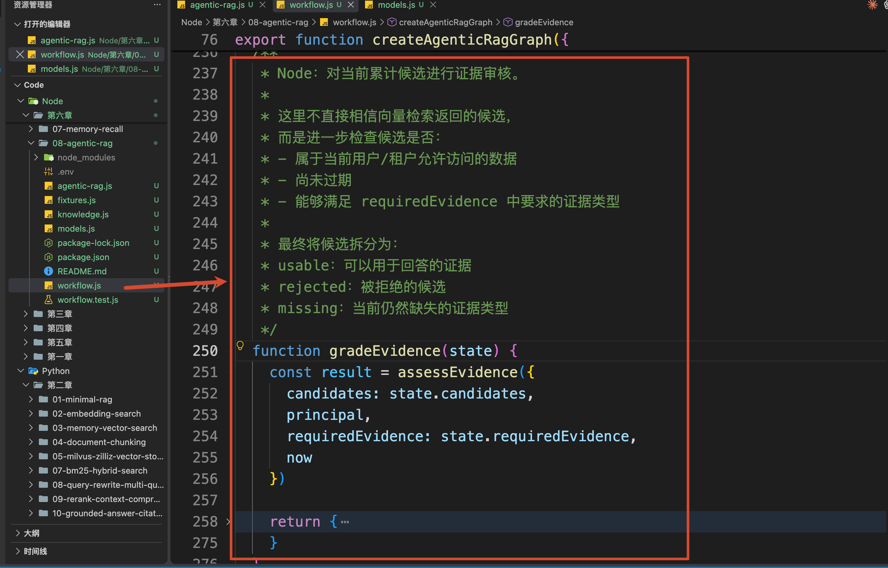

这里的代码就比较简略了，核心的处理逻辑就一条：

```javascript
const result = assessEvidence({
    candidates: state.candidates,
    principal,
    requiredEvidence: state.requiredEvidence,
    now
})
```

`assessEvidence()`  会先检查候选 Chunk 是否属于当前租户？是否正是当前问题需要的证据类型？ 等等的

通过这些检查以后，候选资料才会进入 `usableEvidence`。

接着，程序拿已有证据和 `state.requiredEvidence` 进行对比。

第一轮结束时，状态大致是：

```javascript
{
    requiredEvidence: [
        'review_rule',
        'material_requirement'
    ],
    usableEvidence: [
        { evidenceType: 'review_rule' }
    ],
    missingEvidence: [
        'material_requirement'
    ]
}
```

人工审核规则已经找到了，但是材料要求仍然缺失。

所以，`assess_evidence` 后面的 Conditional Edge 不会进入答案生成，而是重新回到：`search_knowledge`

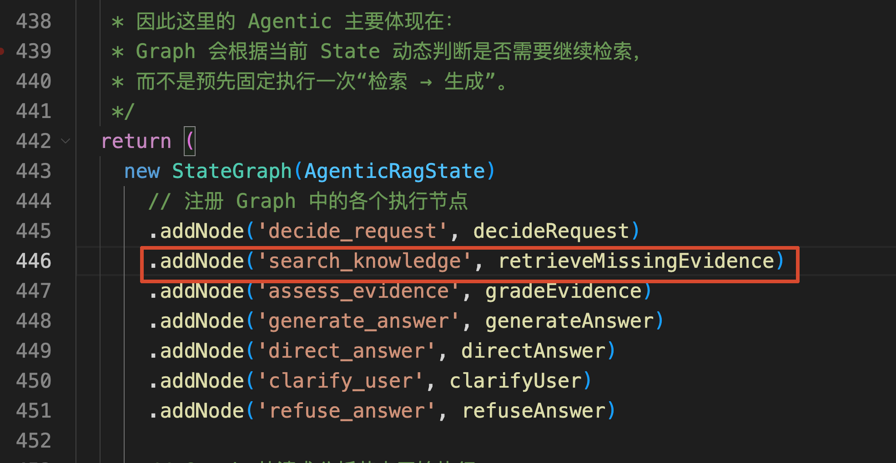

第二轮检索读取新的 `missingEvidence[0]`，这次得到的是 `material_requirement`。

材料 Chunk 返回并通过检查以后，`missingEvidence` 变成空数组：

```javascript
{
    missingEvidence: []
}
```

到这里，程序才确定：回答当前问题需要的证据已经齐全。

### 第四步：有证据以后才能生成答案
Graph 最后进入 `generate_answer`。

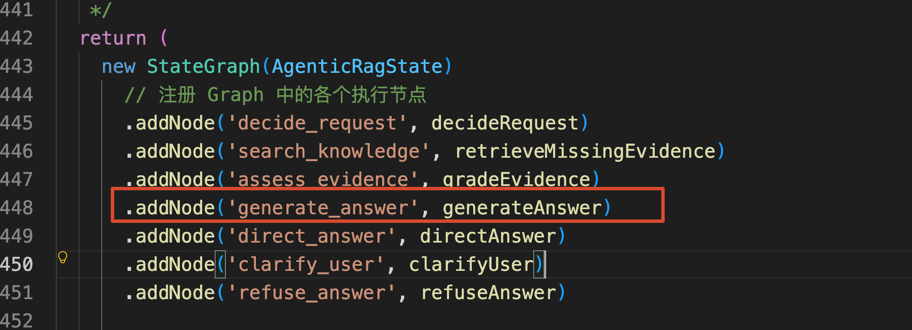

模型是已经通过检查的 `usableEvidence`：

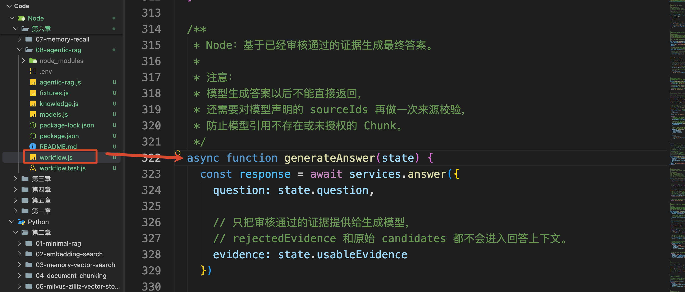

然后通过 `services.answer` 获取 `response`

```javascript
const response = await services.answer({
    question: state.question,
    evidence: state.usableEvidence
})
```

模型需要返回下面这样的结构：

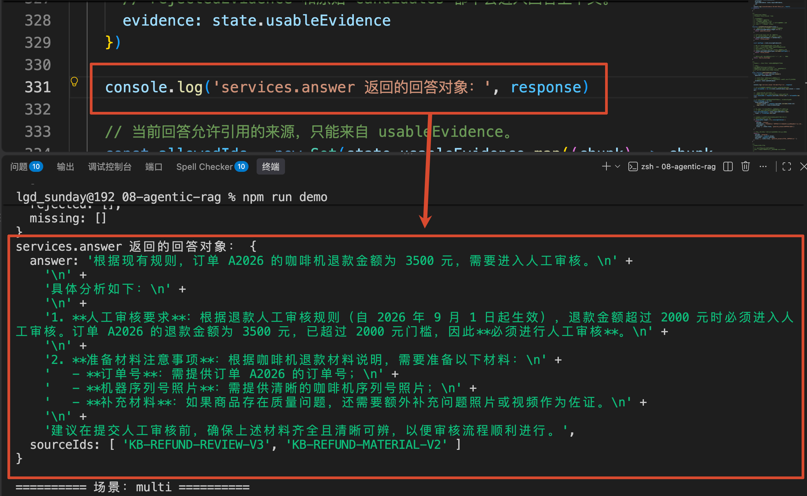

校验成功以后，Graph 才会把状态改成 `answered`，结束本次执行。

完整流程到这里就串起来了：

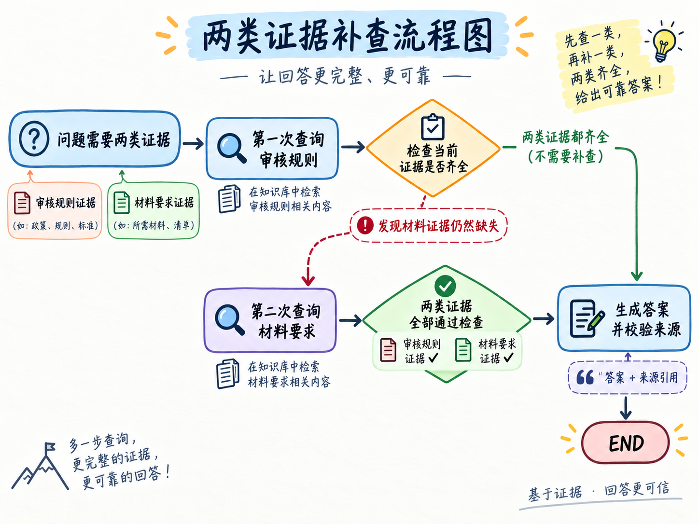


### Agentic 不等于无限检索
看到这里，很多同学可能会觉得：既然 Agent 可以补查，那就让它一直查到找到答案为止，不就行了吗？

肯定不行。

知识库里没有的内容，查一百次也不会凭空出现。不断改写 Query 只会增加模型调用次数、检索延迟和 Token 成本。

所以，查询一定是有次数限制的，这个限制通常是 3

```javascript
createAgenticRagGraph({
    maxSearches: 3
})
```

同时，程序还会记录已经查询过的证据类型。

如果同一类资料已经查过，仍然没有得到有效证据，就不会换个说法继续死循环，而是进入拒答。

即：**Agent 可以动态决定检索路径，但应用必须控制数据范围、证据标准、执行预算和停止条件。**

## 总结
这一小节，咱们主要就看了 Agentic RAG 

Agentic RAG 改变的是检索控制流程：普通 RAG 按照固定链路查询，Agentic RAG 则会根据当前问题决定是否检索、需要哪些证据，以及是否继续补查。

不过，模型提出的检索计划和知识库返回的 Chunk 都不能直接当成最终依据。

程序仍然需要检查租户、文档状态、生效时间和证据类型，并通过检索预算与重复查询检测限制 Agent Loop。

最后，只有当有效证据覆盖了用户问题，模型生成的答案和来源也通过校验以后，本次回答才算真正完成。

> 更新：2026-09-08 16:05 · 原文：<https://www.yuque.com/lgdsunday/ab1dy3/bs1uztt4gstqmlix>
