# 09-实战（上）：实现一个 AI 面试教练 Agent

接下来咱们开始写项目。

我想了好几天，觉得咱们可以做一个  **AI 面试教练 Agent**。

一是因为，现在好多 [训练营](https://mp.weixin.qq.com/s/W3jt2j-YCVc6irX3fhpqcw) 的同学都在面试，有了这个也可以自己在线下做自测。

另一点就是，这个场景功能也比较好贴合咱们这一章学的东西。

咱们这一章所学的内容，核心是三部分：

+ 短期记忆：当前面试怎样恢复
+ 长期记忆：薄弱点怎样跨面试保存
+ Agentic RAG：反馈需要哪些技术资料

整个项目的核心流程大致是这样，分成两个阶段：

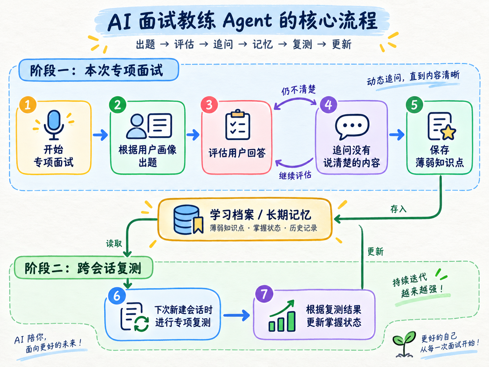

这正好和咱们学过的三部分核心能对应上。

整个视频的讲解，依然拆成上、中、下三篇来讲。

+ 上篇先把项目跑起来，并且解决会话恢复
+ 中篇继续讲面试结果怎样进入长期记忆，以及怎样更新和删除
+ 下篇再完成跨会话复测、多轮资料补查和训练效果验证

## **先把整个项目跑起来**
> 项目代码位于：`Code/Node/第六章/09-ai-interview-coach`
>

这个项目使用到了：

+ `NestJS`：提供服务端 API
+ `Vue 3`：实现面试工作台
+ `LangGraph`：组织出题、评估、检索和记忆写入流程
+ `PostgreSQL`：同时保存 Checkpoint 和长期记忆
+ `DeepSeek-V4-Flash`：在 AI 模式下评估回答并组织面试反馈

进入项目目录，启动 PostgreSQL（别忘了先打开 Docker）：

```bash
cd Code/Node/第六章/09-ai-interview-coach

docker compose up -d --wait
```

确定到以下页面，项目就启动成功了：

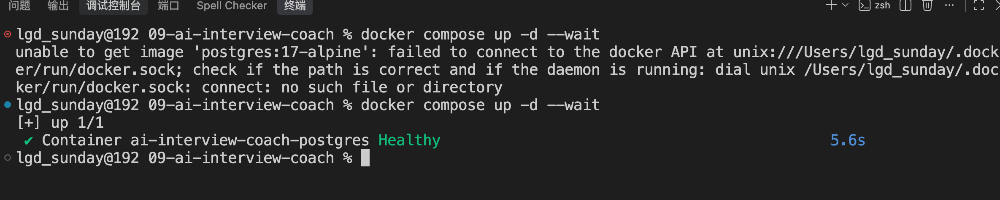

然后安装依赖，初始化 `Checkpointer` 和 `Store` 需要的数据库表：

```bash
npm install
npm run setup
```

最后启动项目：

```bash
npm run dev
```

想要使用 AI 模式，别忘记创建 `.env` 文件

```plain
DEEPSEEK_API_KEY=你的 DeepSeek API Key
DEEPSEEK_MODEL=deepseek-v4-flash
```

启动成功以后，访问：

```latex
http://localhost:5180
```

页面左边是用户和历史面试

中间是当前面试

右边则是用户画像、训练记忆、反馈依据和 Graph 轨迹。

然后，给大家录了一个项目的视频介绍，大家可以看下：

[此处为语雀卡片，点击链接查看](https://www.yuque.com/lgdsunday/ab1dy3/hlaemy3nvit1m99o#vEuir)

## **从“开始专项面试”进入代码**
项目的大致流程看完之后，咱们还是和之前一样从 **开始按钮** 开始看

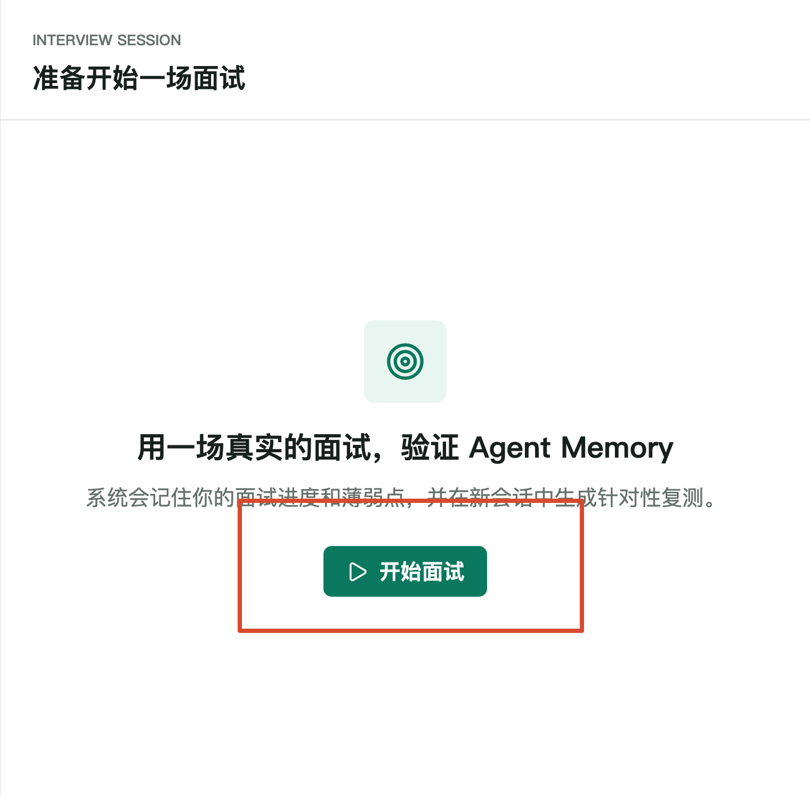

点击按钮以后，Web 端会发送一个请求：

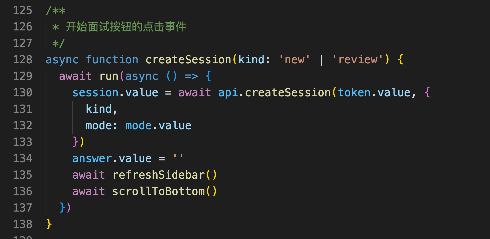

整个请求大致是下面这样的：

```http
POST /api/sessions
Content-Type: application/json
x-demo-token: demo-linxia

{
  "kind": "new",
  "mode": "replay"
}
```

+ `kind: "new"` 表示新建一场专项面试
+ `mode: "replay"` 表示使用确定性演示模式

请求进入 `interview.controller.ts` 中的 `createSession()`：

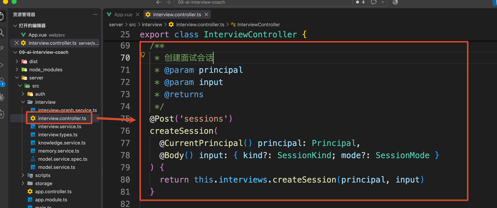

这里 的`principal` 表示服务端根据 `x-demo-token` 解析出来的可信身份，大致就是下面这样：

```typescript
{
    tenantId: 'agent-course',
    userId: 'user-linxia',
    name: '林夏'
}
```

后面查询用户画像、面试记忆和历史会话，都会使用这份身份。

接着进入 `interview.service.ts` 中的 `InterviewService.createSession()`。

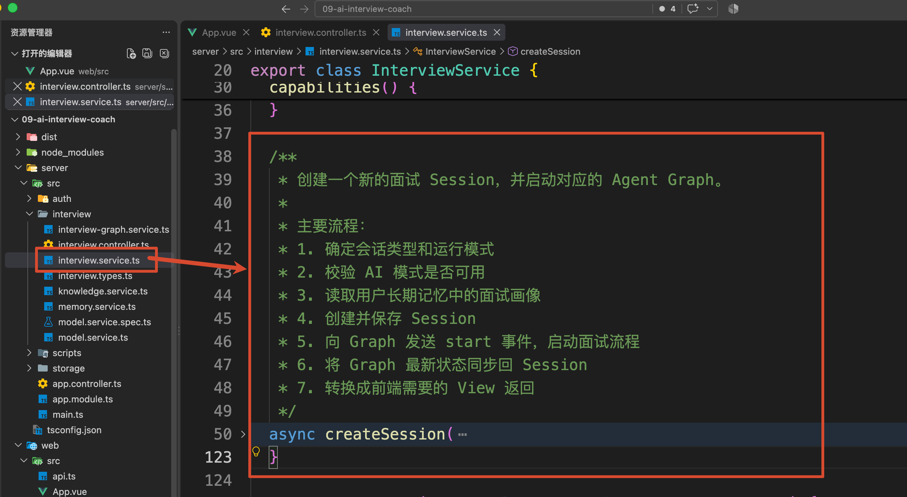

这段代码主要做了三件事：

1. 读取当前用户的面试画像
2. 为这场面试生成独立 sessionId
3. 创建一条会话索引

其中，`sessionId` 是一个 UUID，大概长这样：`f51688c6-31bb-4cd3-a7c1-fbd9bbb60a7d`

然后，代码调用 `InterviewGraphService.invoke()`：

```typescript
/**
 * 向 Agent Graph 发送 start 事件，正式启动面试工作流。
 *
 * principal 和 sessionId 用于确定用户身份以及当前会话；
 * profile 则作为 Graph 初始化时需要的用户画像上下文。
 */
const state = await this.graph.invoke(principal, id, {
    event: 'start',
    sessionId: id,
    mode,
    kind,
    profile
})
```

这里传入了新会话的初始 `State`。

而在 `InterviewGraphService.invoke()` 内部，`sessionId` 会被放进 `thread_id`：

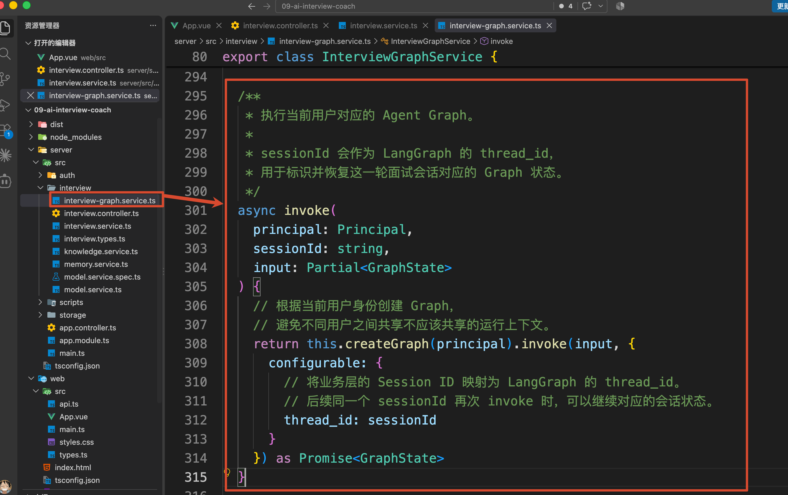

大家还记得 `thread_id` 是干什么的吧。

它是用来告诉 `Checkpointer`：**这次 Graph 执行属于哪一个 Thread（会话窗口）。**

项目在 `StorageService` 中创建的是 `PostgresSaver`：

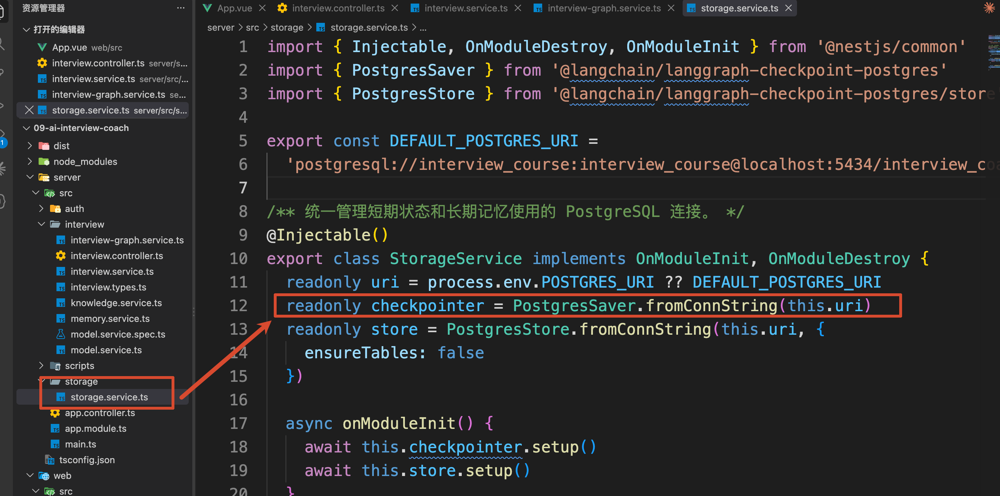

编译 Graph 时，这个 Checkpointer 会被传入：

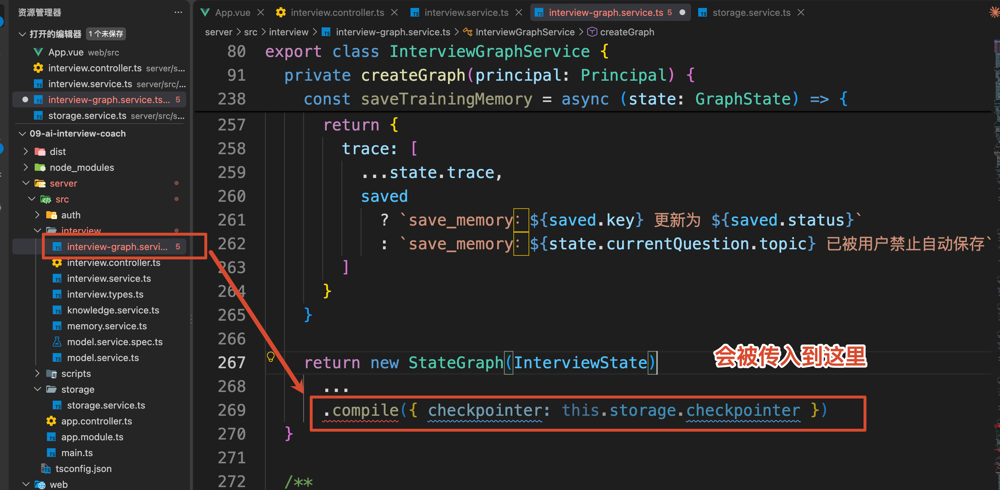

所以，第一道题生成以后，下面这些 State 并不是只存在当前 Node.js 进程里：

```typescript
{
    sessionId: 'f51688c6-...',
    status: 'awaiting_answer',
    turnNumber: 0,
    currentQuestion: {
        topic: 'agent-memory',
        title: '短期记忆与长期记忆',
        prompt: '在 LangGraph 中，Checkpointer 和 Store 有什么区别？'
    },
    messages: [
        {
            role: 'assistant',
            kind: 'question',
            content: '在 LangGraph 中，Checkpointer 和 Store 有什么区别？'
        }
    ]
}
```

它们会作为当前 `thread_id` 的 Checkpoint 写入 PostgreSQL。

这就是为什么服务重启以后，这场面试不会丢失的原因

## **历史面试是怎样恢复的**
现在可以做一个小实验。

保留刚才建立的面试，停止项目：

```latex
Ctrl + C
```

再次执行：

```bash
npm run dev
```

页面重新打开以后，左边依然可以看到刚才的历史面试。

[此处为语雀卡片，点击链接查看](https://www.yuque.com/lgdsunday/ab1dy3/hlaemy3nvit1m99o#X9jcd)

点击它时，Web 端会请求：

```http
GET /api/sessions/{sessionId}
```

服务端先使用当前 `principal` 查询会话索引：

```typescript
const session = await this.memories.getSession(
    principal,
    sessionId
)
```

这一步解决的是会话归属问题。

用户即使知道其他人的 `sessionId`，也不能直接恢复对方的面试。

通过归属校验以后，代码再使用相同的 `thread_id` 读取 Graph State：

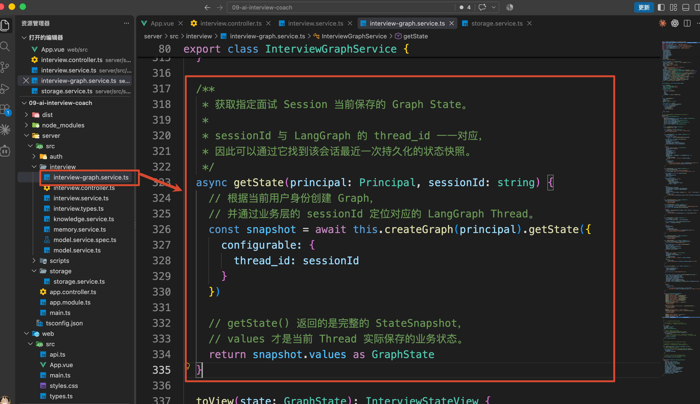

于是，整个恢复过程可以整理成：

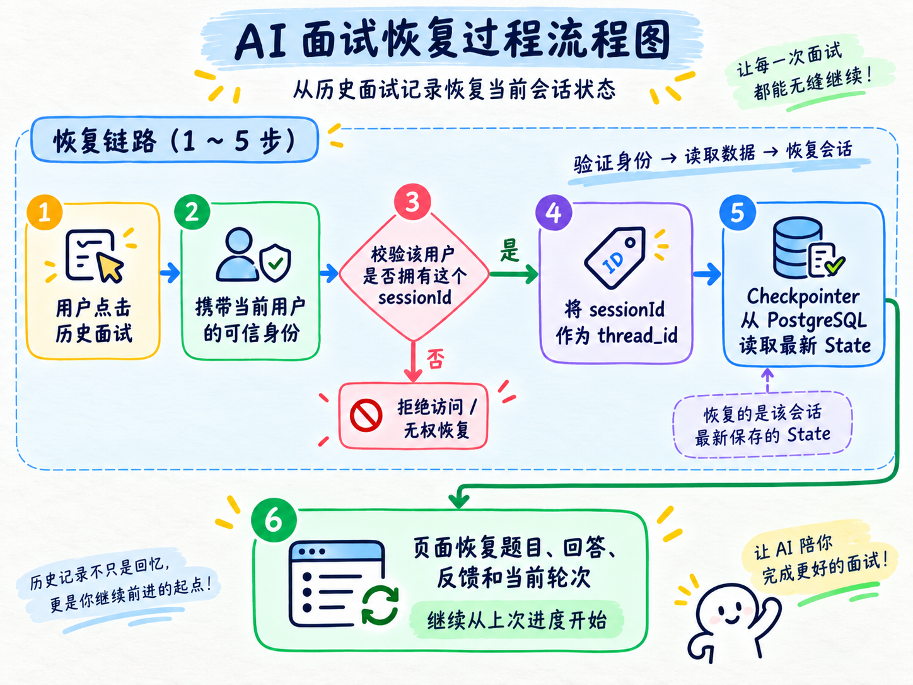


## **总结**
这一篇，咱们先把 AI 面试教练的整个交互跑了起来。

它可以根据用户画像发起一场面试，根据当前回答继续追问，并且在页面或者服务重启以后恢复原来的面试进度。

下一篇，咱们就从“提交回答”开始，继续追踪面试结果怎样从当前 Thread State，变成一条可以跨会话使用的长期训练记忆的。

> 更新：2026-09-09 16:56 · 原文：<https://www.yuque.com/lgdsunday/ab1dy3/hlaemy3nvit1m99o>
