# 10-实战（中）：提取并管理训练记忆，薄弱点、用户画像与更新删除

上一篇，咱们已经把 AI 面试教练跑了起来

这一篇，咱们就从页面中的 **“提交回答”** 开始，看看一次面试回答是怎样被评估、提炼，并最终变成长期训练记忆的。

## 从“提交回答”进入项目
先创建一场专项面试。

面对第一道题，点击“填入不完整回答”，页面会自动填入：“它们都是保存聊天记录的，只是保存位置不同。”

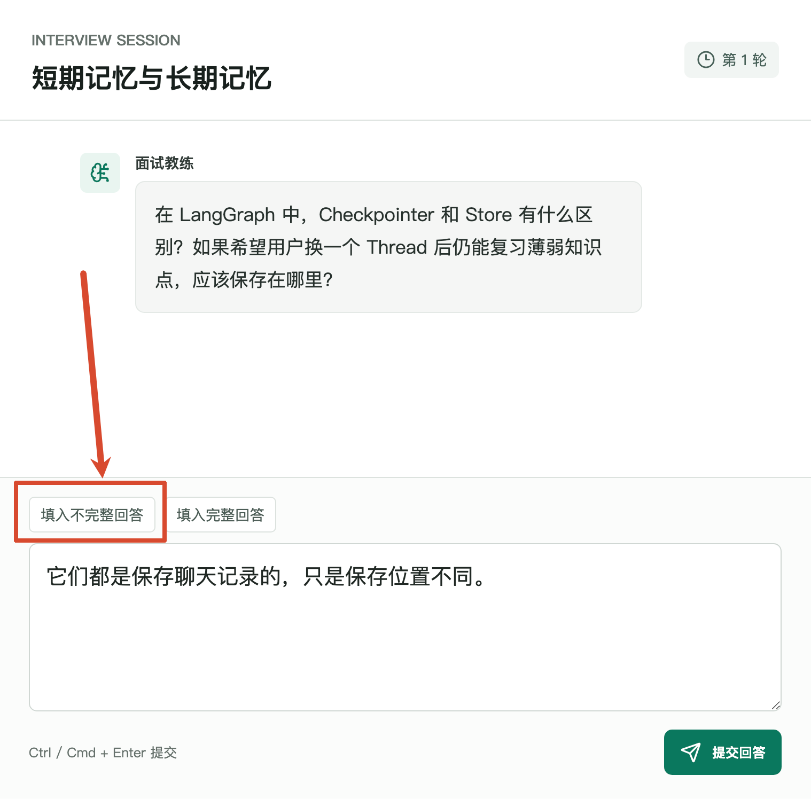

然后点击 **“提交回答”**。

这个按钮位于 `web/src/App.vue`，点击以后会执行 `submitAnswer()`：

```typescript
async function submitAnswer() {
    if (!session.value || !canSubmit.value) return

    await run(async () => {
        session.value = await api.answer(
            token.value,
            session.value!.sessionId,
            answer.value
        )

        answer.value = ''
        await refreshSidebar()
        await scrollToBottom()
    })
}
```

这里传入了三份数据：

+ `token`：当前登录用户的演示 Token
+ `sessionId`：正在回答哪一场面试
+ `answer`：用户刚刚填写的答案

接着，`web/src/api.ts` 中的 `api.answer()` 会发送下面这个请求：

```http
POST /api/sessions/{sessionId}/answers
Content-Type: application/json
x-demo-token: demo-linxia

{
  "answer": "它们都是保存聊天记录的，只是保存位置不同。"
}
```

请求先进入 `server/src/interview/interview.controller.ts` 中的 `answer()` 方法：

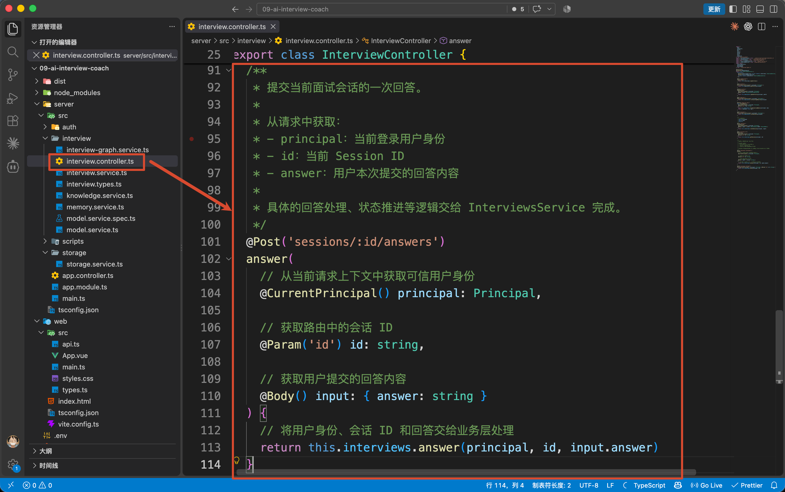

Controller 只负责接收请求。

真正的业务入口，是 `server/src/interview/interview.service.ts` 中的 `InterviewService.answer()`。

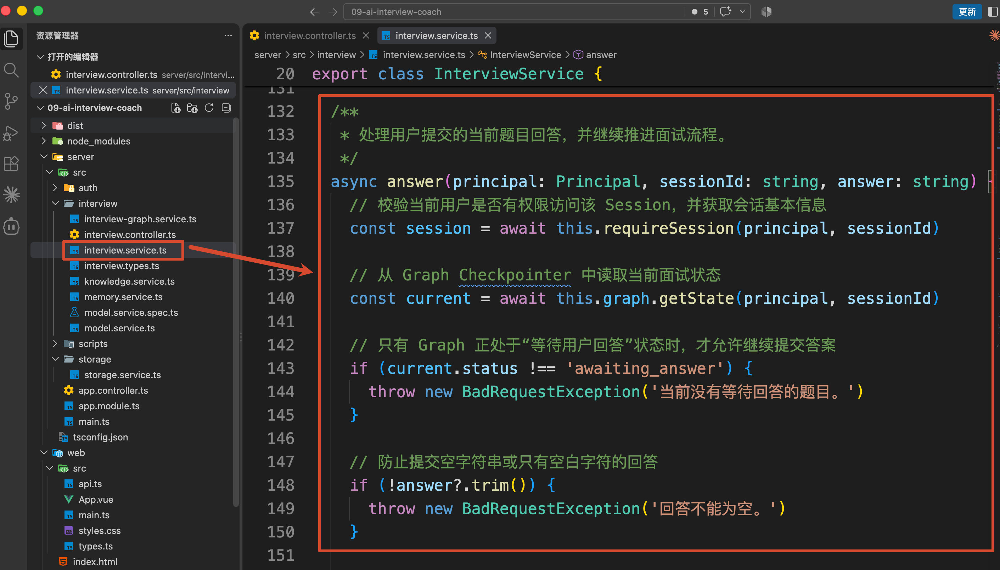

到这里，咱们就看到了真实的核心业务逻辑了

## 服务端核心逻辑
进入 `InterviewService.answer()` 以后，代码不会立刻把答案交给模型。

它会先确认两件事：

```typescript
// 校验当前用户是否有权限访问该 Session，并获取会话基本信息
const session = await this.requireSession(
    principal,
    sessionId
)
// 从 Graph Checkpointer 中读取当前面试状态
const current = await this.graph.getState(
    principal,
    sessionId
)
```

`requireSession()` 会检查这场面试是否属于当前用户。

`graph.getState()` 会根据相同的 `thread_id`，从 `Checkpointer` 中恢复这场面试的最新 State。

恢复出来的 State 里，已经存在上一篇生成的题目和对话记录。

服务端还会确认当前状态确实是 `awaiting_answer`。如果这道题已经回答完成，重复提交会直接被拒绝。

校验通过以后，才会继续调用：

```typescript
// 将本次回答作为 answer 事件重新送入 Graph，
// Graph 会基于已有 Session 状态继续执行后续节点
const state = await this.graph.invoke(
    principal,
    sessionId,
    {
        event: 'answer',
        answer: answer.trim()
    }
)
```

大家注意，这里只提交了本次新增的 `event` 和 `answer`。

当前题目、之前的 `messages`、面试轮次等数据都没有重新传入。它们会由 `Checkpointer` 根据 `sessionId` 对应的 `thread_id` 自动恢复。

所以，Graph 真正开始执行时，拿到的数据大概是：

```typescript
{
    event: 'answer',
    currentQuestion: {
        topic: 'agent-memory',
        title: '短期记忆与长期记忆'
    },
    answer: '它们都是保存聊天记录的，只是保存位置不同。',
    messages: [
        {
            role: 'assistant',
            kind: 'question',
            content: '在 LangGraph 中，Checkpointer 和 Store 有什么区别？'
        }
    ]
}
```

从这里开始，本次回答会依次经过下面几个 Node：

```latex
→ dispatch
→ evaluate_answer
→ retrieve_evidence / assess_evidence
→ compose_feedback
→ save_memory
→ END
```

这些 Node 都是在 `interview-graph.service.ts` 里面完成注册的

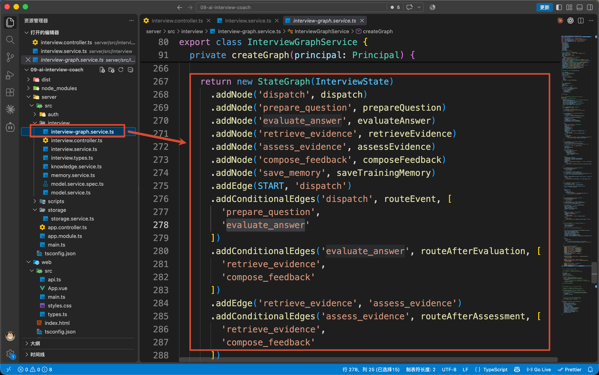

现在，Checkpointer 已经恢复了当前面试的 State，`InterviewGraphService.invoke()` 也已经把下面这次输入交给 Graph：

```typescript
{
    event: 'answer',
    answer: '它们都是保存聊天记录的，只是保存位置不同。'
}
```

Graph 接下来会先进入 `dispatch` （上面的第一个 Node），判断这次收到的到底是“生成下一道题”，还是“处理用户回答”。

## **场景一：不完整回答怎样生成“待复习”记忆**
`dispatch` 自己不处理回答，只负责决定下一步执行哪个 Node：

```typescript
const routeEvent = (state: GraphState) => {
    if (state.event === 'answer') {
        return 'evaluate_answer'
    }

    return 'prepare_question'
}
```

这次的 `event` 是 `answer`，所以 Graph 会进入：`evaluate_answer`

`evaluate_answer` 对应的是 `evaluateAnswer()`。

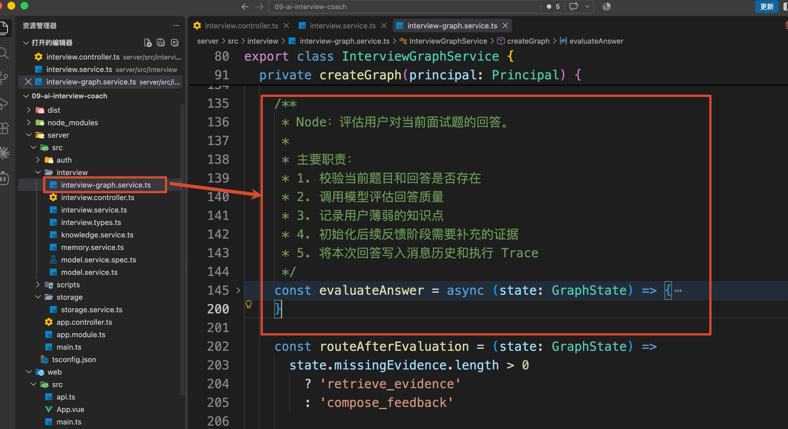

它会把当前题目和用户刚刚提交的回答交给 `InterviewModelService.evaluate()`：

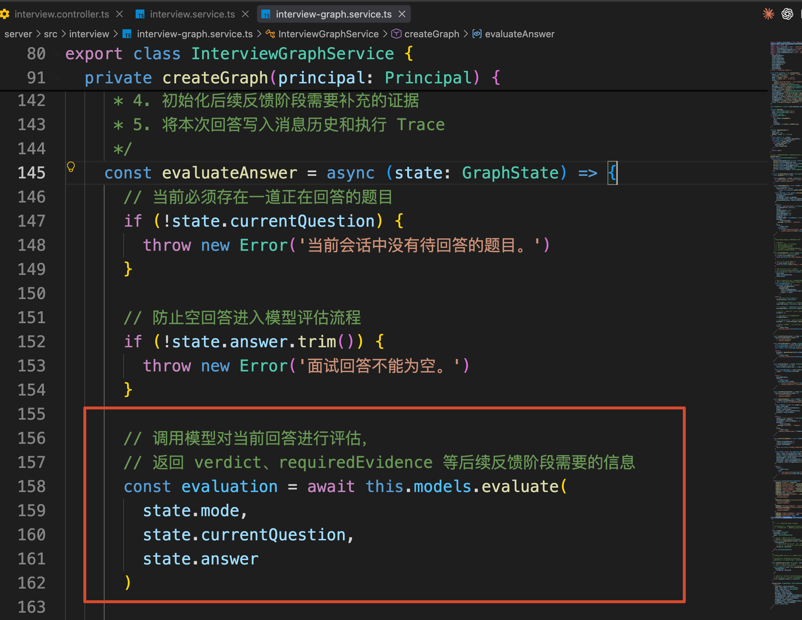

因为，咱们刚才回答的是一份不完整的回答：“它们都是保存聊天记录的，只是保存位置不同。”

所以，`evaluate()` 返回的评估结果大概是：

```typescript
{
    verdict: 'incorrect',
    reason: '已经提到部分相关概念，但关键区别还没有说完整。',
    gaps: [
        'Checkpointer 按 thread_id 保存当前 Thread 的 Agent State',
        'Store 使用自定义 Namespace 保存跨 Thread 的长期信息',
        '跨会话复习的薄弱点应该保存在 Store 中'
    ],
    requiredEvidence: [
        'short_term_memory',
        'long_term_memory'
    ]
}
```

其中：

+ `verdict` 表示本次回答是否正确
+ `gaps` 表示回答还缺少哪些关键内容
+ `requiredEvidence` 表示生成反馈时需要查询哪些技术资料

这份结果会被保存到当前 State 的 `lastEvaluation` 中。

同时，因为本次回答没有通过，当前题目的 `agent-memory` 主题会被加入 `struggledTopics`。

不过，此时的薄弱点还只存在当前 Thread State 中，并没有成为跨会话记忆。

接下来，Graph 会查询反馈需要的资料，并生成面试反馈，大概会经过下面这些 Node：

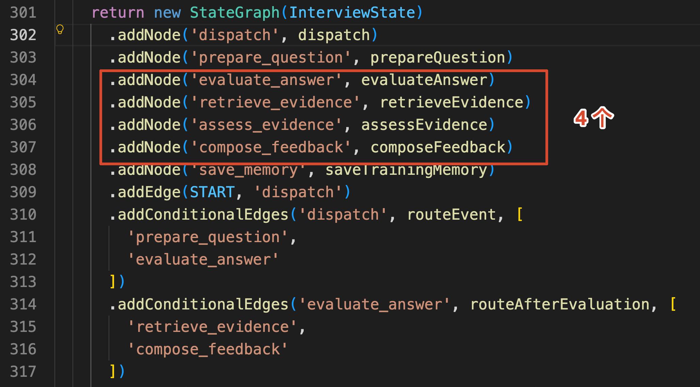

这部分属于 Agentic RAG，下一篇咱们再详细讲。

这里先继续看 `compose_feedback` 后面的 Edge：

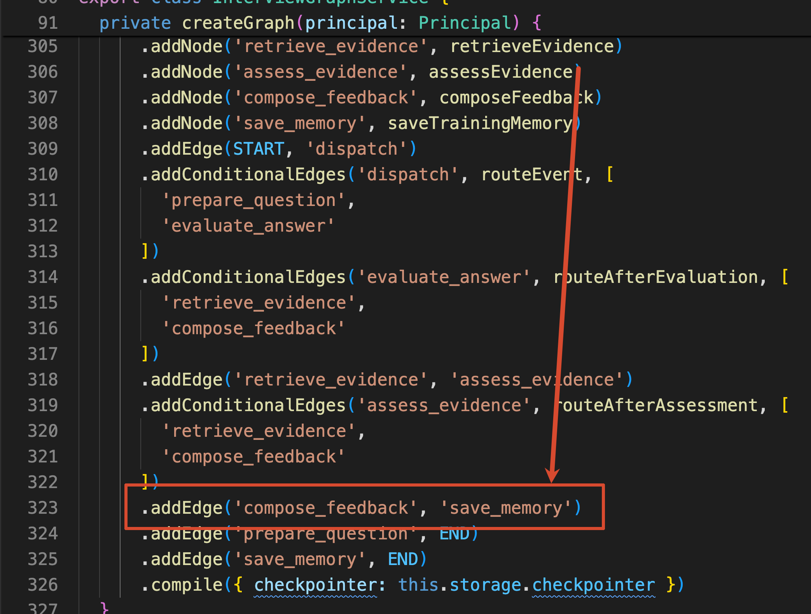

这行代码表示：面试反馈生成完成以后，Graph 会继续进入 `save_memory`。

而 `save_memory`，才是真正写入长期训练记忆的地方。

`save_memory` 对应的是 `saveTrainingMemory()`。

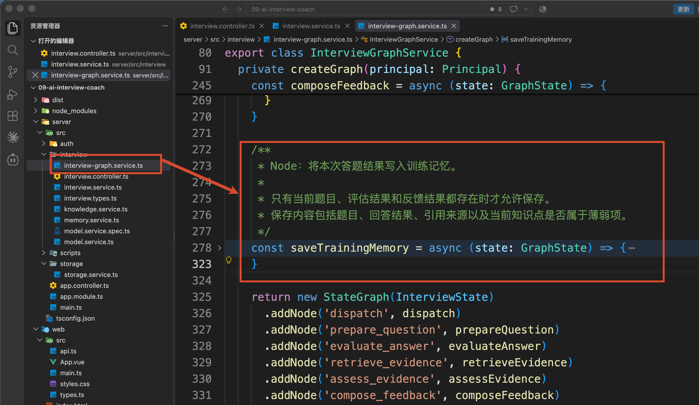

进入这个方法时，当前 State 中已经有了：

+ `currentQuestion`：当前回答的是哪个知识主题
+ `lastEvaluation`：本次回答是否正确，还缺少什么
+ `lastFeedback`：最终反馈使用了哪些资料

接下来，代码会把这些数据交给 `recordTrainingResult()`：

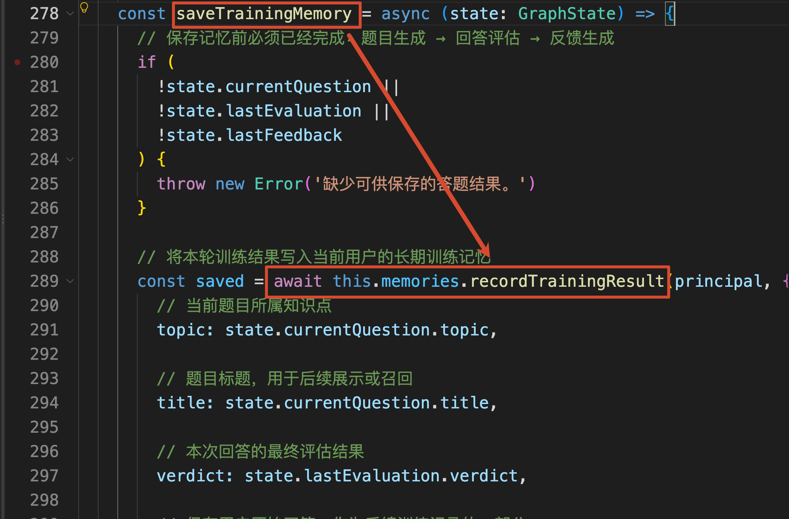

长期训练真正需要保存的是：哪个知识点没有掌握、练习了多少次、最近一次答得怎么样，以及下次什么时候复习。

这些信息最终会被整理成一条 `LearningMemory` ，类似于下面这样子：

```typescript
{
    key: 'agent-memory',
    topic: 'agent-memory',
    title: '短期记忆与长期记忆',
    status: 'needs_review',
    attempts: 1,
    correctCount: 0,
    lastVerdict: 'incorrect',
    lastAnswerSummary: '它们都是保存聊天记录的，只是保存位置不同。',
    nextReviewAt: '2026-09-11T10:00:03.544Z'
}
```

然后写入 `PostgresStore`：

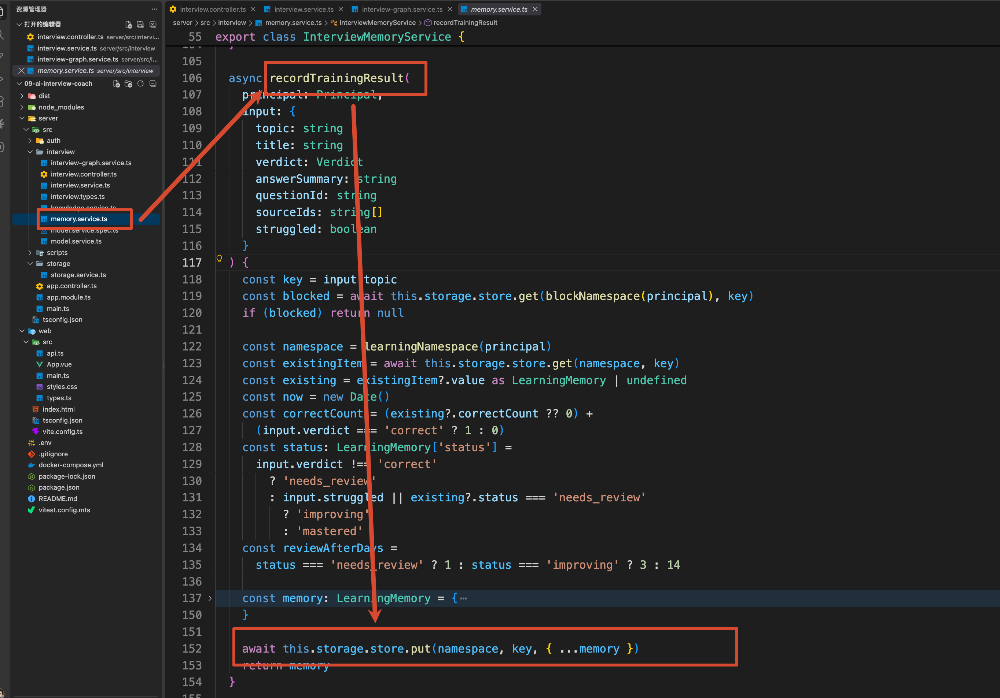

那么到这里，林夏的训练记忆就保存在数据库里面了：

```latex
Namespace：agent-course / user-linxia / learning-memories
Key：agent-memory
```

保存完成以后，页面右侧就会出现一条“短期记忆与长期记忆”的训练记录，状态为 **“待复习”**。

所以，这一整套的完整流程就是：

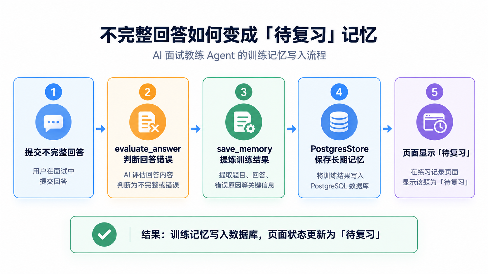

第一条训练记忆已经创建完成。

接下来，咱们看第二个场景：再次回答同一个知识点时，系统会怎样处理原来的薄弱记录。

## **场景二：再次回答怎样更新原来的记忆**
第一次回答完成以后，点击页面中的 **“继续下一题”**。

Web 端会发送：

```http
POST /api/sessions/{sessionId}/next
```

这次 Graph 收到的事件是：

```typescript
{
    event: 'next'
}
```

因为上一道题没有回答完整，`prepareQuestion()` 会继续生成一道相同主题的追问题，比如：

```latex
同一名用户关闭页面后继续原面试，以及新建一场复习面试，分别应该从 Checkpointer 和 Store 中读取什么？
```

这次填入完整回答，再次点击“提交回答”。

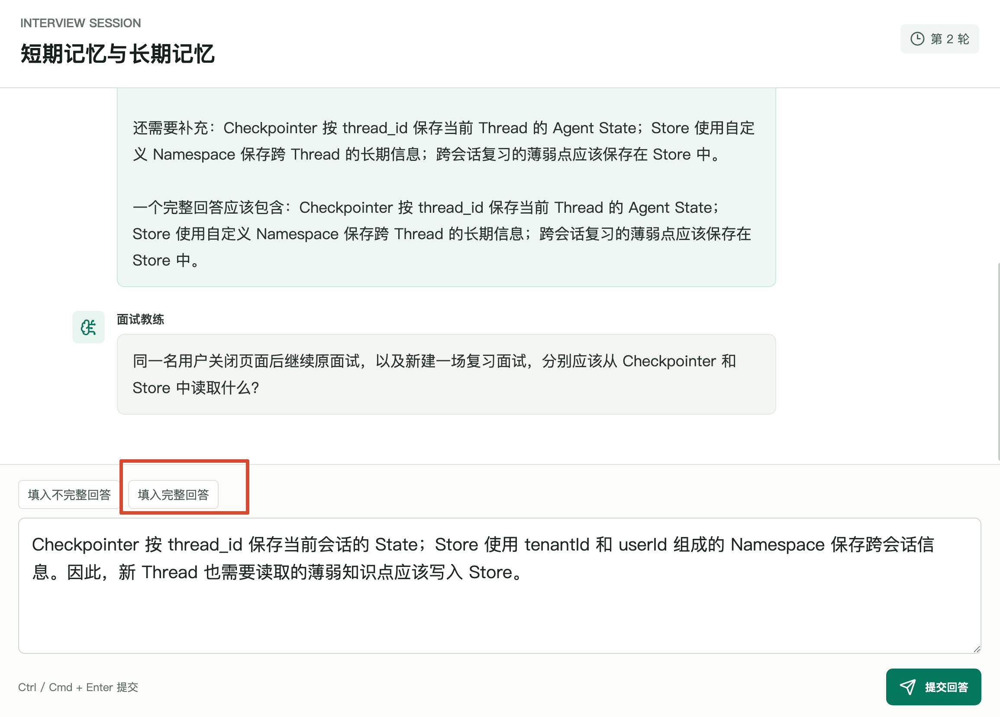

新的答案仍然会经过：`evaluate_answer → compose_feedback → save_memory`

但是，这道追问题的 `topic` 仍然是 `agent-memory`。

所以，`recordTrainingResult()` 使用的还是同一个 Key。

写入以前，代码会先查询原来的训练记忆：

```typescript
const key = input.topic

const existingItem = await this.storage.store.get(
    namespace,
    key
)
```

如果旧记忆已经存在，就在它的基础上更新：

```typescript
const memory: LearningMemory = {
    key,
    // ...
    attempts: (existing?.attempts ?? 0) + 1,
    correctCount,
    lastVerdict: input.verdict,
    lastAnswerSummary: input.answerSummary.slice(0, 180),
    updatedAt: now.toISOString(),
    nextReviewAt: addDays(now, reviewAfterDays)
}
```

所以，页面上不会出现两条相同的 `agent-memory`。

原来的记录会更新成类似这样：

```typescript
{
    key: 'agent-memory',
    status: 'improving',
    attempts: 2,
    correctCount: 1,
    lastVerdict: 'correct'
}
```

大致的意思就是：一共练习了 2 次，其中 1 次回答正确，状态从“待复习”变成“提升中”。

那么，为什么答对以后没有直接变成“已掌握”呢？

因为当前项目不会只根据 **最近一次回答** 判断掌握情况，它还会结合这个知识点之前的训练记录。

代码里的判断是：

```typescript
const status =
    input.verdict !== 'correct'
        ? 'needs_review'
        : input.struggled || existing?.status === 'needs_review'
            ? 'improving'
            : 'mastered'
```

这里一共有三种结果。

### 第一种：needs_review，表示需要复习
只要本次回答是错误或者部分正确，就会进入 `needs_review`。

比如第一次回答以后，训练记忆会变成：

```latex
练习次数：1
正确次数：0
当前状态：needs_review
下次复习：1 天后
```

这个状态表示：**系统已经确认当前知识点存在缺口，后面需要继续追问或者安排复习。**

### 第二种：improving，表示正在提升
如果用户后来回答正确，但是这个知识点在当前 Thread 中答错过，或者 Store 中原本就是 `needs_review`，系统不会立刻把它标记为已掌握，而是先进入 `improving`。

当前案例就属于这种情况：

+ 第一次回答不完整：agent-memory 被记录为 needs_review
+ 继续回答同一主题的追问题，并且回答正确：agent-memory 更新为 improving

这时的训练记忆是：

```latex
练习次数：2
正确次数：1
当前状态：improving
下次复习：3 天后
```

`improving` 表示：**这次已经答对了，但是前面刚暴露过薄弱点，还需要通过下一次独立复测确认是否真正掌握。**

### **第三种：mastered，表示已经掌握**
下一次重新创建一场复习面试时，会产生一个新的 Thread。

如果用户面对同一知识点再次回答正确，程序读取到的历史状态已经是 `improving`，而当前这场面试中又没有出现新的错误，就会把状态更新为 `mastered`：

```latex
历史状态：improving
本次复测：回答正确
当前 Thread：没有再次答错
最终状态：mastered
下次复习：14 天后
```

所以，对于已经暴露过的薄弱点，完整的状态变化是：

+ 第一次回答错误或部分正确：needs_review 表示 需要复习
+ 后来在追问中回答正确：improving 表示 正在提升
+ 下一场独立复测再次回答正确：mastered 表示 已经掌握

那么到这里，训练记忆已经可以创建和更新了。

然后，咱们再来看另一类需要跨会话保存的数据：用户画像。

## 用户画像的保存
页面右上角的“面试画像”中，保存了用户的目标岗位、开发经验和专项方向。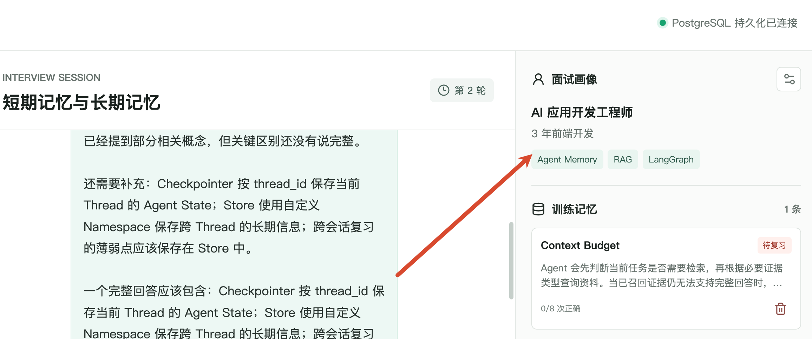

点击设置按钮，修改“专项方向”，再点击 **“保存画像”**，Web 端会发送：

```http
PATCH /api/profile
Content-Type: application/json

{
  "experience": "3 年前端开发",
  "targetRole": "AI 应用开发工程师",
  "focusTopics": ["Agentic RAG"],
  "answerStyle": "一次只问一道题，回答后再继续追问"
}
```

请求最终会进入 `Interview 下面的 MemoryService 的 updateProfile()`：

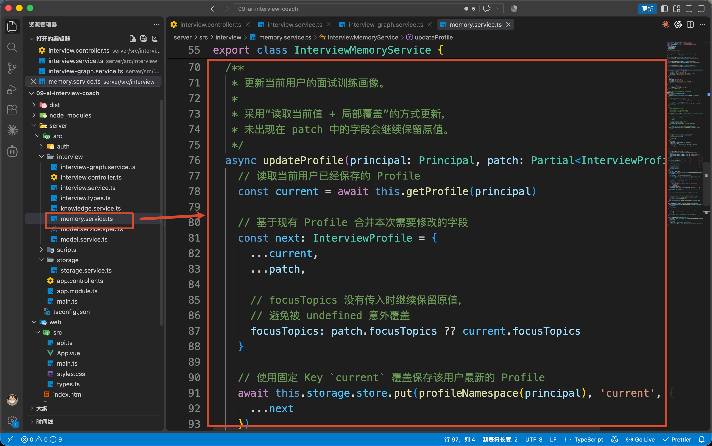

这里的代码不算复杂，代码中会先读取原来的画像，再把本次修改合并进去，最后写回：

```latex
Namespace：agent-course / user-linxia / profile
Key：current
```

用户画像只需要保存一份最新数据，所以使用固定的 `current` Key。

训练记忆则使用知识主题作为 Key，因为一个用户可能同时存在多个薄弱知识点。

画像保存以后，再点击“开始专项面试”。

`InterviewService.createSession()` 会读取最新画像，并把它交给 Graph。后面的 `prepareQuestion()` 会根据新的 `focusTopics` 选择题目。

所以，修改画像不只是改变页面上的文字，它还会影响新面试优先训练什么内容。

## 删除记忆功能
最后，咱们看训练记忆右下角的垃圾桶按钮。

点击以后，浏览器会发送：

```http
DELETE /api/memories/agent-memory
```

请求最终进入 `forgetLearningMemory()`：

```typescript
await this.storage.store.put(
    blockNamespace(principal),
    key,
    {
        blockedAt: new Date().toISOString()
    }
)

await this.storage.store.delete(
    learningNamespace(principal),
    key
)
```

这里执行了两个操作：

+ 删除已经保存的训练记忆
+ 保存一条 memory-blocks 阻断标记

为什么不能只删除记忆？

因为用户以后再次回答 `agent-memory` 相关问题时，Graph 还会进入 `save_memory`。如果程序不知道用户已经要求忘记这个主题，刚删掉的记忆就会被重新创建。

所以，`recordTrainingResult()` 在写入以前，会先检查阻断标记：

```typescript
const blocked = await this.storage.store.get(
    blockNamespace(principal),
    key
)

if (blocked) return null
```

发现阻断标记以后，本次训练结果就不会再自动写入 Store。

因此，当前项目中的“删除记忆”表达的是：

> 删除这条训练记忆，并且停止自动记录这个知识主题。
>

如果真实产品还需要“只删除历史数据，但以后允许继续记录”，就应该把这两个操作拆成不同功能。

## **总结**
这一篇，咱们从“提交回答”按钮开始，完整看到了下训练记忆怎样创建和更新逻辑

用户画像则保存用户当前的训练方向，并在新建面试时影响后续出题。

这些数据都保存在不包含 `thread_id` 的 Store Namespace 中，所以换一场面试以后仍然可以继续使用。

下一篇，咱们就点击 **“复习薄弱点”**，创建一个新的 Thread，看看 Agent 怎样读取刚才保存的训练记忆，并根据这个薄弱点生成一场针对性复测。

> 更新：2026-09-10 12:34 · 原文：<https://www.yuque.com/lgdsunday/ab1dy3/em2d6d96hmpbirlr>
