# 11 - 实战（下）：跨会话复测、Agentic RAG 与训练效果验证

上一篇，咱们已经完成了训练记忆的创建和更新。

第一次回答不完整以后，系统会为“短期记忆与长期记忆”这个知识主题创建一条训练记忆。其中，`agent-memory` 是这条记忆的唯一标识，`needs_review` 表示这个知识点当前还没有掌握，需要继续复习。

在同一场面试中继续回答追问题，并且回答正确以后，这条记忆又被更新成了：

```typescript
{
    key: 'agent-memory',
    title: '短期记忆与长期记忆',
    status: 'improving',
    attempts: 2,
    correctCount: 1
}
```

但是，到这里还不能证明这套记忆真的有用。

因为这两次回答都发生在同一个 Thread 中。Agent 完全可以从当前会话的 State 里看到前面的题目和回答。

真正需要验证的是：**新建一个完全不同的 Thread 以后，Agent 能不能从 Store 中找到这个薄弱点，并根据它生成一场新的复测？**

复测完成以后，咱们还要继续确认两件事：

+ 第一：面试反馈需要多类技术资料时，Agent 能不能检查还缺什么并继续补查；
+ 第二：用户再次回答正确以后，`improving` 能不能更新为 `mastered`。

所以，这一篇就从页面中的“复习薄弱点”开始，把整个 AI 面试教练捋一遍。

## 从“复习薄弱点”进入项目
按照上一篇的操作完成两次回答以后，页面右侧的“短期记忆与长期记忆”应该处于“提升中”状态。

这时，点击页面左侧的“复习薄弱点”。

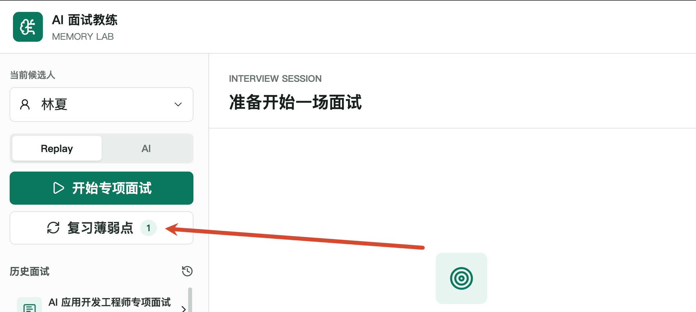

这个按钮会调用：`createSession('review')`

点击以后，发送的仍然是新建面试请求：

```http
POST /api/sessions
Content-Type: application/json
x-demo-token: demo-linxia

{
  "kind": "review",
  "mode": "replay"
}
```

这次和第一篇唯一明显的区别，是 `kind` 变成了 `review`。

不过，大家要注意：**这里创建的仍然是一场新面试。**

服务端会生成新的 `sessionId`，`Checkpointer` 也会使用新的 `thread_id`。

比如：

+ 第一场面试：`thread_id = f51688c6-...`
+ 这次薄弱点复测：`thread_id = 8d72cb40-...`

两个 Thread 不同，所以新面试不会把上一场面试的所有消息全部复制过来。

新的 `sessionId` 准备好以后，`InterviewService.createSession()` 会调用：

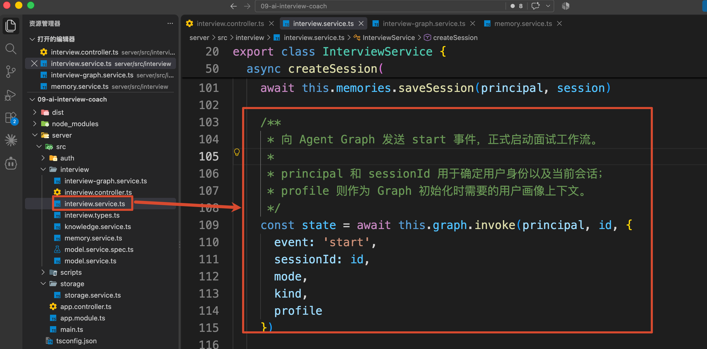

这次传入的是 `event: 'start'`，表示启动一场新的面试。

Graph 会先从 `START` 进入 `dispatch`

`dispatch` 后面的条件路由会根据 `event` 决定下一步：

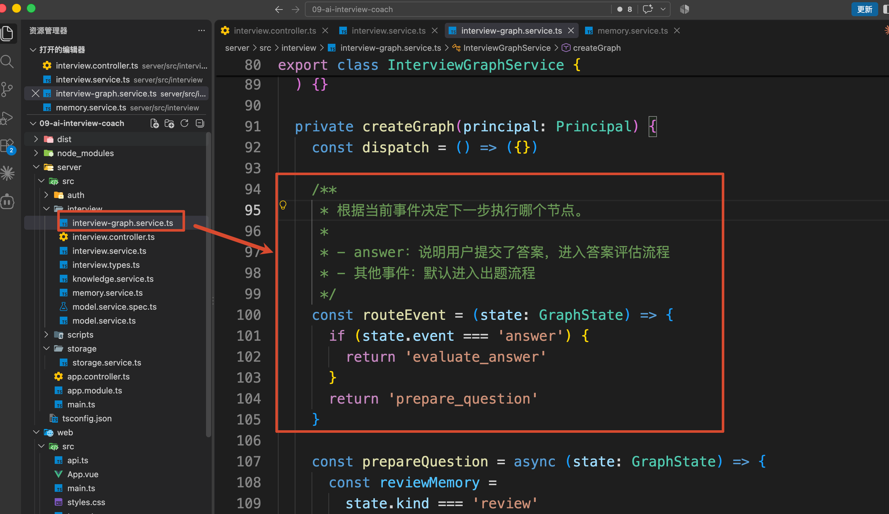

当前的 `event` 是 `start`，不是 `answer`，所以 Graph 会进入 `prepare_question`

`prepare_question` 对应的处理函数就是 `prepareQuestion()`

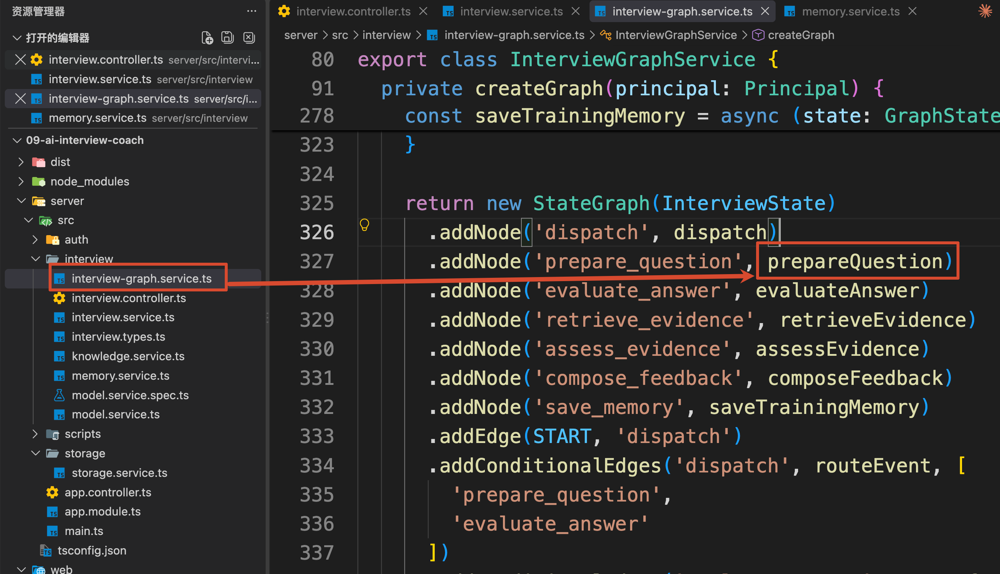

代码会先判断本次面试类型，对于普通面试，这个方法会根据用户画像选择题目，对于当前的复习面试，它还会先从 Store 中查询需要复习的训练记忆：

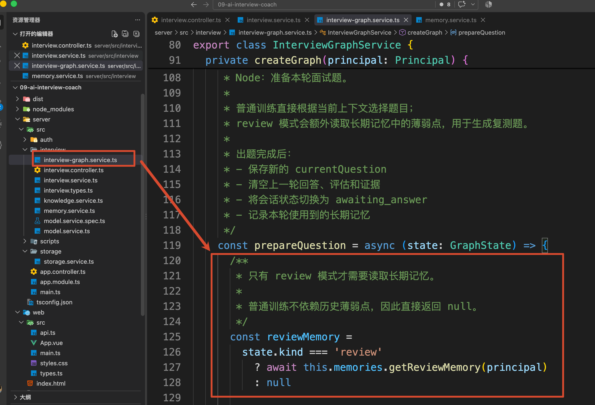

当 `kind === "review"` 时，`getReviewMemory()` 会查询当前用户的训练记忆。

不过，“复习薄弱点”按钮只表示要开始一场复习，并没有指定这次应该复习哪个知识点。

所以，`getReviewMemory()` 会先读取当前用户保存的所有训练记忆：

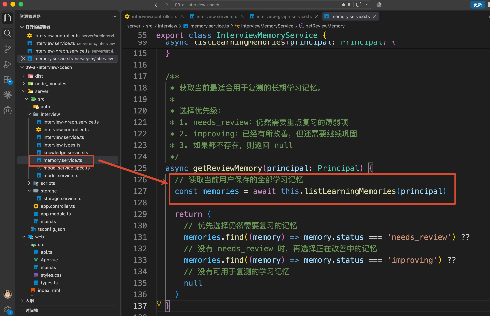

那么，假设当前用户有下面三条记忆：

+ 短期记忆与长期记忆：improving
+ Agentic RAG：needs_review
+ Tool Calling：mastered

咱们就得优先复习掌握程度更差的知识点。

所以，`getReviewMemory()` 会先查找 `needs_review`：

```javascript
memories.find(
    (memory) => memory.status === 'needs_review'
)
```

如果没有，再查找 `improving`：

```javascript
memories.find(
    (memory) => memory.status === 'improving'
)
```

也就是说，复习顺序是：

+ needs_review：当前还没有掌握，优先复习
+ improving：已经答对过一次，但还需要继续巩固
+ mastered：已经掌握，不进入薄弱点复习

当前没有 `needs_review` 记忆，所以程序会继续找到处于 `improving` 状态的 `agent-memory`。

在咱们上一篇结束时，咱们知道 `agent-memory` 已经是 `improving` 了，所以这次会读到：

```typescript
{
    key: 'agent-memory',
    topic: 'agent-memory',
    title: '短期记忆与长期记忆',
    status: 'improving',
    attempts: 2,
    correctCount: 1
}
```

找到 `agent-memory` 以后，`prepareQuestion()` 会把它作为 `reviewMemory` 交给 `selectQuestion()`：

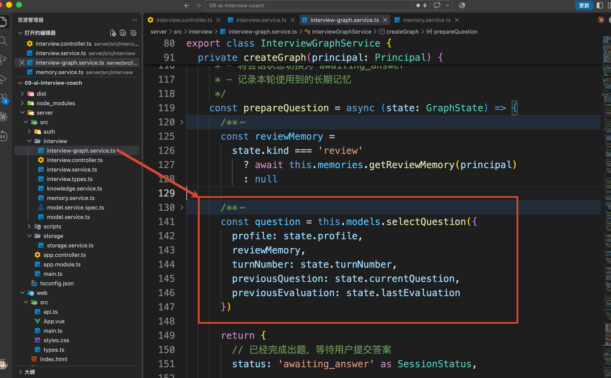

`selectQuestion()` 根据记忆中的 `topic` 找到对应知识点，但不会简单重复上一道题，而是换一个场景问题：

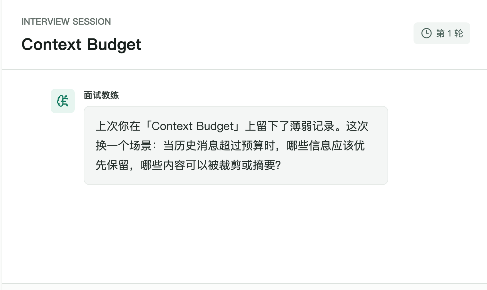

同时页面右边的 Graph 轨迹中，也会明确显示 `prepare_question：根据长期记忆 agent-memory 生成复测题`

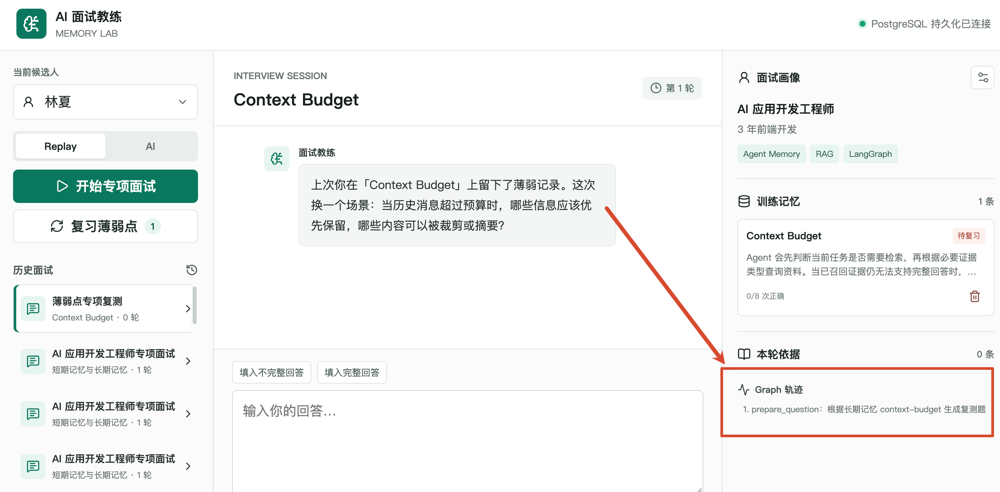

同时，当前 State 会保存本轮真正使用的记忆 Key：

```typescript
{
    usedMemoryKeys: ['agent-memory']
}
```

这样，咱们可以明确知道：本次题目到底是由哪一条长期记忆影响的。

整条跨会话召回链路就是：

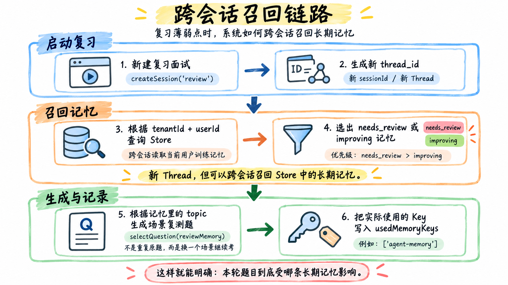

到这里，长期记忆才算真正影响了 Agent 行为。

## Agentic RAG 处理面试反馈
跨会话复测解决了“接下来应该考什么”。

但是，当 Agent 准备告诉用户“你这道题哪里错了”时，还会遇到另外一个问题，那就是：

> **面试反馈的技术结论，根据什么得出来？**
>

如果只让模型凭参数中的知识自由发挥，他可能把 `Checkpointer` 和 `Store` 解释错

所以，评估完成以后，咱们还得确定本轮反馈需要哪些资料，并在资料不足时继续补查。

这就是项目里 Agentic RAG 的作用。

在当前项目中，每一份技术面试反馈都需要有资料依据。Agentic RAG 重点解决的是三类问题：

+ 第一：本轮反馈需要哪几类资料？
+ 第二：第一次查到的依据够不够？
+ 第三：如果还缺一类证据，是否需要继续补查？

那么，咱们现在就顺着本次回答，看看这条检索链路是怎样执行的。

### **一次面试反馈怎样完成多轮补查**
这次咱们输入一个完整回答：

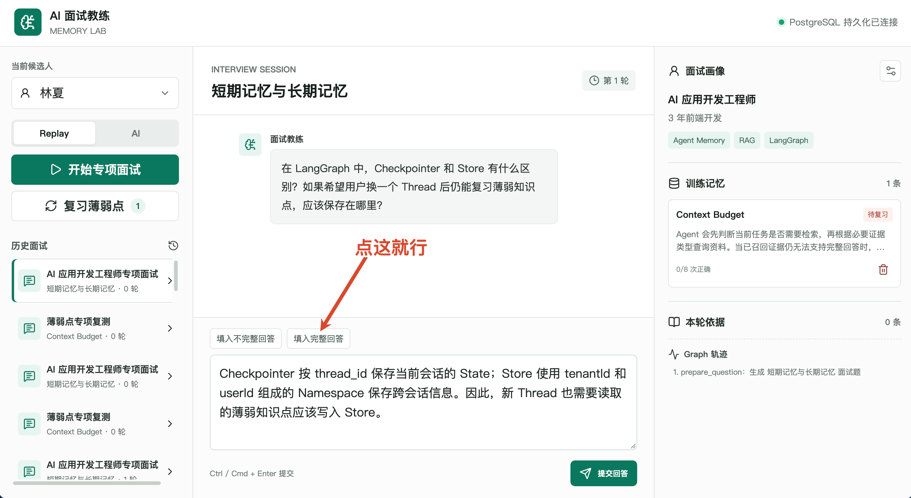

点击“提交回答”以后，Web 端会把本次回答发送给服务端。

服务端恢复当前面试的 State，再向 Graph 传入：

```javascript
{
    event: 'answer',
    answer: 'Checkpointer 按 thread_id 保存当前会话的 State....'
}
```

因为这次的 `event` 是 `answer`，所以 Graph 会执行到 `evaluate_answer`：

`evaluate_answer` 对应的是 `evaluateAnswer()` 方法

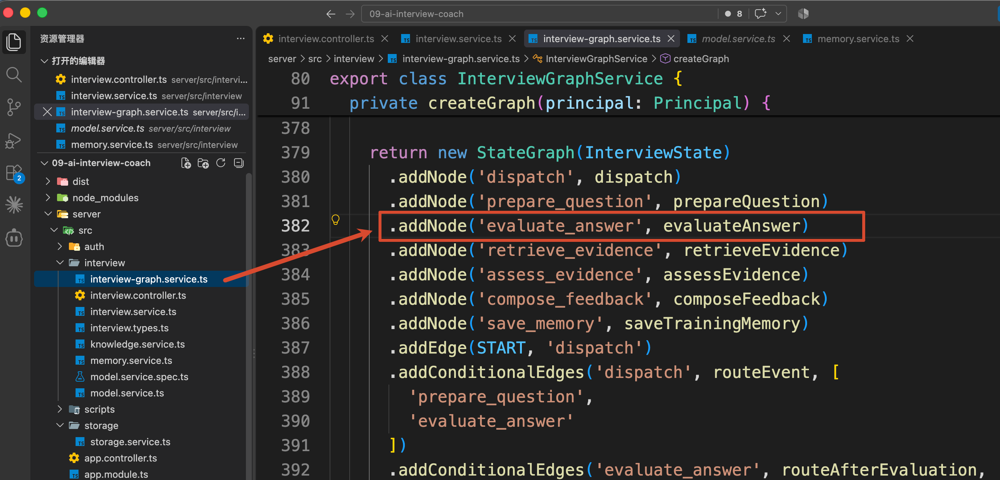

它会把当前题目和用户回答交给 `InterviewModelService.evaluate()`：

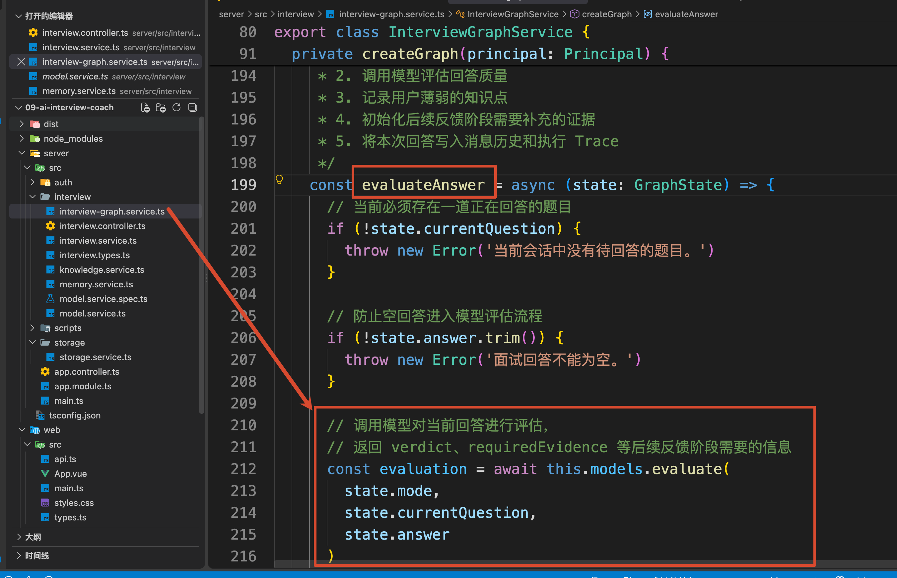

这个方法不只判断“回答是否正确”，还会找出回答缺少的内容，并确定生成反馈需要参考哪些技术资料。

因此，它返回的是一个结构化评估结果：

```javascript
{
    verdict: 'correct',
    reason: '回答覆盖了这道题的核心边界。',
    gaps: [],
    requiredEvidence: [
        'short_term_memory',
        'long_term_memory'
    ]
}
```

其中：

+ `verdict` 表示：本次回答是否正确
+ `reason` 表示：为什么得到这个评估结果
+ `gaps` 表示：回答还缺少哪些关键内容
+ `requiredEvidence` 表示：生成面试反馈时，需要参考哪些类型的技术资料

这道题讨论的是 `Checkpointer` 和 `Store` 的区别。

所以，即使用户已经回答正确，系统在生成反馈以前，仍然需要找到两类资料 `short_term_memory` 和 `long_term_memory` 这两条数据。

其中：

+ `short_term_memory` 表示：用来核对 Checkpointer 和 Thread 级短期记忆
+ `long_term_memory` 表示：用来核对 Store 和跨 Thread 长期记忆

不过这里咱们要注意，`requiredEvidence` 中保存的只是 **需要查找的资料类型**，并不是已经检索到的文档。

此时 Graph 还没有真正开始检索。

接下来，`evaluateAnswer()` 会把这两类资料同时写入 `requiredEvidence` 和 `missingEvidence`，表示：“本轮需要这两类资料，并且当前一类都还没有找到”。

接下来，Graph 进入 `retrieve_evidence`。

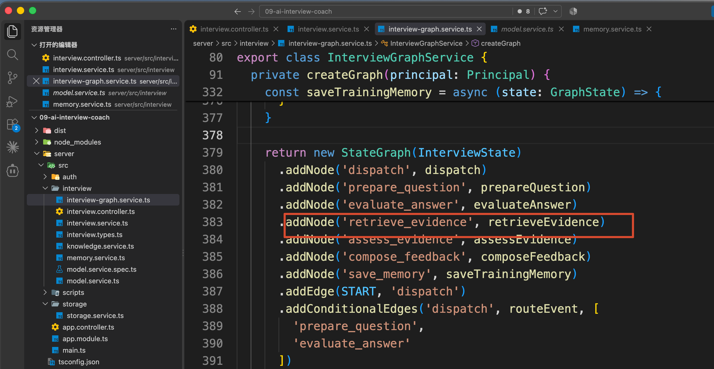

进入 `retrieveEvidence` 方法，可以发现这里每一轮只处理 `missingEvidence[0]`，也就是当前缺少的第一类资料：

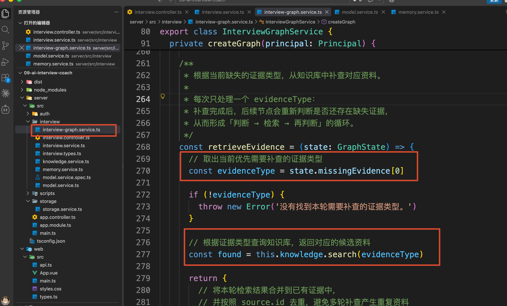

当前 `missingEvidence` 中排在第一位的是 `short_term_memory`

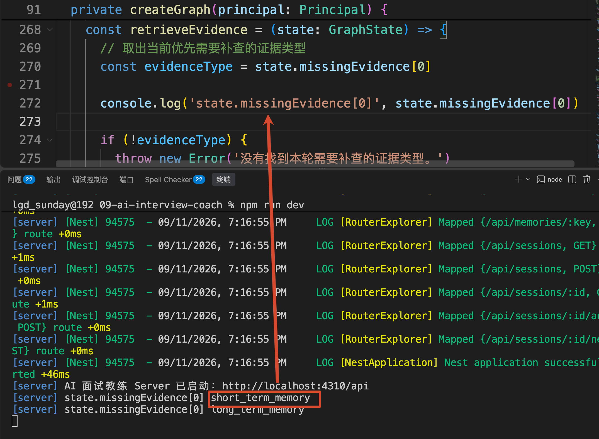

所以，`retrieveEvidence()` 会先取出这个类型，再调用 `InterviewKnowledgeService.search()` 查询对应资料，也就是上上图中的代码逻辑

```javascript
// 取出当前优先需要补查的证据类型
const evidenceType = state.missingEvidence[0]
// 根据证据类型查询知识库，返回对应的候选资料
const found = this.knowledge.search(evidenceType)
```

咱们的项目已经在 `server/src/interview/knowledge.service.ts` 中准备了一组技术资料，`search()` 会根据 `evidenceType` 进行筛选：

```javascript
search(evidenceType: string) {
    return sources.filter(
        (source) => source.evidenceType === evidenceType
    )
}
```

因此，查询 `short_term_memory` 时会找到：

```javascript
{
    id: 'LC-SHORT-TERM-MEMORY',
    evidenceType: 'short_term_memory',
    title: 'LangChain Short-term memory',
    content: '短期记忆属于 Thread-scoped State……',
    url: 'https://docs.langchain.com/oss/javascript/langchain/short-term-memory'
}
```

`retrieveEvidence()` 会把这条资料加入当前 State 的 `evidence`：

```javascript
return {
    evidence: appendUnique(
        state.evidence,
        found,
        (source) => source.id
    )
}
```

现在，State 中已经有了一条短期记忆资料：

```javascript
{
    evidence: [
        {
            id: 'LC-SHORT-TERM-MEMORY',
            evidenceType: 'short_term_memory'
        }
    ]
}
```

不过，找到一条资料以后，Graph 还不能直接生成反馈。

因为本轮总共需要：

```javascript
[
    'short_term_memory',
    'long_term_memory'
]
```

程序还需要检查长期记忆资料是否已经找到。

所以，Graph 中专门配置了一条 Edge：

```javascript
.addEdge(
    'retrieve_evidence',
    'assess_evidence'
)
```

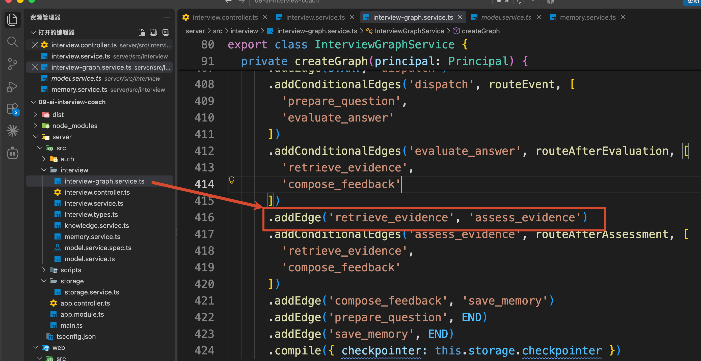

其中 

+ retrieve_evidence 表示： 完成资料查询
+ assess_evidence 表示： 检查资料是否齐全

当前项目中的检查比较简单：**对比 **`requiredEvidence`** 和已经找到的 **`evidence`**，看看还有哪些资料类型没有找到。**

第一轮检查以后，程序会发现：

```javascript
{
    evidence: [
        { evidenceType: 'short_term_memory' }
    ],
    missingEvidence: [
        'long_term_memory'
    ]
}
```

短期记忆资料已经找到，但是长期记忆资料仍然缺失。

因此，Graph 不会进入 `compose_feedback`，而是再次回到 `retrieve_evidence`，开始第二轮查询。

第二轮找到 `long_term_memory` 以后，`assess_evidence` 再检查一次：

```typescript
{
    evidence: [
        { evidenceType: 'short_term_memory' },
        { evidenceType: 'long_term_memory' }
    ],
    missingEvidence: []
}
```

这时候，Graph 才进入 `compose_feedback`。

咱们页面右边的 Graph 轨迹，展示的正是这条执行路径。

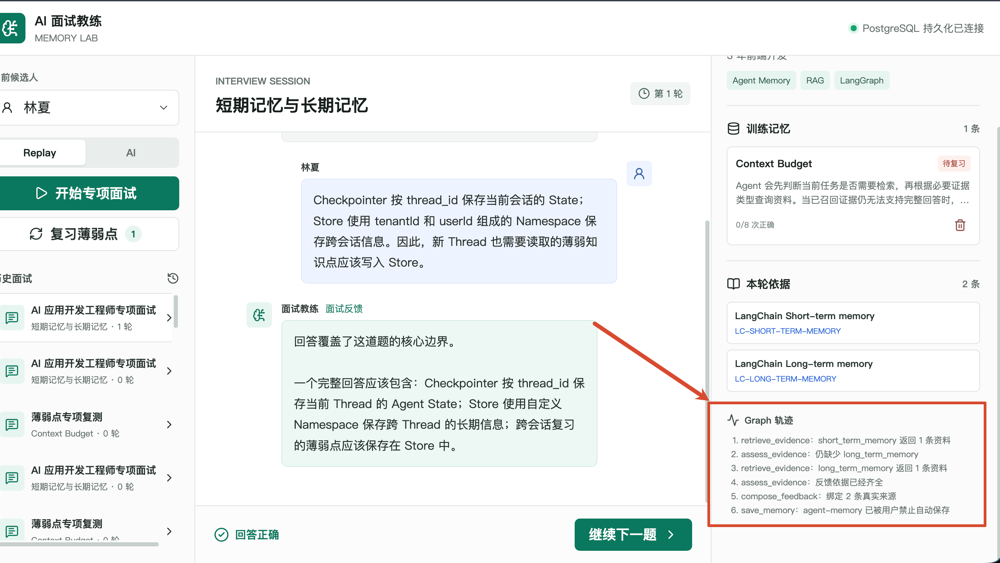

## 复测完成以后，薄弱点怎样变成“已掌握”
这次回答通过评估以后，Graph 会继续进入 `save_memory`：

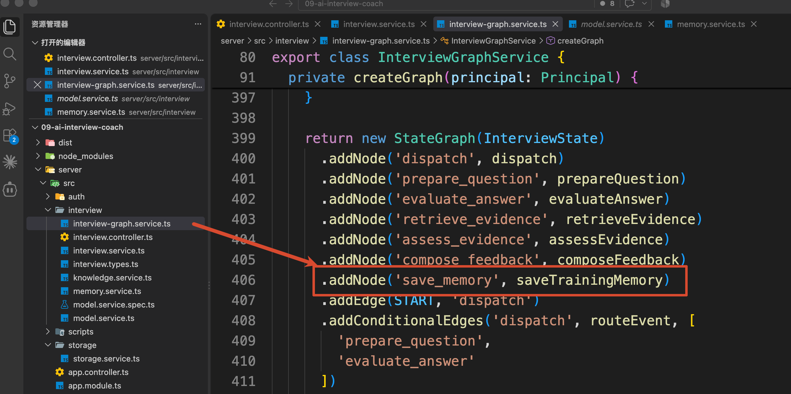

`save_memory` 对应的是 `saveTrainingMemory()`。

这个方法会把当前题目和本次评估结果交给 `recordTrainingResult()`

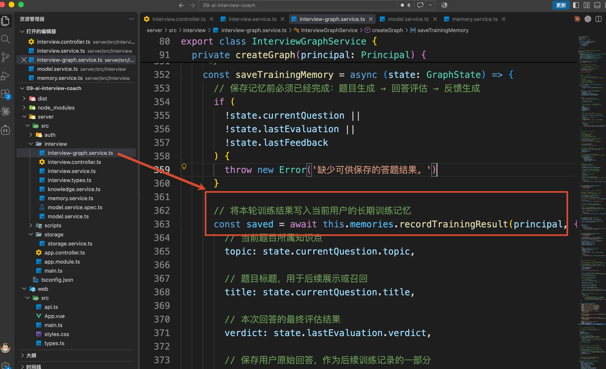

给大家把代码拉出来

```javascript
// 将本轮训练结果写入当前用户的长期训练记忆
const saved = await this.memories.recordTrainingResult(principal, {
  // 当前题目所属知识点
  topic: state.currentQuestion.topic,

  // 题目标题，用于后续展示或召回
  title: state.currentQuestion.title,

  // 本次回答的最终评估结果
  verdict: state.lastEvaluation.verdict,

  // 保存用户原始回答，作为后续训练记录的一部分
  answerSummary: state.answer,

  // 关联当前题目，便于追踪具体训练来源
  questionId: state.currentQuestion.id,

  // 保存反馈阶段实际引用的证据来源
  sourceIds: state.lastFeedback.sourceIds,

  // 判断当前题目的 topic 是否已经被记录为薄弱知识点
  struggled: state.struggledTopics.includes(state.currentQuestion.topic)
})
```

这里的 `verdict` 比较好理解，它来自刚才的回答评估结果：`verdict: state.lastEvaluation.verdict`

本次回答正确，所以它的值是：`verdict: 'correct'`

而 struggled`表示：**当前题目的 topic 是否已经被记录为薄弱知识点。**

程序会检查当前题目的 `topic`，是否存在于 `struggledTopics` 中：

```javascript
state.struggledTopics.includes(
    state.currentQuestion.topic
)
```

这次复测使用的是一个新 Thread。

新 Thread 刚创建时，`struggledTopics` 是空数组：

```plain
{
    struggledTopics: []
}
```

本次回答又是正确的，所以 `evaluateAnswer()` 不会把 `agent-memory` 加入这个数组。

因此：

```javascript
state.struggledTopics.includes('agent-memory')
```

得到的是：`false`

最终，`saveTrainingMemory()` 传给 `recordTrainingResult()` 的关键信息就是：

```javascript
{
    topic: 'agent-memory',
    verdict: 'correct',
    struggled: false
}
```

拿到本次结果以后，`recordTrainingResult()` 会根据 `topic` 生成记忆 Key：

```javascript
const key = input.topic
```

当前 `topic` 是 `agent-memory`，所以程序会从 Store 中读取原来的训练记忆：

```javascript
const existingItem = await this.storage.store.get(
    namespace,
    'agent-memory'
)
```

读取到的旧记录是：

```javascript
{
    key: 'agent-memory',
    status: 'improving',
    attempts: 2,
    correctCount: 1
}
```

所以，接下来参与状态判断的其实是两部分数据：

+ Store 中的旧记录

```plain
status = improving
attempts = 2
correctCount = 1
```

+ 本次复测结果

```javascript
verdict = correct
struggled = false
```

这里的 `struggled: false` 很重要。

这次复测使用的是一个全新的 Thread。当前 Thread 中没有出现过错误回答，本次回答也是正确的，所以 `struggledTopics` 中没有 `agent-memory`。

状态判断会进入最后一条分支：

```typescript
const status =
    input.verdict !== 'correct'
        ? 'needs_review'
        : input.struggled ||
              existing?.status === 'needs_review'
            ? 'improving'
            : 'mastered'
```

本次回答正确，所以不会进入 `needs_review`。

旧记录已经是 `improving`，当前 Thread 也没有再次答错，因此不会继续停留在 `improving`。

最终，同一条训练记忆会更新成：

```typescript
{
    key: 'agent-memory',
    status: 'mastered',
    attempts: 3,
    correctCount: 2,
    lastVerdict: 'correct'
}
```

页面上的状态也会从“提升中”变成“已掌握”。

## 总结
这一篇，咱们算是把长期记忆和 Agentic RAG 怎么接入到这个项目里面讲了一遍

新建复习面试时，系统不会恢复旧 Thread 的全部对话。

它会根据当前用户的 `tenantId + userId` 查询 Store，只召回需要复习的薄弱点，再使用这条记忆生成新的场景题。

提交回答以后，Agent 还会根据 `requiredEvidence` 一类一类查询反馈依据。只要 `missingEvidence` 还没有清空，就继续进行下一轮补查。

最后，本次复测结果继续更新原来的长期记忆，把 `improving` 变成 `mastered`。

那么到这里，第六章也讲完啦

下一小节，咱们就对整个第六章进行总结，再看看这套 AI 面试教练的记忆系统，怎样体现在简历和面试中。

> 更新：2026-09-11 19:36 · 原文：<https://www.yuque.com/lgdsunday/ab1dy3/hrditbvrrpgt6ccp>
