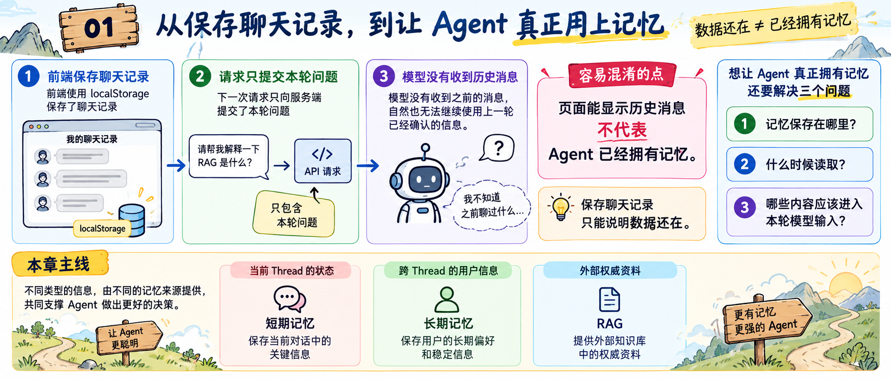
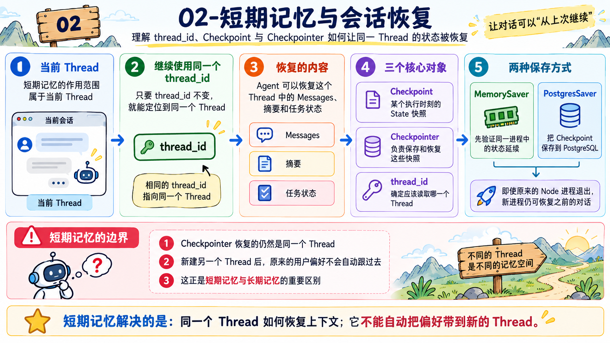
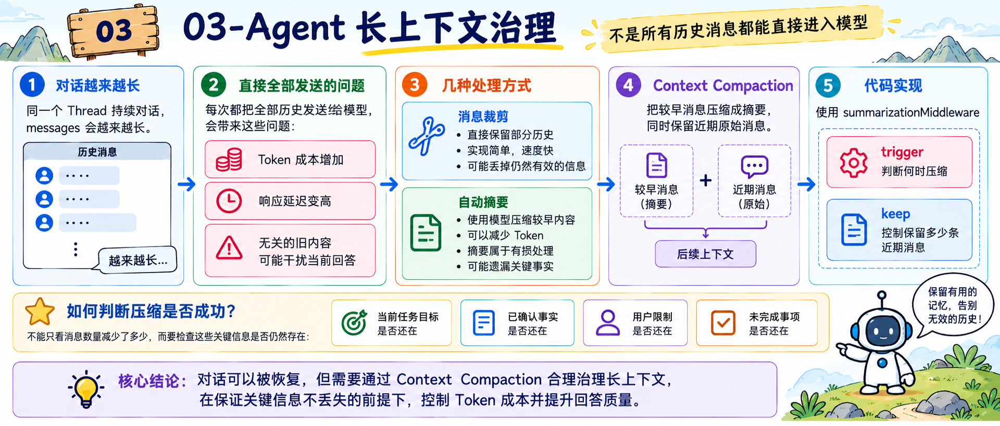
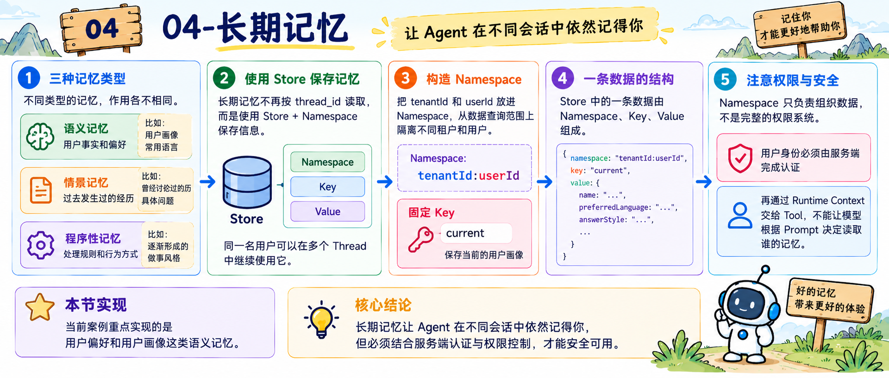
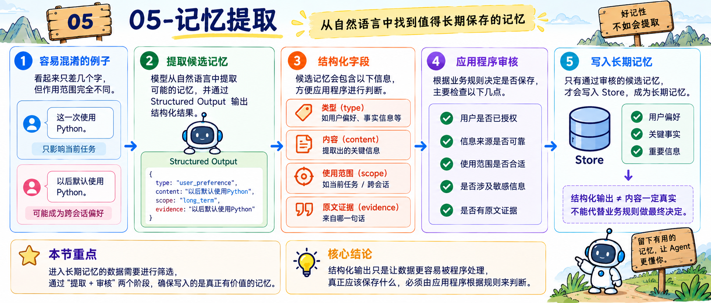
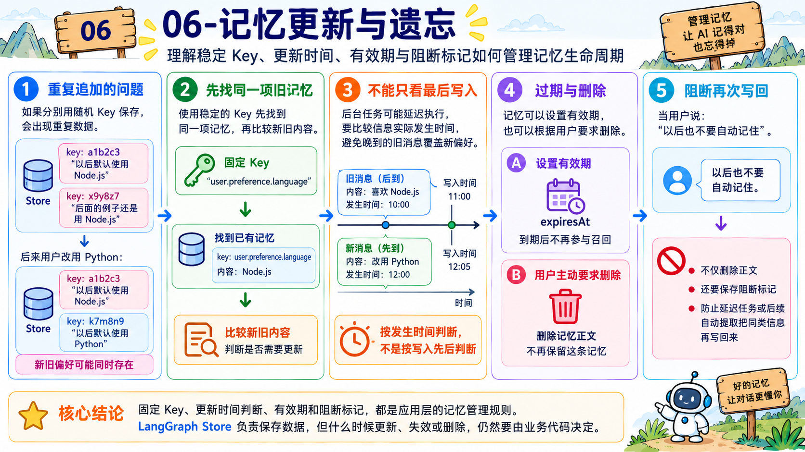
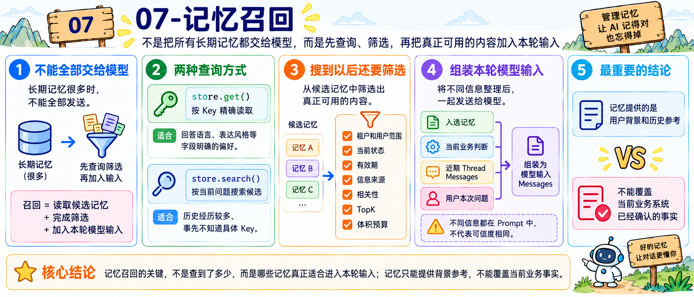
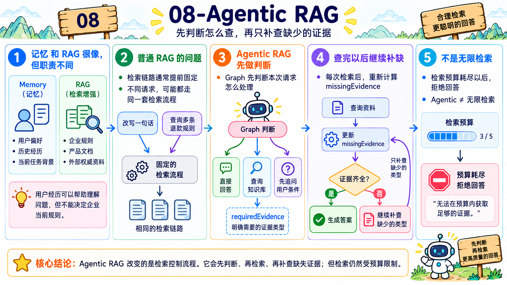
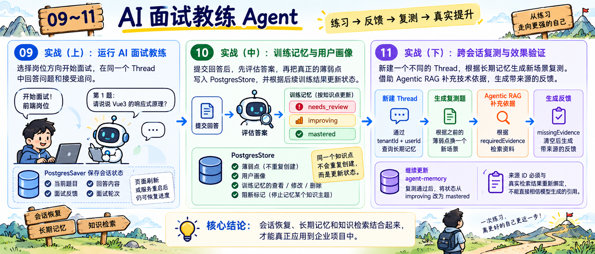

# 12 - 第六章总结：Memory 学到的内容如何在简历和面试中体现

好了，到这里，第六章就全部结束了。

这一章的内容确实不少。

咱们从“保存聊天记录”开始，一直讲到了短期记忆、长期记忆、记忆提取、更新、遗忘和召回，最后完成了一个 AI 面试教练 Agent。

那么最后这个小节，咱们就把整章的内容总结一下

## 第六章都学了啥
### 01-从保存聊天记录，到让 Agent 真正用上记忆


第一小节先分清了一件很容易被混淆的事情：**页面能显示历史消息，不代表 Agent 已经拥有记忆。**

咱们通过代码看到，前端虽然使用 `localStorage` 保存了聊天记录，但是下一次请求只向服务端提交了本轮问题。模型没有收到之前的消息，自然也无法继续使用上一轮已经确认的信息。

所以，保存聊天记录只能说明数据还在。想让 Agent 真正拥有记忆，应用程序还要解决三个问题：**记忆保存在哪里、什么时候读取，以及哪些内容应该进入本轮模型输入。**

这一节也提前建立了全章的主线。当前 Thread 中的状态交给短期记忆，跨 Thread 的用户信息交给长期记忆，外部权威资料则继续由 RAG 提供。

### 02-短期记忆与会话恢复


第二小节讲了短期记忆。

这里的“短期”指的是信息的作用范围属于当前 Thread。只要继续使用相同的 `thread_id`，Agent 就可以恢复这个 Thread 中的 Messages、摘要和任务状态。

实现这项能力时，咱们又认识了三个对象：

+ `Checkpoint` 是某个执行时刻的 State 快照
+ `Checkpointer` 负责保存和恢复这些快照
+ `thread_id` 则用来确定应该读取哪一个 Thread

随后，咱们先使用 `MemorySaver` 验证同一进程中的状态延续，再换成 `PostgresSaver` 把 Checkpoint 保存到 PostgreSQL。这样即使原来的 Node 进程已经退出，新进程仍然可以恢复之前的对话。

但是，Checkpointer 恢复的仍然是同一个 Thread。用户新建另一个 Thread 以后，原来的用户偏好并不会自动跟过去，这也是短期记忆和长期记忆最重要的区别。

### 03-Agent 长上下文治理


对话可以被恢复，不代表所有历史消息都可以直接进入模型。

随着同一个 Thread 不断对话，`messages` 会越来越长。每次都把全部历史发送给模型，不仅会增加 Token 成本和响应延迟，还可能让已经无关的旧内容干扰当前回答。

所以，咱们比较了几种处理方式。

+ 消息裁剪直接保留部分历史，速度快，但是可能丢掉前面仍然有效的信息
+ 自动摘要会使用模型压缩较早内容，但是摘要本身属于有损处理，也可能遗漏关键事实

这一节所说的 `Context Compaction`，就是把较早消息压缩成摘要，同时保留近期原始消息，再把两部分共同作为后续上下文。

代码中使用 `summarizationMiddleware`，根据 `trigger` 判断何时压缩，再通过 `keep` 控制保留多少条近期消息。

最后还明确了一个标准：压缩是否成功，不能只看消息数量减少了多少，而要检查当前任务目标、已确认事实、用户限制和未完成事项是否仍然存在。

### 04-长期记忆


第四小节开始处理跨会话信息。

咱们先认识了语义记忆、情景记忆和程序性记忆。用户事实和偏好属于语义记忆，过去发生过的具体经历属于情景记忆，Agent 逐渐形成的处理规则和行为方式则更接近程序性记忆。

当前案例重点实现的是用户偏好和用户画像这类语义记忆。

长期记忆不再按照 `thread_id` 读取，而是使用 `Store + Namespace` 保存信息，因此同一名用户可以在多个 Thread 中继续使用它。

Store 中的一条数据由 `Namespace、Key、Value` 组成。项目把 `tenantId` 和 `userId` 放进 Namespace，再使用固定 Key 保存当前画像，从数据查询范围上隔离不同租户和用户。

不过，Namespace 只负责组织数据，不是完整的权限系统。用户身份仍然必须由服务端完成认证，再通过 Runtime Context 交给 Tool，不能让模型根据 Prompt 决定读取谁的记忆。

### 05-记忆提取


进入长期记忆的数据需要进行筛选

比如 “这一次使用 Python” 和 “以后默认使用 Python” ，看起来只差几个字，作用范围却完全不同。前者只影响当前任务，后者才可能成为跨会话偏好。

所以，记忆写入被拆成了两个阶段。模型先从自然语言中提取候选记忆，并通过 Structured Output 整理出类型、内容、使用范围和原文证据等字段；应用程序再根据规则决定是否保存。

这里必须记住，结构化输出只能保证返回的数据方便程序处理，不能证明候选内容一定真实，更不能代替业务规则做最终决定。

当前案例会继续检查用户许可、信息来源、使用范围、敏感程度和原文证据。只有真正通过审核的候选，才能写入 Store。

### 06-记忆更新与遗忘


新信息不能永远作为一条新记忆继续追加。

如果 “以后默认使用 Node.js” 和 “后面的例子还是用 Node.js” 分别使用随机 Key 保存，Store 中就会出现重复数据。等用户改成 Python 以后，新旧偏好还会同时存在。

因此，咱们先通过稳定 Key 找到同一项已有记忆，再比较新旧内容。

对于真正的长期修改，程序也不能只看哪条数据最后写入。后台任务可能延迟执行，所以还要比较信息实际发生的时间，避免一条晚到的旧消息覆盖已经确认的新偏好。

带有时间限制的记忆会保存 `expiresAt`，到期以后不再参与召回。用户主动要求删除时，程序则删除记忆正文。

如果用户说的是“以后也不要自动记住”，除了删除正文，还要保存阻断标记。这样延迟到达的后台任务或者后续自动提取流程，就不会再次把同一类信息写回来。

固定 Key、更新时间判断、有效期和阻断标记，都是当前应用为了管理记忆设计的规则。

LangGraph Store 负责保存数据，但一条记忆什么时候更新、失效或删除，仍然要由业务代码决定。

### 07-记忆召回


长期记忆很多时，不能全部交给模型。

因此，记忆召回并不只是从 Store 中执行一次查询。它表示应用根据当前任务读取候选记忆、完成筛选，再把最终入选的内容加入本轮模型输入的完整过程。

咱们根据记忆类型使用了两种查询方式。回答语言和表达风格这类字段明确的偏好，可以通过 `store.get()` 根据 Key 精确读取；历史经历数量较多，而且事先不知道具体 Key 时，再使用 `store.search()` 根据当前问题搜索候选。

不过，搜索到的记忆还不能直接使用。程序还要检查租户和用户范围、当前状态、有效期、信息来源和相关性，再通过 TopK 与体积预算限制最终数量。

随后，应用程序把入选记忆、当前业务判断、近期 Thread Messages 和用户本次问题分别整理，再共同发送给模型。不同类型的信息不会因为都出现在 Prompt 中，就被当成同等可信的事实。

这一节最重要的结论是：**记忆提供的是用户背景和历史参考，不能覆盖当前业务系统已经确认的事实。**

### 08-Agentic RAG


学完记忆召回以后，咱们发现它和 RAG 很像，都是根据当前问题寻找可能有用的信息。

但是，两者的数据职责不同。Memory 保存用户偏好、历史经历和当前任务背景，RAG 查询的则是企业规则、产品文档等外部权威资料。用户过去的经历可以帮助 Agent 理解问题，却不能决定企业现在执行什么规则。

普通 RAG 的检索流程往往由应用程序提前固定，无论用户只是改写一句话，还是查询多条退款规则，都可能执行同一套检索链路。

`Agentic RAG` 改变的就是这部分检索控制流程。Graph 会先判断本次请求应该直接回答、查询知识库，还是因为缺少用户条件而先追问；需要检索时，再通过 `requiredEvidence` 明确完整回答需要哪些证据。

每次检索完成以后，程序都会重新计算 `missingEvidence`。证据已经齐全就生成答案，仍然缺少资料就只补查缺少的类型，检索预算耗尽以后则拒绝回答。

所以，Agentic 并不代表让模型可以无限检索了。

### 09～11-AI 面试教练 Agent


上篇先把整个 AI 面试教练运行起来。用户可以选择岗位方向开始专项面试，在同一个 Thread 中回答问题和接受追问。`PostgresSaver` 会保存当前题目、回答、反馈和面试轮次，因此页面刷新或者服务重启以后，仍然可以恢复原来的面试进度。

中篇从“提交回答”进入代码。Graph 会先评估答案，再把真正暴露出的薄弱点写入 `PostgresStore`。同一个知识点不会每次重复创建，而是根据后续训练结果在 `needs_review`、`improving` 和 `mastered` 之间更新状态。

这一部分还实现了用户画像保存，以及训练记忆的查看、修改和删除。用户要求停止记忆某个知识主题时，系统会同时保存阻断标记，避免后续自动评估再次把它写回来。

下篇新建了一个完全不同的 Thread，然后通过 `tenantId + userId` 查询长期记忆。系统根据之前的薄弱点换一个场景进行复测，而不是恢复旧面试并把原来的问题再问一遍。

复测答案提交以后，Agentic RAG 会根据 `requiredEvidence` 补查技术依据。只有 `missingEvidence` 被清空，程序才允许生成带来源的反馈；来源 ID 还要与真实检索结果重新绑定，不能直接相信模型生成的引用。

最后，正确的跨会话复测会继续更新原来的 `agent-memory`，把状态从 `improving` 改成 `mastered`。

到这里，会话恢复、长期记忆和知识检索才算是可以应用到企业项目中。

## 简历怎么写？
### 技能特长怎么写
可以参考下面这版：

```latex
• 熟悉 Agent Memory 工程化方案，能够基于 LangGraph Thread 与 Checkpointer 实现 Agent State 持久化和会话恢复，并使用 Store、Namespace 和可信用户身份实现跨会话长期记忆与数据隔离。

• 掌握长对话与记忆生命周期管理，能够通过消息裁剪、自动摘要和 Context Compaction 控制模型输入，并实现候选记忆提取、写入审核、更新、过期、删除和阻断重新写入。

• 熟悉 Memory 与 RAG 的数据边界，能够根据当前任务召回用户偏好和历史信息，并使用 Agentic RAG 实现按需检索、证据判断、多轮补查和来源校验。
```

### 项目经历怎么写
咱们这次写的 AI 面试教练的项目，适合学，但是不太适合写到简历上，写上去容易被人当成学习的项目。

所以说，得稍微变通一下。

比如可以写成 **企业销售跟进 Agent**

参考写法如下：

```plain
项目名称：企业销售跟进 Agent

技术栈：TypeScript、NestJS、Vue 3、LangGraph、PostgreSQL、DeepSeek、Agentic RAG

项目介绍：面向企业销售长期跟进过程中客户信息分散、沟通上下文丢失及产品答复缺少依据等问题，构建具备跨会话记忆能力的销售辅助 Agent。系统能够恢复客户沟通进度，从对话中提取并持续维护需求、预算、产品偏好、未解决异议和承诺事项，在后续跟进中召回相关信息，并结合企业产品、价格与交付资料生成有来源的跟进建议。

主要职责：
- 设计 Thread 级会话状态与客户级长期记忆的双层数据结构，使用 PostgresSaver 保存单次沟通中的消息、分析结果和待办事项，使用 PostgresStore 管理跨会话客户画像与历史跟进信息。
- 基于 thread_id 实现客户沟通状态持久化和会话恢复，支持销售人员在页面刷新、服务重启或间隔多日后继续原有沟通，并在恢复前校验租户、客户与会话归属。
- 使用 DeepSeek 与 Zod Structured Output 从沟通内容中提取客户行业、预算、产品需求、购买意向、决策角色、未解决异议和后续承诺，再由应用策略判断信息是否具备长期保存价值。
- 为客户画像和跟进记忆设计稳定 Key、事件时间和有效期，根据新旧信息执行新增、保持、确认更新、过期和删除，避免重复表达产生冗余记录或延迟消息覆盖最新客户意向。
- 将产品偏好、预算等明确字段通过 Key 精确读取，对历史沟通、客户异议和承诺事项执行语义搜索，并结合状态、有效期、来源、相关性和 Context Budget 筛选本轮真正需要的记忆。
- 基于 LangGraph 构建 Agentic RAG 流程，先判断当前问题是否需要查询企业资料，再根据 requiredEvidence 和 missingEvidence 多轮补查产品功能、价格政策、交付条件与售后规则。
- 建立跟进建议的证据校验机制，仅允许模型引用系统真实返回的资料；当企业知识或客户条件不足时，引导销售补充信息，不生成未经验证的产品承诺和价格结论。
- 使用 tenantId + customerId 组织客户长期记忆，并由服务端可信身份控制查询范围，避免模型通过用户输入切换租户或读取其他企业的客户资料。
- 基于 NestJS 和 Vue 3 开发销售跟进工作台，集中展示客户画像、沟通记录、未解决异议、承诺事项、检索依据和跟进建议，方便销售人员继续沟通并核对 Agent 的判断来源。
```


## 面试可能会被问到什么
### 长期记忆和短期记忆的区别？
这个问题最核心的区别，不是保存时间长短，而是**信息在哪个范围内生效**。

短期记忆属于当前 Thread。它通常保存这个会话中的 Messages、摘要、工具结果和任务状态，让 Agent 可以沿着同一段对话继续处理。

长期记忆不依赖某一个 Thread。它通常按照用户、客户或者业务实体组织，用来保存需要跨会话继续使用的信息，比如客户画像、产品偏好、历史异议和承诺事项。

它们底层都可以使用 PostgreSQL，所以“是否写进数据库”不是判断标准。


### 短期记忆如何实现？
在 LangGraph 中，短期记忆通常通过 `Thread + Checkpointer` 实现。

应用程序调用 Graph 时，需要提供一个稳定的 `thread_id`：

```javascript
const config = {
    configurable: {
        thread_id: sessionId
    }
}
```

Graph 执行过程中，Checkpointer 会把当前 Agent State 保存成 Checkpoint。下一次继续使用相同的 `thread_id` 调用时，LangGraph 就可以恢复原来的 Messages 和其他 State，再写入本轮新消息。

开发阶段可以使用 `MemorySaver`，快速验证同一进程中的多轮状态延续。

**真实服务需要应对进程退出和服务重启，所以可以换成 **`PostgresSaver`**，把 Checkpoint 持久化到 PostgreSQL。**


### 长期记忆如何实现？
长期记忆通常使用 `Store` 实现，关键是先确定这条记忆属于谁，以及以后应该通过什么位置找到它。

以企业销售跟进 Agent 为例，可以使用租户和客户组成 Namespace：

```javascript
const namespace = [
    tenantId,
    customerId,
    'customer-memories'
]
```

Namespace 确定数据范围，Key 用来标识具体记忆，Value 保存结构化内容：

```javascript
await store.put(namespace, 'purchase_budget', {
    value: '20 万元以内',
    source: 'customer_statement',
    updatedAt: '2026-09-12T10:00:00+08:00'
})
```

Store 只负责保存和查询数据，不会自动判断什么值得记忆。

真实流程通常是模型先从对话中提取候选记忆，应用程序再检查使用范围、来源、用户许可和敏感程度，最后才决定是否写入。

读取时这些信息必须来自服务端认证后的可信身份，避免出现跨租户或者跨客户的数据访问。


### 如何实现记忆召回？
记忆召回是根据当前任务，挑出这一次真正需要的内容。

实现时可以先把长期记忆分成两类。

对于客户预算、产品偏好这类字段明确的信息，应用已经知道具体 Key，可以直接使用 `store.get()` 精确读取。

对于大量历史沟通和客户异议，应用事先不知道哪一条和当前问题有关，可以通过 `store.search()` 根据当前问题搜索候选记忆。

但是，查询结果还要继续筛选，筛选完成以后，程序再把入选记忆、当前业务数据、近期 Thread Messages 和用户问题分别整理，组成这一次真正发送给模型的输入。


### 长期记忆更新了怎么办？
长期记忆发生变化时，最忌讳的做法是把每一次表达都作为一条新记录继续追加。

比如客户先说预算是 10 万元，后来明确调整成 20 万元。如果两条信息同时作为有效记忆参与召回，Agent 就无法确定应该相信哪一个。

所以，稳定字段应该使用稳定 Key。写入以前，先读取已有值，再根据新信息决定怎样处理，大致的逻辑分为三类：

+ 没有旧值：创建
+ 新旧值相同：保持原记录，不重复写入
+ 新旧值不同：判断是临时要求还是长期修改，必要时等待用户确认

如果记忆是由后台任务异步写入，还要保存信息实际发生的时间。不能让一条晚到的旧消息覆盖客户已经确认的新预算。

带有时间限制的信息可以增加 `expiresAt`，到期以后不再召回。

用户要求删除时，则需要删除正文；如果用户同时要求以后不要自动保存，还要增加阻断标记，防止自动提取流程再次写回。


### 什么是 Agentic RAG？
`Agentic RAG` 指的是知识检索由谁控制。

普通 RAG 通常按照应用程序提前写好的固定流程执行：收到问题、查询一次知识库、取回资料、生成回答。

Agentic RAG 会让 Agent 根据当前问题参与决定的，比如：本次是否需要查询知识库，需要查询哪几类资料，应该继续补查、追问用户还是拒绝回答？

当前项目会先把请求路由为 `direct`、`retrieve` 或 `clarify`。

需要检索时，再通过 `requiredEvidence` 记录完整回答需要的证据类型，通过 `missingEvidence` 记录现在还缺什么。

每轮检索完成以后，Graph 都会重新检查证据。资料齐全才生成答案，仍然缺少就继续补查

达到最大检索次数仍然没有找到，则进入拒答。

所以，Agentic RAG 可以动态调整检索路径，但租户范围、文档状态、证据标准、检索预算和来源校验仍然必须由应用程序控制。


### Memory 和 RAG 有什么区别？
Memory 和 RAG 都会为模型补充上下文，但是两者保存的信息和承担的职责不同。

+ Memory 主要保存当前用户、客户或者任务在过去交互中产生的信息，比如客户预算、产品偏好、历史异议和上一次承诺事项
+ RAG 主要查询外部知识源中的权威资料，比如：产品说明、价格政策、交付周期、合同规则和售后政策 等


## 下一章讲什么
下一章，咱们会进入 `DDD、LangGraph 持久化执行和 Human-in-the-Loop`，并实现一个 AI 演示文稿制作 Agent。

接下来要解决的是：**一个持续几十分钟，甚至跨越多次人工审核的业务任务，在暂停、重启或者执行失败以后，怎样才能继续运行。**

> 更新：2026-09-12 15:04 · 原文：<https://www.yuque.com/lgdsunday/ab1dy3/fqpuwg8ys8g2ofnw>
