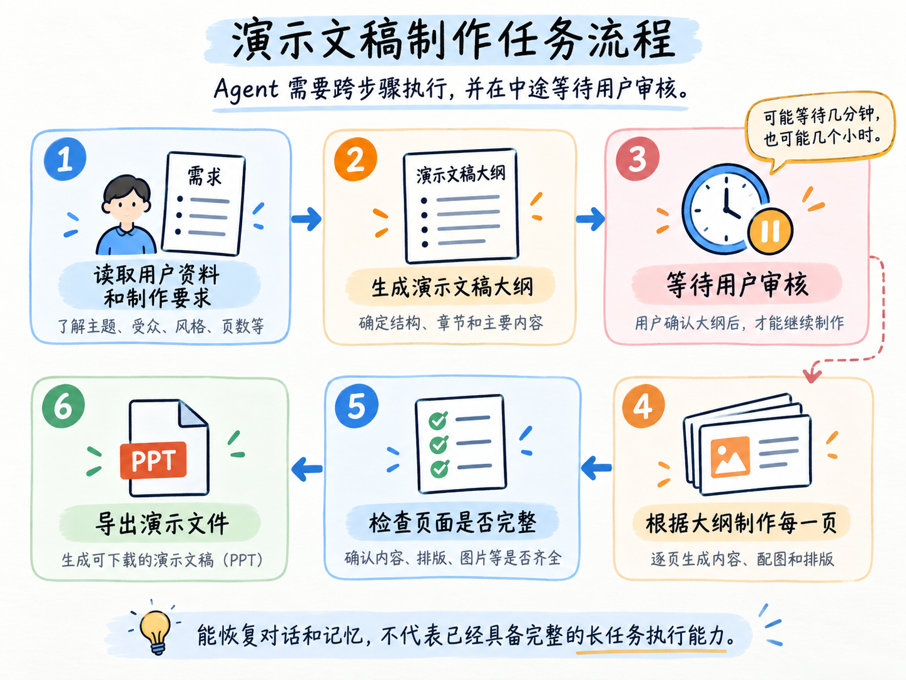

# 01-章介绍：让 Agent 完成一项可以暂停、修改和继续的制作任务

# 01-章介绍：让 Agent 完成一项可以暂停、修改和继续的制作任务
Agent 是有 “记忆” 的

在同一个 Thread 中，它可以恢复之前的消息和任务状态。换一个新的 Thread，它也可以从长期记忆中找到用户画像和历史经历。

但是，能恢复一段对话以后，Agent 就可以完成一个持续时间很长的任务了吗？

还不行。

大家可以把任务换成下面这个：

```latex
我上传了一份产品发布资料。

请根据资料制作一份 12 页的演示文稿，
先生成大纲，等我确认以后再制作每一页，最后导出文件。
```

这个任务看起来就是让 AI 做一份演示文稿。

但是，真正执行起来以后，它不会只调用一次模型就结束。

完整过程大概是这样的：



这里的“等待用户审核”，可能只需要几分钟，也可能需要几个小时。

用户还没有审核，服务就重启了，任务怎么办？

十二页内容已经生成了八页，第九页执行失败了，又怎么办？

用户审核完大纲以后，又修改了第三页。系统应该只重新制作第三页，还是把整份演示文稿全部推翻重做？

你看这都是问题。

并且这些问题和模型本身够不够聪明没有太大关系。

即使模型每次都能生成正确内容，应用程序仍然需要知道：当前任务执行到了哪里、哪一个大纲版本已经通过审核 了

**第七章要解决的，就是一个 Agent 任务跨越多次请求、人工等待和服务重启以后，怎样继续执行，并保证最终使用的是正确的业务结果。**

ok，该说的说完了，下一小节，咱们就开始～

> 更新：2026-09-13 21:24 · 原文：<https://www.yuque.com/lgdsunday/ab1dy3/svc06x9ydghf1y1y>
