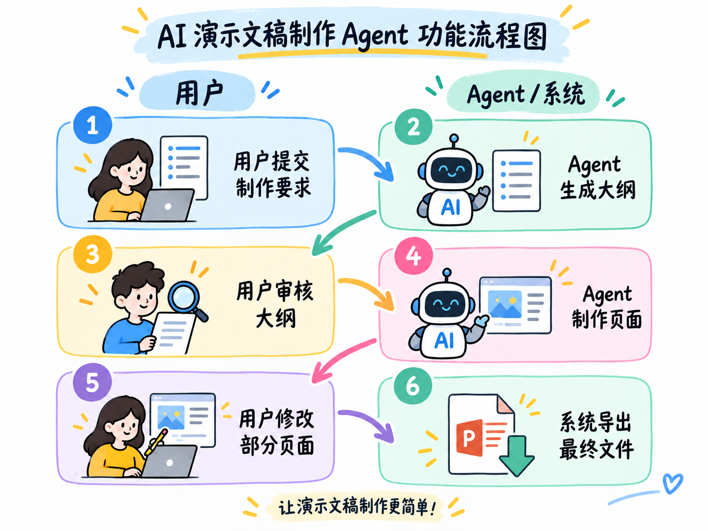
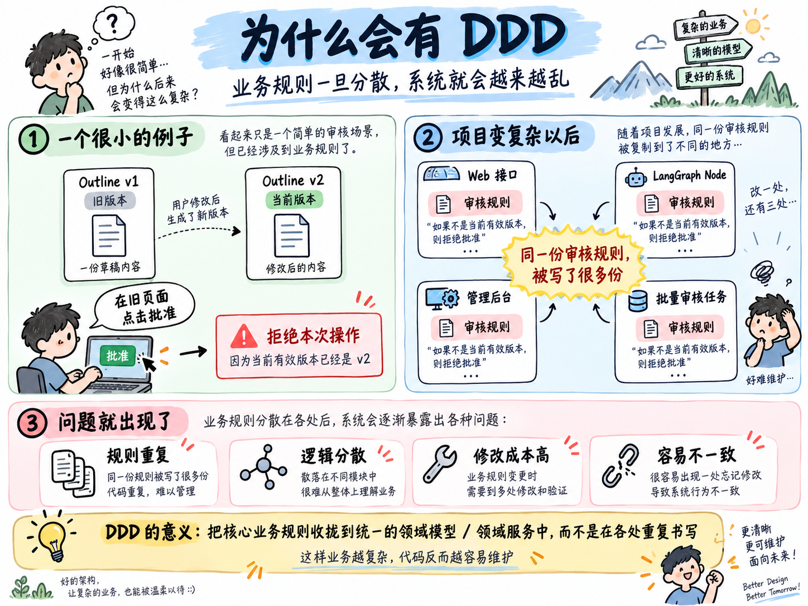
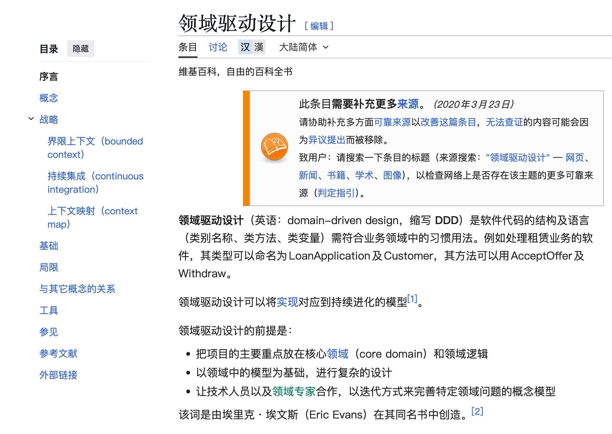
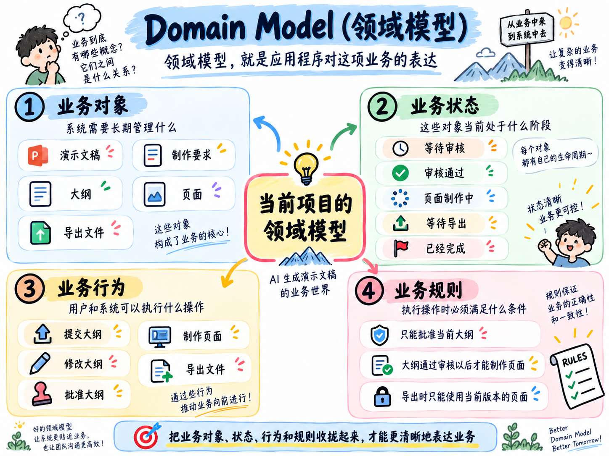
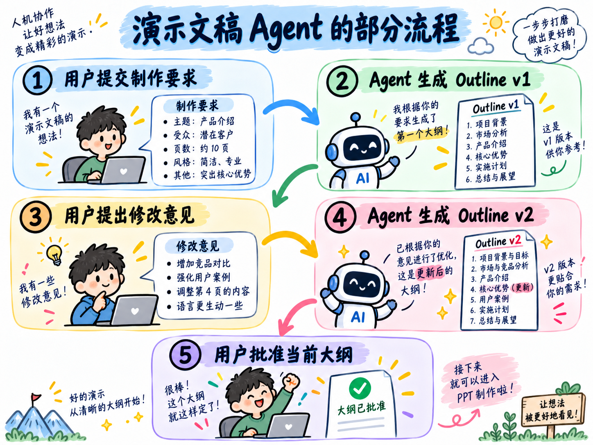
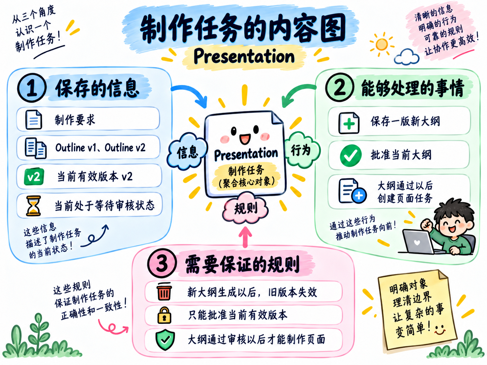
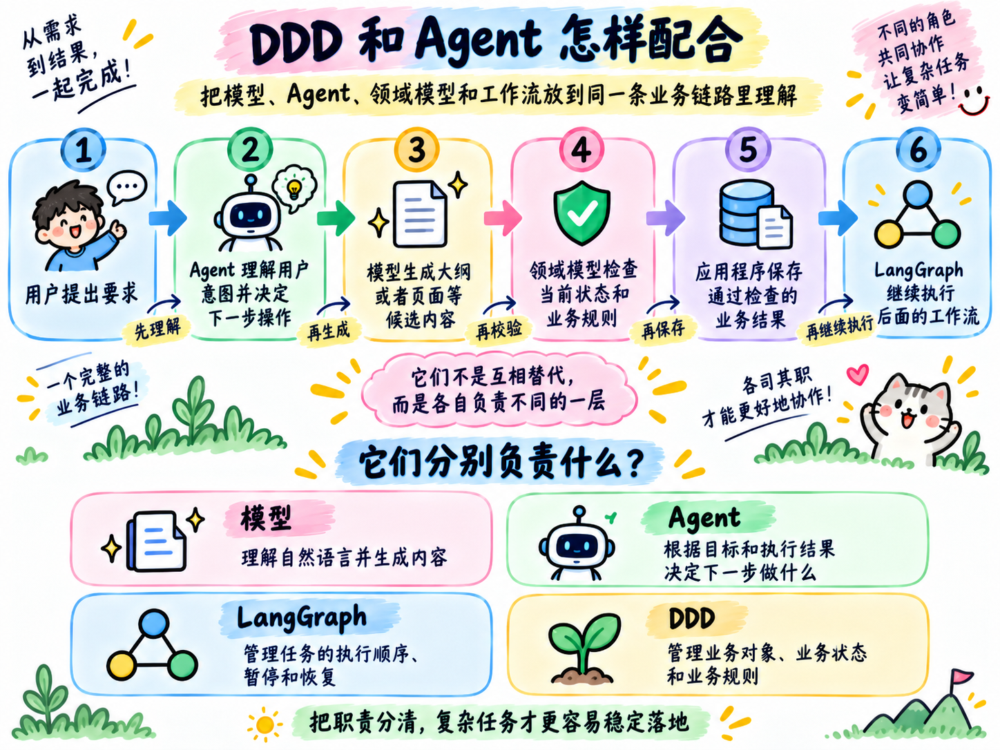

# 02-Agent 业务建模与 DDD：制作要求、大纲、页面和审核规则由谁管理

前面咱们实现的 Agent，已经可以理解用户要求、调用 Tool，并根据执行结果决定下一步做什么。

这一章的任务会更复杂一些。

最终，咱们得实现一个 AI 演示文稿制作 Agent，这玩意功能挺多的，大致的流程给大家画了个图：

在这条流程中，大模型可以生成大纲和页面内容，LangGraph 可以控制任务的执行顺序。

同时因为是生成文稿嘛，所以还会涉及到 **文稿版本的问题**，比如：当前有效的是哪一版大纲？最终导出哪一版？

这些东西，就需要使用 Agent 应用的业务代码来进行管理了。

而这一小节要讲的 `DDD`，就是用来梳理和管理这些业务问题的。

## DDD 为什么会出现
咱们先看一个很小的例子。

假设，Agent 生成第一版大纲以后，用户提出了修改意见，于是系统又生成了第二版，也就是：

+ Outline v1：旧版本
+ Outline v2：当前版本

这时，用户之前打开的旧页面还没有关闭。

他在旧页面里点击“批准”，提交的依然是 `Outline v1`。

那么，此时系统就应该拒绝这次操作，因为当前有效版本已经变成了 `v2`。

刚开始做项目时，咱们可能会在接口里写一个版本判断。

后来，LangGraph 中增加了等待审核的 Node，于是 Node 里也写了一份。

再后来，管理后台和批量审核任务也需要批准大纲，它们又分别写了一份。

慢慢就会变成：

+ Web 接口里有一份审核规则
+ LangGraph Node 里有一份审核规则
+ 管理后台里有一份审核规则
+ 批量任务里还有一份审核规则

业务越复杂，代码就写的越杂，越乱，需要修改的地方也就会变得越多。

大家应该能明白我在说什么对吧。还不懂的可以看下面的图哈

DDD 解决的就是这类问题，即：**把分散的业务知识整理成一套清晰的领域模型，让不同入口执行同一套业务规则。**

所以，DDD 出现的主要原因可以概括成一句话：

> **当业务对象、状态和规则越来越复杂时，应用程序需要一套围绕业务组织代码的方法。**
>

## DDD 到底在设计什么
`DDD` 的全称是 `Domain-Driven Design`，中文一般翻译成 **领域驱动设计**。

它是一种软件设计方法。

DDD 会先理解软件负责解决的业务问题，再建立能够表达这项业务的模型，最后让程序围绕这套模型运行。

这里有两个核心概念。

第一个是 `Domain`，也就是 **领域**。

领域表示当前软件负责解决的业务范围。

以这一章的项目为例，用户需要提交制作要求、审核大纲、修改页面并导出文件。

这些业务共同组成了当前项目的领域：**演示文稿制作。**

第二个是 `Domain Model`，也就是 **领域模型**。

领域模型是应用程序对这项业务的表达，它主要包含四部分：

+ 业务对象：系统需要长期管理什么
+ 业务状态：这些对象当前处于什么阶段
+ 业务行为：用户和系统可以执行什么操作
+ 业务规则：执行操作时必须满足什么条件

放到当前项目中，大概是下面这样：

这四部分组合起来，就是演示文稿制作领域模型的主要内容。

所以，DDD 到底在设计什么？

答案应该是：

> **DDD 设计的是软件中的业务模型，以及这套模型内部的业务对象、状态、行为和规则。**
>

DeepSeek、LangGraph、PostgreSQL 和 Vue 都是实现这套系统时使用的技术。

领域模型描述的则是演示文稿制作业务本身。

## 领域模型是怎样从业务中产生的
领域模型来源于真实的业务流程。

咱们先看演示文稿制作过程中的一小段流程：

用户刚创建任务时，系统需要保存他的制作要求。

`Outline v1` 生成以后，系统需要记录这版大纲的内容，并且知道当前有效版本是 `v1`。

用户提出修改以后，Agent 又生成了 `Outline v2`。

接下来，用户点击“批准大纲”。

系统需要确认他批准的是 `v2`。如果旧页面提交的是 `v1`，这次批准就应该被拒绝。

所以，一份演示文稿制作任务需要统一管理很多的内容，比如：用户提交的制作要求、模型生成过的每一版大纲 等等的

咱们可以把这项制作任务整理成下面这样：

这里的 `Presentation`，是咱们根据演示文稿制作业务整理出来的一个业务对象。

它保存了业务执行过程中需要持续跟踪的信息，也规定了这些信息可以怎样变化，以及变化时需要满足哪些条件。

继续把页面制作、文件导出等业务对象和规则整理进来，它们会共同组成完整的演示文稿制作 **领域模型**。

所以，从业务需求中得到领域模型的过程，可以简单理解成：

> **先把业务的实际执行过程说清楚，再把过程中需要保存的信息、允许发生的变化和必须遵守的条件整理到一起。**
>

## DDD 和 Agent 怎样配合
现在回到 Agent。

假设，用户说：“第二部分太技术化了，改成企业管理者能够看懂的内容。”

那么请问：“固定的业务代码能知道他说的第二部分指的是啥吗？”

肯定不能。

所以，此时 Agent 就需要结合当前上下文理解“第二部分”指什么，再调用模型生成新的页面内容。

这是 Agent 擅长处理的任务。

新内容生成以后，应用程序再去处理固定的 **业务代码逻辑** 的问题

完整关系可以整理成下面这样

假设 Agent 尝试批准已经失效的 `Outline v1`。

领域模型会读取当前版本，发现有效版本已经是 `v2`，然后拒绝这次操作。

换句话说：

> **Agent 决定接下来想做什么，领域模型判断这项操作在当前业务状态下能不能执行。**
>

这就是 DDD 和 Agent 的关系。

DDD 会给 Agent 提供清晰的业务能力，并保证 Agent 的操作始终处于业务允许的范围内。

## 什么项目值得使用 DDD
DDD 主要用来处理复杂业务。

当项目出现下面这些特点时，DDD 会带来比较明显的价值：

+ 系统中存在多个重要的业务对象
+ 业务对象拥有明确的状态和生命周期
+ 某些操作只能在特定状态下执行
+ 同一份数据需要处理版本、审核和失效
+ 同一项业务能力会被 Agent、Web 接口、后台任务等多个入口调用
+ 业务规则还会持续增加和变化
+ 错误操作会真正修改订单、资金、合同或者交付结果

常见项目类型包括：

+ 订单与退款系统
+ 合同审批系统
+ 保险理赔系统
+ 内容审核与发布系统
+ 软件研发与交付系统
+ 需要暂停、恢复和人工审核的企业 Agent
+ 等等的。。。

简单的文本改写、资料总结、天气查询和一次性问答，使用普通函数和基础流程就可以完成。

判断一个 Agent 项目是否值得使用 DDD，可以重点看一个问题：**Agent 执行错误以后，会不会破坏真实的业务状态？**

如果 Agent 只生成一段文本，重点通常是检查模型输出质量。

如果 Agent 会批准退款、修改合同、发布内容或者导出正式交付文件，应用程序就需要一套稳定的领域模型保护业务规则。

当前的 AI 演示文稿制作 Agent 包含大纲版本、人工审核、页面状态、局部修改和最终导出，所以适合使用 DDD 管理这些业务状态。

## 总结
这一小节的内容不难，主要讲了 DDD 的一些概念，大致可以分为 5 点：

+ DDD 随着业务复杂度增加而出现。它会把分散的业务知识整理成清晰的领域模型，让不同入口执行同一套规则。
+ DDD 设计的是业务对象、业务状态、业务行为和业务规则。
+ 领域模型来源于真实需求。咱们先找到系统需要管理的信息，再找到允许执行的操作，最后整理每个操作必须满足的条件。
+ 在 Agent 项目中，Agent 负责理解用户目标并决定下一步操作，DDD 负责管理业务状态并检查业务规则。
+ 当项目包含复杂状态、版本、审核、多个调用入口和真实业务风险时，DDD 会有明显价值。

那么下一小节，咱们就根据一个具体的场景，来看看

> 更新：2026-09-14 18:35 · 原文：<https://www.yuque.com/lgdsunday/ab1dy3/clgcovn4trv9glm9>
