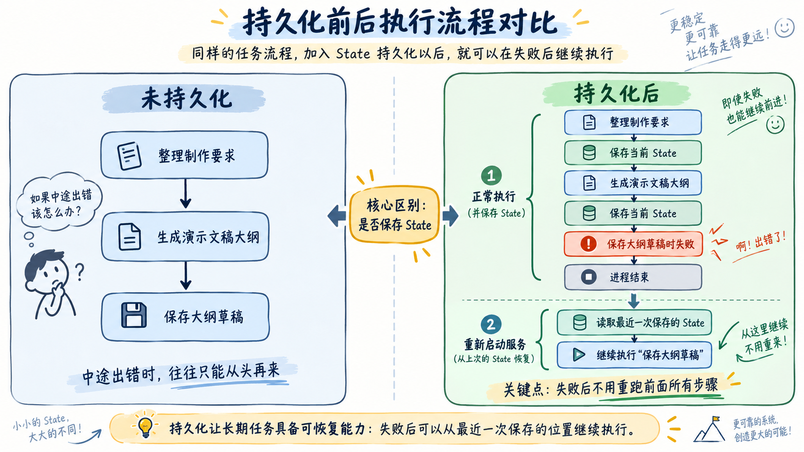
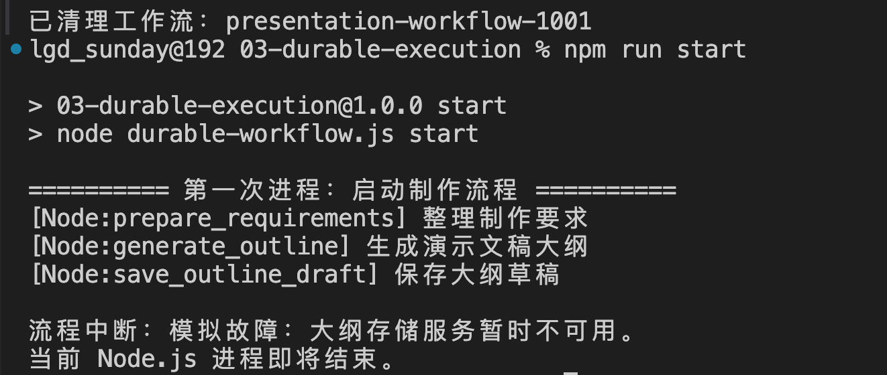
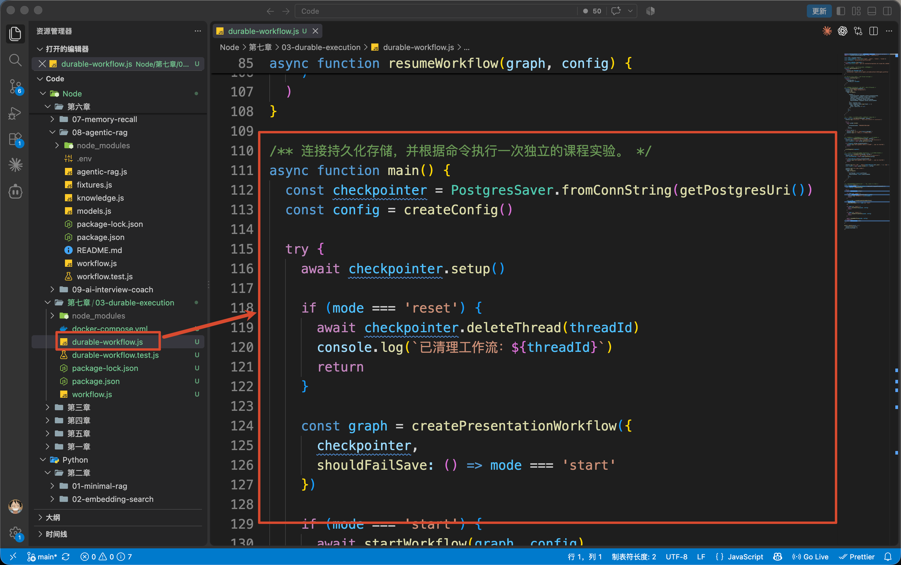
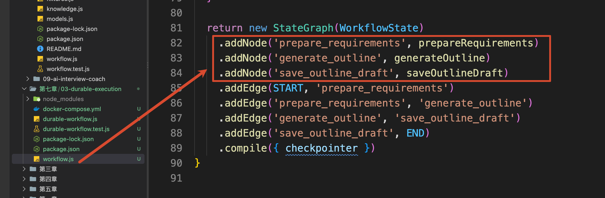
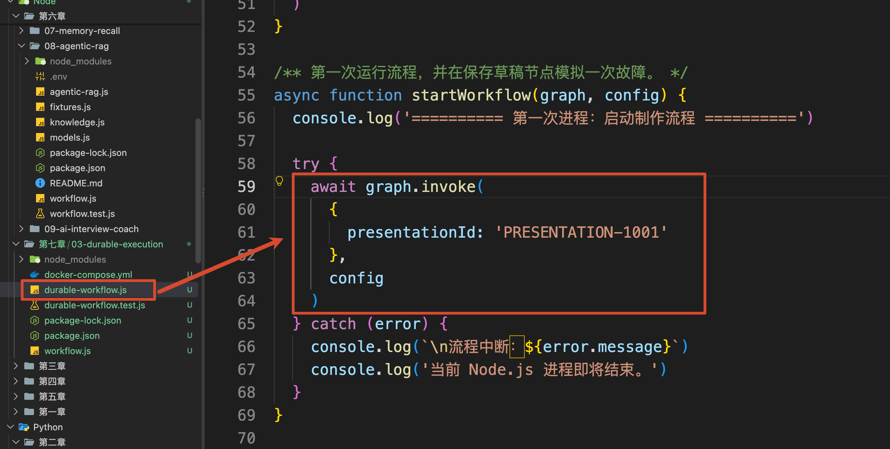
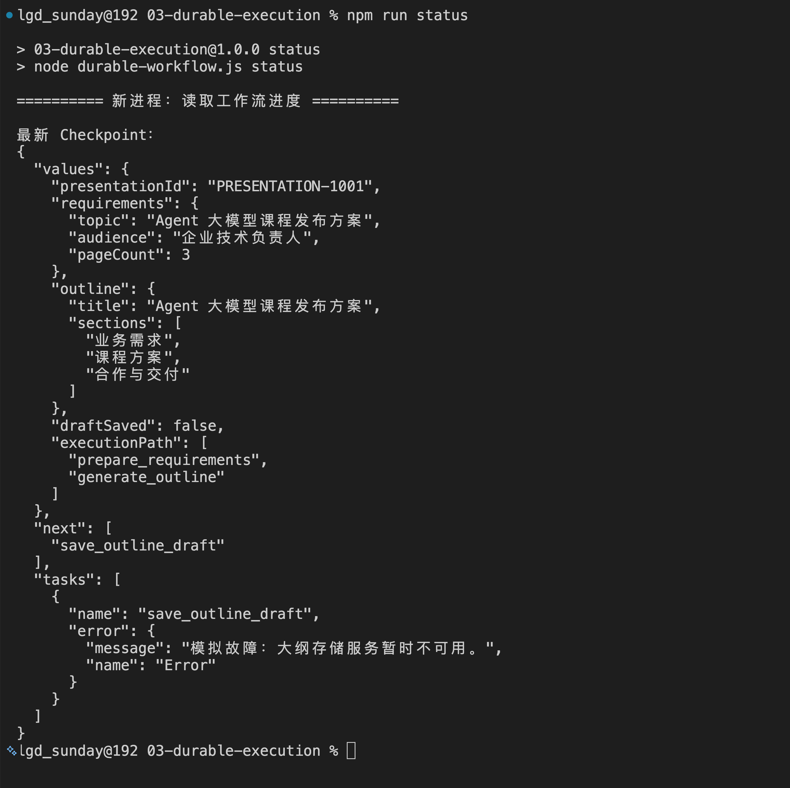
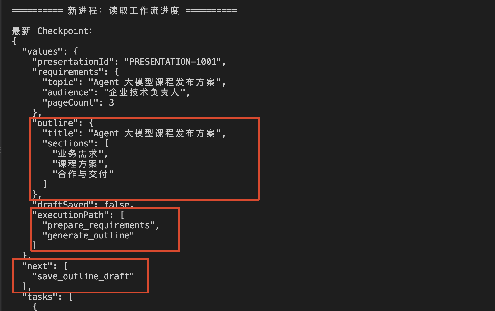
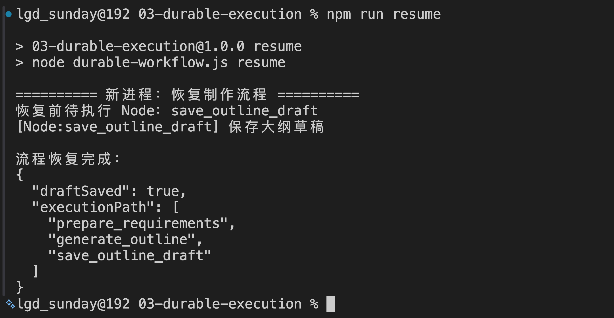
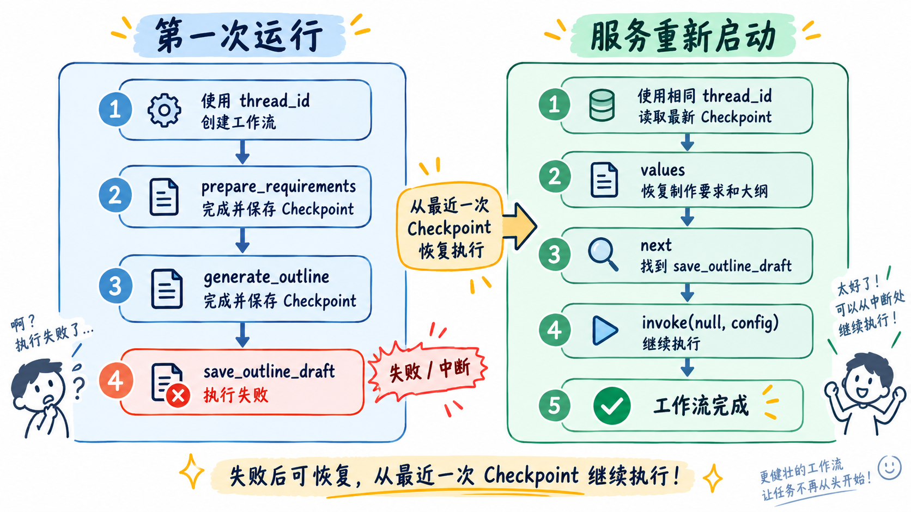
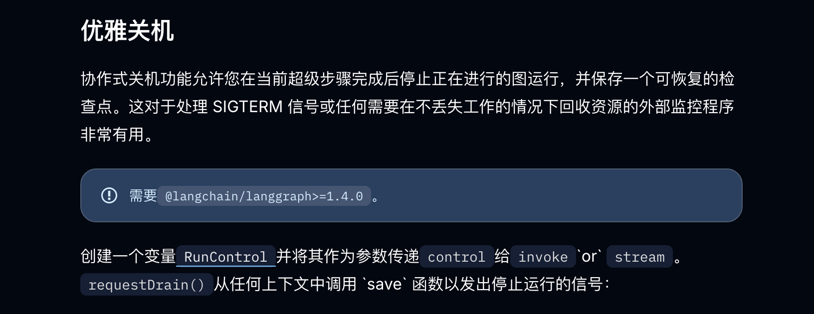

# 03- Agent 持久化执行策略：服务重启以后，Agent 如何继续之前的任务执行

上一小节，咱们通过 DDD 理清了演示文稿制作过程中的业务对象、状态和规则。

比如，大纲已经生成到 `v2`，那么当前有效版本就应该是 `v2`；大纲还没有通过审核，系统就不能开始制作页面。

但是，这些规则能正确执行，还有一个前提，那就是：**应用程序得知道这项任务已经执行到哪里了。**

假设，当前流程是这样的：`整理制作要求 → 生成演示文稿大纲 → 保存大纲草稿`

前两步已经完成，执行到“保存大纲草稿”时，存储服务突然报错，程序直接崩了。

服务重新启动以后，接下来应该执行什么？

如果应用程序从头开始运行，就会再次整理要求、再次调用模型生成大纲，然后再尝试保存。

这样会产生两个问题。

前面已经完成的工作被重复执行了，那就会浪费很多 Token

更麻烦的是，大模型生成内容本身具有一定的随机性。即使输入完全一样，第二次生成的大纲也可能和第一次不同。服务重启一次之后，用户最后看到的内容可能就会发生变化。

那么想要解决这个问题，就要用到这一小节的讲的东西了，也就是：`Durable Execution`  **持久化执行**。

## 持久化执行到底是什么
咱们可以先这样理解：

> **持久化执行，就是把工作流已经完成的状态和下一步任务保存下来。程序中断以后，再从最近一次可靠保存的位置继续执行。**
>

比如咱们刚才的流程是：`整理制作要求 → 生成演示文稿大纲 → 保存大纲草稿`

那么持久化了之后，就会变成：

```latex
→ 整理制作要求
→ 保存当前 State
→ 生成演示文稿大纲
→ 保存当前 State
→ 保存大纲草稿时失败
→ 进程结束

重新启动服务
→ 读取最近一次保存的 State
→ 继续执行“保存大纲草稿”
```

这样写可能有点长，给大家用一张图来表示



这样做的话，“整理制作要求”和“生成演示文稿大纲”已经完成并保存，恢复时就不需要重新执行。

所以，持久化执行的关键就是保存两类信息：

+ 任务已经产生了哪些结果
+ 接下来还需要执行哪个步骤

只要这两类信息没有随着进程退出而丢失，新的服务进程就能继续原来的工作流。

## LangGraph 怎样记住执行位置
为了保存这些信息，LangGraph 提供了 `Checkpointer` （第六章的时候有讲到，但是大家要注意这里虽然也使用了 `Checkpointer`，但是解决的问题完全不一样）

`Checkpointer` 是专门负责保存和读取工作流快照的组件。Graph 每完成一个执行步骤，它就可以把当前 State、下一步执行位置和相关运行信息保存成一份 `Checkpoint`。

服务重新启动以后，LangGraph 再通过 Checkpointer 读取最新 Checkpoint，从中恢复任务数据和执行位置。

Graph 编译时传入 Checkpointer：

```javascript
const graph = new StateGraph(WorkflowState)
    // 添加 Node 和 Edge
    .compile({ checkpointer })
```

工作流运行时，再提供一个 `thread_id`：

```javascript
const config = {
    configurable: {
        thread_id: 'presentation-workflow-1001'
    }
}
```

LangGraph 会按照这个 `thread_id` 保存工作流的 [Checkpoint](https://docs.langchain.com/oss/javascript/langgraph/persistence)。

Checkpoint 就是 Graph 执行过程中保存的 State 快照。

咱们这一小节的案例里面一共会有三个业务步骤：

+ 整理制作要求
+ 生成演示文稿大纲
+ 保存大纲草稿

而咱们会在代码里面把这三个步骤分别放进三个 Node：

+ 整理制作要求  -> `prepare_requirements`
+ 生成演示文稿大纲  -> `generate_outline`
+ 保存大纲草稿  -> `save_outline_draft`

`prepare_requirements` 执行完成以后，State 中会出现制作要求。

接着，`generate_outline` 根据制作要求生成大纲，并把大纲继续写入 State。

此时前两个 Node 已经完成，第三个 `save_outline_draft` 还没有执行。

所以，LangGraph 保存的最新 Checkpoint 里面其实就已经记录下来了： 当前已经产生了哪些数据、接下来应该执行哪个 Node 了？

对应到 Checkpoint 中，大致就是：

```javascript
{
    values: {
        presentationId: 'PRESENTATION-1001',
        requirements: { /* 制作要求 */ },
        outline: { /* 已生成的大纲 */ },
        draftSaved: false
    },
    next: ['save_outline_draft']
}
```

其中：

+ `values` 是这个时刻已经保存的 Graph State
+ `next` 是接下来等待执行的 Node

如果 `save_outline_draft` 执行失败，系统重新读取最新 Checkpoint 时，就可以知道：大纲已经生成，下一步需要继续保存草稿。

这也是持久化执行能够“接着跑”的原因。

概念说到这里就够了，接下来咱们直接运行一次。

## 运行一次中断与恢复实验
本节代码在：

```latex
/Code/Node/第七章/03-durable-execution
```

这次代码返回固定的数据，主要用来观察 Agent 任务失败回复的逻辑。

进入项目目录，安装依赖并启动数据库（别忘了启动 Docker）：

```bash
npm install
docker compose up -d --wait
```

然后清理上一次实验留下的工作流：

```bash
npm run reset
```

接下来，第一次启动制作流程：

```bash
npm run start
```

执行结果如下：



这条命令会执行 `durable-workflow.js`，咱们来看一下这个代码：



进入这个文件的 `main()`，程序先创建 `PostgresSaver`，再把它交给 `createPresentationWorkflow()`：

```javascript
// 使用 PostgreSQL 创建 LangGraph Checkpointer，
// 用于持久化工作流状态，使任务可以跨进程暂停和恢复。
const checkpointer = PostgresSaver.fromConnString(getPostgresUri())
// 初始化 Checkpointer 所需的数据库表。
await checkpointer.setup()
// 创建演示文稿工作流。
// start 模式下主动让保存步骤失败，用来模拟任务执行中断，
// 后续可以通过 resume 模式验证 Checkpoint 恢复能力。
const graph = createPresentationWorkflow({
    checkpointer,
    shouldFailSave: () => mode === 'start'
})
```

`workflow.js` 中已经把三个 Node 连成一条固定流程：



Graph 创建完成以后，`startWorkflow()` 使用初始的 `presentationId` 启动第一次执行：



从这里开始，LangGraph 会按照 Edge 依次执行三个 Node，并在执行步骤之间保存 Checkpoint。

你会看到三个 Node 依次开始执行（就是最初打印的效果）：

```latex
========== 第一次进程：启动制作流程 ==========
[Node:prepare_requirements] 整理制作要求
[Node:generate_outline] 生成演示文稿大纲
[Node:save_outline_draft] 保存大纲草稿

流程中断：模拟故障：大纲存储服务暂时不可用。
当前 Node.js 进程即将结束。
```

这里模拟的是“保存大纲草稿”时，外部存储服务不可用。

异常出现以后，本次 Node.js 进程结束。进程内创建的 Graph 和 `PostgresSaver` 对象也会被销毁。

现在最重要的问题就是：前面生成的大纲还在不在？

## 在新的进程中读取工作流进度
执行：

```bash
npm run status
```

这条命令会启动一个新的 Node.js 进程，重新创建 `PostgresSaver` 和 Graph，然后调用 `showWorkflowStatus` 方法 ：

```javascript
// 根据当前 thread_id 读取最近一次保存的工作流快照。
// getState() 只读取 Checkpoint，不会触发任何 Node 执行。
const snapshot = await graph.getState(config)
```

`config` 中使用的仍然是：

```latex
presentation-workflow-1001
```

所以，`getState()` 会让 Checkpointer 从 PostgreSQL 中找到这条工作流最新的 Checkpoint。

终端会打印：



这里，咱们重点看三个地方。



`values.outline` 中还保存着第一次生成的大纲，说明这个结果没有随着进程退出而消失。

`executionPath` 只有：`prepare_requirements 和 generate_outline`，说明前两个 Node 已经完成。

`next` 则是：`save_outline_draft`，说明下一步还得继续保存大纲草稿。

现在，应用程序已经能准确回答开头的问题：**这项任务完成了什么，接下来应该从哪里继续。**

## 使用相同 thread_id 继续执行
模拟的存储故障已经解除，接下来执行：

```bash
npm run resume
```

这又会启动一个全新的 Node.js 进程。

程序先创建相同的 Config，然后调用：

```javascript
const result = await graph.invoke(null, config)
```

这里传入 `null`，表示没有新的初始输入，需要继续当前 Thread 中尚未完成的工作流。

LangGraph 会根据最新 Checkpoint 找到 `save_outline_draft`，然后从这个 Node 继续执行。

最终输出是：



注意看这次的 Node 日志。

```latex
[Node:save_outline_draft] 保存大纲草稿
```

新的进程只执行了上一次失败的 Node。

下面两行没有再次出现：

```latex
[Node:prepare_requirements] 整理制作要求
[Node:generate_outline] 生成演示文稿大纲
```

这说明 LangGraph 读取了之前保存的 `requirements` 和 `outline`，直接继续完成剩余步骤。

整个恢复流程可以整理成：



那么此时，有些同学可能会有一个疑惑，那就是：服务重启以后，任务会自动继续吗？

不会。

Checkpoint 负责保存进度，应用程序仍然需要发起恢复。

咱们这一小节的：

```bash
npm run resume
```

就模拟了真实项目里的恢复入口。

企业项目中，通常会由启动扫描、任务队列或者定时任务找到仍处于运行中或失败状态的业务任务，再拿到它关联的 `thread_id`，调用：

```javascript
await graph.invoke(null, config)
```

如果服务收到 `SIGTERM` 这类正常停机信号，当前版本的 LangGraph 还提供了 [Graceful Shutdown](https://docs.langchain.com/oss/javascript/langgraph/fault-tolerance#graceful-shutdown) 能力。



它会在当前执行步骤完成后停止，并保存可以继续运行的 Checkpoint。

## 总结
这一小节主要解决了一个问题：**Agent 工作流执行到一半时，服务重启以后从哪里继续？**

答案是：保存在最新 Checkpoint 里。

`values` 保存这个时刻已经产生的 Graph State，`next` 记录接下来等待执行的 Node，`tasks` 可以反映当前任务和错误。

`PostgresSaver` 会把这些 Checkpoint 保存到 PostgreSQL。新的 Node.js 进程使用相同 `thread_id`，就可以读取原来的执行进度。

恢复时调用 `graph.invoke(null, config)`，LangGraph 会继续尚未完成的 Node。已经完成并写入 Checkpoint 的 Node 不会重新执行。

现在，服务重启的问题解决了。

下一小节，咱们继续处理另一种更常见的暂停问题：大纲生成以后，工作流怎样等待用户审核，并在几小时以后继续执行。

> 更新：2026-09-16 19:20 · 原文：<https://www.yuque.com/lgdsunday/ab1dy3/ri8qn85ptbvcryud>
