# 04 - 基于 LangGraph 的持久化工作流

上一小节，咱们解决了服务中断以后继续执行的问题。

不过，在演示文稿制作流程中，还有一种更常见的 **暂停操作**。

Agent 生成大纲以后，需要等待让用户确认（回一下之前学过的 Human-in-the-loop 的案例）。

那么想要实现这样的等待功能，咱们就必须要满足是三个条件：

+ 第一：工作流可以在审核位置暂停
+ 第二：暂停状态可以保存到数据库
+ 第三：用户提交决定以后，可以继续原来的工作流

那么怎么做呢？

咱们来看下～

## 人工审核到底怎样暂停一条工作流
第四章的项目里面，咱们通过 `Human-in-the-loop` 实现过暂停操作：


当时的逻辑时，当 Agent 准备执行 `delete_file` 时，Runtime 会保存待执行的 Action，把 Run 状态改成 `waiting_approval`，然后通过 `break` 结束当前 Agent Loop

用户点击批准以后，服务端再把 Run 改回 `running`，重新调用 `schedule(runId)`，让 `execute()` 继续执行。

这套暂停和恢复逻辑，是咱们在自定义 Agent Runtime 中手动实现的。

但是，它还有一个没有解决的问题。

那就是，当时的 `RunStoreService` 虽然会把 Run 写入工作区文件，但正在运行的任务主要保存在进程内的 `Map` 中，服务启动时也没有重新加载这些 Run。

所以，第四章实现的是：**在服务仍然运行的情况下，暂停 Agent Loop，等待用户批准或者拒绝一个高风险 Action。**

但是，咱们现在要处理的任务会持续更长时间。

大纲生成以后，用户可能过几个小时才回来审核。在等待期间，电脑可能都重启了。。。

所以，这一次需要实现的是：

> **把暂停位置、工作流 State 和待审核内容全部持久化。即使原来的服务进程已经结束，新的进程仍然可以恢复同一条工作流。**
>

因此，这一小节不会重新讲一遍 Human-in-the-Loop 的基本概念。

咱们真正要学习的是：**怎样把人工审核放进一条可以持久化的 LangGraph 工作流中。**

那么，LangGraph 怎么让一条工作流持久化暂停呢？

这里就要使用到一个方法，叫做 `interrupt()` 中断

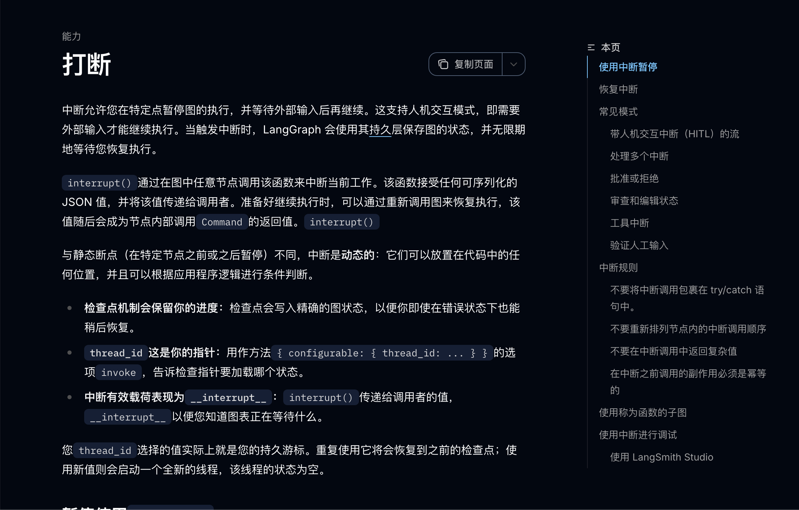

给大家写个伪代码，大家可以看下：

```javascript
const decision = interrupt({
    type: 'outline_review',
    presentationId: state.presentationId,
    outlineVersion: state.outline.version,
    outline: state.outline,
    allowedActions: ['approve', 'revise', 'reject']
})
```

第一次执行到 `interrupt()` 时，LangGraph 会暂停当前 Node。

与此同时，Checkpointer 会保存当前 Graph State、待执行位置以及这份待审核内容：

用户完成审核以后，应用程序再使用相同的 `thread_id`，通过 `Command({ resume })` 提交审核结果：

```javascript
await graph.invoke(
    new Command({
        resume: {
            action: 'approve',
            outlineVersion: 1,
            feedback: null
        }
    }),
    config
)
```

这份 `resume` 数据会成为 `interrupt()` 的返回值。

`review_outline` 拿到用户决定以后，再根据 `approve`、`revise` 或者 `reject` 进入不同的后续 Node。

那么明白了这个概念之后，接下来，咱们就通过代码验证一次完整的暂停和恢复过程。

## 先让工作流停在审核位置
本节代码在：

```latex
/Code/Node/第七章/04-persistent-human-review
```

进入目录，安装依赖并启动 PostgreSQL（再说一遍，别忘了打开 Docker 哈）：

```bash
npm install
docker compose up -d --wait
```

先清理上一次实验留下的数据，再启动制作流程：

```bash
npm run reset
npm run start
```

终端会打印：

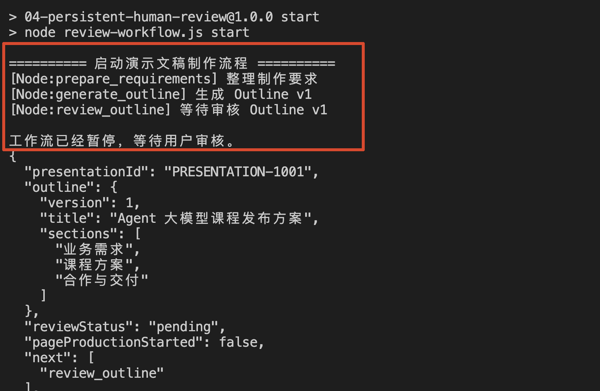

咱们来看看对应的代码逻辑

这一小节的代码其实比较简单，只有两个文件 

+ `review-workflow.js`：这是咱们这次代码的 **运行入口**。
+ `workflow.js`：这是 工**作流定义** 的核心代码文件。负责定义 Graph State、各个 Node、Node 之间的执行顺序。也包括了  `interrupt()` 暂停、`Command({ resume })` 恢复和审核结果的条件路由

咱们先从入口文件开始看。

打开 `review-workflow.js` 中的 `startWorkflow()`  方法，可以看到 这里会使用固定的 `thread_id` 启动工作流：

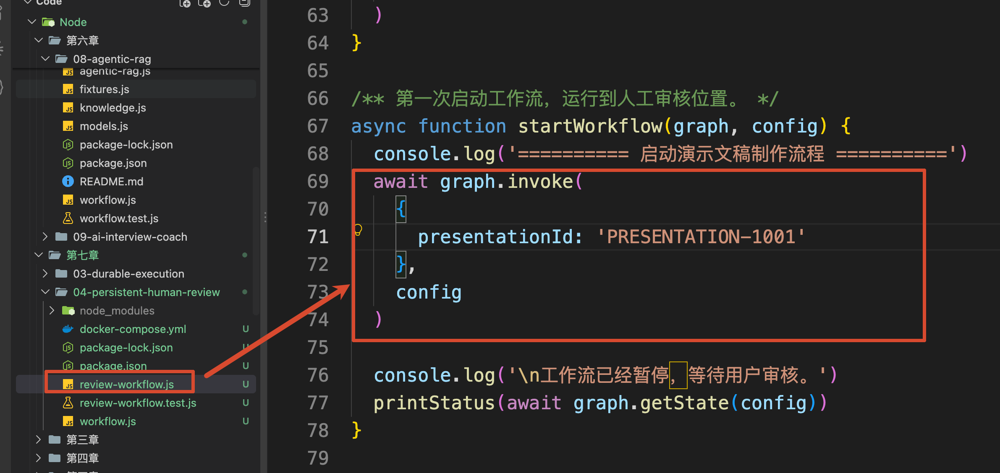

这次 Graph 的结构定义在 `workflow.js` 中：

```javascript
return new StateGraph(WorkflowState)
    .addNode('prepare_requirements', prepareRequirements)
    .addNode('generate_outline', generateOutline)
    .addNode('review_outline', reviewOutline)
    .addNode('start_page_production', startPageProduction)
    .addNode('revise_outline', reviseOutline)
    .addNode('reject_presentation', rejectPresentation)
    .addEdge(START, 'prepare_requirements')
    .addEdge('prepare_requirements', 'generate_outline')
    .addEdge('generate_outline', 'review_outline')
```

前两个 Node 分别整理制作要求和生成第一版大纲。

接着，Graph 进入 `reviewOutline()` （第三个 Node），而这里就是咱们执行暂停的核心逻辑：

```javascript
function reviewOutline(state) {
    /**
     * interrupt 会暂停当前 Graph，
     * 并把大纲及允许执行的操作返回给外部应用。
     *
     * 用户完成审核后，工作流从这里恢复，
     * interrupt 会返回用户提交的审核结果。
     */
    const decision = ReviewDecisionSchema.parse(
        interrupt({
            type: 'outline_review',
            presentationId: state.presentationId,
            outlineVersion: state.outline.version,
            outline: state.outline,
      // 用户只能从批准、修改和拒绝三个动作中选择
            allowedActions: ['approve', 'revise', 'reject']
        })
    )
 // 保存本次审核结果，供后续节点决定工作流应该走哪条分支
    return {
        reviewDecision: decision.action,
        reviewFeedback: decision.feedback
    }
}
```

第一次执行到 `interrupt()` 时，程序还没有 `decision`。

所以，`interrupt()` 会暂停当前 Node，并把下面这些内容保存为待处理的审核请求：

```javascript
{
    type: 'outline_review',
    presentationId: 'PRESENTATION-1001',
    outlineVersion: 1,
    outline: {
        version: 1,
        title: 'Agent 大模型课程发布方案',
        sections: ['业务需求', '课程方案', '合作与交付']
    },
    allowedActions: ['approve', 'revise', 'reject']
}
```

这份数据就是前端审核页面需要展示的内容。

前端可以用 `outline` 渲染当前大纲，再根据 `allowedActions` 提供批准、修改和拒绝入口。

执行：

```bash
npm run status
```

这条命令会启动一个新的 Node.js 进程，再通过 `graph.getState(config)` 读取最新 Checkpoint。

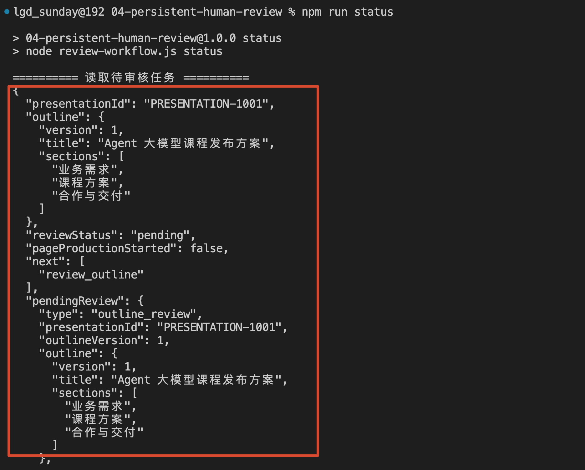

其中这些数据就是咱们在上面看到的暂停时存储的数据，其中：

+ `reviewStatus: 'pending'` 表示当前大纲正在等待审核。
+ `next: ['review_outline']` 表示工作流仍然停在审核 Node。
+ `pendingReview` 则保存了 `interrupt()` 提交的待审核内容。

所以，真实 Web 项目重新打开审核页面时，不需要让模型重新生成大纲。

服务端只需要根据任务关联的 `thread_id` 读取 StateSnapshot，就可以重新得到大纲内容和待审核操作。

到这里，暂停的问题已经解决了。

接下来，咱们看看用户提交审核结果以后，怎么回复数据

先执行一次修改：

```bash
npm run revise
```

这个指令会提交下面这份审核数据：

```javascript
{
    presentationId: 'PRESENTATION-1001',
    outlineVersion: 1,
    action: 'revise',
    feedback: '增加一页企业 Agent 落地风险与控制方案。'
}
```

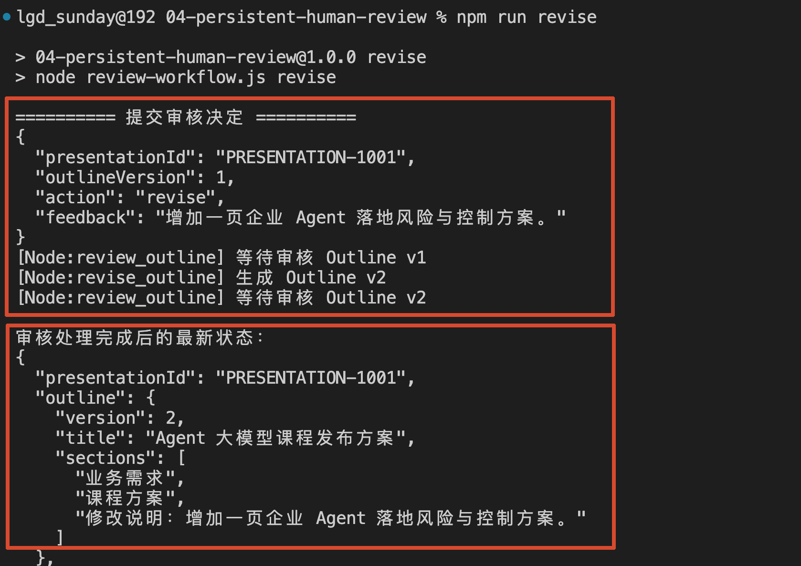

在这里，咱们不会一收到 `action: 'revise'`，就直接恢复 Graph。

其实，代码就会进入到 `submitReview()` 方法里面

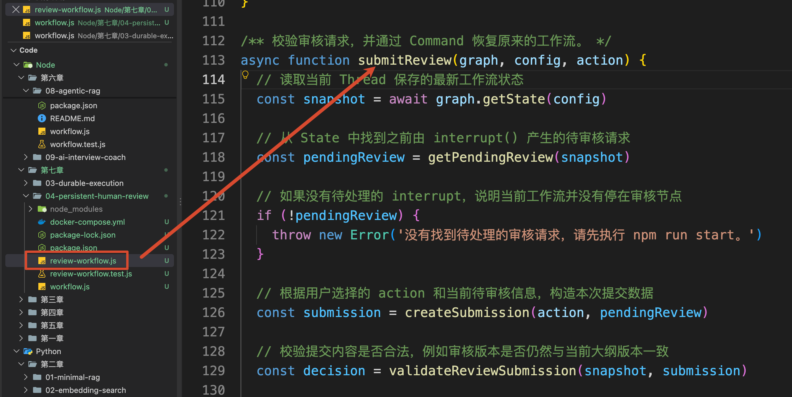

这里面的代码，有三句比较核心的逻辑：

```javascript
// 读取当前 Thread 保存的最新工作流状态
const snapshot = await graph.getState(config)
// 从 State 中找到之前由 interrupt() 产生的待审核请求
const decision = validateReviewSubmission(snapshot, submission)

/**
 * 通过 Command.resume 把审核结果传回之前的 interrupt()，
 * 工作流会从暂停的位置继续执行，而不是重新从头开始。
 */
await graph.invoke(
    new Command({ resume: decision }),
    config
)
```

恢复以前，程序会确认：

+ 当前任务确实存在待审核大纲
+ `presentationId` 属于当前任务
+ 用户提交的 `outlineVersion` 仍然是当前版本
+ 请求修改时已经填写修改意见

校验通过以后，`Command({ resume: decision })` 才会把审核结果送回原来的 `interrupt()`。

这里传入的 `config` 必须要使用原来的 `thread_id`。

回复之后，咱们之前暂定时候的代码 （`reviewOutline` 方法）：

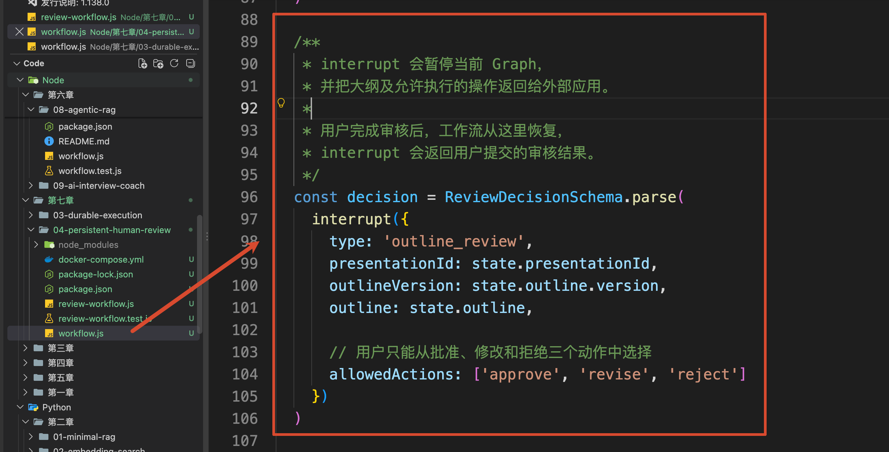

就可以拿到对应的返回值了。

此时的 `decision` 大致就是下面这样：

```javascript
const decision = {
    action: 'revise',
    outlineVersion: 1,
    feedback: '增加一页企业 Agent 落地风险与控制方案。'
}
```

`reviewOutline()` 再把它写入 State：

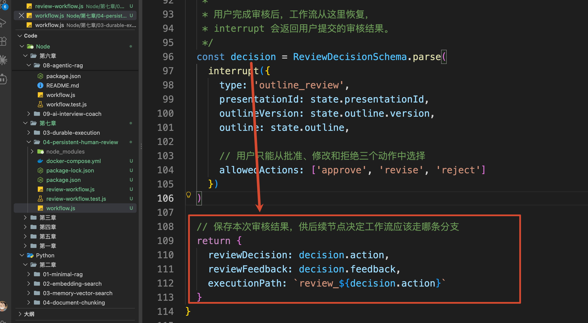

现在，条件路由就可以根据 `reviewDecision` 选择下一步的执行逻辑了，对应的代码如下：

```javascript
.addConditionalEdges('review_outline', routeAfterReview, {
    approve: 'start_page_production',
    revise: 'revise_outline',
    reject: 'reject_presentation'
})
```

这里有三个选择条件，对应的就是 `decision.action` 得值：

+ 如果这个值是 `approve`：表示当前大纲审核通过，Graph 会进入 start_page_production，继续制作页面
+ 如果这个值是 `revise`：表示用户要求修改当前大纲，所以 Graph 会进入 revise_outline，生成 Outline v2，并再次等待审核
+ 如果这个值是 `reject`：表示用户不再继续本次制作任务，Graph 会进入 reject_presentation，并结束工作流

再给大家看下完整的 Node 截图：

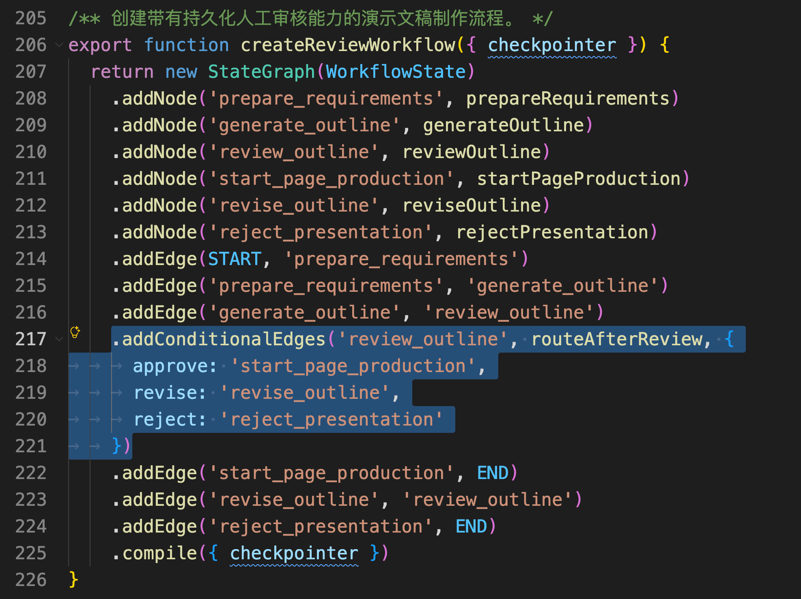

因为咱们这里选择的是 `revise` ，所以根据上面的逻辑，代码会继续生成，走到  `review_outline`：

```javascript
.addEdge('revise_outline', 'review_outline')
```

因此，终端最终会看到：

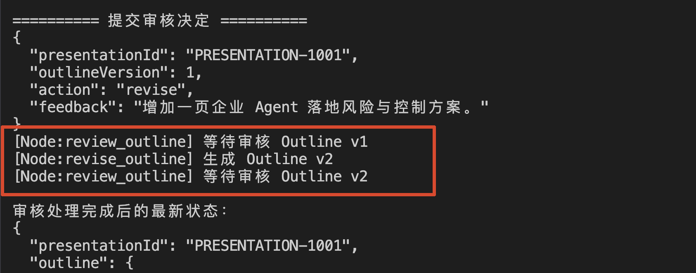

此时，它已经完成第一轮修改，并停在第二次人工审核。

现在，咱们模拟用户检查完 `Outline v2`，决定批准这版大纲。

执行：

```bash
npm run approve
```

它会使用原来的 `thread_id` 读取最新 Checkpoint，找到当前正在等待审核的 `Outline v2`，再准备下面这份审核结果：

```javascript
{
    presentationId: 'PRESENTATION-1001',
    outlineVersion: 2,
    action: 'approve',
    feedback: null
}
```

接着，程序通过 `Command({ resume })` 把这份结果送回 `review_outline`：

```javascript
await graph.invoke(
    new Command({ resume: decision }),
    config
)
```

恢复以后，`interrupt()` 会返回这份审核结果。

条件路由发现本次决定是 `approve`，于是进入 `start_page_production`：

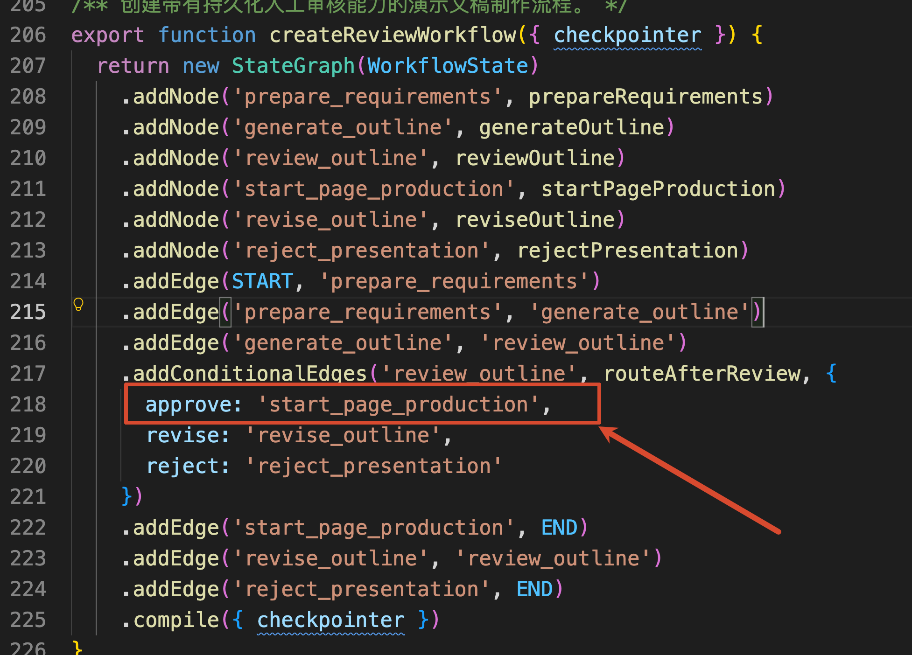

这会触发 `startPageProduction` 方法：

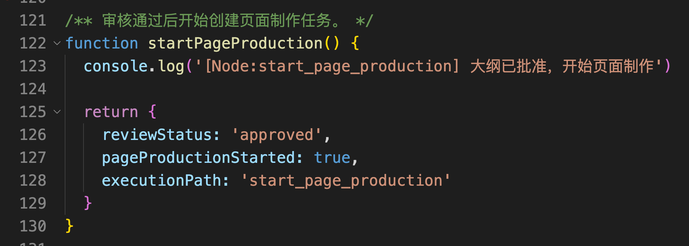

最终状态变成：

```javascript
return {
    reviewStatus: 'approved',
    pageProductionStarted: true,
    next: []
}
```

`next` 为空，说明当前案例中的工作流已经执行完成。

## 总结
这一小节解决的是：**大纲生成以后，工作流怎样跨请求等待用户审核，并根据批准、修改和拒绝继续执行。**

`interrupt()` 会在审核 Node 中暂停 Graph，并把大纲、版本和允许执行的操作作为待审核内容交给应用程序。

Checkpointer 会保存当前 State、执行位置和 Interrupt。即使当前请求结束或者服务重启，应用程序仍然可以通过相同 `thread_id` 找回这次审核。

用户提交决定以后，服务端先校验任务归属、审核状态和大纲版本，再通过 `Command({ resume })` 恢复原来的工作流。

批准会继续页面制作，修改会生成新版大纲并再次等待审核，拒绝会结束当前任务。

同时要记住：包含 `interrupt()` 的 Node 在恢复时会从头执行。中断以前的副作用需要避免重复，或者具备幂等能力。

现在，人工等待的问题解决了。

下一小节，咱们继续处理一个更麻烦的情况：十二页内容已经成功生成八页，第九页失败以后，怎样只继续剩余页面，而不是把前八页全部重新制作一遍。

> 更新：2026-09-17 18:00 · 原文：<https://www.yuque.com/lgdsunday/ab1dy3/gnq1tenlh5ugd65p>
