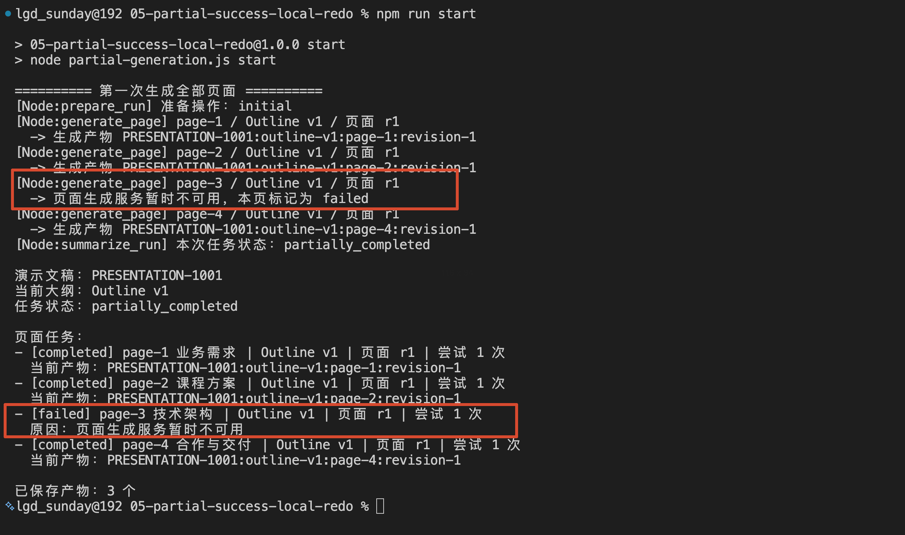
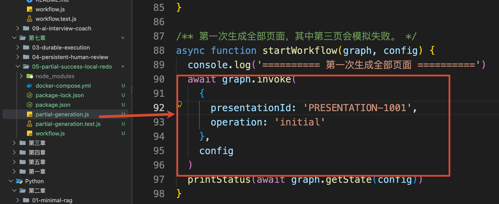
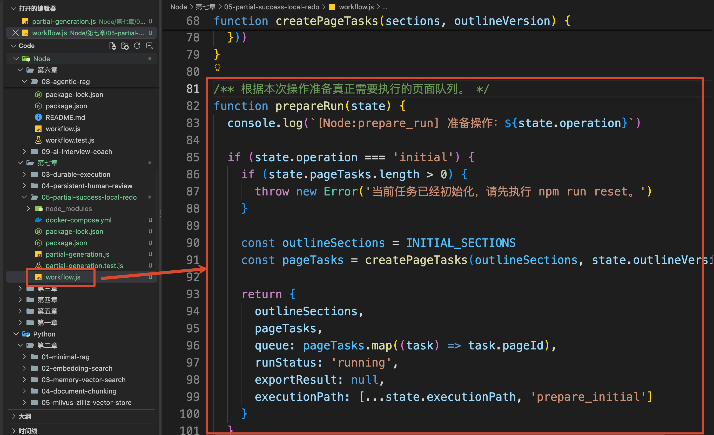
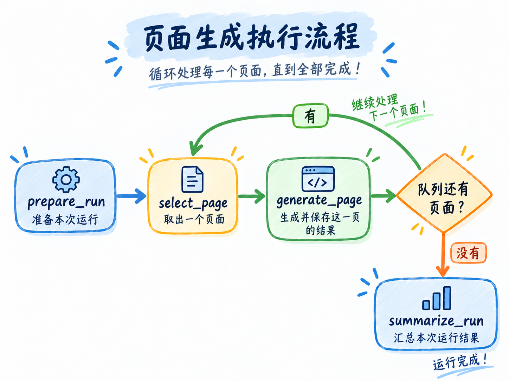
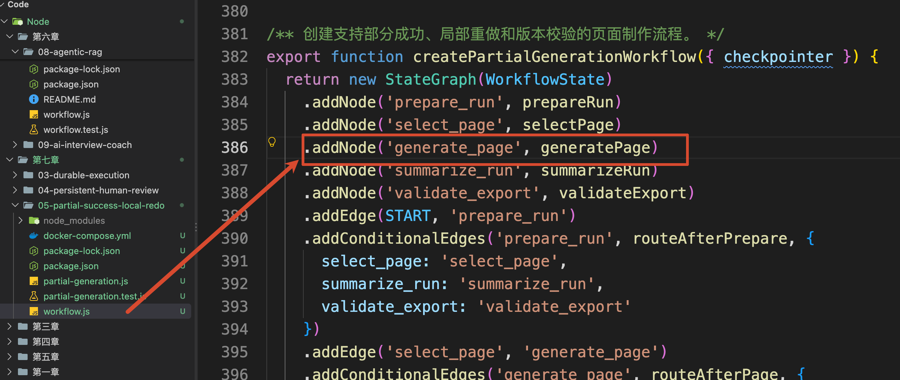
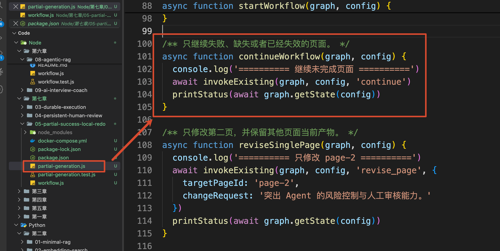
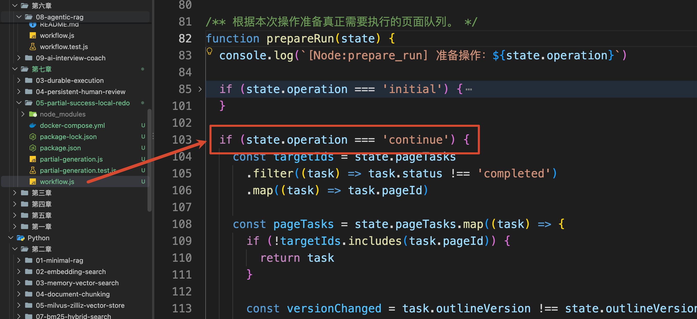
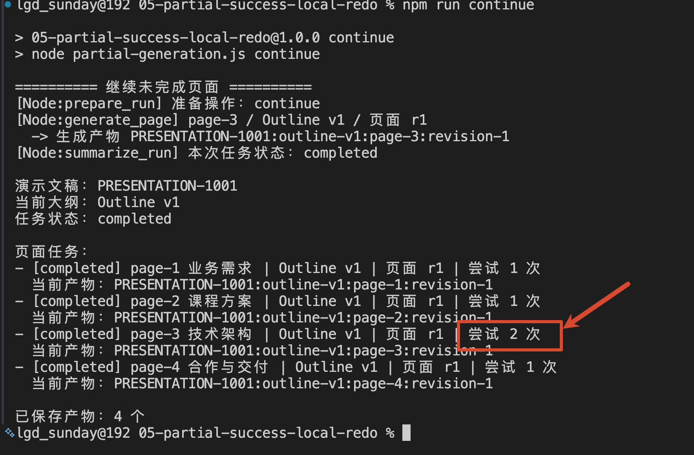
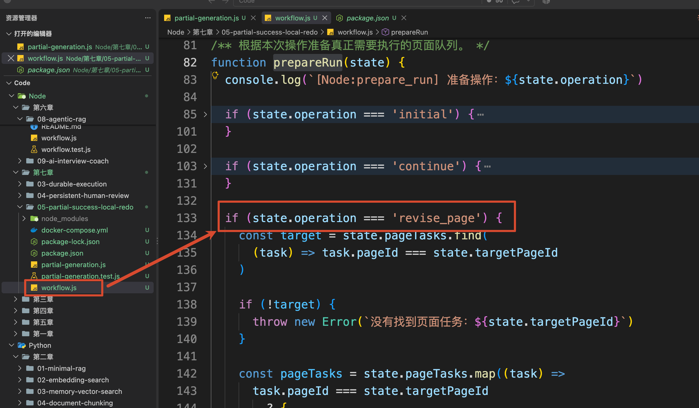
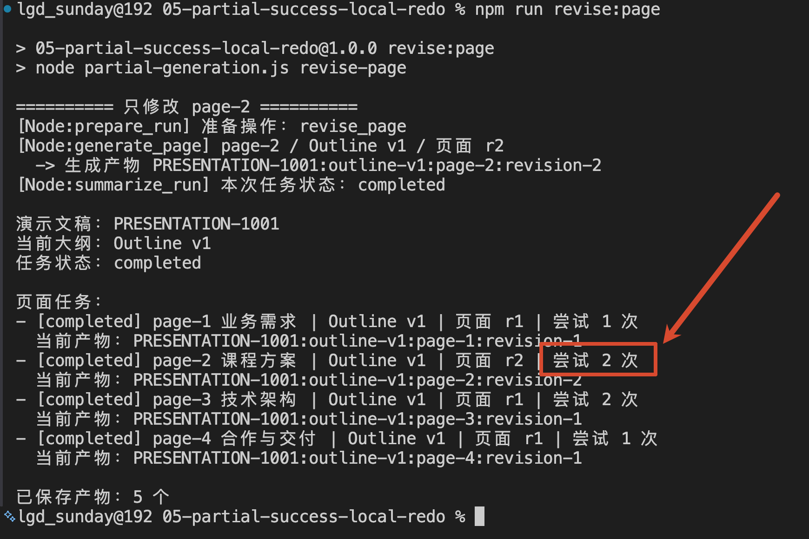

# 05 - 基于 Graph 工作流的局部重做与局部恢复

上一小节，大纲通过审核以后，工作流进入了页面制作阶段。

不过，页面制作并不一定会一次全部成功。干到一半完蛋了的事情，应该很常见才对。

那么假设，当前需要生成四页内容，其中前三页都成功了，但是第四页失败了。

那么现在，这项任务应该算成功还是失败？

如果直接把整项任务标记成失败，下次重新执行四页，前三个已经成功的页面也会被再次生成。

这会重复消耗模型 Token 和页面生成费用。更麻烦的是，重新生成的页面可能和第一次不同。

所以，长任务不能只记录一个整体状态。

系统还需要知道：**每一页是否成功、使用了哪个大纲版本，以及当前应该使用哪一份页面产物。**

这一小节，咱们就来解决三个问题：

+ 某一页失败以后，如何只做失败页面
+ 用户只修改一页时，如何只重新制作这一页
+ 大纲版本变化以后，如何禁止旧页面混入最终文件

## 什么是部分成功
部分成功表示的是一种任务结果，即：**一项任务包含多个可以独立完成的子任务，其中一部分已经成功，另一部分仍然失败或者等待处理。**

在演示文稿项目中，整份文件是一项大任务，每个页面是一项子任务。

所以，咱们需要分别记录每一页的结果，整体的记录结构大概就是下面这样：

```javascript
{
    pageId: 'page-3',
    title: '技术架构',
    outlineVersion: 1,
    pageRevision: 1,
    status: 'failed',
    attempts: 1,
    currentArtifactId: null,
    lastError: '页面生成服务暂时不可用'
}
```

这里的几个字段各自解决一个问题。

+ `pageId` 表示这是哪一页。即使标题发生变化，程序仍然可以通过稳定的 ID 找到同一项页面任务。
+ `outlineVersion` 表示这一页根据哪一版大纲生成。
+ `pageRevision` 表示当前页面修改到了第几版。
+ `status` 记录本页是等待制作、已经完成、生成失败，还是因为大纲更新而失效。
+ `currentArtifactId` 指向当前真正应该使用的页面产物。

有了这些信息，咱们才可以判断一个旧结果到底能不能继续使用。

## 先运行一次部分成功
本节代码在：

```latex
/Code/Node/第七章/05-partial-success-local-redo
```

进入项目，安装依赖并启动 PostgreSQL：

```bash
npm install
docker compose up -d --wait
```

然后清理之前的实验数据，开始第一次页面制作：

```bash
npm run reset
npm run start
```

这次案例一共生成四页，并故意让第三页第一次执行失败。



最后得到的任务状态是：`1、2、4 completed 成功`，`3 failed 失败`

然后咱们来看看如何处理第三页的单独重做。

咱们还是从代码入口开始看。

`npm run start` 会执行 `partial-generation.js`，然后进入 `startWorkflow()`，这个代码大家应该和熟悉了，就不去多说了。



Graph 收到 `operation: 'initial'` 以后，先进入 `prepare_run`。



这个 Node 会创建四个页面任务，再把四个 `pageId` 放进待处理队列：

```javascript
return {
    outlineSections,
    pageTasks,
    queue: pageTasks.map((task) => task.pageId),
    runStatus: 'running'
}
```

接下来的执行流程是这样的：



这里的 `generate_page` 每次只处理一页。



执行完成以后，页面状态和产物引用会写回 Graph State，然后再处理下一页。

而这样的一个处理方式，涉及到一个在 Agent 开发中很重要的工作流设计：`Node Granularity`，也就是 **Node 粒度**。

Node 粒度表示：**一个 Node 里面到底包含多少工作。**

假设要生成十个页面，最简单的写法是创建一个 `generate_all_pages` Node，在这个 Node 内部循环十次

但是，这就是一个粒度比较大的 Node。

问题在于，LangGraph 需要等这个 Node 正常执行完成并返回 State Update，才能保存本次执行产生的新状态。

如果前九页已经调用成功，第十页生成时却抛出异常，那么 `generate_all_pages` 并没有正常返回。工作流恢复时，仍然需要从这个 Node 的开头重新执行，前九页也可能被重复生成。

所以，如果如果想要实现 **恢复执行**，那么这里的恢复指的就必须是一个 Node 的粒度。

比如：咱们想要恢复某一页的执行，则必须以一页为一个粒度才可以

这就是调整 Node 粒度的价值：**把需要独立保存、独立重试和独立复用的工作，拆成单独的一次 Node 执行。**

当然，Node 也不是拆得越小越好。

如果连“读取标题”和“拼接一句文字”都拆成不同 Node，Graph 会出现大量没有独立恢复价值的步骤，代码和执行轨迹也会越来越复杂。

因此，想要判断一个步骤是否应该单独成为 Node，可以看它是否需要：

+ 单独保存执行结果
+ 失败以后单独重试
+ 被后续流程单独复用
+ 调用一个可能失败或者产生费用的外部服务

当前项目中的每一页都有独立状态和独立产物，也可能单独失败、修改和重新生成，所以 “一页” 就是更合适的执行粒度。

## 恢复失败页的执行
现在，`page-1`、`page-2` 和 `page-4` 已经成功，只有 `page-3` 失败。

执行：

```bash
npm run continue
```

代码会走到 `continueWorkflow` 方法



程序会先读取当前 Thread 的 State，再以 `operation: 'continue'` 开始下一轮执行。

进入 `prepareRun()` 以后，程序只挑选没有完成的页面：



通过下面的逻辑进行判断

```javascript
const targetIds = state.pageTasks
    .filter((task) => task.status !== 'completed')
    .map((task) => task.pageId)
```

此时，`targetIds` 中只有：`['page-3']` 

所以，第二次运行只会执行：`page-3`

最终状态变成：

```latex
[completed] page-1 | 尝试 1 次
[completed] page-2 | 尝试 1 次
[completed] page-3 | 尝试 2 次
[completed] page-4 | 尝试 1 次
```

可以看到，只有第三页的尝试次数从 `1` 变成了 `2`。



其他页面没有进入本轮执行队列，之前保存的产物会被直接保留。

这就是部分成功之后的失败续做。

## 重做某一页
现在失败的重做咱们搞定了。

然后咱们来看另外一个场景。

比如，现在页面全部都做完了，但是用户又提出一个要求：

```latex
第二页需要突出 Agent 的风险控制与人工审核能力。
```

这个修改只影响 `page-2`，没有必要重新生成其他三页。

咱们可以执行：

```bash
npm run revise:page
```

代码会在 `prepareRun` 中走这一段逻辑：



`prepareRun()` 找到 `page-2` 以后，会把这一页的 `pageRevision` 加一：

```javascript
{
    pageId: 'page-2',
    outlineVersion: 1,
    pageRevision: 2,
    status: 'pending',
    currentArtifactId: null
}
```

同时，本轮队列中只放入 `page-2`：

```javascript
queue: ['page-2']
```

所以，Graph 只会重新生成第二页



## 总结
这一小节解决的是：页面制作只完成一部分以后，怎样保留成功结果，并准确重做受影响的部分。

每个页面都需要有稳定的 `pageId`，同时记录 `outlineVersion`、`pageRevision`、执行状态和当前产物引用。

失败续做时，只把 `failed`、`pending` 或 `stale` 的页面重新放入队列。已经完成并且版本仍然有效的页面可以继续复用。

单页修改会增加这一页的 `pageRevision`，只替换它的当前产物就可以了。

那么到这里，基本需要讲的工作流知识就都讲完了。

下一小节，咱们把这些能力放进一个完整的 AI 演示文稿制作 Agent，先看项目最终能够实现什么。

> 更新：2026-09-18 11:37 · 原文：<https://www.yuque.com/lgdsunday/ab1dy3/zcnvi1m8pte09dpu>
