# 07 - 实战（中）：从开始制作到大纲审核，串起持久化执行流程

上一小节，咱们已经把整个项目运行起来了。

用户填写制作要求、选择 `Replay` 或者 `AI` 模式，再点击“开始制作”，过一会儿就能看到一份等待审核的大纲。

从页面上看，这个过程好像挺简单的。

但是，服务端实际实际做的事儿还是蛮复杂的，大致是下面这些流程：

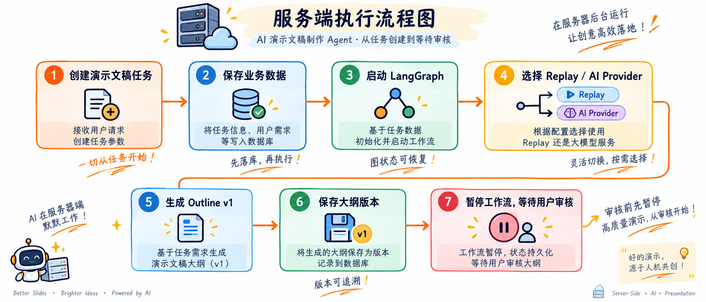

整个的流程就是从「开始制作」这个按钮开始的

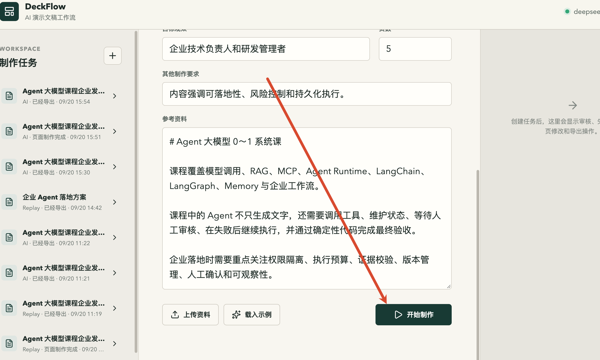

那么还是和之前一样，咱们先看这个代码的点击事件

## 点击“开始制作”以后，请求去了哪里
先打开：

```latex
web/src/App.vue
```

页面中的“开始制作”按钮绑定了 `createTask()`：

```vue
<button
    class="primary-button"
    :disabled="busy"
    @click="createTask"
>
    开始制作
</button>

```

所以，用户点击按钮以后，前端首先执行的是：

```typescript
/** 创建一个新的制作任务，并初始化进入大纲编辑阶段。 */
async function createTask() {
    // 使用统一的异步状态处理函数，管理请求过程中的 loading、错误等状态
    await run(async () => {
        // 调用后端接口，根据当前表单数据创建任务
        const task = await api.create({ ...form })
        // 保存当前创建成功的任务，供后续页面使用
        selected.value = task
        // 加载该任务关联的数据，例如已有的大纲、页面等信息
        await loadTasks(task.id)
        // 创建完成后，将当前视图切换到大纲编辑页面
        activeView.value = 'outline'
    })
}
```

这部分的代码不多说的，咱们只需要知道这个代码会完成 `POST /api/presentations` 的请求，这个请求会进入到  `presentation.controller.ts` 的 `create` 方法中：

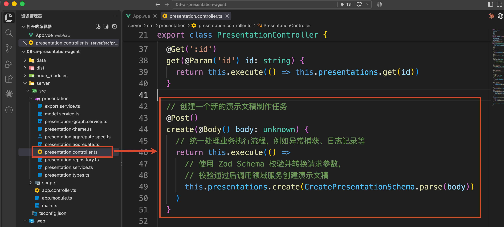

这里会做字段验证，验证之后就会进入到对应的 `presentation.service.ts` 的 `create` 方法

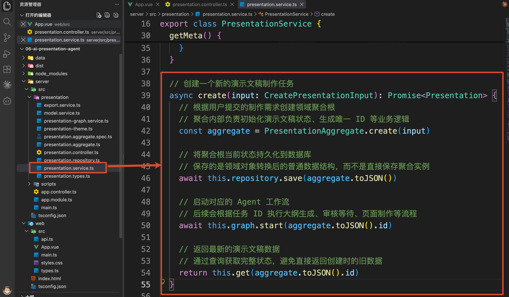

接下来就是对应的执行流程了

咱们看这段代码会发现，代码并不复杂，只有四行，但是整个项目的启动顺序都在这里。

先看第一行：

```typescript
// 根据用户提交的制作需求创建领域聚合根
// 聚合内部负责初始化演示文稿状态、生成唯一 ID 等业务逻辑
const aggregate = PresentationAggregate.create(input)
```

这里会创建一份新的演示文稿业务对象。

初始数据可以简化成：

```javascript
const presentation = {
    id: 'PRES-A1B2C3D4',
    threadId: 'presentation:PRES-A1B2C3D4',
    modelMode: 'replay',
    status: 'creating_outline',
    requirements: {
        topic: 'Agent 大模型课程企业发布方案',
        audience: '企业技术负责人和研发管理者',
        pageCount: 5,
        additionalRequirements: '强调可落地性和风险控制',
        sourceName: 'Agent 课程发布资料.md',
        sourceText: '具体的参考资料内容……'
    },
    outlines: [],
    currentOutlineVersion: null,
    pages: []
}
```

这里需要注意两个字段需要注意下：

+ `id` 表示：业务任务 ID。用来查询这份演示文稿的主题、大纲、页面和导出结果
+ `threadId`  表示 LangGraph 工作流 ID。用来查询这条工作流对应的 Checkpoint

> 前两天有同学问我，说之前项目中的 `thread_id` 和 `sessionId` 有啥关系
>
> 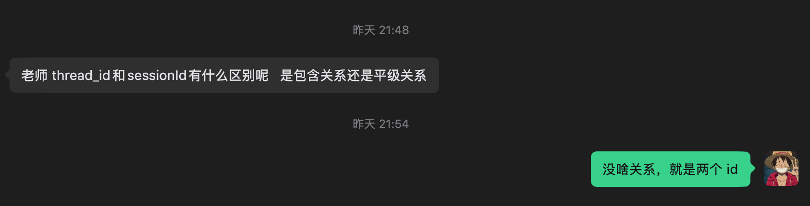
>
> 这些 ID 没有那么复杂，只需要知道每个 ID 都是一个独立的业务标识就可以
>

业务对象创建完成以后，代码执行第二步：

```typescript
// 将聚合根当前状态持久化到数据库
// 保存的是领域对象转换后的普通数据结构，而不是直接保存聚合实例
await this.repository.save(aggregate.toJSON())
```

这一步会通过 `PresentationRepository`，把完整的业务对象写入 PostgreSQL 中的 `presentations` 表。

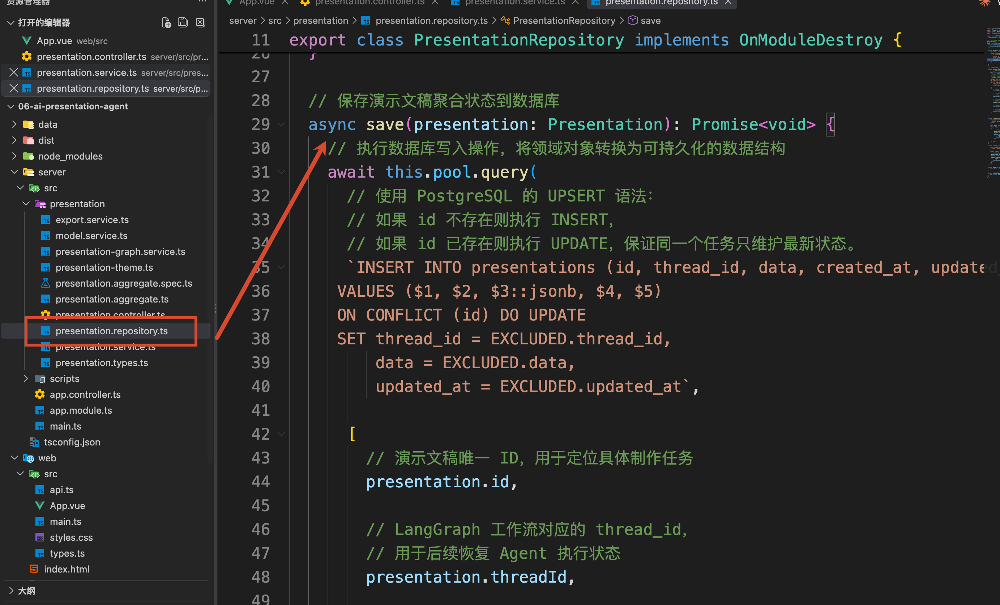

然后开始执行第三步：

```typescript
// 启动对应的 Agent 工作流
// 后续会根据任务 ID 执行大纲生成、审核等待、页面制作等流程
await this.graph.start(aggregate.toJSON().id)
```

最后，把执行的结果返回给前端：

```javascript
// 返回最新的演示文稿数据
// 通过查询获取完整状态，避免直接返回创建时的旧数据
return this.get(aggregate.toJSON().id)
```

所以，`PresentationService.create()` 的执行顺序可以一共就这么四步：

+ 创建业务任务
+ 保存业务任务
+ **启动持久化工作流**
+ 读取最新业务结果并返回给前端

那么在这个流程中，最复杂的就是 **第三步：启动持久化工作流** ，咱们来看看这段。

`this.graph.start()` 对应的是 `presentation-graph.service.ts 的 start() 方法`。

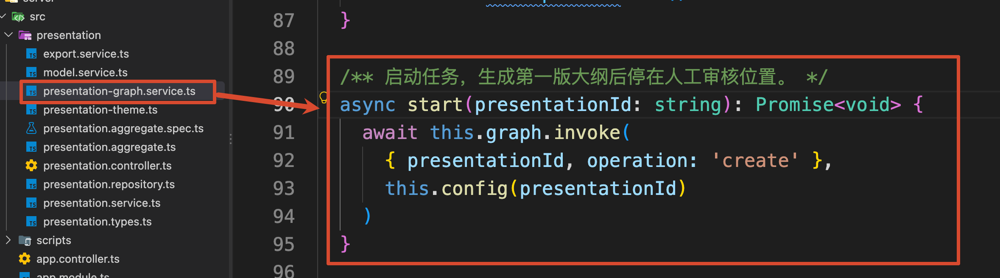

这里传给 Graph 的初始 State 里，最重要的是两个字段：

```javascript
{
    presentationId: 'PRES-A1B2C3D4',
    operation: 'create'
}
```

`presentationId` 告诉后续 Node 应该读取哪一份业务数据。

`operation: 'create'` 则表示，这次启动是为了创建一份新的演示文稿。

第二个参数 `this.config(presentationId)` 会生成：

```javascript
{
    configurable: {
        thread_id: 'presentation:PRES-A1B2C3D4'
    }
}
```

后面每次保存或者恢复 Checkpoint，LangGraph 都会使用这个 `thread_id` 找到同一条工作流。

根据当前的工作流，在 `start` 执行完之后，代码会进入到 `route_operation`，他对应的是 `routeOperation() 方法` 

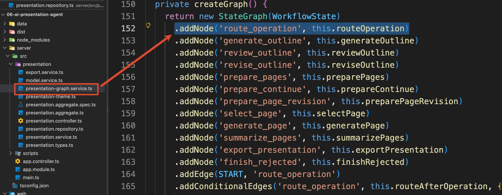

并且，当 `routeOperation()` 执行完成之后，代码会进入到 `routeAfterOperation()` 方法

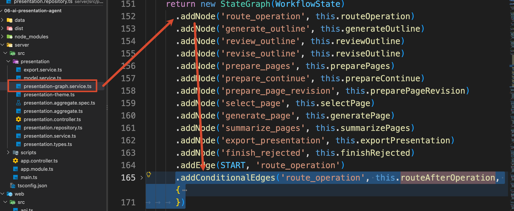

这两块的代码都在一起：

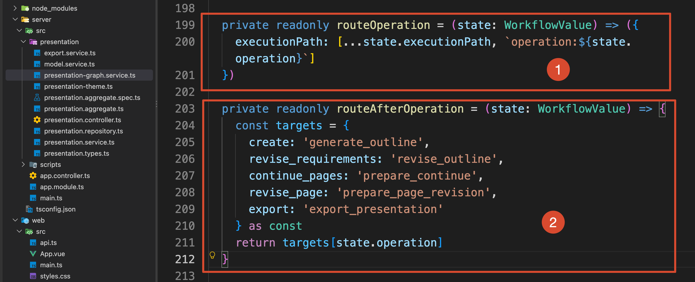

Graph 会先进入 `route_operation`，再根据 `operation` 决定这次应该执行什么任务：

```typescript
return targets[state.operation]
```

当前的 `operation` 是 `create`

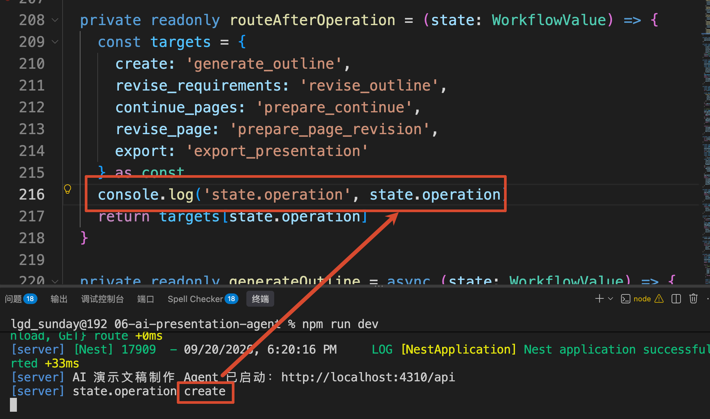

所以 Graph 会进入：`generate_outline` （`看上图 210 行的代码`）

> 后面的修改大纲、继续失败页面、修改单页和导出文件，也会从同一个 Graph 入口进入，只是使用不同的 `operation` 选择不同路线。
>

## Outline v1 是怎样生成出来的
`generate_outline` 对应的是 `generateOutline()`

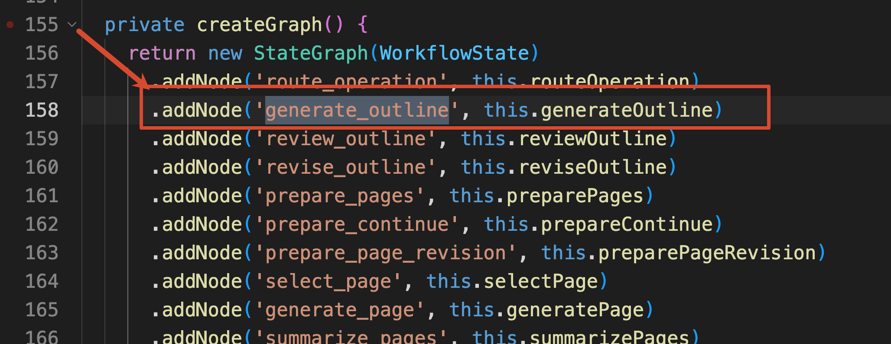

这个方法的作用就是 **生成演示文稿大纲节点**

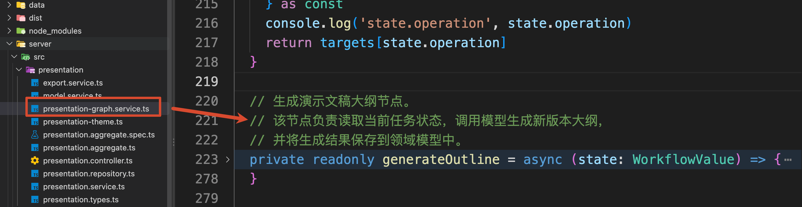

这里面代码有点长，咱们一点点看

首先，根据 `presentationId` 从数据库中读取刚刚保存的业务对象：

```typescript
// 根据 presentationId 从仓储中加载当前演示文稿聚合，
// 获取制作需求、已有大纲等完整业务状态。
const aggregate = await this.load(state.presentationId)
```

然后，根据创建任务时选择的 `modelMode` 获取对应的 Provider：

```typescript
// 根据当前任务配置获取对应的大模型提供方，
// 如果选择的是 `Replay` 模式，这里会得到 Replay Provider，使用预设结果快速演示完整流程。
// 如果选择的是 `AI` 模式，这里会得到 DeepSeek Provider，真正调用模型生成大纲。
const provider = this.models.getProvider(
    aggregate.toJSON().modelMode
)
```

两种 Provider 的内部实现不一样，但是都会返回相同结构的 `OutlineDraft`：

```javascript
// 调用模型生成新的大纲版本。
const draft = {
    title: 'Agent 大模型课程企业发布方案',
    slides: [
        {
            title: '企业为什么需要 Agent',
            purpose: '说明企业 Agent 的业务价值',
            keyPoints: [
                '从单轮问答走向任务执行',
                '连接知识、工具与业务流程'
            ]
        }
    ]
}
```

到这里，模型已经完成了自己负责的事情：**根据制作要求生成大纲内容。**

接下来，系统还要处理大纲版本和审核状态，比如：

+ 本次生成的是 Outline v1 还是 Outline v2？
+ 哪一版是当前有效大纲？
+ 。。。

这些问题都有明确的业务规则。在相同的业务状态下，程序必须得到相同的处理结果，不能随着模型输出发生变化。

所以，代码会把模型生成的 `draft` 交给领域对象，再由普通代码按照固定规则完成处理：

```typescript
// 将模型生成的大纲添加到聚合根中。
// 聚合内部负责维护版本号、当前有效大纲等业务规则。
aggregate.addOutline(draft, state.reviewFeedback)
```

第一次执行 `addOutline()` 时，系统会生成 `Outline v1`：

```javascript
{
    version: 1,
    status: 'pending_review',
    title: 'Agent 大模型课程企业发布方案',
    slides: [
        // 每一页的大纲内容
    ],
    feedback: null,
    approvedAt: null
}
```

与此同时，整个演示文稿任务也会发生变化：

```javascript
{
    status: 'waiting_review',
    currentOutlineVersion: 1
}
```

最后，最新业务对象会再次写入 PostgreSQL：

```typescript
// 保存更新后的演示文稿状态，
// 包括新生成的大纲、版本信息等。
await this.repository.save(aggregate.toJSON())
```

所以在上面的流程中，处理几乎分成了两部分：

+ 模型负责生成大纲内容
+ Agent 固定代码负责大纲版本、审核状态和旧版本失效规则

## Graph 实现持久化暂停
`generate_outline` 执行完成以后，Graph 会继续进入：`review_outline`

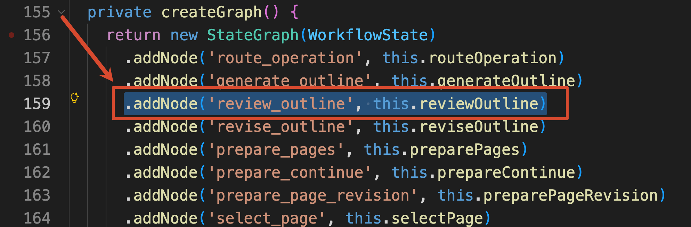

对应的代码是 `reviewOutline()`：

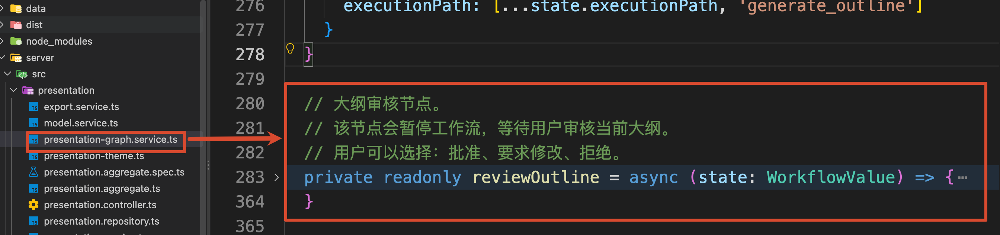

这块代码就是暂停工作流的核心逻辑。

在前面学习的时候我们知道，想要暂停，那么必须使用  `[interrupt()](https://docs.langchain.com/oss/javascript/langgraph/interrupts)` 

```typescript
private readonly reviewOutline = async (state: WorkflowValue) => {
    // 在进入人工审核前加载最新的演示文稿状态。
  const beforeInterrupt = await this.load(state.presentationId)
  // 获取当前需要审核的大纲。
    const outline = beforeInterrupt.currentOutline

  // 使用 interrupt 暂停 LangGraph 工作流。
  // 工作流会停留在这里，等待前端提交用户审核结果。
  //
  // 用户恢复工作流时，会通过 Command({ resume: decision })
  // 将审核结果传递回来。
    const decision = ReviewOutlineSchema.parse(
        interrupt({
            type: 'outline_review',
            presentationId: state.presentationId,
            outlineVersion: outline.version,
            allowedActions: ['approve', 'revise', 'reject']
        })
    )

    ...
}
```

第一次执行到 `[interrupt()](https://docs.langchain.com/oss/javascript/langgraph/interrupts)` 时，用户还没有提交审核决定。

因此，LangGraph 会暂停当前工作流，并保存这份待审核信息：

```javascript
{
    type: 'outline_review',
    presentationId: 'PRES-A1B2C3D4',
    outlineVersion: 1,
    allowedActions: [
        'approve',
        'revise',
        'reject'
    ]
}
```

因为当前 Graph 使用 `PostgresSaver` 作为 Checkpointer，所以，工作流 State、当前执行位置和这份 Interrupt 信息都会写入 PostgreSQL。

到这里，项目中其实已经保存了两类不同的数据。

+ 第一类是演示文稿业务数据，比如：制作要求、当前版本什么的
+ 第二类是 LangGraph 工作流数据。比如：当前暂停位置、`Graph State`、`thread_id` 等等的

很多同学看到这里，可能会产生一个疑问。

`presentation.service 中 create()`  明明执行了：

```typescript
await this.graph.start(aggregate.toJSON().id)
```

现在 Graph 停在 `interrupt()` 了，前端请求会不会也一直卡在这里？

**不会。**

`interrupt()` 暂停的是当前工作流，不是让这次 HTTP 请求无限等待。

Graph 保存好 Checkpoint 和 Interrupt 以后，本次 `invoke()` 就会返回。代码继续执行：

```typescript
return this.get(aggregate.toJSON().id)
```

`this.get()` 会从 `presentations` 表中重新读取刚刚保存的业务对象。

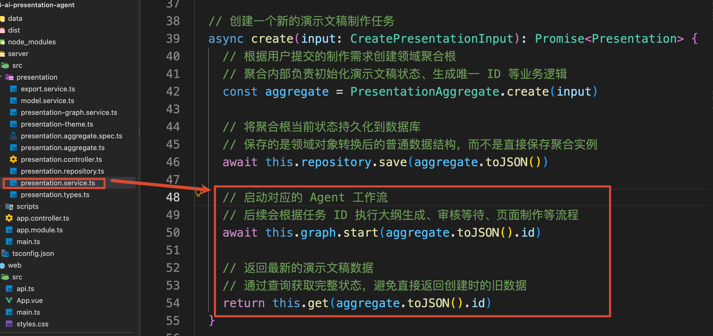

因此，前端最终拿到的是：

```javascript
{
    id: 'PRES-A1B2C3D4',
    status: 'waiting_review',
    currentOutlineVersion: 1,
    outlines: [
        {
            version: 1,
            status: 'pending_review'
        }
    ]
}
```

`createTask()` 再把页面切换到大纲区域：

```typescript
selected.value = task
activeView.value = 'outline'
```

于是，用户就可以看到 `Outline v1 ` 了

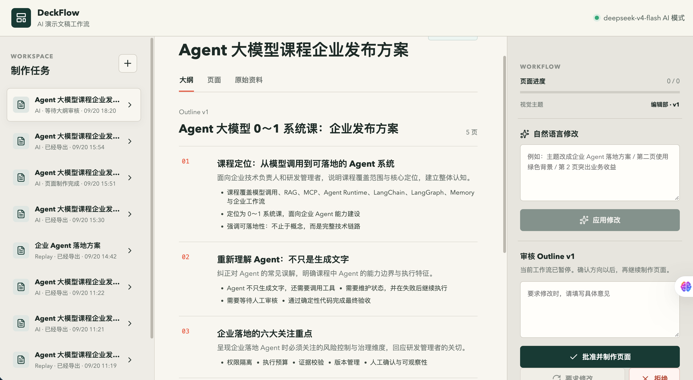

现在，咱们可以在 `Outline v1` 等待审核时，刷新浏览器页面。

刷新以后，左侧任务列表中仍然可以找到刚才创建的任务。重新点击这条任务时，前端会执行 `selectTask` 方法

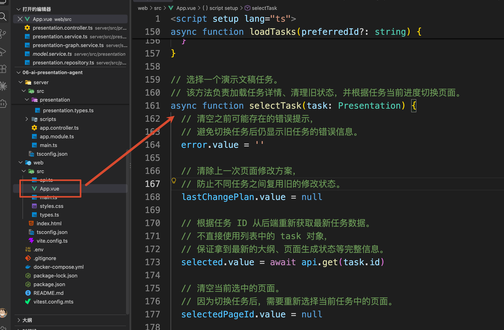

这个方法会发送一个查询请求：

```latex
GET /api/presentations/:id
```

他只会从 `presentations` 表中读取业务对象，再把 `Outline v1` 和 `waiting_review` 状态展示出来。

所以：重新打开任务，只是在读取已经保存的业务数据

这也是为什么，服务重启以后，页面仍然可以展示待审核大纲

## 用户提交审核以后，原来的 Graph 怎样继续
接下来，咱们在审核区域输入：“增加一页企业 Agent 落地风险与控制方案。”

再点击“要求修改”。

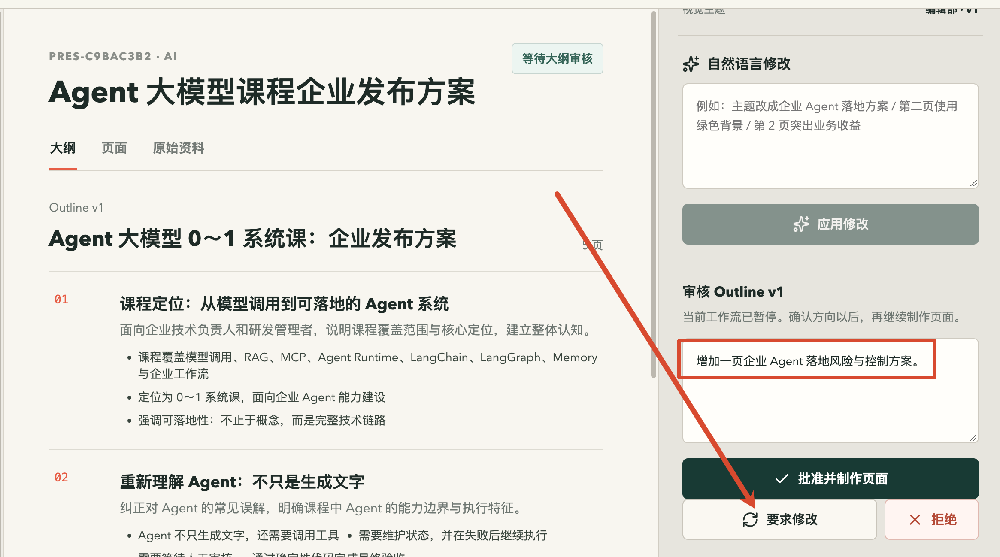

按钮会调用 `App.vue` 中的 `review()` 方法，这个方法会发送 

```javascript
{
    decision: 'revise',
    outlineVersion: 1,
    feedback: '增加一页企业 Agent 落地风险与控制方案。'
}
```

这个写书到：`POST /api/presentations/PRES-A1B2C3D4/review` 地址上，然后会触发到 `presentation.controller.ts` 的 `@Post(':id/review')` 接口

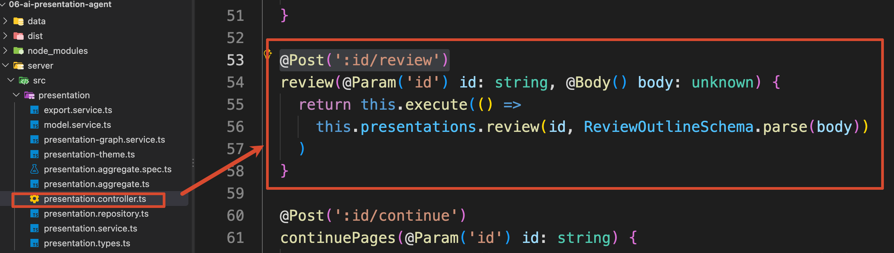

然后代码会进入 `presentation.service.ts` 的 `review` 方法。这个方法会触发 `presentation-graph.service.ts` 的 `review` 函数

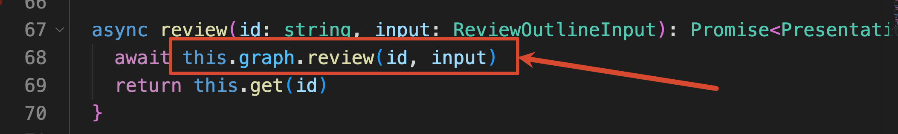

即：整个 review 的核心就在 `presentation-graph.service.ts` 的 `review` 函数中：

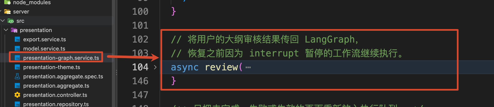

咱们一点点来看。

想要实现重置（review），那么需要先使用相同的 `thread_id` 读取 Checkpoint：

```typescript
// 获取当前任务对应的 Graph 状态快照。
// 通过 thread_id(presentationId) 找到之前暂停时保存的工作流状态。
const snapshot = await this.graph.getState(
    this.config(presentationId)
)
```

再从 Checkpoint 中找到 `review_outline` 留下的 Interrupt：

```typescript
// 检查当前 Graph 是否真的停留在大纲审核节点。
// 如果没有找到 pending review，说明当前任务没有等待用户操作。
const pending = this.findPendingReview(snapshot)
```

如果当前工作流根本没有等待审核，就不能随便恢复。

如果当前等待审核的是 `Outline v2`，用户却提交了 `Outline v1`，这次请求也会被拒绝。

这些检查通过以后，代码才会执行：

```typescript
await this.graph.invoke(
    new Command({ resume: decision }),
    this.config(presentationId)
)
```

这里仍然使用原来的 `thread_id`：`presentation:PRES-A1B2C3D4`

LangGraph 会根据这个 ID 找到之前暂停的 Checkpoint，再把 `decision` 传回原来的 `interrupt()`。

于是，`reviewOutline()` 中的这行代码终于得到了返回值：

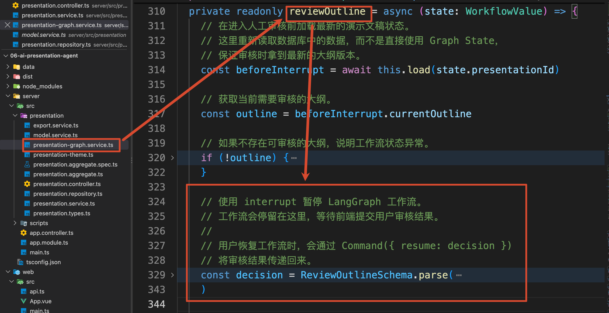

恢复以后，`decision` 大致是：

```javascript
{
    decision: 'revise',
    outlineVersion: 1,
    feedback: '增加一页企业 Agent 落地风险与控制方案。'
}
```

> LangGraph 恢复 Interrupt 时，会从当前 Node 的开头重新执行。因此，放在 `interrupt()` 前面的代码也会再次运行。
>

拿到审核结果（`decision`）以后，项目又从数据库读取了一次最新业务对象：

```typescript
// interrupt 恢复以后，当前函数会继续执行。
// 重新从数据库加载聚合，避免使用暂停之前缓存的旧对象。
const aggregate = await this.load(state.presentationId)
// 校验当前审核版本是否仍然有效。
// 防止用户审核了已经过期的大纲版本。
aggregate.assertReviewable(decision.outlineVersion)
```

这里又做了一次版本校验。

前面的 `getState()`，校验的是工作流当前等待处理的 Interrupt。

这里的 `assertReviewable()`，校验的是业务数据库中的当前大纲版本和审核状态。

也就是说，本次审核需要同时满足：`工作流确实停在这一版大纲的审核位置 + 业务对象也认为这一版大纲仍然可以审核`

两边都没有问题，这次审核结果才会真正进入后续路线。

不过，当前用户填写的修改意见是：“增加一页企业 Agent 落地风险与控制方案。”

这条反馈不只是修改大纲内容，还把演示文稿的页数从 5 页改成了 6 页。

所以，当用户选择 `revise` 时，`reviewOutline()` 还会继续调用：

```typescript
const nextRequirements =
    decision.decision === 'revise'
        ? await this.planOutlineRevision(
            aggregate,
            decision.feedback
        )
        : null
```

`planOutlineRevision()` 会复用项目中现有的 `planChange()`，把自然语言反馈转换成一份明确的修改计划。

当前反馈得到的核心结果可以简化成：

```javascript
{
    scope: 'global_content',
    nextRequirements: {
        topic: 'Agent 大模型课程企业发布方案',
        audience: '企业技术负责人和研发管理者',
        pageCount: 6,
        additionalRequirements:
            '增加一页企业 Agent 落地风险与控制方案。'
    }
}
```

这样，后面生成大纲时，模型收到的页数要求和用户提出的修改意见就是一致的。

`reviewOutline()` 最后会把本次决定写入 Graph State：

```typescript
// 返回 Graph State 更新内容。
// 后续 Conditional Edge 会根据 reviewDecision 决定下一步流程。
return {
    reviewDecision: decision.decision,
    reviewFeedback: decision.feedback,
    nextRequirements,
    executionPath: [
        ...state.executionPath,
        `review:${decision.decision}`
    ]
}
```

接下来，代码会进入到 `routeAfterReview` 

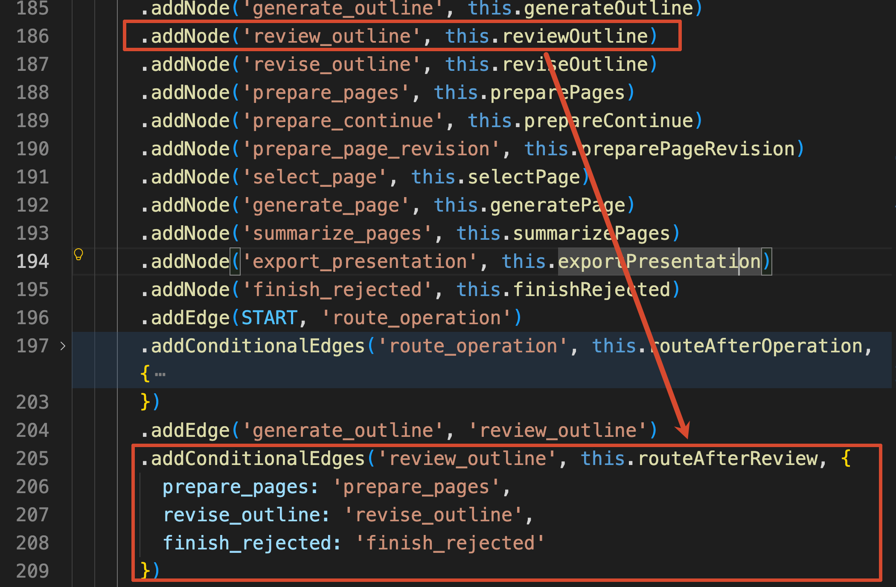

条件路由会根据 `reviewDecision` 选择下一步：

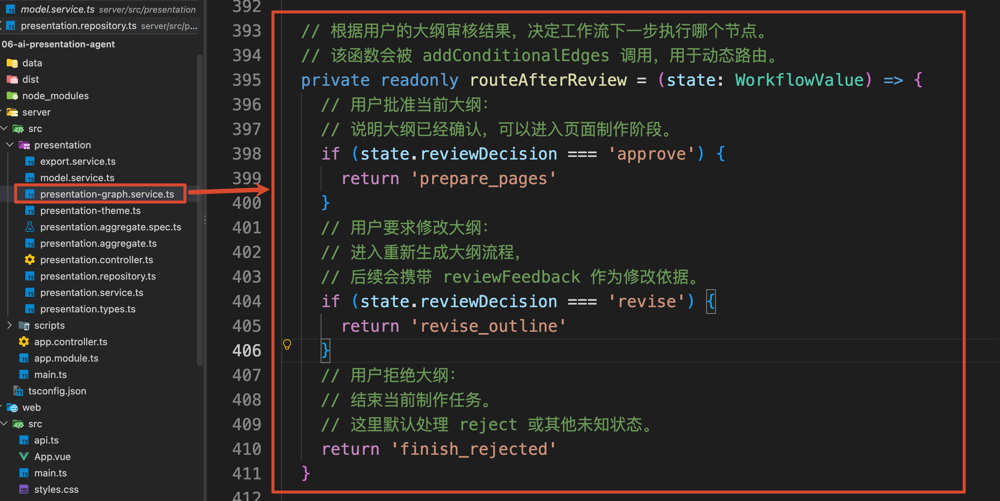

当前决定是 `revise`，所以 Graph 会进入：`revise_outline`，触发 `reviseOutline` 方法

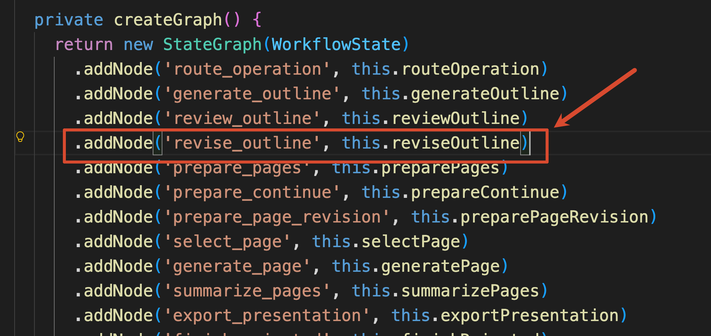

`reviseOutline()` 会读取 `Outline v1`、刚才填写的修改意见和新的制作要求。

调用模型以前，代码会先把 `nextRequirements` 合并到原来的制作要求中：

```typescript
const currentRequirements = aggregate.toJSON().requirements

const nextRequirements = state.nextRequirements
    ? {
            ...currentRequirements,
            ...state.nextRequirements
        }
    : currentRequirements
```

所以，这次真正传给模型的 `requirements.pageCount` 已经从 5 变成了 6。

然后，再次调用当前任务对应的 Provider：

```typescript
// 调用大模型生成新的大纲版本。
//
// 输入：
// - 最新制作需求
// - 当前大纲版本号 + 1
// - 原大纲
// - 用户修改意见
//
// 输出：
// - 新版本大纲 draft
const draft = await provider.generateOutline({
    requirements: nextRequirements,
    version: previousOutline.version + 1,
    previousOutline,
    feedback
})
```

模型生成新内容以后，项目再次执行：

```typescript
aggregate.addOutline(draft, feedback)
```

这次就回去创建 `Outline v2` 了 。

 执行完成以后，Graph 的固定 Edge 会再次进入：`review_outline`

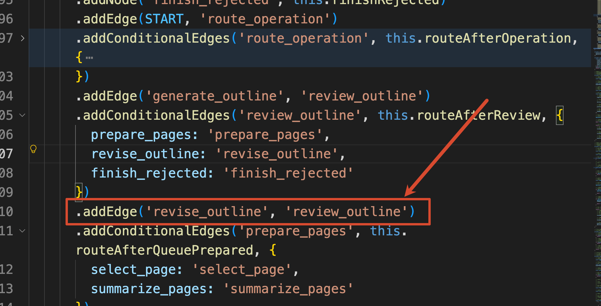

于是，`interrupt()` 会再次暂停工作流。

前端拿到最新业务对象以后，页面上显示的就不再是 `Outline v1`，而是等待审核的 `Outline v2` 了

回到页面，确认 `Outline v2` 没有问题以后，点击“批准并制作页面”。

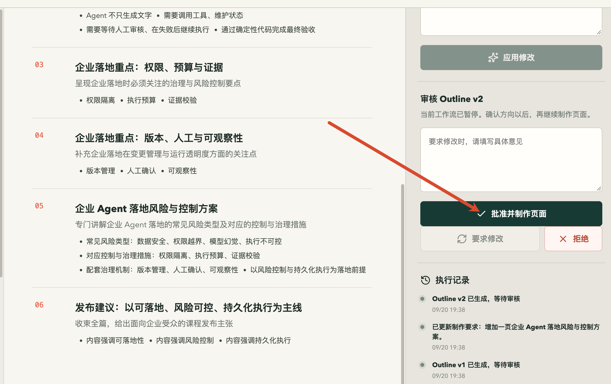

这次提交的审核数据是：

```javascript
{
    decision: 'approve',
    outlineVersion: 2,
    feedback: ''
}
```

工作流恢复以后，`reviewOutline()` 会执行：

```typescript
// 用户批准当前大纲。
// 更新领域状态，并保存最新聚合。
if (decision.decision === 'approve') {
    aggregate.approveOutline(decision.outlineVersion)
    await this.repository.save(aggregate.toJSON())
}
```

`approveOutline()` 会把当前大纲和任务状态改成：

```javascript
{
    outlineStatus: 'approved',
    presentationStatus: 'generating_pages'
}
```

接下来，`routeAfterReview()` 返回：`prepare_pages`

到这里，大纲审核阶段就结束了。

而如果用户选择的是 `reject`，领域对象会把当前大纲和任务标记为 `rejected`，Graph 再进入 `finish_rejected` 并结束。

## 总结
这一小节，咱们沿着两次页面操作，把大纲阶段的完整执行流程串了起来。

点击“开始制作”以后，服务端先创建并保存演示文稿业务对象，再使用稳定的 `thread_id` 启动 LangGraph。

`generate_outline` 根据任务中的 `modelMode` 选择 Replay 或 AI Provider，再把生成结果交给领域对象保存为带版本的大纲。

进入 `review_outline` 后，`interrupt()` 会暂停工作流，`PostgresSaver` 保存 Graph State 和暂停位置，`PresentationRepository` 则保存大纲版本和业务状态。

重新打开任务时，应用只是读取业务数据，并不会自动恢复 Graph。只有用户提交审核结果以后，服务端才会通过相同的 `thread_id` 和 `Command({ resume })` 继续原来的工作流。

如果修改意见改变了主题、受众或页数，系统会先通过 `planChange()` 生成新的制作要求，再生成下一版大纲并重新等待审核。如果批准，Graph 才会进入页面制作。如果拒绝，任务就会结束。

下一小节，咱们就从 `prepare_pages` 继续往下看，看看系统怎样创建页面任务、保留已经成功的页面、继续失败任务，并最终导出 `.pptx` 文件。

> 更新：2026-09-20 19:47 · 原文：<https://www.yuque.com/lgdsunday/ab1dy3/gz8vqaganunbk8lr>
