# 08 - 实战（下）：从页面生成到文件导出，实现失败续做与局部修改

上一小节最后，咱们批准了 `Outline v2`。

`reviewOutline()` 保存审核结果以后，`routeAfterReview()` 返回了：

```latex
prepare_pages
```

这表示大纲阶段已经结束，工作流即将开始制作页面。

那么接下来，还有几个问题需要解决。

1. 假设六个页面里只有第三页生成失败，前面已经完成的页面还要不要重新生成？
2. 用户只想修改第二页的内容，系统怎样只重做第二页？
3. 如果用户说“第二页使用绿色背景”，还需要重新调用模型生成页面正文吗？
4. 最终导出文件时，系统又怎样保证使用的是当前大纲和每一页的最新 Revision？

那么这一小节，咱们就继续从  `prepare_pages` 开始，继续往下面看～

## 批准大纲以后，页面任务怎样生成
先回到 `presentation-graph.service.ts`。

大纲审核通过以后，Graph 会进入 `prepare_pages` Node：

```typescript
.addConditionalEdges('review_outline', this.routeAfterReview, {
    prepare_pages: 'prepare_pages',
    revise_outline: 'revise_outline',
    finish_rejected: 'finish_rejected'
})
```

当前审核结果是 `approve`，所以接下来执行的就是 `preparePages()`：

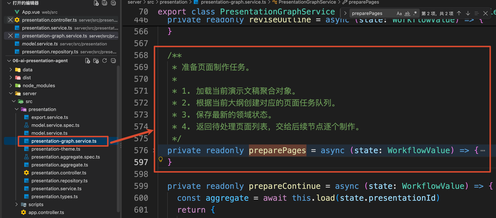

这个 Node 主要完成两件事：

1. 根据当前大纲创建页面任务
2. 把需要制作的 pageId 放进执行队列

咱们一点点来看。

首先，咱们会根据 `presentationId` 获取到当前的文稿对象，然后处理页面制作的任务

```javascript
// 根据 presentationId 加载当前演示文稿聚合对象
const aggregate = await this.load(state.presentationId)
// 根据当前大纲生成页面制作任务
// 如果页面任务已经存在，则由领域模型内部保证不会重复创建
aggregate.ensurePageTasks()
```

`ensurePageTasks()` 会读取当前已经批准的大纲，再把大纲中的每一页转换成一项可以执行的页面任务。

这里先看一下转换以前的数据。

上一小节生成的 `Outline v2` 中，有一个 `slides` 数组。数组里的每一项都表示一页大纲，例如第三页的数据大致是：

```javascript
const outline = {
    version: 2,
    slides: [
        {
            pageId: 'page-3',
            order: 3,
            title: '页面任务的部分成功与局部重做',
            purpose: '展示页面级任务如何独立记录结果',
            keyPoints: [
                '成功页面继续保留',
                '失败页面单独续做',
                '单页修改产生新 Revision'
            ]
        }
    ]
}
```

项目在遍历 `outline.slides` 时，把当前遍历到的这一项命名为 `slide`：

```typescript
const pages: PageTask[] = outline.slides.map((slide) => ({
    pageId: slide.pageId,
    order: slide.order,
    title: slide.title,
    purpose: slide.purpose,
    // 继续补充页面制作阶段需要的状态
}))
```

所以，`slide` 指的就是大纲中的某一页。

不过，一页大纲只能说明“这一页准备讲什么”。真正开始制作以后，系统还需要记录这一页有没有生成成功、尝试了几次、当前使用哪个版本。

因此，项目又定义了 `PageTask`，也就是 **页面制作任务**。

同一页大纲转换成 `PageTask` 以后，就会变成：

```javascript
{
    pageId: 'page-3',
    order: 3,
    title: '页面任务的部分成功与局部重做',
    purpose: '展示页面级任务如何独立记录结果',
    outlineVersion: 2,
    pageRevision: 1,
    status: 'pending',
    attempts: 0,
    lastError: null,
    changeRequest: null,
    styleOverride: null,
    currentArtifactId: null,
    artifacts: []
}
```

 创建并保存这些 `PageTask` 以后，后面的工作流才能判断哪些页面需要生成、哪些页面已经完成，以及失败以后应该继续哪一页。

那么页面任务为什么不会被重复创建呢？

这个关键就在 `ensurePageTasks()`  方法里面。

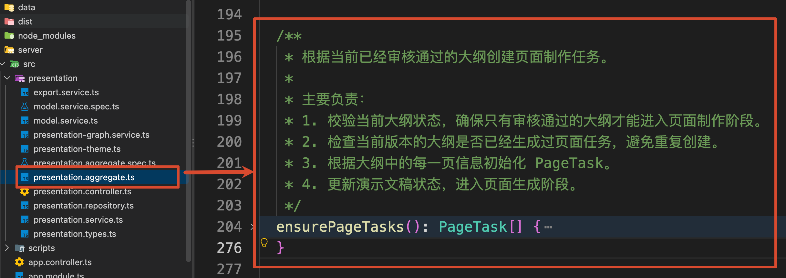

这个方法中有这么一段代码，它会先检查当前大纲版本是否已经存在页面任务：

```typescript
// 检查当前大纲版本是否已经创建过页面任务
// 同一个 outlineVersion 不允许重复生成页面
const existing = this.value.pages.filter(
    (page) => page.outlineVersion === outline.version
)

// 如果已经存在页面任务，直接返回已有任务
// 避免 Agent 重试或者工作流恢复时重复创建页面
if (existing.length > 0) {
    return structuredClone(existing)
}
```

如果 `Outline v2` 的页面任务已经创建过，就直接返回现有任务。

因此，在正常的顺序调用中，同一个大纲版本不会因为再次进入 `prepare_pages`，重复增加六组页面记录。

页面任务创建并保存以后，`preparePages()` 的第一项工作就完成了。

接下来还要处理第二项工作：**确定本轮需要生成哪些页面。**

因为 `this.value.pages` 中可能同时存在已经完成的页面和仍需处理的页面，所以不能把所有 `pageId` 都放进执行队列。

咱们回到 `preparePages()` 的返回值：

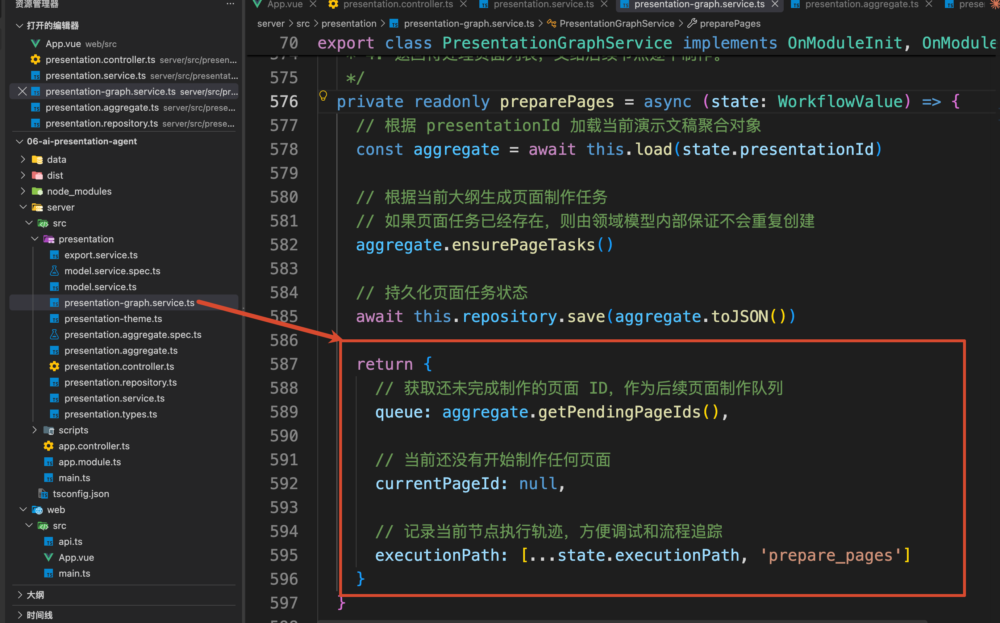

这里的 `queue` 就是本轮等待执行的页面队列。

为了得到这份队列，代码调用了 `getPendingPageIds()`。这个方法会挑出三种仍需处理的页面

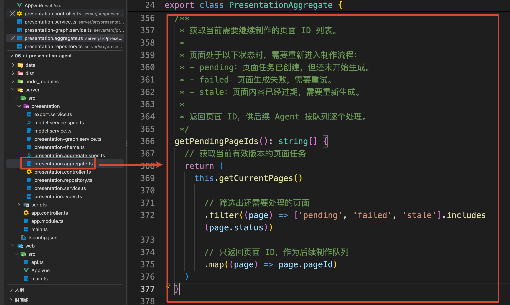

其中：

+ pending 表示：页面任务已经创建，但还没有开始生成
+ failed 表示：页面之前生成失败，需要继续处理
+ stale 表示：当前页面任务已经被标记为失效，需要重新处理

咱们这里主要会用到 `pending` 和 `failed`。旧版大纲中的页面虽然也会被标记为 `stale`，但 `getCurrentPages()` 只读取当前大纲版本，所以旧版页面不会重新进入本轮队列。

当前是第一次制作，六个 `PageTask` 的状态都是 `pending`，所以它们都会进入 Graph State 中的 `queue`：

```javascript
{
    queue: [
        'page-1',
        'page-2',
        'page-3',
        'page-4',
        'page-5',
        'page-6'
    ],
    currentPageId: null
}
```

接下来的页面执行流程，可以简化成：


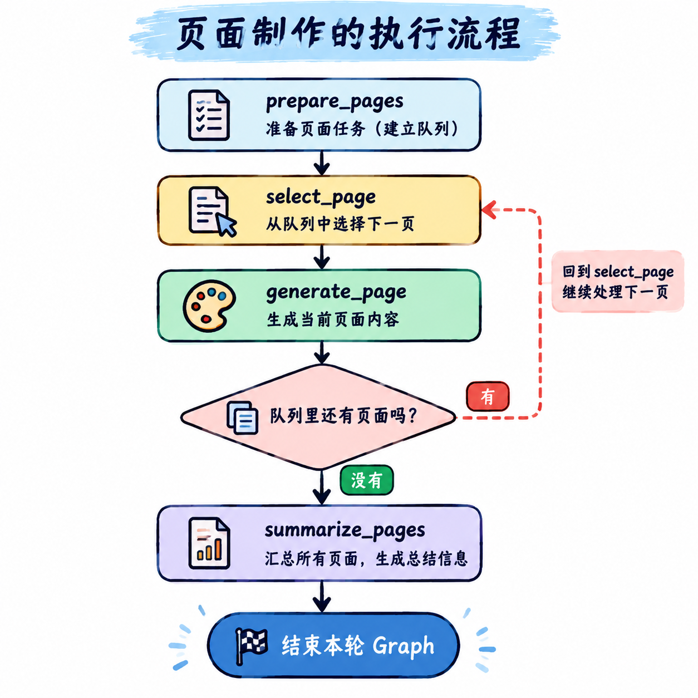

## 页面生成失败以后，为什么其他页面还能继续
`prepare_pages` 准备好队列以后，Graph 会先进入 `select_page`。

对应的方法是 `selectPage()`：

```typescript
    /**
     * 从页面执行队列中选择当前需要处理的页面。
     *
     * 主要负责：
     * 1. 从队列头部取出下一个待制作页面。
     * 2. 更新当前页面 ID。
     * 3. 移除已经被选中的页面，保留剩余队列。
     * 4. 记录当前节点执行轨迹。
     */
private readonly selectPage = (state: WorkflowValue) => {
    const [currentPageId, ...queue] = state.queue

    if (!currentPageId) {
        throw new Error('页面执行队列为空。')
    }

    return {
        currentPageId,
        queue,
        executionPath: [
            ...state.executionPath,
            `select:${currentPageId}`
        ]
    }
}
```

这个方法比较简单，咱们只需要知道第一次执行时，它会从队列中取出 `page-1`：

```javascript
{
    currentPageId: 'page-1',
    queue: ['page-2', 'page-3', 'page-4', 'page-5', 'page-6']
}
```

然后，固定 Edge 会把工作流交给 `generate_page`。

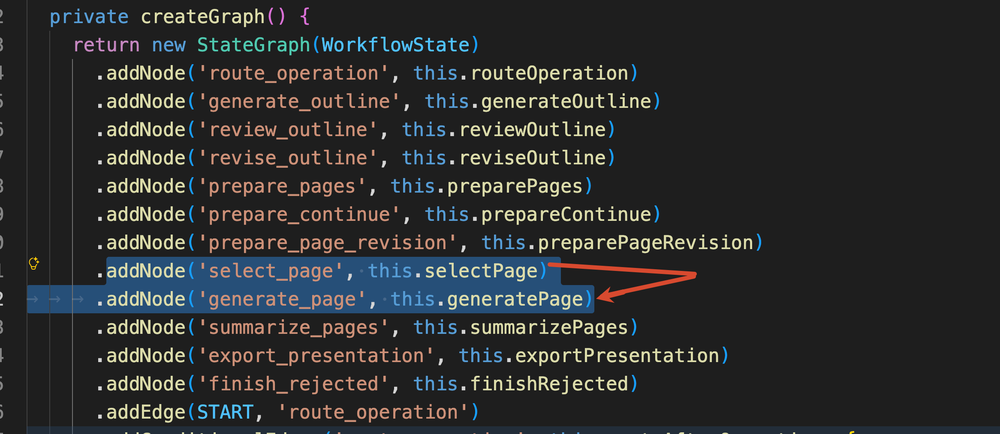

进入 `generatePage()` 以后，咱们会先获取对应的模型服务，也就是 `provider`

```javascript
// 根据当前模型模式获取对应模型服务
const provider = this.models.getProvider(aggregate.toJSON().modelMode)
```

然后开始更新页面状态：

```typescript
// 将页面状态更新为执行中，并记录一次尝试
const page = aggregate.startPage(state.currentPageId)
// 保存页面开始生成后的状态
await this.repository.save(aggregate.toJSON())
```

`startPage()` 会增加本页的尝试次数，并把状态改成 `generating`：

```javascript
{
    pageId: 'page-1',
    status: 'generating',
    attempts: 1
}
```

这份状态会先写进 PostgreSQL，然后才调用 Provider 生成页面内容。

生成成功以后，`completePage()` 会保存页面产物：

```typescript
// 页面生成成功，更新页面产物和状态
latest.completePage(state.currentPageId, content)
// 保存生成完成后的最新状态
await this.repository.save(latest.toJSON())
```

大家自己看上面的注释，会发现上面有一个 **页面产物** 的东西。

这里的 **页面产物**，指的是 Provider 为某一页生成的一版页面内容数据。

例如，Provider 生成第一页以后，会返回：

```javascript
{
    title: '为什么现在需要可靠的 Agent 工作流',
    subtitle: '企业技术负责人 · Outline v2',
    bullets: [
        '模型调用会失败',
        '业务任务会持续很久',
        '关键节点需要人工确认'
    ],
    speakerNote: '本页用于介绍可靠 Agent 工作流的价值。'
}
```

这份数据还不是最终的 PPTX 文件，目前只是生成 PPTX 时需要使用的一版页面内容，项目中使用 `PageArtifact` 来保存。

`completePage()` 会把这份内容和当前大纲版本、页面 Revision 组合起来：

```javascript
{
    artifactId: 'PRES-A1B2C3D4:outline-v2:page-1:revision-1',
    outlineVersion: 2,
    pageRevision: 1,
    title: '为什么现在需要可靠的 Agent 工作流',
    subtitle: '企业技术负责人 · Outline v2',
    bullets: ['模型调用会失败', '业务任务会持续很久'],
    speakerNote: '本页用于介绍可靠 Agent 工作流的价值。'
}
```

因此，每一版页面内容都有自己的 `artifactId`。这个 ID 由四部分组成：`演示文稿 ID + 大纲版本 + 页面 ID + 页面 Revision`

例如：

```latex
PRES-A1B2C3D4:outline-v2:page-1:revision-1
```

页面完成以后，`currentArtifactId` 会指向这份产物：

```javascript
{
    pageId: 'page-1',
    outlineVersion: 2,
    pageRevision: 1,
    status: 'completed',
    currentArtifactId:
        'PRES-A1B2C3D4:outline-v2:page-1:revision-1'
}
```

后面预览和导出时，程序都会通过 `currentArtifactId` 找到当前应该使用的内容。

**为了让所有同学都能观察到“部分成功”，项目在 Replay 模式中故意加入了一次失败：**

```typescript
if (
    provider.mode === 'replay' &&
    page.order === 3 &&
    page.pageRevision === 1 &&
    page.attempts === 1
) {
    throw new Error('页面生成服务暂时不可用')
}
```

也就是说，第三页第一次生成时一定会失败。

错误出现以后，`catch` 会把第三页保存为 `failed`：

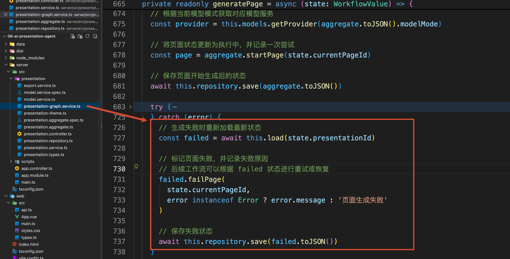

当前第三页的状态就变成了：

```javascript
{
    pageId: 'page-3',
    status: 'failed',
    attempts: 1,
    lastError: '页面生成服务暂时不可用',
    currentArtifactId: null
}
```

不过，`generatePage()` 已经把失败结果保存了下来，并正常返回了本次 State Update。

Graph 会继续检查 `queue`。里面还有 `page-4`、`page-5` 和 `page-6`，所以流程继续进入 `select_page`，处理剩下的页面。

## 点击 “继续未完成页面” 以后发生了什么
接下来，点击右侧的“继续未完成页面”。

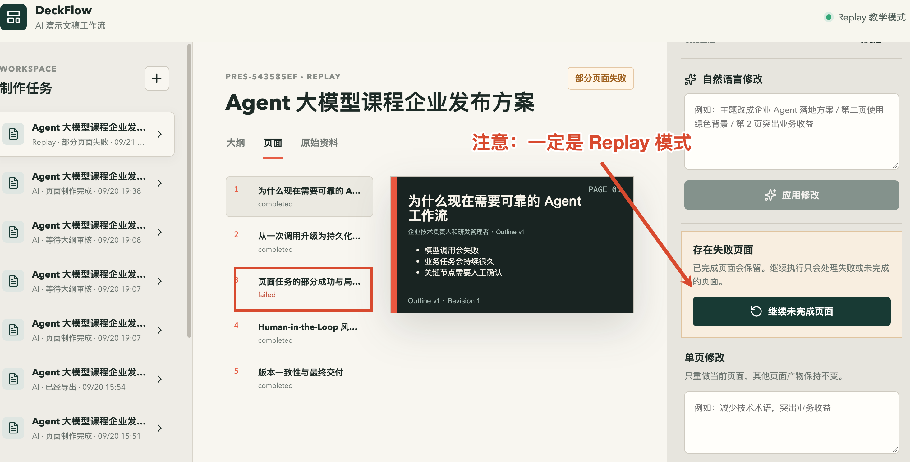

按钮会执行 `App.vue` 中的 `continuePages()`，Web 端会发送：

```http
POST /api/presentations/:id/continue
```

请求经过 `PresentationController` 和 `PresentationService`，最后进入 `PresentationGraphService.continuePages()`：

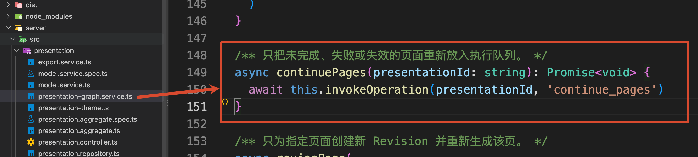

这里调用的是 `invokeOperation()`。

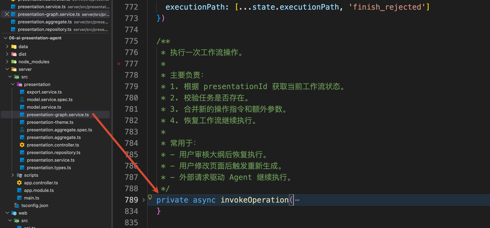

 这里会先使用相同的 `thread_id` 读取上一轮 State：

```typescript
// 根据演示文稿 ID 创建 LangGraph 配置
const config = this.config(presentationId)
// 获取当前工作流保存的状态
// 这里不会重新执行节点，只读取 Checkpointer 中的快照
const snapshot = await this.graph.getState(config)
```

然后清空上一轮的临时队列和当前页面，再提交新的 `operation`：

```typescript
// 使用当前状态恢复工作流执行
await this.graph.invoke(
    {
        ...snapshot.values,
        operation: 'continue_pages',
        queue: [],
        currentPageId: null
    },
    config
)
```

新的运行从 `route_operation` 开始，再进入：`prepare_continue`

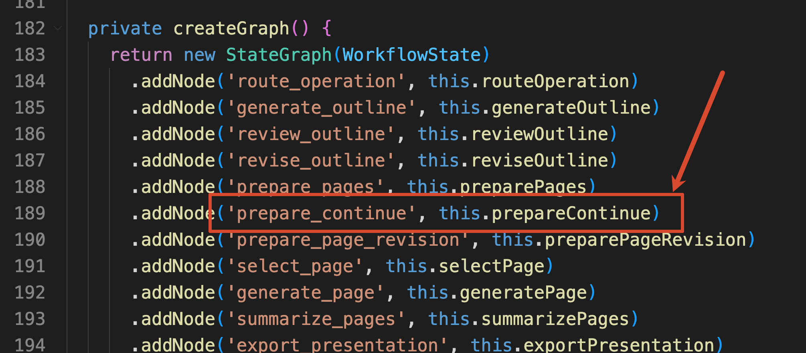

`prepareContinue()` 会重新读取数据库中的演示文稿，再调用 `getPendingPageIds()`：

```typescript
// 准备工作流继续执行时的页面任务队列。
private readonly prepareContinue = async (state: WorkflowValue) => {
  // 加载当前演示文稿聚合对象，获取最新页面状态
    const aggregate = await this.load(state.presentationId)

    return {
    // 根据最新状态重新获取待处理页面队列
    // 包括 pending、failed、stale 等需要继续处理的页面
        queue: aggregate.getPendingPageIds(),
        currentPageId: null,
        executionPath: [...state.executionPath, 'prepare_continue']
    }
}
```

当前只有第三页是 `failed`，所以本轮队列只有：

```javascript
{
    queue: ['page-3']
}
```

`page-1`、`page-2`、`page-4`、`page-5` 和 `page-6` 都是 `completed`，不会再次调用 Provider。

第三页重新进入 `generate_page` 以后，`attempts` 会从 `1` 变成 `2`。

Replay 模式中故意设置的失败条件只会命中第一次，因此第二次可以正常生成：

```javascript
{
    pageId: 'page-3',
    status: 'completed',
    attempts: 2,
    currentArtifactId:
        'PRES-A1B2C3D4:outline-v2:page-3:revision-1'
}
```

所有页面都变成 `completed` 以后，整个任务状态也会变成：`completed`

## 自然语言修改怎样找到正确的处理范围
现在，六个页面已经全部完成。

右侧还有一个“自然语言修改”输入框。

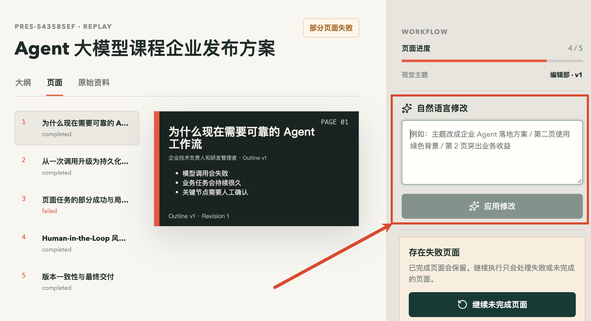

咱们可以先输入：`第 2 页突出业务收益`

再点击“应用修改”。

按钮会从 `App.vue` 的 `applyNaturalLanguageChange()` 开始执行，Web 端发送的请求是：

```http
POST /api/presentations/:id/changes
```

此时请求就会进入 `PresentationService.applyChange()` 

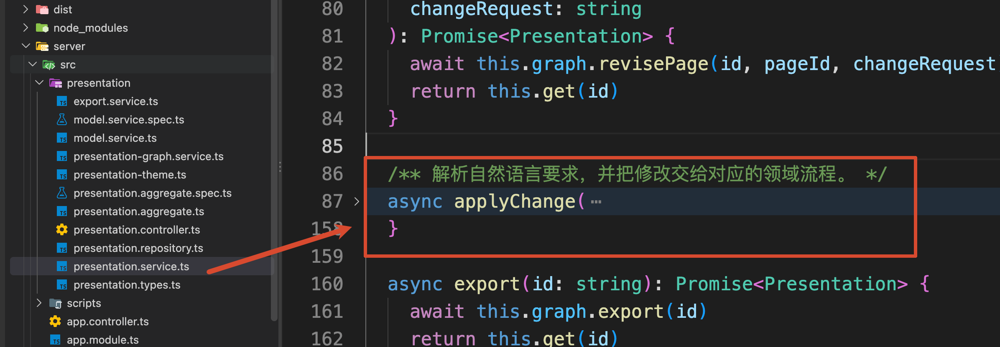

这里的代码有点多，咱们只看关键点部分。这里第一步会调用当前 Provider 的 `planChange()`：

```typescript
// 让模型理解用户修改意图，并转换成结构化修改计划
const plan = await provider.planChange({
    instruction: input.instruction,
    presentation
})
```

`planChange()` 负责判断本次修改会影响哪一部分。

项目一共定义了四种修改范围

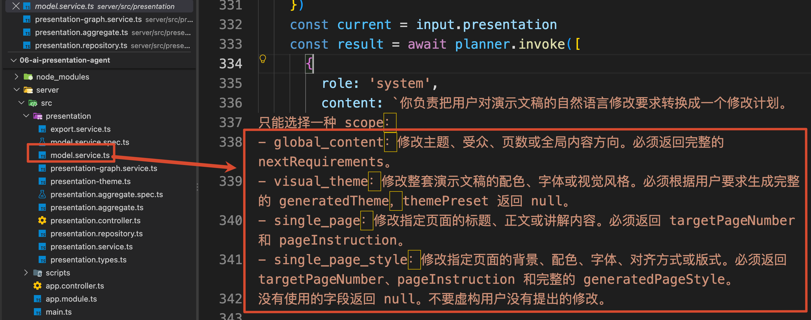

意思分别是：

| scope | 用户要求示例 | 后续处理 |
| --- | --- | --- |
| `global_content` | 主题改成企业 Agent 落地方案 | 更新制作要求，生成新大纲并重新审核 |
| `visual_theme` | 整体改成墨绿色商务风 | 更新全局主题，不重做页面正文 |
| `single_page` | 第 2 页突出业务收益 | 只生成目标页面的新 Revision |
| `single_page_style` | 第二页使用绿色背景 | 只更新目标页面的样式覆盖 |


当前输入指向第二页的内容，所以得到的计划可以简化成：

```javascript
{
    scope: 'single_page',
    targetPageNumber: 2,
    pageInstruction: '第 2 页突出业务收益',
    reason: '修改要求明确指向第 2 页。'
}
```

`applyChange()` 会根据 `scope` 选择真正的处理流程。

当 `scope` 是 `single_page` 时，服务端会先根据 `targetPageNumber` 找到第二页对应的 `pageId`：

```typescript
// 根据当前大纲版本和页码定位目标页面
const page = presentation.pages.find(
    (item) =>
        item.outlineVersion === presentation.currentOutlineVersion &&
        item.order === plan.targetPageNumber
)
```

然后调用：

```typescript
// 触发页面重新生成流程
await this.graph.revisePage(
    id,
    page.pageId,
    plan.pageInstruction
)
```

这次 Graph 收到的操作是：`operation = revise_page`

`route_operation` 会把流程交给 `prepare_page_revision`。

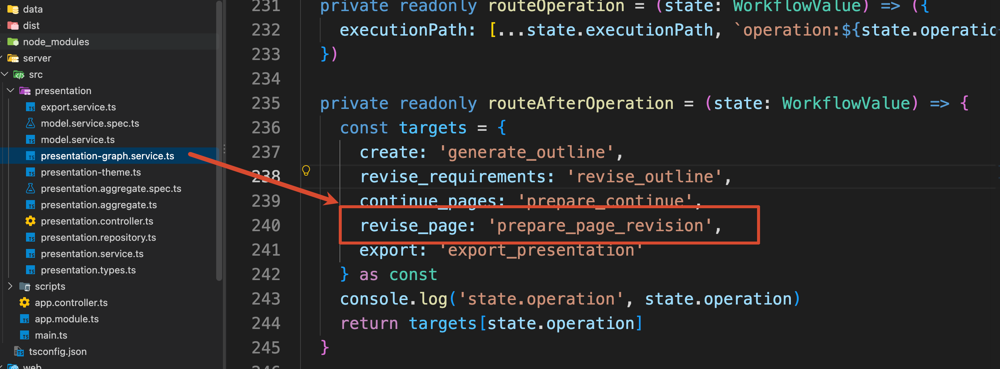

 `prepare_page_revision` 会触发 `preparePageRevision()` 方法

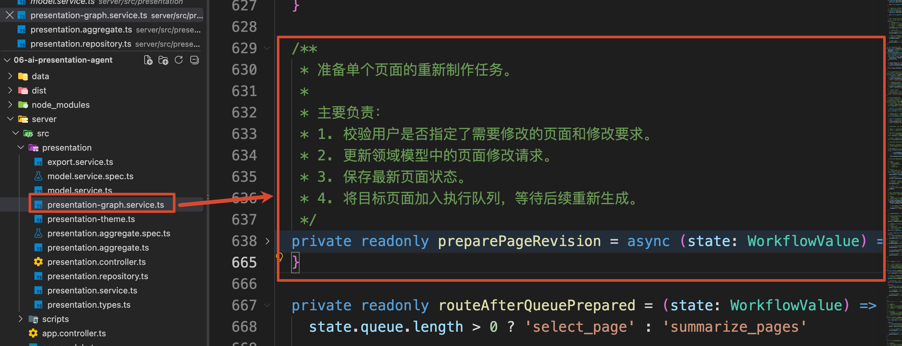

在这个 Node 中，存在一个叫做 `requestPageRevision()` 方法的调用

```javascript
// 加载当前演示文稿聚合对象
const aggregate = await this.load(state.presentationId)
// 通过领域方法记录页面修改请求
// 不直接修改字段，保证页面状态变化符合领域规则
aggregate.requestPageRevision(state.targetPageId, state.changeRequest)
```

`requestPageRevision()` 会修改第二页的业务状态：

```typescript
page.pageRevision += 1
page.status = 'pending'
page.currentArtifactId = null
page.changeRequest = changeRequest
```

第二页会从 Revision 1 变成 Revision 2：

```javascript
{
    pageId: 'page-2',
    pageRevision: 2,
    status: 'pending',
    changeRequest: '第 2 页突出业务收益',
    currentArtifactId: null
}
```

本轮执行队列也只会放入第二页：

```javascript
{
    queue: ['page-2']
}
```

所以，Graph 只重新执行一次 `generate_page`。

完成以后，第二页的当前产物会变成：

```latex
PRES-A1B2C3D4:outline-v2:page-2:revision-2
```

Revision 1 仍然保存在 `artifacts` 中，用于记录历史结果。`currentArtifactId` 已经指向 Revision 2，所以页面预览和后续导出都会使用新版本。

其他五个页面没有进入本轮队列，页面内容和 Revision 都不会变化。

页面右侧原有的“生成新 Revision”按钮，走的也是同一条 `graph.revisePage()` 链路。

区别只在于：自然语言修改会先通过 `planChange()` 判断目标范围，手动单页修改已经由用户选定了目标页面。

### 修改页面样式，不需要重做页面正文
然后，咱们再输入："第二页使用绿色背景"

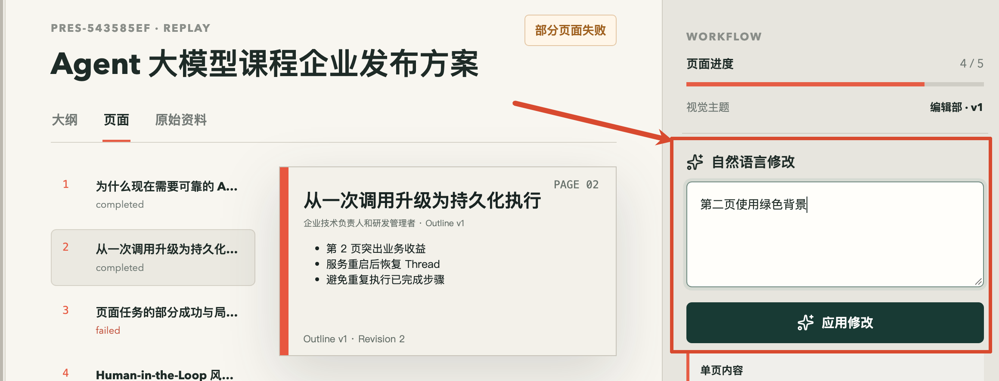

这次计划结果是：

```javascript
{
    scope: 'single_page_style',
    targetPageNumber: 2,
    generatedPageStyle: {
        backgroundColor: '12372A',
        accentColor: '8DBF67',
        textColor: 'FFFFFF',
        mutedColor: 'B8D4C4',
        layoutStyle: 'side_bar',
        titleAlign: 'left',
        density: 'comfortable'
    }
}
```

`applyChange()` 会进入 `single_page_style` 分支，再调用领域对象的 `changePageStyle()`：

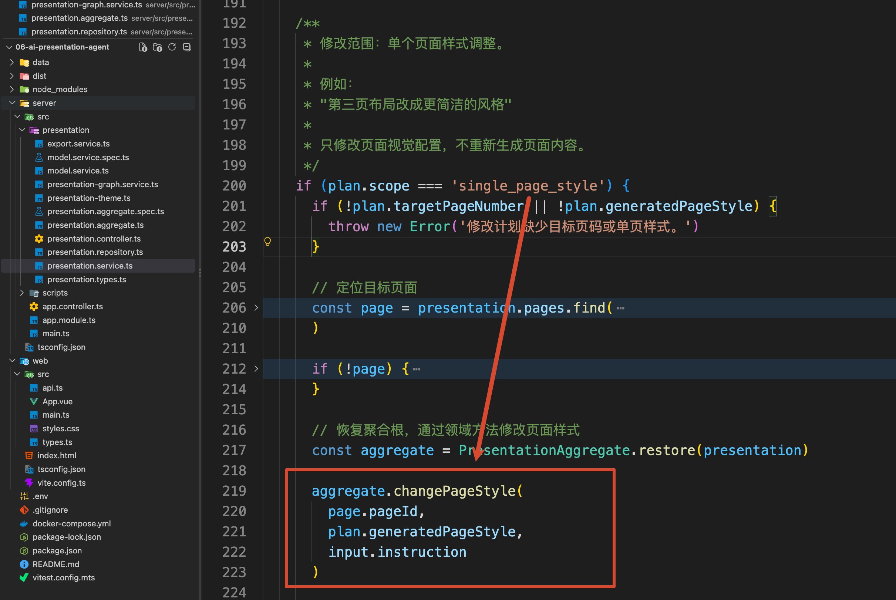

这个操作只会给第二页增加一份 `styleOverride`：

```javascript
{
    pageId: 'page-2',
    pageRevision: 2,
    styleOverride: {
        revision: 1,
        instruction: '第二页使用绿色背景',
        backgroundColor: '12372A',
        accentColor: '8DBF67',
        textColor: 'FFFFFF'
    }
}
```

页面正文并没有变化，所以不需要重新进入 `generate_page`，`pageRevision` 也不会增加。

同样，如果用户输入的是“整套演示文稿改成墨绿色商务风”，`scope` 会变成 `visual_theme`。程序只更新全局 `theme`，已有页面正文仍然保留。

## 点击导出 PPTX 以后，系统怎样确定使用哪一版
页面全部完成以后，右侧会出现“导出 PPTX”按钮。

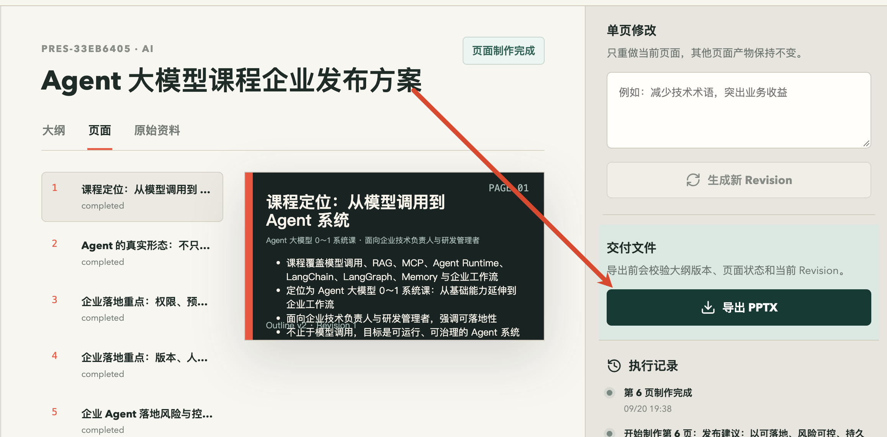

点击按钮，会执行 `App.vue` 中的 `exportPptx()`：

```typescript
async function exportPptx() {
    if (!selected.value) return

    await run(async () => {
    // 调用接口触发 PPTX 导出流程
        selected.value = await api.export(selected.value!.id)
        await loadTasks(selected.value.id)
    // 打开生成后的 PPTX 下载地址
        window.open(api.downloadUrl(selected.value.id), '_blank')
    })
}
```

这个方法连续完成了两个接口的调用

第一个：是调用导出接口，在服务端生成 PPTX：

```http
POST /api/presentations/:id/export
```

等导出接口执行成功以后，第二个请求会打开下载地址：

```http
GET /api/presentations/:id/download
```

咱们先来看第一个请求。

### 导出请求：校验并生成 PPTX
后端收到导出请求后，会启动一次新的 Graph 操作，`route_operation` 会把工作流交给 `export_presentation`，触发 `exportPresentation()` 方法

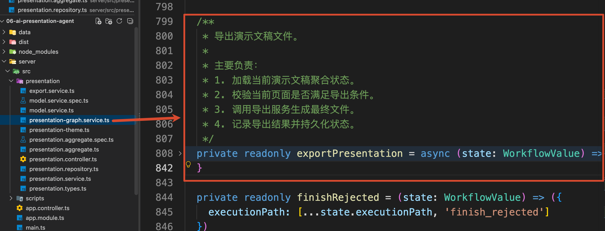

`exportPresentation()` 会先校验当前页面，再创建 PPTX：

```typescript
// 校验当前演示文稿是否满足导出条件
// 例如：所有页面是否已经生成完成
const pages = aggregate.assertExportable()
```

校验通过以后，代码会进入 `server/src/presentation/export.service.ts` 中的 `PresentationExportService.export()`。

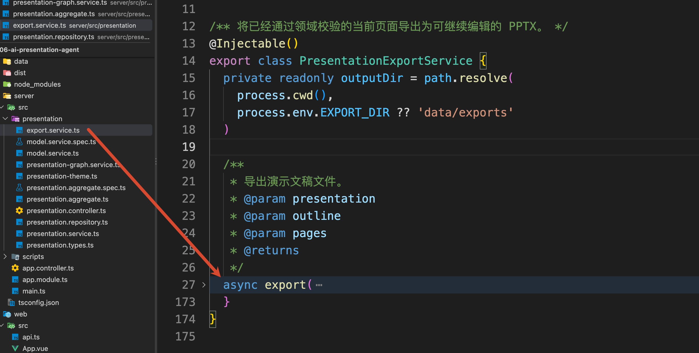

咱们这里用 [PptxGenJS](https://gitbrent.github.io/PptxGenJS/) 生成可以继续编辑的 `.pptx` 文件。

针对每一个 `PageTask`，导出服务会先通过 `currentArtifactId` 找到当前页面产物：

```typescript
const artifact = page.artifacts.find(
    (item) => item.artifactId === page.currentArtifactId
)
```

然后确定这一页最终使用的视觉样式：

```typescript
const backgroundColor =
    page.styleOverride?.backgroundColor ??
    presentation.theme.backgroundColor

const textColor =
    page.styleOverride?.textColor ??
    presentation.theme.textColor
```

所以，第二页的绿色背景会进入最终文件，其他页面继续使用全局主题。

文件生成完成以后，导出服务会返回一条记录：

```javascript
{
    fileName: 'Agent 大模型课程企业发布方案-v2.pptx',
    filePath: '/项目路径/data/exports/Agent 大模型课程企业发布方案-v2.pptx',
    outlineVersion: 2,
    pageArtifactIds: [
        '...:page-1:revision-1',
        '...:page-2:revision-2',
        '...:page-3:revision-1'
    ],
    createdAt: '2026-09-20T...'
}
```

`recordExport()` 会把这份记录保存到演示文稿业务对象中，并把任务状态改成：

```latex
exported
```

到这里，第一个请求才算执行完成。

PPTX 文件已经保存在服务端的 `data/exports` 目录中，数据库里也保存了本次导出的文件名和文件路径。

### 下载请求：把已经生成的文件返回给浏览器
`api.export()` 执行成功以后，前端继续执行：

```typescript
window.open(api.downloadUrl(selected.value.id), '_blank')
```

`downloadUrl()` 只负责拼出下载地址：

```typescript
downloadUrl: (id: string) =>
    `${API}/presentations/${id}/download`
```

浏览器访问这个地址以后，请求会进入 `PresentationController.download()`：

```typescript
@Get(':id/download')
async download(
    @Param('id') id: string,
    @Res() response: Response
) {
    const file = await this.presentations.getDownload(id)
    response.download(file.path, file.fileName)
}
```

Controller 会先调用 `getDownload()` 查找当前任务的导出记录：

```typescript
    /**
     * 获取演示文稿导出文件下载信息。
     *
     * 主要负责：
     * 1. 查询当前演示文稿任务。
     * 2. 校验是否已经完成文件导出。
     * 3. 检查导出文件是否真实存在。
     * 4. 返回文件路径和文件名，供接口层提供下载。
     */
    async getDownload(id: string): Promise<{ path: string; fileName: string }> {
        // 获取当前演示文稿状态
        const presentation = await this.get(id)

        // 没有导出记录，说明文件还未生成
        if (!presentation.exportRecord) {
            throw new Error('当前任务还没有导出文件。')
        }

        // 检查导出文件是否存在
        // 防止数据库中有记录，但实际文件已经丢失
        await access(presentation.exportRecord.filePath)

        return {
            // 返回文件实际存储路径
            path: presentation.exportRecord.filePath,

            // 返回下载时展示的文件名称
            fileName: presentation.exportRecord.fileName
        }
    }
```

这段代码会检查两件事：

+ 当前任务是否存在 exportRecord
+ exportRecord.filePath 对应的文件是否仍然存在

检查通过以后，Controller 再执行：

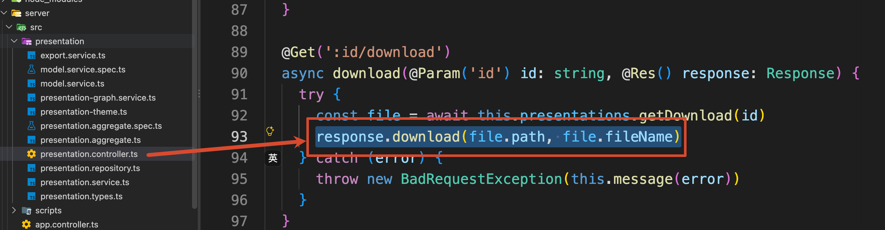

NestJS 就会通过 Express 把指定文件作为下载响应返回给浏览器。

浏览器有了这个链接就可以执行下载操作了

## 总结
到这里，项目从大纲批准到文件下载的完整流程就跑通了。


这个项目真正解决的，是长流程内容生产中的四个问题：

+ 一部分失败时，已经成功的结果可以继续保留。
+ 服务重启以后，可以根据持久化状态继续未完成工作。
+ 用户提出局部修改时，只重做真正受影响的内容。
+ 最终导出前，通过确定性的业务规则检查版本和产物完整性。

模型负责生成大纲、页面内容和修改计划。

LangGraph 负责组织可持续执行的流程。

PostgreSQL 和 Checkpointer 负责保存业务状态与工作流状态。

领域对象负责页面版本、失败续做、局部修改和导出条件这些确定性的规则。

到这里，第七章的 AI 演示文稿制作 Agent 就彻底完整实现啦～～

> 更新：2026-09-21 16:37 · 原文：<https://www.yuque.com/lgdsunday/ab1dy3/fesce27uudlizghr>
