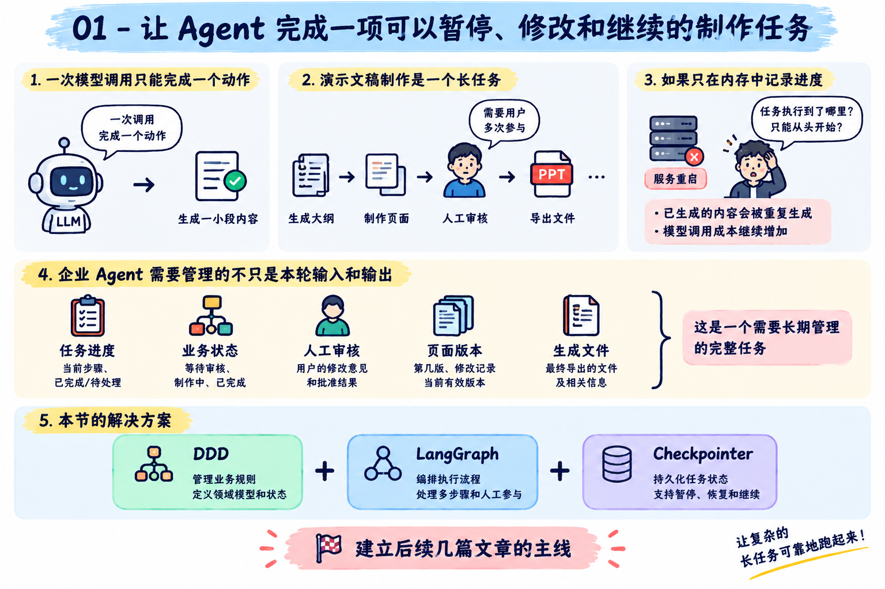
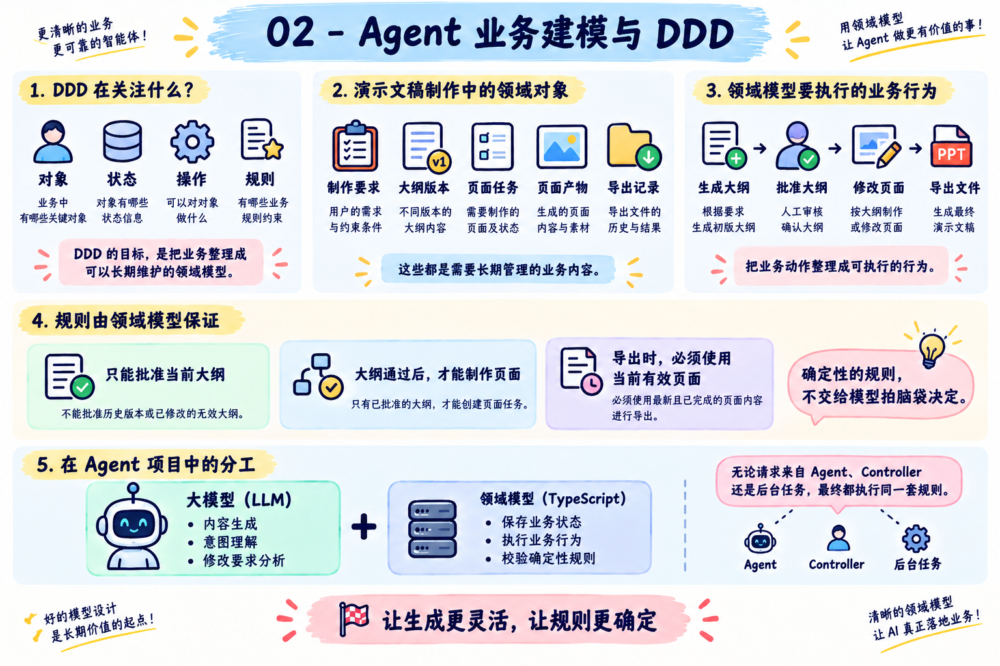
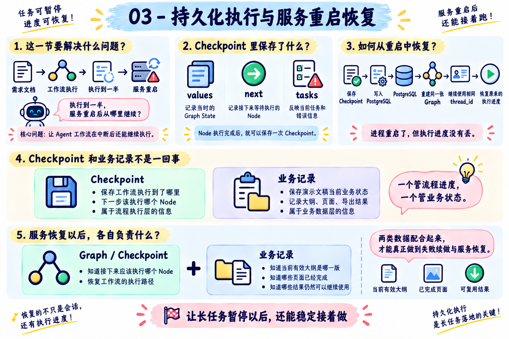
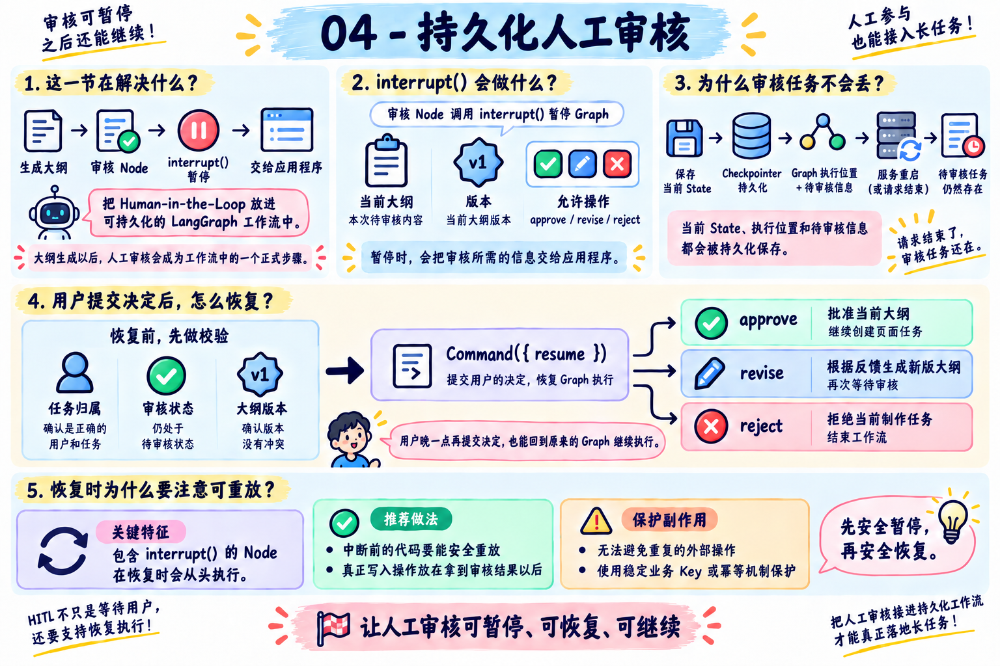
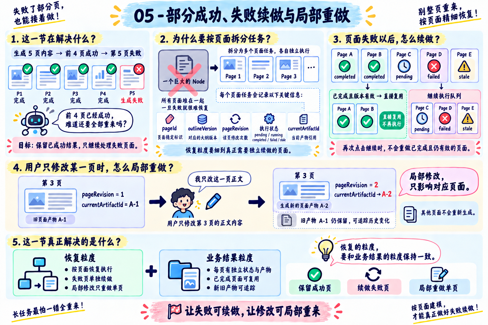

# 09 - 第七章总结：持久化工作流如何在简历和面试中体现

好了，到这里，第七章就全部结束了。

这一章和前面几章有一个很明显的区别。

前面的案例，大多数都可以在一次 Agent Run 中完成。模型分析问题、调用 Tool、拿到结果，最后生成回答，整个任务就结束了。

但是，真实的企业任务经常会持续很长时间。

比如咱们这一章实现的 AI 演示文稿制作 Agent。用户先提交制作要求，系统生成大纲，接着等待用户审核。大纲通过以后，系统还要逐页生成内容、处理失败页面、接受局部修改，最后才能导出 PPTX 文件。

中间任何一个环节，都可能遇到用户暂时离开、服务重启、模型调用失败或者需求发生变化。

所以，这一章真正学习的是：**如何让一项包含 AI 生成、业务规则和人工参与的长任务，能够暂停、恢复、修改，并且可靠地执行到最后。**

最后这一小节，咱们先把整章内容重新梳理一遍，再看看这些能力怎样写进简历，以及面试时可能会被问到什么。

## 第七章都学了啥
### 01-让 Agent 完成一项可以暂停、修改和继续的制作任务


第一小节先确定了整章要解决的问题。

一次模型调用通常只能完成一个相对独立的动作。但是，一项完整的演示文稿制作任务会跨越多个步骤，还会多次等待用户参与。

如果应用程序只在内存中记录进度，服务一旦重启，系统就不知道任务已经执行到了哪里。

如果每次恢复都从头执行，已经生成成功的内容会被重复生成，模型调用成本也会继续增加。

因此，企业 Agent 需要管理的不只是本轮模型输入和输出，还包括任务进度、业务状态、人工审核、页面版本以及已经产生的文件。

这一节建立了后续几篇文章的主线：使用 DDD 管理业务规则，使用 LangGraph 编排执行流程，再通过 Checkpointer 把任务执行状态持久化。

### 02-Agent 业务建模与 DDD


第二小节讲了 `DDD`，也就是领域驱动设计。

DDD 关注的是如何把业务中的对象、状态、操作和规则，整理成程序可以长期维护的领域模型。

咱们从演示文稿制作需求中，找到了需要长期管理的内容：制作要求、大纲版本、页面任务、页面产物和导出记录。

随后，又把“生成大纲”“批准大纲”“修改页面”和“导出文件”等动作，整理成领域模型能够执行的业务行为。

最后，再由领域模型保证确定性的业务规则

在 Agent 项目中，大模型适合处理内容生成、意图理解和修改要求分析。领域对象则使用普通 TypeScript 代码保存业务状态，并校验这些确定性的规则。

这样一来，无论业务操作来自 Agent、Controller 还是其他后台任务，最终都会执行同一套规则。

### 03-持久化执行与服务重启恢复


第三小节解决的是：**Agent 工作流执行到一半，服务重启以后从哪里继续？**

LangGraph 可以在 Node 执行完成以后保存 `Checkpoint`。其中，`values` 记录当时的 Graph State，`next` 记录接下来等待执行的 Node，`tasks` 则可以反映当前任务和错误信息。

这一小节咱们使用 `PostgresSaver` 把 Checkpoint 保存到 PostgreSQL。只要新进程重新加载同一张 Graph，并继续使用相同的 `thread_id`，就可以找到原来的执行进度。

同时还有两类比较容易混淆的知识点：

+ Checkpoint：保存工作流执行到了哪里
+ 业务记录：保存演示文稿、大纲、页面和导出结果现在是什么状态

服务恢复以后，Graph 可以知道接下来应该执行哪个 Node；业务记录则让系统知道当前有效大纲是哪一版、哪些页面已经完成，以及哪些结果仍然可以继续使用。

### 04-持久化人工审核


第四小节把 Human-in-the-Loop 放进了一条可以持久化的 LangGraph 工作流中。

大纲生成以后，审核 Node 会调用 `interrupt()` 暂停 Graph，并把当前大纲、版本和允许执行的操作交给应用程序。

Checkpointer 会保存当前 State、执行位置和待审核信息。即使这次 HTTP 请求已经结束，或者服务已经重启，审核任务仍然存在。

用户稍后提交决定时，服务端会先校验任务归属、审核状态和大纲版本，再通过 `Command({ resume })` 把 `approve`、`revise` 或者 `reject` 传回原来的 Graph。

三种操作会进入不同的后续流程：

+ approve：批准当前大纲，继续创建页面任务
+ revise：根据反馈生成新版大纲，再次等待审核
+ reject：拒绝当前制作任务，结束工作流

这一节还有一个非常重要的执行特征：包含 `interrupt()` 的 Node 在恢复时会从头执行。

因此，中断以前的代码需要能够安全重放。真正产生副作用的写入操作，可以放在取得审核结果以后执行。无法避免重复的外部操作，则需要使用稳定业务 Key 或幂等机制保护。

### 05-部分成功、失败续做与局部重做


第五小节处理了长任务中非常常见的一种结果：一部分成功，一部分失败。

假设系统需要生成五页内容，前四页已经成功，第五页调用模型失败。系统应该保留前四页，只继续处理失败页面。

为了做到这一点，页面任务不能全部塞进一个巨大的 Node 中执行。咱们按照需要独立恢复的粒度拆分任务，并为每一页保存稳定的 `pageId`、`outlineVersion`、`pageRevision`、执行状态和当前产物引用。

页面失败以后会被标记为 `failed`。用户再次点击继续时，程序只会把 `pending`、`failed` 或者 `stale` 的页面放回执行队列。

已经完成并且版本仍然有效的页面，可以直接复用。

当用户只修改某一页正文时，系统会增加这一页的 `pageRevision`，生成一份新的页面产物，再把 `currentArtifactId` 指向新版本。其他页面不会重新生成，旧产物也会保留下来，方便追踪历史变化。

这一节真正解决的是：**怎样让任务恢复的粒度和业务结果的粒度保持一致。**

### 06～08-AI 演示文稿制作 Agent
最后三篇实战，把前面讲过的能力放进了一个完整项目中。

用户先输入主题、目标观众、页数和参考资料，然后选择 `Replay` 或者 `AI` 模式开始制作。

Replay 模式会走固定的流程。AI 模式则会调用 DeepSeek，通过 Structured Output 生成结构化大纲、页面内容和修改计划。

大纲生成以后，Graph 会停在审核位置。用户可以批准大纲、拒绝任务，也可以输入自然语言反馈生成新版本。

大纲审核通过以后，系统会创建页面任务并逐页生成内容。Replay 模式会故意让其中一页第一次执行失败，用来验证部分成功和失败续做。

用户点击“继续未完成页面”以后，系统只处理仍然没有完成的页面，不会重复生成已经成功的部分。

项目还支持使用自然语言修改结果。模型先判断本次修改属于哪一种范围

模型负责理解用户想改什么，应用服务和领域对象负责校验页码、更新版本并执行对应的业务操作。

所有页面完成以后，导出服务会再次检查当前大纲是否通过审核、页面数量是否完整、每一页是否存在有效产物，以及页面版本是否属于当前大纲。

校验通过以后，系统使用 `PptxGenJS` 生成可编辑的 PPTX 文件，再通过独立的下载接口返回给浏览器。

到这里，咱们就已经完成了一个支持：持久化工作流、业务版本、跨请求人工审核、部分成功、失败续做、自然语言局部修改和最终文件交付 的完整企业项目了～

## 简历怎么写？
### 技能特长怎么写
可以参考下面这版：

```latex
• 熟悉企业 Agent 持久化工作流设计，能够基于 LangGraph State、Node、Conditional Edge 与 PostgresSaver 实现任务暂停、跨请求恢复、服务重启续做和执行状态持久化。

• 了解 DDD 在 Agent 项目中的应用，能够将模型生成与确定性业务规则分离，通过领域对象统一管理业务状态、版本关系、审核条件和最终交付约束。

• 掌握 Human-in-the-Loop、部分成功与局部重做方案，能够通过 interrupt、Command.resume、稳定任务 ID、状态机和产物版本控制，实现人工审核、失败续做、单项重做与结果一致性校验。
```

### 项目经历怎么写
这一章完成的项目本身具备清晰的业务流程，可以直接作为项目经历继续完善。

不过，简历里不要把它写成“学习 LangGraph 做了一个 PPT Demo”。

更合适的定位是：**面向企业内容生产和交付场景，实现了一套可以持续执行、人工审核和局部修改的 AI 演示文稿制作平台。**

下面这份写法，建立在你已经完成项目、运行过主要场景，并且能够结合代码解释实现细节的基础上。

```latex
项目名称：AI 演示文稿制作 Agent：持久化内容生产与交付平台

技术栈：TypeScript、NestJS、Vue 3、LangGraph、PostgreSQL、DeepSeek、PptxGenJS

项目介绍：面向企业方案汇报、培训材料和项目提案等内容生产场景，构建支持自然语言需求输入、大纲生成与审核、分页面制作、局部修改和 PPTX 导出的 AI 演示文稿制作 Agent。系统能够持久化保存长任务执行进度，在服务重启、人工等待或部分页面生成失败后继续执行，并通过领域模型和版本校验避免旧大纲、旧页面与最终文件混用。

主要职责：

- 基于 DDD 对演示文稿制作流程进行业务建模，设计 Presentation Aggregate，统一管理制作要求、大纲版本、页面任务、页面产物和导出记录，并在领域层校验大纲审核、页面状态及文件导出条件。

- 使用 LangGraph 构建持久化内容生产工作流，将大纲生成、人工审核、页面任务创建、逐页生成、失败汇总、局部修改和文件导出拆分为不同 Node，通过 State 与 Conditional Edge 控制流程分支。

- 接入 PostgresSaver 保存 Graph Checkpoint，为每个制作任务分配稳定 thread_id，使任务在 HTTP 请求结束或服务重启以后仍能恢复原有 State、Interrupt 和待执行位置。

- 基于 interrupt 与 Command.resume 实现跨请求 Human-in-the-Loop，大纲生成后暂停工作流，支持批准、要求修改和拒绝；恢复前同时校验待审核版本与当前业务版本，阻止旧页面提交的过期审核结果。

- 设计页面级任务状态与产物版本，记录 pageId、outlineVersion、pageRevision、attempts 和 currentArtifactId；页面生成失败时保留已完成结果，后续仅继续 pending、failed 或 stale 页面。

- 接入 DeepSeek Structured Output 分析自然语言修改要求，将修改路由为整体内容、整体主题、单页内容和单页样式，并由应用服务与领域对象执行确定性的版本更新和状态变更。

- 建立最终交付校验链路，导出前检查当前大纲审核状态、页面数量、完成状态和有效产物版本，再通过 PptxGenJS 生成可编辑 PPTX 文件，避免不完整内容或旧版本页面进入最终文件。

- 基于 NestJS 和 Vue 3 实现制作工作台，展示任务状态、大纲版本、页面执行结果、失败原因、修改入口和导出结果，支持用户在同一页面完成审核、续做、局部修改和文件下载。
```

这里没有写并发量、节省比例或者线上使用规模。这些数据必须来自真实项目，一般情况下面是只要写了数据，那么大概率会被问到

## 面试可能会被问到什么
### 什么是 DDD
`DDD` 的全称是 `Domain-Driven Design`，也就是领域驱动设计。

它是一套处理复杂业务的软件设计方法。它的核心思想是：**代码应该围绕业务领域进行设计，而不是只按照数据库表和增删改查来组织。**

在进行 DDD 设计时，开发人员会和业务人员建立一套统一的业务语言，然后使用限界上下文划分不同的业务边界。在每个业务边界内部，再通过实体、值对象、聚合和领域服务来表达具体的业务规则。

例如在电商系统中，订单、库存和支付可以划分成不同的限界上下文。虽然它们之间会发生协作，但是每个模块都有自己的业务模型和职责边界。

DDD 更适合业务规则复杂、并且需要长期迭代的系统。如果项目本身只是简单的增删改查，强行使用 DDD 反而会增加开发和维护成本。

### DDD 和 Agent 是什么关系？
`DDD` 和 `Agent` 解决的不是同一个问题。

`DDD` 负责梳理业务边界和业务规则。例如退款需要满足什么条件、退款金额怎样计算，这些规则应该放在领域模型中，由代码明确控制。

`Agent` 更像一个动态的任务编排者。它可以根据用户目标和当前状态，决定下一步应该查询订单、检查退款条件，还是要求用户补充信息。

在实际项目中，我们可以把 DDD 中的领域服务封装成 Agent 能够调用的工具。Agent 可以决定什么时候调用哪个工具，但是不能绕过领域规则直接修改数据。

例如 Agent 可以发起退款申请，但是用户能不能退款、最多退多少钱，仍然需要由订单领域中的业务规则判断。

因此，DDD 负责保证业务规则是正确的，Agent 负责在这些规则和能力范围内，动态决定下一步怎么做。

### 为什么已经有 Graph State，还需要业务对象和业务记录？
Graph State 用来推动当前工作流运行。它保存当前操作、待处理页面队列、当前页面和审核决定等执行数据。

业务对象记录演示文稿本身的长期状态，比如当前有效大纲版本、各页面的执行状态、当前产物和导出记录。

同一份演示文稿会经历创建、审核、失败续做、单页修改和导出等多次操作。这些操作可能属于不同的 Graph Run，但是它们处理的是同一个业务对象。

所以，Graph State 解决“这次流程执行到了哪里”，业务记录解决“这份演示文稿现在是什么状态”。

### LangGraph 如何实现暂停和回复？
LangGraph 的暂停和恢复，主要依靠 `interrupt`、`checkpointer` 和 `thread_id`。

首先，需要为 Graph 配置 `checkpointer`，用来保存任务执行状态。每次运行时还要传入一个 `thread_id`，让 LangGraph 知道这次任务对应哪一份状态。

当流程执行到需要人工确认的位置时，可以在节点中调用 `interrupt()`。LangGraph 会暂停当前任务，保存 Graph 的状态，并把需要确认的内容返回给调用方。

用户完成确认以后，再使用相同的 `thread_id`，通过 `Command({ resume: 用户输入 })` 重新调用 Graph。LangGraph 会读取之前保存的状态，并继续执行后面的流程。

这里需要注意：恢复时，LangGraph 会从当前节点的开头重新执行，而不是从 `interrupt()` 的下一行直接继续。因此，暂停之前的写入操作要保证幂等，或者单独放到其他节点中，避免重复执行。

### 服务重启以后，工作流怎样继续？
Graph 编译时需要接入持久化 Checkpointer，本章使用的是 `PostgresSaver`。

每个制作任务都有一个稳定的 `thread_id`。Node 执行完成以后，LangGraph 会把新的 State 和下一步执行位置保存成 Checkpoint。

服务重启以后，应用程序重新创建同一张 Graph，并连接同一个 PostgreSQL。再次使用原来的 `thread_id` 调用时，LangGraph 就可以读取最新 Checkpoint，并从尚未完成的位置继续。

同时，应用还会从业务 Repository 中读取最新的 `PresentationAggregate`，确保恢复后的流程使用当前有效的大纲、页面和版本信息。

### 持久化人工审核是怎样实现的？
审核 Node 使用 `interrupt()` 暂停 Graph，并返回当前大纲、版本和允许操作。

Checkpointer 会保存这次 Interrupt，所以等待期间 HTTP 请求可以结束，服务也可以重启。

用户提交审核决定以后，服务端使用相同 `thread_id` 找到原来的工作流，并通过：

```javascript
new Command({
    resume: decision
})
```

恢复执行。

项目在恢复以前还会校验待审核版本和当前业务版本。这样即使用户一直开着旧页面，也不能批准已经失效的大纲。

### 单页修改时，怎样避免重新生成全部页面？
每一页都有稳定的 `pageId` 和独立的 `pageRevision`。

用户要求修改第二页正文时，系统先把自然语言要求识别为单页内容修改，再调用领域对象增加第二页的 `pageRevision`，并把这一页重新放进生成队列。

新的页面产物生成以后，`currentArtifactId` 会指向新版本。其他页面的状态和当前产物不会发生变化。

如果用户只是修改第二页背景颜色，程序只更新这一页的 `styleOverride`。正文内容没有变化，所以无需增加 `pageRevision`，也无需再次调用模型生成页面。

## 下一章讲什么
第七章解决了一条复杂业务流程怎样持续运行。

但是，当任务同时包含大量中间文件、专业方法和不同角色时，全部交给一个 Agent 处理，Context 会越来越大，职责也会越来越混乱。

下一章，咱们会继续学习 `Workspace、Skills` 和多 Agent 协作，并实现一个 AI 互动剧情游戏制作 Agent。

世界观、角色档案、剧情大纲、分支关系和场景脚本会被保存到 Workspace；重复使用的专业制作方法会被封装成 Skill；剧情规划、角色设计、场景编写和一致性检查则会交给不同的 Subagent。

最终，咱们会把这些能力组合起来，生成一个真正可以运行和体验的互动剧情游戏生成的 Agent。

> 更新：2026-09-21 20:58 · 原文：<https://www.yuque.com/lgdsunday/ab1dy3/xz2ra1pbikvyb31f>
