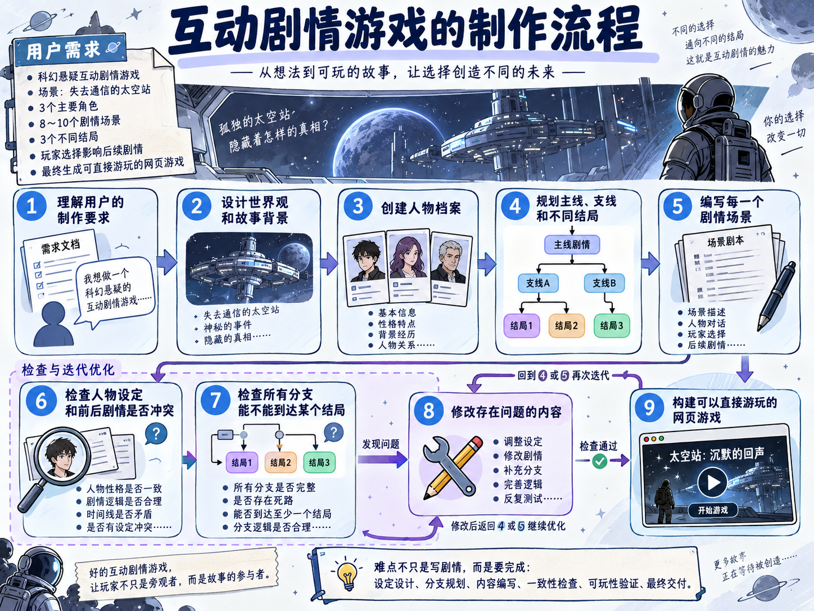
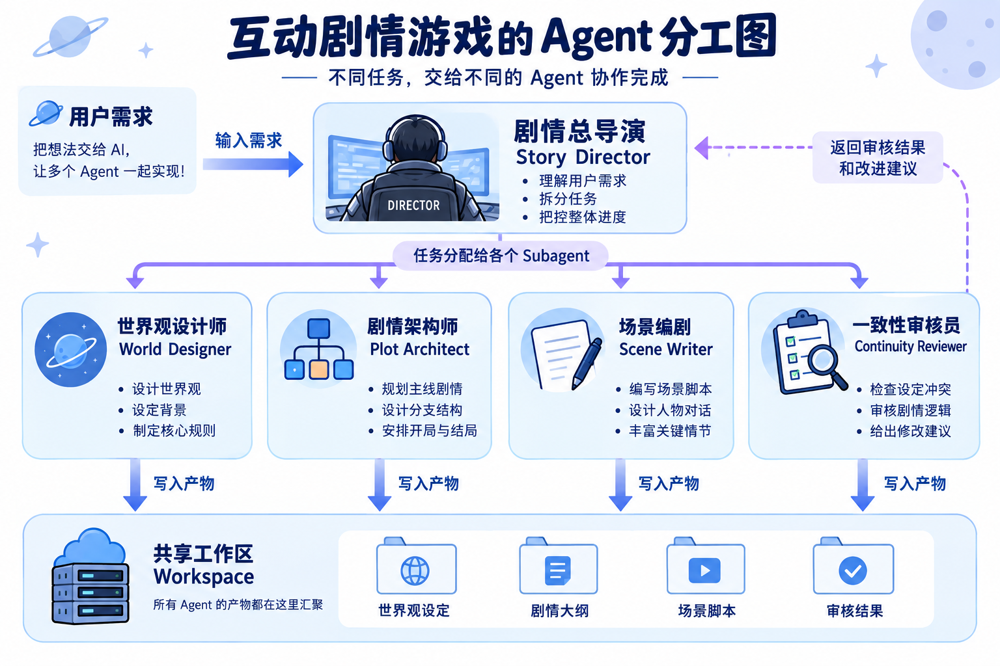

# 01-章介绍：多 Agent 协作构建构建「互动游戏制作 Agent」

上一章，咱们实现了一个 AI 演示文稿制作 Agent。

他可以生成大纲、等待用户审核、制作页面，并在执行失败或者服务重启以后继续完成任务。

这已经是一条比较完整的 Agent 工作流了。

不过，接下来咱们把任务再变复杂一点。

假设用户提出了下面这个要求：

```latex
帮我制作一款科幻悬疑题材的互动剧情游戏。

故事发生在一座失去通信的太空站，包含 3 个主要角色、
8～10 个剧情场景和 3 个不同结局。

玩家的选择需要影响后续剧情，最后还要生成一个可以直接游玩的网页游戏。
```

看到这个需求，模型当然可以直接生成一段剧情。

但是，咱们要交付的是一套完整的互动剧情游戏。真正的制作过程大概是这样的：



这个项目难度就更大了，针对这种难度的项目，如果还是按照咱们之前一个 Agent 走天下的方法，很快就会遇到很多的问题。

比如：项目的世界观、人物档案、剧情大纲和场景内容会不断增加。如果把这些内容全部放进 `messages`，上下文会越来越大，模型想要从一大堆历史消息中找到真正需要的信息也会越来越难。

而且，不同任务需要的方法也不一样。

设计世界观时，需要考虑时代背景、科技规则和阵营关系。设计分支剧情时，需要保证玩家的选择能够改变后续路线。审核剧情时，又要检查人物动机、时间线和结局是否存在冲突。

如果把所有规则一次性塞进同一个 System Prompt，Agent 每执行一步，都得带着整套说明重新调用模型。

最后，一个 Agent 还要同时扮演世界观设计师、剧情策划、场景编剧和审核人员。任务越往后执行，他的上下文中混入的职责和过程信息就越多。

所以，第八章要给 Agent 增加三项新的能力。

## 使用 Workspace 管理复杂任务的产物
世界观、人物档案和剧情场景，都可以保存成独立文件，类似于下面这样：

```latex
/projects/{projectId}/
├── brief.md
├── world/world.md
├── characters/characters.json
├── story/outline.json
├── scenes/scene-001.json
├── reviews/consistency-report.json
└── dist/game.json
```

这些文件共同组成当前项目的 `Workspace`，也就是工作区。

Agent 需要某份内容时再读取对应文件，生成新结果时写回工作区。这样，中间产物就不需要一直堆在聊天记录里，后续 Agent 也能继续使用前面已经完成的结果。

## 使用 Skills 保存专业的工作方法
制作互动剧情游戏说实话挺麻烦的。

怎么设计角色、怎么规划分支、怎么检查剧情一致性，都有各自的处理方法。

本章会把这些专业方法整理成一个个 `[Skill](https://docs.langchain.com/oss/javascript/deepagents/skills)`。Agent 执行具体任务时，再加载当前需要的 Skill。

例如，编写场景时加载场景写作 Skill，检查剧情时加载一致性审查 Skill。这样就可以重复使用写好的专业方法了

## 使用 Subagents 完成不同的专业任务
然后，咱们再把不同任务交给不同的 Agent：



剧情总导演负责理解用户要求、拆分任务和检查整体进度。

每个 `[Subagent](https://docs.langchain.com/oss/javascript/deepagents/subagents)`，也就是子 Agent，使用自己的上下文完成一类专业任务。任务完成以后，它会把产物写进 Workspace，再把简短结果返回给剧情总导演。

这样，世界观设计过程不会全部挤进主 Agent 的上下文，场景编剧也只需要读取当前场景真正依赖的资料。

当然，多几个 Agent 并不会自动让结果变好。

世界观设计师和场景编剧可能使用了不同的人物设定，剧情架构师设计的某条分支也可能永远无法到达结局。

所以，本章还会加入 `Reviewer` 和确定性校验程序。Reviewer 负责检查语义上的剧情冲突，普通代码负责检查场景 ID、分支引用和结局可达性。发现问题以后，只把对应任务退回修改。

最后，咱们会把这些能力组合成一个完整的 **AI 互动剧情游戏制作 Agent**。

用户提交题材、世界观和角色要求以后，可以看到 Agent 团队的执行进度、Workspace 中生成的文件、剧情分支图和审核报告。所有内容通过检查以后，系统会构建出一个可以直接试玩的网页游戏。

前七章学过的 Agent Loop、Tool Calling、Memory、LangGraph 持久化执行和 Human-in-the-Loop，都会继续出现在这个项目里。

**第八章真正要解决的是：当一项任务包含大量中间产物、多种专业方法和多个相对独立的子任务时，怎样组织 Agent、上下文和工作产物，让它们共同完成一个复杂项目。** 

OK，该说的说完了。下一小节，咱们先从 `[Deep Agents](https://docs.langchain.com/oss/javascript/deepagents/overview)` 开始～

> 更新：2026-09-22 10:44 · 原文：<https://www.yuque.com/lgdsunday/ab1dy3/vgdl3ekbm6l8i8do>
