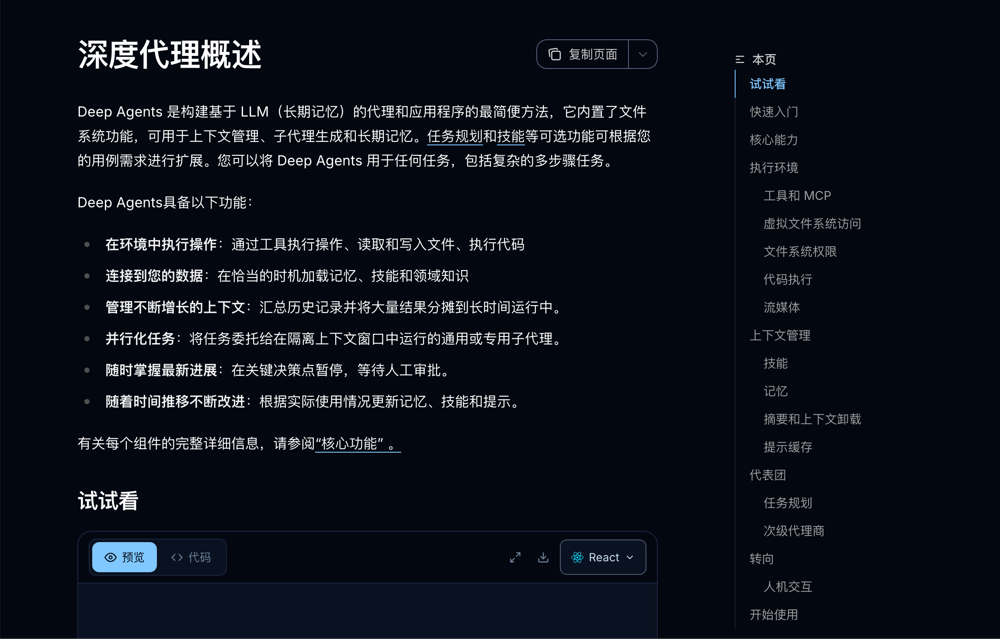
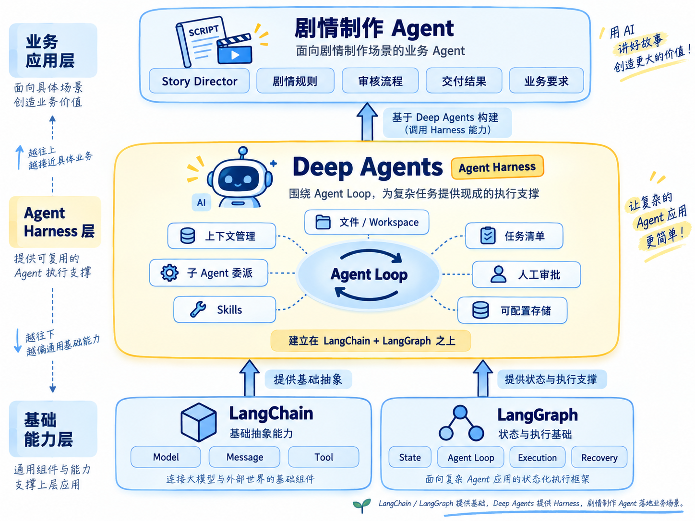
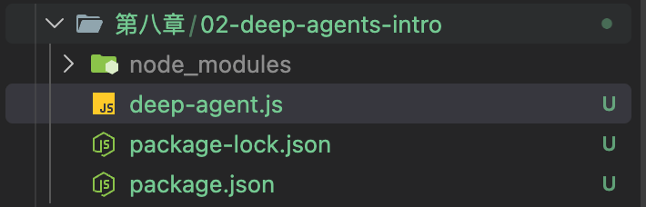
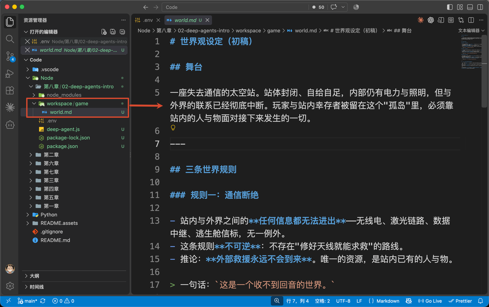
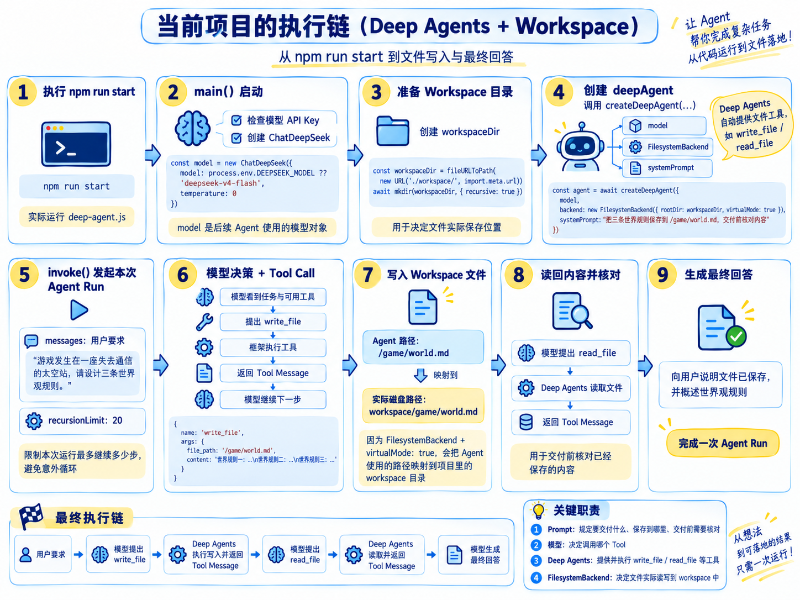

# 02 - Deep Agents 入门：为什么复杂任务需要 Agent Harness

上一小节，咱们确定了第八章的目标：制作一个能交付网页游戏的互动剧情 Agent。

同时我们也提到想要完成这个项目，那么咱们需要划分不同的 SubAgent


首先第一个叫做《世界观设计师》。

它的主要作用就是帮助咱们定义整个游戏世界的世界观、背景、核心规则这些。

比如，骂我们可以让 Agent 为“失去通信的太空站” 写三条世界观规则。

这样的规则作为核心规则，后面还会被角色设计、剧情规划和场景写作反复使用。

所以，Agent 得把它们保存下来，需要时再读出来。

再往后，项目还会出现人物档案、剧情大纲、场景文件和审核报告。只靠一段不断变长的 `messages` 装这些内容，事情会越来越难管理。

因此，这一小节，咱们就要先解决这个的问题：**让 Agent 安排当前任务、写下一份中间产物，再把它读回来。**

## 普通 Agent 能不能做
能。

第五章的 `createAgent()` 已经能让模型调用 Tool。咱们完全可以自己写三个 Tool：`记录待办 + 保存文件 + 读取文件`

但是，文件应该保存在哪里？模型能读取哪些路径呢？

这些能力都可以自己写，只是项目越复杂，咱们越需要一套共同的运行基础。

LangChain 把这类基础称作 [Agent Harness](https://docs.langchain.com/oss/javascript/deepagents/overview)。这里的 `Harness` 可以先理解成：**围绕 Agent Loop，预先准备好文件、上下文管理、任务委派等复杂任务常用能力的一套执行支撑。**

那么，咱们用什么来实现这套 Harness 呢？

答案是： [Deep Agents](https://docs.langchain.com/oss/javascript/deepagents/overview)。



它是 LangChain 生态提供的一个库，建立在咱们已经学过的 LangChain 和 LangGraph 之上。Agent Loop 依然负责“模型决策、调用工具、接收结果”，Deep Agents 则为复杂任务准备了文件管理、上下文处理和子 Agent 委派等能力。

Deep Agents 在这条循环周围，提供了文件工具、可配置的存储后端、子 Agent 委派、上下文处理等能力。需要时，还可以加入 Skills、任务清单和人工审批。

大致关系是：



那么搞明白这些基本概念之后，咱们接下来就来看看代码

## 运行一个最小 Deep Agent
案例代码在 `Code/Node/第八章/02-deep-agents-intro`，只有一个文件 `deep-agent.js`。



别忘了你的  `.env` 文件：

```plain
DEEPSEEK_API_KEY=你的 DeepSeek API Key
DEEPSEEK_MODEL=deepseek-v4-flash
```

配置好以后执行：

```bash
npm run start
```

执行 `npm run start`，实际运行的是 `deep-agent.js`。

从 `main()` 方法开始，做的第一件事，是检查模型 API Key，然后创建 `ChatDeepSeek`：

```javascript
const model = new ChatDeepSeek({
    model: process.env.DEEPSEEK_MODEL ?? 'deepseek-v4-flash',
    temperature: 0
})
```

`model` 是后面 Agent 要使用的模型对象，这些之前都说过很多次了，现在就不再多说了。

然后接下来咱们要执行 `createDeepAgent` 来构建 `deepAgent` 对象了。

在构建这个对象的时候，咱们需要用到一个 `backend` 的属性，这个属性得为 Agent 提供文件读写能力

所以咱们得先有一个路径，用来表示文件要保存到哪里

```javascript
const workspaceDir = fileURLToPath(new URL('./workspace/', import.meta.url))
await mkdir(workspaceDir, { recursive: true })
```

然后，`main()` 把模型和文件保存位置一起交给 `createDeepAgent()`：

```javascript
const agent = await createDeepAgent({
    model,
    backend: new FilesystemBackend({ rootDir: workspaceDir, virtualMode: true }),
    systemPrompt: `你负责制作互动剧情游戏的世界观设定。
这次只交付世界观初稿：把三条明确且不冲突的世界规则保存到 /game/world.md。
交付前核对已经保存的内容，再向用户说明结果。`
})
```

这里的 `backend` 就决定文件工具实际读写的位置。`rootDir` 指向项目里的 `workspace`，`virtualMode: true` 则把 Agent 使用的 `/game/world.md` 映射为电脑上的 `workspace/game/world.md`。

所以，Prompt 里写的 `/game/world.md` 是 Agent 使用的路径，那么在咱们执行了 `npm run start` 之后，就会生成对应的文件，并保存到当前项目的 `workspace/game/world.md` 里面。

而 Prompt 则规定的是**要交付什么、保存到哪里、交付前需要核对**。至于调用哪个 Tool，后面由模型在运行中决定，真正的文件操作，则由 Deep Agents 提供的 `write_file` 执行。

现在 Agent 已经创建好了，接下来才调用 `invoke()`，把用户要求交进去：

```javascript
const result = await agent.invoke({
    messages: [{
        role: 'user',
        content: '游戏发生在一座失去通信的太空站，请设计三条世界观规则。'
    }]
}, { recursionLimit: 20 })
```

`messages` 里就是本次用户输入。`recursionLimit` 限制这次运行可以继续执行多少步，避免实验意外地一直循环。

到这里，一次 Agent Run 才真正开始。模型看到任务和可用工具后，可能提出一个这样的 Tool Call：

```javascript
{
    name: 'write_file',
    args: {
        file_path: '/game/world.md',
        content: '世界规则一：……\n世界规则二：……\n世界规则三：……'
    }
}
```

这份对象表示**模型请求写入文件**，这里大家可以看到，他会触发一个 `write_file` 的东西。

`write_file` 就是咱们上麦你所提到的 Deep Agents 在创建 Agent 时自动提供的内置工具。模型提出 `write_file` 的 Tool Call 后，框架会调用这个工具写入文件，再把执行结果作为 Tool Message 返回给模型。

因为咱们刚才配置了 `FilesystemBackend`，这次写入会写入到项目里的 `workspace/game/world.md`。



给大家看下完整的内容：

```markdown
# 世界观设定（初稿）

## 舞台

一座失去通信的太空站。站体封闭、自给自足，内部仍有电力与照明，但与外界的联系已经彻底中断。玩家与站内幸存者被留在这个"孤岛"里，必须靠站内的人与物面对接下来发生的一切。

---

## 三条世界规则

### 规则一：通信断绝

- 站内与外界之间的**任何信息都无法进出**——无线电、激光链路、数据中继、逃生舱信标，无一例外。
- 这条规则**不可逆**：不存在"修好天线就能求救"的路线。
- 推论：**外部救援永远不会到来**。唯一的资源，是站内已有的人与物。

> 一句话：`这是一个收不到回音的世界。`

### 规则二：物资递减

- 空气、水、食物、能源由站内循环系统维持，可以再生，但循环**存在固定损耗**。
- 全站可用物资总量随时间**单调下降**，无法从外部补充。
- 推论：**时间本身就是压力**。在站内停留越久，能用的东西越少。

> 一句话：`这是一个只能用掉、不能补回来的世界。`

### 规则三：内部因果

- 站内发生的每一件事，其成因**都已经在站内**——是人、是设备，或是早已随站装载上来的东西。
- 不存在外部势力、超自然力量，也不会有"路过的飞船"来推动剧情。
- 推论：**一切谜团最终都必须能用站内的人与物解释**。

> 一句话：`这是一个所有答案都关在门里的世界。`

---

## 一致性说明（三条规则互不冲突）

- 规则一负责**切断退路**：把故事锁在站内，排除"等待外部救援"这条线。
- 规则二负责**制造节奏**：让"留在站内"这件事本身有成本，时间必然推进。
- 规则三负责**约束成因**：把谜团的解法限定在站内，与前两条互不矛盾。

三者分层清晰——**空间上封闭（规则一）、资源上有限（规则二）、因果上自洽（规则三）**，不存在相互否定的情况。
```

梳理一下当前这个项目的执行链大概就是下面这样的：



模型的具体表述和 Tool 调用次数可能变化，上面展示的是这次任务期望观察到的典型过程。

## 总结
这一节，咱们让“世界观设计师”完成了一次具体的交付：根据用户的题材生成三条世界规则，把初稿写进项目的 `workspace/game/world.md`，再读回来核对。运行结束后，咱们可以直接打开这个 Markdown 文件，查看 Agent 实际写下了什么。

整个过程里，咱们没有自己编写 `write_file` 和 `read_file`。它们是 Deep Agents 提供的工具。咱们可以通过 `FilesystemBackend` 指定工具要读写的项目目录。模型提出 Tool Call，工具执行文件操作，再把结果交还给模型。这就是刚才终端里看到的执行过程。

只不过，这里只写了一份世界观文件。后面还会有角色档案、剧情大纲和许多场景。那么这些文件该怎样组织、按需读取和共享？

下一小节，咱们就从这里继续讲 Workspace。

> 更新：2026-09-23 17:00 · 原文：<https://www.yuque.com/lgdsunday/ab1dy3/gl8smcwxxa4v41s4>
