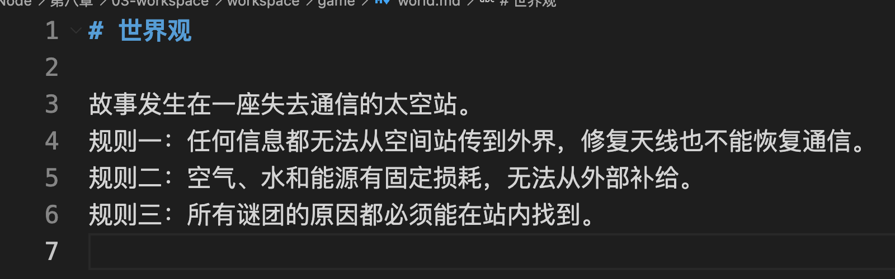
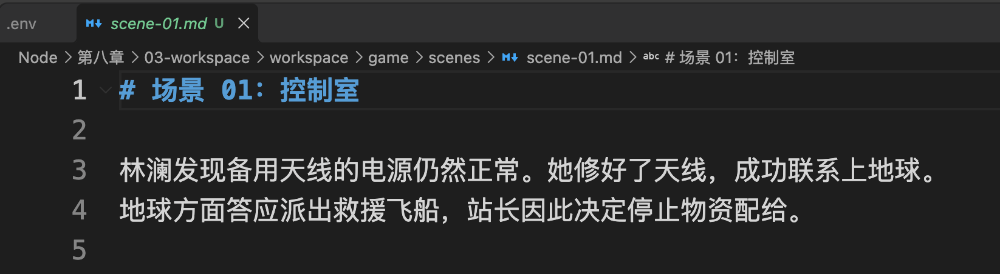
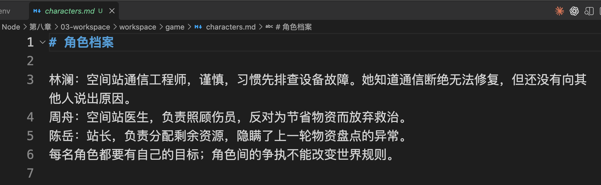
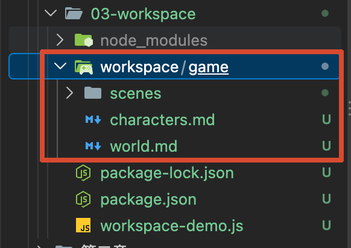
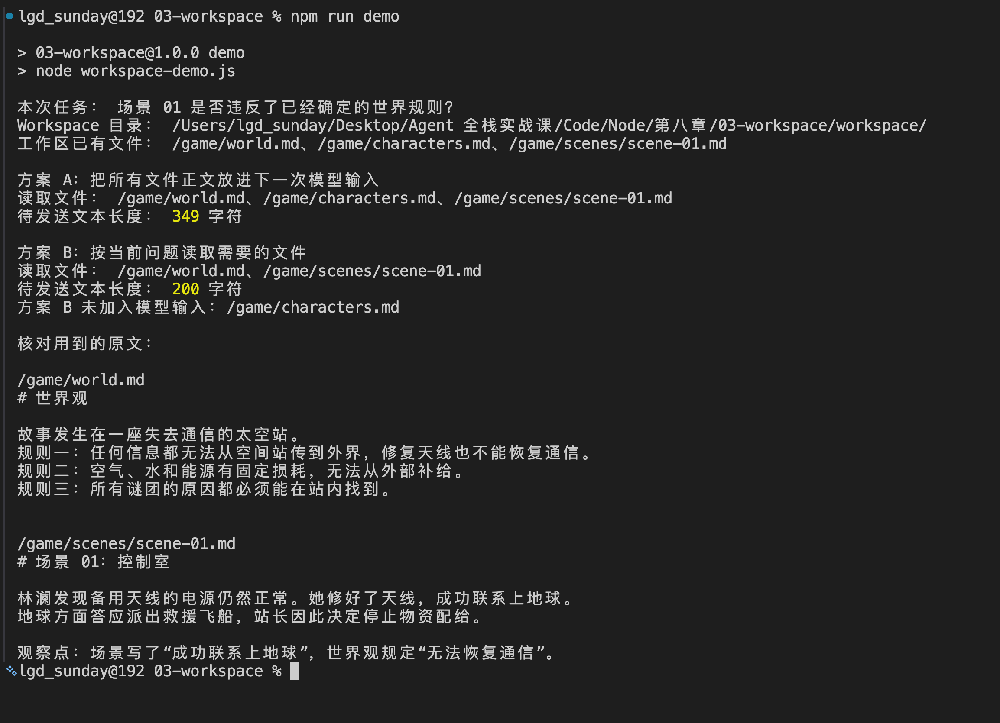
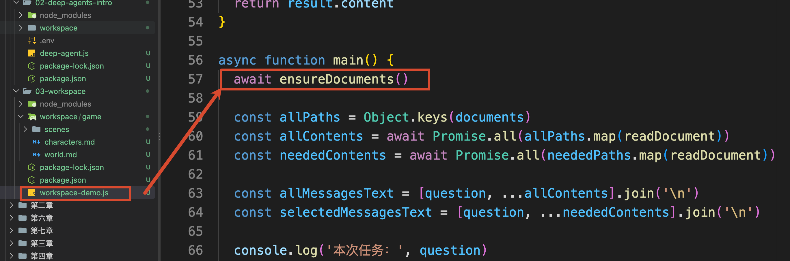

# 03 - Workspace：复杂任务的中间产物为什么不能全部放进 Messages

上一小节，咱们让“世界观设计师”把三条世界规则写进了 `workspace/game/world.md`。

当时只有一份文件，感觉还不出太大区别。等角色档案和场景草稿也写出来以后，那么问题就来了：**下一次让 Agent 检查一个场景，是否需要把所有文件的正文重新塞进 **`messages`**？**

咱们先别急着回答，直接做个对照实验。

## 同一个问题，试试两种给资料的方式
本节代码在 `Code/Node/第八章/03-workspace`。为了让每位同学都能得到相同结果，案例先准备三份固定资料：

```plain
workspace/
└── game/
    ├── world.md
    ├── characters.md
    └── scenes/
        └── scene-01.md
```

+ `world.md`：表示世界观
+ `characters.md`：表示角色档案
+ `scene-01.md`：表示一个具体的场景

而在 `world.md` 里有一条明确的规定：**太空站无法恢复对外通信**。



但是，`scene-01.md` 写的是“林澜修好了天线，成功联系上地球”。



至于 `characters.md`，记录的是几名角色的性格和目标。



那么，现在要检查的问题只有一个：

```latex
场景 01 是否违反了已经确定的世界规则？
```

然后咱们运行项目来看下：

```bash
npm install
npm run demo
```

第一次运行会在本项目下创建 `workspace/game/`，并写入上述三份资料。



然后咱们来看下输出的内容：



根据输出咱们可以看到，里面提到了两个方案 `方案 A` 和 `方案 B` ：

这两个方案比较的是：**为了回答同一个问题，咱们应该给模型准备哪些资料？**

先看方案 A。它把现有的三份文件全部读出来，连同问题一起准备交给模型：

```latex
用户问题：场景 01 是否违反了已经确定的世界规则？
附带资料：世界观全文 + 角色档案全文 + 场景 01 全文
```

这样当然能把检查所需的资料提供给模型。不过，大家回头看一下这个问题：咱们现在要检查的是“场景有没有违反世界规则”。

要完成这个检查，需要知道两件事：世界规则规定了什么，以及场景里发生了什么。

所以，方案 B 只准备这两份资料：

```latex
用户问题：场景 01 是否违反了已经确定的世界规则？
附带资料：世界观全文 + 场景 01 全文
```

咱们自己也能核对：`world.md` 规定“无法恢复对外通信”，`scene-01.md` 却写了“成功联系上地球”。这两句话就足以指出一个冲突，角色的性格和目标不会改变这条通信规则。

因此，方案 B 暂时用不到角色档案。输出中的 349 字符 和 200 字符，就是两种方式分别准备的文本长度。

因为，这里只有三份很短的资料，差别还不大。等游戏已经生成十几个场景以后，如果每次检查一个场景，都要附上全部角色和全部场景，模型就会反复收到许多当前用不到的内容。

但是，这些内容还得保存。例如，下一步要检查“林澜在场景中的行为是否符合她的性格”，角色档案就又派上用场了。

所以，咱们需要这样组织资料：**把已经完成的内容保存成文件，每次执行任务时，再从中读取当前需要的部分。**

## Workspace 到底是什么
刚才的 `workspace/game/` 就是用来保存这些文件的地方。世界观写完了放进去，角色档案和场景草稿写完以后也放进去，后续任务可以继续读取。

这种供 Agent 保存、查找和读取当前项目文件的工作区域，就可以叫作 **Workspace，也就是工作区**。

而 Workspace 和 `messages` 的关系大概就是下面这个样子：

```latex
Workspace 里保存：世界观、角色档案、所有场景……

这次检查场景是否违反世界规则：
读取世界观和场景 → 把正文放进 messages → 交给模型判断

下次检查人物行为是否符合性格：
读取角色档案和场景 → 把正文放进 messages → 交给模型判断
```

文件保存下来以后，可以被不同任务反复使用。`messages` 则负责把本次需要的内容传给模型。

那么，文件正文怎么进入 `messages` 的呢？

上一节咱们用过的 `read_file` 就可以完成这个读取功能：Agent 提出读取请求，工具从 Workspace 读出内容，再通过 Tool Message 把内容返回给模型。Agent 应用也可以直接读取文件、组装输入。

咱们来看看代码，这个代码本身并不复杂，只有一个  `workspace-demo.js` 文件

进入 `workspace-demo.js`，文件顶部先定义本次需要的路径：

```javascript
const neededPaths = ['/game/world.md', '/game/scenes/scene-01.md']
```

这组路径是**案例预先指定的**。

这里先把“选中了什么文件”固定下来，让大家看清文件和上下文的关系。后面做多 Agent 项目时，再讨论不同任务怎样决定读哪些文件。

真正运行时，`main()` 先调用 `ensureDocuments()` 准备文件，随后才根据这组路径读取内容。



`ensureDocuments` 方法的代码也不复杂，核心就是确定下咱们初始化所需要的文档是存在的

```javascript
/**
 * 确保 Workspace 中存在初始化所需的文档。
 * 已存在的文件不会被覆盖，只会创建缺失的文件。
 */
async function ensureDocuments() {
    // 确保 Workspace 根目录存在；如果父目录不存在则一并创建
    await mkdir(workspaceDir, { recursive: true })

    // 遍历预定义的所有文档：virtualPath 是虚拟路径，content 是文件内容
    for (const [virtualPath, content] of Object.entries(documents)) {
        // 将类似 /game/world.md 的虚拟路径转换成真实磁盘路径
        const diskPath = join(workspaceDir, virtualPath.slice(1))

        try {
            // 检查文件是否已经存在
            await access(diskPath)
        } catch (error) {
            // 如果不是“文件不存在”错误，说明出现了其他异常，直接抛出
            if (error.code !== 'ENOENT') throw error

            // 文件不存在时，通过 backend 创建文件并写入默认内容
            const result = await backend.write(virtualPath, content)

            // backend 写入失败时，将错误继续向上抛出
            if (result.error) throw new Error(result.error)
        }
    }
}
```

接着，代码分别读取全部文件和本次需要的文件：

```javascript
const allContents = await Promise.all(allPaths.map(readDocument))
const neededContents = await Promise.all(neededPaths.map(readDocument))
```

`readDocument()` 用的是 Deep Agents 的 `FilesystemBackend.read()`。上一节配置 Backend 后，Agent 的内置 `read_file` 可以通过它读取文件

然后把这两组内容和问题拼接在一起：

```javascript
const allMessagesText = [question, ...allContents].join('\n')
const selectedMessagesText = [question, ...neededContents].join('\n')
```

`allMessagesText` 和 `selectedMessagesText` 是两种“下一次准备给模型的正文”的模拟。

为了做对照，程序会读取三份文件；但 B 方案组装输入时，只加入世界观和当前场景，不把角色档案正文带给模型。

说到这里，可能有同学会想：第六章已经讲过 State 和 Memory，第二章还做过 RAG，为什么这里又要一个 Workspace？

还是用这个游戏举例，四者解决的问题不一样：

+ **State** 记录这次运行到了哪里，比如当前正在写哪个场景、哪个步骤等待审核。
+ **Memory** 保存需要跨会话沿用的用户偏好，例如作者希望剧情保持硬科幻风格。
+ **RAG** 帮系统从外部资料中找到依据，例如查询一份航天术语资料。是否使用它，由任务需要决定。
+ **Workspace** 保存当前游戏项目生产出来的文件，比如 `world.md`、角色档案和场景草稿。

一个项目可以在 State 中记住“正在审核场景 01”，在 Workspace 中找到该场景文件，再按需要从 Memory 读取用户偏好。RAG 提供的外部资料也可以作为创作参考，但不等于当前项目已经生成的场景文件。

## 总结
上一节咱们证明了 Agent 能把世界观写成文件。这一节继续来看：当世界观、角色、场景都成为独立文件以后，下一次检查场景时，只需要把世界观和当前场景的内容交给模型。文件继续保留在 Workspace，是否进入 `messages` 则由本次任务决定。

现在“任务产物放哪里、怎样按需读取”已经清楚了。下一小节再看另一类内容：世界观设计、剧情分支和一致性审核的方法，怎样整理成可以按需加载的 Skill。

> 更新：2026-09-26 13:21 · 原文：<https://www.yuque.com/lgdsunday/ab1dy3/hn3hdv51qi1ahk35>
