# 04 - Agent Skills：把剧情设计方法封装成按需加载的可复用能力

上一小节，咱们把世界观、角色档案和场景草稿放进了 Workspace。Agent 要检查哪个问题，就读取对应的文件。

现在，咱们继续往下做，让 Agent 根据世界观设计剧情分支。

大家可以想一下：如果只说“帮我写两个选项”，模型可能写出两个不同的按钮，但玩家点完以后，看到的结局却差不多。这样的选择，玩起来就没什么意思了。

所以，咱们希望它按照一套明确的方法来设计：先读取世界规则，再设计一个两难处境；每个选择都要有收益和代价，最后产生不同的结局。

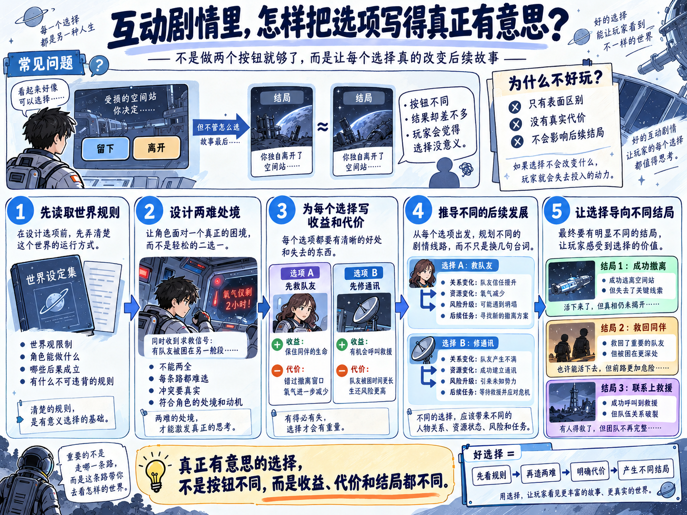

这套方法以后还会反复使用。今天写太空站的剧情，明天写荒岛求生的剧情，都需要检查选择和后果。

当然，咱们可以每次都把这套要求写进 Prompt。但后面还有人物设计、场景编写和一致性审核，每项工作都有自己的方法。全部放进 System Prompt，每次调用模型就都要带上这些内容。

那么，能不能**把这些方法提前整理好，Agent 做到哪类任务，再读取对应的方法？**

这一小节，咱们就通过 `Agent Skills` 来实现它。

## Agent Skills 到底是什么
`Skill` 可以翻译成“技能”。在这里，它具体表现为：**一个保存任务说明、执行步骤和相关资料的文件夹，供 Agent 在需要时读取和使用。**

其中最重要的文件叫作 `SKILL.md`。它会告诉 Agent：这项技能用来做什么、什么时候使用，以及具体应该怎样做。

这个目录格式有公开的 [Agent Skills 规范](https://agentskills.io/specification)，Deep Agents 也提供了对应的 [Skills 支持](https://docs.langchain.com/oss/javascript/deepagents/skills)。

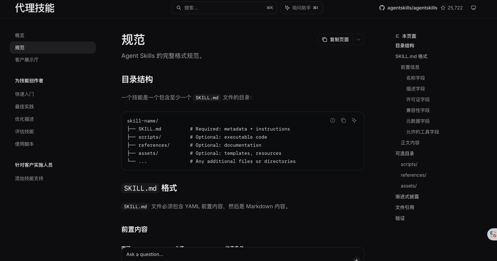比如，咱们准备一个“分支剧情设计” Skill，里面保存刚才提到的设计步骤。以后用户要求设计剧情分支，Agent 就可以读取这份说明，再调用工具完成任务。

这里可以顺便和前两节连起来理解：

+ **Skill** 告诉 Agent 怎样设计剧情，例如每个选择都要有代价。
+ **Tool** 执行具体操作，例如 `read_file` 读取世界观，`write_file` 保存大纲。
+ **Workspace** 保存本次项目的文件，例如世界观和刚写好的剧情大纲。

Skill 的说明被读出来以后，也会成为模型本次推理的上下文。它的价值在于：**把可以复用的方法单独维护，需要时再加载。**

第六章的长期记忆则保存另一类信息，例如“这位用户喜欢硬科幻”。Agent 可以结合这项偏好，再按照剧情设计 Skill 的方法完成创作。

## 写一份剧情设计 Skill
本节代码在 `Code/Node/第八章/04-agent-skills`。

先看其中的文件：

```latex
04-agent-skills/
├── package.json
├── skill-agent.js
└── workspace/
    ├── game/
    │   └── world.md
    └── skills/
        └── branch-story-design/
            ├── SKILL.md
            └── references/
                └── outline-template.md
```

`game/world.md` 是本次创作要依据的世界观。

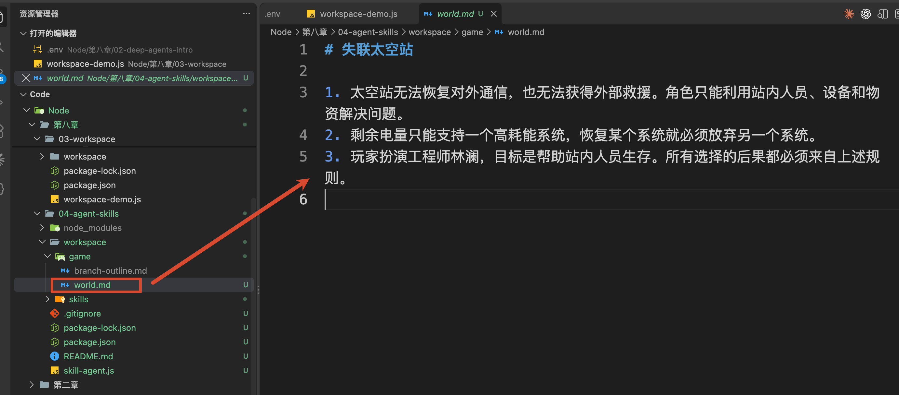

为了让案例可以独立运行，这里准备了一份固定内容，沿用前两节的失联太空站背景：无法恢复对外通信，也无法获得外部救援。这次再增加一条限制：剩余电量只能支持一个高耗能系统，让玩家有一个需要取舍的问题。

`skills/branch-story-design/` 则保存设计方法。大家注意区分：世界观描述**当前游戏有什么限制**，Skill 描述**遇到剧情设计任务应该怎样处理**。

先打开 `workspace/skills/branch-story-design/SKILL.md`

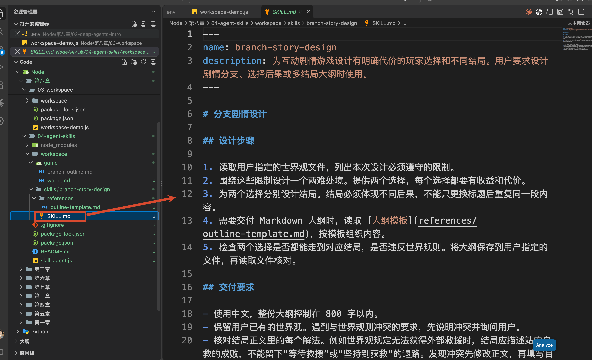

最上面是：

```yaml
---
name: branch-story-design
description: 为互动剧情游戏设计有明确代价的玩家选择和不同结局。用户要求设计剧情分支、选择后果或多结局大纲时使用。
---
```

这段放在 Markdown 开头的 YAML 配置叫作 `Frontmatter`，可以简单理解为这份 Skill 的基本介绍。

`name` 是名称，与当前文件夹的名字保持一致。

`description` 则说明“能做什么、什么时候用”。这里写明了剧情分支、选择后果和多结局，模型看到用户任务以后，才有依据判断它是否适用。

介绍写完，下面才是具体方法。当前文件中的设计步骤是：

```markdown
## 设计步骤

1. 读取用户指定的世界观文件，列出本次设计必须遵守的限制。
2. 围绕这些限制设计一个两难处境。提供两个选择，每个选择都要有收益和代价。
3. 为两个选择分别设计结局。结局必须体现不同后果，不能只更换标题后重复同一段内容。
4. 需要交付 Markdown 大纲时，读取 [大纲模板](references/outline-template.md)，按模板组织内容。
5. 检查两个选择是否都能走到对应结局，是否违反世界规则。将大纲保存到用户指定的文件，再读取文件核对。
```

这五步，就是咱们希望反复使用的剧情设计方法。

其中第四步还提到了一个文件：`references/outline-template.md`。

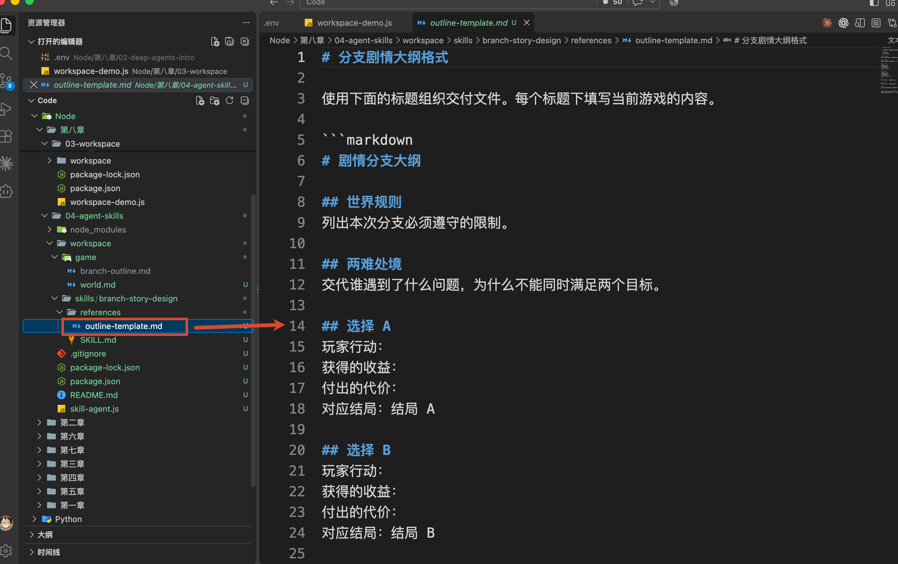

它和当前 `SKILL.md` 在同一个技能目录里，专门规定大纲应该有哪些部分：

```latex
世界规则
两难处境
选择 A：行动、收益、代价、对应结局
选择 B：行动、收益、代价、对应结局
结局 A
结局 B
自检
```

把格式单独放在模板中，以后修改交付格式，就可以直接修改这个文件。Agent 执行到“需要交付 Markdown 大纲”这一步时，再把模板读取进来就可以了。

到这里，大家应该能看出它怎样复用了。

当前 Skill 写的是“读取用户指定的世界观文件”，具体读取哪个世界、把结果保存到哪里，由本次任务提供。换一个游戏，咱们可以继续使用同一套设计步骤。

## 运行案例，看看什么时候会读取 Skill
这次要观察两件事：**设计剧情时，有没有读取设计方法；普通问答时，会不会也把这份方法读一遍。**

进入本节代码目录，别忘了 `.env` ：

```plain
DEEPSEEK_API_KEY=你的 DeepSeek API Key
DEEPSEEK_MODEL=deepseek-v4-flash
```

先运行：

```bash
npm run story
```

这条命令会向 Agent 提交下面的任务：

```latex
请根据 /game/world.md，为失联太空站游戏设计一个两难处境，
提供两个有不同后果的选择和对应结局。
将 Markdown 大纲保存到 /game/branch-outline.md。
```

这段话只告诉 Agent：**要写什么，以及保存到哪里。**

至于“每个选择都要有收益和代价”“两个结局不能只是换个标题”等具体要求，咱们写在了 `SKILL.md` 中。

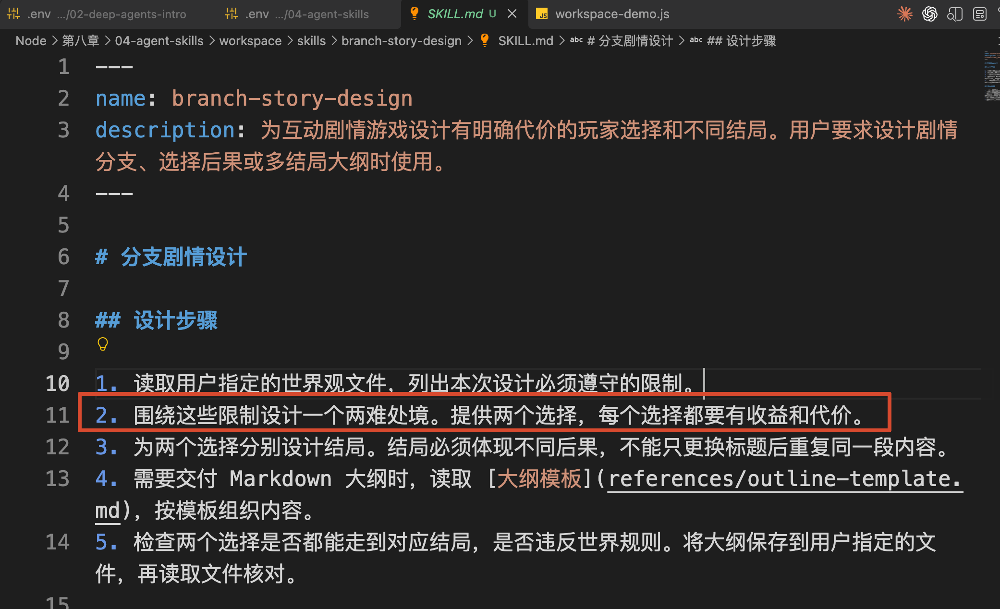

那么，Agent 有没有读取这些要求呢？

继续往下看终端中的 `本次工具调用`。这里记录了 Agent 为完成任务，实际调用过哪些工具：

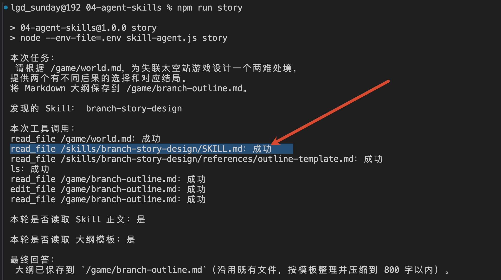

这一行表示：**Agent 调用了 **`read_file`**，读取了咱们刚才编写的剧情设计 Skill。** 文件中的设计步骤会通过工具返回结果交给模型。

后面的记录，则可以顺着理解为：

+ 读取 world.md：了解这次游戏的世界规则
+ 读取 outline-template.md：了解大纲需要包含哪些内容
+ write_file /game/branch-outline.md：把生成的大纲保存成文件
+ read_file /game/branch-outline.md：读取刚保存的大纲，进行核对

所以，咱们要通过这份日志确认的是：**Agent 确实读取了设计方法，并继续完成了资料读取和文件保存。**

最终文件在本项目的：

```latex
workspace/game/branch-outline.md
```

打开它，检查是否能找到“选择 A”“选择 B”和两个结局，以及每个选择的收益与代价。

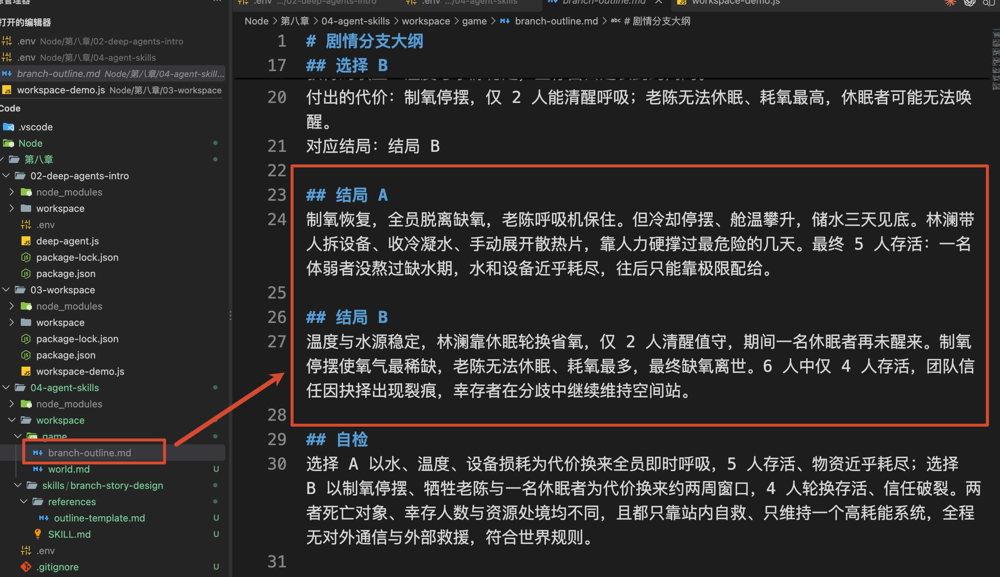

比如这次模型把有限电量的分配设计成了两条方案：优先保住生命维持系统，或者优先保住水与冷却循环。

这些剧情内容是模型根据世界观和 Skill 生成的。**课程提供的是方法和格式，具体故事由模型编写。**

重复运行时，文件已经存在，模型可能使用 `edit_file` 更新，也可能先读取已有内容进行复核。终端会展示实际发生的操作；只有读取、没有重新写入时，也会明确提示。

然后，咱们换一个与剧情无关的问题：

```bash
npm run chat
```

这次提交的是“2 + 3 等于多少？直接给出答案。”。实际运行结果是：

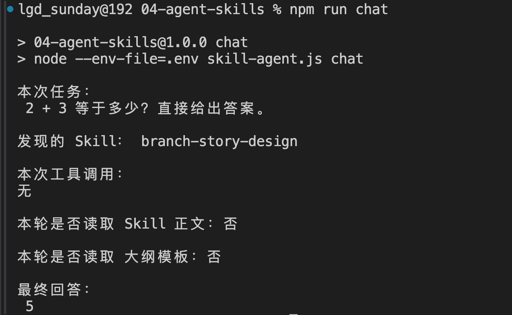

两次运行都发现了同一个 Skill，但第二次没有读取正文和模板。

因为回答这个算术问题，用不到剧情设计方法。模型知道这项技能存在，仍然可以直接回答当前问题。

## 从 main() 看 Skill 怎样被加载和使用
结果已经看到了，那么接下来咱们就来看看代码

`npm run story` 实际执行的是：

```bash
node --env-file=.env skill-agent.js story
```

 `skill-agent.js` 整个执行从 `main()` 开始。

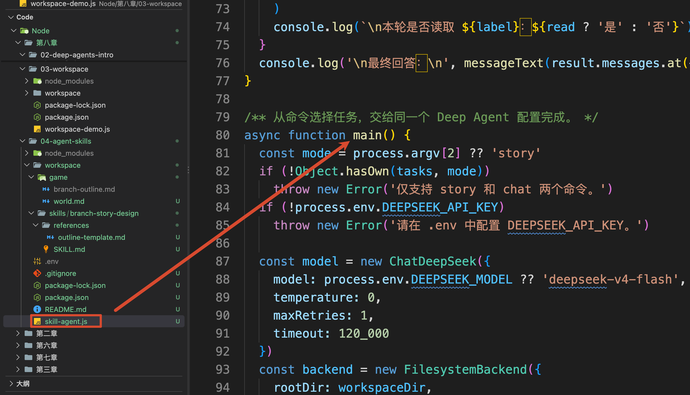

`main()` 根据最后的 `story` 参数，从文件顶部的 `tasks` 对象中取出刚才那段创作要求。

读取模型配置以后，它会创建 Backend 和 Agent。下面是一些关键代码：

```javascript
const workspaceDir = fileURLToPath(new URL('./workspace/', import.meta.url))

// 把本地 workspace 目录作为 Agent 的文件系统工作区
const backend = new FilesystemBackend({
    rootDir: workspaceDir,
    virtualMode: true
})

// 创建 Deep Agent。
// story 和 chat 共用同一套模型、Workspace、Skills 和权限配置，
// 具体执行什么任务由后面传入的用户消息决定。
const agent = await createDeepAgent({
    model,
    backend,
    skills: ['/skills/'],
    systemPrompt: '你是互动剧情制作助手。当前任务由你直接完成，按用户要求交付。'
})
```

`FilesystemBackend` 在前面已经用过，它让 Agent 通过工具读写本项目的 `workspace`。

这一节新增加的是：

```javascript
skills: ['/skills/']
```

它告诉 Deep Agents 去哪里发现 Skill。因为 Backend 的根目录是 `workspace`，这里对应的实际位置就是：

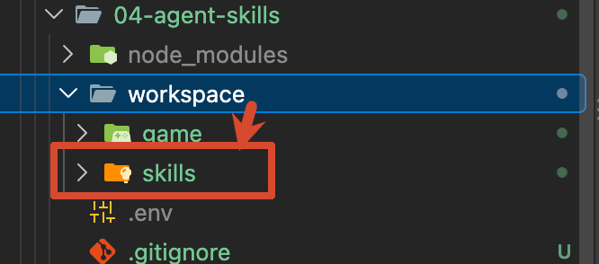

目录下面有咱们刚才写好的 `branch-story-design/SKILL.md`，框架才能找到它。只创建文件夹、却没有在 `skills` 中配置位置，当前案例就不会加载这项技能。

Agent 创建好以后，`main()` 把选中的任务交给 `invoke()`：

```javascript
// 把当前命令对应的任务作为用户消息交给 Agent 执行。
// recursionLimit 限制 Agent 最大递归执行次数，
// AbortSignal 则限制整次任务最长执行 5 分钟。
const result = await agent.invoke({
    messages: [{ role: 'user', content: tasks[mode] }]
}, { recursionLimit: 30, signal: AbortSignal.timeout(300_000) })
```

到这里，才开始本次创作。

接下来咱们顺着刚才的调用记录，看 Skill 是怎样进入模型上下文的。

### 先让模型知道有哪些 Skill
在本次首次调用模型以前，Deep Agents 会扫描配置的技能目录，解析 `SKILL.md` 开头的介绍。

模型先看到的是一份技能清单。对于这次的代码，可以简化成：

```latex
名称：branch-story-design
用途：设计剧情分支、选择后果和多结局大纲
完整说明：/skills/branch-story-design/SKILL.md
```

因此，模型能够知道“这里有一项适合当前任务的技能”，也知道去哪里读取完整方法。

这里要分清文件扫描和模型输入：程序为了发现技能，会读取文件；初始提供给模型的是名称、描述和位置，五条设计步骤还没有整段加入模型上下文。

### 模型提出读取请求，设计方法才进入上下文
模型看到用户要求设计两个选择和结局，便可以根据技能描述，提出下面的 Tool Call。这里只展示与读取位置有关的字段：

```javascript
{
    name: 'read_file',
    args: {
        file_path: '/skills/branch-story-design/SKILL.md'
    }
}
```

`read_file` 就是第二小节已经用过的内置文件工具。它通过 Backend 找到磁盘上的 `workspace/skills/branch-story-design/SKILL.md`，把正文作为 Tool Message 返回。

模型拿到这份结果以后，才能看到“先读世界观、为每个选择设计收益和代价”等完整要求。程序配置 Skill 的位置，模型根据任务读取其中的方法。

这次任务要求交付 Markdown 大纲，刚才读到的第四条又告诉模型：先读取 `references/outline-template.md`。

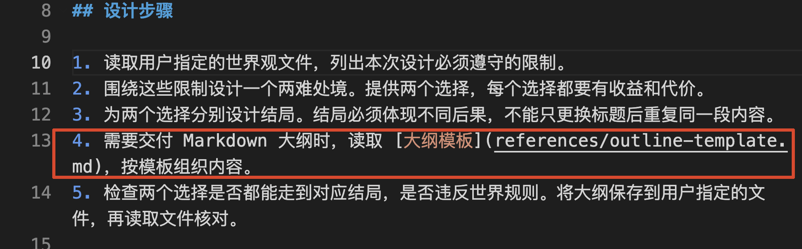

它是相对于当前 Skill 目录的位置。于是，本次记录里继续出现：

```latex
read_file /skills/branch-story-design/references/outline-template.md
```

模板返回以后，模型就同时知道了“怎样设计”和“按什么格式交付”。

这种逐步加入信息的方式，官方称为 [Progressive Disclosure，也就是渐进式披露](https://docs.langchain.com/oss/javascript/deepagents/skills#how-skills-work)。

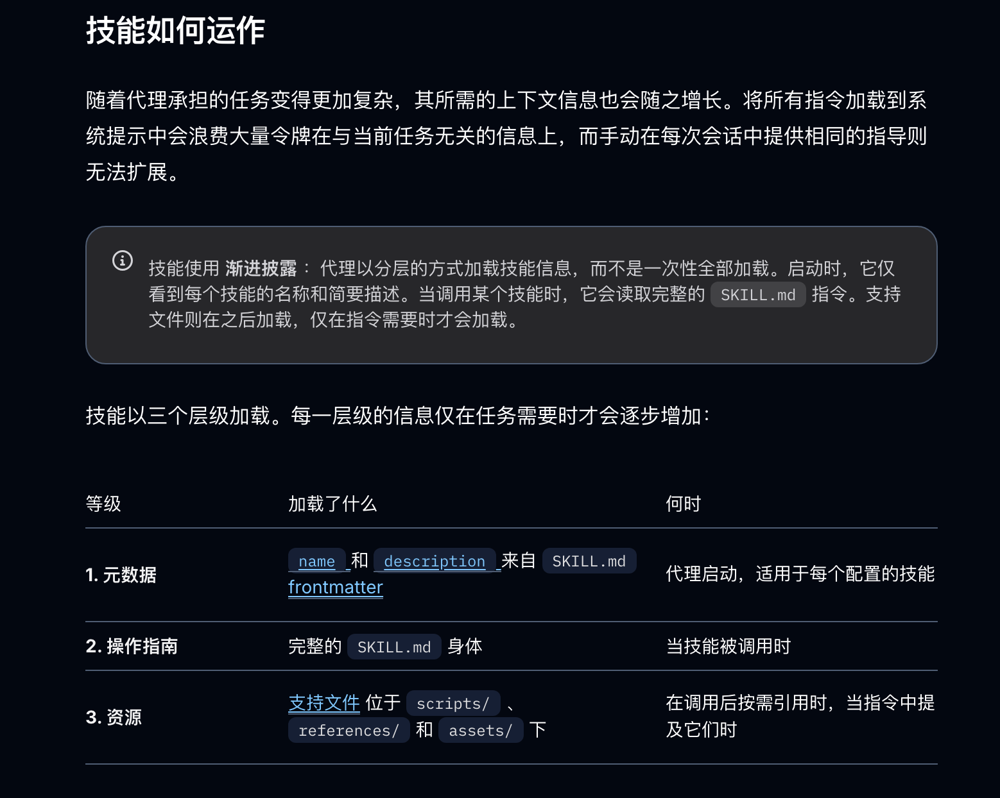

放到咱们这次的代码里面，就是：`先提供技能介绍 → 判断剧情任务适用，读取 SKILL.md → 需要交付 Markdown 大纲，继续读取模板`

现在，模型已经读取世界观、设计步骤和大纲模板，可以开始编写剧情了。

大纲要保存到哪里，也有明确的规定：用户任务指定了 `/game/branch-outline.md`。

模型把生成的正文放进 `write_file` 的参数，Deep Agents 执行写入，Backend 再将它保存到本项目的 `workspace/game/branch-outline.md`。

保存成功以后，Skill 的第五步要求再次读取文件核对。于是，本次调用记录的最后又出现了一次对大纲文件的 `read_file`。

等 `invoke()` 返回，`main()` 才调用 `collectToolCalls()` 和 `printRun()`，把本次请求过的工具、对应结果，以及是否读过 Skill 打印出来。这两个函数负责展示记录，具体工具调用已经由 Agent 完成。

最后，程序会检查本轮是否保存或读取过大纲，再通过 Node.js 的 `readFile()` 读取真实文件，打印正文和磁盘路径。

大家就能把模型的最终回复和实际文件对照起来啦

## 总结
这一节，咱们把剧情设计方法写进 `SKILL.md`，把交付格式放进模板，再通过 `skills` 配置让 Deep Agents 发现它。

设计剧情时，模型读取方法和模板，使用文件工具把大纲保存进 Workspace；普通问答时，本次运行只使用了技能介绍，没有读取整份设计说明。

所以，上一节解决的是**当前项目的内容怎样保存和读取**，这一节继续解决了**制作这些内容的方法怎样复用和按需加载**。

以后再增加人物设计、场景编写和一致性审核 Skill，也要把各自处理的任务写清楚。方法可以分别维护，不必全部挤进同一段 System Prompt。

但如果同一个 Agent 既设计世界观，又写角色、做剧情、检查所有场景，任务和上下文仍然会越积越多。下一小节，咱们就继续看：这些工作应该怎样分给不同的 Agent，以及它们怎样配合。

> 更新：2026-09-27 18:31 · 原文：<https://www.yuque.com/lgdsunday/ab1dy3/zigtzsan11121rof>
