# 05 - 多 Agent 协作方案：Router、Handoff、Supervisor 与 Subagent

上一小节，咱们给 Agent 配置了剧情设计 Skill。它可以读取世界观，按照 Skill 中的方法设计分支，再把大纲保存到 Workspace。

只做这件事，一个 Agent 就够用了。

但是，后面要制作一款完整的互动剧情游戏，还需要设计人物、编写多个场景、检查剧情冲突。每项工作都会读取文件、调用工具，并产生自己的中间结果。

如果这些工作始终由同一个 Agent 连续处理，那么它在检查最终剧情时，消息里可能还保留着前面设计人物、修改大纲时的很多细节，就难免会有些力不从心了。

就好比一个程序员既要：分析需求、写代码，又要自己验收写测试，难免容易罢工。。。（来自打工人浓浓的怨气）

所以，这个时候，就可以把工作分给不同角色。比如，让一个“总导演”负责整体任务，把剧情设计交给“剧情设计师”。设计师自己读取资料、完成设计，最后告诉总导演：**做完了什么，文件放在哪里。**

这就用到了这一节的 **多 Agent 协作**：让多个具有不同职责的 Agent，通过任务和结果的传递，共同完成工作。

## 多个 Agent，应该怎样分工
大家可能看到过 `Router`、`Handoff`、`Supervisor` 和 `Subagent` 这些名字。

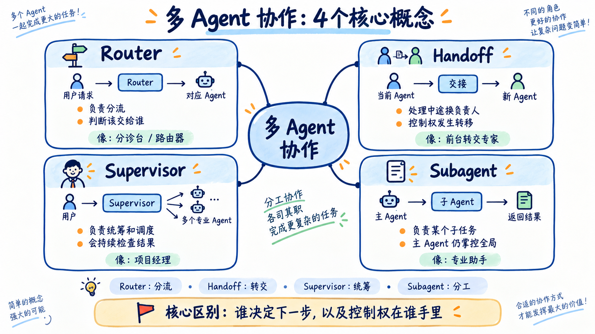

咱们直接放到剧情制作场景里理解。重点看三种安排：先分配请求、转交后续对话，以及主 Agent 委派子任务。

### Router：先判断这次请求应该交给谁
假设一个创作平台里有三个功能：修改世界设定、设计人物、检查剧情。

用户说：“帮我检查第三个场景有没有违反世界规则。”

系统先判断这是“剧情检查”请求，再交给负责检查的 Agent：

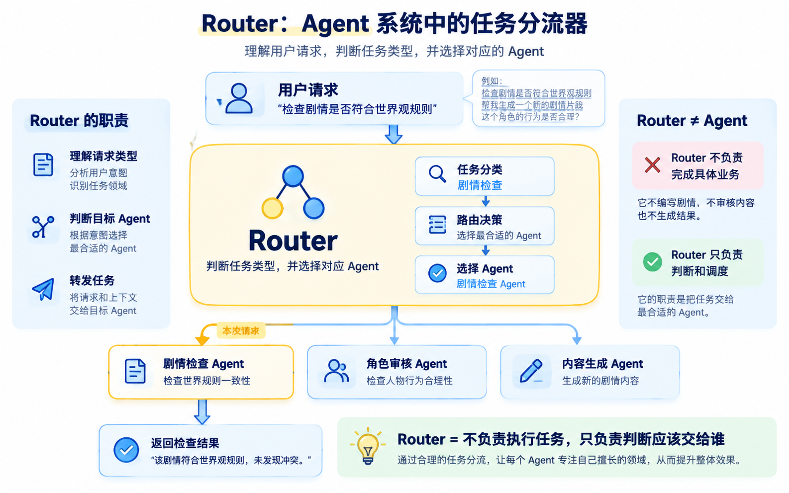

中间负责判断和分配的部分，就是 `[Router](https://docs.langchain.com/oss/javascript/langchain/multi-agent/router)`，也就是路由。

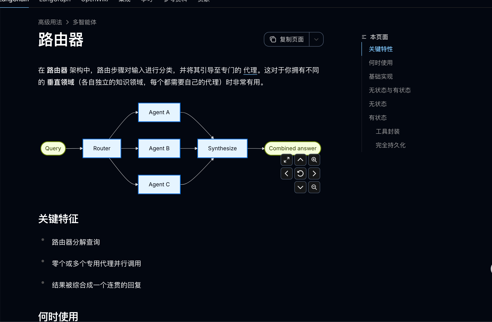

**Router 根据输入，选择适合处理本次请求的 Agent。** 分类可以由普通规则完成，也可以交给模型判断。

如果用户同时要求“检查人物设定和剧情冲突”，路由也可以把请求分给多个 Agent，再汇总结果。

这种方式适合任务分类比较明确的入口。它的重点是 **把当前请求分配出去**，通常不负责根据多轮执行结果持续规划整个制作项目。

### Handoff：把接下来的对话交给另一个角色
继续看这个创作平台。

用户一开始和创作助手讨论游戏主题，聊到人物时，希望进一步设计主角的背景、性格和人物关系。

这时，创作助手可以把后续对话交给人物设计 Agent：

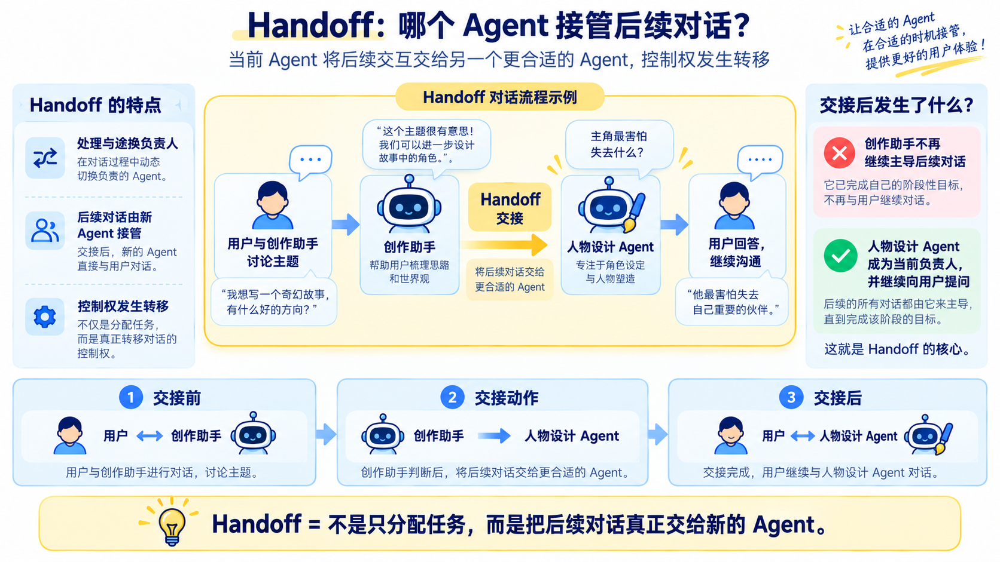

这种接管后续交互的方式，叫作 `[Handoff](https://docs.langchain.com/oss/javascript/langchain/multi-agent/handoffs)`，可以理解为交接。

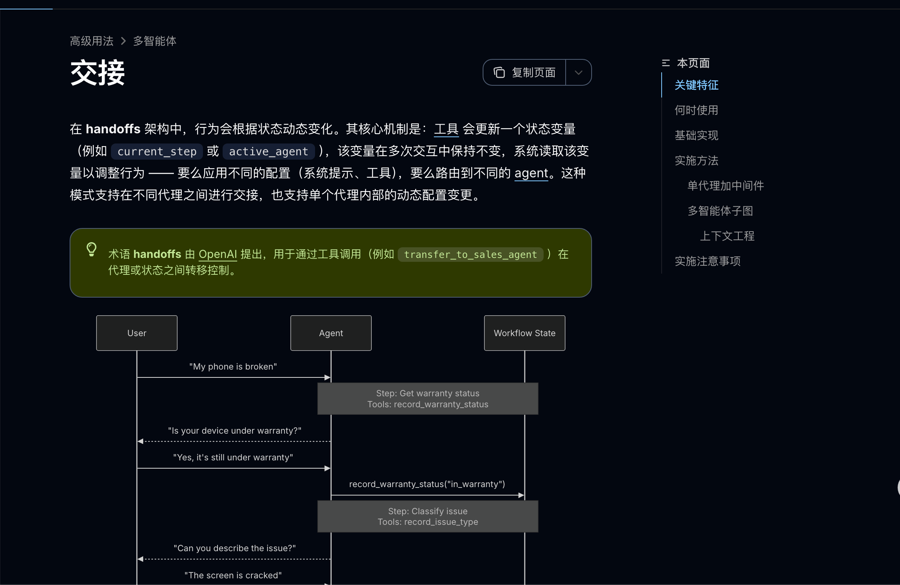

**交接以后，当前负责对话的角色发生了变化。** 系统会记录当前角色，下一轮用户消息继续由这个角色处理，需要时再转交。

交接完成以后，假如用户再说“我希望主角是一个胆小的工程师”，这条消息就会由人物设计 Agent 继续处理。

它会围绕人物设计追问和回答，直到这部分工作结束，或者需要再次交接。

所以，Handoff 解决的就是：**对话进行到不同阶段时，让合适的角色接手，继续和用户沟通。**

### Supervisor 与 Subagent：主 Agent 安排工作，子 Agent 交回结果
现在换成另一种需求：

> 帮我完成一款失联太空站剧情游戏，包括世界观、剧情分支、场景和审核。
>

用户希望拿到完整作品，制作过程需要有人持续负责。

咱们可以安排一个总导演 Agent。它先委派世界观设计，拿到结果以后，再安排剧情设计，发现剧情问题时，继续决定让谁修改。

其中，负责统筹的主 Agent 通常叫作 **Supervisor**；接收具体任务的子 Agent 叫作 **Subagent（代理子节点）**。

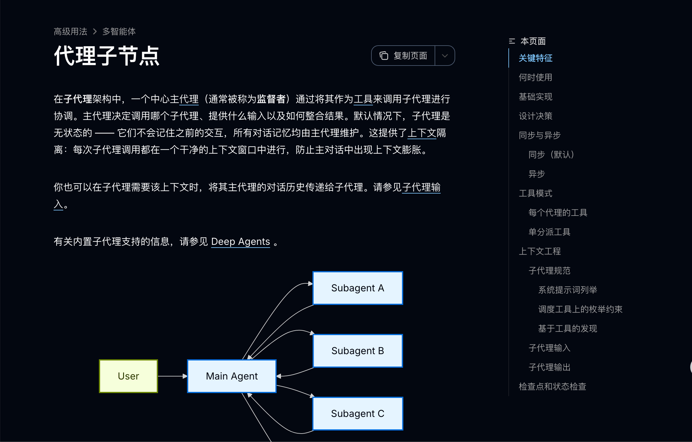

它们是同一套协作关系中的两个角色。

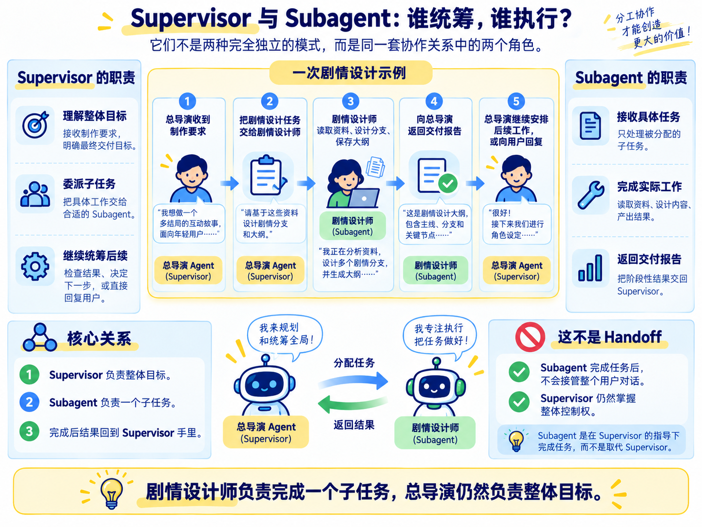

这里，剧情设计师负责完成一个子任务，总导演仍然负责整体目标。

那么到这里，咱们再把这四个概念连起来理解一下。

假设用户说：“帮我设计一个游戏人物。”

系统先判断这是人物设计任务，再交给人物设计 Agent。这里负责**判断请求类型、选择处理者**的，就是 `Router`。

如果用户原本正在和创作助手讨论游戏主题，现在希望深入设计人物，系统就可以让人物设计 Agent 接手，继续与用户沟通。这个**交接后续对话**的过程，就是 `Handoff`。

如果用户要求的是“帮我制作一款完整游戏”，就需要一个总导演持续管理整个任务。它根据制作进度，安排世界观设计、剧情编写和审核，并根据返回结果决定下一步。

这里，**负责统筹的总导演就是 **`Supervisor`**，接收具体任务、完成后交回结果的专业 Agent 就是 **`Subagent`**。**

所以，这四个概念可以这样记：

+ **Router：这次请求应该交给谁？**
+ **Handoff：接下来换谁继续和用户沟通？**
+ **Supervisor：整个任务由谁统筹，下一步安排谁做什么？**
+ **Subagent：被委派的这部分工作，由谁具体完成并交回结果？**

再给大家来张图：

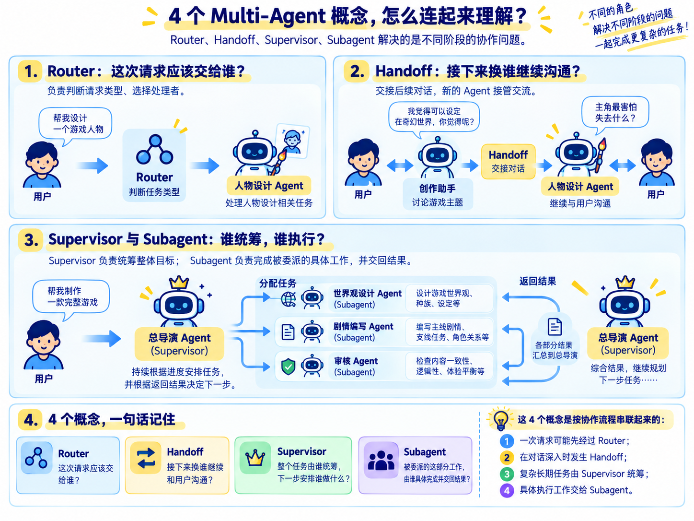

这样来看，应该就比较好理解的哈

## 当前剧情项目，为什么选择总导演与子 Agent
咱们后续的完整项目，需要从一个创作要求，逐步得到世界观、剧情大纲和场景文件。

这些工作之间有依赖：设计剧情时要遵守世界规则，编写场景时要依据剧情大纲，审核时又要对照前面生成的文件。

因此，咱们采用总导演负责统筹、专业 Agent 完成子任务的方式。后续项目计划拆成：

```latex
总导演
├── 世界观设计师：世界规则与人物设定
├── 剧情设计师：分支结构与结局
├── 场景编写者：具体场景、对话与玩家选项
└── 剧情审核者：检查设定和剧情是否一致
```

框架提供的是配置子 Agent、传递任务和接收结果的能力。

这一节先实现其中最小的一组：**总导演 + 剧情设计师**。

世界观和 Skill 继续沿用上一节，咱们只调整“由谁执行”。这样就能专门观察一次任务是怎样交出去、再返回的。

另外，两个 Agent 可以使用同一个 DeepSeek 模型。它们分别拥有自己的职责说明和消息记录，框架分别执行各自的 Agent Loop。

它们也可以运行在同一个程序里面。等到需要接入由其他团队独立部署、独立维护的 Agent 系统时，再考虑 [A2A 这类跨系统通信协议](https://a2a-protocol.org/latest/topics/what-is-a2a/)。当前案例使用 Deep Agents 内部的子 Agent 调用即可。

## 运行案例，观察一次任务委派
代码在 `Code/Node/第八章/05-multi-agent-collaboration`。

别忘了安装依赖和  `.env` 配置：

```bash
npm install
```

```plain
DEEPSEEK_API_KEY=你的 DeepSeek API Key
DEEPSEEK_MODEL=deepseek-v4-flash
```

然后执行：

```bash
npm run demo
```

这个打印出来的东西有点多，咱们一点点来看。

首先是 「用户任务」

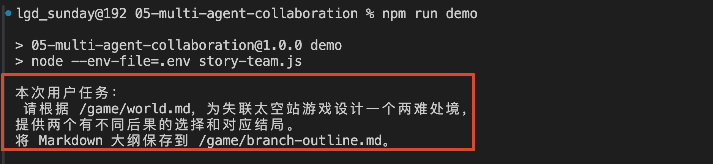

这次的终端日志增加了角色名称：`[story-director]` 表示总导演，`[plot-designer]` 表示剧情设计师。

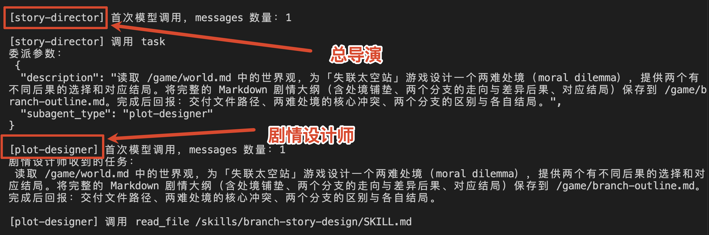

先找这一行：

```latex
[story-director] 调用 task
```

它表示总导演决定调用 `task` 工具，把工作交出去。紧接着打印的“委派参数”会告诉大家：交给谁，以及交代了什么任务。

然后继续往下看，工具调用的角色就会变成：

```latex
[plot-designer] 调用 read_file /game/world.md
[plot-designer] 调用 read_file /skills/branch-story-design/SKILL.md
```

这说明读取世界观和 Skill 的工作，已经由剧情设计师接手了。

下面是本次复跑时截取的后续记录，省略了部分参数和成功提示：

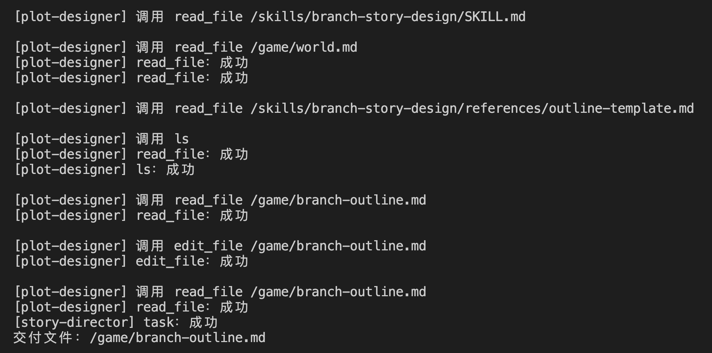

本次运行时，大纲已经存在，所以剧情设计师先读取，再通过 `edit_file` 修改，最后重新读取核对。文件尚未存在时，通常会使用 `write_file` 创建。

模型每次的具体调用顺序可能有差异，重复运行时也可能复用已有文件。

咱们需要检查的是：**总导演是否委派了任务，剧情设计师是否实际执行了文件操作，以及结果是否回到了总导演。**

最终大纲保存在本节项目的：`workspace/game/branch-outline.md`

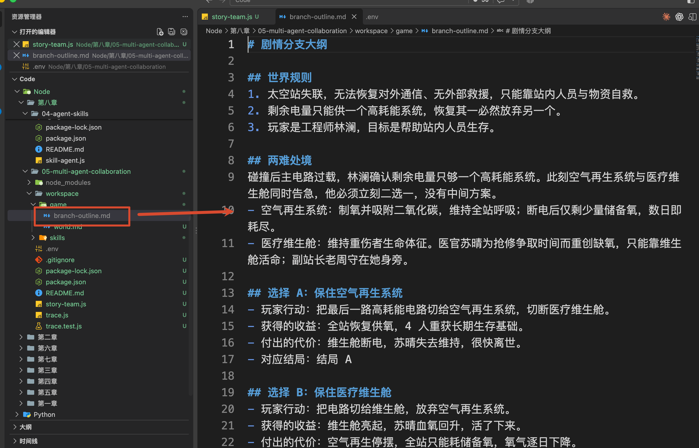

打开这个文件，可以看到具体的两难处境、玩家选择和结局。

## 从 main() 看任务怎样交给剧情设计师
刚才执行的 `npm run demo`，实际运行的是 `story-team.js`，入口仍然是文件底部调用的 `main()`。

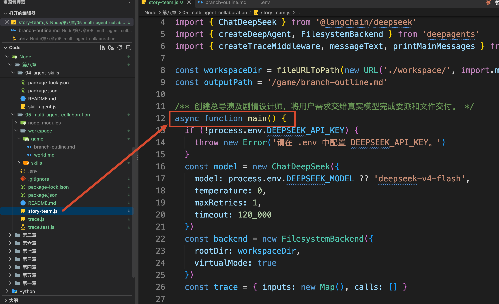

项目还有一个 `trace.js`，它使用第五章讲过的 Middleware 记录各个 Agent 的输入和工具调用。刚才带角色名称的日志来自这里，任务调度由 Deep Agents 完成。

接下来打开 `story-team.js`，顺着 `main()` 往下看。

### 先准备模型、工作区和剧情设计师
`main()` 先创建 `ChatDeepSeek` 和 `FilesystemBackend`。这两部分与上一节保持一致：

```javascript
// 初始化大语言模型，作为后续 Agent 的推理核心。
const model = new ChatDeepSeek({
    model: process.env.DEEPSEEK_MODEL ?? 'deepseek-v4-flash',
    temperature: 0,
    maxRetries: 1,
    timeout: 120_000
})

// 创建 Agent 使用的文件系统后端。
// Workspace 作为 Agent 的共享工作空间，用于保存世界观、Skill 和最终产物。
const backend = new FilesystemBackend({
    rootDir: workspaceDir,
    virtualMode: true
})
```

这里的 `workspaceDir` 指向本项目的 `workspace` 目录。Agent 看到的 `/game/world.md`，对应磁盘上的 `workspace/game/world.md`。

接着，`main()` 定义了 `plotDesigner`，也就是剧情设计师的配置，这个对象配置比较多，咱们只看一部分就可以：

```javascript
const plotDesigner = {
    name: 'plot-designer',
  // 描述当前子 Agent 的能力边界，
  // 帮助总导演判断什么时候应该调用该 Agent。
    description: '根据已有世界观设计剧情分支和不同结局，将 Markdown 大纲写入指定文件。',
  // 子 Agent 专属系统提示词。
  // 约束它的职责范围：读取世界观、使用 Skill、生成文件，而不是直接回答用户。
    systemPrompt: `你是互动剧情游戏的剧情设计师。
按照适用 Skill 完成收到的子任务，读取世界观并遵守其中的限制。
文件已经存在时，先读取，再根据本次任务决定修改或复用，完成后重新读取核对。
最终只返回交付文件路径和两个分支的简短说明，报告控制在 150 字以内，不要返回大纲全文。`,
  // isolated 表示该子 Agent 拥有独立执行环境。
  // 它有自己的上下文，不会直接共享主 Agent 的消息历史。
    mode: 'isolated',
    skills: ['/skills/'],
    // 文件权限与日志 Middleware 配置省略。
}
```

先看前三个字段。

+ `name` 用来确定这位设计师的身份，后面委派时会使用 `plot-designer` 找到它
+ `description` 给总导演看，说明这位设计师擅长什么，总导演才知道什么任务适合交给它
+ `systemPrompt` 则给剧情设计师自己看，告诉它接到任务以后应该怎样执行、怎样汇报
+ `mode: 'isolated'`。这个配置让子 Agent 使用独立的消息历史，记住：是独立的历史消息。也就是说 它有自己的上下文，不会直接共享主 Agent 的消息历史。
+ 最后的 `skills: ['/skills/']`，让剧情设计师能够发现上一节的剧情设计 Skill。自定义子 Agent 的 Skills 需要明确配置

代码还为剧情设计师配置了文件权限：允许写入 `/game/branch-outline.md`，其他文件保持只读。后面即使模型想修改世界观，也会受到文件工具权限的限制。

### 再把剧情设计师交给总导演
定义好 `plotDesigner` 以后，`main()` 继续调用 `createDeepAgent()` ，也就是 **总导演的 Agent**

```javascript
// 创建总导演 Agent。
// 总导演不负责具体创作，而负责理解需求、选择子 Agent、汇总结果。
const director = await createDeepAgent({
    name: 'story-director',
    model,
    backend,
    subagents: [plotDesigner],
    systemPrompt: `你是互动剧情制作的总导演。本次案例只负责委派和汇报。
使用 task 工具委派给 plot-designer。description 简洁保留用户的完整创作要求、世界观路径和交付文件路径。
剧情设计师会自行读取世界观和 Skill；你直接委派，无需调用文件工具，无需增加剧情细节或另一套设计步骤。
收到交付报告后，向用户简短说明交付位置和分支区别。`,
    permissions: [{ operations: ['write'], paths: ['/**'], mode: 'deny' }],
    // 日志 Middleware 配置省略。
})
```

其中，`subagents: [plotDesigner]` 就是本节最关键的配置。

Deep Agents 根据这份配置准备子 Agent，并向总导演提供一个叫作 `task` 的工具。总导演可以通过这个工具，把任务发送给指定的子 Agent。

所以，大家在代码里能找到 `subagents` 配置，在运行日志里能看到 `task`。这个工具由框架提供。

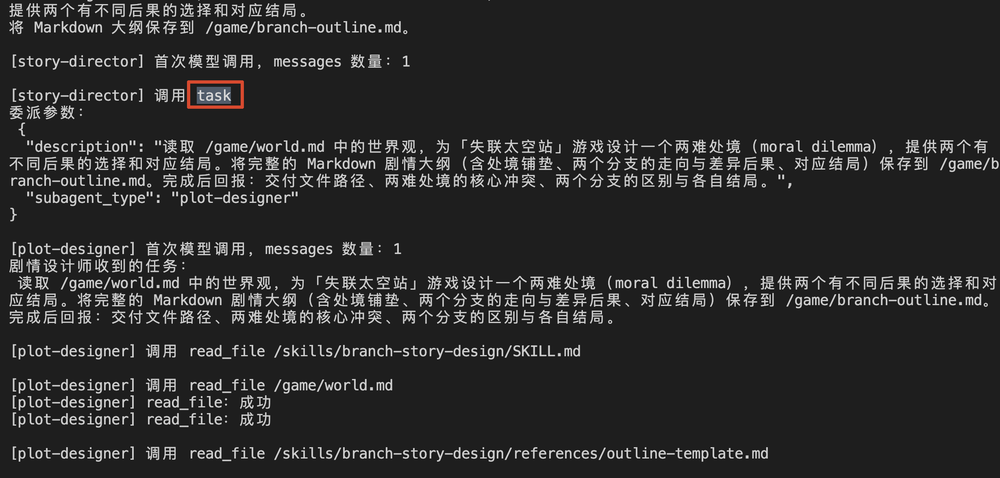

### 调用总导演，再由模型提出 task Tool Call
总导演创建完成以后，`main()` 把刚才的用户要求保存在 `userTask` 中，再调用 `invoke` 方法 ：

```javascript
// 用户真实提交给系统的任务。
// 总导演收到后，需要判断应该交给哪个子 Agent 完成。
const userTask = `请根据 /game/world.md，为失联太空站游戏设计一个两难处境，提供两个有不同后果的选择和对应结局。将 Markdown 大纲保存到 ${outputPath}。`
  
// 调用总导演 Agent。
// recursionLimit 控制最大递归调用次数，防止 Agent 无限循环。
// timeout 限制整个任务最长执行时间。
const result = await director.invoke(
    { messages: [{ role: 'user', content: userTask }] },
    { recursionLimit: 40, signal: AbortSignal.timeout(300_000) }
)
```

应用程序只从总导演这个入口提交任务。总导演看到用户要求、角色说明和可用工具以后，模型会决定是否调用 `task`。

本次日志中的“委派参数”，就是模型为 `task` 生成的参数。保留关键意思，可以简化成下面这样：

```javascript
{
    subagent_type: 'plot-designer',
    description: '根据 /game/world.md，为失联太空站设计一个两难处境、两个选择和对应结局，将大纲保存到 /game/branch-outline.md。'
}
```

`subagent_type` 对应前面配置的 `name`，决定任务交给谁。

`description` 是这一次具体要做的工作。

收到这次 Tool Call，Deep Agents 会找到 `plot-designer`，把任务说明作为它的输入消息，启动子 Agent 的执行。

因此，终端里会出现：

```latex
[plot-designer] 首次模型调用，messages 数量：1
剧情设计师收到的任务：
……刚才 task 参数中的 description……
```

这里统计的是子 Agent State 中的 `messages`，它的 System Prompt、工具定义和 Skill 描述还会在模型调用时一起提供。

接下来，剧情设计师按照自己的 Skill 读取世界观、设计分支、保存文件。这些文件操作会继续产生它自己的 `AIMessage` 和 `ToolMessage`，推动它完成这次子任务。

咱们把这一段执行关系连起来看，画个图，大概就是下面这样的

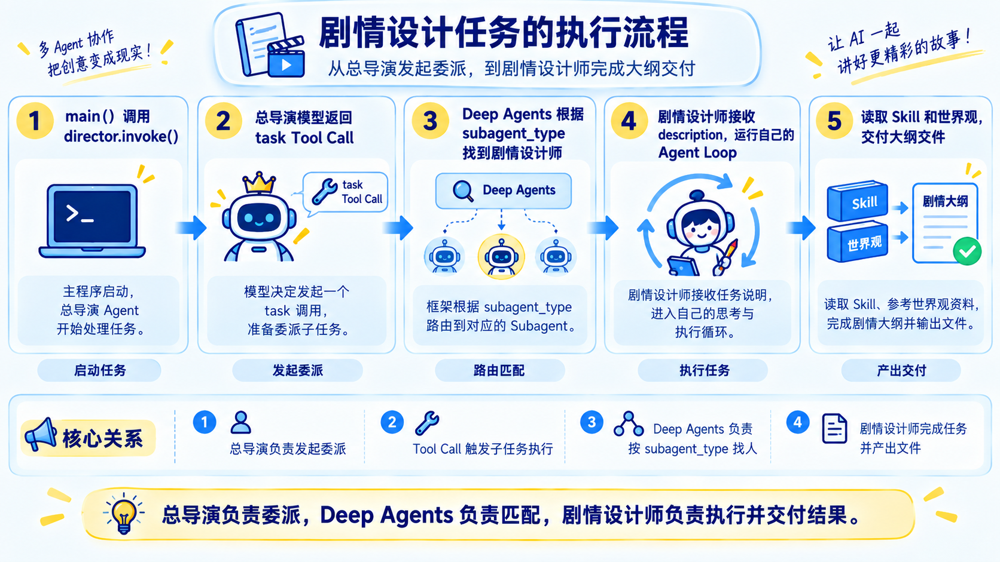

### 剧情设计师完成以后，总导演收到什么
剧情设计师读取并核对大纲以后，会生成最终回复，说明文件位置和两个分支的区别。

Deep Agents 会把这份回复作为 `task` 的工具结果，返回给总导演。

从总导演的角度看，就是自己调用的工具完成了，收到一条新的 `ToolMessage`。它再读取这份报告，决定下一步操作。

本案例只要求完成剧情设计，所以总导演随后向用户回复。完整项目里，它还可以继续委派场景编写或者审核任务。

现在回到终端，找到“总导演最终的 messages”。本次运行得到的是：

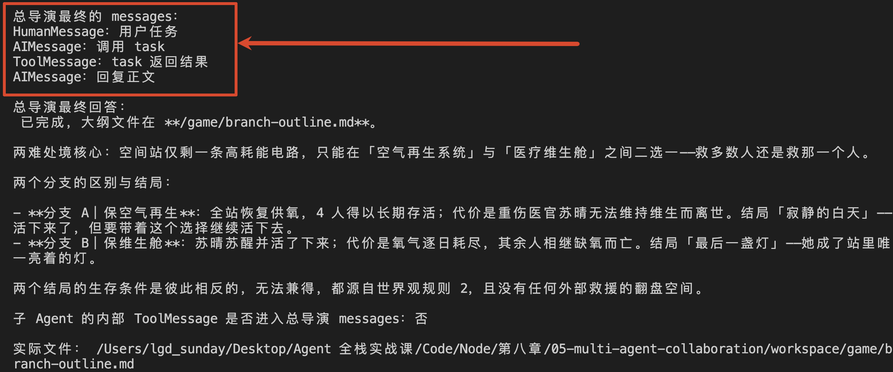

这里值得注意的是：剧情设计师读过 Skill、模板和大纲，但是总导演的这份消息列表里，只出现了 `task` 的返回结果。

**子 Agent 内部的文件读取记录保留在它自己的执行过程中；主 Agent 通过交付报告了解结果。** 这就是实际开发中消息隔离的对应表现。

总导演收到的报告如果很长，同样会占用很多上下文。所以代码专门要求剧情设计师简短汇报，把完整大纲留在 Workspace。

这就把前三节的内容连起来了：Skill 提供设计方法，Workspace 保存作品，Subagent 在独立的执行过程中完成设计，再把结果交回总导演～～

## 总结
这一节，咱们围绕“任务交出去以后，由谁继续负责”，认识了三种协作安排。

+ **Router** 先判断请求应该交给哪些处理者，适合分类明确的任务入口。
+ **Handoff** 改变当前负责交互的角色，让专业角色继续与用户沟通。
+ **Supervisor + Subagents** 保留主 Agent 负责总体任务，由子 Agent 完成具体工作，再把结果交回。

在代码中，咱们通过 `subagents` 配置剧情设计师。总导演调用 `task`，传入接收方和任务说明；剧情设计师使用自己的 Skill、消息历史和工具调用完成设计，把文件保存到 Workspace，再返回交付报告。

这样，具体设计过程可以留在子 Agent 中，总导演继续围绕整体任务推进了

下一小节，咱们继续解决：**子 Agent 交回的结果，怎样检查？如果发现问题，又该让谁修改、修改哪一部分？**

> 更新：2026-09-29 15:55 · 原文：<https://www.yuque.com/lgdsunday/ab1dy3/vwei1ro13l055svz>
