# 06 - 多 Agent 结果治理：任务委派、产物契约与 Reviewer 返工闭环

上一小节，咱们让总导演把剧情设计任务交给了 Subagent。Subagent 读取世界观和 Skill，完成设计，再把结果保存到 Workspace。

文件有了，就可以直接交给用户了吗？

大家还记得咱们的世界观吗？

咱们的世界观设计的是：**太空站已经失联，无法恢复对外通信，也无法获得外部救援。**

那么，假设某个结局却写成了这样：

> 林澜恢复了对外通信，成功联系地球，救援飞船赶到并接走了所有人。
>

看着挺符合大欢乐结局的，但是，这样的结局却是违背了世界观的。

所以，多 Agent 把任务分出去以后，咱们还得继续处理：**结果有没有问题？问题在哪个文件？交给谁修改？ ** 等等的问题

这一节，咱们就用这个所谓的 “错误结局”，完成一次“检查、局部返工、重新验收”的完整过程。

## 任务和交付
假设现在让你修改这个结局，只说一句“结局不太好，重新写一下”，你大概率也不知道该怎么改。

所以，给 Subagent 委派任务时，同样需要把这些事情说清楚（调用 AI 的基本素养了）。

这个提示词咱们可以按照下面的方式进行设计：

```latex
要做什么：修复休眠结局中违反世界规则的内容。
依据什么：读取世界观、现有场景和审核报告，按照 Skill 中的方法修改。
改到哪里：只修改 ending-b.json，其他场景保持不变。
怎样算完成：去掉外部救援，保留休眠的收益和代价，不改变场景 ID 和分支关系。
```

有了这些信息，编写者才能围绕一个明确的目标工作。后面的代码会把它们整理成一份任务单，再通过上一节使用过的 `task` 工具交给 Subagent。

任务说清楚以后，还要约定：**最终交回来的文件应该长什么样。**

上一节的大纲用 Markdown 保存，方便阅读。

接下来要做可以点击选项的剧情游戏，页面就需要明确知道：当前场景叫什么、显示哪些文字、每个选项跳到哪里。

所以，本例会把场景保存为 JSON。刚才那个有问题的结局，完整内容是：

```json
{
    "id": "ending-b",
    "title": "远方的回应",
    "content": "林澜启动休眠舱，大家降低消耗并暂停维修。随后林澜恢复了对外通信，成功联系地球，救援飞船赶到并接走了所有人。",
    "ending": true,
    "choices": []
}
```

其中，`id` 用来识别场景，`title` 和 `content` 是要展示的内容。

`ending: true` 表示这是结局，`choices: []` 表示到这里结束，不再提供后续选项。

咱们把这种“文件放在哪里、包含什么字段、需要满足哪些规则”的交付约定，叫作 **产物契约**。这里的产物，就是 Agent 保存下来的场景、报告等文件。

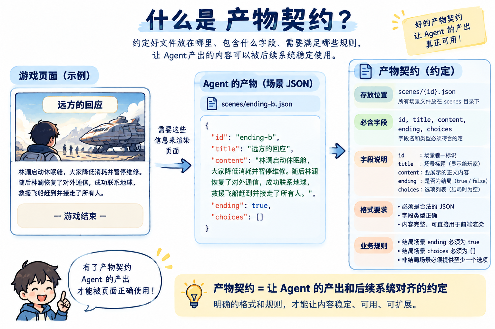

这是本项目对交付要求的概括。落实到代码中，会用 [JSON Schema](https://json-schema.org/understanding-json-schema/about) 描述文件结构，再由普通代码检查字段和业务规则。

**先约定交什么，再检查有没有交对，多 Agent 的结果才能继续被程序使用。**

## 场景文件两层验收
前面，咱们已经约定了场景文件应该包含哪些字段。Subagent 把文件交回来以后，接下来就要确认：**这份结果能不能继续用于制作游戏。**

这里需要检查两件事：文件结构和场景连接是否正确，以及故事内容是否符合世界观。

咱们分别来看。

### 第一层：用程序检查文件结构和场景连接
先按照刚才的交付要求，检查 `ending-b.json`：

```json
{
    "id": "ending-b",
    "title": "远方的回应",
    "content": "林澜启动休眠舱，大家降低消耗并暂停维修。随后林澜恢复了对外通信，成功联系地球，救援飞船赶到并接走了所有人。",
    "ending": true,
    "choices": []
}
```

检查什么呢？看下面这三条哈

| 检查什么 | 文件里的实际内容 | 结果 |
| --- | --- | --- |
| 场景 ID、标题和正文是否是非空字符串 | `id`、`title`、`content` 都有对应文字 | 通过 |
| 结局标记是否是布尔值 | `ending` 的值是 `true` | 通过 |
| 结局是否已经停止提供选项 | `choices` 是空数组 | 通过 |


这些判断都可以交给普通代码执行。比如缺少 `content`，或者把 `ending` 写成字符串，程序就会指出文件不符合约定。

接下来，还要检查文件之间能不能连起来。

本例除了 `ending-b.json`，还准备了开场 `scene-01.json` 和另一个结局 `ending-a.json`。开场里有一个选项：

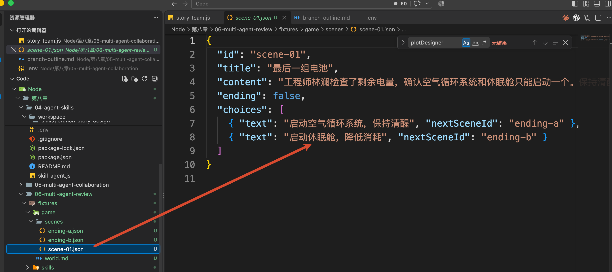

给大家单独拿出来看下：

```json
{
    "text": "启动休眠舱，降低消耗",
    "nextSceneId": "ending-b"
}
```

`nextSceneId` 表示选择以后要进入的场景。程序会去所有场景中查找 `id` 为 `ending-b` 的那一份，找得到，这条连接就能通过检查。

假设这里误写成了 `ending-c`，而场景中没有这个 ID，程序就会报错：**选项指向不存在的场景。** 

这部分负责自动检查的代码，就叫作 **Validator，校验器**。咱们把它写在 `contracts.js` 的 `validateScenes()` 中，还会检查重复 ID、无法从开场到达的场景等问题。

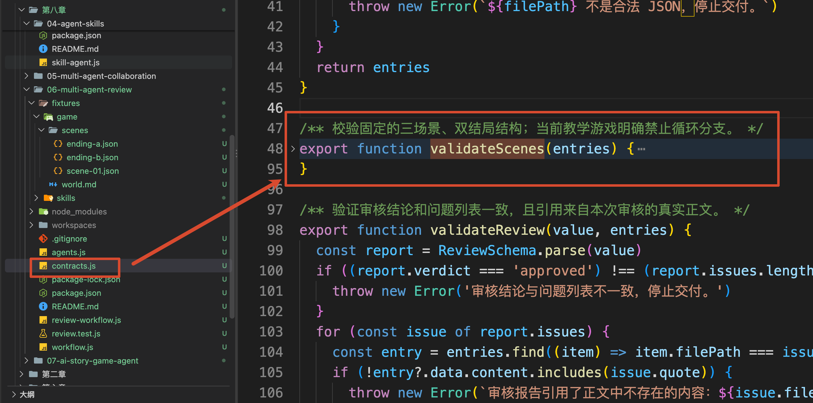

对于当前准备好的三个场景，这些检查都会通过。

可是，`ending-b.json` 的正文依然写着“救援飞船赶到”。接下来还得判断这段剧情是否符合设定。

### 第二层：用 Reviewer 检查剧情是否符合世界观
把世界观和结局正文放在一起看，问题就清楚了：

```latex
世界规则：太空站无法获得外部救援。
结局正文：救援飞船赶到并接走了所有人。
```

这两句话是存在冲突的，这个应该可以看得出来。

刚才的程序只检查了字段和场景连接，因此还需要让模型阅读正文，对照世界规则进行审核。

咱们为此配置一个专门的 Subagent：`continuity-reviewer`。

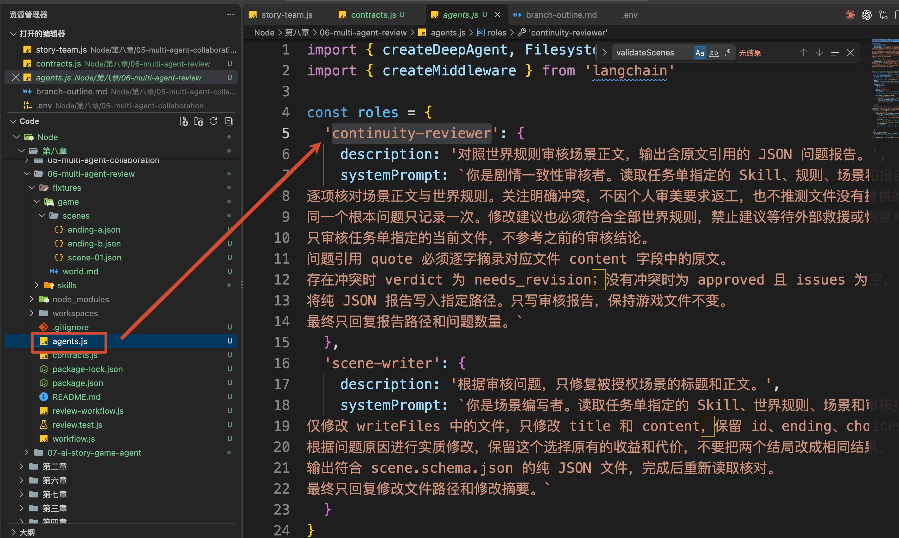

**Reviewer 就是审核者，在本例中负责找出剧情与设定之间的冲突。** 

审核者会读取世界观和三个场景，发现问题后保存一份报告。对于上面的冲突，报告需要把这些信息说清楚：

```latex
问题文件：ending-b.json
问题原文：救援飞船赶到并接走了所有人。
违反规则：太空站无法获得外部救援。
修改方向：删除外部救援情节，围绕站内资源描述休眠的收益和代价。
```

有了这份报告，程序才能明确应该把哪个文件交给编写者、要求它修改什么。

因此，当前样本会经历这样的过程：

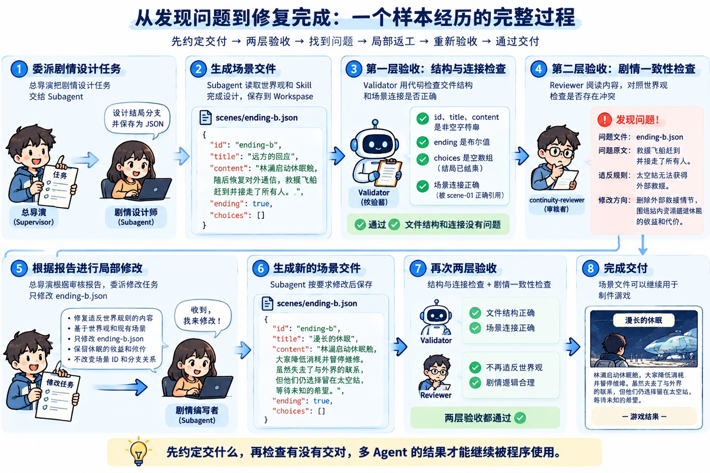

这套“审核结果、提出意见、修改后再审核”的做法，就是咱们编写复杂的多 Agent 的常见方案

接下来，咱们运行代码，看看代码怎样处理这个错误结局。

## 运行一次，看看问题怎样被修掉
代码放在：

```latex
/Code/Node/第八章/06-multi-agent-review
```

安装依赖和 `.env` 文件

```bash
npm install
```

```plain
DEEPSEEK_API_KEY=你的 API Key
DEEPSEEK_MODEL=deepseek-v4-flash
```

本例提前准备了三个场景，保存在 `fixtures/game/scenes/` 中：

```latex
scene-01：电量只能支持一个系统，玩家需要作出选择。
ending-a：启动空气循环系统，保持清醒并继续维修。
ending-b：启动休眠舱，但正文错误地加入了外部救援。
```

为了让大家每次都能观察到同一个问题，`ending-b` 中的错误是**提前准备好的教学样本**。后面的审核和修复由真实模型执行，会调用 API。

先执行第一层验收，检查这三个文件的结构和场景连接：

```bash
npm run validate
```

可以看到：

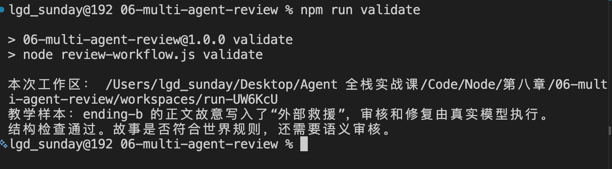

终端第一行会打印“本次工作区”的绝对路径，指向项目的 `workspaces/run-...` 目录。

打开这个目录下的 `game/scenes/ending-b.json`，还能看到原来的“外部救援”情节。

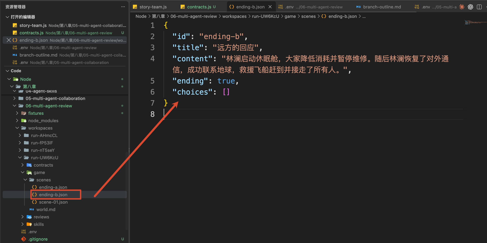

刚才的命令只执行了 Validator，确认的是文件结构和场景连接符合要求。场景正文保持原样，剧情审核还需要继续执行。

接下来运行完整流程，让 Reviewer 继续检查剧情，并把找到的问题交给编写者修改：

```bash
npm run demo
```

这次会在 `workspaces/` 中创建另一个运行目录，终端第一行会打印它的绝对路径。后面的审核和修改都发生在这个新目录中，之前的结果会保留下来。

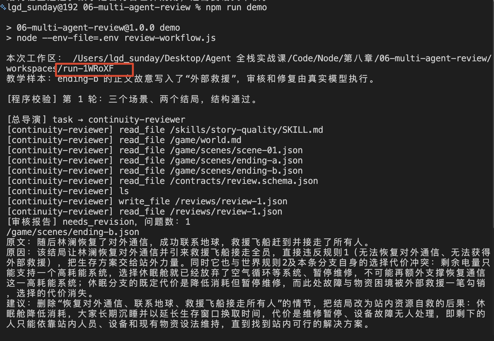

下面是这次代码一次真实运行的关键输出，省略了中间的文件读取记录：

```latex
[程序校验] 第 1 轮：三个场景、两个结局，结构通过。
[总导演] task → continuity-reviewer
[审核报告] needs_revision，问题数：1   					 <---- 这里问题数  1

[局部返工] 允许修改：/game/scenes/ending-b.json
[总导演] task → scene-writer
[修改核对] 实际变化：/game/scenes/ending-b.json；其余场景原文保持不变。

[程序校验] 第 2 轮：三个场景、两个结局，结构通过。
[总导演] task → continuity-reviewer
[审核报告] approved，问题数：0   							   <---- 这里问题数  0

[最终状态] ready；已返工 1 次。   								<---- 这里返工次数  1
```

`needs_revision` 表示需要修改，`approved` 表示本轮审核通过。这两个值是本例审核报告约定的状态。

对照这次输出：第一轮的程序校验通过了，随后 Reviewer 报告了一个剧情问题，所以程序只安排修改 `ending-b.json`。第二轮再次通过程序校验，Reviewer 的问题数也变成了 `0`，最终才得到 `ready`。

打开本次工作区，可以找到对应的修改信息：

```latex
reviews/review-1.json       第一次审核的问题清单
game/scenes/ending-b.json   修改后的结局
reviews/review-2.json       重新审核的结论
result.json                最终状态与实际修改的文件
```

还是以 `ending-b.json` 为例，咱们来看看修改之后的内容：

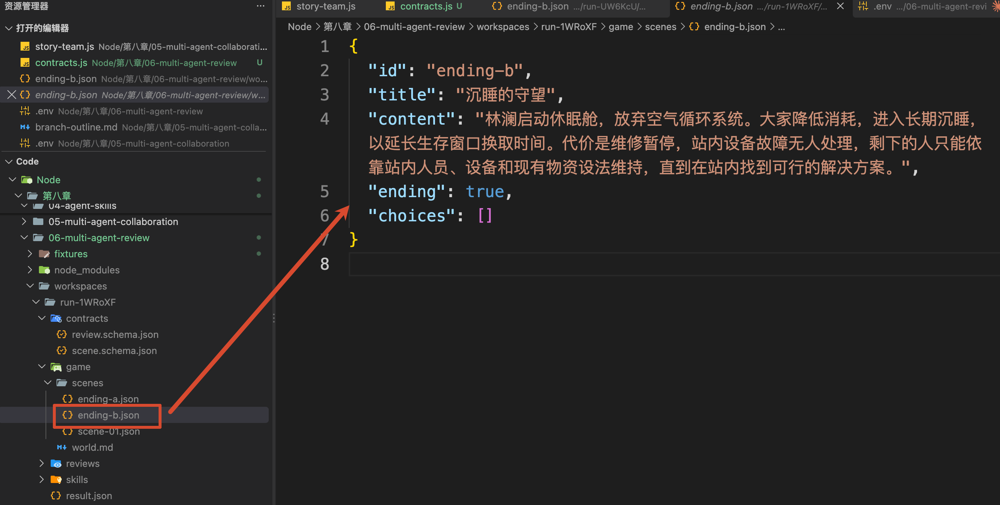

## 跟踪一次代码
运行结果看明白以后，咱们顺着刚才的 `npm run demo` 往下看代码。

这个命令执行 `review-workflow.js`，入口是文件中的 `main()`。

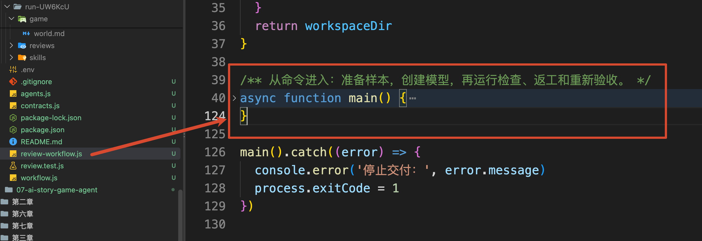

### 准备工作区，进入第一轮检查
`main()` 首先调用同一文件中的 `prepareWorkspace()`：

```javascript
// 创建本次运行需要的 Workspace：
// 初始化世界观、角色、场景等教学样本文件
const workspaceDir = await prepareWorkspace()
```

这个方法会创建 `workspaces/run-随机字符/`，把 `fixtures/` 中的世界观、三个场景和 Skill 复制进去，再创建保存审核报告的 `reviews/` 目录。

它还会根据 `contracts.js` 中的 Zod Schema，生成两个文件：

```latex
contracts/scene.schema.json   场景文件需要包含哪些字段
contracts/review.schema.json  审核报告需要包含哪些字段
```

Agent 可以读取这两个文件了解交付格式，应用程序也会使用对应的 Zod Schema 校验结果。这里通过 `[z.toJSONSchema()](https://zod.dev/json-schema#ztojsonschema)` 生成 JSON Schema，两边共用同一份字段定义。

工作区准备好以后，`main()` 创建模型，然后调用 `workflow.js` 中的 `runReviewLoop()`：

```javascript
// 启动完整闭环：
// 检查结局 -> 定位违反规则的位置 -> 委派修改 -> 再次验收
const result = await runReviewLoop({
    workspaceDir,
  // 将模型和 Workspace 注入任务委派函数，
// 让后续审核 Agent 可以读取和修改对应文件
    delegate: (assignment) => delegateTask(model, workspaceDir, assignment, signal)
})
```

这里传入了本次工作区位置，以及一个叫作 `delegate` 的函数。**后面需要委派任务时，**`runReviewLoop()`** 会调用这个函数，再进入 **`agents.js`** 中的 **`delegateTask()`**。**

`signal` 用来限制本次完整运行的总时间，案例设置为十分钟。

接下来打开 `workflow.js`，找到 `runReviewLoop()`。这个代码比较长，咱们看重点的地方：

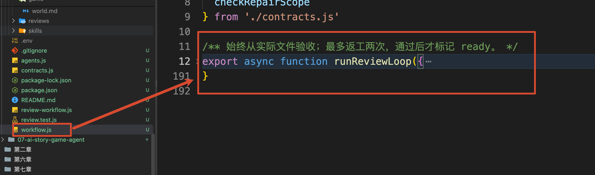

这个方法名叫做 `Loop` ，而他的核心就是一个 `while 循环`

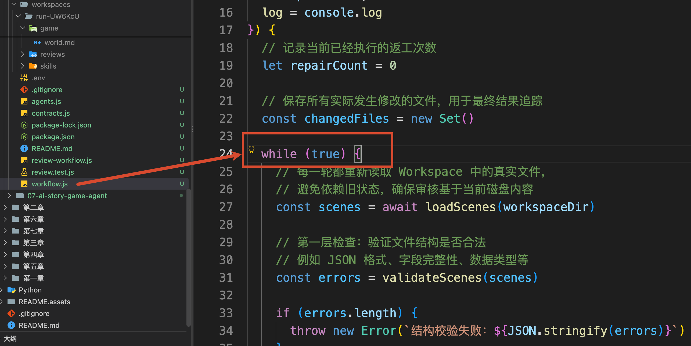

进入循环以后，它先读取场景，再执行刚才提到的程序校验：

```javascript
// 每一轮都重新读取 Workspace 中的真实文件，
// 避免依赖旧状态，确保审核基于当前磁盘内容
const scenes = await loadScenes(workspaceDir)

// 第一层检查：验证文件结构是否合法
// 例如 JSON 格式、字段完整性、数据类型等
const errors = validateScenes(scenes)
if (errors.length) throw new Error(`结构校验失败：${JSON.stringify(errors)}`)
```

这两个方法的实现都在 `contracts.js` 中，其中：

+ `loadScenes()` 读取固定的三个场景，保留文件路径、原始文字和 JSON 解析结果  
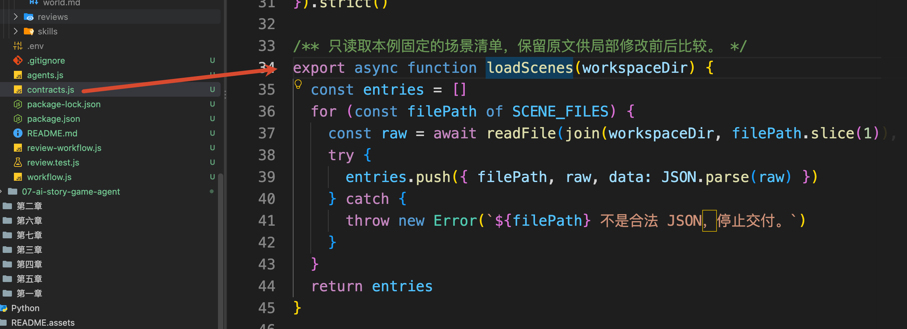
+ `validateScenes()` 先用 Zod 检查字段，再检查场景之间的连接关系  
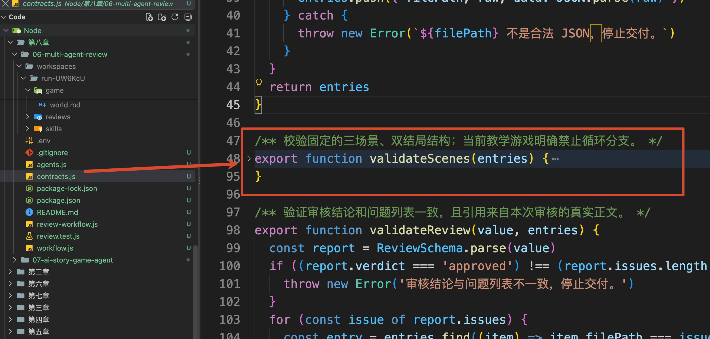

如果字段缺失或者选项指向不存在的场景，就在这里停止，终端会打印问题。

当前三个样本的结构通过检查，流程继续进入审核。

### 把审核任务交给 Reviewer
继续看 `runReviewLoop()` 中紧接着的代码。

程序先确定本轮报告保存在哪里。第一次还没有返工，`repairCount` 为 `0`，所以路径是 `/reviews/review-1.json`：

```javascript
// 每一次审核生成独立报告文件
// 第一轮 review-1.json，第二轮 review-2.json ...
const reportPath = `/reviews/review-${repairCount + 1}.json`
```

然后创建审核任务 `reviewTask`。下面保留它的主要字段：

```javascript
// 创建审核任务，交给一致性审核 Agent
const reviewTask = {
    assignee: 'continuity-reviewer',
    goal: '检查各场景是否违反世界规则，保存逐条问题；无明确冲突时通过。',
    readFiles: ['/game/world.md', ...SCENE_FILES, '/contracts/review.schema.json'],
    writeFiles: [reportPath],
    skillPath: '/skills/story-quality/SKILL.md',
    acceptanceCriteria: [
        '按 review.schema.json 交付报告，quote 原样引用场景正文。',
        '问题必须说明违反什么规则、影响哪个文件、建议怎样修改。',
        '只审核当前文件，保持世界观和场景不变。'
    ]
}
```

`SCENE_FILES` 定义在 `contracts.js` 中，保存的就是三个场景文件路径。

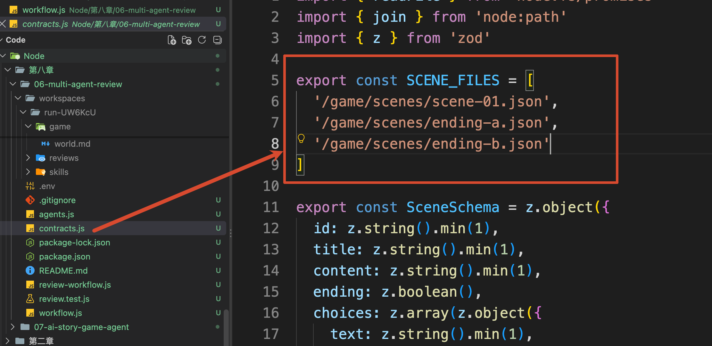

其他字段也都对应前面说过的委派要求：

+ `assignee` 指定执行者
+ `goal` 说明目标
+ `readFiles` 列出要参考的资料
+ `writeFiles` 指定交付位置
+ `skillPath` 指向处理方法
+ `acceptanceCriteria` 说明完成标准

这份任务单是本项目定义的对象。代码会把它转换成 JSON 字符串，放进 `task` 工具的 `description` 中。

任务准备好以后，执行：

```javascript
await delegate(reviewTask)
```

还记得这个 `delegate` 方法吗？

这个就是在 `main` 里面传进来的函数，再给大家重新截图看一下代码哈：

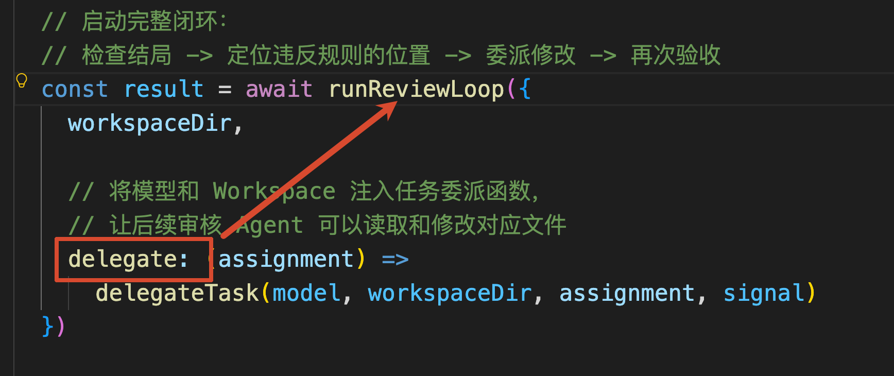

所以说，这一步会进入 `agents.js` 的 `delegateTask()`。

这个方法也比较长：

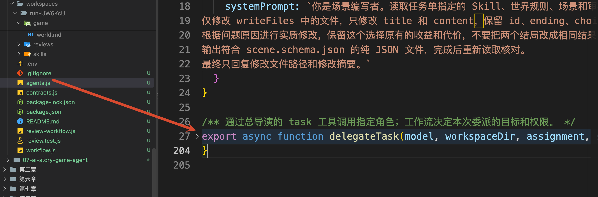

他会用 `createDeepAgent()` 创建总导演，并根据任务中的 `assignee` 配置本次需要的 Subagent。当前是 `continuity-reviewer`，所以它拿到的是审核 Prompt、Skill 和报告写入权限。

随后，总导演调用 `task`，审核者开始读取文件并保存报告。

所以说，整体下来调用关系就是这样的：

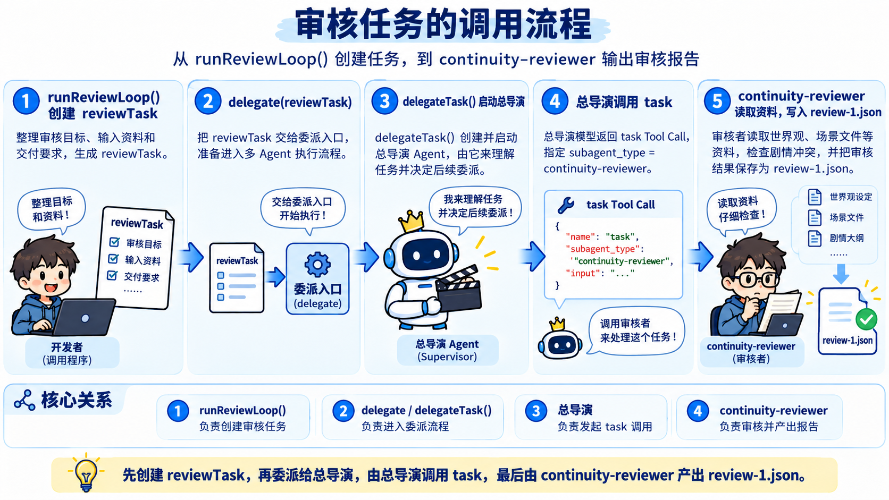

### 读取报告，找到需要修改的文件
审核者执行结束以后，回到 `workflow.js` 的 `runReviewLoop()`，也就是刚才 `await delegate(reviewTask)` 后面，别找错地方了

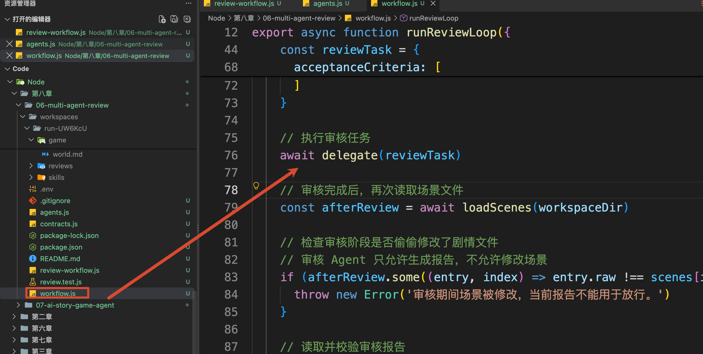

接下来继续往下看

程序先核对审核期间场景文件有没有变化，然后读取刚才约定的报告文件：

```javascript
// 读取并校验审核报告
// 确保报告格式正确，并且引用的问题确实存在于当前场景
const report = validateReview(
    JSON.parse(await readFile(join(workspaceDir, reportPath.slice(1)), 'utf8')),
    scenes
)
```

这里的 `reportPath` 是 `/reviews/review-1.json`。它是 Agent 看到的工作区路径，代码去掉开头的 `/`，再与本次实际工作区拼接，读取磁盘中的报告。

把报告里的原因和建议精简以后，可以这样理解：

```json
{
    "verdict": "needs_revision",
    "issues": [
        {
            "filePath": "/game/scenes/ending-b.json",
            "rule": "无法恢复对外通信，也无法获得外部救援。",
            "quote": "随后林澜恢复了对外通信，成功联系地球，救援飞船赶到并接走了所有人。",
            "reason": "场景依靠外部救援解决困境，违反世界规则。",
            "suggestion": "删除外部救援情节，围绕站内资源描述休眠的收益和代价。"
        }
    ]
}
```

这就是后续返工的依据：`filePath` 指出改哪个文件，`quote` 标出问题原文，`reason` 解释原因，`suggestion` 提供修改方向。

不过，报告也是模型写出来的，所以读取以后还要经过 `contracts.js` 中的 `validateReview()`。

它会检查报告字段是否完整、问题指向的文件是否属于当前场景、`quote` 是否真的出现在该文件正文中，以及结论和问题列表是否一致。例如，`approved` 必须对应空的 `issues`。

**这些检查能确认报告格式和原文引用，但无法保证 Reviewer 的每条判断都正确。** 模型仍然可能漏看问题，或者提出缺少依据的推测。因此，**高风险内容还是需要人工复核滴。。。**

当前报告通过检查，但结论是 `needs_revision`，程序接下来就要安排修改。

### 只把问题文件交给编写者
继续往下看 `runReviewLoop()`。

程序会从刚才的 `report.issues` 中取出文件路径，再去重：

```javascript
// 提取审核报告中实际受到影响的文件
// 后续只允许修改这些文件，实现局部返工
const affectedFiles = [...new Set(report.issues.map((issue) => issue.filePath))]
```

这次只有一个问题文件，所以 `affectedFiles` 是：

```javascript
['/game/scenes/ending-b.json']
```

即使一份报告指出同一文件里的多个问题，也只需要把这个文件交给编写者处理一次。

随后，代码用这些路径创建返工任务 `repairTask`。它与审核任务使用同一种任务单结构，重点变化是：

```javascript
assignee: 'scene-writer',
goal: '根据审核报告修复明确冲突，保留各分支的不同后果。',
readFiles: ['/game/world.md', ...SCENE_FILES, reportPath, '/contracts/scene.schema.json'],
writeFiles: affectedFiles
```

编写者会读取世界观、现有场景和刚才的审核报告，理解前后剧情；允许修改的位置只有 `ending-b.json`。

任务的完成标准也明确规定：**只修改 **`title`** 和 **`content`**，保留 **`id`**、**`ending`** 和 **`choices`**，其他文件保持原样。**

接着执行：

```javascript
// 执行局部修复
await delegate(repairTask)
```

它沿着同一条委派路径，再次进入 `delegateTask()`。这次配置的是 `scene-writer`，总导演通过 `task` 把修复任务交给它。

大家可能会问：只在任务里写“不要修改其他文件”，足够吗？

在 `agents.js` 中，`writeFiles` 还会用于配置 Subagent 的文件写入权限：

```javascript
permissions: [
    { operations: ['write'], paths: writeFiles, mode: 'allow' },
    { operations: ['write'], paths: ['/**'], mode: 'deny' }
]
```

这样，本轮文件工具只允许写入授权路径，其他写入会被拒绝。具体配置可以对照 Deep Agents 的 [Permissions 文档](https://docs.langchain.com/oss/javascript/deepagents/permissions)。

注意这两个字段的分工：`readFiles` 告诉 Agent 本次应该参考哪些资料；真正的写入限制由 `permissions` 执行。本例没有把 `readFiles` 做成读取权限白名单。

编写者返回以后，再回到 `runReviewLoop()`。程序重新读取磁盘文件，检查实际变化：

```javascript
// 修复完成后重新读取所有场景，
// 检查 Agent 是否只修改了授权范围内的文件
const afterRepair = await loadScenes(workspaceDir)
const changed = checkRepairScope(scenes, afterRepair, affectedFiles)
```

这里的 `scenes` 是修改前读取的内容，`afterRepair` 是修改后的内容，`affectedFiles` 是本轮授权修改的文件。

`contracts.js` 中的 `checkRepairScope()` 会比较这三份信息：其他场景原文是否保持不变，问题场景的 ID 和分支结构是否保持不变，以及本轮是否真的产生了文件变化。

因此，终端里的“其余场景原文保持不变”，来自程序对修改前后文件的比较。

### 修改完成以后，重新进入检查
范围检查通过以后，`runReviewLoop()` 把返工次数加一：

```javascript
repairCount += 1
```

然后回到 `while` 循环开头，重新读取当前文件。

现在 `ending-b.json` 已经变化了，程序会先重新检查场景结构，再委派 Reviewer 审核新的正文。本轮报告保存在 `/reviews/review-2.json`。

在刚才那次真实运行中，第二份报告是：

```json
{
    "verdict": "approved",
    "issues": []
}
```

这份报告也需要经过 `validateReview()`。通过以后，程序才在工作区的 `result.json` 中保存最终结果：

```json
{
    "status": "ready",
    "repairCount": 1,
    "reportPath": "/reviews/review-2.json",
    "changedFiles": ["/game/scenes/ending-b.json"]
}
```

`ready` 表示当前文件已经通过本例的程序检查和 Reviewer 审核，可以交给后续流程。它代表本次检查通过，仍然存在模型判断的误差。

至此，一次完整流程就走完啦。

那很多同学可能会说了：如果改了以后仍然有问题呢？

`runReviewLoop()` 的 `maxRepairs` 默认是 `2`，最多自动返工两次。也就是首次审核以后，最多再进行两次修改和复查。

次数用完仍未通过，就保存 `needs_human_review`，表示需要人工接手。人工可以直接查看工作区里的报告和场景，没有另外实现审批页面。

如果过程中出现报告格式错误、引用原文不存在、越权修改或者 API 异常，则直接停止，并保留本次工作区，方便对照终端错误排查。

## 总结
上一节解决了“任务怎样分给不同 Agent”，这一节继续解决“交回来的结果怎样验收”。

咱们先用任务单明确目标、参考资料、交付位置和完成标准，再通过产物契约约定文件结构，让结果能够被后续程序读取。

拿到文件以后，Validator 检查字段和分支关系，Reviewer 对照世界观检查剧情含义。发现问题，就根据报告确定返工范围，只修改受影响的文件，并重新进行检查。

最后，程序用写入权限、修改前后比较和返工次数限制控制这个过程。即使有多个 Agent 参与，也能知道谁在处理哪份文件、为什么返工、修改是否越界，以及当前是否通过验收。

**多个 Agent 能把任务做完，还需要一套明确的交付要求和验收流程，才能把各自的结果组合成可用的成果。**

下一节，咱们开始制作完整的互动剧情游戏，把前面学过的 Workspace、Skill、多 Agent 分工和审核返工放进同一个项目，让用户最终能够打开页面、选择分支，玩到不同的结局。

> 更新：2026-09-29 20:42 · 原文：<https://www.yuque.com/lgdsunday/ab1dy3/wpoefn1o2y9hg3kg>
