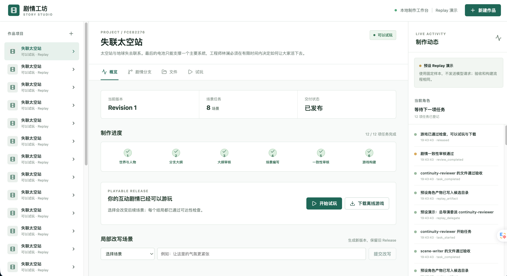

# 07 - 实战（上）：AI 互动剧情游戏制作 Agent 的项目演示、运行与需求分析

前面几节，咱们分别让 Agent 把资料保存在 Workspace，按需读取 Skill，把工作交给不同的 Subagent，再检查交回来的场景有没有违反世界规则。

不过，到目前为止，咱们看到的还是一段剧情大纲、几个 JSON 文件和一次返工。

那么，**这些文件最后能做成什么呢？**

这一节，咱们就开始搞这个：**AI 互动剧情游戏制作 Agent**。

你给出一个故事创意，系统组织世界观设计师、剧情策划、场景编剧和一致性审核者完成制作。你负责审核大纲，最后拿到一部可以亲自选择分支、走向不同结局的网页游戏。

先把项目跑起来，看一遍结果

## 项目如何运行
本项目代码在：`Code/Node/第八章/07-ai-story-game-agent`。后面的 08～10 小节也会继续使用这个项目。

 Node 要在 22 以上，**别忘了打开 Docker**，在这个项目目录执行：

```bash
npm install
docker compose up -d --wait
npm run dev
```

配置 `.env` 文件

```plain
DEEPSEEK_API_KEY=你的 DeepSeek API Key
DEEPSEEK_MODEL=deepseek-v4-flash
```

浏览器打开：

```latex
http://localhost:5183
```

应该就可以看到这样的页面了：



那么接下来咱们来看看这个项目到底都有哪些功能？

[此处为语雀卡片，点击链接查看](https://www.yuque.com/lgdsunday/ab1dy3/oqwywxgev21g4klk#HYETR)

## 总结
这一节，咱们把整个项目跑了一遍。

那么下一节咱们就从“开始制作”按钮进入代码，追踪这个请求怎样创建项目和 Workspace，又怎样启动第一个角色任务的～

> 更新：2026-10-02 15:06 · 原文：<https://www.yuque.com/lgdsunday/ab1dy3/oqwywxgev21g4klk>
