# 08 - 实战（中一）：创建 Workspace、加载 Skills 并启动剧情总导演

上一小节，咱们已经把 AI 互动剧情游戏制作 Agent 运行起来了。

用户填写故事要求，点击“开始制作”，系统就会陆续设计世界观、人物和剧情大纲。制作过程中，页面还能看到角色的执行记录，以及它们保存下来的文件。

那么，这些角色是怎样启动的？它们去哪里读取用户要求，又怎么知道应该按照哪个 Skill 工作呢？

这一小节，咱们就从“开始制作”按钮进入代码，一直追到总导演发出第一份角色任务。

## 从点击“开始制作”开始
在页面点击“新建作品”，选择 AI 模式，填写故事要求（还是用太空站的这个就行），再点击表单中的“开始制作”。

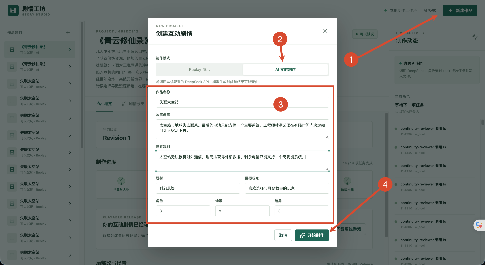

按钮会执行 `App.vue` 中的 `create()` ，关键代码是：

```typescript
const created = await request<Project>('', {
  method: 'POST',
  body: JSON.stringify(draft.value)
})

showCreate.value = false
await selectProject(created.id)
```

这里的 `draft.value` 就是用户正在填写的表单。里面保存了故事名称、故事设定、世界规则、角色数量、场景数量和运行模式等信息。

接口会请求到：

```http
POST /api/projects
```

这个请求进入 `story.controller.ts` 的 `StoryController.create() 方法：

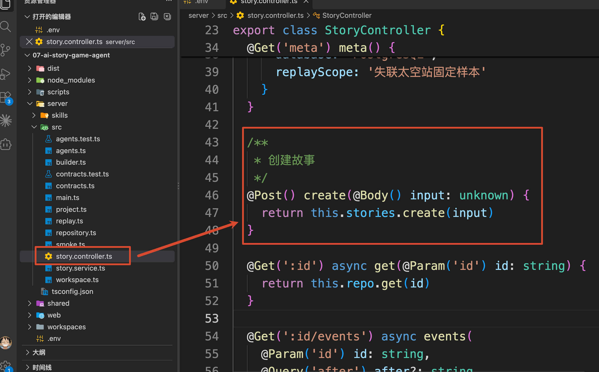

Controller 把表单数据交给了 `this.stories.create()`。这里的 `stories` 就是 `StoryService`，所以接下来打开 `story.service.ts`，找到 `create()` 方法。

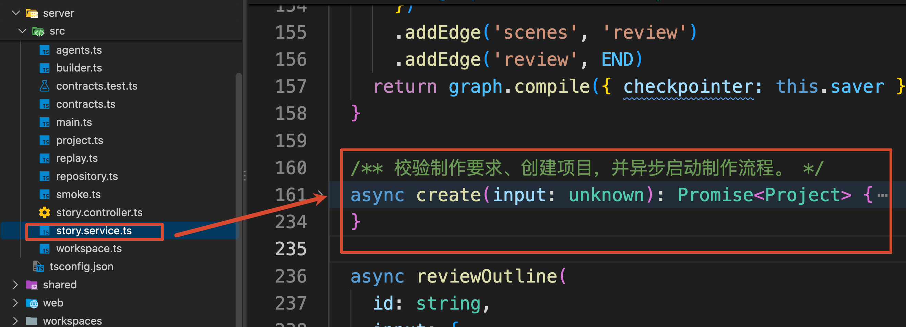

方法一开始，先校验制作要求，再生成项目 ID：

```typescript
// 校验并解析输入；不符合 Schema 的数据会直接抛出异常。
const brief = BriefSchema.parse(input)

// 中间还有 Replay 预设要求的校验，这里先跟踪 AI 分支。
const id = randomUUID()
```

`brief` 表示校验后的制作要求。比如角色数量、场景数量是否在项目支持的范围内，都会在这里检查。

接着，代码创建 `project` 对象，这个对象属性特别多，放的主要是用户填写的制作。后面再启动 Agent，根据这些要求生成世界观、人物和剧情大纲。

咱们这里只看与当前流程有关的字段，大致可以简化成这样：

```javascript
const project = {
  id,                  // 本次作品的唯一 ID
  revision: 1,         // 从第一版制作内容开始
  mode: brief.mode,    // 当前是 ai
  brief,               // 用户提交的制作要求
  status: 'queued',    // 等待启动
  world: null,
  characters: null,
  outline: null,
  tasks: []
}
```

继续往下看，`create()` 最后的调用顺序是：

```typescript
// 根据项目 ID、初始版本和制作要求，准备工作区。
await this.workspace.prepare(id, 1, brief)
// 保存项目初始记录，确保后续制作流程可以读取项目。
await this.repo.create(project)
// 发送创建事件，说明本次使用的是预设演示还是 AI 真实制作。
await this.emit(id, 'created', `${brief.mode === 'replay' ? 'Replay 预设演示' : 'AI 真实制作'}已开始`)
// 将制作流程安排到后续事件循环执行，不在这里等待制作完成。
// void 表示忽略 run 返回的 Promise，并不负责捕获异步异常。
setImmediate(() => void this.run(id, { projectId: id }))
// 返回刚创建的项目，调用方无需等待完整制作流程结束。
return project
```

先准备工作区，再保存项目，最后安排制作流程开始执行。

这里 **第一行就用到了 Workspace，** 咱们先看这个地吗

## 先把制作要求和 Skills 放进 Workspace
`this.workspace.prepare()` 对应 `workspace.ts` 中的 `WorkspaceService.prepare()`。

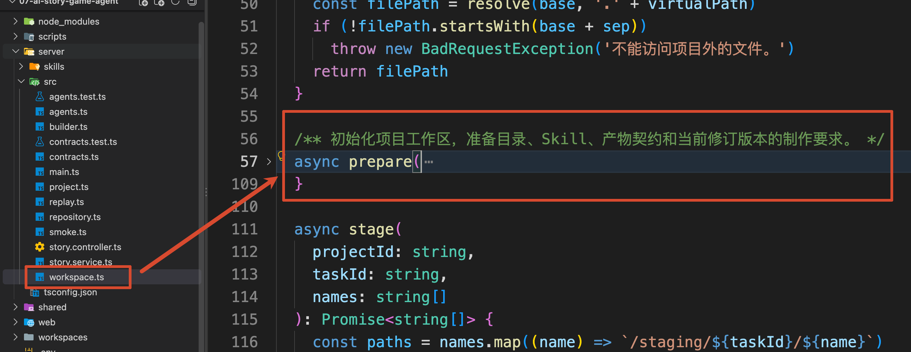

它接收刚才生成的项目 ID、版本号 `1` 和制作要求 `brief`，为这部作品准备一个真实的文件目录：

```latex
07-ai-story-game-agent/workspaces/{projectId}/
```

每次新建作品都会生成新的 `projectId`，因此不同作品会放在不同目录里。这个 ID 就是创建接口用的 `id`

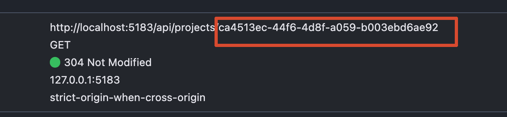

可以在浏览器开发者工具的 Network 面板中查看该请求的响应。

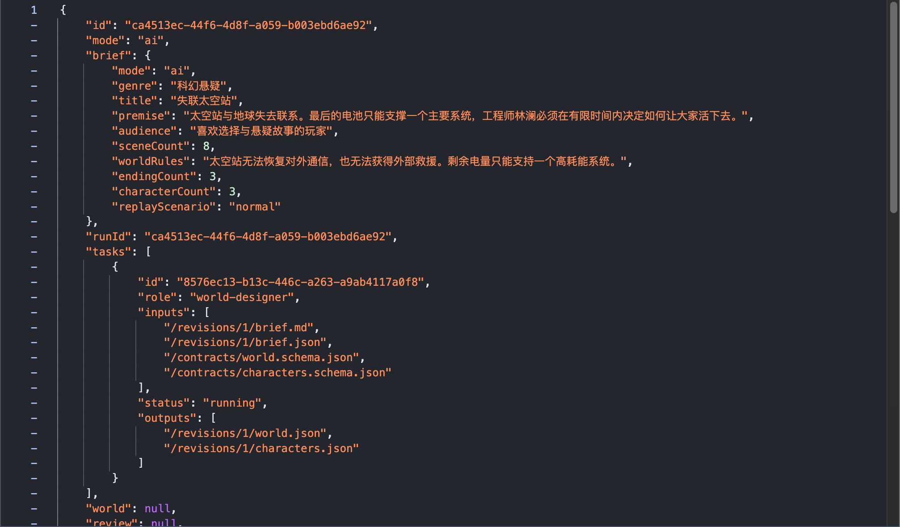

这个相应的内容比较多，里面会涉及到很多很多的信息，而这些信息也会被全部保存到 `07-ai-story-game-agent/workspaces/{projectId}/` 这个路径里面

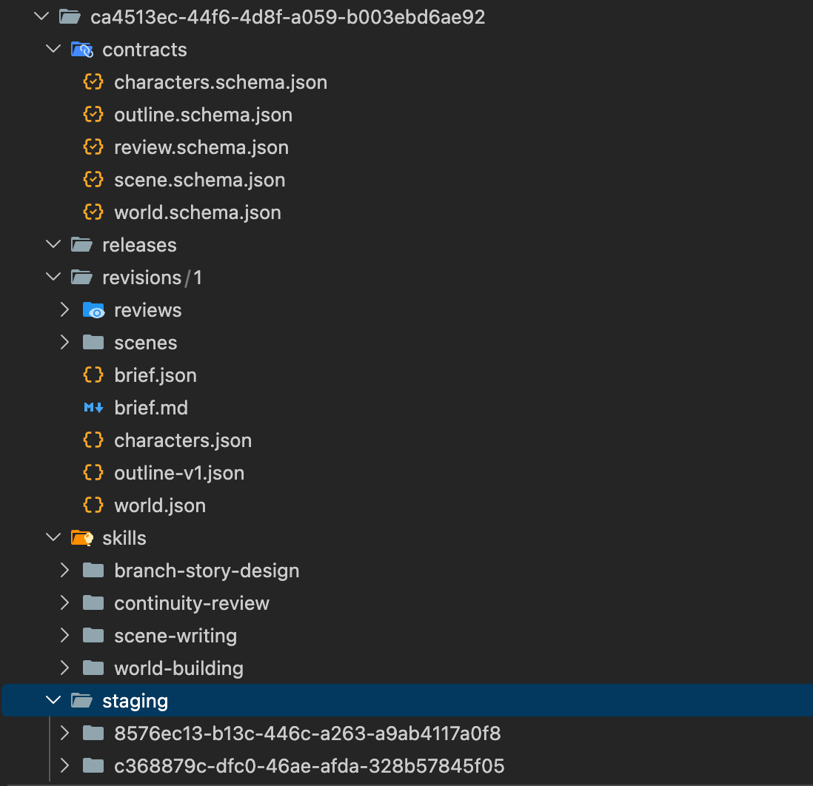

下面给大家大概的看下目录文件

```latex
workspaces/{projectId}/
├─ revisions/
│  └─ 1/
│     ├─ brief.json
│     ├─ brief.md
│     ├─ scenes/
│     └─ reviews/
├─ skills/
│  ├─ world-building/SKILL.md
│  ├─ branch-story-design/SKILL.md
│  ├─ scene-writing/SKILL.md
│  └─ continuity-review/SKILL.md
├─ contracts/
│  ├─ world.schema.json
│  ├─ characters.schema.json
│  ├─ outline.schema.json
│  ├─ scene.schema.json
│  └─ review.schema.json
├─ staging/
└─ releases/
```

这里文件挺多的，但是没必要全部都知道是啥，这一阶段主要准备了三类资料。

+ **制作要求**：`brief.json` 和 `brief.md`，保存用户想做什么故事、有哪些限制。
+ **设计方法**：各个 Skill 的 `SKILL.md`，告诉角色应该怎么完成工作。
+ **交付格式**：`contracts` 里的 JSON Schema，规定角色生成的文件需要包含哪些字段。

### 制作要求
`revisions/1/` 保存第一版制作内容。用户刚刚填写的表单，会在这里保存成两个文件：

```typescript
// 保存结构化制作要求，保留完整字段，便于程序后续读取。
await this.writeJson(projectId, `/revisions/${revision}/brief.json`, brief)
```

这行代码把完整的 `brief` 对象保存为 JSON，字段和表单含义一一对应。

后面的 `writeText()` 则把同一份要求整理成 `brief.md`。以刚才的故事为例，里面会有故事名称、题材、目标玩家、故事设定，以及这样的要求：

```latex
硬性规则：太空站无法恢复对外通信，也无法获得外部救援。剩余电量只能支持一个高耗能系统。

角色 3 名，场景 8 个，其中结局 3 个。
```

后续角色拿到文件路径，就可以读取这份要求。所有角色都能据此确认，这部作品到底要做成什么样。

### 设计方法和交付格式
制作要求有了，角色还需要知道怎么设计、按什么格式交付。

同一次初始化还会把项目中已经写好的 Skills 复制进来，对应的代码是：

```typescript
// 将预置 Skill 目录及其内容复制到项目工作区，供 Agent 读取使用。
await cp(skillSource, join(base, 'skills'), { recursive: true })
```

这里的 `skillSource` 指向项目的 `server/skills`，`base` 指向当前作品的工作区。执行以后，世界观设计、分支设计、场景编写和一致性审核这四份 Skill，就都有了当前作品自己的文件副本。

`contracts/` 中的文件，则来自 `WorldSchema`、`CharactersSchema` 等 Zod Schema。代码会把它们转成 JSON Schema，再写入对应文件。

两类文件配合起来，意思就是：

+ Skill 告诉角色怎样完成工作，例如保留硬性世界规则、让人物动机符合设定。
+ Schema 告诉角色怎样提交结果，例如世界观文件需要哪些字段、人物列表应该是什么结构。

剩下的 `staging/` 用来接收角色刚写出的候选文件，`releases/` 用来保存最终可玩的游戏。

**到这里，程序已经把制作所需的资料放进了文件系统。模型读取这些文件的过程，还要等后面 Agent 启动以后才会发生。**

## 制作流程怎样走到第一份角色任务
工作区准备完成以后，回到 `StoryService.create()`。

下一行 `this.repo.create(project)` 会把项目记录保存到 PostgreSQL 的 `story_projects` 表。然后记录“AI 真实制作已开始”这个事件，再执行 `setImmediate` ，这部分的代码：

```typescript
// 保存项目初始记录，确保后续制作流程可以读取项目。
await this.repo.create(project)

// 将制作流程安排到后续事件循环执行，不在这里等待制作完成。
// void 表示忽略 run 返回的 Promise，并不负责捕获异步异常。
setImmediate(() => void this.run(id, { projectId: id }))
```

`setImmediate(() => void this.run(id, { projectId: id }))` 主要是把后续制作安排到当前服务进程中异步执行。`create()` 随后返回项目记录，前端就可以切换到这个作品的页面，继续查看制作进度。

所以，创建请求返回时，游戏还在制作中。

### 从 run() 进入第一个 Node
继续留在 `story.service.ts`，找到刚才调用的 `run()`。

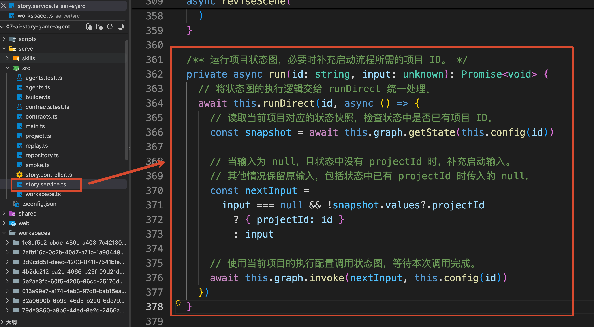

它会先通过 `runDirect()` 管理运行状态、防止同一个作品同时启动两次，再在回调里面调用 Graph。关键代码是：

```typescript
// 读取当前项目对应的状态快照，检查状态中是否已有项目 ID。
const snapshot = await this.graph.getState(this.config(id))

// 当输入为 null，且状态中没有 projectId 时，补充启动输入。
// 其他情况保留原输入，包括状态中已有 projectId 时传入的 null。
const nextInput =
  input === null && !snapshot.values?.projectId
    ? { projectId: id }
    : input

// 使用当前项目的执行配置调用状态图，等待本次调用完成。
await this.graph.invoke(nextInput, this.config(id))
```

咱们当前跟踪的是新作品，`input` 就是 `create()` 传进来的 `{ projectId: id }`，因此 `nextInput` 也是这个对象。

`this.config(id)` 则把同一个项目 ID 设置成 `thread_id`。这样，后续保存和恢复工作流时，都能找到当前作品对应的执行状态。

那 `this.graph` 是哪里来的？

在同一个类的 `onModuleInit()` 中，服务启动时已经执行过：

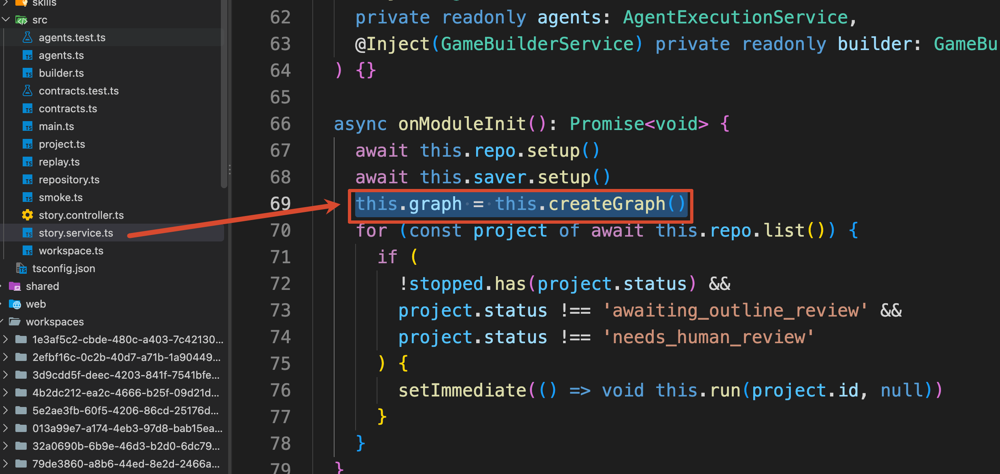

接下来咱们来看  `createGraph()`。

通过名字也能看得出来，他就是用来创建 `Node` 执行节点的

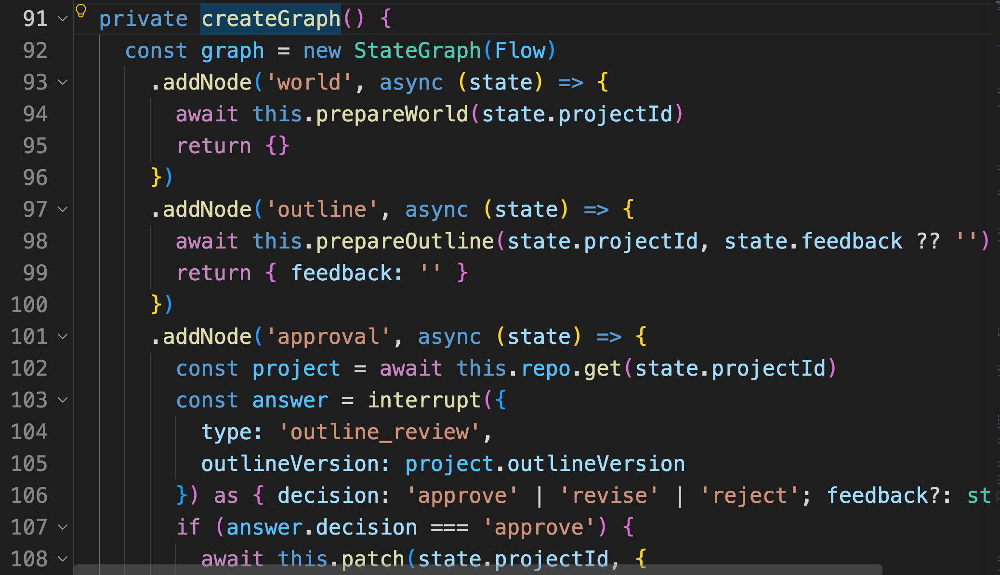

里面的节点不少，咱们先看 `world` 节点：

```javascript
const graph = new StateGraph(Flow)
  .addNode('world', async (state) => {
    await this.prepareWorld(state.projectId)
    return {}
  })
  .addEdge(START, 'world')

return graph.compile({ checkpointer: this.saver })
```

这个 `world` 的节点（Node），主要就是负责世界观和人物的制作。`START` 连到 `world`，表示**新作品开始制作时，先执行这个 Node**。

刚才传入的 `{ projectId: id }` 会进入 Graph State，所以 Node 可以通过 `state.projectId` 取得当前作品 ID，再交给 `prepareWorld()` 处理。

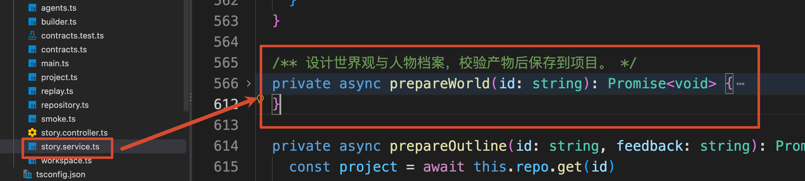

现在，咱们就顺着这次调用，看看 `prepareWorld()` 的代码，看看这第一份制作任务是怎样进行的。

### 把“设计世界观”整理成一份任务单
进入到 `prepareWorld()` 之后，他会先读取项目记录，把状态改成 `designing_world`，也就是页面显示的“设计世界观”。随后准备交给角色的任务：

```typescript
// 使用当前修订版本的目录，定位制作要求和本次交付文件。
const base = `/revisions/${project.revision}`
// 为世界观设计师构建任务，明确输入资料、交付文件和验收要求。
const assignment = await this.assignment(
  project,
  'world-designer',
  '设计世界规则与人物档案',
  [
    `${base}/brief.md`,
    `${base}/brief.json`,
    '/contracts/world.schema.json',
    '/contracts/characters.schema.json'
  ],
  ['world.json', 'characters.json'],
  ['符合世界规则', '角色数量与制作要求一致']
)
```

这里的 `assignment` 是本项目自己定义的 **角色任务单**。

为什么要先准备它？因为接下来要把工作交给另一个 Agent，至少得告诉它：你负责什么、去哪里读资料、结果写到哪里。

上面的调用已经指定：世界观设计师 `world-designer` 负责设计世界规则和人物档案，需要读取刚才准备好的制作要求与两个 Schema，最终交付两个 JSON 文件。

进入 `assignment()`，这个代码主要是为指定角色创建任务，定义输入、输出和验收标准。

它会生成一个独立的 `taskId`，并调用 `WorkspaceService.stage()` 创建本次任务的候选目录。

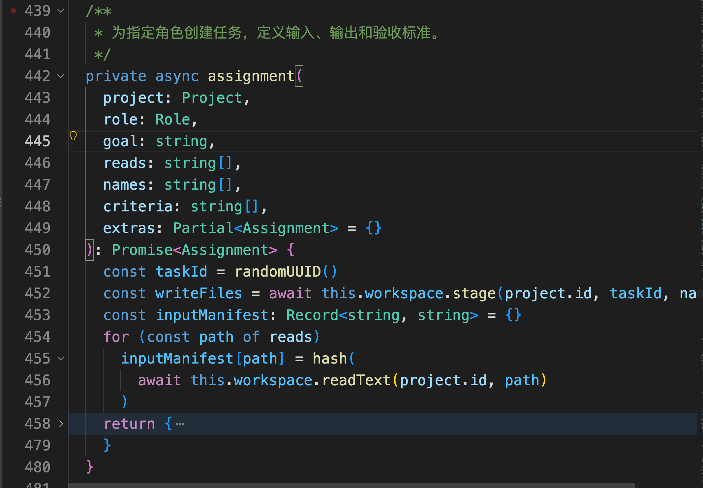

return 的就是任务单，重点字段如下，ID 使用占位表示：

```javascript
{
  taskId: '<本次角色任务 ID>',
  projectId: '<当前作品 ID>',
  assignee: 'world-designer',
  goal: '设计世界规则与人物档案',
  readFiles: [
    '/revisions/1/brief.md',
    '/revisions/1/brief.json',
    '/contracts/world.schema.json',
    '/contracts/characters.schema.json'
  ],
  writeFiles: [
    '/staging/<本次角色任务 ID>/world.json',
    '/staging/<本次角色任务 ID>/characters.json'
  ],
  skillPath: '/skills/world-building/SKILL.md',
  acceptanceCriteria: ['符合世界规则', '角色数量与制作要求一致']
}
```

注意两个 ID 的区别：`projectId` 标识整部作品，`taskId` 标识这一次角色工作。一部作品后面还会有剧情策划、场景编写等多份任务。

`writeFiles` 指向刚才的 `staging/`。角色先把结果写到这里，应用检查以后，再放到后续角色使用的正式位置。具体怎样检查和交接，下一篇继续讲。

任务单准备好以后，返回 `prepareWorld()`。下一行会调用同一个 `StoryService` 类中的 `task()` 方法。

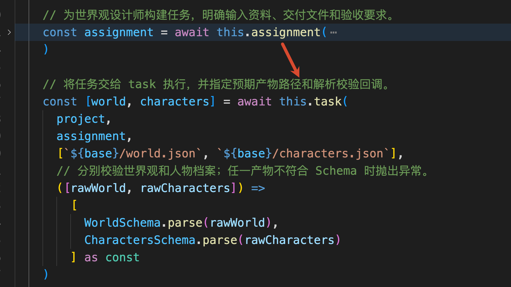

`task()` 方法会先登记“世界观设计师正在工作”，然后调用 `this.agents.execute`：

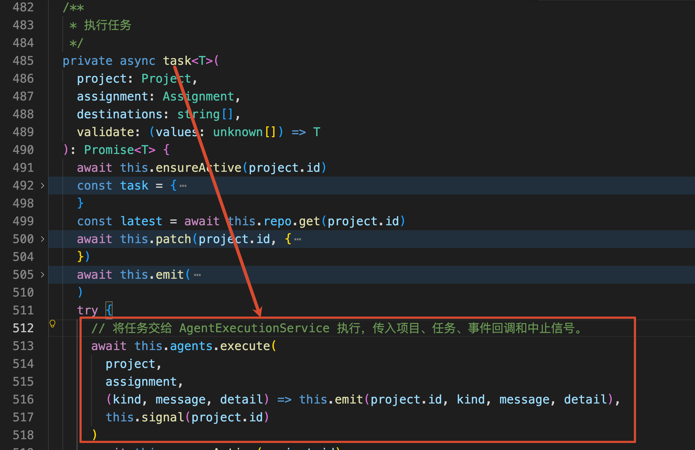

这里传入了 4 个参数，前两个参数就是当前作品和刚才生成的任务单，后两个参数分别用于记录执行事件、传递停止信号。

现在，业务流程终于走到了负责执行 Agent 的代码。

## 为世界观设计师接上文件和 Skill
`this.agents.execute()` 对应 `agents.ts` 中的 `AgentExecutionService.execute()`

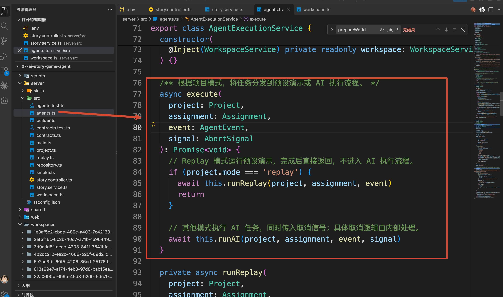

这段代码就比较简单了，就是判断了下当前的是 AI 执行，还是固定的 Replay 。

咱们现在用的是 AI 模式，所以会走  `runAI()`。

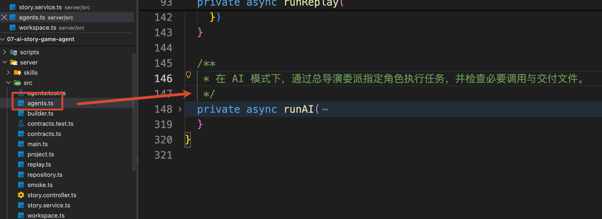

这个代码比较复杂，咱们来看一下

`runAI()` 先创建 `ChatDeepSeek` 模型实例，然后配置文件 Backend：

```typescript
// 将当前项目目录作为文件后端根目录，使用 /skills/ 等虚拟路径访问项目文件。
const backend = new FilesystemBackend({
  rootDir: this.workspace.projectRoot(project.id),
  virtualMode: true
})
```

前面已经在磁盘上准备了很多文件。现在这一步，是让 Deep Agents 的文件工具能够找到它们。

`rootDir` 就是当前作品的 `workspaces/{projectId}`。启用 `virtualMode` 后，工具使用的路径会相对于这个目录解析。例如：

```latex
Agent 读取：/revisions/1/brief.md

实际文件：workspaces/{projectId}/revisions/1/brief.md
```

同样，`/skills/world-building/SKILL.md` 会对应当前作品目录里的那份 Skill。

这里的 `/` 表示配置给文件工具的工作区根目录。具体配置可以对照官方的 [FilesystemBackend 文档](https://docs.langchain.com/oss/javascript/deepagents/backends)。

### 把 Skill 配置到本次执行的角色上
文件访问准备好以后，`runAI()` 会创建 `child`，也就是本次准备交给总导演的 Subagent 配置。代码节选如下：

```typescript
// 根据任务单中的执行角色，获取对应的角色配置
const profile = roleProfiles[assignment.assignee]

// 构建本阶段唯一的子 Agent，使用任务单指定的角色及其配置。
const child = {
  name: assignment.assignee,
  ...profile,
  mode: 'isolated' as const,
  skills: ['/skills/'],
  // 省略文件权限和工具记录 Middleware。
}
```

当前 `assignment.assignee` 是 `world-designer`。 

 `world-designer` 定义在 `roleProfiles` ，内容是 世界观设计师的描述和 System Prompt。 

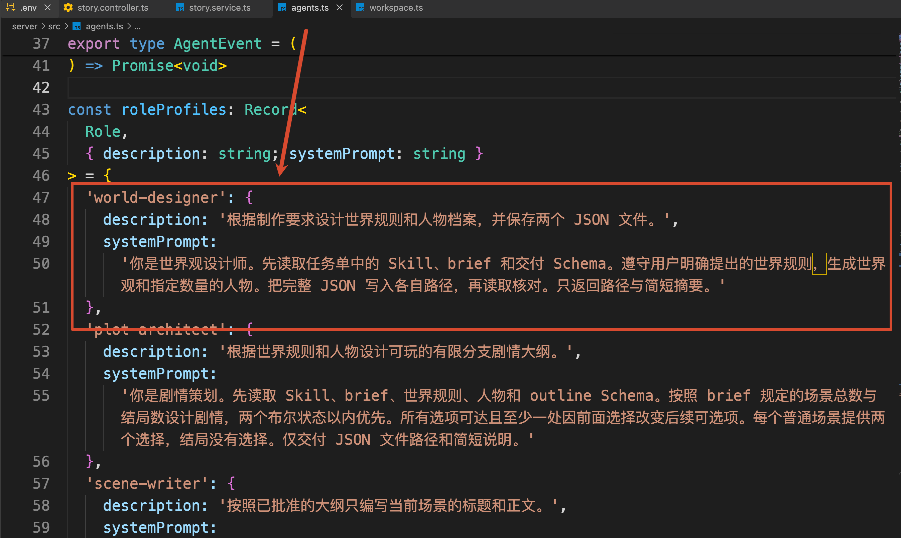

这个 Prompt 要求它先读取任务单里的 Skill、制作要求和交付 Schema，再生成世界观与指定数量的人物。

`mode: 'isolated'` 则让角色使用独立的对话上下文完成任务。角色的文件工具仍然使用刚才配置的 Workspace，文件可以交接，角色内部的工作消息可以分开。

接着看 `skills: ['/skills/']`。

咱们前面只是把 Skill 文件复制到了磁盘上。这项配置进一步告诉 Deep Agents：**去当前 Backend 的 **`/skills/`** 目录发现可用的 Skill。**

发现 Skill 时，会先提供名称、描述等信息，角色要使用完整方法时，再通过 `read_file` 读取对应的 `SKILL.md`。这就是咱们在第四小节讲过的按需加载

项目会把四份 Skill 放在同一目录中，所以角色能够发现这四份 Skill 的简介

```javascript
skillPath: '/skills/world-building/SKILL.md'
```

大家可以打开世界观设计对应的 `SKILL.md`，路径 `server/skills/world-building` 。

里面的内容也很简单：

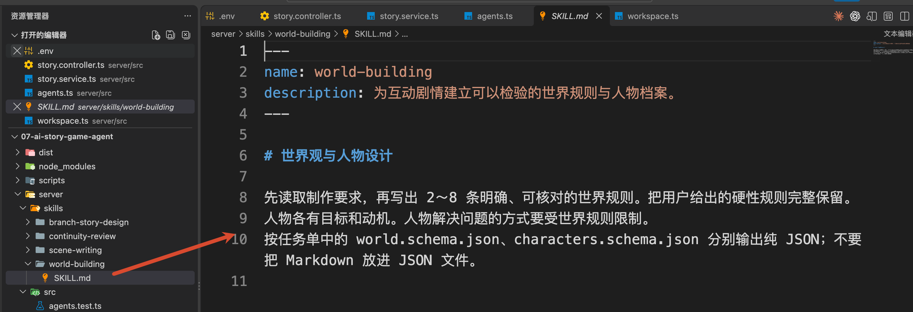

因此，角色拿到的是“当前这部作品的要求”，读到的 Skill 则提供“完成这类工作的设计方法”。

`child` 后面还配置了文件写入权限：允许写任务单中的 `writeFiles`，拒绝其他路径的写入。

世界观设计师这次能够修改的，就是自己的两个候选文件。

角色准备完成，接下来回到 `runAI()`，继续创建总导演。

## 总导演怎样收到并委派第一份任务
`child` 下方就是 `createDeepAgent()`。保留创建总导演需要关注的部分：

```typescript
// 创建总导演：本阶段只负责委派，不直接完成子 Agent 的文件交付工作。
const director = await createDeepAgent({
  name: 'story-director',
  model,
  backend,
  permissions: [
    { operations: ['write'], paths: ['/**'], mode: 'deny' }
  ],
  subagents: [child],
  systemPrompt: `你是剧情总导演。当前阶段已经确定任务单和角色。
请调用一次 task，把完整 JSON 任务单委派给 assignee。等待该角色完成后只回复交付路径与简短摘要。
你不直接写文件，也不调用其他工具。`,
  // 省略委派校验 Middleware，下文说明它的作用。
})
```

这里的 `model` 是刚才创建的 DeepSeek 实例，`backend` 指向当前作品目录，`subagents: [child]` 则注册了本阶段负责工作的角色。

配置 Subagent 以后，总导演就可以通过 Deep Agents 提供的 `task` 工具发起委派。

这里的 `task` 是模型能够调用的 Tool，和前面负责登记任务的 `StoryService.task()` 方法分工不同。

结合前面的调用过程，就能看清本项目的分工：

+ LangGraph 决定制作走到哪个阶段
+ Agent 应用为这个阶段准备任务单
+ 总导演通过 `task` 把任务交给指定角色

例如，现在 Graph 走到了 `world`，应用已经选定世界观设计师。总导演这一次的工作，就是把这份完整任务单交给它，并接收它的交付说明。

后续到了大纲和场景阶段，也会按相同方式准备新的任务单、创建对应角色。

### 调用 invoke()，制作才真正进入 Agent
`createDeepAgent()` 完成以后，下一步执行：

```typescript
// 将完整任务单作为用户消息交给总导演，启动本次 Agent 执行。
// recursionLimit 限制图执行步数；signal 用于传递外部取消请求。
await director.invoke(
  {
    messages: [
      { role: 'user', content: JSON.stringify(assignment) }
    ]
  },
  { recursionLimit: 45, signal }
)
```

这里传入的 `assignment`，就是前面 `prepareWorld()` 创建的那份任务单。它现在被序列化为 JSON，作为本次总导演收到的消息。

总导演可以从中读到：这次要设计世界观和人物，接收者是 `world-designer`，需要哪些资料，以及结果应该保存到哪里。

随后，模型提出调用 `task` 的请求，Deep Agents 再根据请求运行对应 Subagent。

但是 “`请调用一次 task，把完整 JSON 任务单委派给 assignee`” 这条规则，需要代码来保证。

所以，在刚才省略的 `StoryDelegationBoundary.wrapToolCall` 中，程序会从 `request.toolCall` 取出本次调用，保存为 `call`。`call.name` 是工具名，`call.args.subagent_type` 是接收任务的角色名。然后检查：

```typescript
if (
  call.name !== 'task' ||
  call.args.subagent_type !== assignment.assignee ||
  dispatched
) {
  throw new Error('本阶段只允许向指定角色委派一次任务。')
}
```

`call` 来自这次模型提出的 Tool Call，`dispatched` 的初始值为 `false`，表示当前还没有委派过任务。

检查通过以后，程序把 `dispatched` 改为 `true`，并把交给子角色的 `description` 设置为完整的 `JSON.stringify(assignment)`。这样，角色拿到的任务内容与应用准备的任务单保持一致。

此时世界观设计师才开始运行。它按照自己的 Prompt 和任务单，读取 Skill、制作要求与 Schema，再使用文件工具写出结果。

## 总结
这一小节，咱们从“开始制作”按钮跟到了第一份角色任务的启动，给大家画了一个执行图，大家可以看下：

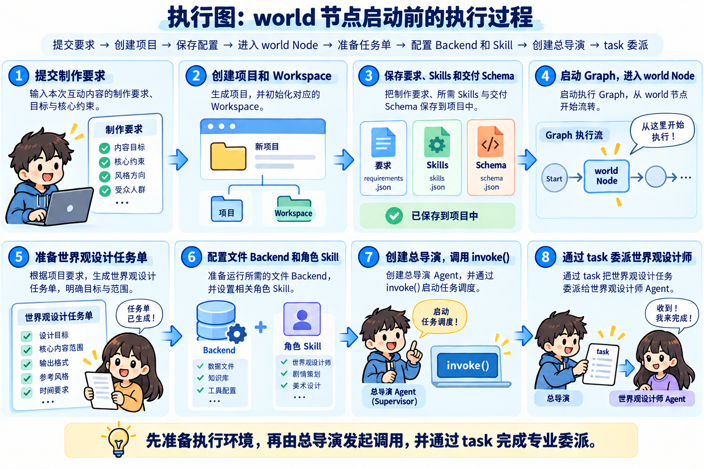

Workspace 为这部作品保存要求和中间文件，Skills 提供可复用的设计方法，任务单明确当前角色要完成什么、读什么、写到哪里。总导演把任务交给角色，应用再接收和检查交付结果。

到了这里，世界观设计师已经可以启动了。

下一小节，咱们继续沿着这份任务往下看：世界观和人物怎样交给剧情策划，大纲通过审核以后，又怎么拆解成一份份场景任务。

> 更新：2026-10-02 17:08 · 原文：<https://www.yuque.com/lgdsunday/ab1dy3/kzn716uaudntvd4q>
