# 09 - 实战（中二）：委派世界观、角色、剧情与场景任务

上一小节，咱们从“开始制作”按钮进入代码，跟到了总导演把任务交给世界观设计师。

世界观设计师拿到任务单以后，就可以读取制作要求，设计世界规则和人物，再把结果写进文件。

那么，**这些文件写好以后，剧情策划怎么接着工作？大纲通过审核以后，场景编剧又该写哪些内容？**

这一小节，咱们继续跟踪同一部作品，把世界观、人物、大纲和场景的制作过程串起来。

## 世界观和人物写好以后，程序怎样接收
先接着上一节的世界观任务往下看。

目前已知，`world-designer` 同时负责世界观和人物档案。

世界观设计师按照任务要求调用文件工具，把生成的 JSON 写到两个位置。

+ `world.json` 保存世界规则
+ `characters.json` 保存人物的姓名、目标和动机。

角色执行结束以后，`agents.ts` 中的 `director.invoke()` 返回。

`runAI()` 随后检查是否发起过委派、是否发起过指定 Skill 的读取，以及交付文件是否存在。

检查通过，`runAI()` 和调用它的 `execute()` 才会结束。

接下来，代码会回到哪里呢？

回到 `story.service.ts` 的 `task()` 方法。上一节就是它通过 `await this.agents.execute(...)` 启动了这次 Agent 执行。

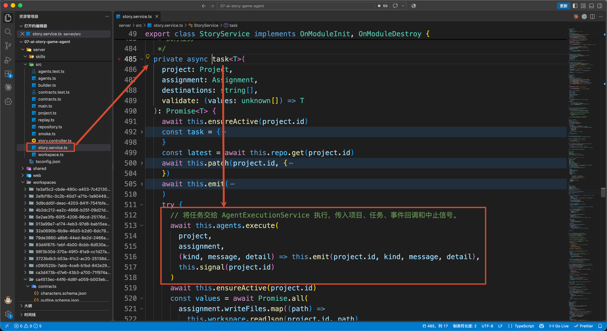

找到这行调用，继续往下看，接收文件的代码就在后面。

`task()` 会按照任务单里的交付路径，读取角色刚写好的 JSON：

```typescript
// 读取任务交付文件并解析为 JSON 对象。
const values = await Promise.all(
  assignment.writeFiles.map((path) =>
    this.workspace.readJson(project.id, path)
  )
)
// 调用 validate 回调函数对产物进行校验，返回解析后的结果。
const result = validate(values)
```

这里的 `values` 是读取结果组成的数组，顺序和 `writeFiles` 一致，我在这里打印了 `values` 的数据，大家可以看下：

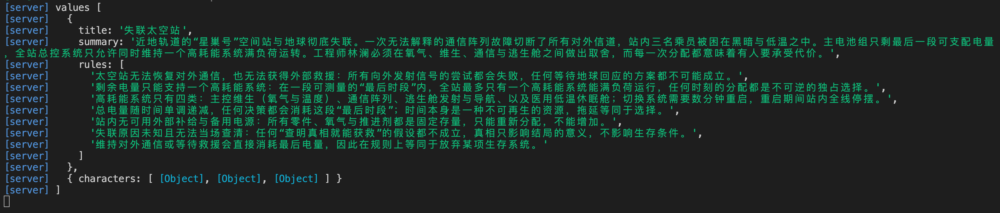

这里包含了两个元素对象

+ 第一个元素对象是 **世界观对象**：来自 `world.json`，包含世界观标题 `title`、背景介绍 `summary` 和世界规则 `rules`。
+ 第二个元素对象是 **人物档案对象**：来自 `characters.json`，其中的 `characters` 数组保存了各个人物的档案。

那么下一行的 `validate()` 从哪里来？

它是调用 `task()` 时传入的校验函数。回到同一个文件的 `prepareWorld()`，找到 `const [world, characters] = await this.task(...)`，完整调用是：

```typescript
// 将任务交给 task 执行，并指定预期产物路径和解析校验回调。
const [world, characters] = await this.task(
  project,
  assignment,
  [`${base}/world.json`, `${base}/characters.json`],
  // validate 就是这个，作用是：分别校验世界观和人物档案；任一产物不符合 Schema 时抛出异常。
  ([rawWorld, rawCharacters]) =>
    [
      WorldSchema.parse(rawWorld),
      CharactersSchema.parse(rawCharacters)
    ] as const
)
```

第四个参数就是刚才的 `validate`。它把数组里的两个对象分别交给 `WorldSchema` 和 `CharactersSchema` 检查。

这两个 Schema 定义在 `contracts.ts` 中。

```javascript
// 世界观数据结构：用于约束 Agent 最终生成的世界观内容。
export const WorldSchema = z
    .object({
        // 世界观标题，至少 2 个字符。
        title: z.string().min(2),
        // 世界观概要，避免生成过于简单的描述。
        summary: z.string().min(20),
        // 世界规则，要求 2～8 条，每条规则至少 8 个字符。
        rules: z.array(z.string().min(8)).min(2).max(8)
    })
    .strict()

// 单个角色的数据结构。
const CharacterSchema = z
    .object({
        // 角色唯一标识。
        id: Id,
        // 角色名称。
        name: z.string().min(1),
        // 角色当前希望达成的目标。
        goal: z.string().min(8),
        // 驱动角色采取行动的内在动机。
        motivation: z.string().min(8)
    })
    .strict()
```

例如，世界观需要包含 `title`、`summary` 和 `rules`；每个人物需要包含 `id`、`name`、`goal` 和 `motivation`。缺少必要字段或者字段类型不正确，校验就不能通过。

这里也能看出 `task()` 的设计：**每种任务提供自己的校验函数，读取文件和接收结果的流程可以复用。** 后面的大纲和场景也会走这个方法。

### 把结果放到后续角色能够读取的位置
再看刚才调用 `task()` 时的第三个参数：

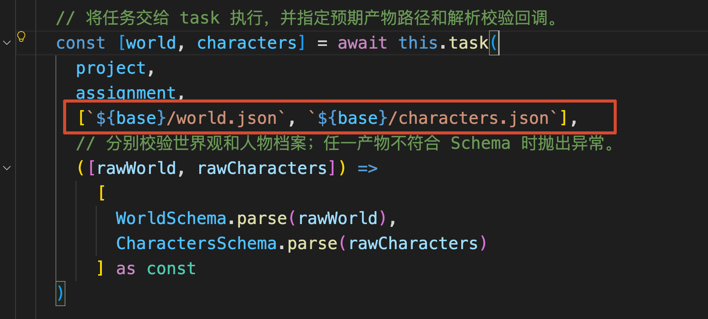

`base` 在 `prepareWorld()` 中定义为 `/revisions/${project.revision}`，当前就是 `/revisions/1`。因此，这两个路径表示世界观和人物档案最终要保存的位置。

这个参数在 `task()` 内部叫作 `destinations`。

现在回到 `task()`，继续看 `validate(values)` 后面的代码。省略输入文件是否变化等检查，本次文件交付由这个循环完成：

```typescript
// 将任务交付文件从暂存区移动到正式目录，确保产物可被后续流程访问。
for (let i = 0; i < destinations.length; i++) {
  await this.workspace.promote(
    project.id,
    assignment.writeFiles[i],
    destinations[i]
  )
}
```

`promote()` 定义在 `workspace.ts`，里面做的事情就是读取候选文件，再把内容写入目标文件。本次对应关系是：

+ `/staging/<任务 ID>/world.json → /revisions/1/world.json`
+ `/staging/<任务 ID>/characters.json → /revisions/1/characters.json`

这些都是当前作品 Workspace 内的路径，实际文件位于项目的 `workspaces/{projectId}` 目录下。

文件复制完成以后，`task()` 把这次角色任务标记为完成，再通过 `return result` 返回校验后的两个对象。

执行就回到了 `prepareWorld()`。刚才等在 `await this.task(...)` 左侧的 `world` 和 `characters`，现在有值了。

`prepareWorld()` 接着检查人物数量，再把这两个对象保存到项目记录：

```typescript
if (characters.characters.length !== project.brief.characterCount)
  throw new Error('角色数量不符合制作要求。')

await this.patch(id, { world, characters })
```

例如，制作要求是 3 个人物，这里就必须拿到 3 个人物。只有这一步也通过，`prepareWorld()` 才能正常结束，继续后面的大纲制作。

此时，后续代码就可以从项目记录读取世界观和人物对象。后续 Agent 则可以通过文件工具读取它们的完整内容了。

## 剧情策划怎样接着生成大纲
世界观和人物准备好以后，制作流程就要进入大纲阶段了。

这个顺序写在 `story.service.ts` 的 `createGraph()` 中，这个大家看的多了，就不跟大家截图了，直接放上代码：

```typescript
.addEdge('world', 'outline')
```

前面的 `world` Node 调用的就是 `prepareWorld()`。它执行完成以后，Graph 沿着这条 Edge 进入 `outline` Node，而这个 Node 调用的是一个匿名函数：

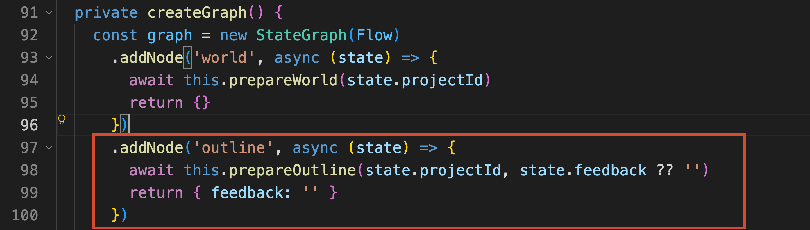

说白了就一行代码，调用 `this.prepareOutline` ：

```typescript
await this.prepareOutline(state.projectId, state.feedback ?? '')
```

第一个参数仍然是当前作品 ID；第二个参数是用户对大纲的修改意见。现在是第一次生成大纲，修改意见为空。

接下来 咱们开始看 `prepareOutline()` 方法

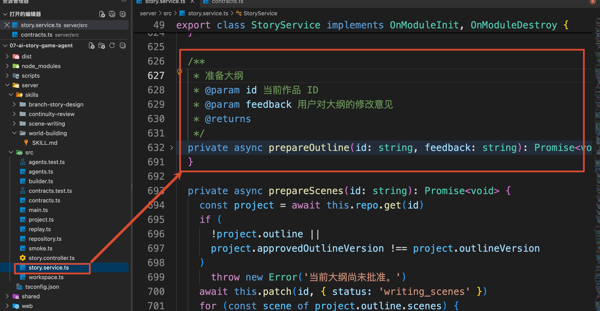

### 为剧情策划准备任务单
方法先读取项目，把状态改成 `designing_outline`，也就是“设计大纲”，然后调用前面已经用过的 `assignment()`：

```typescript
// 为剧情架构师创建本次大纲设计任务单，
// 明确任务目标、可读取资料、交付文件以及验收要求。
const assignment = await this.assignment(
  project,
  'plot-architect',
  `根据世界设定设计分支大纲。${feedback ? `用户修改意见：${feedback}` : ''}`,
  [
    `${base}/brief.md`,
    `${base}/world.json`,
    `${base}/characters.json`,
    '/contracts/outline.schema.json'
  ],
  ['outline.json'],
  ['所有场景、结局和状态路径可达', '角色与场景数量符合要求']
)
```

这次接收任务的 **是 **`plot-architect`**，也就是剧情策划。**

大家看传入的文件路径：除了原有的制作要求，这里已经加入了刚才保存的 `world.json` 和 `characters.json`。剧情策划读取它们，就能知道故事有哪些世界规则、人物分别想做什么。

**前一个角色写出的文件，成为下一个角色的输入资料。** 角色之间的内容交接，就发生在这里。

`assignment()` 还会根据角色名称，把这次的 `skillPath` 设置成：

```latex
/skills/branch-story-design/SKILL.md
```

对应的 Skill 源文件在 `server/skills/branch-story-design/SKILL.md`。它要求剧情策划按照制作要求设计场景和结局，让玩家的选择能够影响后续路线，并检查场景之间的连接。

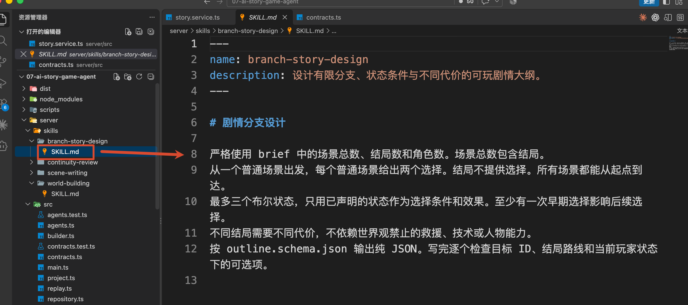

例如，咱们要求 8 个场景、3 个结局。这里的 8 个场景已经包含 3 个结局，剧情策划需要安排剩余的普通场景，以及通向这些结局的选择。

任务单准备好以后，`prepareOutline()` 继续调用 `this.task()`。后面的启动过程和上一节相同：`task()` 调用 `agents.execute()`，AI 模式进入 `runAI()`，再由总导演通过 `task` 工具委派给指定角色。

这一次，`assignment.assignee` 的值来自上面传入的 `'plot-architect （剧情策划）'`。

因此，`runAI()` 会从 `roleProfiles` 取出剧情策划的配置，创建本次 Subagent。它的 Prompt 就定义在 `agents.ts` 的 `roleProfiles['plot-architect'].systemPrompt` 中。

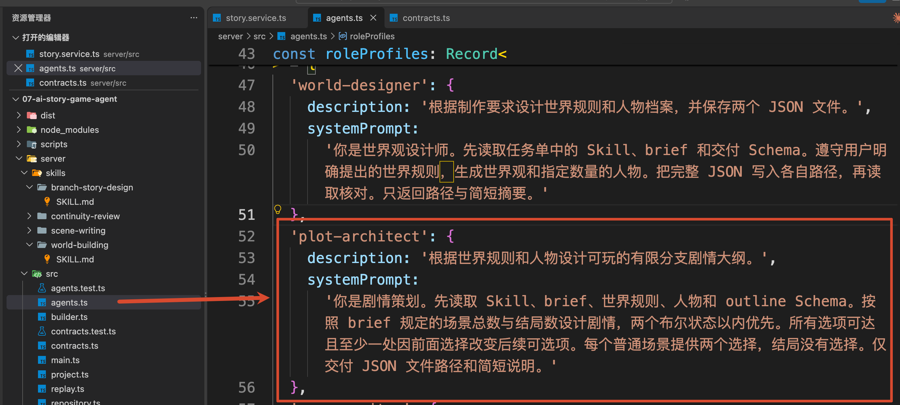

剧情策划接到任务后，读取自己的 Skill 和输入资料，将大纲写到本次任务的 `/staging/<任务 ID>/outline.json`。

### 接收大纲，准备交给用户审核
继续看 `prepareOutline()` 中的 `this.task()` 调用：

```typescript
// 执行剧情架构师任务，并将生成结果保存为当前版本的大纲文件。
const outline = await this.task(
  project,
  assignment,
  [`${base}/outline-v${project.outlineVersion}.json`],
  // Agent 完成任务后，对交付结果进行两层校验：
  // 1. Schema 校验结构是否合法；
  // 2. 业务校验大纲是否满足当前项目要求。
  ([raw]) => {
    const value = OutlineSchema.parse(raw)
    assertOutline(project.brief, value, project.characters!)
    return value
  }
)
```

这次只交付一个文件，所以校验函数从数组里取出一个 `raw`，也就是刚刚读取的大纲 JSON。

`OutlineSchema.parse()` 检查字段结构。后面的 `assertOutline()` 定义在 `contracts.ts`，继续检查场景数、结局数、人物引用和分支是否有效。例如，某个选择指向了不存在的场景，这份大纲就不能通过检查。

具体的分支检查算法，咱们在下篇讲游戏构建时再展开。

检查通过，`task()` 会把候选文件复制到 `/revisions/1/outline-v1.json`，再把大纲对象返回给这里的 `outline`。

大纲中有一个 `scenes` 数组，每个元素描述一个场景。后面编写正文时，主要会用到这些字段：

| 字段 | 保存的内容 |
| --- | --- |
| `id` | 当前场景的编号，后续用它指定编写任务和文件名 |
| `summary` | 这个场景准备发生什么事情 |
| `characterIds` | 哪些人物在这个场景中出场 |
| `ending` | 当前场景是不是结局 |
| `choices` | 玩家可以选择什么、选择以后去哪里，以及选择的条件和效果 |


所以，到大纲阶段，场景之间怎样连接已经确定了。后面的场景编剧会根据这些安排，把场景摘要展开成具体的标题和正文。

拿到大纲以后，`prepareOutline()` 执行：

```typescript
// 校验通过后保存大纲，并进入“等待人工审核”状态。
await this.patch(id, {
  outline,
  status: 'awaiting_outline_review'
})
```

这行代码把大纲和“等待大纲审核”状态保存到项目记录。前端读取到这个状态，就会在“概览”中显示“请审核 Outline v1”。点击“查看剧情分支”，还能看到大纲中的场景和分支关系。

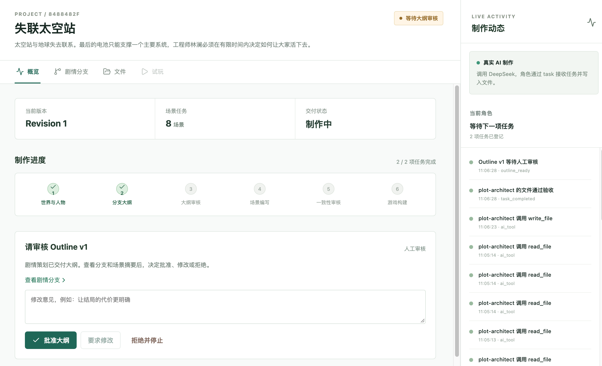

## 点击“批准大纲”以后，场景制作怎样开始
先看服务端在哪里等用户。

`prepareOutline()` 返回以后，`outline` Node 执行完成。`createGraph()` 中的下一条 Edge 是：

```typescript
.addEdge('outline', 'approval')
```

因此，Graph 会进入 `approval` Node。这个 Node 读取当前作品，再调用 `interrupt()`，关键代码如下，省略了返回值的 TypeScript 类型：

```typescript
// 等待用户对当前版本大纲进行人工审核。
const project = await this.repo.get(state.projectId)

// 中断当前 Graph 执行，向外部请求人工审批。
// 流程会停在这里，直到收到 approve / revise / reject 三种决策之一。
const answer = interrupt({
  type: 'outline_review',
  outlineVersion: project.outlineVersion
})
```

执行到这里，Graph 暂停，等待用户提交审核结果。之前配置的 Checkpointer 会保存执行状态。页面上的审核区域由刚才的项目状态控制，工作流的暂停则由这里的 `interrupt()` 完成。

接下来，咱们回到页面，点击 **“批准大纲”**。

### 从按钮找到恢复工作流的代码
这个按钮调用 `App.vue` 中的 `review('approve')` 开始（这个前端代码就不跟大家说了哈），咱们只需要知道这个会发送 `POST /api/projects/{当前作品 ID}/outline-review` 接口

那么假设现在批准第一版大纲，且没有填写修改意见，请求体就是：

```json
{
  "decision": "approve",
  "outlineVersion": 1,
  "feedback": ""
}
```

请求会进入 `story.controller.ts` 的 `review()`

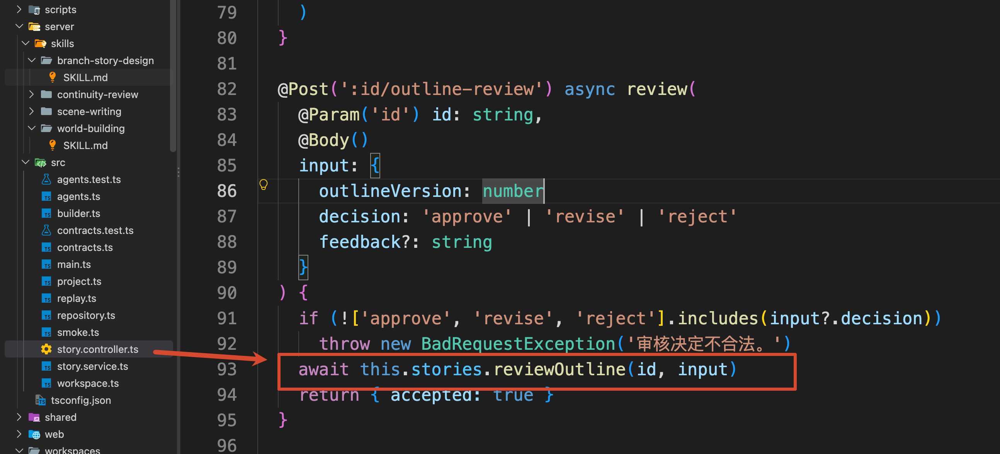

然后，直接进入到 `story.service.ts` 的 `reviewOutline()`。

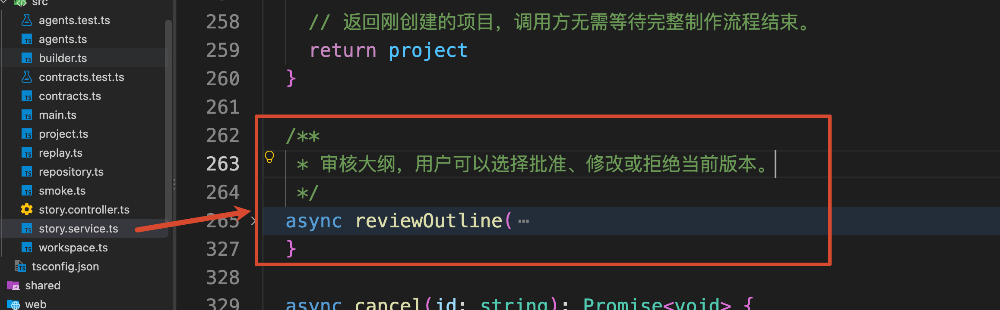

`reviewOutline()` 会先检查当前作品是否正在等待审核、用户提交的版本是否仍然有效，以及 Graph 是否停在 `approval`。这些条件满足以后，它通过 `setImmediate` 安排 `run()` 执行：

```typescript
// 异步恢复之前被 interrupt 暂停的工作流，
// 将用户的审批结果作为 resume 数据传回 approval 节点。
setImmediate(
    () =>
        void this.run(id, new Command({ resume: input })).finally(() =>
            // 无论工作流执行成功还是失败，都释放审核锁。
            this.pendingReviews.delete(id)
        )
)
```

这里的 `input` 就是上面那个审核对象，`new Command({ resume: input })` 表示带着这份审核结果恢复执行。`run()` 收到这个 `Command` 以后，会继续把它传给 `this.graph.invoke(...)`。

恢复时使用的 `thread_id` 仍然是当前作品 ID，所以 LangGraph 能找到这部作品暂停的执行状态。它重新进入 `approval` Node，再次执行到 `interrupt()` 时，这次就会把 `input` 返回给前面的 `answer`。这是 [LangGraph Interrupts](https://docs.langchain.com/oss/javascript/langgraph/interrupts#resuming-interrupts) 提供的恢复方式。

此时，`answer.decision` 的值是 `'approve'`，Node 便继续执行批准分支：

```typescript
await this.patch(state.projectId, {
  approvedOutlineVersion: project.outlineVersion,
  status: 'writing_scenes'
})
```

`approvedOutlineVersion` 保存用户批准的大纲版本。当前是 `1`，后面的场景制作会检查自己使用的大纲是否就是这个版本。

批准分支执行完成，`approval` Node 最后把审核决定返回到 Graph State：

```typescript
// 将人工审核结果返回给 Graph，
// 后续节点可以根据 decision 决定继续、返工或结束流程。
return {
  decision: answer.decision,
  feedback: answer.feedback ?? ''
}
```

同一个 `createGraph()` 中，下面这段条件路由读取 `state.decision`，决定下一步：

```typescript
.addConditionalEdges('approval', (state) => state.decision, {
  approve: 'scenes',
  revise: 'outline',
  reject: END
})
```

咱们刚才点击的是“批准大纲”，因此进入 `scenes`。

另外两个按钮也对应这里的分支。

+ “要求修改”会增加 `outlineVersion`、清空项目中的当前大纲，并把用户意见交给 `prepareOutline()`，重新委派剧情策划。新大纲生成以后，还要再次审核。
+ “拒绝并停止”会将项目标记为取消，并结束这条流程

接下来继续跟踪已经批准的这部作品。

## 场景编剧怎样逐个完成场景
在 `createGraph()` 中找到 `scenes` Node，它调用的是：

```typescript
.addNode('scenes', async (state) => {
  await this.prepareScenes(state.projectId)
  return {}
})
```

因此，接下来进入 `prepareScenes()` 方法

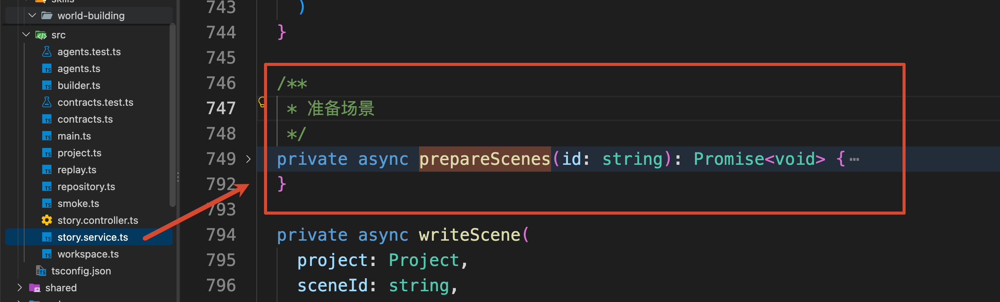

方法先读取项目，检查 `project.outline` 是否存在，以及 `approvedOutlineVersion` 是否等于当前 `outlineVersion`。确认正在使用已批准的大纲以后，再遍历大纲中的 `scenes` 数组。

### 从大纲里取出本次要编写的场景
`prepareScenes()` 中的循环是：

```typescript
// 按照已批准大纲中的场景列表，逐个准备场景产物。
for (const scene of project.outline.scenes) {
    // 每生成一个场景前检查项目是否仍然处于可执行状态，
    // 避免项目被取消或终止后继续生成后续内容。
    await this.ensureActive(id)

    // 当前场景在 Workspace 中对应的产物路径。
    const path = `/revisions/${project.revision}/scenes/${scene.id}.json`

    try {
        // 尝试读取已经存在的场景文件，
        // 并校验它是否仍然符合当前大纲和场景定义。
        assertScene(
            project.outline,
            await this.workspace.readJson(id, path),
            scene.id
        )

        // 场景已经存在且校验通过，直接复用，
        // 不需要再次调用 Agent 生成。
        continue
    } catch {
        // 场景不存在、读取失败或校验不通过时，
        // 重新生成当前场景。
        await this.writeScene(project, scene.id, undefined, false)
    }
}
```

这里的 `scene` 就是大纲里的一项场景安排。程序根据它的 `id` 拼出正文文件路径，先尝试读取并检查这个文件。

首次制作时，场景正文文件还没有生成，读取会失败，执行就进入 `catch`，调用 `writeScene()`。如果是在失败后重试，已有文件通过检查，就会执行 `continue`，跳过这一项，继续下一个场景。

`assertScene()` 负责检查文件结构，以及场景有没有改变已批准的分支安排，下面接收正文时还会看到它。

本项目使用 `for...of` 配合 `await`，所以场景是**一份完成以后，再制作下一份**。生成到中途失败时，前面已经交付的场景文件可以保留下来，重试时逐份检查和复用。

现在继续进入 `writeScene()`。

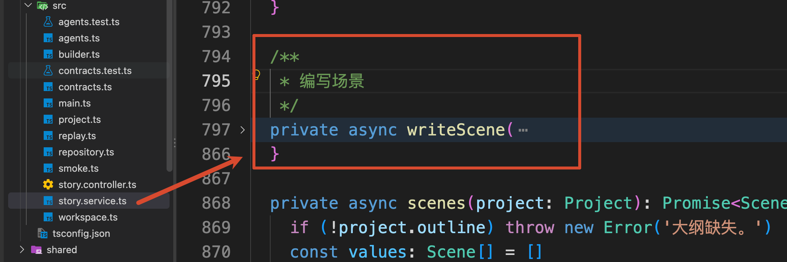

刚才传入的 `scene.id`，在这个方法中接收为 `sceneId`。后两个参数 `undefined`、`false` 表示本次没有用户改写意见，也没有进入 Reviewer 返工，当前执行的是首次编写。

### 同一个场景编剧，每次只接一份任务
`writeScene()` 首先准备 `reads`，也就是场景编剧需要读取的资料：

```typescript
// 场景编写时默认需要读取：
// 用户需求、世界观、角色设定、已批准大纲以及场景 Schema。
const reads = [
  `${base}/brief.md`,
  `${base}/world.json`,
  `${base}/characters.json`,
  `${base}/outline-v${project.outlineVersion}.json`,
  '/contracts/scene.schema.json'
]
```

`base` 仍然根据当前作品的 `revision` 得到。这里的大纲路径使用 `outlineVersion`，因此用户批准哪一版，编剧就会拿到哪一版大纲。

当前代码提供了完整大纲，角色可以从中查看当前场景和相关场景的摘要。任务单另外用 `sceneId` 指定这次只编写哪一个场景。

随后，方法根据本次操作生成任务目标。首次编写时，`goal` 的值是：

```typescript
`按照已批准大纲编写 ${sceneId} 的正文。`
```

准备好目标和输入文件后，再创建任务单：

```typescript
// 为 Scene Writer 创建任务单，
// 明确目标、可读取资料、交付文件以及验收要求。
const assignment = await this.assignment(
  project,
  'scene-writer',
  goal,
  reads,
  [`${sceneId}.json`],
  ['只写本场景标题与正文', '分支结构与批准大纲完全一致'],
  { sceneId, instruction }
)
```

接收角色是 `scene-writer`，也就是场景编剧。这次 `assignment()` 同样会生成新的任务 ID，把交付路径设置为 `/staging/<本次任务 ID>/${sceneId}.json`，并匹配场景编写 Skill。

打开 `server/skills/scene-writing/SKILL.md`，里面有一条明确要求：

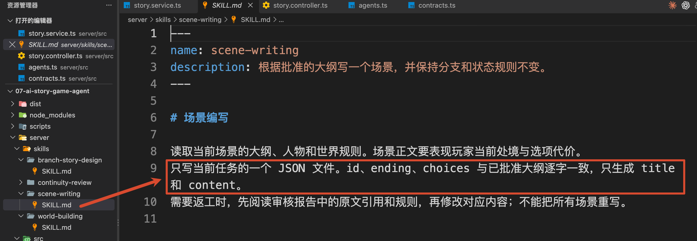

这里的分工就清楚了：剧情策划确定场景安排和玩家选择，场景编剧根据这份安排扩写标题与正文。

接着，`writeScene()` 调用 `this.task()`

```javascript
// 执行场景编写任务，并将结果写入对应的场景文件。
await this.task(
    project,
    assignment,
    [`${base}/scenes/${sceneId}.json`],

    // 对 Agent 生成结果进行校验，
    // 确保当前场景与已批准大纲中的结构保持一致。
    ([raw]) => assertScene(project.outline!, raw, sceneId)
)
```

`task()` 方法会再次走到 `agents.ts` 的 `runAI()`。

这次 `assignment.assignee` 是 `'scene-writer'`，所以创建的 Subagent 会使用 `roleProfiles['scene-writer']` 中的 Prompt。

`child.permissions` 也会使用本次 `assignment.writeFiles` 设置写入范围。于是，当前编剧只能写自己这份候选文件，世界观、人物和已批准大纲的写入操作会被拦截。

场景编剧写完文件，执行再次回到 `StoryService.task()`。这一次，`writeScene()` 传入的接收方式是：

```typescript
await this.task(
  project,
  assignment,
  [`${base}/scenes/${sceneId}.json`],
  ([raw]) => assertScene(project.outline!, raw, sceneId)
)
```

第三个参数指定正式文件位置。第四个参数则把读取到的场景 JSON，也就是 `raw`，连同已批准的大纲和目标 `sceneId`，交给 `assertScene()`。

这一块执行逻辑有点复杂，跟大家画了一个流程图，大家可以参考下：

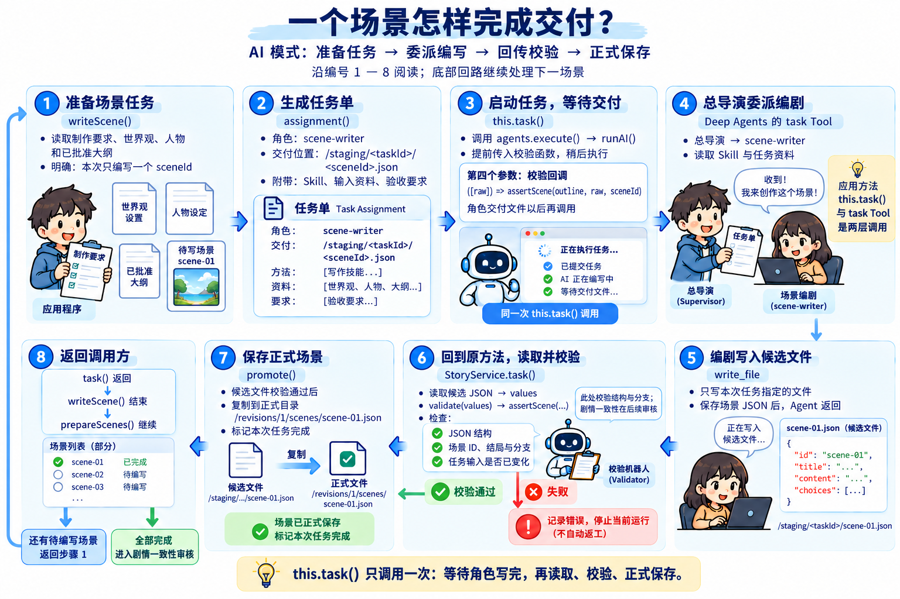

接下来打开 `contracts.ts`，找到这个函数。

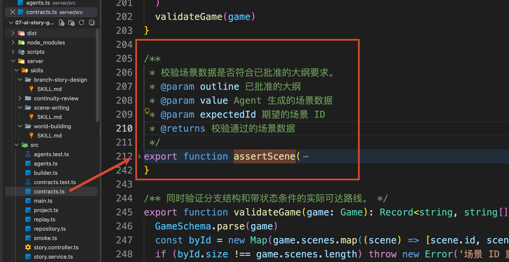

这个函数用 `value` 接收刚才的 `raw`，用 `expectedId` 接收目标 `sceneId`。它先通过 `SceneSchema.parse(value)` 解析场景文件，得到 `scene`；再使用 `expectedId`，从大纲里找到对应条目，保存为 `planned`。然后检查：

```typescript
if (!planned || scene.id !== expectedId)
  throw new Error(`场景 ID 不符合任务要求：${expectedId}`)

if (
  scene.ending !== planned.ending ||
  !isDeepStrictEqual(scene.choices, planned.choices)
) {
  throw new Error(`${expectedId} 修改了已批准的分支结构。`)
}
```

例如，大纲已经规定一个选择前往某个普通场景，编剧写正文时却把它改成直接进入结局，就会因为 `choices` 不一致而被拒绝。选择文字、跳转目标、条件和效果，都要保留大纲中的内容。

检查通过以后，`task()` 按照前面讲过的流程，将候选文件复制到正式位置并结束当前任务。`writeScene()` 返回，`prepareScenes()` 的循环才会进入下一项。

下一次 `writeScene()` 会为下一个场景重新准备任务单，再创建本次执行的总导演和子角色。同一个 `scene-writer` 角色配置可以反复使用，每次任务的 `sceneId` 和交付路径各不相同。

等所有场景都处理完，当前版本的 `scenes` 目录中就有了每个场景对应的 JSON 文件。页面左侧“项目文件”也可以打开这些文件，查看场景标题和正文；AI 生成的场景 ID 和内容以本次大纲为准。

到这里，世界观、人物、大纲和场景已经完成了文件交接。

不过，刚才的校验主要检查字段和分支安排。正文里如果写出了违反世界规则的情节，还需要进一步审核。因此，`prepareScenes()` 返回后，Graph 会沿着 `.addEdge('scenes', 'review')` 进入 `review` Node，调用 `reviewAndRelease()`。

这就是下一篇要继续跟踪的位置。

## 总结
这一篇，咱们从世界观设计师的交付文件，一直跟到了场景正文的生成

这几个角色能够接着彼此的工作往下做，靠的是任务单里明确的输入和交付文件。每个角色完成一部分创作，服务端检查结果，再交给下一步使用。

接下来还需要确认整部故事有没有前后矛盾，以及怎样把这些文件做成可以玩的游戏。

下一小节，咱们从 `reviewAndRelease()` 继续看一致性审核、局部返工和游戏构建。

> 更新：2026-10-04 11:37 · 原文：<https://www.yuque.com/lgdsunday/ab1dy3/vdeqtnr05ertml51>
