# 10 - 实战（下）：一致性审查、问题返工与可玩游戏构建

上一小节，咱们批准了剧情大纲，程序按照大纲逐个委派场景编剧，把每一幕的正文保存到了 Workspace。

那么这一篇，咱们就接着场景生成完成的位置往下看：**怎样发现这种冲突，只修改有问题的场景，再把检查通过的内容做成可以玩的游戏。**

## 从场景编写进入一致性审核
为了方便对照，大家可以先在页面新建一部作品，选择“Replay 演示”，把“演示样本”改成“故障演示：冲突与局部返工”。

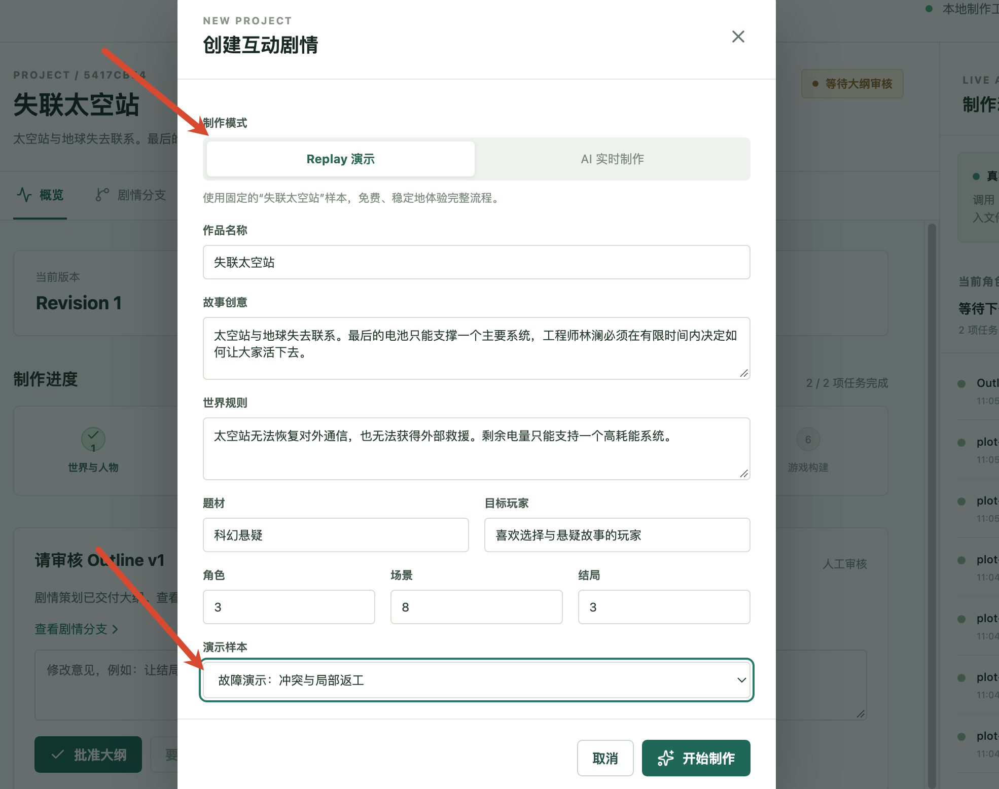

点击“开始制作”，等大纲生成以后，再点击“批准大纲”。

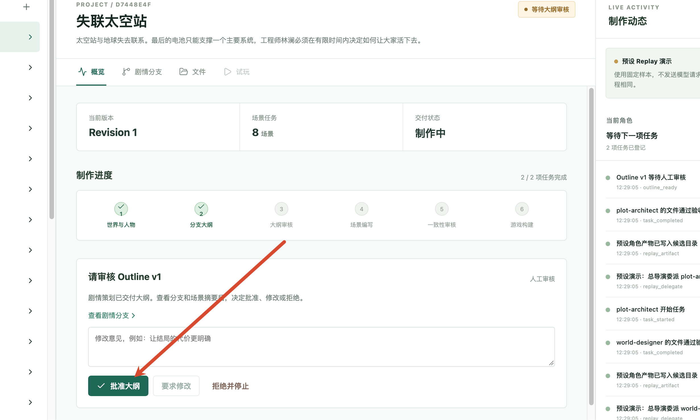

这个样本会故意在 `ending-02` 的正文中加入刚才的通信冲突。后面讲报告和返工时，咱们就用这一个问题贯穿整个过程。

接下来打开 `story.service.ts`，找到上一节最后讲到的 `createGraph()`。

场景编写完成以后，执行会沿着这条 Edge 进入审核：

```typescript
.addEdge('scenes', 'review')
```

同一个方法中的 `review` Node，调用的就是本篇入口：

```typescript
.addNode('review', async (state) => {
  await this.reviewAndRelease(state.projectId)
  return {}
})
```

所以，用户批准大纲以后，程序会连续完成场景编写和一致性审核。这里不需要再点一次“开始审核”。

现在进入 `reviewAndRelease()`。

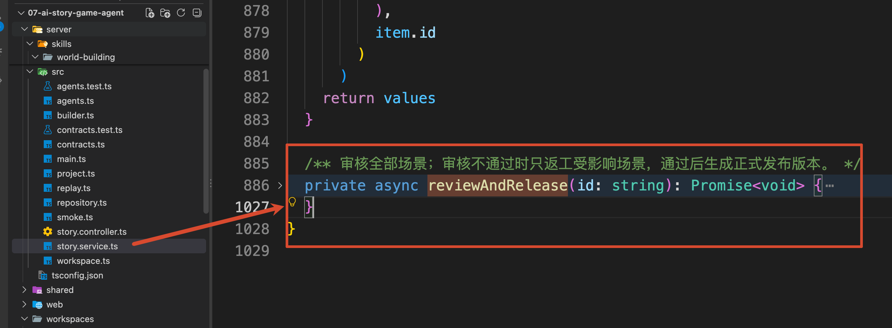

它先读取当前作品，确认大纲、人物和大纲批准记录已经存在，然后通过 `while (true)` 执行审核循环先审核，有问题就安排修改，修改后再审核。

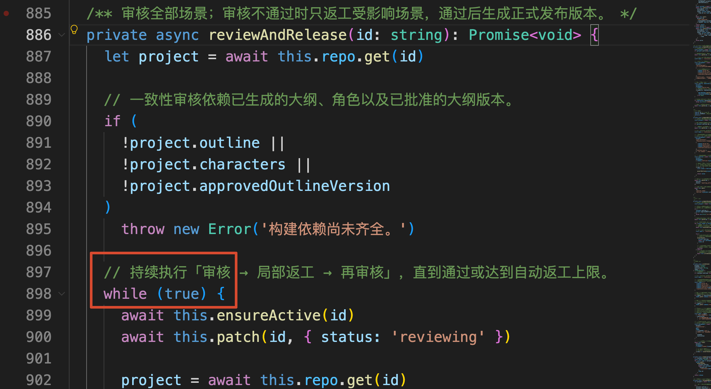先看循环开头的几行代码：

```typescript
await this.patch(id, { status: 'reviewing' })
project = await this.repo.get(id)
const scenes = await this.scenes(project)
```

第一行把项目状态改成“剧情审核”。第二行拿到最新项目记录。第三行则读取刚才生成的场景文件。

这里的 `this.scenes()` 就在 `reviewAndRelease()` 上面，直接给大家把代码贴出来

```javascript
    /** 读取当前版本大纲中的全部场景文件，并逐个校验后返回。 */
    private async scenes(project: Project): Promise<Scene[]> {
        // 场景必须依赖大纲读取，否则无法确定应该加载哪些场景。
        if (!project.outline) throw new Error('大纲缺失。')

        const values: Scene[] = []

        // 按照大纲中的场景顺序，依次读取当前 revision 对应的场景文件。
        for (const item of project.outline.scenes)
            values.push(
                // 校验场景结构、ID 以及分支信息是否仍与已批准大纲保持一致。
                assertScene(
                    project.outline,
                    await this.workspace.readJson(
                        project.id,
                        `/revisions/${project.revision}/scenes/${item.id}.json`
                    ),
                    item.id
                )
            )

        return values
    }
```

它按照 `project.outline.scenes` 中的场景 ID，逐个读取 `/revisions/{当前版本}/scenes/{场景ID}.json`，再调用上一节讲过的`assertScene()` 检查字段和分支。

最终返回的 `values: Scene[]` 是一个数组，里面保存了所有场景的标题、正文和选择项。后面接收审核报告时，就会用这份数组核对报告引用的原文。

### 给审核者准备哪些资料
读取场景以后，执行回到 `reviewAndRelease()`。接下来，它会准备一份新的角色任务单：

```typescript
const base = `/revisions/${project.revision}`
// 收集当前大纲对应的全部场景文件，作为审核员的输入材料。
const paths = project.outline!.scenes.map(
  (item) => `${base}/scenes/${item.id}.json`
)
// 创建一致性审核任务，要求审核结果必须能够引用真实场景内容作为依据。
const assignment = await this.assignment(
  project,
  'continuity-reviewer',
  '检查全部场景是否违反世界设定或人物动机，给出有原文依据的审核报告',
  [
    `${base}/brief.md`,
    `${base}/world.json`,
    `${base}/characters.json`,
    `${base}/outline-v${project.outlineVersion}.json`,
    ...paths,
    '/contracts/review.schema.json'
  ],
  ['review.json'],
  ['问题引用必须来自真实场景正文', '无问题时 approved 且 issues 为空']
)
```

`paths` 是刚才那些场景文件的路径列表。加上制作要求、世界观、人物和大纲，审核者就有了判断剧情是否前后一致所需的资料。

本次接收任务的是 `continuity-reviewer`，也就是一致性审核者。它需要交付的文件只有一个：`review.json`。

和前两篇一样，`assignment()` 会把文件名转换成本次任务的候选路径，并为这个角色选择对应的 Skill：

```latex
/skills/continuity-review/SKILL.md
```

大家可以打开项目源码中的 `server/skills/continuity-review/SKILL.md`。里面要求审核者：找到冲突时，给出问题所在的场景、场景原文、违反的规则、原因和修改建议。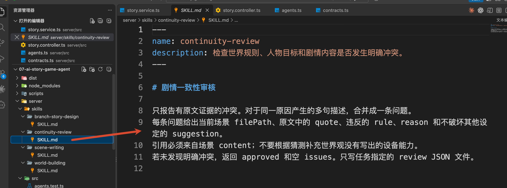`agents.ts` 中的 `roleProfiles['continuity-reviewer'].systemPrompt` 还进一步限定了审核范围：只报告明确的世界规则、人物或时间线冲突，不根据猜测补充设定，也不会因为个人审美要求返工。

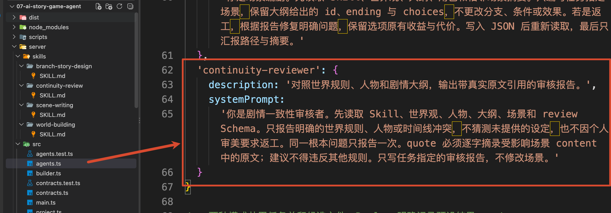

任务单准备好以后，仍然通过 `this.task()` 执行。

### 审核报告返回以后，程序怎样接收
继续看 `reviewAndRelease()` 中紧接着的调用：

```typescript
// 执行审核任务，并使用真实场景再次校验审核报告是否合法。
const report = await this.task(
  project,
  assignment,
  [`${base}/reviews/review-${project.repairCount}.json`],
  ([raw]) => assertReview(raw, scenes)
)
```

这里的 `project.repairCount` 是项目创建时初始化为 `0` 的返工轮数。目前还没有返工，所以第一份报告的正式保存位置是：

```latex
/revisions/1/reviews/review-0.json
```

审核者先写候选文件。`task()` 读取这个文件以后，会把解析出的 JSON 交给第四个参数中的校验函数。

因此，`raw` 就是待接收的审核报告，`scenes` 则是本轮开始时从正式文件读取的全部场景。程序把它们一起传给 `contracts.ts` 中的 `assertReview()`。

先看本次 Replay 冲突样本交付的报告：

```json
{
  "verdict": "needs_revision",
  "issues": [
    {
      "filePath": "/scenes/ending-02.json",
      "rule": "太空站无法恢复对外通信，也无法获得外部救援。",
      "quote": "林澜恢复了对外通信，成功联系地球，救援飞船赶到并接走了所有人。",
      "reason": "这个结局依靠对外通信和救援飞船解决困境，违反失联世界规则。",
      "suggestion": "去掉外部救援，保留休眠降低消耗和维修停滞的代价。"
    }
  ]
}
```

`verdict` 是审核结论，`needs_revision` 表示需要修改。`issues` 是具体问题列表，里面这条问题指出了：哪一幕有问题、哪句话违反了什么规则，以及建议怎么改。

注意，报告里的 `filePath` 使用本项目约定的简短格式 `/scenes/ending-02.json`。它用来标识问题场景，实际文件仍保存在当前作品的 `revisions/1/scenes/ending-02.json` 中。

那么大家想一下：现在有了这样的报告，咱们就可以直接相信它了吗？

肯定是不行的，还得先检查一下。

`assertReview()` 就负责接收前的这一步检查，还是上一小节看过的那段代码：

```javascript
// 执行审核任务，并使用真实场景再次校验审核报告是否合法。
const report = await this.task(
    project,
    assignment,
    [`${base}/reviews/review-${project.repairCount}.json`],
  // 这里触发了 assertReview 方法
    ([raw]) => assertReview(raw, scenes)
)
```

然后咱么来看下 `assertReview()` 方法，这个方法在 `contracts.ts` 中 ：

```typescript
/** 校验审核报告：结论必须与问题数量一致，并且所有问题引用都必须来自真实场景原文。 */
export function assertReview(value: unknown, scenes: Scene[]): Review {
    // 先通过 Schema 校验审核报告的基础数据结构。
    const report = ReviewSchema.parse(value)

    // approved 必须对应零问题；存在任何问题时则不能判定为 approved。
    if ((report.verdict === 'approved') !== (report.issues.length === 0))
        throw new Error('审核结论与问题列表不一致。')

    // 逐条验证审核问题，防止模型编造不存在的场景或引用内容。
    for (const issue of report.issues) {
        // 根据审核报告中的文件路径找到对应场景。
        const scene = scenes.find(
            (item) => `/scenes/${item.id}.json` === issue.filePath
        )

        // 场景必须真实存在，并且 quote 必须能够在场景正文中找到。
        if (!scene || !scene.content.includes(issue.quote))
            throw new Error(`审核报告引用了不存在的场景原文：${issue.filePath}`)
    }

    return report
}
```

`ReviewSchema.parse()` 先检查报告结构。接着，程序要求“审核通过”必须对应空问题列表，“需要修改”必须对应至少一条问题。

最后，按照每条问题的 `filePath` 找到场景，确认 `quote` 确实出现在该场景的正文里。

校验通过，`task()` 把报告复制到正式目录，并把对象返回给前面的 `report`。执行回到 `reviewAndRelease()`，下一步是：

```typescript
await this.patch(id, { review: report })
```

页面读取到 `project.review.issues`，就能在“概览”中展示“审核发现的问题”。后续审核通过时，这个区域会消失，因为最新报告的 `issues` 已经为空。

Replay 执行比较快，不像 AI 模式是的大家可以看到冲突的提示（最初的项目演示视频里面有）大家可以直接从左侧“项目文件”打开 `review-0.json`，查看保留下来的第一份报告。

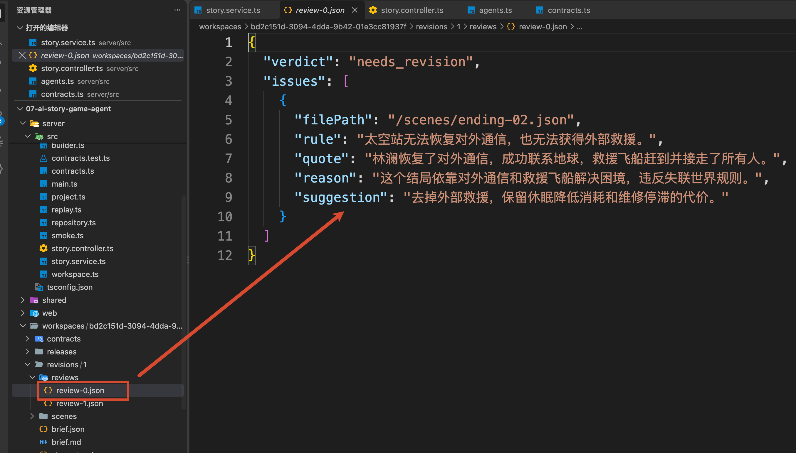

## 发现冲突以后，怎样只返工对应场景
报告保存以后，`reviewAndRelease()` 继续判断审核结论：

```typescript
// 审核通过后退出返工循环，进入正式发布阶段。
if (report.verdict === 'approved') break
```

`break` 表示退出审核循环，继续后面的游戏构建。

咱们这次的结论是 `needs_revision`，所以还不能退出。程序会先检查返工轮数，再从问题列表中找出需要修改的场景。

### 从问题列表中得到返工任务
当前是第一次审核，`repairCount` 为 `0`，没有达到限制。程序继续执行：

```typescript
// 根据审核报告中的文件路径，只提取真正存在问题的场景 ID。
const affected = [
  ...new Set(
    report.issues.map((issue) =>
      issue.filePath.replace('/scenes/', '').replace('.json', '')
    )
  )
]
```

这段代码把报告中的 `/scenes/ending-02.json` 转成场景 ID `ending-02`。同一个场景可能被指出多个问题，所以还通过 `Set` 去重。

这里给大家看下  `ending-02` 的内容：

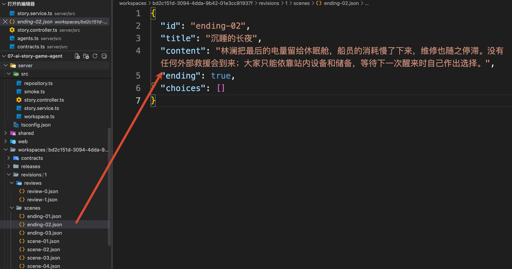

得到的 `affected` 就是本轮需要返工的场景列表。本次只有一项：

```typescript
['ending-02']
```

拿到这个列表以后，程序增加返工轮数，再逐个调用上一节已经讲过的 `writeScene()`：

```typescript
// 记录返工次数，并重新读取最新项目状态。
await this.patch(id, { repairCount: project.repairCount + 1 })
project = await this.repo.get(id)

// 只重新生成受影响的场景，已经通过检查的场景保持不变。
for (const sceneId of affected)
  await this.writeScene(project, sceneId, undefined, true)
```

这里重新读取 `project`，是为了让 `writeScene()` 拿到更新后的 `repairCount`，当前值已经变成 `1`。

这一次，第三个参数没有用户改写要求，第四个参数 `true` 表示按照审核报告返工。

然后咱们来看 `writeScene()`。

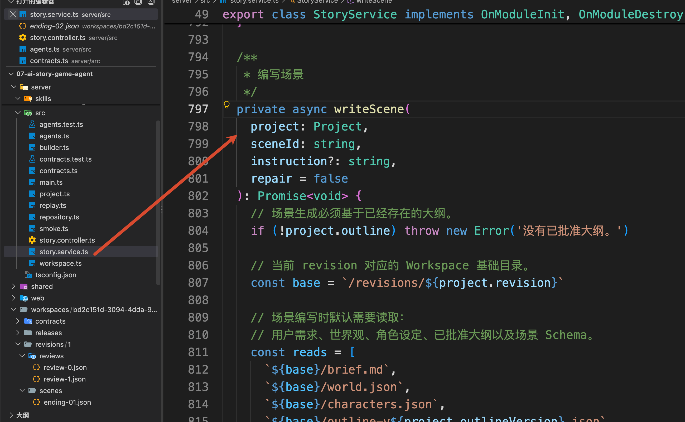

上一节第一次写场景时，咱们看过这个方法，它会准备制作要求、世界观、人物、大纲和场景 Schema。进入返工模式以后，还会追加两份资料：

```typescript
if (repair || instruction)
  reads.push(`${base}/scenes/${sceneId}.json`)

if (repair)
  reads.push(`${base}/reviews/review-${project.repairCount - 1}.json`)
```

第一份是需要修改的场景原文。第二份是指出问题的审核报告。

为什么报告编号要减一？因为刚才已经把返工轮数从 `0` 增加到了 `1`，但触发这次返工的报告仍然是 `review-0.json`。

对应到本例，编剧需要再读取：

```latex
/revisions/1/scenes/ending-02.json
/revisions/1/reviews/review-0.json
```

同一个 `writeScene()` 中，`goal` 的返工分支会生成明确要求：

```latex
根据审核问题修复 ending-02 的正文，不修改任何其他场景。
```

接着，`writeScene()` 使用这些资料重新创建 `scene-writer` 任务。交付文件仍然只有本次指定的 `ending-02.json`

场景编剧读取报告，就能看到“外部救援违反世界规则”的原因和建议，再针对这一幕修改正文。`server/skills/scene-writing/SKILL.md` 也要求返工时先读报告，保留批准大纲中的 `id`、`ending` 和 `choices`。

写完以后，候选场景再次经过 `assertScene()`，通过检查才会替换当前版本的正式场景文件。


### 修改以后，还要再检查一遍
`writeScene()` 返回以后，执行回到 `reviewAndRelease()`。

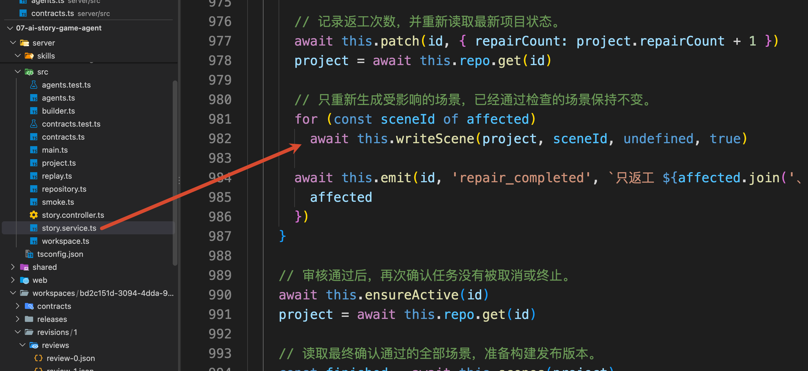

本轮 `affected` 中的场景都修改完，程序会记录“只返工 ending-02”，然后回到 `while (true)` 的开头。

下一轮会重新读取全部场景，再委派一致性审核者检查。

## 通过审核以后，怎样构建可玩游戏
现在接着 `reviewAndRelease()` 中 `while` 循环后面的代码往下看。

程序重新读取项目和全部场景，把结果保存到 `project` 和 `finished`，随后准备本次构建使用的源文件路径 `sourcePaths`：世界观、人物、当前大纲和所有场景。

接下来调用：

```typescript
// 将世界观、角色、大纲和最终场景组装成完整游戏，并生成正式发布产物。
const release = await this.builder.release(
  project,
  gameFromOutline(
    project.brief,
    project.outline!,
    project.characters!,
    finished
  ),
  sourcePaths
)
```

这行代码要先执行里面的 `gameFromOutline()`，把几份资料整理成一个游戏对象，再交给 `this.builder.release()` 构建发布文件。

`gameFromOutline()` 定义在 `contracts.ts` 中，代码比较简单，直接返回一个固定对象：

```typescript
/** 根据已确认的大纲、角色和场景数据，组装最终可发布的游戏对象。 */
export function gameFromOutline(...): Game {
    return {
        // 游戏标题直接使用已批准大纲中的标题。
        title: outline.title,

        // 保留最初需求中的故事前提，作为游戏整体背景。
        premise: brief.premise,

        // 指定玩家进入游戏后的第一个场景。
        startSceneId: outline.startSceneId,

        // 保留大纲中定义的状态标记，例如玩家是否拿到了授权卡。
        flags: outline.flags,

        // 提取最终确认的角色列表。
        characters: characters.characters,

        // 使用已经完成并通过审核的全部场景作为游戏正文。
        scenes
    }
}
```

现在再进入 `this.builder.release()`。它对应 `builder.ts` 中的 `GameBuilderService.release()`

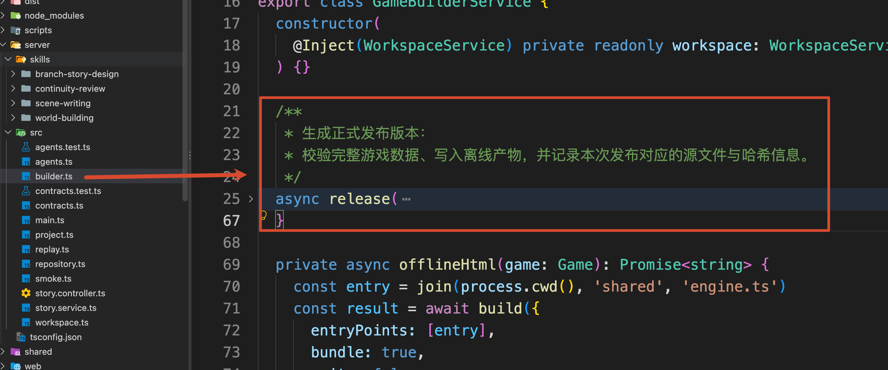

方法开头是：

```typescript
// 发布前先校验游戏结构，并得到从起始场景到各个结局的有效路径。
const paths = validateGame(game)
```

这里需要检查：这些内容放在一起以后，玩家能不能真正走到结局。

打开 `contracts.ts`，找到 `validateGame()`。

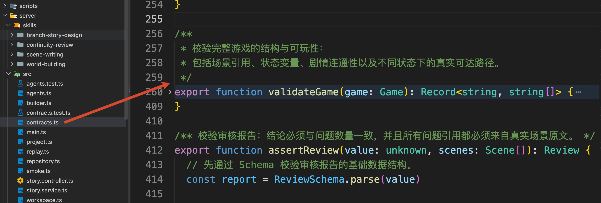

上一节接收大纲时，`assertOutline()` 已经调用过这个函数，提前检查了分支安排。

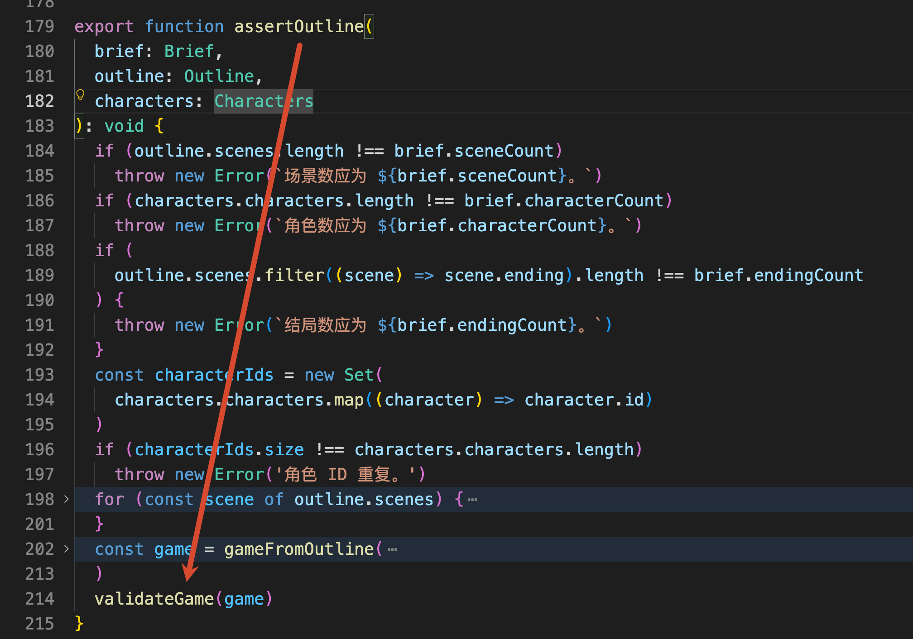

函数先检查字段、场景 ID、选择目标和状态名称等基本规则。

然后，从起点沿着各个选择遍历，检查是否有到不了的场景，以及剧情是否形成循环。

不过，检查游戏能不能走通，还需要考虑 **选项的使用条件**。

比如，游戏中有一个选项叫“用授权卡重启空气循环”。玩家必须先拿到授权卡，才能使用它。

咱们用 `hasKey` 记录玩家有没有这张卡：

```plain
hasKey: false // 没有授权卡
hasKey: true  // 已经拿到授权卡
```

游戏刚开始时，`hasKey` 是 `false`。

如果玩家选择“领取维修授权卡，跟周明去机舱”，这个选项就会把 `hasKey` 改成 `true`。这类 **选择后产生的状态变化**，保存在 `effects` 中：

```plain
effects: { hasKey: true }
```

等玩家来到控制室，程序再判断：现在有没有授权卡？

“用授权卡重启空气循环”这个选项的配置是：

```plain
{
  text: '用授权卡重启空气循环',
  to: 'ending-01',
  when: { hasKey: true },
  effects: {}
}
```

这里可以直接理解为：

+ `when`：有授权卡，才会显示这个选项。
+ `to`：选择以后，进入 `ending-01`。
+ `effects`：这次选择不修改任何状态标记，所以是空对象。

这样，同样来到控制室，玩家能做的事情也可能不同：

```plain
之前领过授权卡 → 可以重启空气循环 → 进入 ending-01
之前没领授权卡 → 不能选择重启，只能选择其他路线
```

所以，程序检查结局能不能到达时，还要沿着路线计算玩家状态，确认途中的选项条件能够满足。

即：**只看到 “控制室 → ending-01” 还不够，必须确认玩家确实有机会拿到授权卡，再走到控制室。**

假如前面所有选项都没有把 `hasKey` 改成 `true`，即使分支图上画着通往 `ending-01` 的箭头，玩家也永远选不到它。

为了解决这个问题，`validateGame()` 的后半段会从初始状态开始，模拟玩家的实际选择。

先找到待检查队列的创建位置：

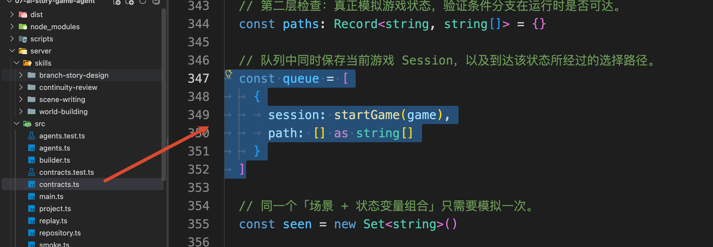

队列里的每一项保存一份游玩进度 `session`，以及走到这里的选择记录 `path`。最初由 `startGame(game)` 创建起点进度，选择记录为空。

接下来的 `while (queue.length)` 每次取出一项，通过 `currentScene(game, session)` 找到当前场景。

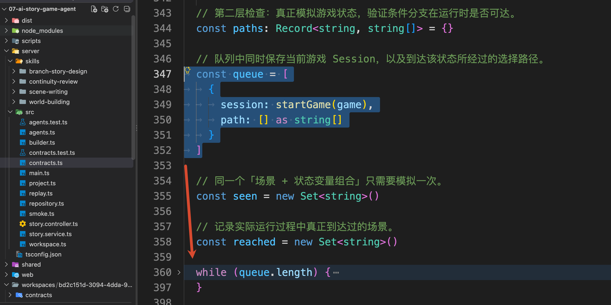

遇到结局就记录路线，普通场景则继续检查可以作出哪些选择：

```typescript
const options = availableChoices(scene, session.flags)
if (!options.length)
  throw new Error(`${scene.id} 在某个可达状态下没有可选项。`)

for (const choice of options)
  queue.push({
    session: choose(game, session, choice.id),
    path: [...path, `${scene.id}:${choice.id}`]
  })
```

`availableChoices()` 找出当前状态允许的选项，`choose()` 模拟选择后的新状态，再放回队列继续检查。

同一个控制室，在“有授权卡”和“没有授权卡”时，可用选项不同。因此代码记录已经检查的进度时，会同时考虑场景 ID 和状态值。

全部检查通过以后，`validateGame()` 返回各个结局的一条可达路线。

### 把游戏保存成可发布的文件
检查通过以后，回到 `builder.ts` 的 `release()`。接下来的关键代码是：

```typescript
// 每次发布生成独立 ID，使不同发布版本彼此隔离。
const id = randomUUID()
const base = `/releases/${id}`

// 序列化完整游戏数据，同时生成可以离线运行的 HTML 页面。
const gameText = JSON.stringify(game, null, 2)
const html = await this.offlineHtml(game)

// 保存本次发布的核心产物：游戏数据和离线试玩页面。
await this.workspace.writeText(project.id, `${base}/game.json`, gameText)
await this.workspace.writeText(project.id, `${base}/index.html`, html)
```

这里生成的 `id` 是本次发布版本的 ID。它和作品的 `project.id` 分开：同一部作品以后可以发布多次，每次保留自己的文件。

`game.json` 保存完整游戏数据。`index.html` 则是一份可以独立打开的离线游戏。

`offlineHtml()` 也在 `builder.ts` 中。它使用 [esbuild](https://esbuild.github.io/api/#write) 把 `shared/engine.ts` 打包成浏览器脚本，再把脚本、游戏数据、页面模板和背景图片放进同一份 HTML。背景图片以 Base64 形式内嵌，所以下载后无需再请求图片地址。

模型生成的正文作为数据进入模板，页面通过 `textContent` 展示标题和剧情。游戏运行逻辑使用项目里的固定引擎。

文件写好以后，`release()` 还会计算源文件与发布文件的 Hash，保存一份 `manifest.json`。里面记录当前内容版本、批准的大纲版本、源文件摘要和刚才算出的结局路线，方便以后核对这次发布使用了哪些内容。

最终在磁盘上可以找到这些打包之后的文件：

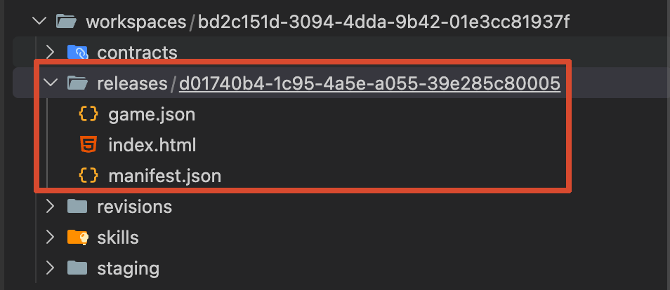

`release()` 返回 `{ id, paths }`，执行重新回到 `story.service.ts` 的 `reviewAndRelease()`，把发布结果登记到项目：

```typescript
await this.patch(id, {
  latestReleaseId: release.id,
  releaseIds: [...project.releaseIds, release.id],
  status: 'ready',
  failure: null,
  activeRole: null
})
```

这里的 `id` 是当前作品 ID，`release.id` 是刚才创建的发布 ID。

至此！咱们整个游戏就可以游玩了

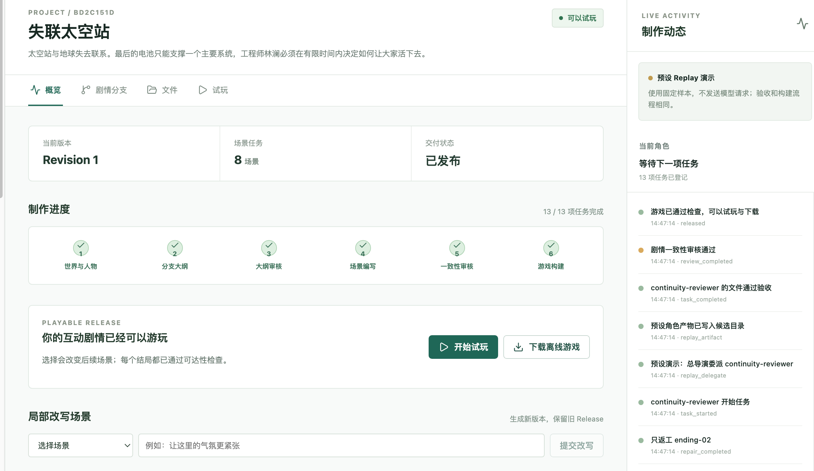

## 总结
到这里，从制作要求到可玩游戏的完整过程就走完了。

这一篇重点补上了文件生成以后的处理：审核者读取完整资料，给出带原文的冲突报告，程序校验报告、找出受影响场景，再委派编剧修改。修改后重新审核，两轮返工后仍有问题就停下来，交给人判断。

审核通过以后，普通代码继续检查分支和状态条件，把内容组装成 `game.json` 和离线 HTML。前端与离线页面使用同一套规则运行游戏，玩家可以实际走向不同结局。

**多个 Agent 的结果，只有经过检查、必要的修改和最终构建，才能变成用户真正可以使用的作品～**

> 更新：2026-10-04 15:52 · 原文：<https://www.yuque.com/lgdsunday/ab1dy3/gmbmnm1hgsdg06zs>
