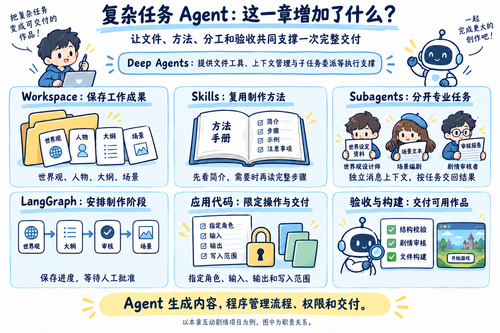
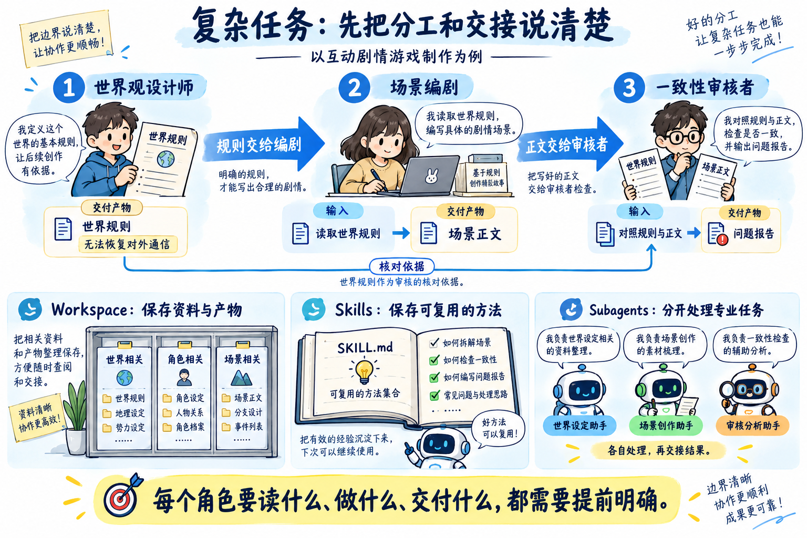
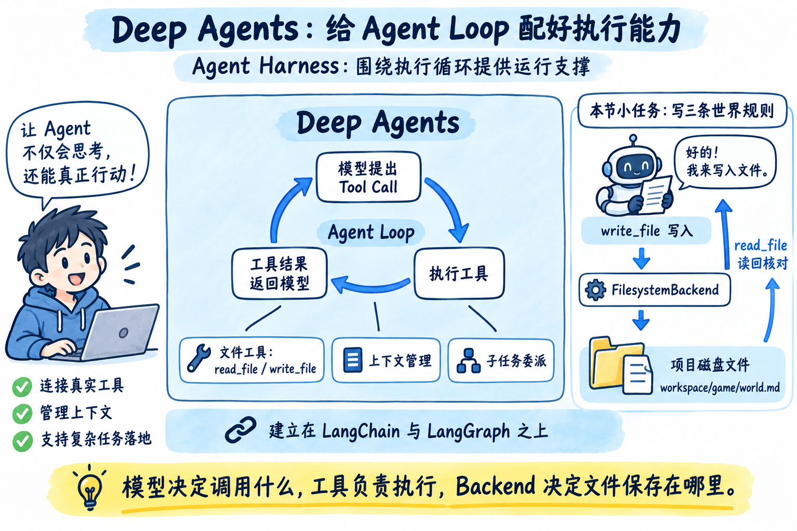
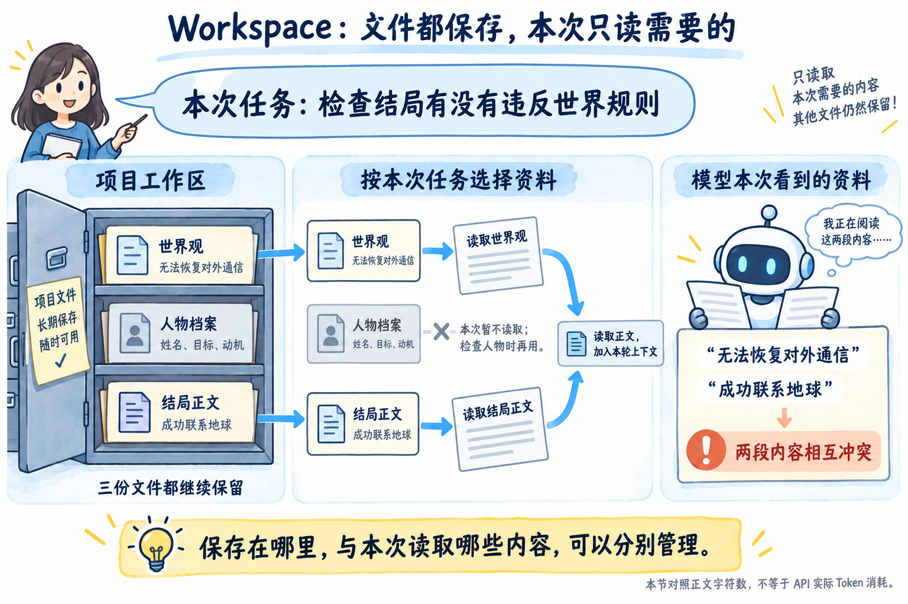
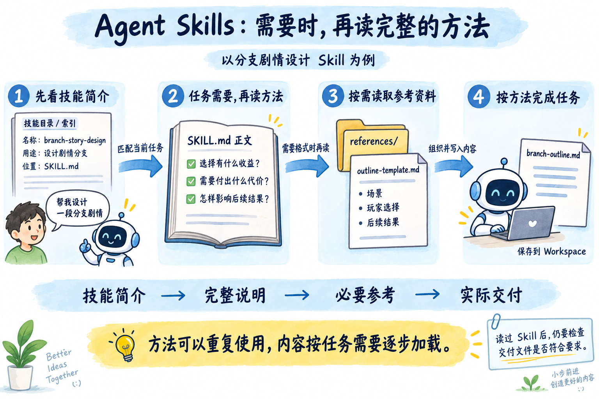
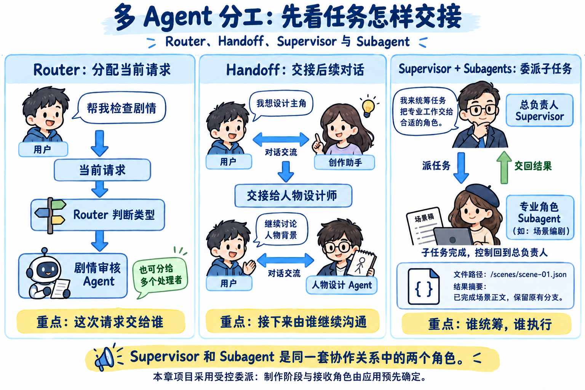
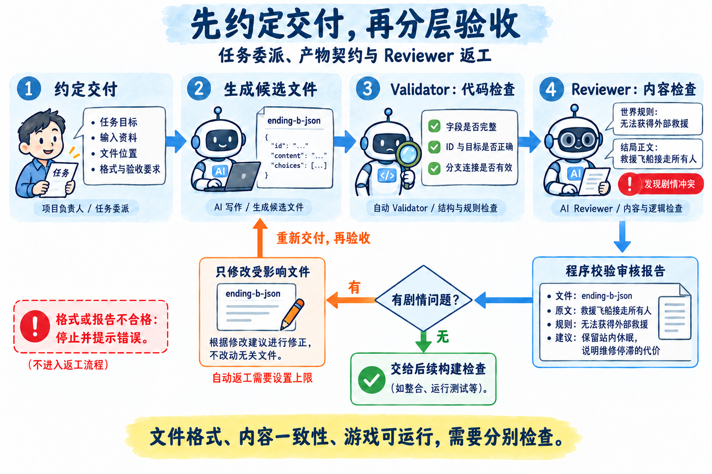
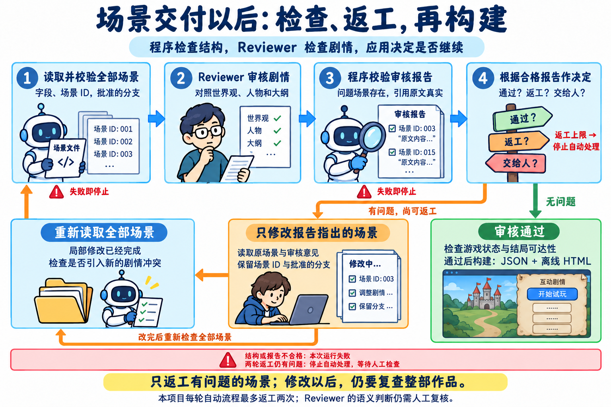

# 11 - 第八章总结：复杂任务 Agent 如何在简历和面试中体现

好了，到这里，第八章也全部学完了。

这一章，咱们让 Agent 完成了一件挺有意思的事情：用户给出制作要求，系统就能逐步生成世界观、人物、大纲和场景，最后交付一款可以点击选项、走向不同结局的互动剧情游戏。

但回头想一下，真正麻烦的地方在哪？

世界观要交给后面的编剧使用，场景要沿用已经批准的大纲，审核者要指出具体哪里写错了，修改以后还得重新检查。任何一处接不上，最后都可能得到一堆文件，却做不出能玩的游戏。

所以，**这一章学习的是怎样组织复杂任务中的资料、方法、角色和交付结果，让多个 Agent 共同完成一项完整工作。**

最后这一小节，咱们先回顾学过的内容，再整理简历写法和面试时需要说清楚的问题。

## 第八章都学了啥
先把这一章的几项能力放到一起看：



图里的每一部分都有自己的作用。Workspace 保存文件，Skills 保存方法，Subagent 执行专业任务。外层工作流安排制作顺序，应用代码负责权限、验收和最终交付。接下来，再按小节回顾它们是怎样接起来的。

### 01-复杂任务为什么需要重新分工
第一小节先确定了整章的项目目标。

制作一款互动剧情游戏，需要有世界规则、人物动机、剧情分支、场景正文和不同结局。这些内容之间有依赖关系，后面写出的场景还得遵守前面确定的设定。

如果让同一个 Agent 从头做到尾，它的消息中就会不断积累各种资料、写作过程和修改记录。检查一个结局时，当前用不到的人物设计过程也可能还在上下文里。

因此，咱们先提出了三种处理办法：把项目资料保存到 Workspace，把制作方法整理成 Skills，再把专业任务交给不同的 Subagent。

这里需要先有明确的任务边界。比如世界观设计师交付世界规则，场景编剧依据这些规则写正文，审核者检查两者是否冲突。



### 02-Deep Agents 与 Agent Harness
第二小节认识了 [Deep Agents](https://docs.langchain.com/oss/javascript/deepagents/overview)。

它建立在 LangChain 和 LangGraph 之上，为 Agent 准备文件操作、上下文管理和子任务委派等执行能力。这类围绕 Agent Loop 提供的运行支撑，就可以理解为 Agent Harness。

咱们先做了一个很小的任务：让世界观设计师写三条世界规则，保存成文件，再读回来核对。

这里没有自己编写 `write_file` 和 `read_file`。模型提出 Tool Call，Deep Agents 执行对应工具，再把结果交回模型。咱们通过 `FilesystemBackend` 指定文件实际保存的位置。

最终，项目里的 `workspace/game/world.md` 就是可以检查的结果。运行结束以后，这份资料仍然存在，后续任务也可以继续读取。



### 03-Workspace 与按需读取
第三小节继续处理资料越来越多的问题。

案例准备了世界观、人物档案和场景三份文件，然后比较两种输入方式：把三份资料全部交给模型，或者只提供本次检查需要的世界观与场景。

当前要检查的是“场景有没有违反世界规则”。一个文件写着“无法恢复对外通信”，另一个写着“成功联系地球”，这两份资料已经足够指出问题。人物档案可以留在工作区，等检查人物行为时再读。



Workspace 就是供当前项目保存、查找和读取这些文件的工作区域。文件正文需要被模型使用时，再通过文件工具或者应用程序读取，加入本轮上下文。

它的保存方式取决于 [Backend](https://docs.langchain.com/oss/javascript/deepagents/backends)。课程使用 `FilesystemBackend`，所以文件会写到指定的磁盘目录。

### 04-Agent Skills 与制作方法复用
第四小节开始整理“怎样完成任务”的方法。

比如设计分支剧情，不能只写两个按钮。还需要考虑每个选择的收益、代价和后续结果。咱们把这些步骤写进 `SKILL.md`，把大纲格式放进模板，让不同的创作任务都能复用。

[Agent Skills 规范](https://agentskills.io/specification) 约定了技能目录和 `SKILL.md` 等内容的组织方式。文件开头的名称、描述用于说明这项技能适合什么任务，正文再写具体操作方法。

Deep Agents 的 [渐进式加载](https://docs.langchain.com/oss/javascript/deepagents/skills) 会先向模型提供技能简介和位置。任务需要时，再读取完整说明，继续按需要加载模板或参考资料。



因此，人物设计、剧情规划和一致性审核的方法，可以分别维护，不必每次都把所有说明加入同一段 System Prompt。

### 05-Router、Handoff、Supervisor 与 Subagent
第五小节解决的是：工作分给多个角色以后，它们怎样配合？

这几个名字对应不同的安排：

+ [Router](https://docs.langchain.com/oss/javascript/langchain/multi-agent/router) 根据当前请求选择处理者，可以选择一个，也可以分给多个处理者。
+ [Handoff](https://docs.langchain.com/oss/javascript/langchain/multi-agent/handoffs) 把后续交互交给另一个角色，用户接下来的消息继续由新角色处理。
+ Supervisor 负责统筹，把具体工作交给 Subagent，子任务完成以后再接收结果、继续推进整体任务。

Supervisor 和 Subagent 是同一套协作关系中的两个角色。把请求的去向和结果的返回方向画出来，就比较容易区分：



本章的小案例使用“总导演 + 剧情设计师”，观察了一次任务委派。总导演调用 `task`，子 Agent 读取资料、写文件，最后返回交付说明。

[Subagent](https://docs.langchain.com/oss/javascript/deepagents/subagents) 可以有独立的消息上下文。这样，子任务内部反复读文件、修改内容的过程，就不必原样进入主 Agent 的对话。

这些角色可以使用同一个模型，也可以运行在同一个程序里。区分角色的关键是职责、输入、工具和上下文

### 06-任务委派、产物契约与审核返工
第六小节继续追问：文件写出来了，怎样知道它能不能用？

咱们先约定每个任务要做什么、读取哪些资料、交付到哪里，以及怎样算完成。再约定场景文件需要包含哪些字段、分支应该指向哪里。

这些关于文件位置、数据格式和验收要求的约定，在课程里统称为“产物契约”。它是项目的工程设计，可以用 Schema 和业务校验落实。

拿到文件以后，需要分开检查两类问题。

+ 第一类可以由普通代码判断：必要字段是否存在、场景 ID 是否重复、选项是否指向真实场景。负责这些检查的程序就是 Validator。
+ 第二类需要理解文字：世界观规定无法获得外部救援，结局却写救援飞船接走了所有人。这类内容交给 Reviewer 阅读和判断。

Reviewer 需要给出问题文件、原文、违反的规则和修改建议，应用程序才能据此安排局部返工。修改以后重新验收，仍有问题就继续处理或在达到上限后停止。



### 07～10-AI 互动剧情游戏制作 Agent
最后四篇实战，把前面的小案例组合成了一个完整项目。

用户点击“开始制作”以后，服务端先创建作品记录和独立工作区，保存制作要求、Skills 与交付 Schema，再启动 LangGraph 工作流。

制作依次经过世界观与人物设计、大纲生成、人工审核、场景编写、一致性审核和游戏构建。大纲需要用户批准，后续场景才能按照当前批准版本生成。

这里有一层分工要记住：

+ LangGraph 和业务代码安排制作阶段，并生成当前任务单。
+ 总导演通过 `task` 把任务交给指定角色。
+ 专业角色读取资料和 Skill，完成当前任务，写入候选文件。
+ 应用程序读取候选结果，检查以后再保存到正式目录。

因此，当前项目里“下一步由谁做”已经受到应用约束。总导演负责完成委派，角色在自己的任务范围内生成内容。

每份任务都有自己的 `taskId`。AI 角色的写入权限限定在任务单列出的候选文件上，编写一个场景时不能顺手覆盖世界观或其他场景。

文件返回以后，程序检查 Schema、批准大纲中的分支以及输入文件是否发生变化。通过检查的内容再交给后续流程使用。

场景都准备好以后，一致性审核者读取整部作品，生成问题报告。报告本身还要检查：引用的场景和原文是否真实存在，审核结论与问题列表是否一致。

拿到合格的问题报告，服务端只把受影响的场景交回编剧。返工后重新审核全部场景，两轮自动返工仍然不通过，就停在需要人工处理的状态。

这一段可以通过下面的图串起来：



图里的返工由合格的剧情问题报告触发。JSON 格式错误、引用不存在的原文等异常，会让当前运行失败，不能混同于这条自动返工流程。

审核通过以后，普通代码继续检查场景连接和状态条件。例如，一条路线要求玩家持有授权卡，程序需要确认玩家确实有机会取得它，不能只看分支图上的箭头连通。

最后，构建服务生成 `game.json`、离线 `index.html` 和记录版本、源文件 Hash 等信息的 `manifest.json`。用户既可以在页面试玩，也可以下载 HTML 直接打开。

## 简历怎么写？
### 技能特长怎么写
这一章可以重点体现复杂任务组织、多 Agent 协作和结果验收能力。完成项目并理解相应实现以后，可以参考：

```latex
• 熟悉 Deep Agents 与 Agent Harness 的应用，能够结合 LangGraph 工作流、文件 Backend、Skills 和 Subagents，组织包含多阶段生成、人工审核和文件交付的复杂任务。

• 能够设计文件化 Workspace 与 Agent Skills，将项目资料、制作方法和中间产物分开管理，通过按需读取、渐进式加载和子 Agent 上下文隔离组织模型输入。

• 理解 Router、Handoff、Supervisor 与 Subagent 的适用场景，能够通过任务单、工具约束和文件写入权限实现职责明确的任务委派。

• 熟悉多 Agent 结果验收，能够结合 Schema、业务规则、Reviewer 原文引用校验与有上限的局部返工流程，完成结构化产物检查和最终文件构建。
```

### 项目经历怎么写
这一章学到的多角色协作、文件交付和审核返工，也可以用在企业营销内容制作中。

比如，运营同学准备一场新品活动，需要同时制作公众号文章、短视频脚本和落地页文案。不同渠道的表达方式可以不同，但产品功能、活动权益和有效时间必须保持一致。

咱们可以把这项业务设计成 **企业营销内容生产 Agent**：先整理活动要求与制作计划，由运营确认，再安排不同角色编写内容，检查以后交付。

下面是业务迁移后的简历示例。需要实际完成营销资料、Skills、内容 Schema、审核规则与交付模板的改造，再按自己完成的职责使用。项目性质按实际情况注明为个人项目、课程实践或公司项目。

```markdown
项目名称： 企业营销内容生产 Agent

技术栈： TypeScript、NestJS、Vue 3、DeepSeek、Deep Agents、LangGraph、PostgreSQL、Zod

项目介绍： 面向企业市场与运营团队，根据产品资料、活动要求和品牌规范，组织多个专业 Agent 完成内容策划、公众号文章、短视频脚本和落地页文案制作。支持制作计划人工审核、多渠道内容一致性检查、问题内容局部返工和版本追溯，交付可预览、可修改、可下载的营销内容包。

主要职责：

- 基于 LangGraph 编排活动需求整理、内容策划、人工审核、多渠道制作与交付流程，使用 PostgresSaver 保存执行状态，支持长任务中断后继续执行。
- 基于 Deep Agents 实现内容总编与专业 Subagent 的受控委派，为活动策划、渠道文案和内容审核配置独立上下文，通过任务单明确输入资料、负责角色和交付要求。
- 设计活动级 Workspace，统一保存产品资料、品牌规范、制作计划、候选内容与审核报告，通过 FilesystemBackend、工具白名单和路径写入规则，限制各角色的文件操作范围。
- 将公众号写作、短视频脚本、落地页文案和品牌内容审查封装为 Agent Skills，按任务加载方法与模板，复用不同渠道的内容规范，减少重复维护长 Prompt。
- 建立候选内容验收流程，通过 Zod 检查各渠道交付结构，核对当前批准计划和输入资料 Hash，确认生成依据未发生变化后再接收正式文件，避免旧资料生成的内容混入本轮交付。
- 引入 Reviewer 检查产品描述、活动权益与跨渠道表述的一致性，要求问题报告引用真实原文，校验报告后只返工受影响内容，再重新审核，并通过返工次数上限控制异常循环。
- 设计内容修订与交付版本管理，单篇改写时复用其他内容，通过交付清单记录制作计划版本和源文件摘要，保留历史内容包，方便运营核对修改与追溯生成依据。
- 基于 NestJS 和 Vue 3 开发营销内容工作台，展示制作计划、角色任务、文件预览和审核问题，支持人工确认、局部修改与内容包下载，由运营审核后用于实际渠道投放。
```

讲这个项目时，可以沿着一次具体活动展开：运营提交什么资料，各角色分别制作什么，审核发现哪一处产品描述或活动规则不一致，最后怎样只修改有问题的内容并重新交付。

当前课程代码实现的是互动剧情游戏。迁移时需要保留任务交接、文件权限、验收和版本管理机制，把游戏专用的分支与结局检查替换为营销内容的结构和业务规则检查。这里的交付范围是文案与脚本，不包含自动生成视频、直接发布到公众号或操作广告账户。

## 面试可能会被问到什么
### Deep Agents 和前面使用的 createAgent 有什么关系？
`createAgent()` 提供模型与工具多轮交互的基本执行能力。Deep Agents 在这些能力之上，提供文件工具、可配置的 Backend、子 Agent 委派和上下文管理等复杂任务常用功能。

例如，项目需要让角色读取世界观、保存场景，再把任务交给审核者。使用 Deep Agents 后，可以复用文件和委派机制，把主要精力放在任务单、文件格式和验收规则上。

Harness 可以理解为这些执行支撑的组合。它能减少通用机制的重复建设，当前业务的阶段安排、授权范围和交付标准仍然需要应用设计。

所以，选型要看任务需要。简单的查询问答用 `createAgent()` 就能完成，文件和专业子任务较多时，再考虑 Deep Agents。

### Workspace、Messages、State、Memory 和 RAG 有什么区别？
可以用同一个剧情项目来回答：

| 内容 | 在这个例子里负责什么 |
| --- | --- |
| Messages | 模型当前收到的用户要求、Tool Call 和工具结果 |
| State | 当前工作流需要继续使用的执行数据，例如项目 ID 和审核决定 |
| Memory | 跨会话沿用的信息，例如创作者长期偏好的叙事风格 |
| Workspace | 当前作品的世界观、人物、大纲、场景和审核文件 |
| RAG | 从外部知识源查找创作参考，例如航天术语资料 |


Messages 通常也是 Agent State 的一部分，这几项并不都是互相独立的存储系统。表格区分的是它们承担的职责。

当前游戏项目重点实现了工作区、工作流状态和文件交接。长期偏好与外部知识检索属于可以继续接入的能力，不能因为前面章节学过，就说当前项目已经全部实现。

文件保存到 Workspace 后，被读取的正文仍然会进入模型上下文。收益来自“只读本次需要的内容”，并非把文件放到磁盘就自动不消耗 Token。

### Skill、Tool 和 Prompt 应该怎样区分？
Prompt 是本次交给模型的指令和上下文。Skill 把某一类任务的方法、模板和参考资料组织成可复用的文件包。Tool 则负责实际执行动作。

以场景编写为例，当前任务的 Prompt 指定要写哪一幕、依据哪一版大纲。场景 Skill 说明怎样展开冲突、保留选择的代价。角色再调用 `read_file` 获取资料，调用 `write_file` 写入结果。

Skill 被读取以后，其中的说明也会成为模型输入的一部分。它方便维护和按需使用制作方法，不能靠说明文字强制保证权限或输出正确。

因此，“不要修改其他场景”既可以写在 Skill 里提醒模型，也必须通过代码限制写入路径。

### Skills 的渐进式加载，具体减少了什么？
它减少的是任务尚未需要时，完整方法和参考资料对上下文的占用。

模型先看到技能名称、用途和位置。确认当前任务需要场景编写方法后，再读取对应 `SKILL.md`。方法中提到模板时，再继续读取模板。

这样，编写场景时不必一开始就带上所有角色的完整工作手册。

但技能目录仍然要扫描，技能简介也会占用输入。已经读进来的说明还可能保留在后续消息里。所以，渐进式加载提供了按需组织上下文的机制，实际 Token 和耗时需要结合运行记录衡量。

### 什么时候需要多 Agent？怎样选择协作方式？
先看任务是否有值得拆开的职责、资料和交付结果。

修改一句文案通常不需要多个角色。如果任务包含世界设定、分支设计、场景编写和整篇审查，每个部分依赖的资料和工作方法不同，就有拆分的价值。

入口只需要判断请求交给谁，可以用 Router。用户需要换一个专业角色继续对话，可以用 Handoff。需要一个负责人接收子任务结果、持续推进整体目标，可以采用 Supervisor 与 Subagents。

同时要计算协作成本。任务委派、重复读取资料和多轮审核都可能增加模型调用。本章项目按阶段串行执行，拆分的主要目的在于职责清楚、上下文分开和结果可检查，不能直接宣称多 Agent 会更快、更便宜。

### Subagent 的上下文隔离是怎样实现的？
当前项目为专业角色配置 `mode: 'isolated'`，角色使用自己的 System Prompt，并从本次委派的任务开始执行。

总导演不会把自己的整段对话历史原样交给角色，角色内部读取资料、修改文件的完整工作消息也不会全部回传。任务结束后，总导演接收最终说明，完整内容通过 Workspace 文件交接。

这些 Agent 可以共享同一个模型服务。独立的是各自的执行上下文和职责，不要求模型权重、进程或部署机器都不同。

上下文隔离也不能直接当成文件权限隔离。角色能操作哪些文件，还要单独配置。

## 下一章讲什么
第八章完成了以文字和结构化文件为主的复杂任务协作。

下一章，咱们继续把输入和输出扩展到图片、语音与业务数据，并实现一个可以上传 Excel、通过文字或语音提问的数据分析 Agent。

这一次，Agent 要处理的不只是内容生成，还需要读懂数据字段、调用工具完成真实计算，再把结果整理成图表和分析结论。

前面学过的任务组织、工具调用和结果校验，都会继续用上。

> 更新：2026-10-04 16:40 · 原文：<https://www.yuque.com/lgdsunday/ab1dy3/qrhncsguqp6xr7u5>
