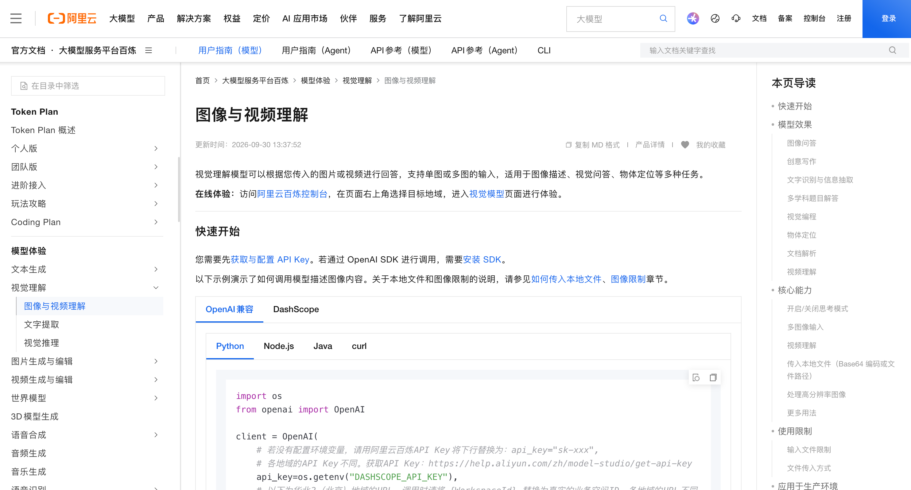
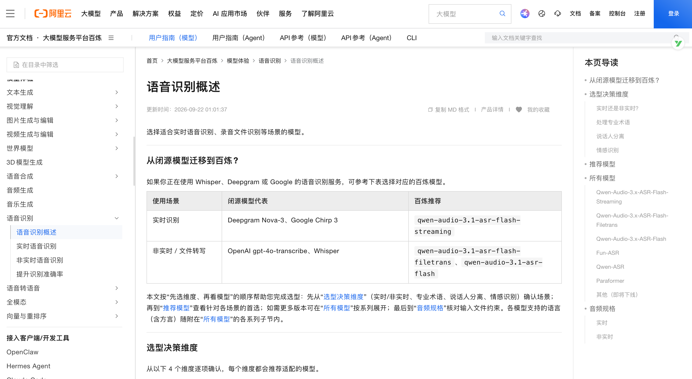
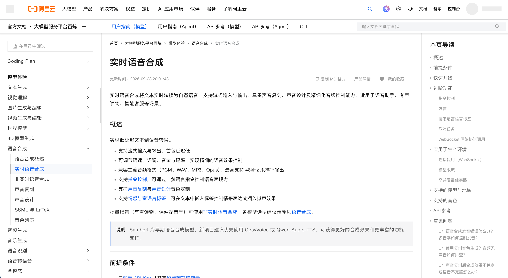
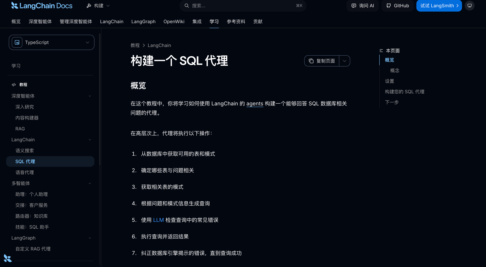

# 01-章介绍：让 Agent 看懂图片、听懂问题，并真正完成数据分析

前面几章，咱们已经让 Agent 写过代码、制作过演示文稿，还通过多个 Agent 的协作，完成了一款可以游玩的互动剧情游戏。

这些项目主要通过文字接收用户要求。

现在，咱们换一个需求。

假设你是一名销售负责人，手里有一份最近半年的销售 Excel。你希望把文件上传以后，直接对着麦克风说：

> 帮我看看，哪些区域连续两个月销售额下降了？把趋势画出来。
>

看完结果以后，还可以继续问：

> 只看华东，销售额下降主要集中在哪些商品上？
>

用户只需要说明想了解什么，Agent 就能读取报表、查询数据、生成图表，再把分析摘要读出来。

**第九章，咱们就来实现这样一个 AI 数据分析 Agent。**

## 把图片和语音接进 Agent
实际工作中，用户提供的信息有很多种形式。

可能是一段文字，也可能是一张销售看板截图，或者一段语音。

文字、图片和音频，是不同的信息形式，也就是不同的“模态”。本章会把这些输入方式接进同一个 Agent 应用。

先看图片。

假设用户上传了一张看板截图，问：“这里的销售额为什么和 Excel 里不一样？”

咱们会使用 [视觉理解模型](https://help.aliyun.com/model-studio/vision) 提取截图中的指标、日期、单位和数值，再和原始数据对照。

这里还要处理识别错误。图片模糊、单位缺失时，系统需要提示用户确认，后面的计算才能有明确依据。

语音也有自己的处理过程。

咱们可以先通过 [ASR，也就是语音识别](https://help.aliyun.com/zh/model-studio/asr-model)，把用户说的话转换成文字，再交给 Agent 分析。

回答生成以后，使用 [TTS，也就是语音合成](https://help.aliyun.com/zh/model-studio/realtime-tts-user-guide)，把摘要转换成声音播放。

这样，原来的文字问答就能扩展成语音交互。

不过，能播放还不够。用户听到一半想换个问题，旧回答就应该及时停下来。所以，咱们还会继续处理流式返回、音频播放和打断，避免新问题已经提交，系统还在播放上一次的答案。

## 让分析结果有真实的计算依据
接下来，再看刚才上传的 Excel。

要找出销售额下降的区域，系统得先知道：哪列是日期、哪列是区域、哪列是销售额，数据有没有缺失，金额的单位是什么。

这些信息确认以后，才能按月份和区域汇总，再比较前后月份的变化。

因此，咱们可以先使用工具解析 Excel 和 CSV，整理字段、样例和数据质量问题，再让 Agent 根据用户问题组织查询。

这里会用到 `Text-to-SQL`，简单理解就是：**把自然语言问题转换成 SQL 查询，再由数据引擎执行计算。** [LangChain 的 SQL Agent 文档](https://docs.langchain.com/oss/javascript/langchain/sql-agent)讲解了读取表结构、生成查询、执行和根据结果回答的过程。

比如，用户说“按月比较各区域销售额”，模型负责确定要查询什么，工具负责执行汇总，得到结果以后再生成解释和图表。需要补充分析时，Agent 还可以继续查询商品维度的数据。

当模型能够生成 SQL 或分析代码以后，执行范围也得限制好。允许读取哪些数据、能否访问其他文件、最多运行多久，这些都需要由程序控制。

算出数字以后，咱们还要让用户能核对它。

图表用了哪个时间范围？销售额有没有扣除退款？结论中的数字对应哪次查询？这些依据会和分析结果一起保留下来。

当然，数据能够支持的结论也有范围。

**“哪些商品贡献了主要降幅”可以通过销售数据计算；“客户为什么不愿意购买”还需要额外证据。** 只有销售明细时，Agent 应该说明目前能确定的事实，以及还缺少哪些信息。

## 最后完成一个 AI 数据分析 Agent
本章的项目会把上面这些能力组合起来，完成：

**AI 数据分析 Agent：上传业务报表，用语音提问，自动分析并生成图表。**

在这个项目里，咱们会实现四组功能：

+ **上传数据**：读取 Excel、CSV，查看工作表、字段和数据质量提醒。
+ **连续分析**：用自然语言提问、修改筛选条件、继续追问，得到真实查询结果与图表。
+ **图片与语音交互**：对照看板截图，通过语音提问、听取摘要，并在需要时停止播放。
+ **核对与交付**：查看统计条件、查询结果和数据来源，导出分析报告。

这种能力可以用在销售复盘、运营报表、库存分析等场景。业务人员负责提出问题，Agent 帮助完成查数、比较和整理结果的过程。

课程仍然使用 Node.js。前面学过的 LangChain、LangGraph、工具调用和会话状态会继续用上，重点放在本章新增的图片、数据和语音处理上。

学习时，咱们先通过小案例把各项能力跑通，再进入完整项目。项目上篇看演示和需求，后面几篇从上传文件、发送问题、录音等真实入口，逐步追踪实现过程。

下一小节，咱们先从一张业务看板截图开始，看看图片里的信息怎样进入 Agent。

> 更新：2026-10-04 20:15 · 原文：<https://www.yuque.com/lgdsunday/ab1dy3/nbn0bxcgaodgvors>
