# 03-Agent 系统的Excel 与 CSV 解析

上一小节，咱们让模型读懂了销售看板截图。

截图里有销售额、订单数和统计时间，模型可以根据这些信息回答问题。

但是，如果用户接着问：

> 9 月哪个区域的销售额最高？和 8 月相比，变化最大的商品是什么？
>

截图里没有这些明细。要继续分析，就需要用户提供原始数据，比如从业务系统导出的 Excel 或 CSV。

所以，这一小节先完成一件事：**把 Excel 和 CSV 整理成字段含义明确、问题可以定位、后面能够查询的数据。**

## 先看咱们要读取的文件
本节代码在 `Code/Node/第九章/03-table-import`。

打开 `samples/sales-clean.xlsx`，里面有三张工作表：

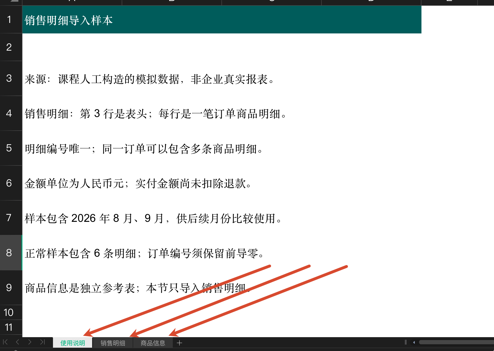

整个 Excel 文件可以理解为一个 **工作簿（Workbook）**，下面的每个页签是一张 **工作表（Worksheet）**。

咱们这次要分析销售情况，就应该读取“销售明细”，也就是第二张表

销售明细长这样：

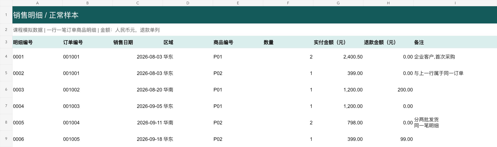

再看行号。第一行是标题，第二行是说明，**第三行才是表头**。

表头告诉程序每列表示什么，比如“订单编号”“销售日期”“实付金额（元）”。第四行开始，才是一条条真正的数据。

这里还要确认“一行代表什么”。

前两条记录的订单编号都是 `001001`，但商品分别是 `P01` 和 `P02`。这是同一笔订单买了两种商品，所以拆成了两条明细。

因此，大家可以理解为：

> 一行是一笔订单商品明细，明细编号应该唯一，订单编号可以重复。
>

这样，咱们就知道了：这张表有 6 条明细，不能直接说它有 6 笔订单（第一行 和 第二行 是一笔订单）。

### 同样的数据，CSV 是什么样的
`samples/sales-clean.csv` 保存了同样的销售明细（如果直接用 WPS 打开，打开之后和 Excel 形式差不多）

而CSV 是文本格式，常见写法用逗号分隔字段。本例的 CSV 第一条记录就是表头。

大家可以用代码编辑器打开它，打开之后是这样：

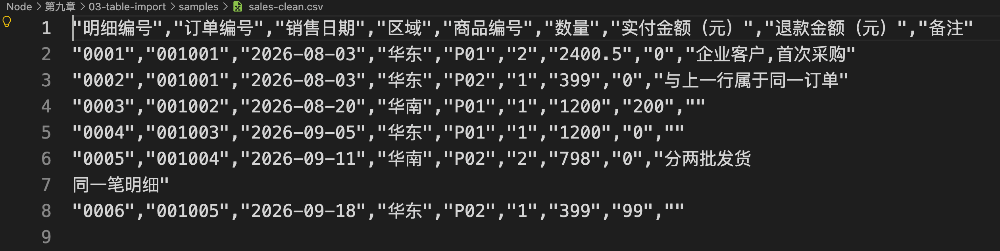

不过这样不好看，给大家看下用 WPS 打开的效果：

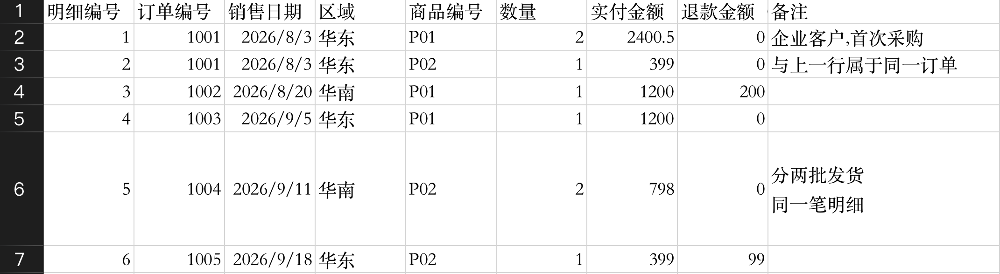

## 先运行一次导入
项目的核心代码分成两个文件：

+ `import-data.js`：从命令开始，串起读取、整理和保存，最后打印结果。
+ `table-parser.js`：解析文件、检查字段、整理类型并生成数据概览。

项目使用三个依赖：

| 依赖 | 在本节负责什么 |
| --- | --- |
| `xlsx`，也就是 SheetJS CE | 读取 Excel 工作簿、工作表及单元格信息 |
| `csv-parse` | 按 CSV 格式读取文本记录 |
| `@duckdb/node-api` | 把整理后的数据保存到本地数据库，供后面查询 |


咱们先执行：

```bash
npm run inspect
```

终端会列出三个工作表，以及每张表前四行的内容。

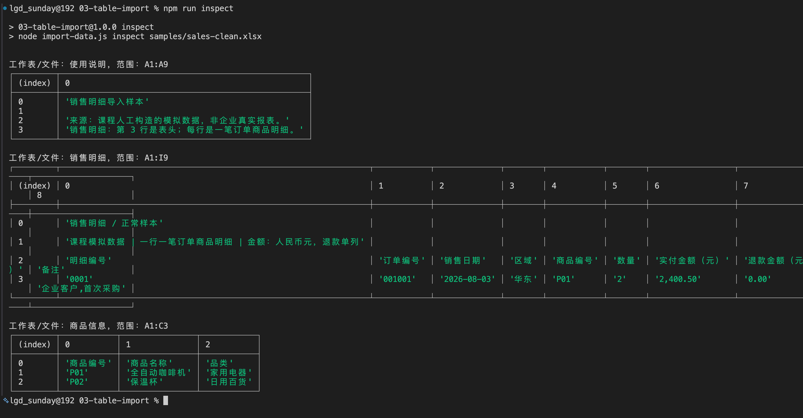

然后执行：

```bash
npm run xlsx
```

这次会真正导入销售明细，输出比较宽：

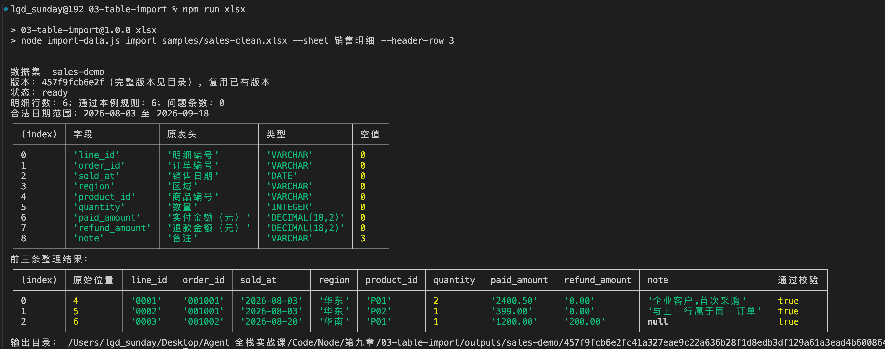

咱们可以先看前面的统计：

```latex
数据集：sales-demo
状态：ready
明细行数：6；通过本例规则：6；问题条数：0
合法日期范围：2026-08-03 至 2026-09-18
```

下面还会打印各字段的类型、空值数量、前三条整理结果，以及实际保存位置。

`ready` 是本例定义的状态，表示这份数据通过了代码里约定的检查。它不代表程序已经证明每一笔销售都真实、完整。

再执行：

```bash
npm run csv
```

同样会得到 6 条明细，整理后的字段值也相同。

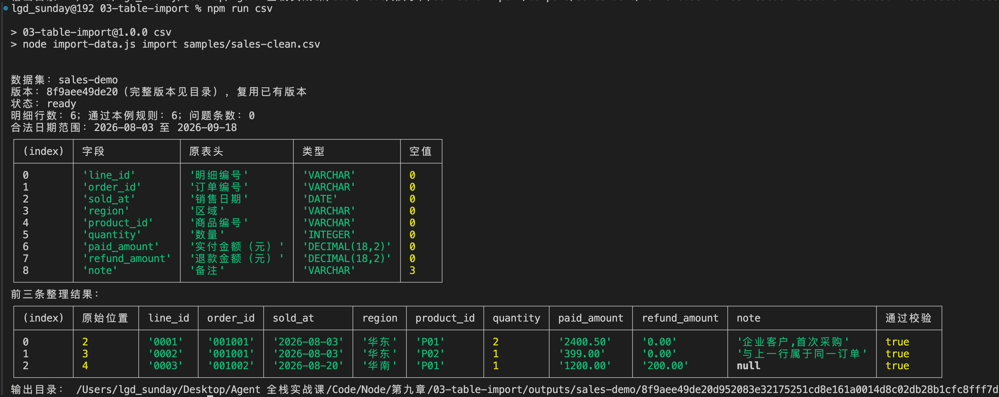

CSV 的一个字段内部可能包含换行，所以这里记录的是 **CSV 记录序号**

数据读出来了，接下来咱们从入口看它是怎么处理的。

## 从 main() 看文件怎样变成明细数据
打开 `package.json`，`xlsx` 脚本对应的命令是：

```bash
node import-data.js import samples/sales-clean.xlsx --sheet 销售明细 --header-row 3
```

它把文件路径、工作表名称和表头行号，一起交给了 `import-data.js`。

文件最后调用 `main()`

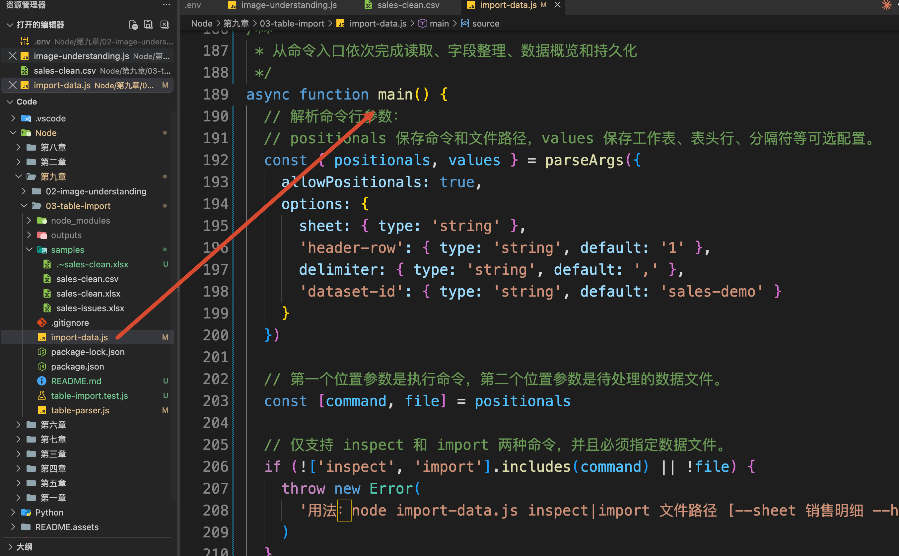

``main()` 读取这些参数以后，先执行：

```javascript
// 根据文件路径读取数据源，统一处理 CSV、Excel 等不同格式。
const source = await readSource(resolve(file))
```

这里的 `file` 就是 `samples/sales-clean.xlsx`。`resolve()` 把它转换成完整路径，随后交给 `table-parser.js` 中的 `readSource()`。

### 读取文件，再找到指定工作表
`readSource()` 先检查文件格式和大小，再通过 `readFile()` 读取文件内容，得到 `bytes`。

如果当前文件是 Excel，就执行：

```javascript
source.workbook = XLSX.read(bytes, {
  type: 'buffer',
  cellDates: false,
  cellNF: true,
  cellFormula: true
})
```

之前学习过「后台解决方案课程」的同学对这个 `XLSX` 应该都不陌生，`XLSX.read()` 其实就来自 SheetJS，返回的 `workbook` 对象包含工作表名称和单元格数据。

其中，`cellDates: false` 让 Excel 日期暂时保留原始存储值，后面统一转换，另外两个配置用来保留数字格式和公式信息。

方法返回以后，执行回到 `main()`，继续调用 `readTable()`。当前参数的值相当于：

```javascript
// 正式导入时，根据命令行配置读取指定工作表和表头，
// CSV 还可以通过 delimiter 指定字段分隔符。
const table = readTable(source, {
  sheet: '销售明细',
  headerRow: 3,
  delimiter: ','
})
```

咱们来看下 `table-parser.js` 的 `readTable()`

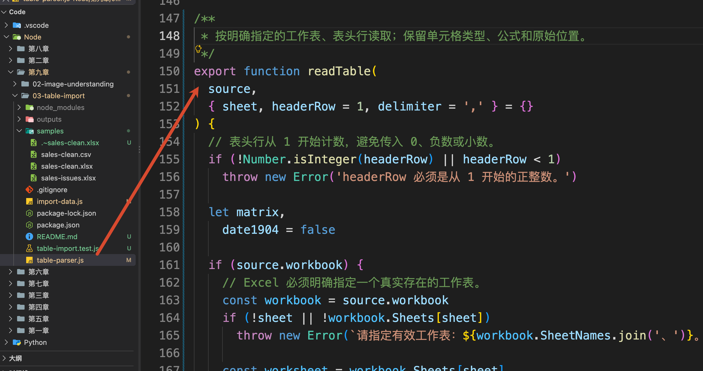

它通过：

```javascript
const worksheet = workbook.Sheets[sheet]
```

拿到“销售明细”，再读取第三行表头。

接下来，程序检查这行表头是否包含本例需要的字段，再把每一条明细按表头对应起来。例如，“订单编号”这一列会对应到程序中的 `order_id`。

这份对应关系就定义在 `table-parser.js` 顶部的 `columns` 中。下面是其中一项：

```javascript
{
  name: 'order_id',
  header: '订单编号',
  type: 'VARCHAR',
  kind: 'id',
  description: '同一订单可对应多条明细，保留前导零'
}
```

`header` 用来找到原表中的列，`name` 是后面程序和数据库使用的字段名，`type` 指定数据库类型。这里的 `VARCHAR` 就是字符串类型。

这份配置是咱们针对当前销售表约定的规则。如果换成字段不同的业务表，就需要重新配置。

完成对应以后，`readTable()` 返回 `table`。其中，第一条明细的部分内容长这样，为了方便观察，这里省略了其他字段：

```javascript
{
  sourceRow: 4,
  cells: {
    order_id: { address: 'B4', t: 's', v: '001001' },
    paid_amount: { address: 'G4', t: 'n', v: 2400.5 }
  }
}
```

`sourceRow` 保留原始行号；`cells` 保存这行的单元格。

每个单元格中的 `v` 是原值，`t` 是类型，`s` 表示文本，`n` 表示数值。

以后发现哪笔金额有问题，就能通过 `sourceRow` 和 `address` 找回原表位置。

### CSV 也整理成相同的记录结构
如果执行的是 `npm run csv`，`readSource()` 会按 UTF-8 解码文件，然后在 `readTable()` 中进入 CSV 分支。

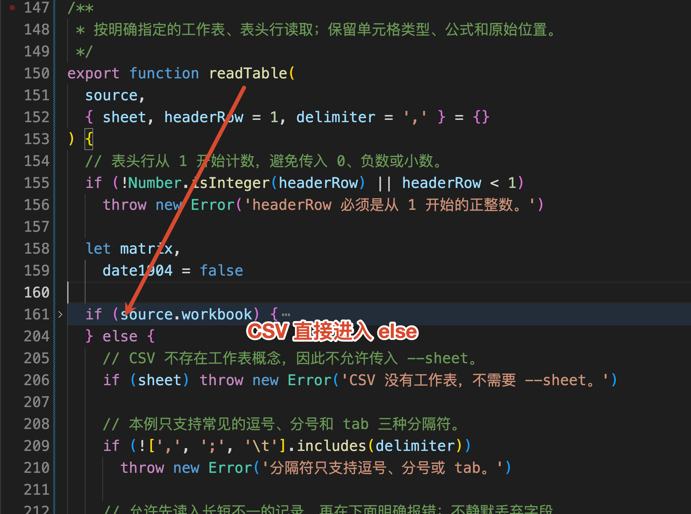

里面调用的是 `csv-parse` 的 `parse()`。关键配置节选如下：

```javascript
// 允许先读入长短不一的记录，再在下面明确报错；不静默丢弃字段。
const records = parse(source.text, {
  bom: true,
  delimiter,
  cast: false,
  relax_column_count: true,
  max_record_size: 100_000
})
```

`bom: true` 用来处理部分 UTF-8 CSV 开头的编码标记；`delimiter` 指定分隔符；`cast: false` 让读取结果先保留为字符串，避免 `001001` 被提前转换成 `1001`。这些配置可以在 [csv-parse 官方文档](https://csv.js.org/parse/options/)中查看。

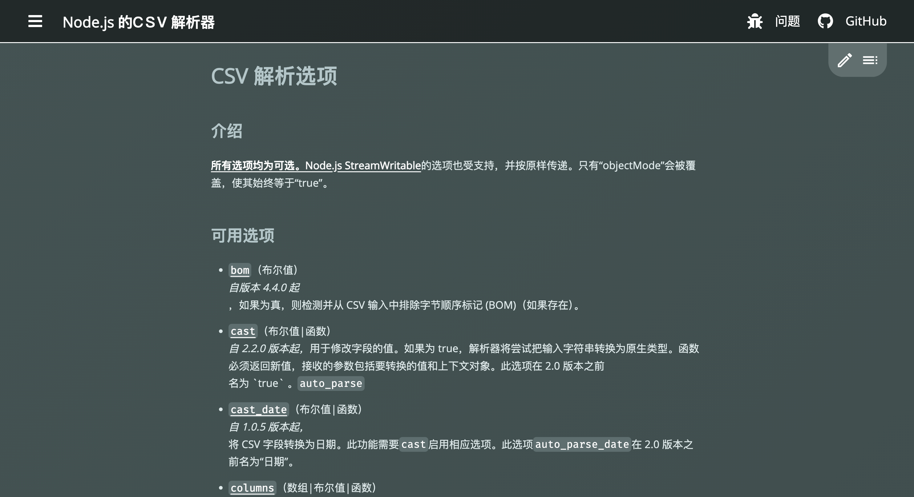

`relax_column_count` 允许库先读出列数不同的记录，**后面的程序仍然会检查列数并报错**，不会把多出来的字段丢掉。

CSV 分支最终也会生成带有 `sourceRow` 和 `cells` 的记录。这样，两种格式读完以后，就能交给同一段代码继续处理。

### 把单元格整理成明确的字段类型
`readTable()` 返回以后，`main()` 接着执行：

```javascript
// 将原始表格字段和值转换为系统内部统一的数据结构，
// 同时收集缺失值、非法字段等数据质量问题。
const normalized = normalizeRows(table)
```

进入 `table-parser.js` 的 `normalizeRows()`。

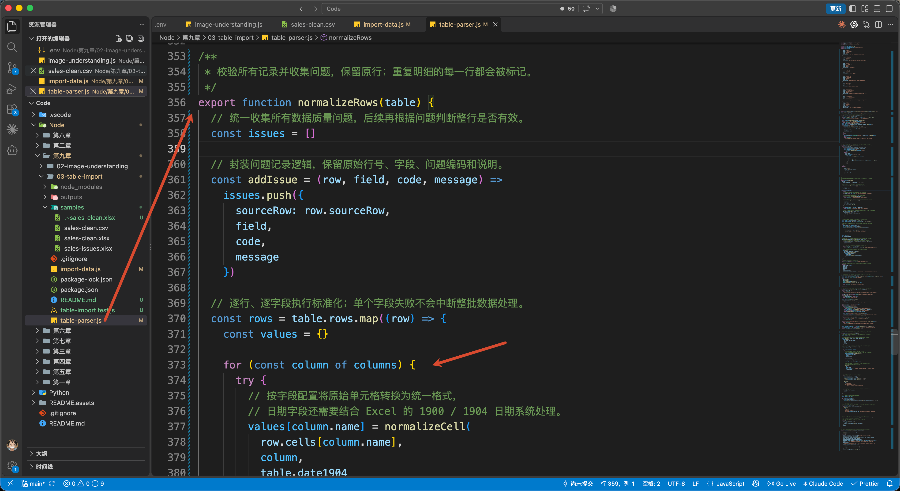

它会遍历每条记录，再根据刚才的 `columns` 配置，把每个单元格交给 `normalizeCell()`：

```javascript
// 按字段配置将原始单元格转换为统一格式，
// 日期字段还需要结合 Excel 的 1900 / 1904 日期系统处理。
values[column.name] = normalizeCell(
  row.cells[column.name],
  column,
  table.date1904
)
```

`row.cells[column.name]` 是当前单元格，`column` 是这个字段的规则。最后的 `date1904` 来自 Excel 工作簿配置，用来识别日期采用哪一种起算方式

这一步主要解决下面几件事：

| 字段 | 本例怎样处理 | 原因 |
| --- | --- | --- |
| 明细编号、订单编号 | 保留字符串，如 `001001` | 编号前面的零有意义 |
| 销售日期 | 统一为 `2026-08-03` | 后面才能按日期范围筛选 |
| 数量 | 检查后转换成整数 | 避免把“两个”等文字直接拿去计算 |
| 实付与退款金额 | 统一为两位小数的十进制文本，如 `2400.50` | 随后精确写入数据库金额字段 |
| 空备注 | 保留为 `null` | 备注允许不填写 |


Excel 日期需要稍微注意一下。它经常用一个数字保存日期，再通过单元格格式显示为年月日。程序会用 SheetJS 的日期解析方法转换，并检查是否为真实日期

第一条记录整理完成以后，会得到下面这样的结果，仍然只展示部分字段：

```javascript
{
  sourceRow: 4,
  values: {
    line_id: '0001',
    order_id: '001001',
    sold_at: '2026-08-03',
    paid_amount: '2400.50',
    refund_amount: '0.00'
  },
  isValid: true
}
```

`values` 保存整理后的字段，`isValid` 表示这一行是否通过本例校验。

保存到数据库时，它会进入 `DECIMAL(18,2)` 字段，也就是最多 18 位数字、其中 2 位小数的定点数类型。后面可以直接用数据库完成金额计算。

## 遇到有问题的数据，程序怎样处理
刚才运行的是正常样本。现在换一份文件，看看同一个 `normalizeRows()` 遇到问题会怎样。

执行：

```bash
npm run issues
```

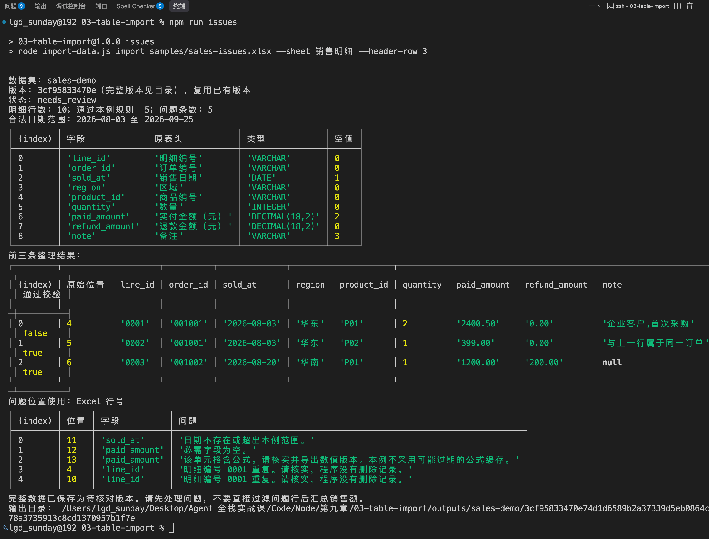

这个命令读取 `samples/sales-issues.xlsx`。它在原来的 6 条明细后面增加了几条有问题的记录，表中已经用浅色标出：

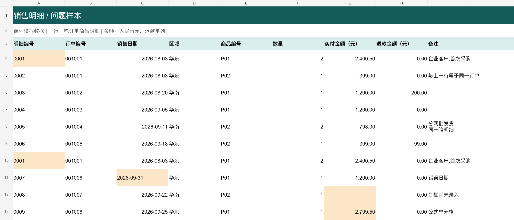

终端里的统计会变成：

```latex
状态：needs_review
明细行数：10；通过本例规则：5；问题条数：5
```

下面的问题清单可以和原表对照：

| Excel 位置 | 问题 | 本例处理方式 |
| --- | --- | --- |
| 第 4、10 行 | 明细编号 `0001` 重复 | 两行都保留，并分别提示 |
| 第 11 行 | 日期为 `2026-09-31` | 提示日期不存在 |
| 第 12 行 | 实付金额为空 | 提示必需字段为空 |
| 第 13 行 | 实付金额由公式计算 | 提示需要核实公式结果 |


这里的 `needs_review` 也是本例定义的状态，表示数据需要核对。

所以，最终的结果才会 **保留原始数据、指出具体问题，把需要确认的地方交给使用者处理**。

### 问题在代码中保存在哪里
回到刚才的 `normalizeRows()`。

它调用 `normalizeCell()` 时，如果某个字段校验失败，会把整理后的字段设为 `null`，并记录问题。例如空金额对应的记录是：

```javascript
{
  sourceRow: 12,
  field: 'paid_amount',
  code: 'INVALID_VALUE',
  message: '必需字段为空。'
}
```

原始单元格仍然保留在前面的 `table.rows` 中，没有被修改。

所有字段检查完以后，`normalizeRows()` 还会统计 `line_id`，找出重复明细。这个检查针对明细编号，同一个 `order_id` 对应多种商品是允许的。

最后，函数把有问题的行标记为 `isValid: false`，一起返回：

```javascript
// 返回结构示意，具体记录见实际输出。
{
  rows: [ /* 全部整理后的明细，包括有问题的行 */ ],
  issues: [ /* 原始位置、字段和问题原因 */ ]
}
```

这就是 `main()` 中 `normalized` 的来源。无论正常还是异常样本，后面都会拿着这两部分继续生成概览和保存。

## 整理完成以后，数据保存在哪里
执行回到 `import-data.js` 的 `main()`，接下来是：

```javascript
// 根据原始表格和标准化后的数据生成数据概览，
// 例如字段信息、记录数量、数据类型及质量统计。
const profile = buildProfile(table, normalized)
```

`buildProfile()` 定义在 `table-parser.js` 中。

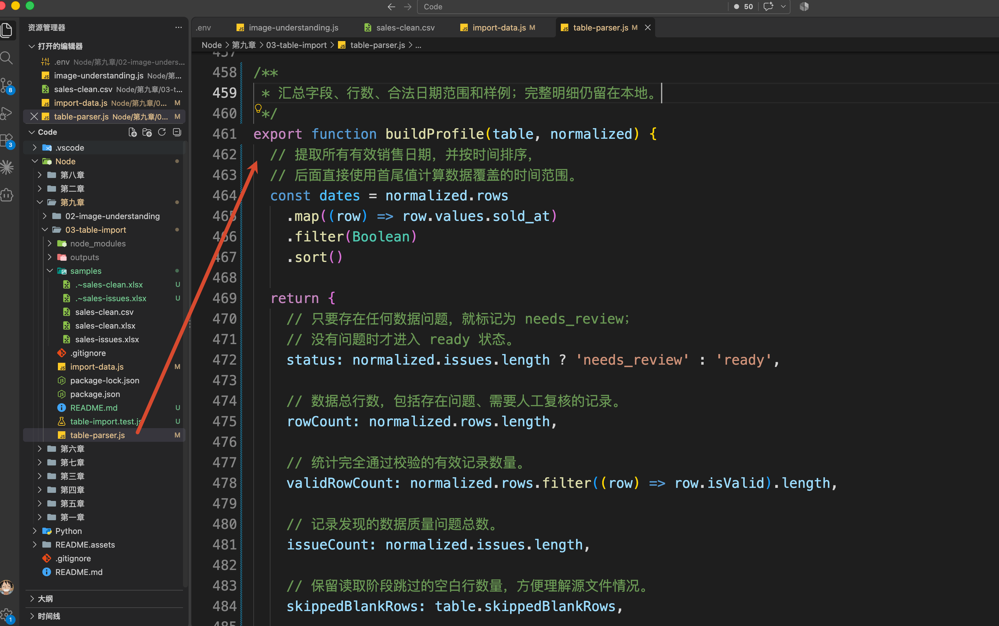

它根据刚才的明细和问题列表，整理出一份 **数据概览**：有哪些字段、每列是什么类型、有多少条记录、日期覆盖到哪里，以及有没有待处理问题。

以正常样本为例，`profile` 的部分内容是：

```javascript
{
  status: 'ready',
  rowCount: 6,
  validRowCount: 6,
  issueCount: 0,
  dateRange: {
    start: '2026-08-03',
    end: '2026-09-18'
  },
  grain: '一行一笔订单商品明细；line_id 应唯一，order_id 可以重复。',
  amountPolicy: '人民币元，paid_amount 未扣退款；refund_amount 单列，空值不等于 0。'
}
```

实际对象中还包含 `columns` 和 `samples`，分别保存字段说明和前三条整理样例。

后面让模型生成查询时，可以先提供这份概览。这样，模型就知道销售日期对应 `sold_at`，实付金额对应 `paid_amount`，也知道一行代表什么。

对于问题样本，概览也会保留 `needs_review`。后续分析入口应该先检查这个状态，提示核对数据

### 用 DuckDB 保存完整明细
概览生成以后，`main()` 调用 `saveDataset()`，把来源文件、明细、问题和概览一起传进去。

```javascript
// 将原始信息、标准化数据和数据概览持久化为一个数据集。
const result = await saveDataset(source, table, normalized, profile, {
  datasetId: values['dataset-id']
})
```

这个函数位于 `import-data.js`，它会继续调用 `saveDatabase()`，把数据存进 DuckDB。

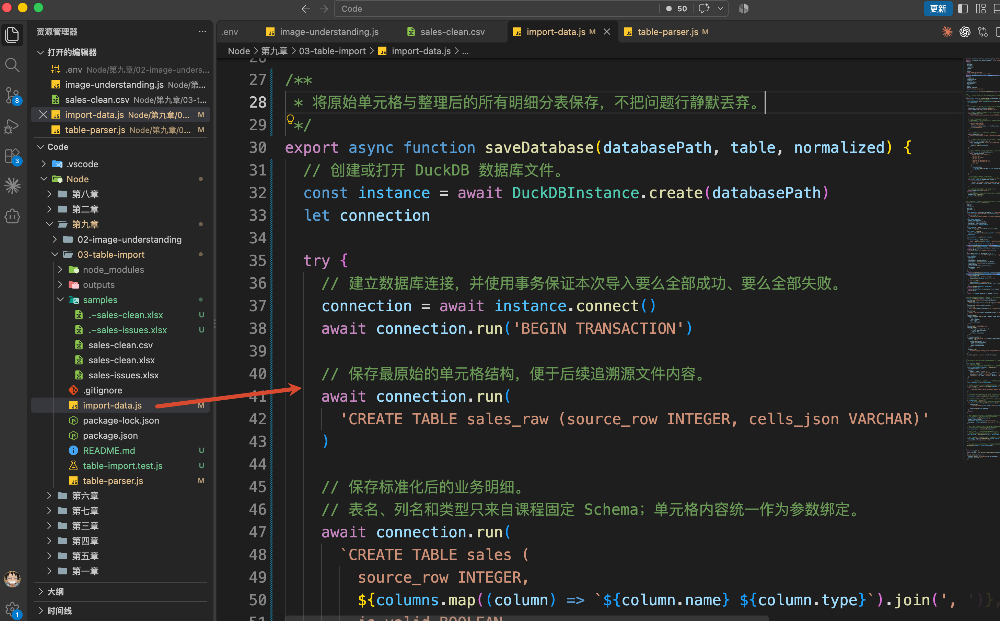

前面安装的 `@duckdb/node-api` 就用在这里。

[DuckDB](https://duckdb.org/docs/current/clients/node_neo/overview) 是适合做数据分析的嵌入式数据库。在当前 Node.js 程序中创建实例，就可以把数据保存在一个本地文件里，再用 SQL 查询；不需要像前面的 PostgreSQL 那样单独启动数据库服务。

`saveDatabase()` 的入口是：

```javascript
// 创建或打开 DuckDB 数据库文件。
const instance = await DuckDBInstance.create(databasePath)
// 建立数据库连接，并使用事务保证本次导入要么全部成功、要么全部失败。
const connection = await instance.connect()
```

这里的 `databasePath` 指向当前导入版本下的 `data.duckdb` 文件。

连接建立以后，程序创建三张表，再逐行写入：

| 表名 | 保存的内容 |
| --- | --- |
| `sales_raw` | 原始明细行号和单元格信息，方便核对原值、公式 |
| `sales` | 整理后的全部明细，以及每行的 `is_valid` 标记 |
| `import_issues` | 问题所在行、字段和原因 |


写入时，单元格内容通过参数传给 SQL。

因此，问题样本依然会保存 10 条明细。无法转换的金额或日期在 `sales` 中是 `null`，原值可以从 `sales_raw` 找回。

数据写入结束后，`saveDataset()` 还会保存原文件副本、`profile.json` 和 `issues.json`。

最终目录是：

```latex
outputs/sales-demo/<版本 Hash>/
├─ source.xlsx       原始文件副本，CSV 导入时为 source.csv
├─ data.duckdb       保存完整明细的数据库
├─ profile.json      数据概览与来源信息
└─ issues.json       问题清单，正常样本为 []
```

终端最后会打印当前目录的真实位置，大家直接打开查看即可。

## 总结
这一节，咱们完成了从 Excel/CSV 文件到本地数据表的处理。

先确认工作表、表头和每行的含义，再把单元格整理成编号、日期、数量和金额等明确类型。遇到空金额、重复明细、错误日期和公式时，程序保留原值并给出问题位置，避免清洗过程悄悄改变统计结果。

整理完成以后，完整明细保存到 DuckDB，字段和质量情况保存成数据概览，原文件、导入结果则通过数据集和版本关联起来。

咱们这次的代码完全可以支持小型 `.xlsx` 和 UTF-8 CSV。多级表头、旧 `.xls` 或 GBK 编码得需要先整理或转换一下才行。

现在，数据已经有了明确的存放位置和字段含义。下一小节，咱们继续解决：**用户问“9 月哪个区域销售额最高”，Agent 怎样把这句话变成可以执行的 SQL 查询？**

> 更新：2026-10-07 16:30 · 原文：<https://www.yuque.com/lgdsunday/ab1dy3/uad1xrkx8oqnl619>
