# 04-Text-to-SQL：把业务问题变成可以执行的查询

上一小节，咱们把 Excel 和 CSV 中的销售明细保存到了 DuckDB。

现在，用户问：

> 2026 年 9 月，哪个区域的销售额最高？
>

数据已经有了。接下来要做的事情就是：找到 9 月的记录，按照区域分别求和，再比较金额。

这些计算可以交给数据库完成。但是，用户输入的是一句话，数据库需要的是 SQL。

所以，咱们可以让模型先理解用户的问题，再根据表结构生成 SQL，交给程序执行。

这个过程就叫 **Text-to-SQL，也就是把自然语言问题转换成 SQL 查询。**

这一节，咱们就把上一节留下的问题查出来，同时看看：用户没说清楚怎么办，模型写错字段以后又该怎样处理。

## 一句话怎样变成一条查询
先把刚才的问题说得更具体一点：

> 仅按已导入数据，2026 年 9 月哪个区域的未扣退款销售额最高？列出各区域金额。
>

为什么要补上“未扣退款”？

因为上一节的表里有两列金额：`paid_amount` 是实付金额，`refund_amount` 是退款金额。直接相加实付金额，和扣掉退款以后再相加，结果可能不同。

现在问题明确了，对应的查询可以这样写：

```sql
SELECT region, SUM(paid_amount) AS sales_amount
FROM sales
WHERE sold_at >= DATE '2026-09-01'
  AND sold_at < DATE '2026-10-01'
GROUP BY region
ORDER BY sales_amount DESC
```

之前没有怎么写过 SQL 的同学，可以看下这个 SQL 是什么意思：

| SQL 中的写法 | 对应用户的什么要求 |
| --- | --- |
| `FROM sales` | 从销售明细表中查询 |
| `WHERE ...` | 只选择 2026 年 9 月的记录 |
| `GROUP BY region` | 按区域分组，华东和华南分别计算 |
| `SUM(paid_amount)` | 把每个区域的实付金额加起来 |
| `AS sales_amount` | 给计算结果取名叫 `sales_amount` |
| `ORDER BY sales_amount DESC` | 按金额从大到小排列 |


数据库执行以后，就会返回区域和金额，第一行就是金额最高的区域。

拿到真实结果以后，还可以让模型把表格整理成容易阅读的回答。整个过程是：

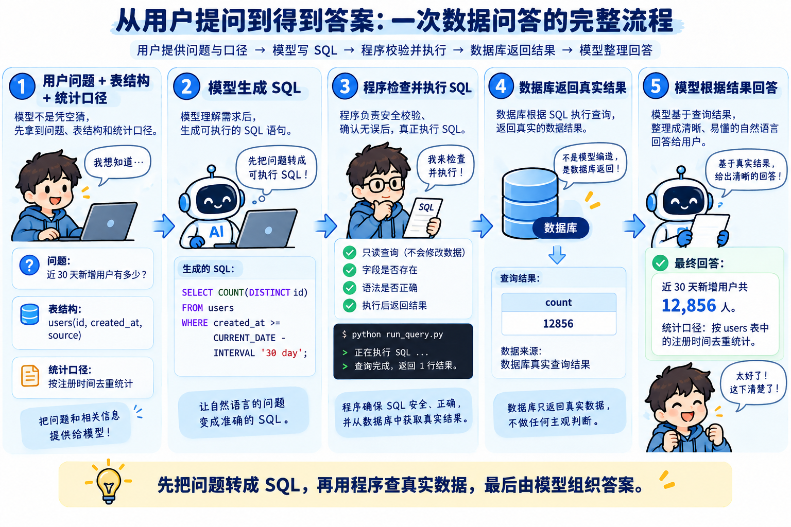

本节先把这条链路单独实现出来，后面的数据分析 Agent 就可以把它作为一种分析能力使用。

## 先把这条查询运行起来
本节代码在 `Code/Node/第九章/04-text-to-sql`。

进入目录，执行：

```bash
npm run prepare-data
```

`prepare-data` 会复用上一节的 `readSource()`、`readTable()`、`normalizeRows()` 和 `saveDataset()`，导入同一份 `sales-clean.xlsx`。

最终打印结果如下：

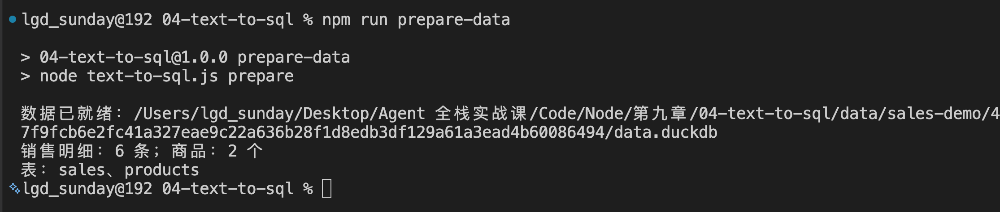

销售明细继续放在 `sales` 表。同时，把工作簿中的“商品信息”导入 `products` 表，后面查询商品名称时会用到。

本节的文件保存在自己的目录中：

```latex
data/
├─ current.json                         当前使用的数据版本
└─ sales-demo/<版本 Hash>/
   ├─ data.duckdb                       销售明细与商品表
   ├─ profile.json                      上一节生成的数据概览
   ├─ source.xlsx                       原文件副本
   └─ issues.json                      导入问题清单
```

因此，两个课程代码目录要保持相邻。如果上一节尚未安装依赖，先执行 `npm --prefix ../03-table-import ci`。本次准备数据不会修改上一节的代码和输出。

### 先核对计算结果
执行：

```bash
npm run demo -- regions
```

这个命令使用 Replay：问题和 SQL 都已预设好了，数据库会真正执行查询，**没有调用模型，所以不需要 API Key**。

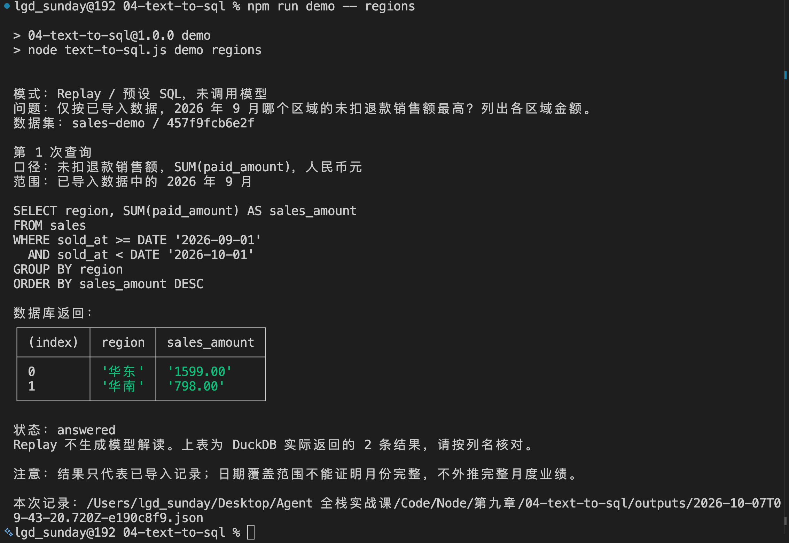

这样，大家可以先确认数据有没有准备好，以及 SQL 到底算出了什么。

终端会打印刚才的 SQL，后面是数据库结果：

| region | sales_amount |
| --- | ---: |
| 华东 | 1599.00 |
| 华南 | 798.00 |


可以回到上一节的 Excel 核对。9 月华东有两条明细，金额分别为 1200 元和 399 元，加起来就是 1599 元；华南有一条 798 元的明细。

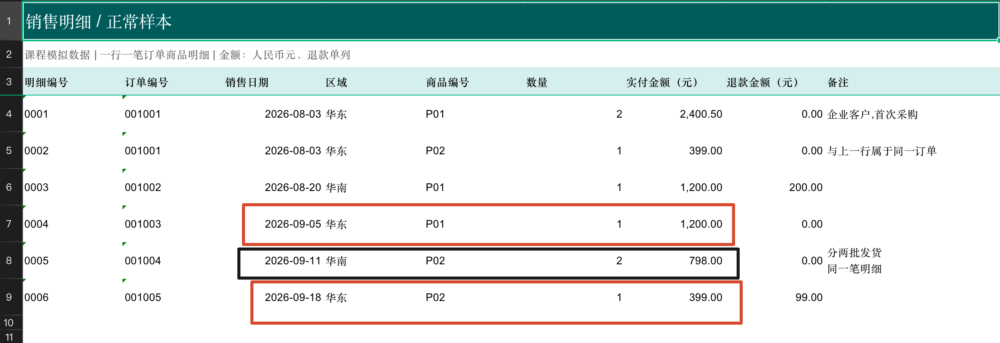

这里的结论应该是：**在已导入的 9 月记录中，华东未扣退款销售额最高，为 1599 元。**

### 换成模型生成 SQL
确认数据可以查询以后，在本节目录的 `.env` 中配置：

```plain
DEEPSEEK_API_KEY=你的_API_Key
DEEPSEEK_MODEL=deepseek-flash
```

这里继续使用 DeepSeek。

然后执行：

```bash
npm run ask -- "仅按已导入数据，2026 年 9 月哪个区域的未扣退款销售额最高？列出各区域金额。"
```

这次问题会真正交给模型，由它生成 SQL，再根据查询结果回答。

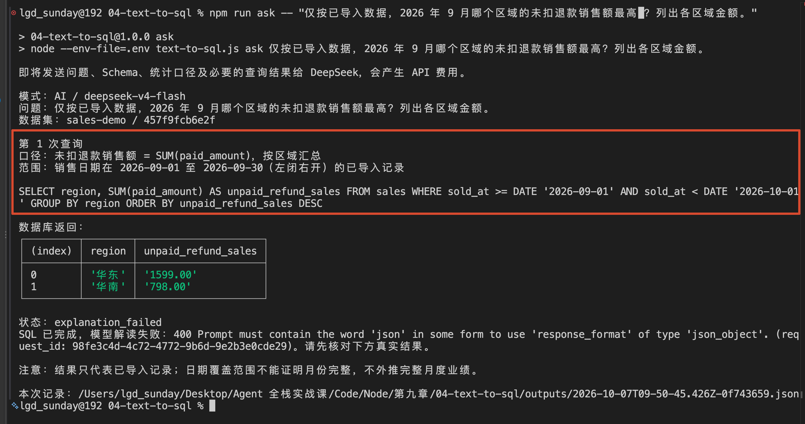

模型生成的 SQL 可能和前面的写法不完全相同，大家重点核对三件事：是否查了 9 月、是否按区域汇总、是否使用未扣退款金额。

查询流程返回后，`outputs/` 会保存一份 JSON，记录问题、数据版本，以及本次产生的 SQL、结果和回答。

## 看看代码
打开 `package.json`，`ask` 对应：

```bash
node --env-file=.env text-to-sql.js ask
```

后面追加的那句话，就是用户问题。

程序进入 `text-to-sql.js` 的 `main()` 

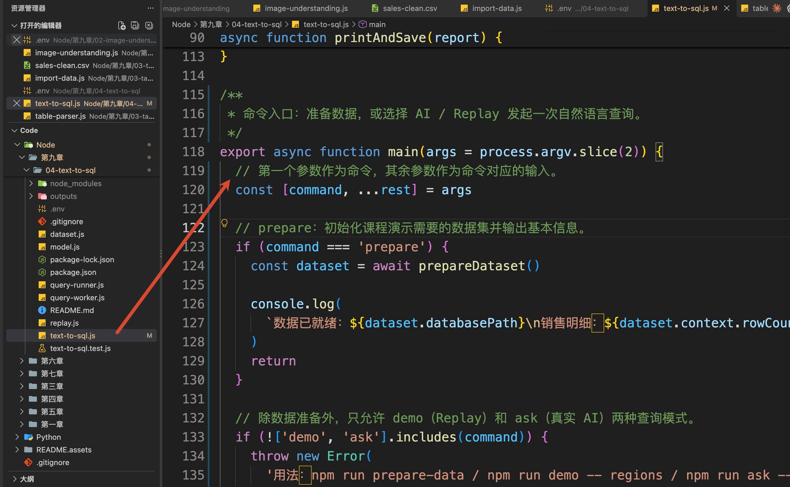

先执行：

```javascript
// 查询阶段直接加载已经准备好的数据库及 Schema、统计口径等上下文。
const dataset = await loadDataset()
```

`loadDataset()` 位于 `dataset.js`。

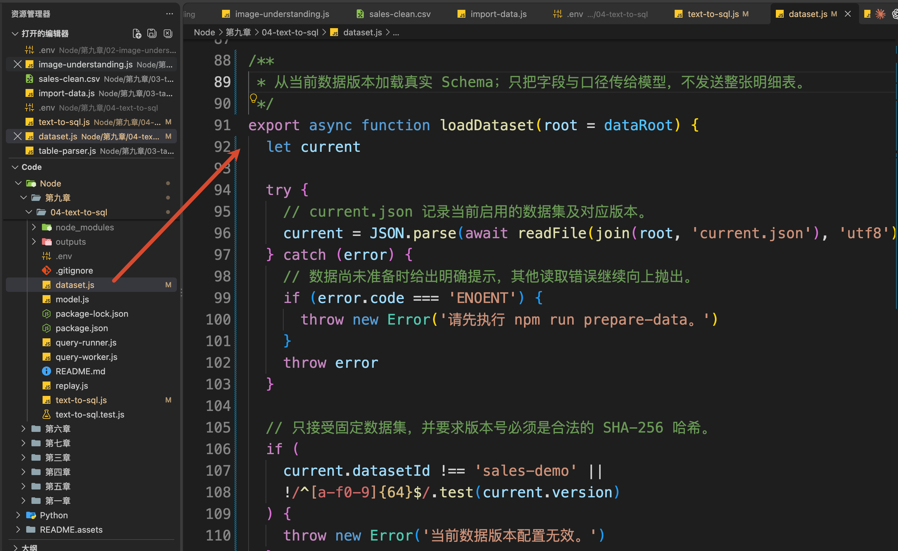

它根据 `data/current.json` 找到当前版本，读取 `profile.json`，确认数据状态为 `ready`，再打开对应的 DuckDB 文件，读取真实表结构。

最终返回的 `dataset` 有两部分：

```javascript
// 只展示本次讲解需要的字段。
{
  databasePath: '当前版本的 data.duckdb 路径',
  context: {
    schemas: {
      sales: [
        { name: 'sold_at', type: 'DATE' },
        { name: 'region', type: 'VARCHAR' },
        { name: 'paid_amount', type: 'DECIMAL(18,2)' }
        // 其他字段省略
      ]
    },
    grain: '一行一笔订单商品明细；line_id 应唯一，order_id 可以重复。',
    amountPolicy: '人民币元，paid_amount 未扣退款；refund_amount 单列，空值不等于 0。'
  }
}
```

+ `databasePath` 是留给程序打开数据库
+ `context` 则提供给模型，用来理解数据

其中的 `schemas` 就是表结构，也常被叫作 **Schema**，说明表里有哪些字段、分别是什么类型。

但是，只提供字段名还不够。模型知道 `paid_amount` 是一个数字，也未必知道它有没有扣掉退款。

所以，`context` 还会带上上一节整理的字段说明，以及本例明确约定的统计规则

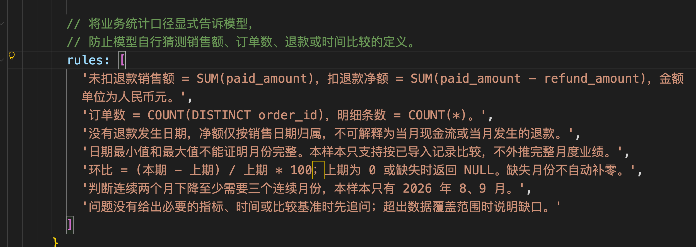

有点长，跟大家简化一下：

```latex
未扣退款销售额 = SUM(paid_amount)
扣退款净额 = SUM(paid_amount - refund_amount)
订单数 = COUNT(DISTINCT order_id)
明细条数 = COUNT(*)
```

这些信息都准备好以后，`loadDataset()` 返回 `dataset`，执行回到 `main()`。

### 把问题和数据概览一起交给模型
接下来，咱们沿着刚才的 `ask` 命令，继续看真实的模型调用过程。

`main()` 会调用 `model.js` 中的 `createAIProvider()`，得到 `provider` 对象。这个对象中，`decide()` 负责请求模型生成查询，`explain()` 负责根据查询结果组织回答。

准备好以后，`main()` 把它和问题、数据一起传给 `answerQuestion()`：

```javascript
// 执行完整问答流程：生成 SQL、校验并执行，再根据真实查询结果生成答案。
const report = await answerQuestion(question, dataset, provider)
```

这里的 `question` 就是命令中输入的问题，`dataset` 是刚才加载的数据。

继续进入同一文件中的 `answerQuestion()`，找到：

```javascript
// 模型根据用户问题、真实 Schema、统计口径以及上一轮错误，
// 决定是继续追问用户，还是生成 SQL。
const decision = Decision.parse(
  await provider.decide(question, dataset.context, previousError)
)
```

这个代码是在一个 `for` 循环里面的

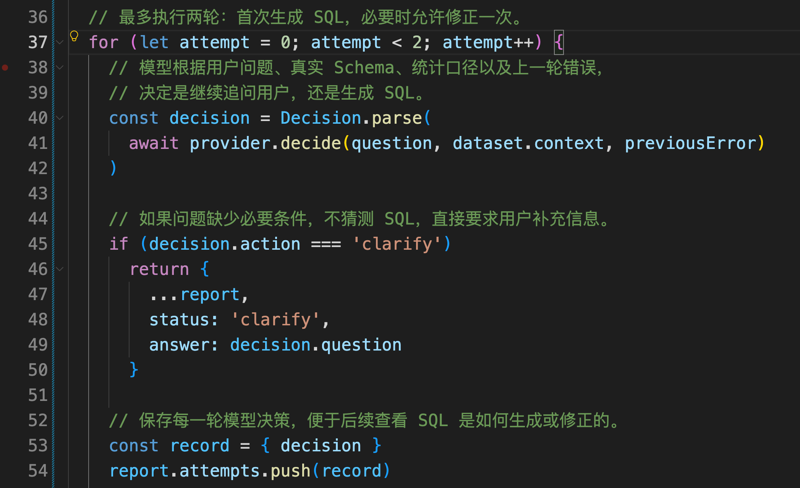

咱们先看括号里面的 `provider.decide()`。它对应的就是 `model.js` 中，`createAIProvider()` 返回对象里的 `decide()` 方法。

这个方法会调用同一文件中的 `json()`，把用户问题和 `dataset.context` 发送给 DeepSeek。文件顶部的 `instructions` 是这次请求使用的 Prompt，里面约定了模型应该返回哪些字段：能查询时返回 SQL、统计口径和范围，需要补充条件时返回追问内容。

所以，模型收到的要求可以理解为：

> 根据这些表结构和统计规则，为“9 月各区域未扣退款销售额”生成 SQL，并说明这次统计的口径和范围。
>

模型返回 JSON 文本后，`json()` 会用 `JSON.parse()` 把它转换成对象。以当前问题为例，返回结构可以是下面这样，具体 SQL 和描述以实际输出为准：

```javascript
{
  action: 'query',
  sql: 'SELECT region, SUM(paid_amount) AS sales_amount ...',
  metric: '未扣退款销售额，SUM(paid_amount)，人民币元',
  scope: '已导入数据中的 2026 年 9 月'
}
```

这里省略了 SQL 后半段，完整查询可以参考文章开头的例子。

`action: 'query'` 表示可以查询；`sql` 是准备执行的语句；`metric` 和 `scope` 说明本次采用的指标及范围，终端也会把它们打印出来。

拿到这个对象以后，程序还要确认字段齐全。例如，`action` 是 `query` 时，必须同时有 `sql`、`metric` 和 `scope`。

这就是 `Decision.parse()` 的作用。`Decision` 定义在 `model.js` 顶部，是本例用 Zod 编写的检查规则。对象通过检查以后，才会作为 `decision` 交给后面的查询流程

至于第三个参数 `previousError`，它用来保存上一次 SQL 执行失败的信息。

### 生成 SQL 以后，由程序执行
`decision` 通过检查以后，`answerQuestion()` 继续执行：

```javascript
// SQL 必须真正交给数据库执行，后续回答只能基于数据库返回结果。
result = await execute(dataset.databasePath, decision.sql)
```

这里的 `execute` 默认就是 `query-runner.js` 导出的 `executeQuery()`。

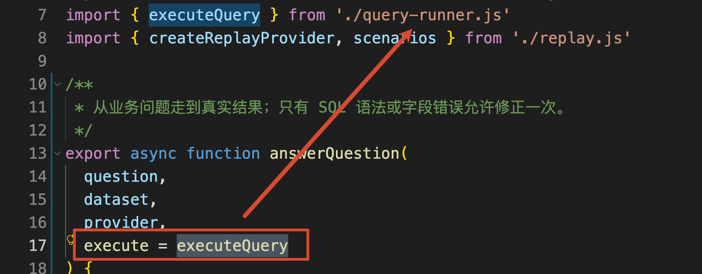

于是，刚才准备好的两部分终于接上了：程序提供数据库路径，模型提供 SQL。

`executeQuery()` 会启动 `query-worker.js` 子进程。子进程以只读方式打开本节数据库，检查查询结构后再执行 SQL。

本例通过 DuckDB 的 [SQL 解析能力](https://duckdb.org/docs/current/data/json/sql_to_and_from_json)检查语句，只开放单条简单查询、指定业务表和必要函数，同时限制外部访问、执行时间和结果大小。

查询成功后，`result` 长这样：

```javascript
{
  rows: [
    { region: '华东', sales_amount: '1599.00' },
    { region: '华南', sales_amount: '798.00' }
  ],
  truncated: false
}
```

`rows` 就是数据库返回的行，`truncated` 表示结果是否因为行数限制被截断。

执行回到 `answerQuestion()`。确认结果非空、没有被截断以后，才会调用：

```javascript
// SQL 成功并取得真实结果后，
// 再让模型结合问题、统计口径和查询结果生成自然语言回答。
await provider.explain(question, dataset.context, decision, result)
```

这次传给模型的内容多了刚才的 SQL 和真实查询结果。模型可以据此说明哪个区域最高、具体是多少，并交代统计范围。

最后，`answerQuestion()` 把结果和回答组成 `report`，返回 `main()`，由 `printAndSave()` 打印并保存。

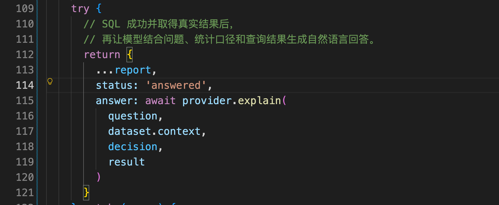

这样，从用户问题到最终输出就走完了：

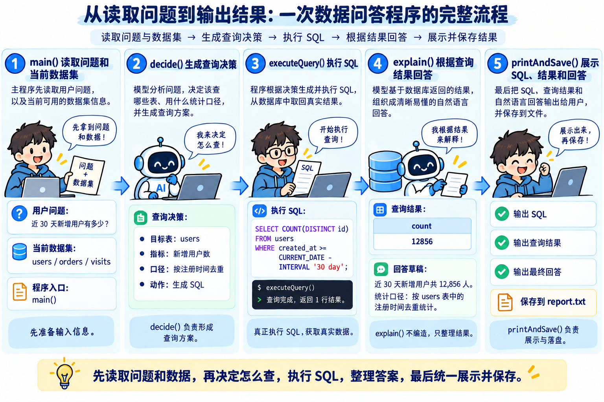

## 再问复杂一点：和上个月相比怎样
刚才查出了 9 月金额。那么加入用户接着问：

> 仅按已导入数据，比较 2026 年 9 月与 8 月各区域未扣退款销售额，列出差额和环比。
>

调用入口还是 `answerQuestion()`，只是问题变了，需要生成的 SQL 也随之变化。

先用固定查询核对结果：

```bash
npm run demo -- compare
```

完整打印如下：

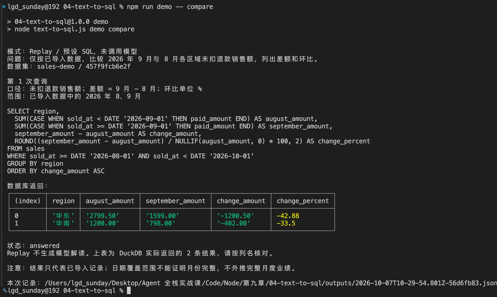

这次 SQL 中最关键的是下面两列：

```sql
SUM(CASE WHEN sold_at < DATE '2026-09-01'
         THEN paid_amount END) AS august_amount,
SUM(CASE WHEN sold_at >= DATE '2026-09-01'
         THEN paid_amount END) AS september_amount
```

完整查询已经用 `WHERE` 把日期限制在 8 月 1 日到 10 月 1 日以前。因此，这里的 `CASE WHEN` 可以理解为：符合 8 月条件的金额放进第一列，符合 9 月条件的放进第二列，再分别求和。

接着计算：

```latex
差额 = 9 月金额 - 8 月金额
环比 = 差额 / 8 月金额 × 100%
```

得到的结果是：

| 区域 | 8 月金额 | 9 月金额 | 差额 | 环比 |
| --- | ---: | ---: | ---: | ---: |
| 华东 | 2799.50 | 1599.00 | -1200.50 | -42.88% |
| 华南 | 1200.00 | 798.00 | -402.00 | -33.50% |


### 要显示商品名称，就需要关联商品表
用户还可能问：

> 和 8 月相比，9 月哪个商品的未扣退款销售额变化最大？按差额绝对值排序，展示商品名称。
>

这里明确“绝对值”，是为了同时比较增加和减少的幅度。

执行：

```bash
npm run demo -- products
```

完整打印：

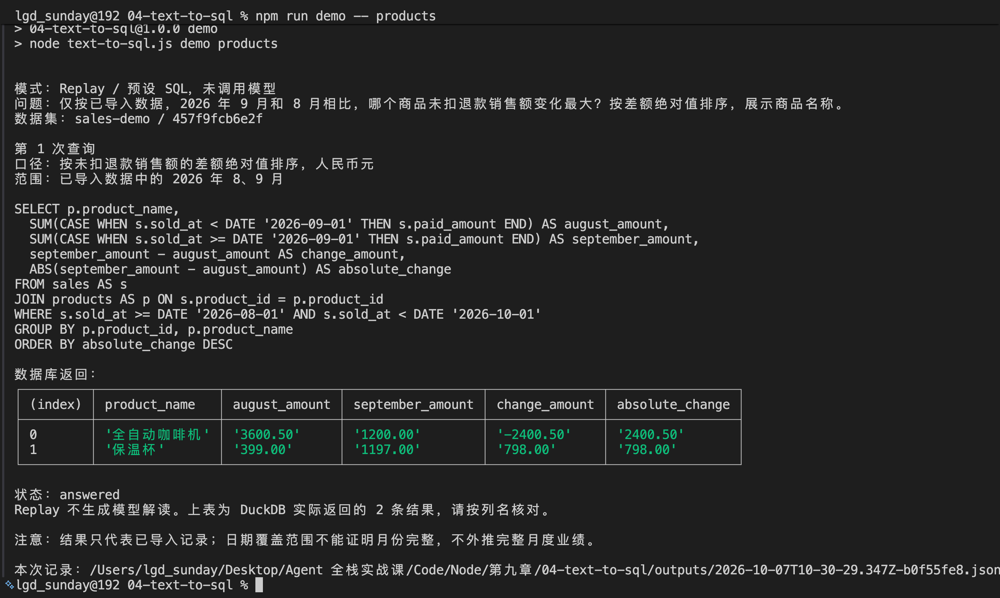

销售明细只有 `product_id`，商品名称保存在准备数据时导入的 `products` 表中。

因此，这次查询会增加：

```sql
FROM sales AS s
JOIN products AS p ON s.product_id = p.product_id
```

`s`、`p` 分别是两张表的简称。`JOIN` 根据相同商品编号，把每条销售明细和商品名称对应起来。

这份关联关系已经写在 `dataset.context.relation` 中，所以模型生成查询时可以读取它。

程序导入商品表时还检查了商品编号唯一。否则，一个商品编号如果对应两行商品资料，关联以后可能把同一笔销售匹配两遍，金额也会被重复累计。

本次结果是：

| 商品 | 8 月金额 | 9 月金额 | 差额 |
| --- | ---: | ---: | ---: |
| 全自动咖啡机 | 3600.50 | 1200.00 | -2400.50 |
| 保温杯 | 399.00 | 1197.00 | +798.00 |


因此，在这份样本里，咖啡机的变化幅度最大，表现为减少 2400.50 元。

大家可以把这两个问题改成 `npm run ask -- "你的问题"`，观察模型怎样生成等价查询。固定演示中的完整 SQL 都在 `replay.js` 中，可以用来对照。

## 总结
这一节，咱们把上一节导入的数据真正用起来了。

`Text-to-SQL` 负责把自然语言问题转换成查询。要让模型写对 SQL，需要同时提供真实表结构、字段含义、表关联和统计口径。

查询生成以后，由程序检查并交给 DuckDB 执行，再把真实结果交给模型组织回答。区域汇总用到了筛选、分组和求和，月份比较增加了条件聚合，商品分析则通过 `JOIN` 找到商品名称。

问题不清楚时先追问，缺少数据时指出缺口，SQL 写错时只允许有限修正。最终把问题、SQL、结果与回答一起保存，才能知道答案是怎样得来的。

不过，模型生成的 SQL 已经开始影响程序执行了。

本例的只读连接、查询检查和子进程提供了基础限制，完整的文件、网络和资源隔离还需要进一步处理。下一节，咱们就来看：**Agent 生成的查询和代码，到底应该在哪里执行。**

> 更新：2026-10-07 18:34 · 原文：<https://www.yuque.com/lgdsunday/ab1dy3/zpnfplb60i23gxf4>
