# 05-受限执行：模型生成的 SQL 和分析代码在哪里运行

上一小节，模型已经可以根据用户的问题生成 SQL，再由程序执行查询。

程序里也加了只读连接和查询检查，只允许查询指定的业务表。

接下来，假设用户继续问：

> 当前数据中，9 月各区域的销售额是多少？各自占总销售额的百分比是多少？
>

如果想要实现这个功能，那么可以分成两步：

+ 先用 SQL 查询各区域的销售额
+ 再用一段 JavaScript 计算占比

计算占比只需要各区域的金额。如果这段代码还想读取服务器上的配置文件，应该允许吗？

肯定是不应该允许的。

这时候，就要考虑代码执行时的权限了。

所以，这一节要解决的是：**让查询和分析代码能够完成计算，同时限制它们能访问的数据、文件、网络，以及能够使用的时间和资源。** 

这就是本节所说的“受限执行”。

## 受限执行到底限制什么
**受限执行，就是给代码规定操作范围和资源上限，让它在这些限制下完成任务。**

拿刚才的占比计算来说，咱们可以规定：

| 需要限制的事情 | 本例怎么处理 |
| --- | --- |
| 能读取哪些业务数据 | 只提供查询返回的区域金额 |
| 能不能修改输入文件 | 输入文件只读 |
| 能不能联网 | 关闭外部网络 |
| 能用多少资源、运行多久 | 限制 CPU、内存和执行时间 |


这些限制要由应用程序和执行环境保证。

因此，本节为任务准备一个专门的运行环境，也就是 **Sandbox，沙箱**。

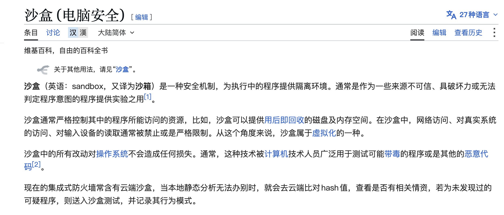

在这里，可以把它理解为：**专门用来执行代码、并且限制了访问权限和资源用量的环境。**

本节使用 Docker 容器来实现这个环境。程序负责配置数据访问、网络和资源限制，再把任务放进去执行。每次任务创建一个新容器，取回结果以后再删除，整个过程就像下面这样：


图里的“宿主”，就是容器外面负责准备数据、启动容器和接收结果的程序所在环境。换到咱们的代码里面，就是咱们在电脑上运行的 Node.js 程序。

对应刚才的销售分析，本例会先后创建两个容器：

| 执行任务 | 应用提供的业务数据 |
| --- | --- |
| 第一个容器：执行 SQL，查询区域销售额 | 当前数据库的只读副本 |
| 第二个容器：执行 JavaScript，计算金额占比 | SQL 返回的区域金额 |


然后咱们来看看代码

## 运行三个实验，看看限制有没有生效
本节代码在 `Code/Node/第九章/05-restricted-execution`。

这个代码运行的时候要注意哈：**使用 Node.js 22 或以上版本，保留 03、04、05 三个目录的相邻关系。04 完成过 **`npm run prepare-data`** 后，启动 Docker Desktop，**

然后，在本节目录执行：

```bash
npm run build:sandbox
```

这个命令准备运行镜像，里面包含 Node.js、DuckDB 和执行入口，后面会用这份镜像创建容器。

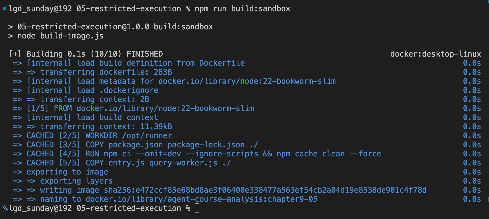

看到 `FINISHED`，最后出现镜像名 `agent-course-analysis:chapter9-05`，就说明构建成功了。`CACHED` 表示复用了之前的缓存。

然后，咱们先执行：

```bash
npm run demo -- code
```

程序会先在一个容器里执行 SQL，查出区域销售额；取回结果以后，再创建一个容器执行占比计算。

SQL 使用当前数据库的只读副本，计算代码只拿到查询返回的两行金额。因为计算占比用不到整个数据库，所以第二步只提供查询结果。

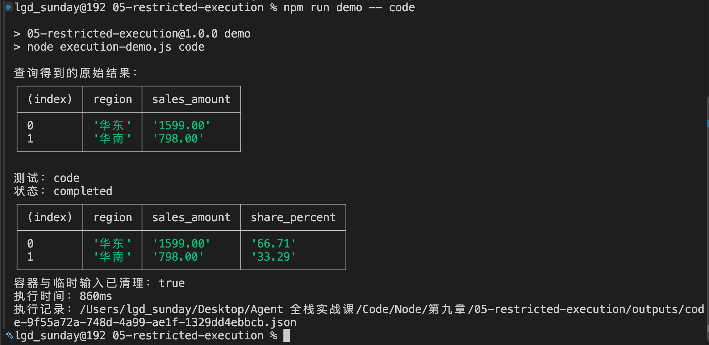

第一张表是查到的金额：华东 1599 元、华南 798 元。第二张表增加了计算后的占比：

| 区域 | 金额（元） | 占比（%） |
| --- | ---: | ---: |
| 华东 | 1599.00 | 66.71 |
| 华南 | 798.00 | 33.29 |


两项金额合计 2397 元，华东占比为 `1599 ÷ 2397 × 100% ≈ 66.71%`，和结果对应得上。

最后还能看到：

```latex
状态：completed
容器与临时输入已清理：true
```

这表示本次计算正常结束，结果已经返回给宿主程序，用过的容器和临时数据也已经删除。04 中的原始数据库继续保留。

到这里，咱们确认了：**设置这些限制以后，正常计算仍然能够完成。**

### 电脑上的其他文件，能不能读取
接下来，咱们在电脑上准备一个测试文件，但不把它放进容器。然后让容器里的代码尝试读取它。

这些操作已经写进测试命令，直接执行：

```bash
npm run demo -- read-host
```

命令会先创建 `.work/host-only.txt`，再让分析代码尝试读取这个文件的宿主绝对路径。

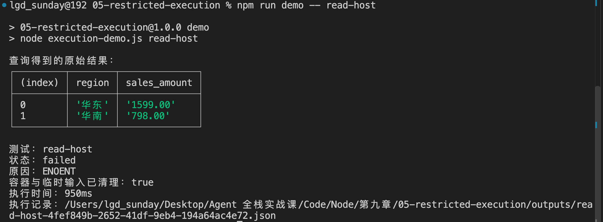

关注最后的错误：

```latex
状态：failed
原因：ENOENT
容器与临时输入已清理：true
```

`ENOENT` 表示在当前执行环境中找不到文件。打开本节的 `.work/` 目录，却能看到 `host-only.txt` 确实存在：

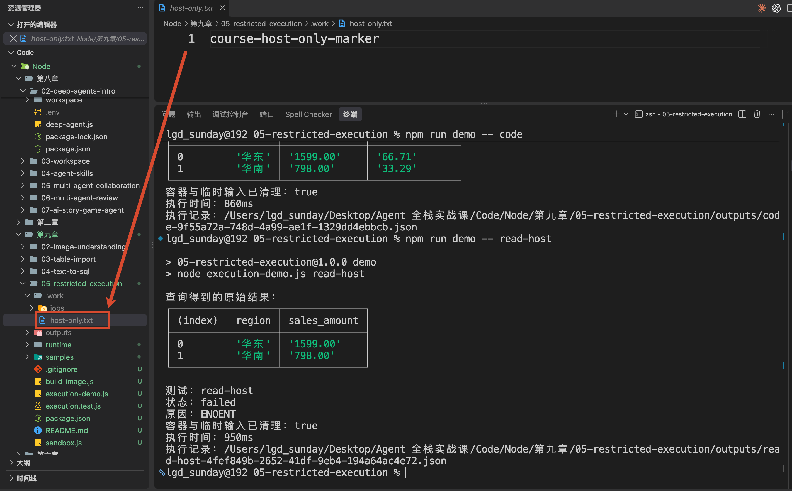

这是因为文件保存在电脑上，程序没有把它提供给容器。容器里的代码通过这个路径读不到它。

这个实验验证了：**电脑上存在的文件，不会自动变成计算容器可以读取的文件。**

### 出现死循环，能不能停止
再执行：

```bash
npm run demo -- timeout
```

这次交给容器的分析函数里包含 `while (true) {}`，它会一直循环，不会主动返回结果。

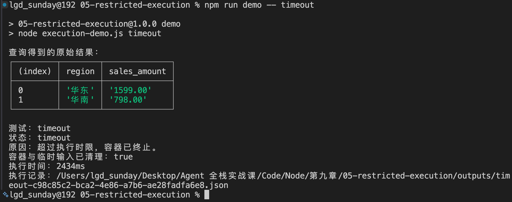

本例给这次执行设置了 2 秒时限。到达时限以后，宿主程序会终止容器，最后输出：

```latex
状态：timeout
原因：超过执行时限，容器已终止。
容器与临时输入已清理：true
```

命令还包含前面的数据查询、容器准备和清理，所以终端总耗时可能超过 2 秒。

现在，三个实验已经把本节要做的事情展示出来了：

+ 正常计算可以完成
+ 没有开放的文件读不到
+ 持续不结束的任务会被停止

## 这些限制是怎样实现的
接下来，咱们回到代码，看这三个结果分别是怎么实现的。

这里大家要注意，这一块的代码会 **比较复杂**，里面会联动咱们在 `04 小节` 的代码，也会涉及到大量的 SQL 查询，所以大家以理解为主就可以。

## 从 main() 看数据怎样进入容器
这些限制具体是怎样设置的？咱们回到刚才成功计算占比的 `npm run demo -- code`，从命令入口往下看。

打开 `package.json`，`demo` 对应的是：

```bash
node execution-demo.js
```

所以，刚才的命令会进入 `execution-demo.js` 的 `main()`，参数 `name` 是 `code`。

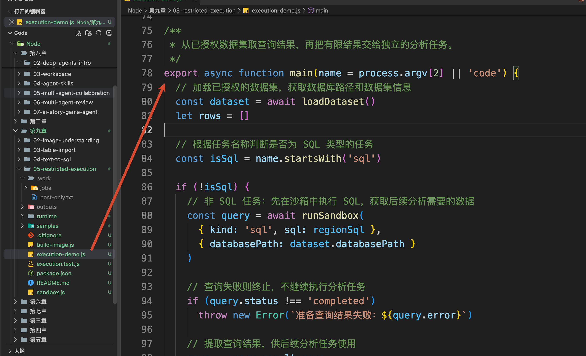

不过，补充计算需要先拿到区域销售额。因此，`main()` 先调用上一节的 `loadDataset()`，取得当前数据集

```javascript
// 加载已授权的数据集，获取数据库路径和数据集信息
const dataset = await loadDataset()
```

然后，再发起 SQL 任务：

```javascript
// 非 SQL 任务：先在沙箱中执行 SQL，获取后续分析需要的数据
const query = await runSandbox(
  { kind: 'sql', sql: regionSql },
  { databasePath: dataset.databasePath }
)
```

`regionSql` 来自上一节的 `replay.js`，就是按区域统计 9 月销售额的那条 SQL。本节直接复用它作为执行输入。

这里要分清两个参数：

+ 第一个参数是本次要执行的内容，`kind: 'sql'` 表示 SQL 任务。
+ 第二个参数是应用提供的执行配置，`databasePath` 来自已经选定的数据集。

接下来进入 `sandbox.js` 的 `runSandbox()`。

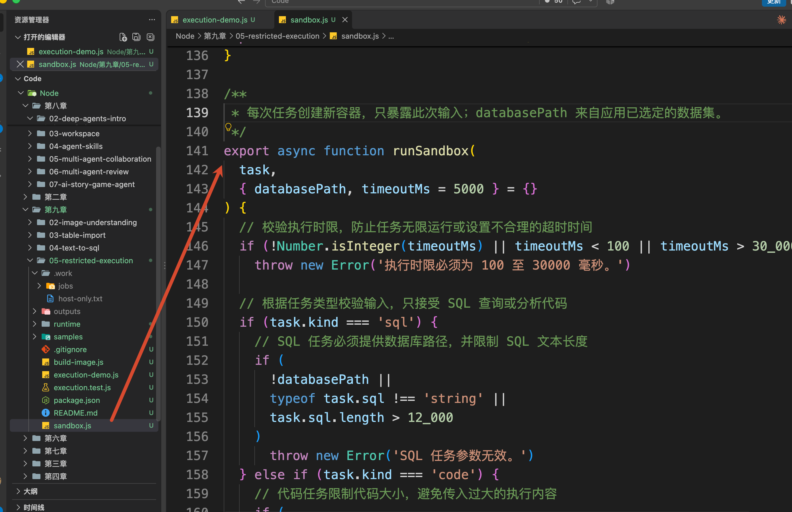

它会生成本次任务的 `jobId`，创建一个临时目录：

```latex
.work/jobs/<jobId>/input/
├─ request.json
└─ data.duckdb
```

`request.json` 保存任务类型和 SQL。`data.duckdb` 是当前课程数据库的副本，原始文件继续留在 04 的数据目录里。

输入准备好以后，`runSandbox()` 调用：

```javascript
// 创建独立容器；提前标记，确保创建异常时也尝试清理
await docker(containerArgs(name, inputDirectory))
```

这里的 `name` 是应用生成的唯一容器名称，`inputDirectory` 就是刚才的临时输入目录。

同一文件中的 `containerArgs()` 会返回 Docker 参数，其中一项是：

```javascript
'--mount',
`type=bind,source=${inputDirectory},target=/input,readonly`
```

这个配置表示：把宿主上的 `inputDirectory` 映射到容器里的 `/input`，并且只允许读取。这里可以结合 Docker 的 [文件挂载文档](https://docs.docker.com/engine/storage/bind-mounts/)查看。

所以，容器读取 `/input/data.duckdb` 时，读到的就是刚才为本次任务准备的数据库副本。

项目根目录、其他数据集和配置文件都没有被挂载进去。

### 限制容器的权限和资源
继续看 `containerArgs()`。

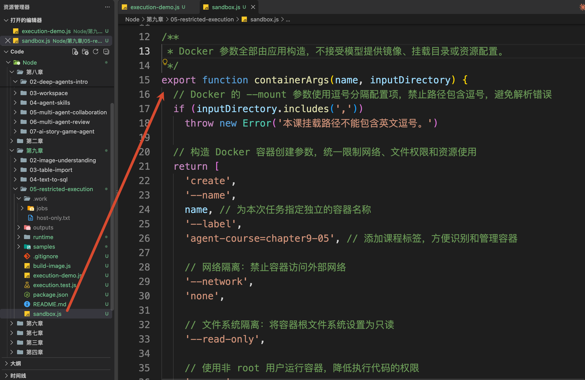

除了只读输入，它还设置了这些限制：

| 配置 | 本例限制什么 |
| --- | --- |
| `--network none` | 不提供外部网络连接 |
| `--read-only` | 容器根文件系统只读 |
| `--user 1000:1000` | 使用非 root 用户执行 |
| `--cap-drop ALL` | 移除额外的 Linux 权限能力 |
| `--security-opt no-new-privileges=true` | 限制进程通过执行程序获得新的权限 |
| `--cpus 1` | 最多使用相当于 1 个 CPU 的计算额度 |
| `--memory 256m` | 容器内存上限为 256 MiB |
| `--memory-swap 256m` | 配合相同内存上限，不额外使用 swap |
| `--pids-limit 64` | 限制容器中的进程和线程数量 |


运行时还提供了一个有大小限制的 `/tmp` 临时目录，用于必要的临时写入，随容器一起清理。

> 这些参数分别对应 Docker 的 [运行配置](https://docs.docker.com/engine/containers/run/) 和 [资源限制](https://docs.docker.com/engine/containers/resource_constraints/)。有兴趣的同学可以看下
>

## SQL 进入容器以后，还要检查什么
容器创建完成，`runSandbox()` 会继续调用 `startAndCollect()`，启动容器并等待输出。

容器执行哪个文件，由 `runtime/Dockerfile` 最后一行指定：

```dockerfile
ENTRYPOINT ["node", "/opt/runner/entry.js"]
```

这里对应的源码就是本节的 `runtime/entry.js`。

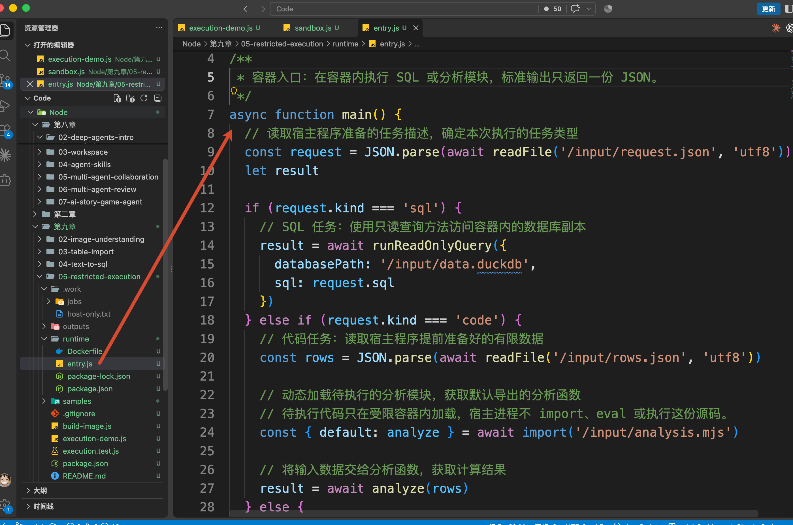

它先读取 `/input/request.json`，看到 `kind` 是 `sql`，就执行：

```javascript
// SQL 任务：使用只读查询方法访问容器内的数据库副本
result = await runReadOnlyQuery({
  databasePath: '/input/data.duckdb',
  sql: request.sql
})
```

`runReadOnlyQuery()` 在哪里？

就在上一节的 `query-worker.js` 中。构建镜像时，`build-image.js` 会把这份文件复制到镜像里，所以本节继续沿用已有的 SQL 检查逻辑。

打开 04 的 `query-worker.js`，这个方法创建数据库连接时指定了：

```javascript
access_mode: 'READ_ONLY',
enable_external_access: 'false',
autoinstall_known_extensions: 'false',
autoload_known_extensions: 'false'
```

数据库连接建立以后，`runReadOnlyQuery()` 调用同一文件中的 `checkedSql()`。

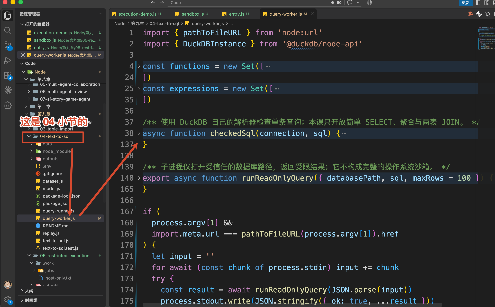

这个方法使用 DuckDB 的 `json_serialize_sql()`，把 SQL 解析成描述语句结构的 JSON。

例如，“查询 `sales` 表”会在解析结果中对应一个表节点，其中包含 `table_name: 'sales'`。程序就可以逐个检查语句类型、表名和函数名。

## 查询结果怎样交给分析代码
现在回到刚才 `execution-demo.js` 的 `main()`。

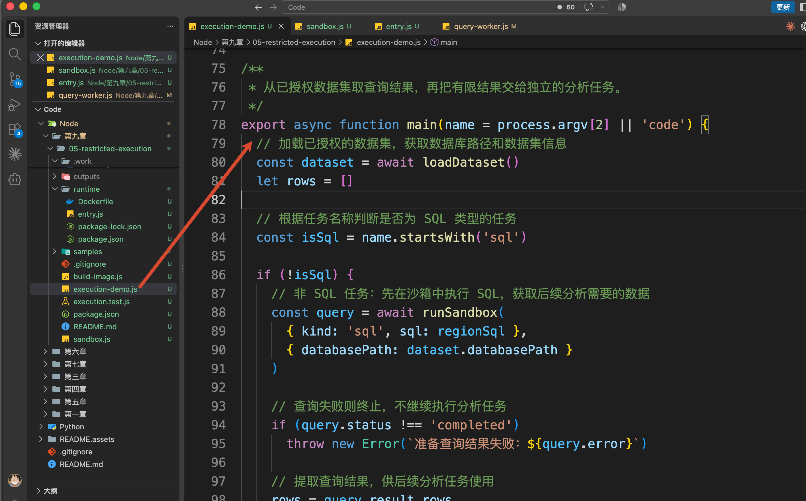

第一个 `runSandbox()` 完成以后，`query.result.rows` 中保存的，就是华东和华南的两行金额：

```javascript
// 提取查询结果，供后续分析任务使用
rows = query.result.rows
```

接着，`main()` 调用 `makeTask(name, rows)`。当前 `name` 是 `code`，这个方法会读取 `samples/region-share.mjs`，把文件内容作为待执行代码，和 `rows` 一起组成任务：

```javascript
// 结构示意，code 中实际保存的是文件里的完整源码。
{
  kind: 'code',
  rows: [
    { region: '华东', sales_amount: '1599.00' },
    { region: '华南', sales_amount: '798.00' }
  ],
  code: 'export default function analyze(rows) { ... }'
}
```

这份任务再次传给 `runSandbox()`。

这次它会创建新的容器和输入目录，保存的文件变成：

```latex
.work/jobs/<新的 jobId>/input/
├─ request.json       任务类型为 code
├─ rows.json          查询返回的两行数据
└─ analysis.mjs       本次待执行代码
```

**补充计算只需要这两行金额，因此这次没有放入数据库文件。**

新容器仍然执行 `runtime/entry.js`，不过这次会进入 `code` 分支：

```javascript
// 代码任务：读取宿主程序提前准备好的有限数据
const rows = JSON.parse(
  await readFile('/input/rows.json', 'utf8')
)
const { default: analyze } = await import('/input/analysis.mjs')
result = await analyze(rows)
```

`analyze` 就是 `region-share.mjs` 默认导出的函数。它接收刚才的查询结果，计算占比，再返回带有 `rows` 的对象。

这里的 `import()` 发生在容器内部。宿主程序只负责保存代码文本和启动容器，不会直接加载执行这份分析代码。

计算完成后，`entry.js` 把结果转换成 JSON，写到标准输出。宿主中的 `startAndCollect()` 收到这些输出，再交回 `runSandbox()`。

### 程序怎样接收这份结果
容器返回以后，`runSandbox()` 会先检查退出状态，再解析返回的 JSON，并调用：

```javascript
result: validateResult(message.result)
```

`validateResult()` 位于同一个 `sandbox.js` 文件中，检查结果是否有 `rows`、行数是否超限、字段是否为允许的简单类型，以及查询是否被截断。

通过以后，`runSandbox()` 返回的核心内容就是：

```javascript
{
  status: 'completed',
  result: {
    rows: [
      { region: '华东', sales_amount: '1599.00', share_percent: '66.71' },
      { region: '华南', sales_amount: '798.00', share_percent: '33.29' }
    ]
  },
  cleanedUp: true
}
```

最后，`main()` 打印这份结果，再把执行记录保存到宿主的 `outputs/`。

## 越界和超时以后，程序怎样处理
刚才，咱们已经走完了正常计算的流程了，但是还有两个“有问题”的实验代码没看，接下来咱们来看看。

### 文件读取失败，怎样把错误传回来
先看 `read-host` 实验。

分析代码尝试读取电脑上的 `host-only.txt`，这个文件没有提供给容器，所以读取时抛出了 `ENOENT` 错误。

此时，执行仍然在 `runtime/entry.js` 中。

前面执行分析函数的这行代码：

```javascript
// 将输入数据交给分析函数，获取计算结果
result = await analyze(rows)
```

会因为文件读取失败而抛出异常，接着进入这个文件最下方的 `main().catch(...)`。

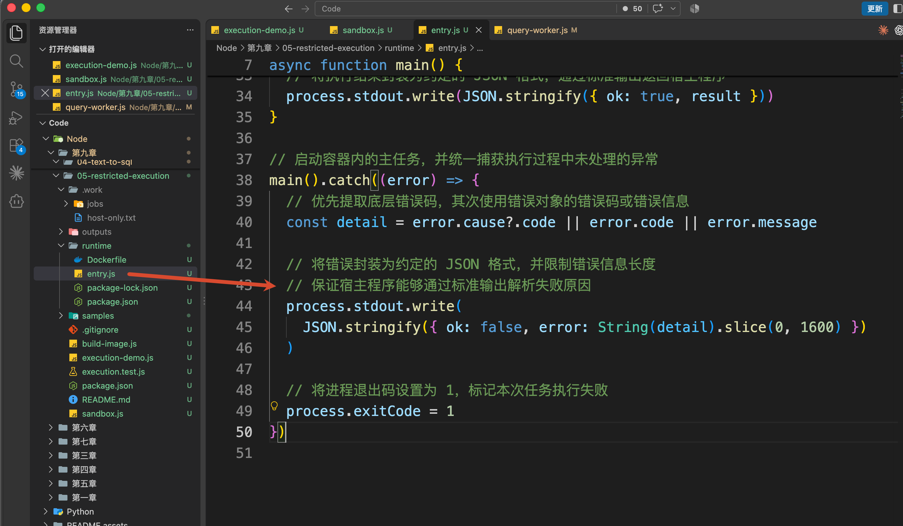

这里会提取错误信息，通过标准输出返回：

```json
{
  "ok": false,
  "error": "ENOENT"
}
```

错误通过前面讲过的同一条路径回到宿主：`startAndCollect()` 收集输出，再交给 `runSandbox()`。

`runSandbox()` 解析这份 JSON 时，发现 `ok` 是 `false`，于是把本次任务标记为 `failed`，并保留错误原因。这就对应了前面终端里的：

```latex
状态：failed
原因：ENOENT
```

所以，这次越界读取的处理过程很清楚：**容器读不到文件，执行入口返回错误，宿主记录本次任务失败。**

### 代码一直不返回，怎样停止它
再看前面的死循环实验。

`while (true) {}` 会一直执行，既不返回结果，也不主动抛出异常。宿主如果一直等待容器输出，这次任务就结束不了。

因此，停止这类任务的计时器需要放在宿主程序中。

回到 `execution-demo.js` 的 `main()`。

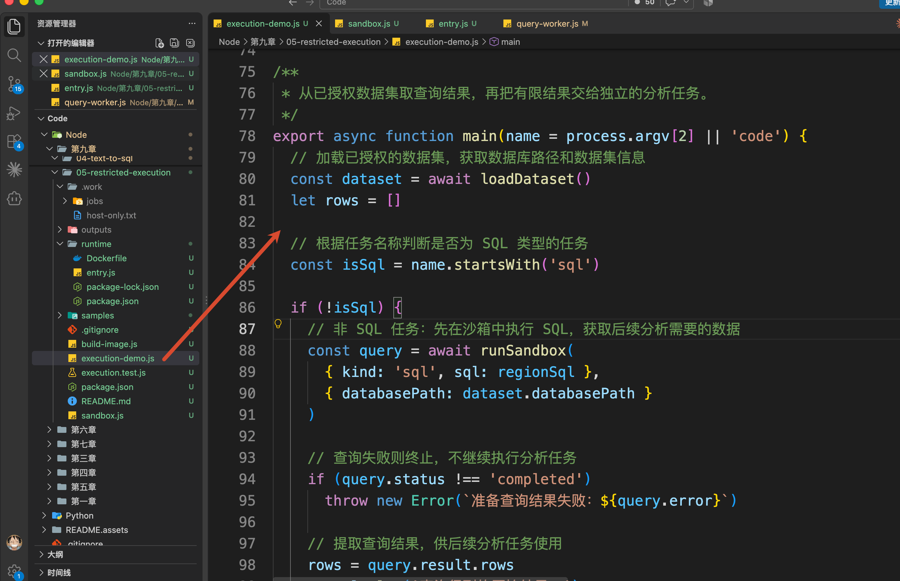

调用 `runSandbox()` 时，它通过 `timeoutMs` 给死循环实验设置了 2000 毫秒的时限。

`runSandbox()` 再把这个时限传给 `sandbox.js` 中的 `startAndCollect()`。打开这个方法，就能找到：

```javascript
const timer = setTimeout(() => stop('timeout'), timeoutMs)
```

启动容器以后，宿主就开始计时。容器内部的死循环不会阻塞宿主的这个定时器。

到达时限，`stop('timeout')` 先记录停止原因，再执行：

```javascript
docker(['rm', '--force', name])
```

这里的 `name` 是当前任务的容器名称。这条命令会强制终止并删除该容器，具体行为可以查看 Docker 的 [强制删除容器说明](https://docs.docker.com/reference/cli/docker/container/rm/#force-remove-a-running-container---force)。

停止完成后，`startAndCollect()` 把停止原因交回 `runSandbox()`，后者就会把任务标记为 `timeout`。这就是前面看到“超过执行时限，容器已终止”的原因。

### 失败以后，临时数据还会保留吗
无论是刚才的文件读取失败，还是超时停止，`runSandbox()` 最后都会进入自己的 `finally`，清理本次任务：

+ 检查容器是否还存在，存在就删除。
+ 删除本次任务的临时输入目录。

超时处理可能已经删除了容器，这里会继续清理剩下的临时文件。只有清理成功，返回的执行报告才会带上 `cleanedUp: true`。

执行回到 `main()` 后，错误原因和清理状态会一起打印出来，并保存到 `outputs/`，方便后续查看。

因此，**失败任务的容器和临时输入会被清理，失败原因会保留下来。** 04 中的原始数据库不受这次清理影响。

## 总结
这一节，咱们完成了查询和分析代码的受限执行。

SQL 在容器里查询当前数据库的只读副本，JavaScript 在另一个容器里使用查询结果计算占比。应用提前规定数据范围、文件权限、网络和资源上限，再接收计算结果。

执行失败时记录原因，超过时限时主动停止，结束以后清理容器和临时输入。

大家记住这条流程就可以：

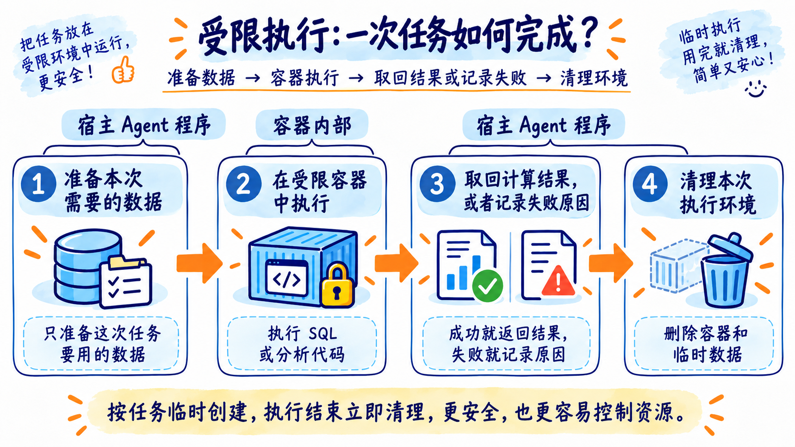

拿到计算结果以后，下一节咱们继续把它做成图表，并让图上的数字能够查回对应的 SQL 和数据来源。

> 更新：2026-10-08 18:06 · 原文：<https://www.yuque.com/lgdsunday/ab1dy3/vvqmeeo6lg3v0ua5>
