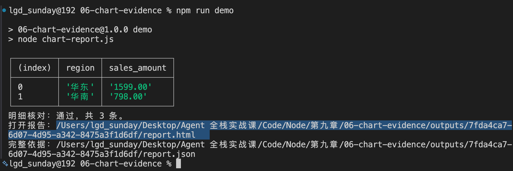
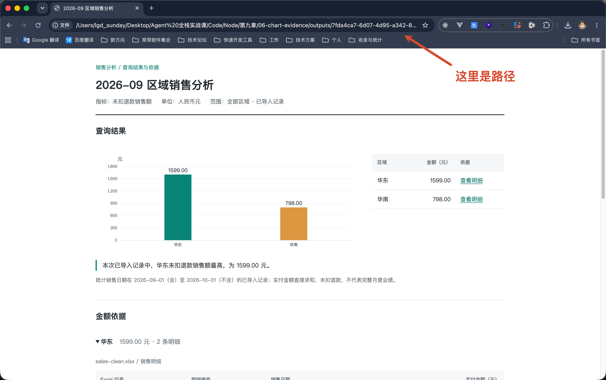
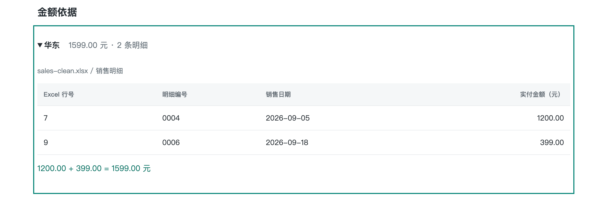
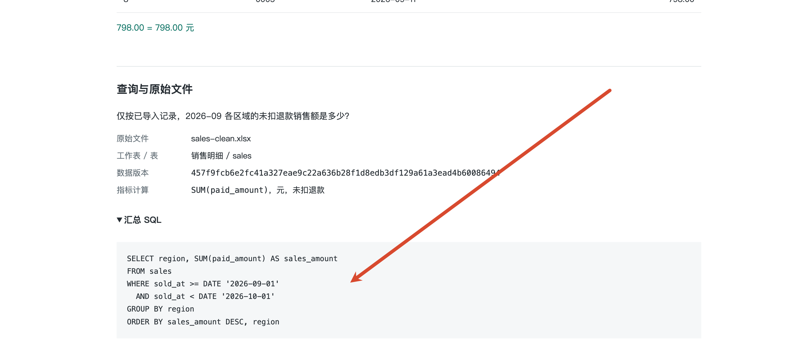
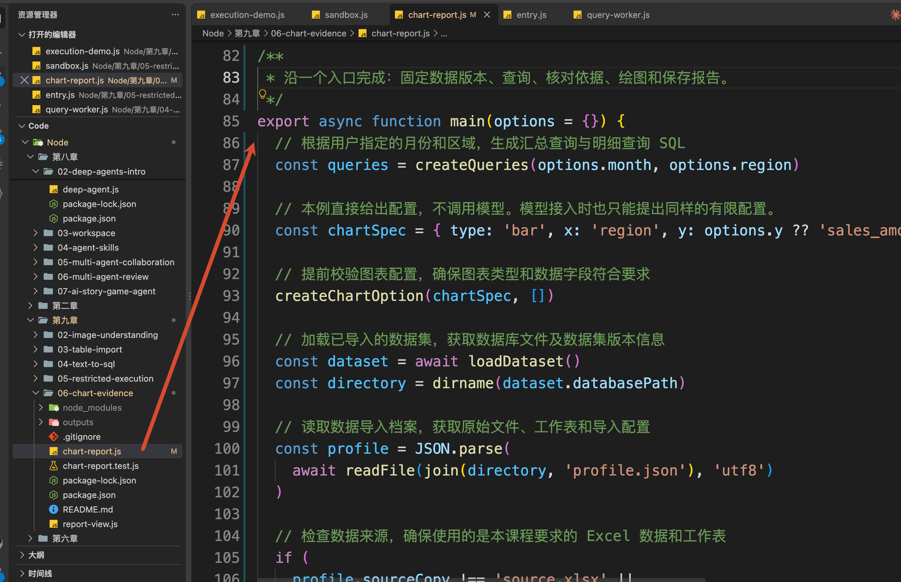
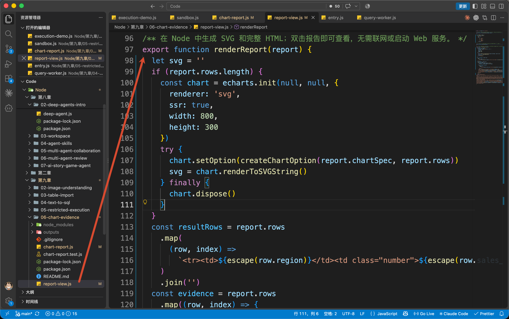
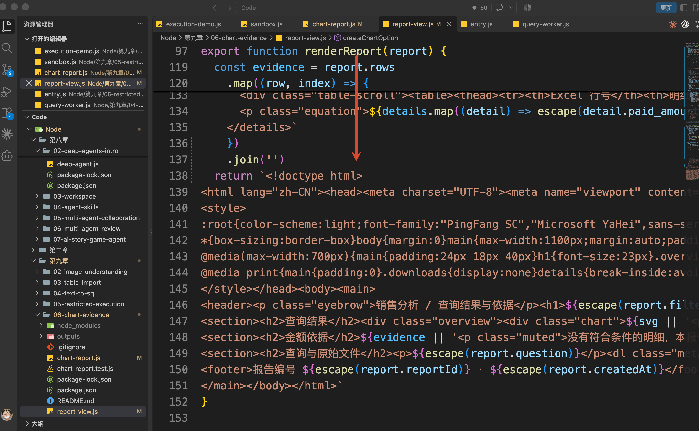

# 06-图表与分析依据：怎样让每个数字都能查回去

上一小节，咱们已经能够在受限环境里执行查询和分析代码。

比如，查询 9 月各区域的未扣退款销售额，得到华东 1599 元、华南 798 元。

接下来，把这两个数字画成柱状图，就能很直观地比较哪个区域更高。

同时，我们还可以让图形变得可点击，只要用户点了图上的数字，那么就可以查询原始数据。

咱们这一小节，就干这个事

## 先看一份可以核对的报告
本节代码在 `Code/Node/第九章/06-chart-evidence`。

沿用 04 已准备的数据和 05 已构建的 Docker 镜像，保持 Docker Desktop 运行。在本节目录执行：

```bash
npm run demo
```

仍然使用 Node.js 22 或以上版本，保留 03、04、05、06 的相邻目录关系。

命令会打印一个 `report.html` 路径



把这个路径复制到浏览器里面，可以看到这样的一个页面：



左边是柱状图，右边是查询结果表。两边的华东金额都是 1599 元。

页面同时标明了时间、单位和统计口径：**2026 年 9 月、人民币元、实付金额求和、未扣退款，只统计已导入的记录。**

然后，点击右边华东这一行的“查看明细”，页面会跳到这两条记录：



这里展示的是 `1599 元` 的组成，这个组成分成两部分：

+ Excel 第 7 行：1200 元
+ Excel 第 9 行：399 元

继续到页面下方，可以展开“汇总 SQL”



也可以点击“下载本次原文件”，打开其中的“销售明细”工作表，核对第 7 行和第 9 行。

**图表负责展示结果，SQL 说明怎样计算，原文件和行号帮助用户核对数据。**

你看，这就是咱们最终要实现的效果。

接下来，咱们只看这条关联是怎样建立的。

## 图表怎样使用真实查询结果
本节的代码比较简单，也正好让大家缓缓。

从刚才的命令开始。打开 `package.json`，`demo` 执行的是 `node chart-report.js`，所以入口是 `chart-report.js` 的 `main()`。



它先确定月份和区域，调用 `createQueries()` 生成查询，再通过上一节的 `runSandbox()` 执行 SQL。

查询成功以后，`main()` 取出结果：

```javascript
// 分别提取汇总结果和明细记录
const rows = summaryRun.result.rows
```

本次 `rows` 就是：

```javascript
[
  { region: '华东', sales_amount: '1599.00' },
  { region: '华南', sales_amount: '798.00' }
]
```

数据有了，还需要告诉图表：横轴画什么，纵轴画什么。

因此，`main()` 准备了一份配置 `chartSpec`，默认内容是：

```javascript
{
  type: 'bar',
  x: 'region',
  y: 'sales_amount'
}
```

这三个字段是本例约定的写法，分别表示：使用柱状图，横轴对应区域，纵轴对应销售额。

这里只指定了**怎样展示已有字段**。柱子的金额继续从刚才的 `rows` 中读取。

`main()` 会把 `rows` 和 `chartSpec` 一起放进 `report`，交给 `report-view.js` 的 `renderReport(report)` 生成页面。



`renderReport()` 内部调用 `createChartOption()`，把这份配置转换成 [Apache ECharts 的图表配置](https://echarts.apache.org/handbook/en/concepts/dataset/)。

`ECharts` 这玩意很多同学也都用过，主打的就是一个配置又臭又多。

所以，咱们没必要细看里面的配置内容，只看一点关键部分就行：

```javascript
// createChartOption() 节选，省略坐标轴样式等配置。
dataset: {
  dimensions: ['region', 'sales_amount'],
  source: rows
},
series: [{
  type: spec.type,
  encode: { x: spec.x, y: spec.y }
}]
```

这里的 `spec` 就是传进来的 `chartSpec`。

通过  `createChartOption()` 处理好配置之后，咱们回到 `renderReport()`  方法，他最后会直接返回一个 `html 文件内容`，把生成的 `Echats` 图标插入进去，这样得到的就是咱们前面看到的 `html` 文件



## 1599 元怎样查回 Excel
现在，图表和结果表已经对应上了。那刚才展开的两条原始明细，又是从哪里来的？

回到 `chart-report.js` 的 `main()`。

它在执行汇总查询以后，还会执行一次明细查询。两条 SQL 都由 `createQueries()` 准备，使用相同的日期和区域条件。

本次明细查询是：

```sql
SELECT source_row, line_id, sold_at, region, paid_amount
FROM sales
WHERE sold_at >= DATE '2026-09-01'
  AND sold_at < DATE '2026-10-01'
ORDER BY source_row
```

其中的 `source_row` 是导入 Excel 时保存的原始行号。例如，查询结果中的这一条：

```javascript
{
  source_row: 7,
  line_id: '0004',
  sold_at: '2026-09-05',
  region: '华东',
  paid_amount: '1200.00'
}
```

就表示：这条华东明细来自“销售明细”工作表的第 7 行，实付金额为 1200 元。

`main()` 把这次查询返回的数组保存为 `details`，然后调用同一文件里的：

```javascript
verifyEvidence(rows, details)
```

这个方法做的事情就是：把明细按区域重新加起来，检查它是否等于汇总结果。

本次华东有 1200 元和 399 元两条明细，加起来正好是 1599 元，检查通过。页面再从 `details` 中取出华东的记录，展示到“金额依据”里。

如果明细合计对不上，程序会停止生成报告，避免展示一份图表和依据互相矛盾的结果。

不过，只有行号还不够。用户以后可能重新上传 Excel，新文件的第 7 行已经变了。

因此，`main()` 在查询前就会复制本次的数据库和原文件。两次查询使用同一个数据库副本，报告也保留当时的 Excel：

```latex
outputs/<本次报告 ID>/
├─ report.html       图表、结果表与明细
├─ report.json       数据版本、统计条件、SQL 和查询结果
├─ source.xlsx       本次使用的 Excel 副本
└─ data.duckdb       本次查询的数据库副本
```

以后核对这份报告时，就打开它自己的 `source.xlsx`。即使当前数据换了新版本，旧报告仍然保留着当时的依据。

到这里，咱们就能完整地展示这些数据了：**1599 元来自指定版本 Excel 中的两条华东记录，按 9 月销售日期筛选，将实付金额求和，未扣退款。**

## 总结
这一小节的内容相对比较简单，绝大部分的东西咱们之前都讲过。

最核心的内容就是让大家知道怎么查询这些数据并动态的生成图标和分析依据。

那么下一小节，咱们就要增加语音交互能力了，通沟语音交互来让用户可以直接开口提出分析问题。

> 更新：2026-10-08 19:06 · 原文：<https://www.yuque.com/lgdsunday/ab1dy3/kyhwfkr56obxp0ap>
