# 07-语音交互：串起 ASR、Agent 与 TTS

前面几节，咱们已经可以让用户输入一个问题，再由模型生成 SQL，查询销售数据，最后展示结果和分析依据。

那么这一小节咱们就来看和 AI 的语音交互功能。

整个语音交互功能的逻辑是：**先把声音转成文字，再把得到的文字答案转回声音**。从而实现通过语音来完成和 AI 沟通的能力。

这样的一套流程中会涉及到两个比较核心的概念：**ASR 和 TTS**。

## ASR、Agent 和 TTS 是怎样配合的
### ASR：先识别用户说了什么
`ASR` 的全称是 `Automatic Speech Recognition`，也就是**自动语音识别**。

它接收音频，识别其中的语音内容，再输出对应的文字。

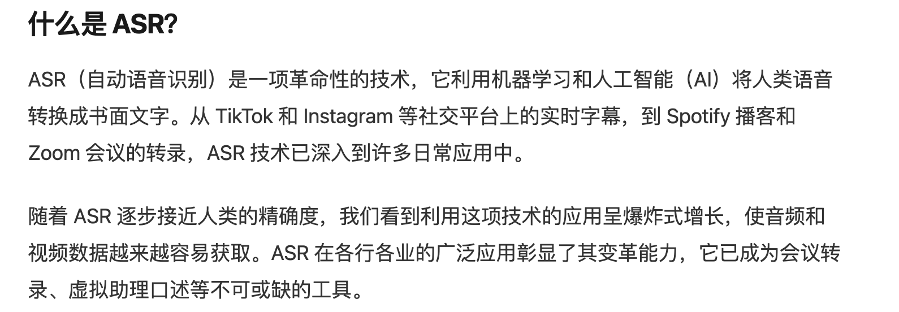

这里这里会有两个关键性的动作：

+ **录音**：浏览器通过麦克风采集声音，得到音频数据。
+ **语音识别**：把音频交给识别模型，得到文字。

这里的模型咱们会使用百炼的 `[qwen3-asr-flash](https://help.aliyun.com/zh/model-studio/qwen-asr-api-reference)` 完成识别。它支持通过 OpenAI 兼容接口接收音频

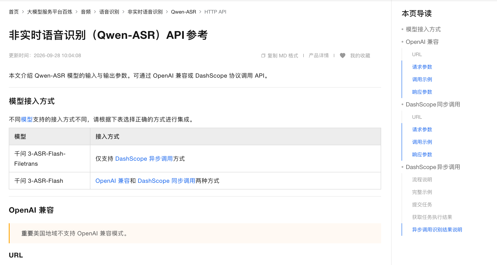

拿到文字以后，就可以交给前面实现的分析流程了。

还记得 04 的 `answerQuestion()` 吗？它会把用户问题和数据表信息交给模型，让模型判断条件是否足够，再生成 SQL。

程序执行查询以后，模型根据返回的数据组织回答。

### TTS：把已经得到的答案读出来
文字答案生成以后，接下来用到的就是 `TTS`。

它的全称是 `Text to Speech`，也就是**语音合成**：根据输入的文字，生成可以播放的音频。

例如，下面这段文字就可以作为合成输入：

```latex
仅按已导入的 2026 年 9 月记录，华东未扣退款销售额为 1599 元，华南为 798 元。
```

TTS 根据这段内容生成声音，浏览器再播放出来。

这里的金额来自前面的查询和回答。TTS 负责朗读，答案中的数字、单位和统计范围，需要在进入合成以前就确定好。

这里，咱们会用百炼的 `[qwen3-tts-flash](https://help.aliyun.com/zh/model-studio/qwen-tts-api)`。这样，语音识别和语音合成都通过百炼接入，中间的文字分析继续使用 DeepSeek。

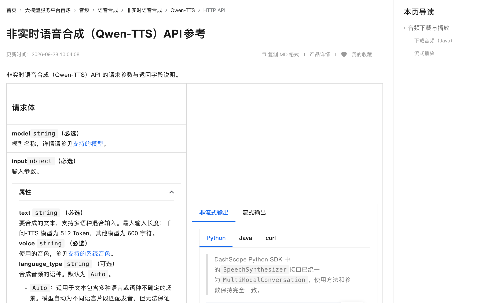

把这三部分连起来，完整流程就是：

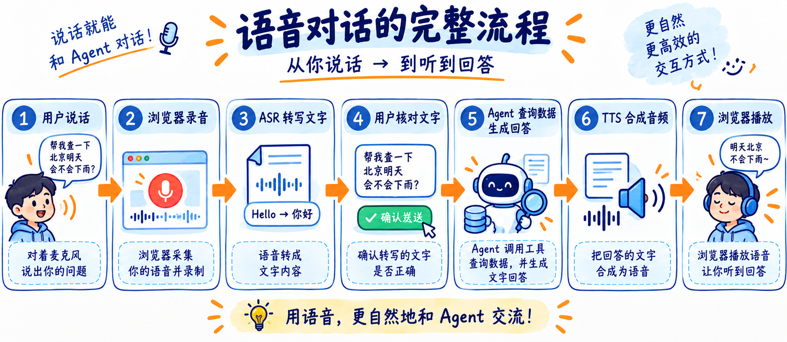

## 先运行一次语音分析
本节代码在 `Code/Node/第九章/07-voice-interaction`。

注意哈，这里的代码还需要保留 03、04、05 与当前小节的相邻目录关系。前面已经准备好的销售数据和 Docker 运行镜像继续使用，保持 Docker Desktop 运行即可。

在本节目录配置 `.env`：

```plain
DASHSCOPE_API_KEY=你的百炼APIKey
DASHSCOPE_BASE_URL=https://你的业务空间ID/compatible-mode/v1
DEEPSEEK_API_KEY=你的DeepSeekAPIKey
DEEPSEEK_MODEL=deepseek-flash
```

然后执行：

```bash
npm install
npm run dev
```

执行之后终端会弹出一个 URL 地址

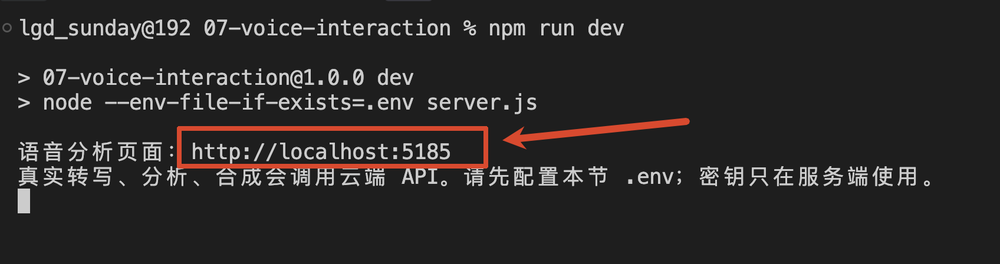

直接通过浏览器打开就可以，页面长这样：

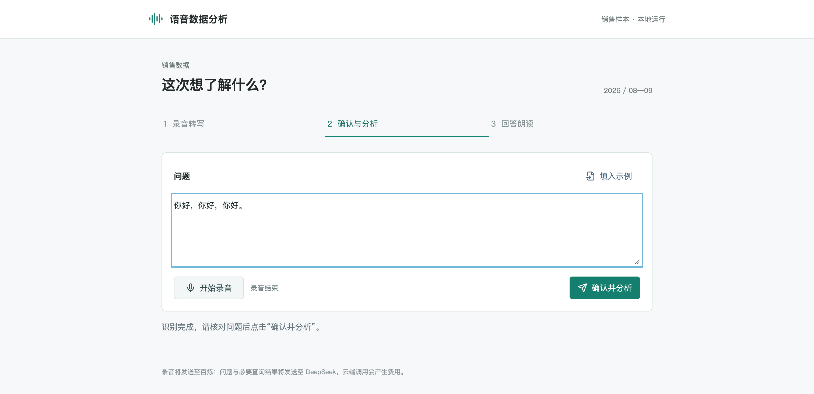

点击“开始录音”，允许浏览器使用麦克风，然后说：

> 仅按已导入记录，2026 年 9 月各区域的未扣退款销售额分别是多少？
>

说完以后，点击“结束录音”。页面会先显示正在识别，随后把文字填进输入框。有问题就直接修改输入框里的文字。

确认以后，点击“确认并分析”。

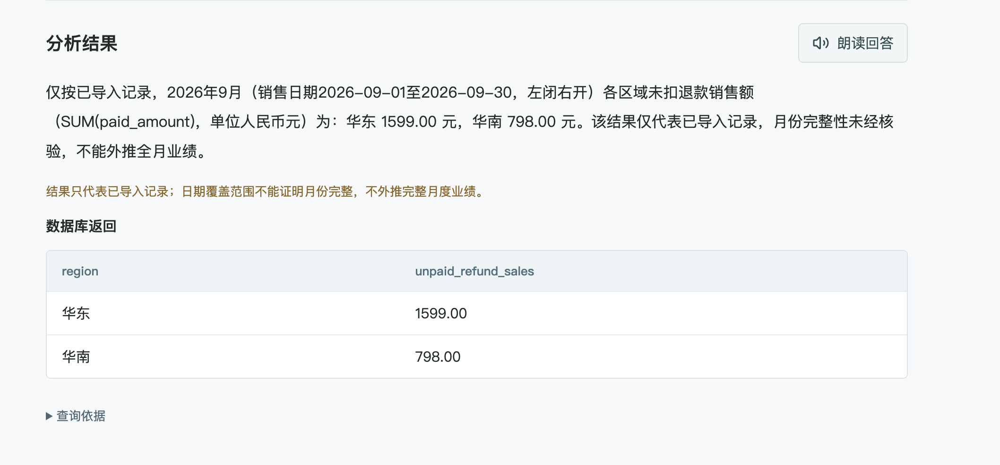

大家也可以点击“朗读回答”。音频生成以后，就会进行对应播报

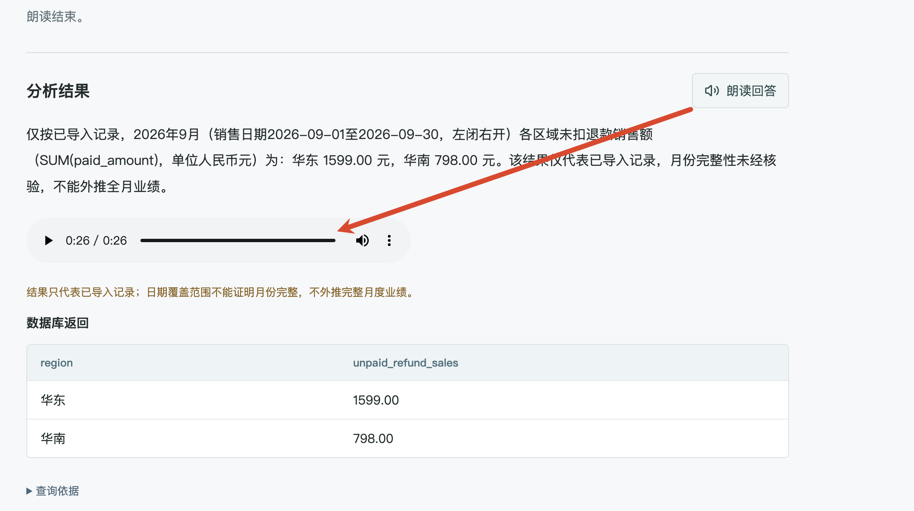

操作看完了，接下来咱们从“开始录音”这个入口，顺着代码走一遍。

## 从开始录音，到拿到识别文字
先确认代码在哪里运行。

打开 `package.json`，`dev` 对应的是：

```json
"dev": "node --env-file-if-exists=.env server.js"
```

这个命令启动 `server.js`，读取存在的 `.env` 配置。服务端通过 `createApp()` 创建 Express 应用，并把 `public` 目录作为页面提供给浏览器。

因此，页面按钮的处理代码在 `public/app.js`，接收按钮请求的接口在 `server.js`。真正调用语音模型的方法，则在 `speech.js`。

### 浏览器怎样取得一段录音
打开 `public/app.js`，在文件底部找到录音按钮的事件绑定：

```javascript
$('record').addEventListener('click', () =>
  recording ? stopRecording() : startRecording()
)
```

这里的 `$()` 是文件顶部封装的 `document.getElementById()`。`record` 对应页面的录音按钮，`recording` 记录当前是否正在录音。

第一次点击时，它会进入 `startRecording()`。

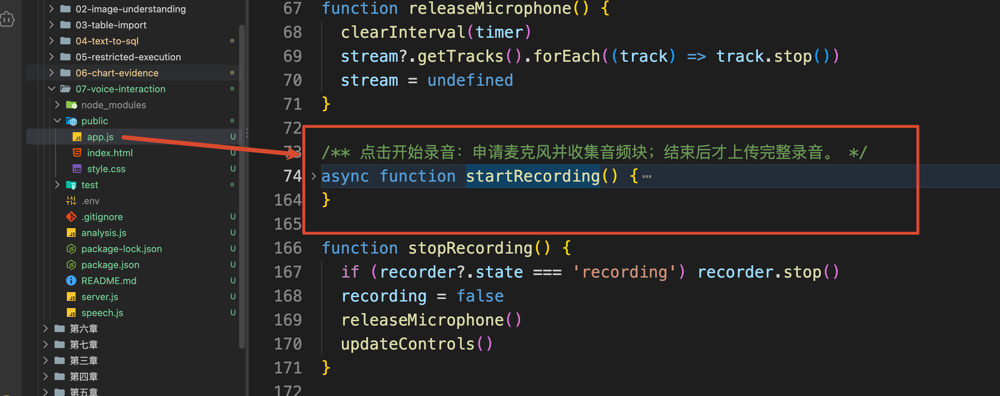

这个方法先检查浏览器支持的录音格式，再申请麦克风权限：

```javascript
// 请求用户授权麦克风，获取音频流
stream = await navigator.mediaDevices.getUserMedia({ audio: true })
```

`[getUserMedia()](https://developer.mozilla.org/en-US/docs/Web/API/MediaDevices/getUserMedia)` 是浏览器提供的接口。用户授权以后，返回的 `stream` 中就包含麦克风的音轨，后面可以从这里采集声音。

拿到 `stream`，同一个方法继续创建录音器：

```javascript
// 保存录音过程中产生的音频数据块
const chunks = []
// 创建录音器，指定音频格式和 64kbps 编码比特率
recorder = new MediaRecorder(stream, {
  mimeType,
  audioBitsPerSecond: 64_000
})
```

`MediaRecorder` 负责把采集到的声音编码成音频数据。`mimeType` 来自方法前面的格式选择，一般是 WebM/Opus 和 Ogg/Opus 中的一种，主要看浏览器支持，然后通过 `audioBitsPerSecond` 设置目标音频码率。

录音数据怎样留下来呢？接着看它注册的回调：

```javascript
// 浏览器产生音频数据时，将非空数据块保存起来
recorder.ondataavailable = (event) => {
  if (event.data.size) chunks.push(event.data)
}
```

浏览器交付录音数据时，会触发 `dataavailable`。`event.data` 是这次交付的音频块，程序把非空内容放进刚才创建的 `chunks` 数组。

回调准备好以后，`startRecording()` 才执行 `recorder.start()`，开始录音。

用户说完，第二次点击同一个按钮

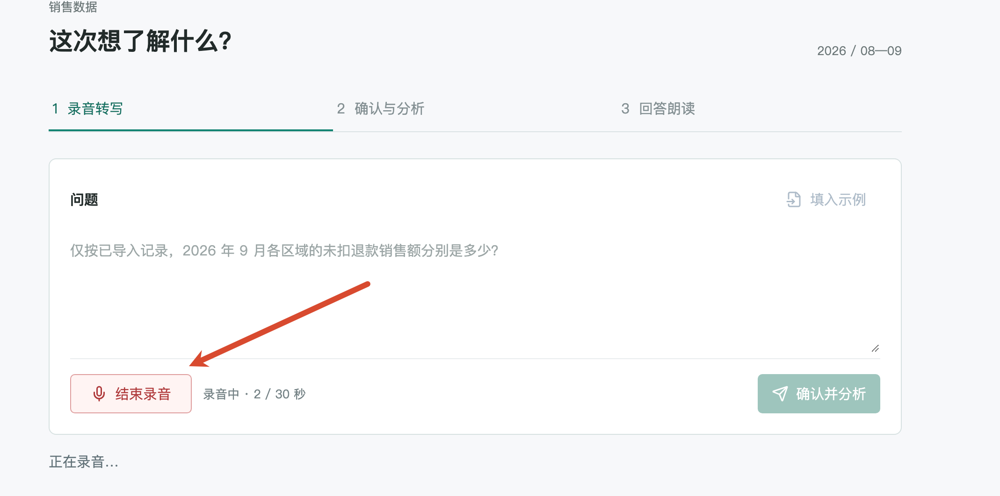

事件就会进入 `stopRecording()`

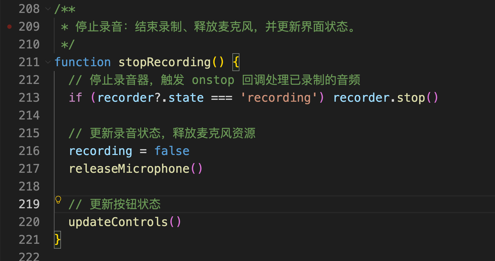

其中的 `recorder.stop()` 会结束录制。

按照浏览器的[事件顺序](https://developer.mozilla.org/en-US/docs/Web/API/MediaRecorder/stop)，停止时会先交付剩余音频，再触发 `stop` 事件。

因此，后面的 `recorder.onstop` 可以从 `chunks` 里取得完整录音。

在这个回调中，程序把音频块整理为一个 `Blob`：

```javascript
// 将收集到的音频块合并为一个完整的音频文件
const audio = new Blob(chunks, { type: mimeType })
```

`Blob` 可以理解为浏览器里保存二进制内容的对象。此时的 `audio` 就保存着这一段录音，后面可以把它作为请求体上传。

到这里，咱们完成的是**录音**。识别还没有开始。

### 服务端怎样把录音交给 ASR
继续留在 `recorder.onstop`。得到 `audio` 以后，紧接着发送：

```javascript
const { text } = await request('/api/transcribe', {
  method: 'POST',
  headers: { 'Content-Type': mimeType },
  body: audio
})
```

`request()` 是本文件封装的 `fetch()`，这里直接把录音作为请求体，发给本地服务的 `/api/transcribe`。

接下来打开 `server.js`，咱们来看 `createApp` 方法

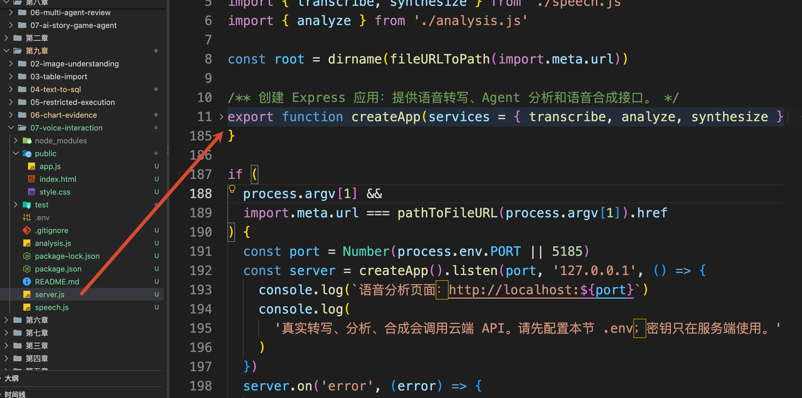

在注册接口以前，程序已经通过 `express.raw()` 配置了音频请求的读取方式，所以接口拿到的 `req.body` 是一个保存录音字节的 `Buffer`。

接口中的关键代码是：

```javascript
// 将音频数据和格式交给语音识别服务
const text = await services.transcribe(
  req.body,
  req.headers['content-type']
)
// 将识别出的文字返回浏览器
res.json({ text })
```

这里的 `services` 来自 `createApp()` 的参数，默认内容就是本文件顶部导入的 `transcribe`、`analyze` 和 `synthesize` 三个方法。

所以，这次调用会进入 `speech.js` 中的 `transcribe()`。第一个参数 `audio` 是上传的录音，第二个参数 `contentType` 说明录音格式。

`transcribe()` 先检查音频大小与格式，并读取服务端的百炼配置。检查通过以后，才准备模型请求。下面节选请求中的核心内容：

```javascript
{
  model: 'qwen3-asr-flash',
  messages: [{
    role: 'user',
    content: [{
      type: 'input_audio',
      input_audio: {
        data: `data:${mime};base64,${audio.toString('base64')}`
      }
    }]
  }],
  stream: false
}
```

这段结构和 02 小节的图片输入有点像。

不知道大家还记不记得，当时，咱们把图片放进 `image_url`。现在，`type: 'input_audio'` 告诉接口，这个内容块里放的是待识别音频。

`audio.toString('base64')` 把录音字节转换成能够放进 JSON 的字符串。对于 WebM，它的形式大致是：

```latex
data:audio/webm;base64,音频内容……
```

这一步只是整理传输格式，文字仍然要由 ASR 模型识别。

`transcribe()` 接着调用本文件的 `postJSON()`，将请求发往百炼的 `/chat/completions`。`postJSON()` 内部使用 Node.js 的 `fetch()`，从服务端配置中取出 Key，添加鉴权请求头，并读取响应 JSON。

这里设置了 `stream: false`，所以这里的代码会等待这段录音的转写结果完整返回，再继续处理。

### 识别结果怎样回到输入框
百炼返回以后，执行回到 `transcribe()`。

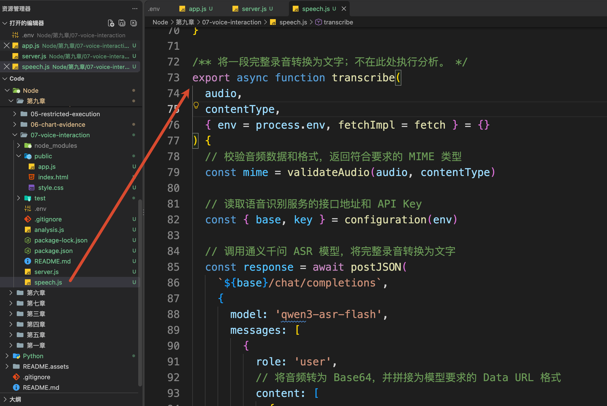

刚才的 `postJSON()` 返回值保存在 `response` 中，识别文字从这里取出：

```javascript
// 从模型响应中提取识别出的文字
const text = response.choices?.[0]?.message?.content
```

只保留与本节有关的字段，响应结构可以表示成：

```javascript
// 结构示意，具体文字以本次识别结果为准。
{
  choices: [{
    message: {
      content: '2026 年 9 月各区域的未扣退款销售额分别是多少？'
    }
  }]
}
```

`transcribe()` 检查这段文字非空以后，把它返回给 `server.js`。接口再通过前面的 `res.json({ text })` 交给浏览器。

于是，执行回到 `public/app.js` 的 `recorder.onstop`。请求完成后，下面这行代码就可以把识别结果显示出来：

```javascript
$('question').value = text
```

现在再回头看页面：用户刚才说的话，已经变成了输入框里可以修改的文字。

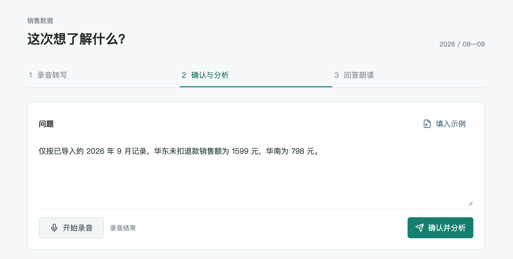

这一阶段会停在这里，等待用户点击“确认并分析”。录音停止时，程序也会通过 `releaseMicrophone()` 关闭音轨，结束本次麦克风采集。

## 把确认后的文字交给 Agent
确认日期、区域和口径没有问题以后，用户点击“确认并分析”。这个按钮调用的是 `public/app.js` 的 `submitQuestion()`。

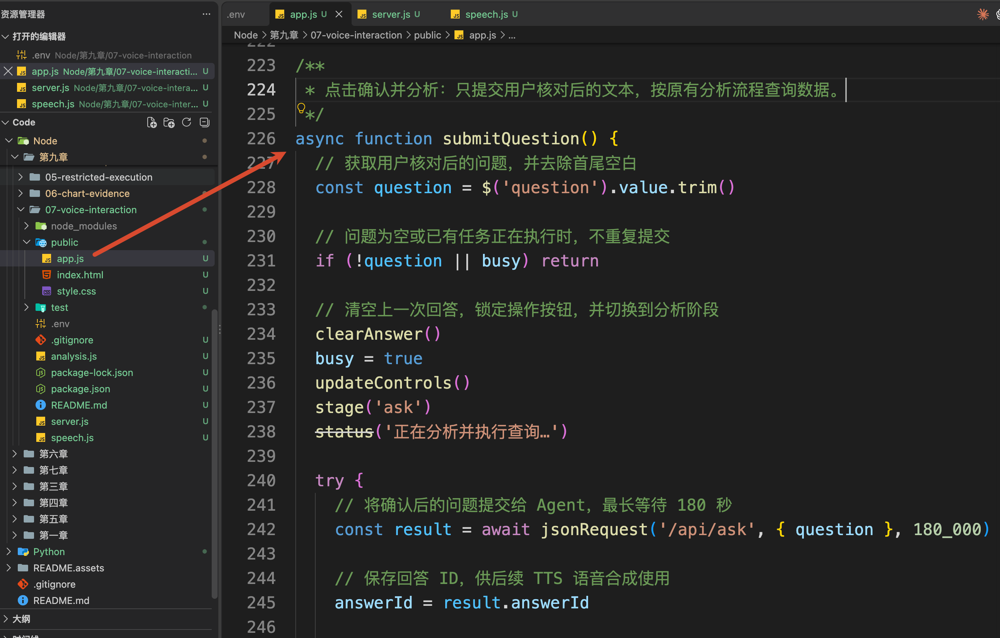

方法重新读取输入框，再发送分析请求：

```javascript
// 获取用户核对后的问题，并去除首尾空白
const question = $('question').value.trim()
// 将确认后的问题提交给 Agent，最长等待 180 秒
const result = await jsonRequest('/api/ask', { question }, 180_000)
```

这里的 `jsonRequest()` 同样是对 `fetch()` 的封装，只是把请求体整理成 JSON。最后一个参数是本地请求的等待上限。

因为 `question` 是点击按钮时重新读取的，所以用户修改后的文字会生效。

打开 `server.js`，找到 `/api/ask` 接口

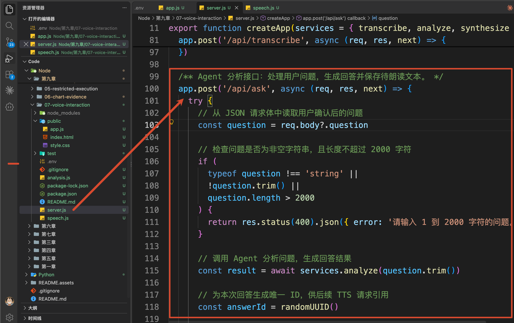

它取出 `req.body.question`，检查文字非空以后，调用：

```javascript
// 调用 Agent 分析问题，生成回答结果
const result = await services.analyze(question.trim())
```

这个方法定义在 `analysis.js`。进入 `analyze()`，

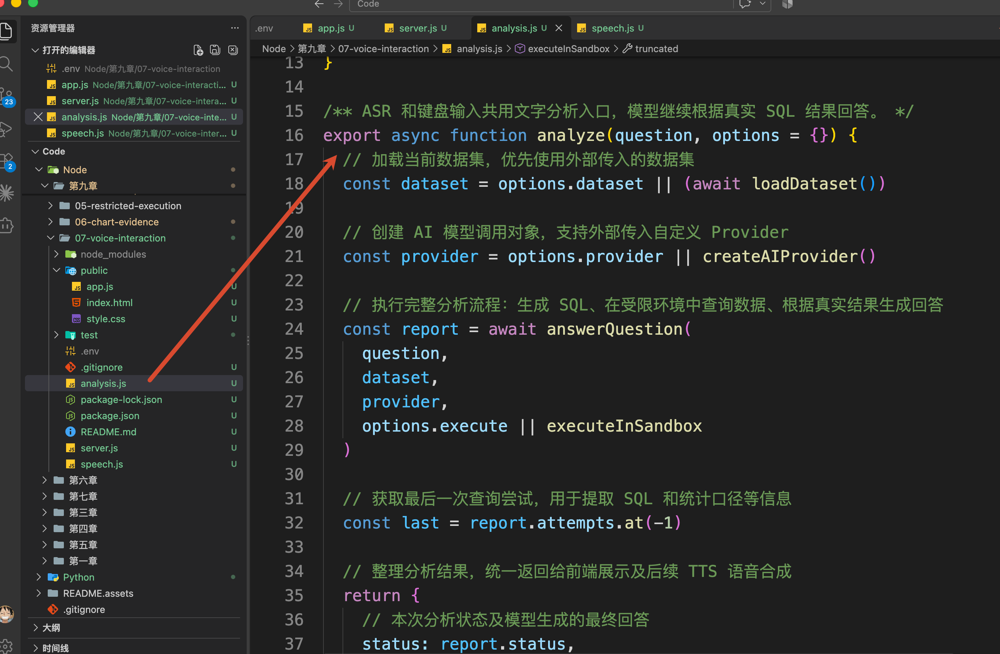

可以看到它先取得数据集和模型 Provider，再交给原有的问答方法：

```javascript
// 加载当前数据集，优先使用外部传入的数据集
const dataset = options.dataset || await loadDataset()
// 创建 AI 模型调用对象，支持外部传入自定义 Provider
const provider = options.provider || createAIProvider()
// 执行完整分析流程：生成 SQL、在受限环境中查询数据、根据真实结果生成回答
const report = await answerQuestion(
  question,
  dataset,
  provider,
  options.execute || executeInSandbox
)
```

正常从页面调用时，`options` 使用默认空对象。因此，程序读取 04 已准备的数据，用 DeepSeek 处理文字问题，并通过 `executeInSandbox()` 执行查询。

`executeInSandbox()` 又会调用 05 的 `runSandbox()`，把 SQL 放进受限容器中执行。

对于条件完整、查询成功的这次问题，`answerQuestion()` 的过程还是：**模型生成 SQL，程序取得数据库结果，再让模型根据结果回答。** 相关实现已经在前面讲过，这里只需要确认语音转写得到的文字确实进入了这条流程就可以。

等 `answerQuestion()` 返回，`analyze()` 得到 `report`，再整理出页面需要的字段：

```javascript
// analyze() 的返回内容节选。
{
  status: report.status,
  answer: report.answer,
  speechText: selectSpeechText(report),
  sql: last?.decision.sql || '',
  rows: report.result?.rows || []
}
```

`last` 是这份报告中最后一次查询尝试，用来取得本次 SQL。`answer` 是文字回答，`rows` 是数据库实际返回的记录。

这里多出来的 `speechText`，就是**接下来准备朗读的文字**，由同一文件的 `selectSpeechText(report)` 生成。

### 保存这次回答，供后面的朗读使用
`analyze()` 返回以后，执行回到 `server.js` 的 `/api/ask`。

接下来，服务端给这次回答生成一个 ID，并暂存准备朗读的文字：

```javascript
// 为本次回答生成唯一 ID，供后续 TTS 请求引用
const answerId = randomUUID()

// 保存待朗读文本，有效期为 15 分钟
answers.set(answerId, {
  text: result.speechText,
  expiresAt: Date.now() + 15 * 60_000
})

// 返回 Agent 分析结果和 answerId，供浏览器展示及请求语音
res.json({ ...result, answerId })
```

`answers` 是 `createApp()` 开头创建的 `Map`。这里把“回答 ID”和“对应的朗读文字”关联起来，有效期设为 15 分钟。

大家可以把它理解成：服务端记下“编号为这一串 ID 的回答，应该朗读这段文字”。后面浏览器只需要带回这个编号，服务端就能找到对应内容。

响应回到浏览器的 `submitQuestion()`，它先保存：

```javascript
answerId = result.answerId
```

再将 `result.answer` 显示到页面，通过 `renderRows(result.rows)` 展示结果表，同时保留 SQL、统计范围和数据版本。

到这里，分析已经完成，页面上的“朗读回答”按钮也就可以使用了。

## 点击朗读回答，怎样真正发出声音
点击“朗读回答”，执行进入 `public/app.js` 的 `speakAnswer()`。

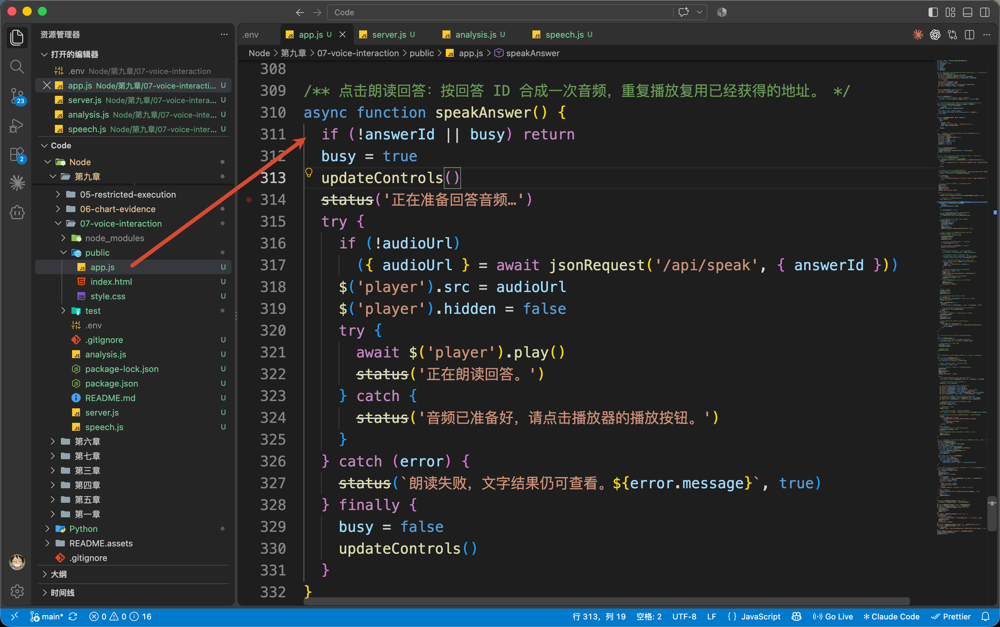

第一次朗读时，它带着刚才保存的 `answerId`，请求合成接口：

```javascript
if (!audioUrl) {
  ({ audioUrl } = await jsonRequest('/api/speak', { answerId }))
}
```

`audioUrl` 用来保存本次合成得到的音频地址，第一次调用时还没有值。因此，程序会先发起请求

后面再次播放同一份回答，就可以复用地址。

### 服务端找到这一次的回答
打开 `server.js`，进入 `/api/speak`

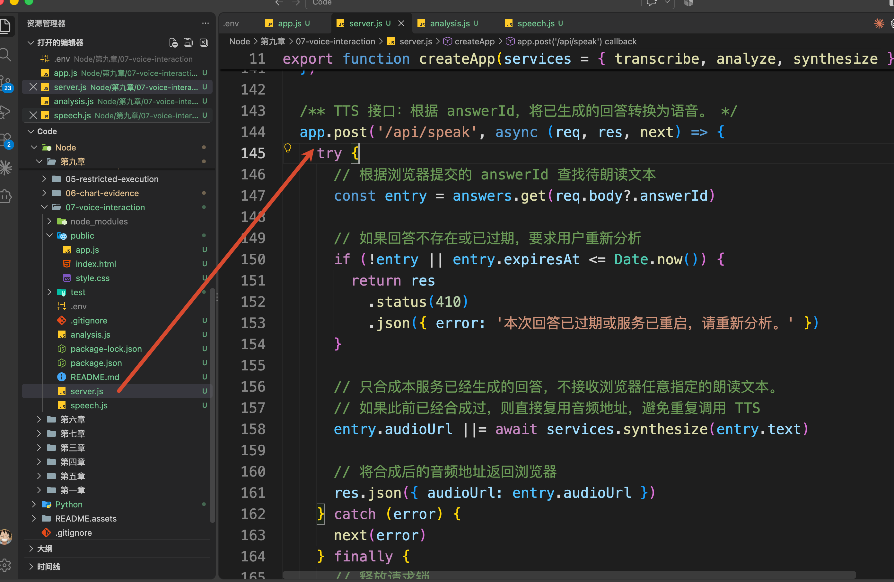

先看这行：

```javascript
// 根据浏览器提交的 answerId 查找待朗读文本
const entry = answers.get(req.body?.answerId)
```

这里使用的就是前面那份 `answers`。浏览器传回哪个 `answerId`，程序就查出它对应的缓存记录。

`entry.text` 因而是前面准备好的 `result.speechText`，并且代码会先检查这条记录是否存在、有没有过期。

检查通过以后，执行：

```javascript
// 只合成本服务已经生成的回答，不接收浏览器任意指定的朗读文本。
// 如果此前已经合成过，则直接复用音频地址，避免重复调用 TTS
entry.audioUrl ||= await services.synthesize(entry.text)
// 将合成后的音频地址返回浏览器
res.json({ audioUrl: entry.audioUrl })
```

`||=` 在这里表示：已经有音频地址就复用，没有才调用 `synthesize()`。

这样，用户点击朗读时，服务端使用的是这次分析已经生成的内容。它可以根据回答 ID 找到文字

### TTS 返回音频，浏览器负责播放
刚才的 `services.synthesize(entry.text)` 会进入 `speech.js` 的 `synthesize(text)`。

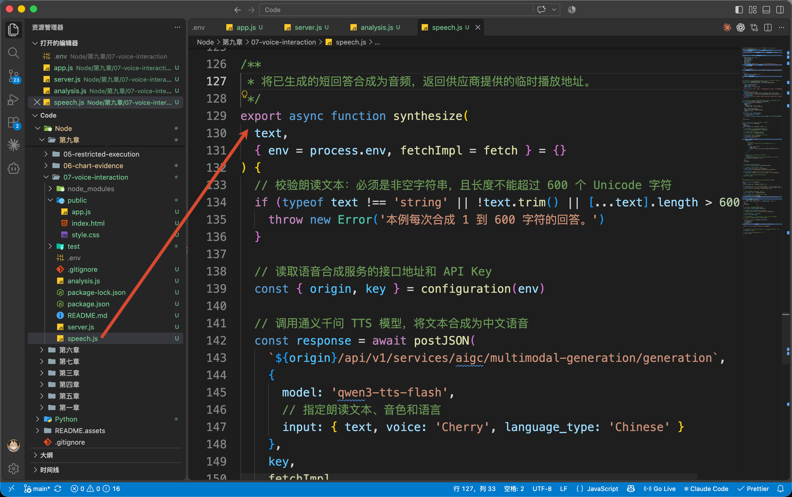

`text` 已经是准备朗读的内容。函数检查长度和配置以后，通过 `postJSON()` 调用百炼的语音合成接口：

```latex
/api/v1/services/aigc/multimodal-generation/generation
```

这个接口使用百炼原生的请求结构，核心请求体是：

```javascript
{
  model: 'qwen3-tts-flash',
  input: {
    text,
    voice: 'Cherry',
    language_type: 'Chinese'
  }
}
```

这里 `input` 里面的三个参数跟大家说一下：

+ `text` 指定读什么
+ `voice` 指定使用哪种音色
+ `language_type` 指定中文

这里大家注意一个区别：前面的 ASR 使用兼容接口，音频放进 `messages`。

咱们这里用 TTS 使用原生合成接口，文字放进 `input.text`。

合成成功以后，`postJSON()` 返回的 JSON 保存在 `response` 中，音频地址从这里取得：

```javascript
const rawURL = response.output?.audio?.url
```

也就是说，响应中的关键部分是 `output.audio.url`。这个地址指向本次合成的音频、。

`synthesize()` 检查地址以后，把它返回给刚才的 `/api/speak`。接口再通过 `{ audioUrl }` 返回浏览器。

现在回到 `speakAnswer()`，前面的请求已经得到了 `audioUrl`，后面就可以把它交给页面上的播放器：

```javascript
$('player').src = audioUrl
$('player').hidden = false
await $('player').play()
```

`player` 对应 `public/index.html` 中的 `<audio>` 元素。设置 `src` 后，浏览器读取音频，调用 `play()`，才开始播放。

所以，**TTS 合成音频和浏览器播放音频，是前后两个动作。**

声音播放出来以后，咱们就完成了这次语音提问的全部过程啦～

## 总结
这一节，咱们从浏览器里的“开始录音”按钮出发，完成了声音转写、文字确认、数据分析和回答朗读。

这里最重要的是把每一步的数据接清楚：

+ 浏览器取得录音，ASR 返回文字
+ 确认后的文字进入原来的分析流程，生成回答
+ 服务端通过回答 ID 找到朗读内容，再调用 TTS，最后由浏览器播放

这样，语音就能够和已经实现的数据分析能力配合起来。

不过，当前还要等录音结束才识别，等分析结束再合成。下一节，咱们继续处理等待时间，以及用户中途停止播放、重新提问时的流程控制。

> 更新：2026-10-09 16:01 · 原文：<https://www.yuque.com/lgdsunday/ab1dy3/tcd3a0ranzrc3bgk>
