# 08-流式语音与打断：怎样让对话能够及时回应

上一小节，咱们已经可以通过语音提问，再让 Agent 把分析结果读出来了。

不过，大家在使用的时候，应该会注意到：每一步都得等。

说完一句话，点击结束录音，才能等待识别；确认问题以后，要等整个回答生成，再点击朗读，等待音频合成。

如果回答比较长，这个等待就更明显了。

还有一个问题。假如正在播放“各区域的销售情况”，用户突然只想看华东，旧回答就应该停下来，把接下来的交互交给新问题。

这一节，咱们就围绕这两件事继续改进：**让已经准备好的内容尽早返回，让不再需要的回答及时停止。**

## 流式语音，到底提前了哪一步
先看“流式”是什么意思。

简单理解就是：**数据产生一部分，就先把这一部分交给下一步处理。**

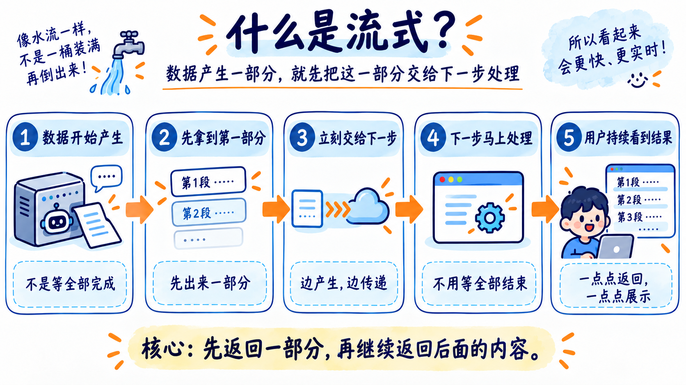

放进上一节的流程，三个位置都可以进行调整。

+ 录音时，浏览器可以不断把小段音频发送给 ASR。识别服务一边接收，一边返回当前识别文字，这样就能看到“边说边出字”的效果。
+ 模型生成回答时，也可以逐步返回文字。页面收到多少，就先显示多少。
+ 等文字已经组成一个完整句子，再把这一句交给 TTS。第一句合成好，就可以先播放，后面的内容继续生成和合成。

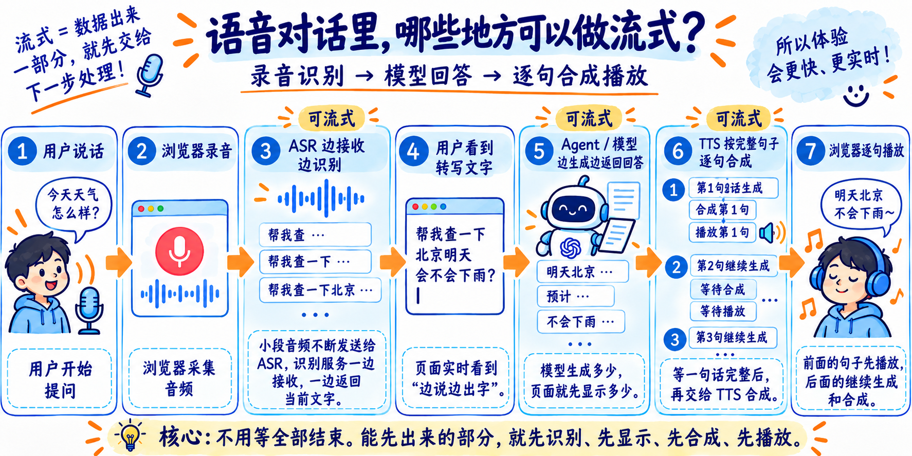

这样，用户不必等到最后一句也准备好，才听到第一句。

那么接下来，咱们就看看这个代码怎么去写

## 先体验逐句返回和中途打断
本节代码在 `Code/Node/第九章/08-streaming-voice`

> PS：有同学反映还是希望前端使用 Vue，后端使用 NestJS。 所以这里代码的框架做了一些修改。整体逻辑是一样的。
>

和之前一样，前面的 03、04、05、07 目录还得保留着，这里得复用已经准备好的销售数据。别忘了保持 Docker Desktop 运行。

配置自己的 `.env`：

```plain
DEEPSEEK_API_KEY=你的DeepSeekAPIKey
DEEPSEEK_MODEL=deepseek-flash
DASHSCOPE_API_KEY=你的百炼APIKey
DASHSCOPE_BASE_URL=https://你的真实业务空间ID.cn-beijing.maas.aliyuncs.com/compatible-mode/v1
```

执行：

```bash
npm install
npm run dev
```

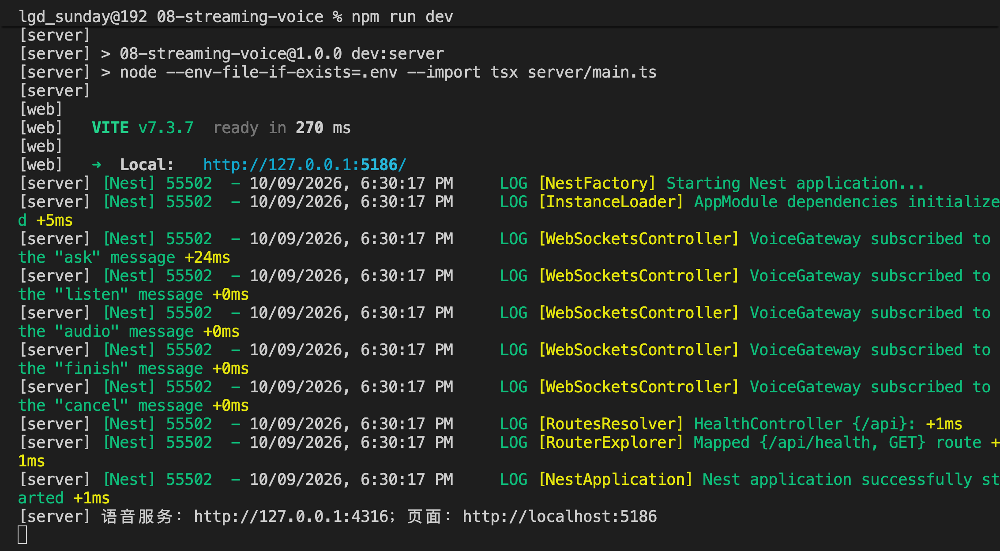

打开 `http://localhost:5186`

页面左侧是问题、录音和耗时，右侧是本轮回答、查询结果与执行记录：

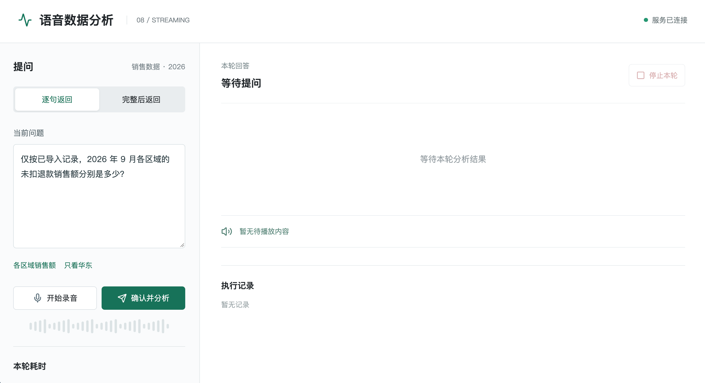

### 先看文字和声音怎样出现
保持“逐句返回”，点击“开始录音”，等待页面显示“录音中”，然后说：

> 仅按已导入记录，2026 年 9 月各区域的未扣退款销售额分别是多少？
>

留意输入框，它会在录音过程中更新文字。

这里给大家录了个视频大家可以看下：

[此处为语雀卡片，点击链接查看](https://www.yuque.com/lgdsunday/ab1dy3/krzgq4l61bxhuiha#KgVIX)

说完以后，点击“结束录音”。等页面显示“识别完成，等待确认”，核对文字，再点击“确认并分析”。

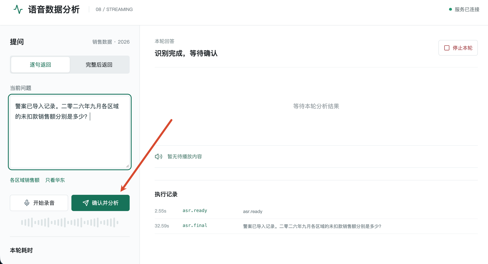

接下来观察三个变化：页面先显示执行状态，查询完成后出现真实表格，随后回答文字逐步增加，并按句播放。

[此处为语雀卡片，点击链接查看](https://www.yuque.com/lgdsunday/ab1dy3/krzgq4l61bxhuiha#zqwhR)

样例中的华东金额是 1599 元，华南是 798 元。措辞和耗时由实际模型调用决定。

### 再看旧回答能不能停下来
播放过程中，点击右侧的“停止本轮”。

当前声音应该停止，尚未播放的句子也不再接着播放。已经显示的文字和查询结果保留，方便核对。

然后点击“只看华东”快捷项，再点击“确认并分析”。

[此处为语雀卡片，点击链接查看](https://www.yuque.com/lgdsunday/ab1dy3/krzgq4l61bxhuiha#MwKld)

这个快捷项会填入包含月份、区域和退款口径的完整问题。

接下来应该只显示新问题的结果。上一轮晚到的文字和音频，都不能再混进来。

操作看过了，下面就从按钮出发，看这些变化怎样实现。

## 从开始录音，到最终识别文字
先打开 `web/src/App.vue`，找到 “开始录音” 按钮调用的 `record()`。

这个方法会先通过 `begin()` 准备一个新任务。其中有两行：

```typescript
const turnId = crypto.randomUUID()
activeTurnId.value = turnId
```

`turnId` 是本项目给这次任务分配的编号，`activeTurnId` 保存页面当前正在处理的编号。

为什么这时就要有编号？因为识别结果会陆续返回。程序需要知道，每一条消息属于哪次录音。后面处理打断时，还会用到它。

准备好麦克风以后，`record()` 发送：

```typescript
send('listen', { turnId })
```

这里的 `send()` 在同一个文件中，通过浏览器的 WebSocket 发送消息。它会把内容整理为：

```javascript
// 结构示意，实际 turnId 是刚才生成的 UUID。
{
  event: 'listen',
  data: { turnId: '本次任务编号' }
}
```

上一节使用 HTTP 上传完整录音。这一节需要不断发送音频，同时不断接收识别结果，因此浏览器与 NestJS 之间建立一条 WebSocket 连接。

服务端在 `server/main.ts` 中配置了 [NestJS 的 WsAdapter](https://docs.nestjs.com/websockets/adapter)，按 `event` 找到对应处理方法。

### 服务端怎样开始实时识别
接下来打开 `server/voice.gateway.ts`，找到：

```typescript
@SubscribeMessage('listen')
async listen(...)
```

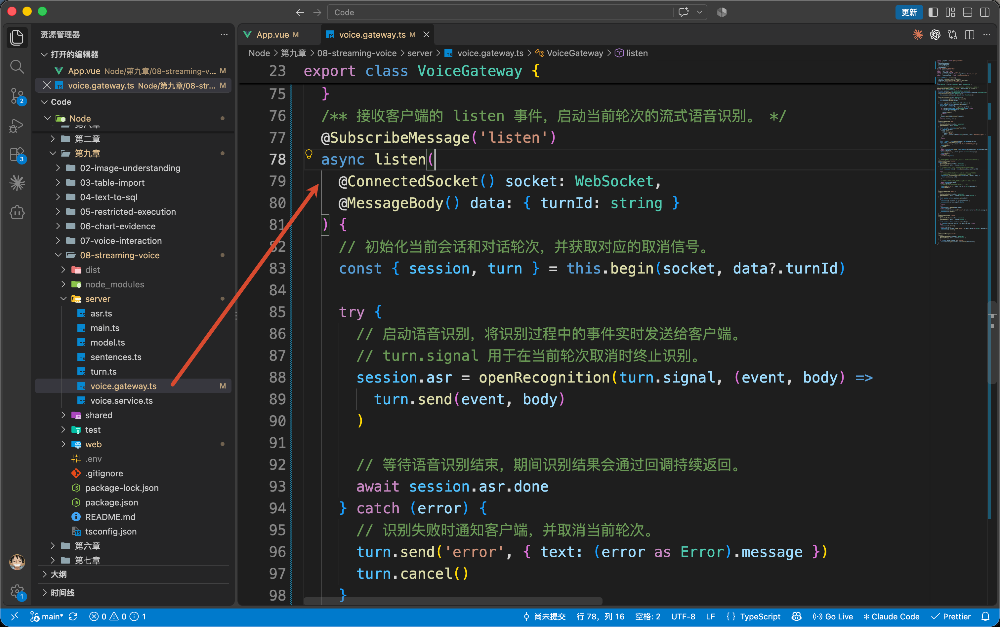

刚才的 `listen` 事件会进入这里。方法为当前连接登记本轮任务，再调用 `server/asr.ts` 的 `openRecognition()`。

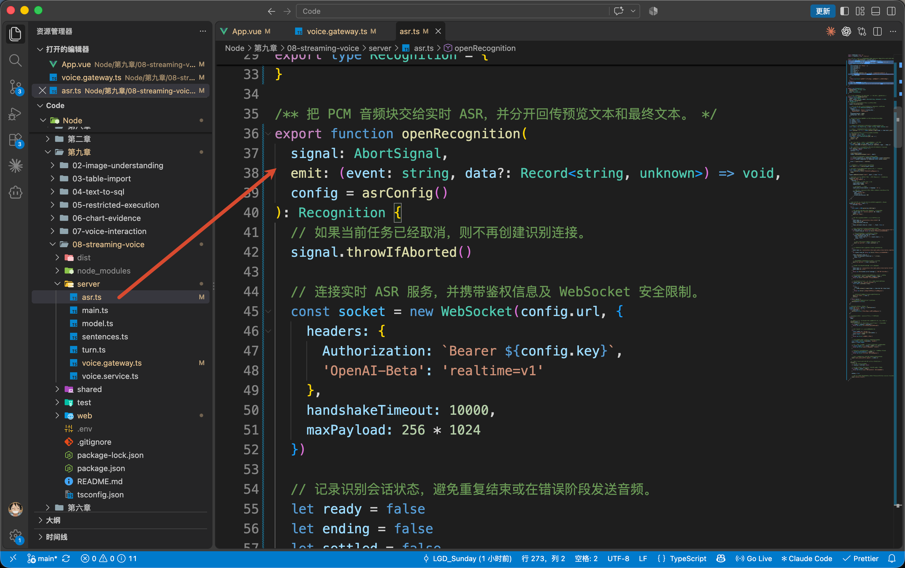

这个函数才负责连接百炼，使用的是 `[qwen3-asr-flash-realtime](https://help.aliyun.com/zh/model-studio/real-time-speech-recognition-user-guide)`。

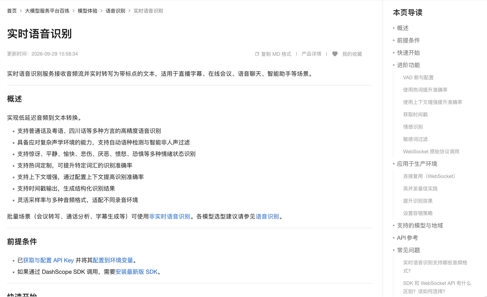

连接建立以后，`openRecognition()` 发送 `session.update`，说明接下来音频的格式。核心配置是：

```typescript
session: {
  // 输入音频使用 16kHz PCM 格式。
  input_audio_format: 'pcm',
  sample_rate: 16000,

  // 指定识别语言为中文。
  input_audio_transcription: { language: 'zh' },

  // 由服务端检测语音边界，静音 600ms 后判断当前语音片段结束。
  turn_detection: {
    type: 'server_vad',
    threshold: 0,
    silence_duration_ms: 600
  }
}
```

这里使用单声道、16kHz、16 位 PCM。可以先把 PCM 理解为按顺序保存声音采样值的音频数据。

这里的 `server_vad` 表示让识别服务检测语音活动，根据说话和停顿识别各句。

用户可能说一句，停一下，再补一句。程序会把这些句子积累起来，等用户点击“结束录音”，才结束整段录音。

配置确认后，服务端向页面发送 `asr.ready`。

回到 `App.vue` 的 `receive()`，收到这条消息才会执行：

```typescript
microphone?.start()
```

因此，页面显示“录音中”时，浏览器和识别服务都已经准备好了。

### 音频怎样一段段送过去
`microphone` 是 `web/src/recorder.ts` 中的 `Microphone` 实例。

它使用浏览器的 [AudioWorklet](https://developer.mozilla.org/en-US/docs/Web/API/AudioWorklet) 采集音频。具体采样代码在 `web/public/pcm-worklet.js`，每积累约 100 毫秒的 PCM，就交回页面。

这一段只需要抓住一个区别：现在交付的是小段 PCM，上一节 `MediaRecorder` 保存的是 WebM 或 Ogg 录音文件。音频内容必须与服务端声明的格式对应，不能直接把文件片段当成 PCM。

每收到一段，`record()` 注册的回调就会发送：

```typescript
send('audio', { turnId, audio })
```

其中 `audio` 是这一小段 PCM 的 Base64 字符串，`turnId` 仍然是本次录音编号。

服务端的 `VoiceGateway.audio()` 核对编号，然后调用当前识别会话的 `append()`。它最终向百炼发送：

```typescript
send('input_audio_buffer.append', { audio })
```

于是，声音就可以一段段进入识别服务了。

### 输入框里的文字为什么还会变化
继续留在 `asr.ts`，看上游 WebSocket 的 `message` 回调。

识别过程中，百炼使用 `item_id` 标记当前识别的是哪一句。这里用 `items` 保存本次录音里的各句内容。

收到 `conversation.item.input_audio_transcription.text` 时，代码更新这一句的预览：

```typescript
items.set(event.item_id, {
  text: (event.text || '') + (event.stash || ''),
  final: false
})
// 将当前文本发送给客户端，实现边说边出字。
emit('asr.partial', { text: preview() })
```

这里的 `event` 是百炼刚返回的消息。`text` 是当前句子已确认的前缀，`stash` 是还可能修正的后缀。两部分拼起来，就是这句话的预览。

`preview()` 则把已经保存的各句按顺序拼起来。因此，第二句话开始识别时，第一句不会被覆盖。

例如，识别过程可能依次预览：

```latex
九月
九月华东
九月华东的未扣退款销售额是多少
```

这些内容会被转为 `asr.partial` 事件，返回页面。

识别服务确认某一句以后，会返回 `conversation.item.input_audio_transcription.completed`。

代码从 `event.transcript` 取得这句的最终文字，更新同一个 `item_id`。

用户点击“结束录音”以后，`finishRecording()` 先交付剩余音频，再发送 `finish` 事件。

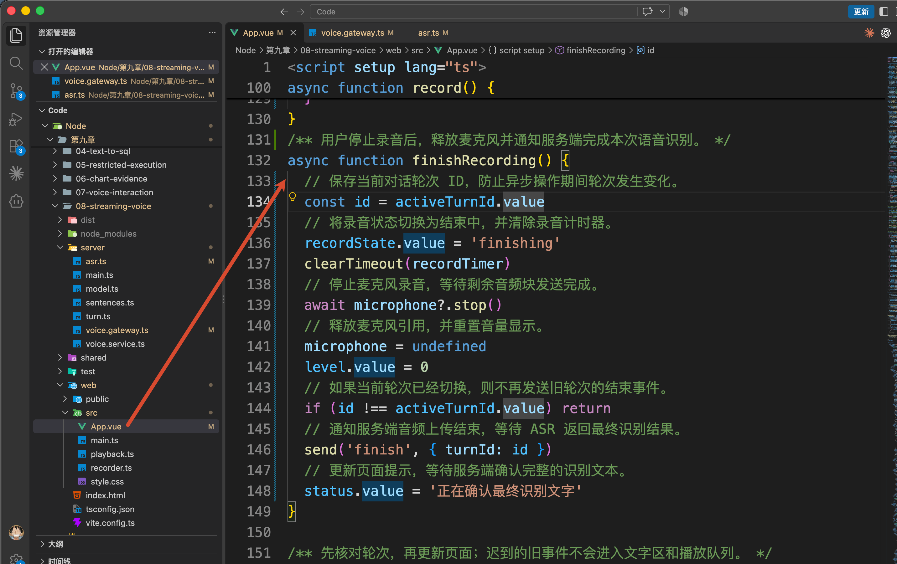

服务端对应发送 `session.finish`，等待最后的识别结果和 `session.finished`。

直到整次识别结束，程序才把各句的最终文字合在一起，发送本例定义的 `asr.final`。

页面收到最终文字后，恢复输入框编辑，等待用户核对并点击“确认并分析”。

所以，**预览文本负责让用户及时看到识别进度，确认后的完整问题才进入分析。**

## 从确认分析，到第一句开始播放
现在点击“确认并分析”，进入 `App.vue` 的 `ask()`。

它调用 `begin()` 生成本次分析的新编号，然后发送：

```typescript
send('ask', {
  turnId,
  question: question.value,
  mode: mode.value
})
```

`question` 是用户确认后的完整问题。`mode` 来自页面上的“逐句返回 / 完整后返回”，对应 `stream` 和 `buffered`。

服务端的 `VoiceGateway.ask()` 接收消息，检查参数后，进入 `server/voice.service.ts` 的 `VoiceService.answer()`。

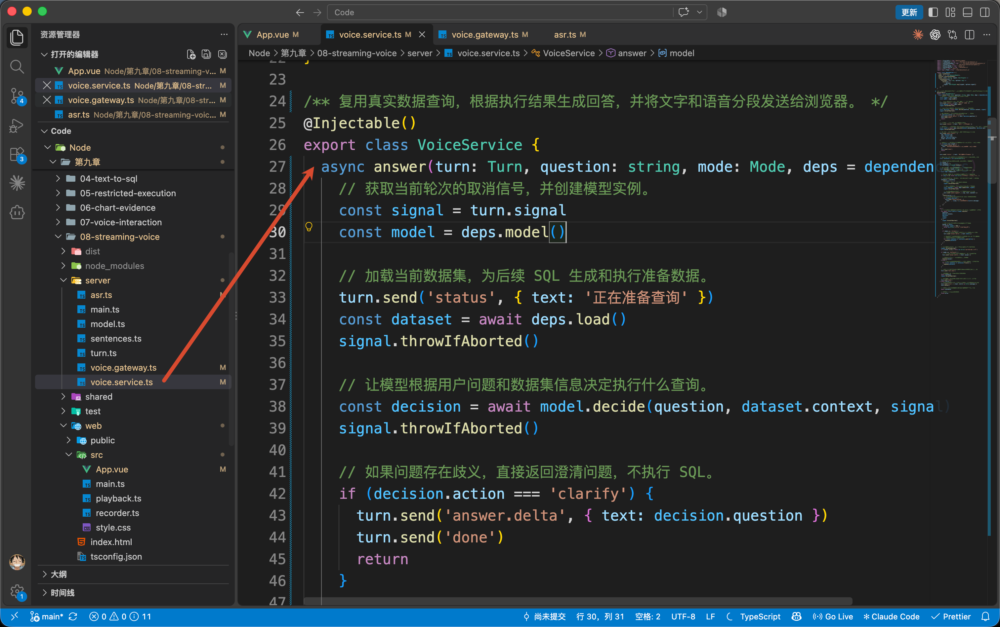

`answer()` 先加载数据概览，让 `AnalysisModel.decide()` 生成查询决策，再执行受限查询。

下面是同一方法中的关键调用，省略了状态通知：

```typescript
const dataset = await deps.load()
const decision = await model.decide(question, dataset.context, signal)
const result = await deps.execute(dataset.databasePath, decision.sql)
```

这里的 `deps` 是文件顶部准备好的依赖集合。默认 `load` 使用 04 的 `loadDataset()`，`execute` 使用 07 的 `executeInSandbox()`，继续调用 05 的受限容器。

模型要求补充条件时，会走追问分支；真正返回查询决策，才执行 SQL。

`signal` 用来传递本轮的取消请求，后面点击停止时再继续看它。

这一步仍然使用完整的 JSON 决策。SQL 必须完整、通过校验，才能交给执行器，不能生成半句就执行。

查询成功后，`result.rows` 就是实际返回的数据。服务端先发送 `query.result`，页面据此显示表格和 SQL，然后才开始生成解释。

### 回答文字怎样逐步显示
继续看 `answer()`，接下来进入：

```typescript
for await (const delta of model.explain(
  question, dataset.context, decision, result, signal
)) {
  // 处理这一小段新文字。
}
```

这里的 `model` 是 `server/model.ts` 中的 `AnalysisModel`。`explain()` 把用户问题、统计规则、查询决策和真实结果交给 DeepSeek，并设置 `stream: true`。

这次生成的是直接展示和朗读的文字，[DeepSeek 流式响应](https://api-docs.deepseek.com/api/create-chat-completion/) 会陆续返回增量。代码从 `choice.delta.content` 取出新文字，再通过 `yield` 交给刚才的循环。

于是，`VoiceService.answer()` 中的 `delta`，就是本次新收到的一小段文字。

在逐句模式下，同一个循环先执行：

```typescript
turn.send('answer.delta', { text: delta })
```

这里的 `turn` 保存当前任务编号和取消信号。`turn.send()` 会给事件附上 `turnId`，通过 WebSocket 返回页面。

回到 `App.vue` 的 `receive()`，收到 `answer.delta` 后：

```typescript
answer.value += data.text
```

Vue 根据 `answer` 更新页面，这就是文字逐步出现的过程。

### 什么时候把文字交给 TTS
文字已经能显示了，声音怎样接上呢？

如果每收到一小段文字就调用一次 TTS，可能把“1599.00 元”拆成几段，还会产生大量请求。

所以，刚才的循环在发送文字以后，还会继续执行：

```typescript
for (const sentence of sentences.push(delta)) {
  enqueue(sentence)
}
```

`sentences` 在循环以前创建，是 `server/sentences.ts` 中的 `SentenceBuffer`。它保存尚未结束的句子，遇到中文句号、问号等句末标点，才交出完整内容。

比如模型分两次返回：

```latex
第一次：华东未扣退款销售额为 1599.
第二次：00 元。华南……
```

第一次只存进缓冲区。第二次遇到句号以后，才得到：

```latex
华东未扣退款销售额为 1599.00 元。
```

这时才把它交给 `enqueue()`。

继续留在 `answer()`。往上找到 `enqueue`，它是这个方法内部定义的合成队列入口，关键代码如下：

```typescript
// 单并发合成，后一句等待前一句完成；文字流仍可继续接收。
synthesis = synthesis.then(async () => {
  // 合成前检查当前轮次是否已被取消。
  signal.throwIfAborted()
  // 将当前句子交给 TTS，获取对应的音频播放地址
  const audioUrl = await deps.speak(text, signal)
  signal.throwIfAborted()
  // 把音频序号、对应文字和播放地址发送给浏览器。
  turn.send('audio.segment', { seq, text, audioUrl })
})
```

每来一句，就把一次合成接在前一个 Promise 后面。这样可以保证第一句先合成，第二句再合成。

这里没有让接收文字的循环等待整条合成队列。因此，**第一句合成的时候，后面的回答仍然可以继续生成。**

`deps.speak()` 调用的是 07 的 `synthesize()`，得到这句话的真实音频地址。`seq` 是本轮从 0 开始的句子序号。

于是，页面收到的事件中会有：

```javascript
// 结构示意。
{
  turnId: '当前分析编号',
  seq: 0,
  text: '华东未扣退款销售额为 1599.00 元。',
  audioUrl: '这一句话的音频地址'
}
```

前面没有结束标点的最后一段，会在模型正常结束后，通过 `sentences.flush()` 取出，不会漏掉。

### 音频怎样一段接一段播放
收到 `audio.segment` 以后，`App.vue` 把它交给：

```typescript
playback.push(data)
```

`playback` 是页面启动时创建的 `PlaybackQueue`，代码在 `web/src/playback.ts`。

这个对象内部保存一个待播放数组。第一段到达时，设置 `audio.src` 并调用 `play()`；后面的段先排队。当前音频触发 `ended`，才取出下一段。

至此，整个过程就连起来了：

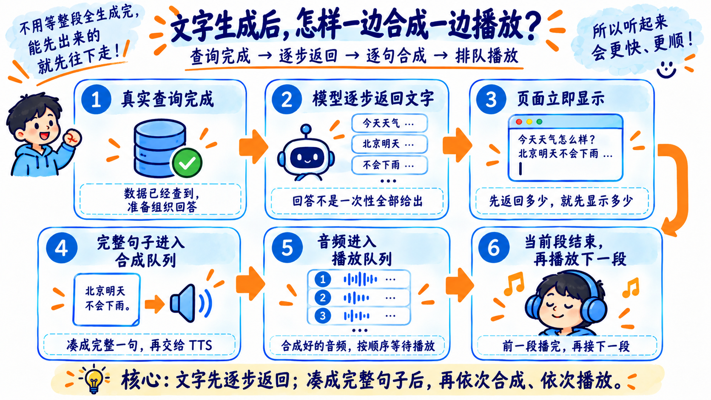

“完整后返回”则会先收齐全文，再发送文字并合成整段。两种方式的差别，就在 `answer()` 里如何处理这些增量。

## 总结
这一节，咱们让录音可以边传边识别，让查询结果出来后的回答可以逐步显示，再通过合成队列和播放队列，把完整句子依次读出来。

用户中途停止时，页面会停掉播放器、清空队列，服务端接收取消信号，同时通过任务编号挡住旧结果。

**及时回应包括两个方向：准备好的内容尽早返回，用户不再需要的内容及时停下。**

下一节进入 AI 数据分析 Agent 的完整项目，把图片、业务表格、受限查询、分析依据和语音交互接到同一个应用里。

> 更新：2026-10-09 19:00 · 原文：<https://www.yuque.com/lgdsunday/ab1dy3/krzgq4l61bxhuiha>
