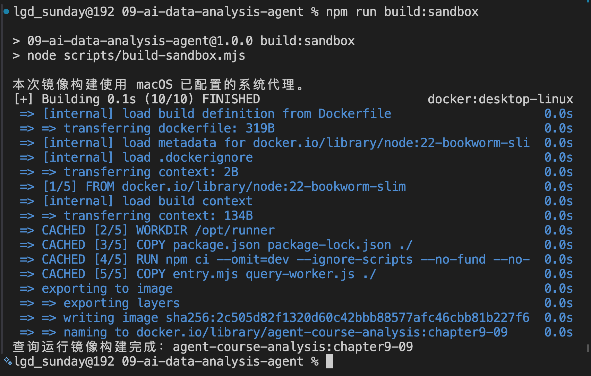
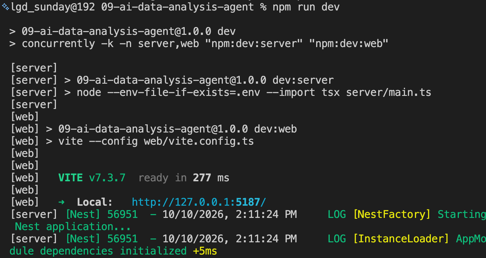

# 09-实战（上）：AI 数据分析 Agent 的项目演示、运行与需求分析

前面几节，咱们已经让模型看过截图，解析过 Excel，生成过 SQL，也把语音识别、查询和语音播放接到了一起。

接下来，把这些能力做成一个真正可以操作的项目：**AI 数据分析 Agent**。

比如，运营同学拿到一份销售报表，想知道：

> 哪些区域连续两个月销售额下降？
>
> 只看华东，哪些商品贡献了主要降幅？
>

他可以上传报表，直接用文字或者语音提问。Agent 根据问题确定统计条件，调用查询工具计算，再把结果整理成图表和报告。

这里还有一个重要要求：**用户要能核对这些数字究竟是怎么算出来的。**

所以，这个项目除了回答问题，还会保留数据版本、时间范围、金额口径、SQL 和查询结果。看到可疑数字，可以直接查回去。

这一篇先把项目跑起来，亲自体验这些功能。后面三篇再沿着按钮和请求进入代码。

## 项目如何运行
代码目录是：

```latex
Code/Node/第九章/09-ai-data-analysis-agent
```

准备 Node.js 22.20 或以上版本，并打开 Docker Desktop。在项目目录执行：

```bash
npm install
npm run build:sandbox
npm run dev
```

`build:sandbox` 会构建本项目的查询运行镜像，首次执行需要下载依赖。



镜像构建好以后，后续启动使用 `npm run dev` 就行。



页面地址是：

```latex
http://localhost:5187
```

NestJS 服务使用 `4317` 端口，页面使用 `5187`。启动终端要保持运行。

然后咱们来看看整个项目的运行效果：

[此处为语雀卡片，点击链接查看](https://www.yuque.com/lgdsunday/ab1dy3/ig72gn2kgtcwbip2#sepFC)

后面的实现讲解，继续从咱们刚才操作过的入口进入，一共分 4 篇来讲：

+ **中一：** 从“上传 Excel / CSV”和“确认分析”开始，追到数据导入和第一次真实查询。
+ **中二：** 从商品降幅追问、查看依据和导出报告开始，讲条件继承、结果计算与报告交付。
+ **下篇：** 从图片上传、麦克风和停止按钮开始，接通多模态输入与语音输出。

每次先找到按钮对应的前端方法，再跟到请求、服务端处理和最终结果。走到哪个功能，就讲清哪个功能的关键代码。

下一篇，咱们从上传按钮开始，看看这 18 条 Excel 明细怎样变成可以安全查询的数据的。

> 更新：2026-10-10 17:27 · 原文：<https://www.yuque.com/lgdsunday/ab1dy3/ig72gn2kgtcwbip2>
