# 10-实战（中一）：从上传 Excel 到完成第一次数据查询

上一小节，咱们已经把 AI 数据分析 Agent 运行起来了。

这一篇，咱们就沿着刚才操作过的按钮，把这条过程看清楚。

## 点击“上传 Excel / CSV”，文件先去了哪里
在页面左侧点击“上传 Excel / CSV”，选择 `sales-demo.xlsx`。

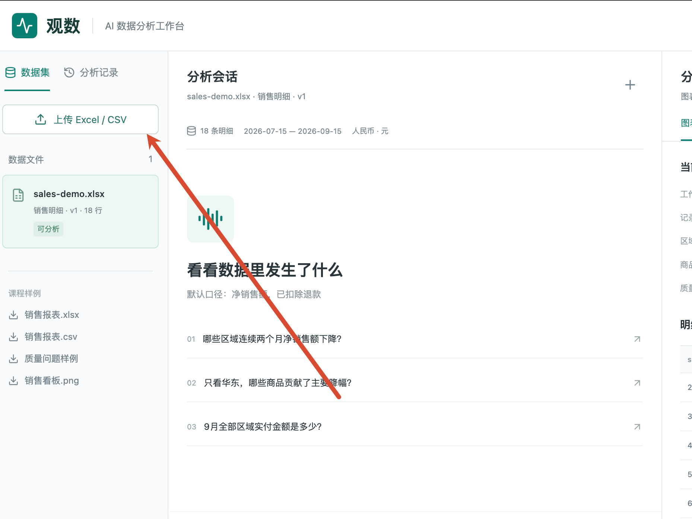

打开 `web/src/App.vue`，找到这个按钮。按钮先打开文件选择框，选好文件以后，下面的 `input` 会调用 `uploadFile()`。

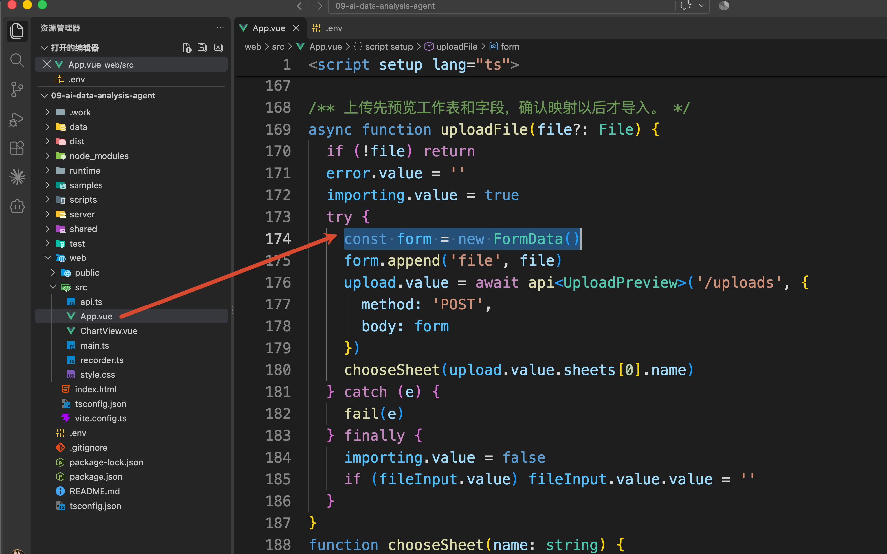

在 `uploadFile()` 中，找到发送文件的这几行：

```typescript
const form = new FormData()
form.append('file', file)
upload.value = await api<UploadPreview>('/uploads', {
  method: 'POST',
  body: form
})
```

`file` 就是刚才选中的 Excel。`api()` 定义在 `web/src/api.ts`，会为地址补上 `/api`，因此实际发送的是 `POST /api/uploads`。

接下来到 `server/app.controller.ts`，找到 `@Post('uploads')`：

```typescript
// 定义 POST 上传接口，路径为当前控制器路由下的 uploads。
@Post('uploads')
@UseInterceptors(
    // 使用文件上传拦截器，接收 multipart/form-data 中字段名为 file 的文件。
    FileInterceptor('file', {
        limits: {
            fileSize: 5 * 1024 * 1024, // 单个文件大小上限为 5 MiB，超过限制会拒绝上传。
            files: 1 // 每次请求最多上传 1 个文件。
        }
    })
)
// @UploadedFile() 获取拦截器解析出的文件对象，Express.Multer.File 提供类型声明。
upload(@UploadedFile() file: Express.Multer.File) {
    // 请求中没有上传文件时直接报错，不再执行后续处理。
    if (!file) throw new Error('请选择文件')

    // 将文件交给数据集服务处理，并返回其处理结果。
    return this.datasets.upload(
        file.buffer, // 内存中的文件二进制内容。
        file.originalname // 客户端上传时提供的原始文件名。
    )
}
```

这里使用的是 NestJS 的[文件上传接口](https://docs.nestjs.com/techniques/file-upload)。`FileInterceptor('file')` 接收前端放在 `file` 字段里的文件，并限制一次上传一个、大小不超过 5 MiB。

接收以后，`file.buffer` 保存文件内容，`file.originalname` 保存文件名。Controller 把它们交给 `DatasetService.upload()`。

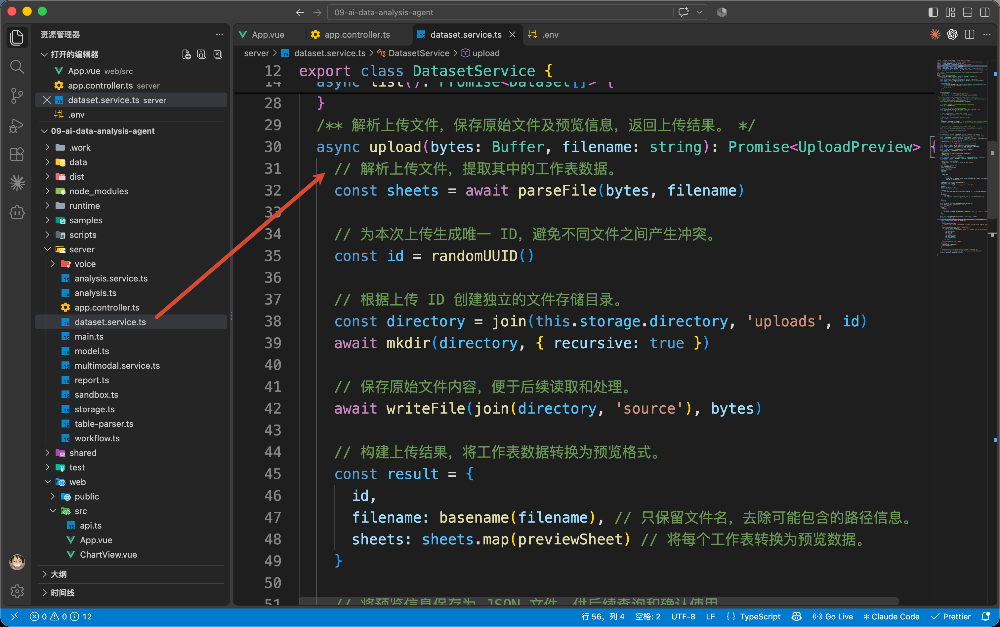

### 先读取工作表，再让用户确认
进入 `server/dataset.service.ts` 的 `upload()`，第一行就是：

```typescript
// 解析上传文件，提取其中的工作表数据。
const sheets = await parseFile(bytes, filename)
```

`parseFile()` 定义在 `server/table-parser.ts`。

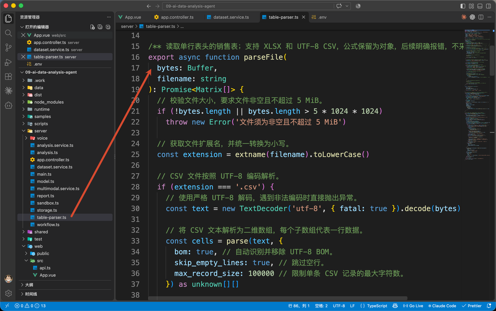

它会根据文件类型，使用 ExcelJS 读取 XLSX，或者使用 `csv-parse` 读取 CSV。

本次上传的是 Excel，所以会执行：

```typescript
// 创建 Excel 工作簿实例，并从文件字节中加载 XLSX 内容。
const workbook = new ExcelJS.Workbook()
await workbook.xlsx.load(bytes as any)
```

这一步把文件内容交给 [ExcelJS](https://github.com/exceljs/exceljs#reading-xlsx)。随后，函数遍历工作表，把每一行的单元格整理成数组。

比如，“销售明细”工作表整理以后是下面这样，这里只展示表头和第一条数据：

```typescript
{
  name: '销售明细',
  cells: [
    ['销售日期', '区域', '商品名称', '实付金额（元）', '退款金额（元）'],
    ['2026-07-15', '华东', '咖啡机', 20000, 2000]
    // 后续明细省略
  ]
}
```

`name` 是工作表名称，`cells` 保存这张表的全部行。此时，程序已经读到了数据，但还需要用户确认：**使用哪张工作表，每一列分别代表什么。**

所以，执行回到 `DatasetService.upload()` 以后，它会生成一个上传 ID，保存原文件，再调用 `previewSheet()` 生成预览：

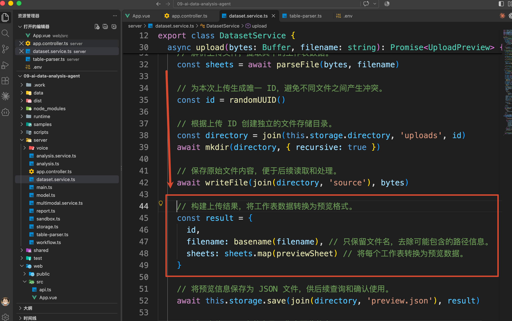

这里的 `id` 标识这一次上传。原文件保存在 `data/uploads/{上传ID}/source`，预览信息保存在同一目录的 `preview.json`。

`previewSheet()` 也在 `table-parser.ts` 中。它根据表头名称给出字段映射建议，例如把“销售日期”推荐给日期字段，同时统计数据总数，取前四条作为预览。

这个结果返回前端以后，`App.vue` 就会显示“确认工作表与字段”弹窗。

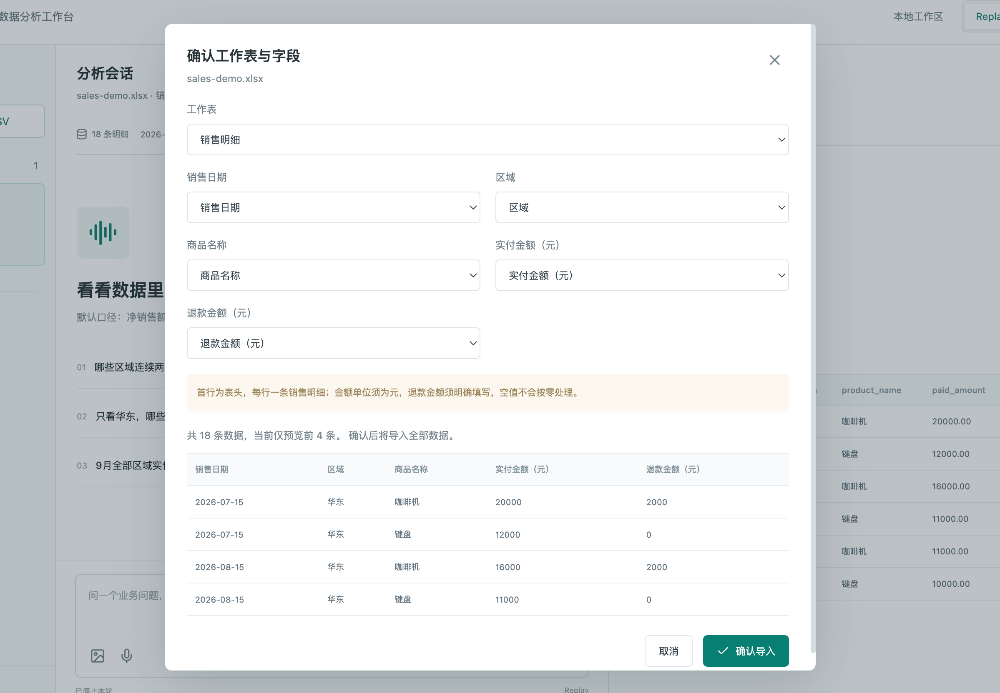

## 点击“确认导入”，把明细写入数据库
继续在弹窗中核对五个字段，然后点击“确认导入”。

这个按钮调用 `App.vue` 的 `confirmImport()`，发送 `POST /api/datasets`。请求内容可以整理成：

```typescript
{
  uploadId: '刚才返回的上传 ID',
  sheet: '销售明细',
  mapping: {
    date: '销售日期',
    region: '区域',
    product: '商品名称',
    paid: '实付金额（元）',
    refund: '退款金额（元）'
  }
}
```

`mapping` 就是用户在弹窗中确认的对应关系。比如 `paid` 对应“实付金额（元）”，后端就知道应该从这一列读取实付金额。

请求到达 `app.controller.ts` 的 `import()`，经过参数校验，再调用 `DatasetService.import()`。

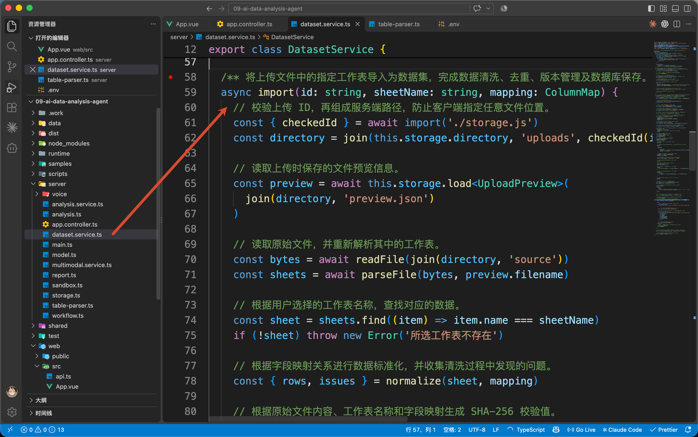

进入 `dataset.service.ts` 的 `import()`，它先根据上传 ID 找到上传目录 `directory`，读取其中的 `preview.json`，得到保存文件名等信息的 `preview`。接着重新解析原文件，取出用户选中的工作表：

```typescript
// 读取原始文件，并重新解析其中的工作表。
const bytes = await readFile(join(directory, 'source'))
const sheets = await parseFile(bytes, preview.filename)
// 根据用户选择的工作表名称，查找对应的数据。
const sheet = sheets.find(item => item.name === sheetName)
if (!sheet) throw new Error('所选工作表不存在')
// 根据字段映射关系进行数据标准化，并收集清洗过程中发现的问题。
const { rows, issues } = normalize(sheet, mapping)
```

这里的 `sheet` 就是完整的“销售明细”工作表。接下来的 `normalize()`，负责把原始单元格转成程序统一使用的字段，并检查数据有没有问题

进入 `table-parser.ts` 的 `normalize()`

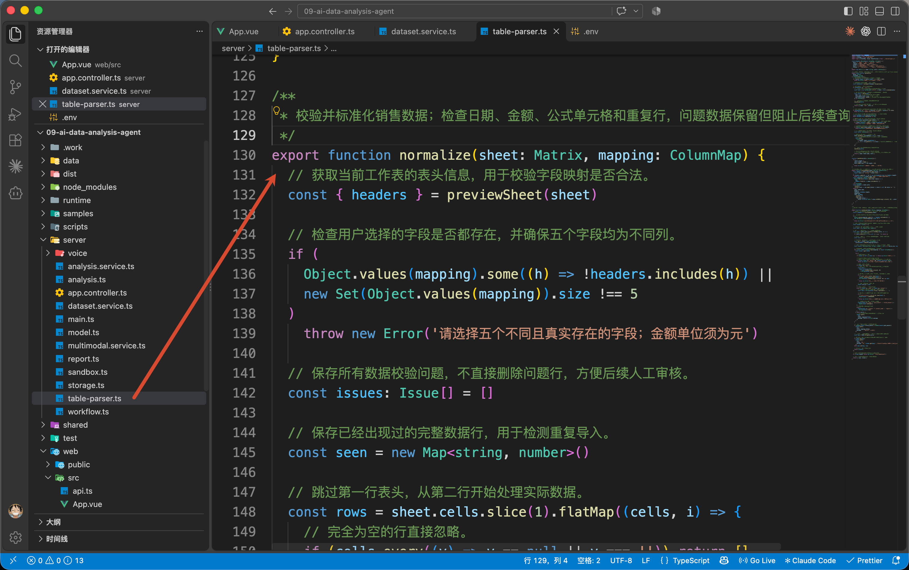

它按照刚才的 `mapping` 逐行取值。

例如，Excel 中第一条咖啡机明细会被整理成：

```typescript
{
  source_row: 2,
  sold_at: '2026-07-15',
  region: '华东',
  product_name: '咖啡机',
  paid_amount: '20000.00',
  refund_amount: '2000.00'
}
```

`source_row: 2` 表示它来自 Excel 的第二行，第一行是表头。后面发现问题时，就能定位回原表。

`normalize()` 返回以后，执行回到 `DatasetService.import()`。现在，`rows` 是整理后的完整明细，`issues` 是检查发现的问题。

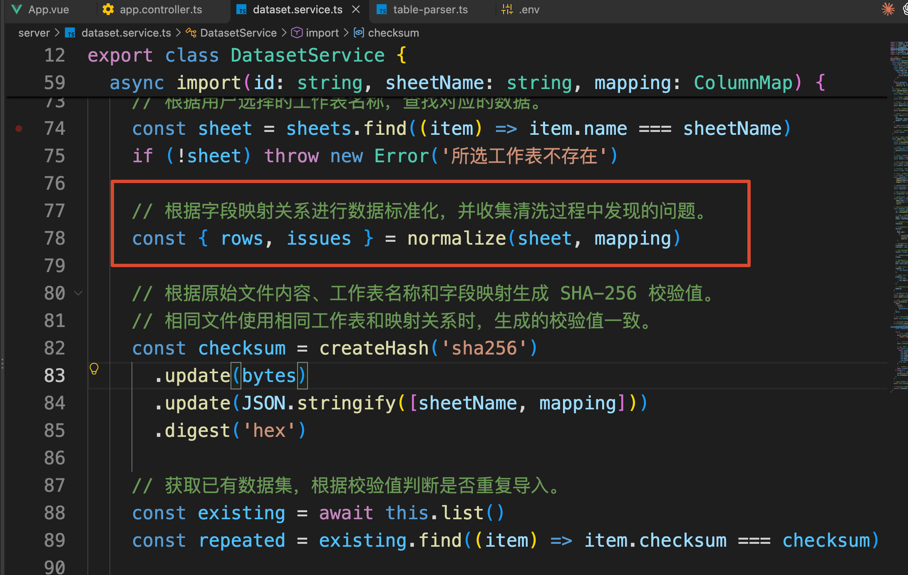

`import()` 接下来会先检查是否重复导入，再为新数据创建一个 `dataset` 对象，登记文件名、工作表、数据条数和版本等信息。这个对象就是页面中一条数据集记录。

首次导入本次样例时，其中几个字段是：

```typescript
// 只展示本次需要关注的字段。
{
  id: '本次生成的数据集 ID',
  name: 'sales-demo.xlsx',
  sheet: '销售明细',
  version: 1,
  rowCount: 18,
  status: 'ready',
  start: '2026-07-15',
  end: '2026-09-15'
}
```

上传 ID 用来找到刚上传的原件；这里新生成的数据集 ID，则用来找到已经整理好的数据。后面的分析会使用这个数据集 ID。

重复检查使用文件内容、工作表和字段映射计算出的 `checksum`。相同内容再次导入，会返回已有数据集；同名文件、同一工作表的内容发生变化，再生成新的数据集和版本。

`status` 根据 `issues` 确定：没有问题是 `ready`，有问题是 `needs_review`。只有没有质量问题，才会继续创建数据库。

在 这个方法里面，找到 `if (!issues.length)`。

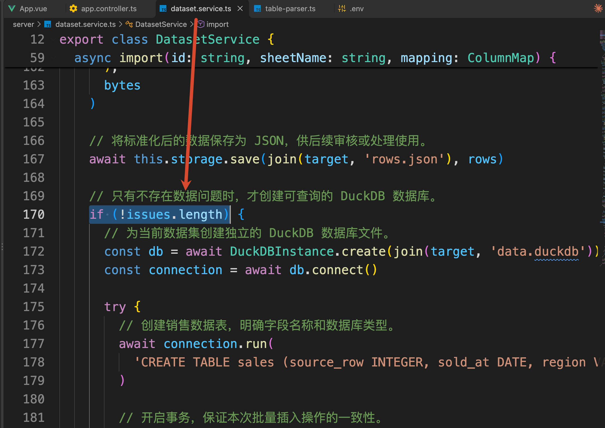

里面使用 [DuckDB 的 Node.js 接口](https://duckdb.org/docs/current/clients/node_neo/overview)创建 `data.duckdb`，建立 `sales` 表，再把 `rows` 中的明细逐条写入。

省略建表和事务处理，写入的关键代码是：

```typescript
for (const row of rows) {
  await connection.run(
    'INSERT INTO sales VALUES ($1,$2,$3,$4,$5,$6)',
    [row.source_row, row.sold_at, row.region,
      row.product_name, row.paid_amount, row.refund_amount] as any
  )
}
```

这里遍历的是全部 18 条明细。`$1` 到 `$6` 对应后面数组中的六个值，两列金额在数据库中使用 `DECIMAL(18,2)` 保存。

全部写入完成以后，本次数据集目录里可以找到：

```latex
data/datasets/{数据集ID}/
├─ source.xlsx       原始文件
├─ rows.json         整理后的明细
├─ data.duckdb       保存 sales 表的数据库文件
└─ metadata.json     数据集信息、字段映射与质量问题
```

最后，`import()` 返回数据集，前端 `confirmImport()` 刷新列表并调用 `selectDataset()` 选中它。

回到页面，左侧会出现 `sales-demo.xlsx`，显示“18 行”和“可分析”。到这里，上传和导入这条流程就完成了。

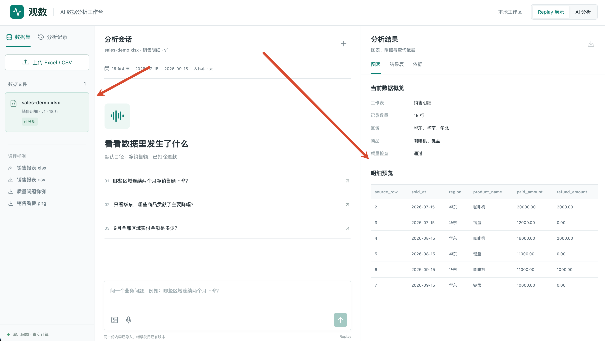

## 点击“确认分析”，问题怎样进入 Agent
现在，选中刚才的数据集，在输入框里填写：

```latex
哪些区域连续两个月净销售额下降？
```

把右上角那里改成 AI 分析

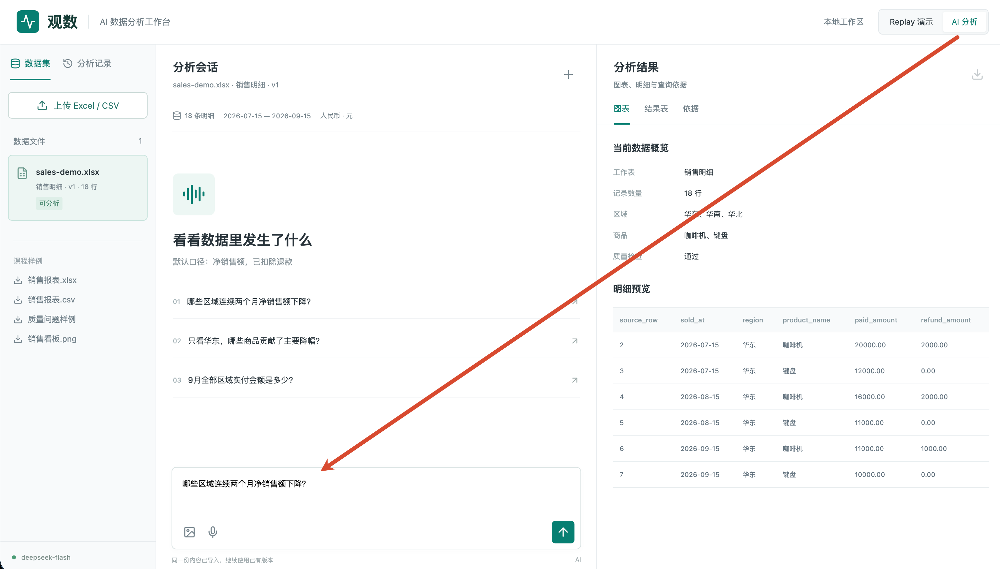

然后咱们发送这个消息

这个发送按钮会调用 `App.vue` 中的 `ask()`。

第一次提问且还没有创建会话时，`ask()` 会先发送 `POST /api/sessions`，请求中带上当前选中的数据集 ID：

```typescript
{ datasetId: selected.value.id }
```

请求进入 `app.controller.ts` 的 `createSession()`，再调用 `analysis.service.ts` 的 `AnalysisService.createSession()`。

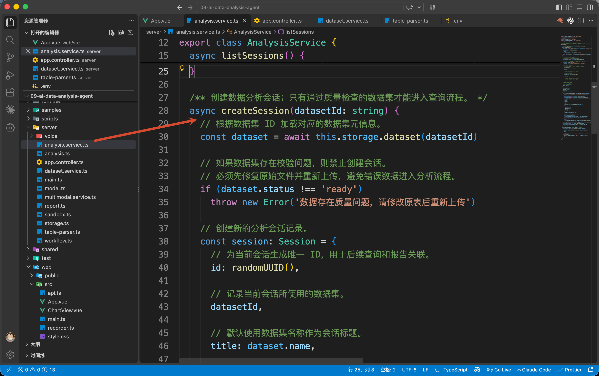

这个方法检查数据集是否为 `ready`，然后创建一条分析会话。与本次流程有关的内容是：

```typescript
// 其余字段省略。
{
  id: '新生成的会话 ID',
  datasetId: '刚才选中的数据集 ID',
  reports: [],
  lastSpec: null
}
```

`datasetId` 固定这场分析使用哪份数据。`reports` 保存分析报告，`lastSpec` 保存上一轮的统计条件

会话返回以后，执行回到前端 `ask()`，继续发送分析请求：

```latex
POST /api/sessions/{会话ID}/analyze
```

```json
{
  "question": "哪些区域连续两个月净销售额下降？",
  "mode": "ai"
}
```

接着找到 `app.controller.ts` 中 `@Post('sessions/:id/analyze')` 对应的方法。

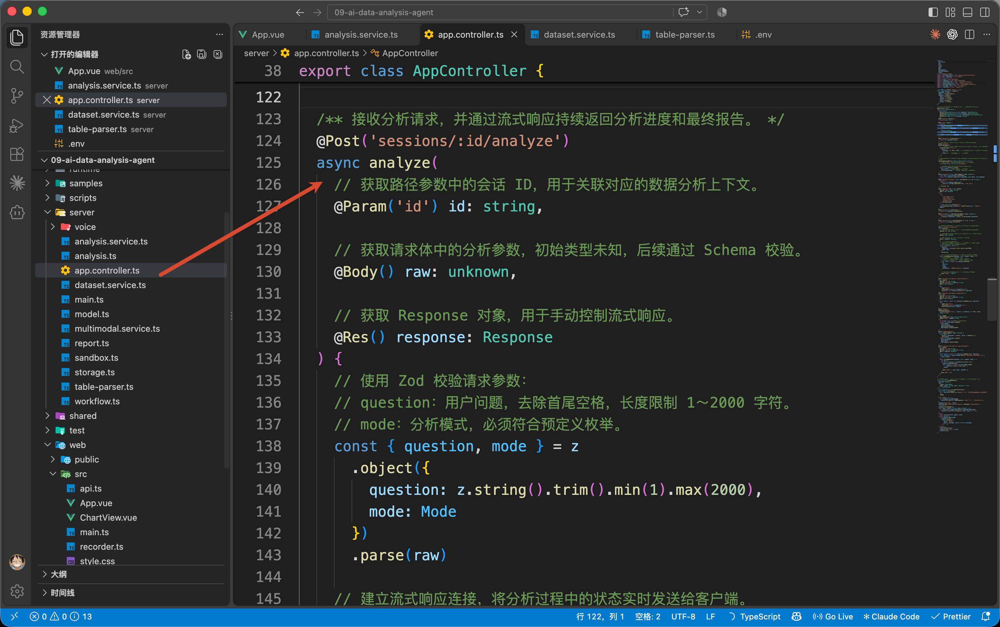

它接收问题和模式，调用 `AnalysisService.analyze()`，并把执行进度与最终报告逐条发回页面。

### 从 analyze() 进入查询工作流
打开 `server/analysis.service.ts` 的 `analyze()`。

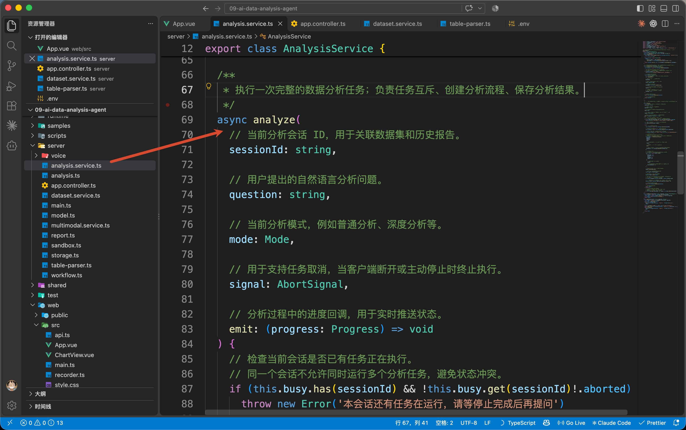

方法先加载当前会话，再通过会话中的 `datasetId` 读取数据集。

确认数据允许查询以后，它会调用 `createAnalysisGraph()`：

```typescript
// 创建分析流程图。
// Graph 内部会按照节点定义依次完成：
// 问题理解 → 查询决策 → 数据执行 → 结果解释 → 生成报告。
const graph = createAnalysisGraph({
  question, dataset, session, mode, signal, emit,
  directory: this.storage.datasetDir(dataset.id)
})
```

这里传进去的 `question` 是刚才输入的问题，`dataset` 是导入时保存的数据集信息，`directory` 指向它自己的数据目录。`signal` 用于停止执行，`emit` 用于向页面发送进度。

`createAnalysisGraph()` 定义在 `server/workflow.ts`，这里用了 `LangGraph` 这个大家应该都熟悉了

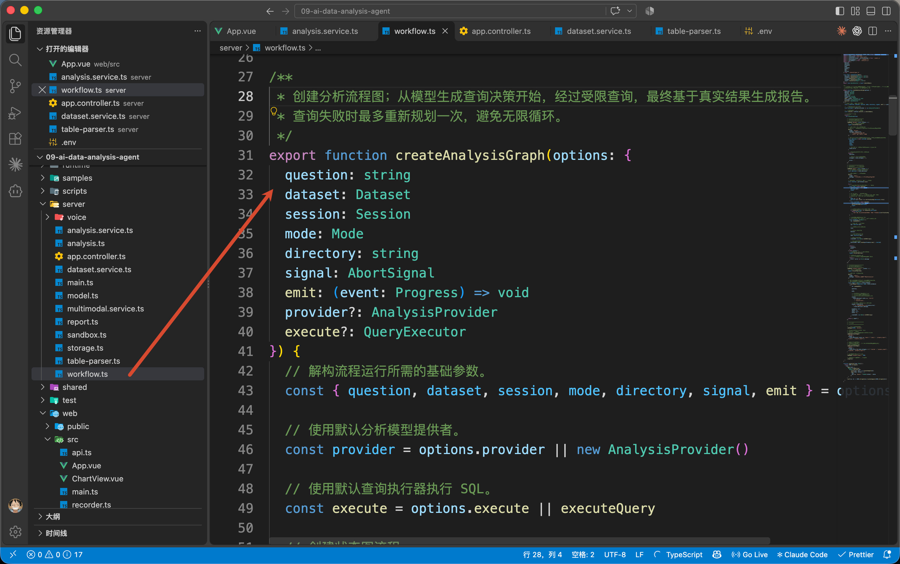

创建完成以后，`analyze()` 紧接着调用：

```typescript
// 启动分析流程。
// 初始状态包含空的决策、证据、错误信息和报告。
const state = await graph.invoke(
  { decision: null, evidence: null, error: '', attempts: 0, report: null },
  { signal, recursionLimit: 12 }
)
```

这几个初始字段分别用来保存查询决策、查询依据、错误、尝试次数和最终报告。目前还没有执行，所以都从空值或零开始。

现在进入 `workflow.ts` 的 `createAnalysisGraph()`，找到入口这条 Edge：

```typescript
.addEdge(START, 'decide')
```

因此，刚才的 `graph.invoke()` 会先运行 `decide` Node。再向上找到 `.addNode('decide', ...)`，其中真正获取查询决策的是：

```typescript
// 调用模型，根据用户问题、数据集信息和历史上下文生成查询决策。
const decision = await provider.decide(
  question, dataset, session, mode, signal, state.error
)
return { decision, attempts: state.attempts + 1, error: '' }
```

`provider` 在这个函数开头通过 `new AnalysisProvider()` 创建。

接下来，咱们就到 `server/model.ts`，看 `AnalysisProvider.decide()` 怎样处理这句话。

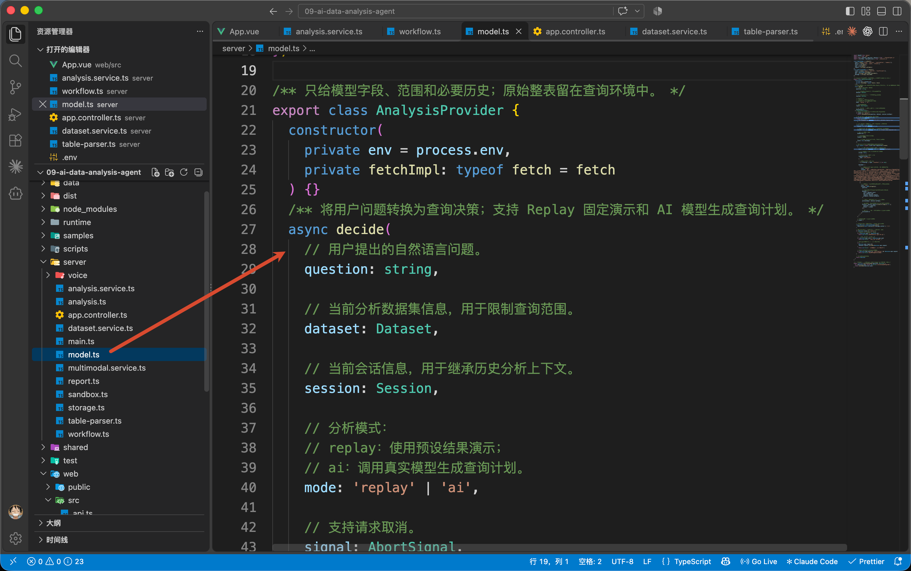

`decide()` 会调用 DeepSeek 的 `chat.completions.create()`。

它给模型提供两部分内容：

+ System Message 说明表结构和计算规则
+ User Message 提供本次问题、数据覆盖的日期与区域，以及必要的历史条件

在这个调用的 System Message 中，可以找到下面的规则：

```latex
净销售额 net=paid_amount-refund_amount，实付 paid=paid_amount，退款 refund=refund_amount，单位元；默认净销售额。
```

这就明确了“净销售额”怎样计算。表结构里的 `sold_at`、`region` 等字段，也会告诉模型日期和区域分别保存在什么位置。

当前是第一次提问，User Message 中的 `previousSpec` 为 `null`，`history` 为空。

这里要求模型通过 [JSON Output](https://api-docs.deepseek.com/guides/json_mode/)返回结构化内容。拿到返回值以后，`decide()` 会执行：

```typescript
const decision = DecisionSchema.parse(
  JSON.parse(result.choices[0]?.message.content || '{}')
)
```

`JSON.parse()` 把文本转成对象，`DecisionSchema.parse()` 检查字段类型和允许的取值。

下面还会继续检查查询是否缺少 `spec` 或 SQL、日期顺序是否正确等。检查通过的 `decision`，才会返回给刚才的 `decide` Node。

针对这次问题，一份符合要求的决策可以是下面这样。

```typescript
{
  route: 'query',
  spec: {
    kind: 'decline',
    metric: 'net',
    start: '2026-07-01',
    end: '2026-09-30',
    region: null
  },
  sql: '本次生成的 SELECT 语句',
  message: '按月汇总各区域净销售额，再判断是否连续下降'
}
```

这些都是本项目定义的字段。`route: 'query'` 表示需要查询；`spec` 保存统计条件：检查连续下降、使用净销售额、覆盖 7～9 月，`region: null` 表示查询全部区域。

对应的 SQL 可以写成：

```sql
SELECT strftime(sold_at, '%Y-%m') AS month,
       region,
       ROUND(SUM(paid_amount - refund_amount), 2) AS amount
FROM sales
WHERE sold_at >= DATE '2026-07-01'
  AND sold_at <= DATE '2026-09-30'
GROUP BY month, region
ORDER BY month, region
```

它先按月份和区域分组，再计算每组的净销售额。得到各月金额以后，程序才能比较下降情况。

## SQL 执行以后，结果怎样回到页面
现在回到 `workflow.ts`。刚才的 `decide` Node 已经把 `decision` 写入 State。

找到它后面的条件路由：

```typescript
.addConditionalEdges(
  'decide',
  state => state.decision?.route === 'query' ? 'query' : 'prepare_report',
  ['query', 'prepare_report']
)
```

当前的 `route` 是 `query`，所以接下来进入 `query` Node。需要澄清或者资料不足时，会直接去准备相应提示，本次先沿查询这条路线往下看。

在同一个文件中找到 `.addNode('query', ...)`。它先取出 `state.decision`，然后执行：

```typescript
// 在指定数据集的 DuckDB 文件中执行 SQL。
const rows = await execute(
  join(directory, 'data.duckdb'),
  decision.sql!,
  signal
)
```

`directory` 就是 `analyze()` 传进来的数据集目录，因此这里找到的 `data.duckdb`，正是刚才导入 18 条明细时创建的数据库。

`execute` 在 `createAnalysisGraph()` 开头指定，页面正常运行时使用的是 `server/sandbox.ts` 导出的 `executeQuery()`。

进入 `executeQuery()`，本次查询会经历以下过程：

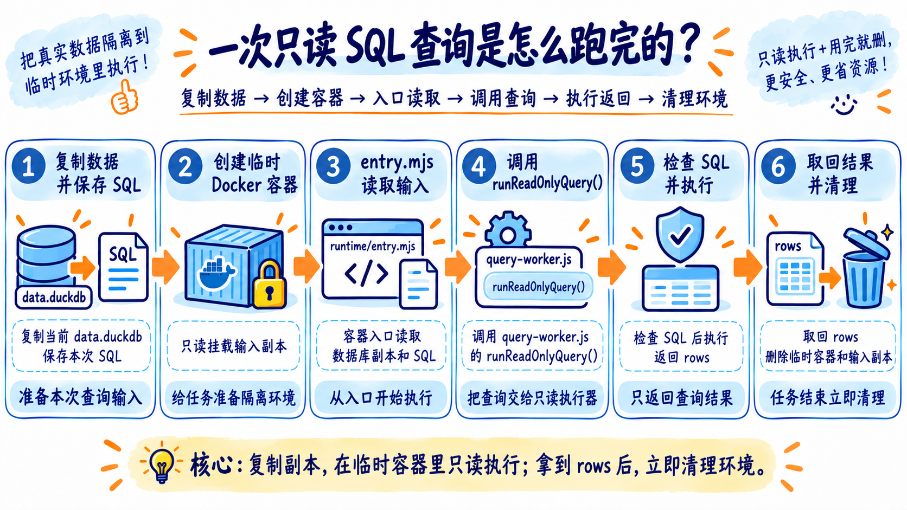

这里继续使用第五小节讲过的受限执行：只开放当前 `sales` 表的受限 SELECT 查询，限制写入、联网、执行时间和输出大小。SQL 检查和 Docker 参数的细节，这里就不重新展开了。

查询成功以后，执行回到 `query` Node，刚才 `await execute(...)` 左侧的 `rows` 就有值了。它包含月份、区域和数据库实际算出的金额，例如：

```typescript
[
  { month: '2026-07', region: '华东', amount: '30000.00' },
  { month: '2026-07', region: '华北', amount: '20000.00' },
  { month: '2026-07', region: '华南', amount: '15000.00' }
  // 后面还有 8 月和 9 月的结果
]
```

继续看 `query` Node 中 `await execute(...)` 后面的代码

因为模型可能在 `spec.metric` 中写了 `net`，SQL 却只统计 `paid_amount`，忘记扣退款。这条 SQL 能执行，但得到的数字不符合它自己声明的条件。

为此，`model.ts` 提供了 `verificationSql(decision)`。

```javascript
/** 标准查询用于独立核对模型 SQL，保持指标与计划口径一致。 */
export function verificationSql(decision: Decision) {
    if (!decision.spec) throw new Error('缺少已确认的分析口径')
    return buildSql(decision.spec)
}
```

它把 `decision.spec` 交给 `analysis.ts` 的 `buildSql()`，用程序生成一条标准查询。

当模型 SQL 与标准查询文本不同时，`query` Node 会再执行标准查询，比较两边的结果。结果不同就记录错误，让模型修正。

**这一步核对的是“模型 SQL 的结果，是否与按 spec 计算的结果一致”。spec 对用户问题的理解是否准确，仍然需要核对时间、区域和指标。** 当前项目只开放几类销售分析，因此可以为这些类型编写标准查询。

查询和核对通过以后，`query` Node 才创建 `evidence`，把本次 SQL、真实结果、数据集和统计条件放到一起。省略 ID、时间等字段，它保存的内容就是：

```typescript
{
  sql: decision.sql,
  rows,
  dataset,
  spec: decision.spec
}
```

这个 `evidence` 是本次分析的依据，随后通过 `return { evidence, error: '' }` 写入 State。

如果执行或核对失败，`query` Node 会把原因写入 `error`。它后面的条件路由允许回到 `decide` 修正一次；第二次查询仍失败，就进入报告节点说明失败原因。停止请求则会直接中止执行。

### 把查询结果整理成回答
本次查询成功，`query` 后面的路由会进入 `prepare_report`。

找到这个 Node，它看到 State 中已经有 `evidence`，就调用：

```typescript
buildReport(question, mode, state.evidence)
```

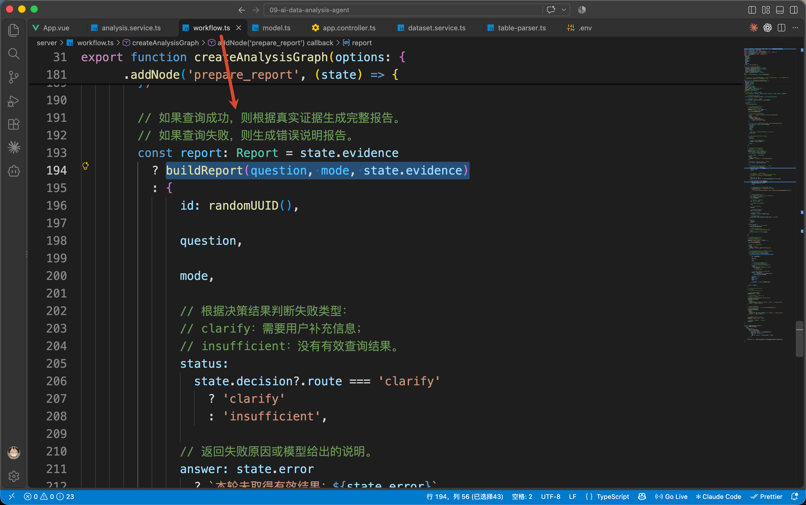

`buildReport()` 位于 `server/analysis.ts`。本次 `spec.kind` 是 `decline`，它会把每个区域的金额按月份排好，再检查最后三个相邻月份是否依次下降。

本次样例的查询结果，按区域整理如下，单位是元：

| 区域 | 7 月 | 8 月 | 9 月 |
| --- | ---: | ---: | ---: |
| 华东 | 30000 | 25000 | 20000 |
| 华北 | 20000 | 22000 | 21000 |
| 华南 | 15000 | 17000 | 18000 |


所以，华东满足连续两个月下降。比如 7 月华东的金额，就能在原表中复算：`20000 - 2000 + 12000 - 0 = 30000`。

这里的回答文字、结果表和图表配置，都是 `buildReport()` 根据真实结果生成的。

报告写入 State 后，Graph 进入 `END`，执行回到 `AnalysisService.analyze()` 的 `await graph.invoke(...)` 后面。

`analyze()` 取出 `state.report`，追加到当前会话的 `reports`，把统计条件保存到 `lastSpec`，再通过 `saveSession()` 写入 `data/sessions/{会话ID}.json`。

随后它把报告返回 Controller。`app.controller.ts` 中的 `analyze()` 会发送一条 `report` 事件：

```typescript
send('report', report)
```

前端 `App.vue` 的 `ask()` 一直在等待这些事件。

收到 `report` 后，它把结果加入会话，更新右侧报告，并把状态改成“分析完成”。这时，就能在页面看到华东连续下降的结论了。

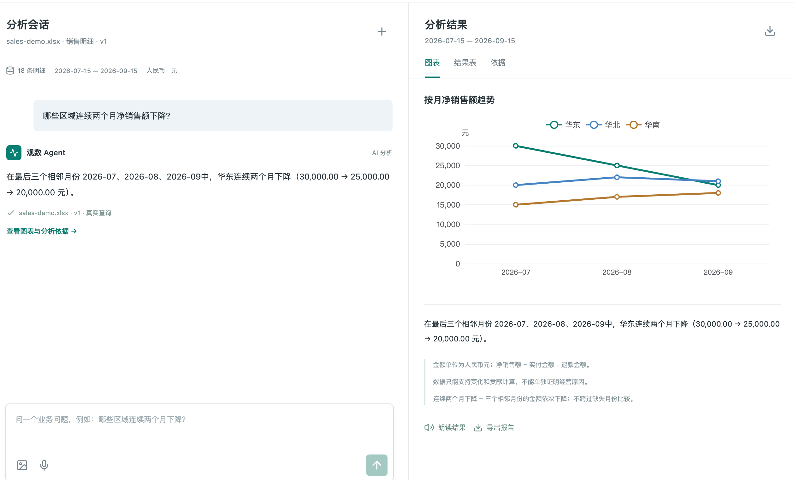

到这里，从输入问题到看到结果，就完整走完了一次。

## 总结
这一篇，咱们从两个操作入口看完了一次数据查询：

+ 上传 Excel → 预览并确认字段 → 校验明细 → 写入 DuckDB
+ 输入问题 → 确定条件和 SQL → 受限查询 → 核对结果 → 返回回答

模型负责把业务问题转换成查询条件和 SQL，数据库负责计算，应用负责控制执行、核对结果，并保存查询依据。

现在已经知道华东连续两个月下降。接下来，用户还可以继续问：“只看华东，哪些商品贡献了主要降幅？”

下一篇，咱们就从这次追问开始，看系统怎样接着分析，并把结果整理成可以核对和导出的图表报告。

> 更新：2026-10-11 11:27 · 原文：<https://www.yuque.com/lgdsunday/ab1dy3/gc2k9uvv382eo7ho>
