# 11-实战（中二）：连续追问、补充分析与图表报告生成

上一小节，咱们已经查到：华东的净销售额从 7 月的 30000 元，下降到 8 月的 25000 元，再下降到 9 月的 20000 元。

看到这个结果，用户很自然就会继续问：

> 只看华东，哪些商品贡献了主要降幅？
>

这句话省略了时间范围，也没有重新说明销售额是否扣除退款。系统需要接着上一轮的条件，再去查询商品数据。

这一篇，咱们就从发送这句追问开始，看它怎样得到新的计算结果，再把结果整理成图表和可以下载的报告。

## 继续追问，怎样接上上一轮的条件
保持上一节的会话和“AI 分析”模式，在输入框中填写：“只看华东，哪些商品贡献了主要降幅？”

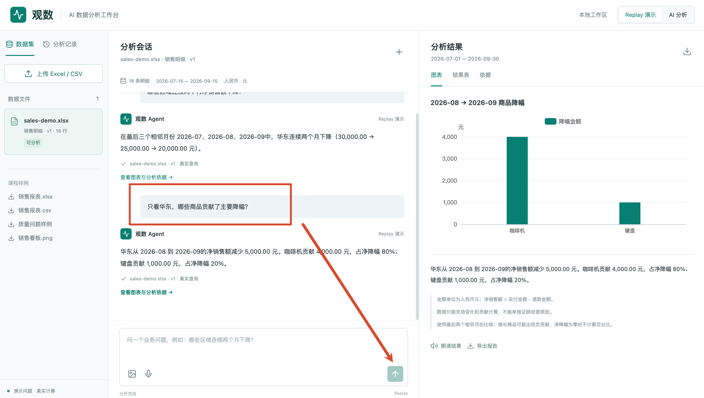

点击发送，仍然进入 `web/src/App.vue` 的 `ask()`。

这个方法中，创建会话的代码有一个判断：

```typescript
if (!session.value)
  session.value = await api<Session>('/sessions', {
    method: 'POST',
    body: JSON.stringify({ datasetId: selected.value.id })
  })
```

上一轮已经创建过会话，所以这一次会跳过创建，继续使用原来的 `session.value.id` 发送请求：

```latex
POST /api/sessions/{当前会话ID}/analyze
```

请求体中放的是本次问题：

```json
{
  "question": "只看华东，哪些商品贡献了主要降幅？",
  "mode": "ai"
}
```

### 服务端从哪里拿到前面的分析
请求到达 `server/app.controller.ts` 的 `analyze()` 后，Controller 会把会话 ID 和问题交给 `AnalysisService.analyze()`。

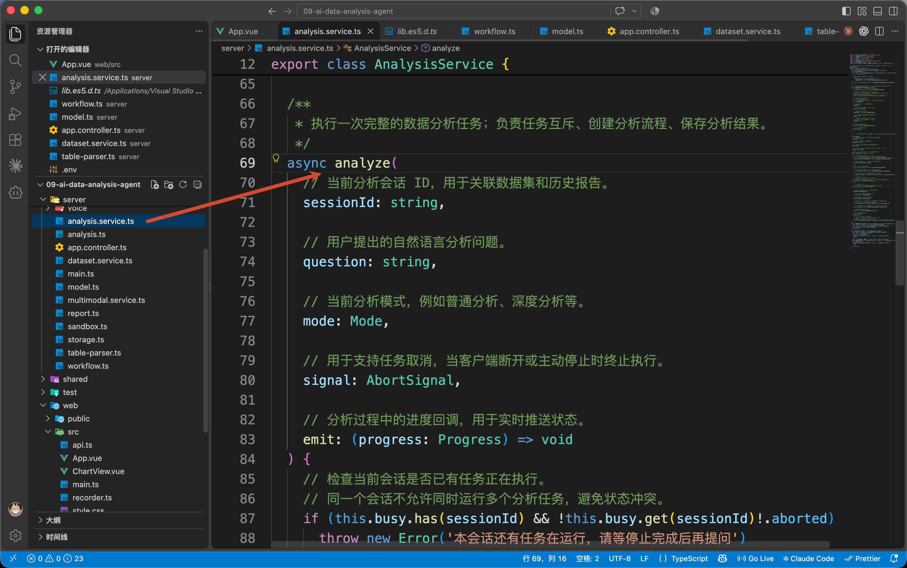

打开 `server/analysis.service.ts`，在这个方法前面找到：

```typescript
// 加载当前分析会话信息。
const session = await this.storage.session(sessionId)
// 根据会话关联的数据集 ID 加载数据集元信息。
const dataset = await this.storage.dataset(session.datasetId)
```

第一行读取 `data/sessions/{会话ID}.json`，里面保存着之前的报告和最近一次统计条件。第二行根据会话中的 `datasetId`，找到本次继续分析的数据集。

上一节分析结束时，程序执行过：

```typescript
// 将本次报告加入当前会话历史。
session.reports.push(report)
// 如果报告中包含有效分析依据，则保存最近一次分析规格。
// 后续可以用于继续分析或恢复上下文。
if (report.evidence) session.lastSpec = report.evidence.spec
// 保存更新后的会话信息。
await this.storage.saveSession(session)
```

所以，按照上一篇的示例口径，此时读取到的 `session.lastSpec` 是：

```javascript
{
  kind: 'decline',
  metric: 'net',
  start: '2026-07-01',
  end: '2026-09-30',
  region: null
}
```

它记录的是：刚才分析了 7 月到 9 月、全部区域的净销售额，并检查连续下降。`session.reports` 则保存了上一轮的问题和完整报告。

拿到这些内容以后，`analyze()` 会把 `session` 和本次 `question` 一起传给 `createAnalysisGraph()`，再调用 `graph.invoke()` 开始本轮分析。

这里每次提问都会启动一轮新的 Graph。前面的分析通过刚才读取的 `session` 传进来。

### 历史条件怎样进入模型
接着进入 `server/workflow.ts` 的 `createAnalysisGraph()`。

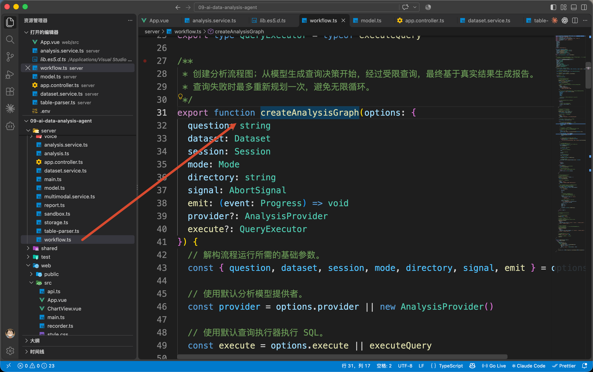

Graph 首先执行 `decide` Node。这个 Node 调用 `provider.decide()`，其中一个参数就是刚才传进来的 `session`。

继续到 `server/model.ts` 的 `AnalysisProvider.decide()`

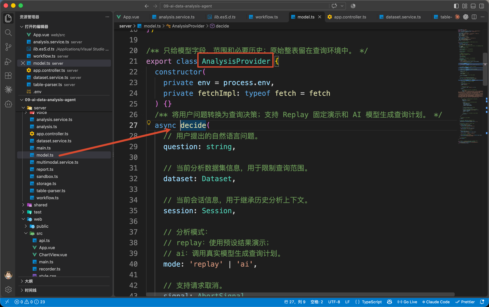

找到发送给模型的用户消息。下面节选和追问有关的字段：

```typescript
{
  question,
  previousSpec: session.lastSpec,
  history: session.reports.slice(-4).map((r) => ({
    question: r.question,
    answer: r.answer
  }))
}
```

`question` 是“只看华东，哪些商品贡献了主要降幅”。`previousSpec` 是刚才那份统计条件。`history` 提供最近四轮的问题与回答，帮助模型理解这次追问接着哪件事。

同一个方法里的 System Prompt，还明确写了处理规则：

```latex
追问继承历史明确条件，用户新条件覆盖旧条件。
```

因此，这次应该沿用“7 月到 9 月”和“净销售额”，再把用户新增的“华东”和“商品降幅”加进去。

模型返回的 `decision.spec` 就可以整理为下面这组条件：

```javascript
{
  kind: 'contribution',
  metric: 'net',
  start: '2026-07-01',
  end: '2026-09-30',
  region: '华东'
}
```

这里的 `contribution` 是本项目约定的商品降幅分析类型。

和上一轮相比，日期、指标没有变化，区域缩小到华东，分析类型从连续下降变成了商品降幅。

如果用户明确说“改看 9 月实付金额”，模型就应该按新要求修改时间和指标。运行时可以在右侧“依据”中核对实际采用的条件，模型生成的具体日期和 SQL 要以自己的结果为准。

假如用户只说“分析商品降幅”，前面也没有确定区域，模型可以按 Prompt 约定返回 `route: 'clarify'`，在 `message` 中询问要分析哪个区域。Graph 会直接把这段询问返回页面，等用户补充后再发起新一轮分析。

## 补查商品数据，再计算降幅
上一轮查询得到的是“每个月、每个区域一共卖了多少钱”。但是他还不能告诉咱们具体那些商品的降幅

所以，模型在返回本轮 `decision` 时，还需要把 `route` 设为 `'query'`，表示需要查询，并在 `sql` 字段中提供按商品汇总的 SQL。

按照上面这组条件，对应查询如下，金额仍然扣除退款：

```sql
SELECT
  strftime(sold_at, '%Y-%m') AS month,
  product_name AS product,
  ROUND(SUM(paid_amount - refund_amount), 2) AS amount
FROM sales
WHERE sold_at >= DATE '2026-07-01'
  AND sold_at <= DATE '2026-09-30'
  AND region = '华东'
GROUP BY month, product
ORDER BY month, product
```

这次要注意两个位置：`WHERE` 限定只查询华东，`GROUP BY month, product` 按月份和商品分别汇总。

`decide` 把决策写入 State 后，`route: 'query'` 会让 Graph 继续进入 `query` Node。接下来仍然走上一篇的受限查询与口径核对流程。

查询成功以后，`query` 把返回的 `rows` 放进 `evidence.rows`。使用项目提供的 `sales-demo.xlsx`，这次得到的内容如下，金额单位是元：

| month | product | amount |
| --- | --- | ---: |
| 2026-07 | 咖啡机 | 18000 |
| 2026-07 | 键盘 | 12000 |
| 2026-08 | 咖啡机 | 14000 |
| 2026-08 | 键盘 | 11000 |
| 2026-09 | 咖啡机 | 10000 |
| 2026-09 | 键盘 | 10000 |


现在，各商品的月度金额已经补齐了。接下来才有数据计算：每种商品的净销售额减少了多少，占华东净降幅的多少。

### 本次比较的是哪两个月
`query` 完成后，Graph 进入 `prepare_report` Node。

打开 `server/workflow.ts`，找到这个 Node 调用的：`buildReport(question, mode, state.evidence)`

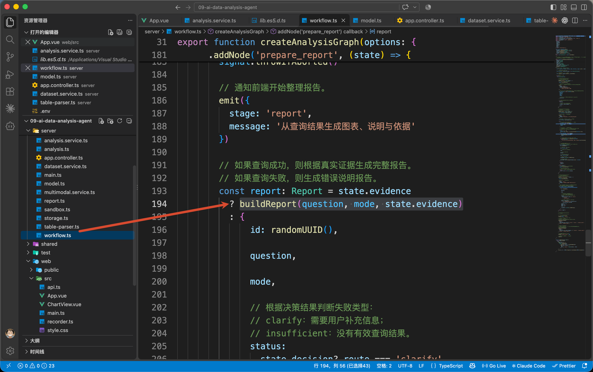

然后进入 `server/analysis.ts` 的 `buildReport()`。

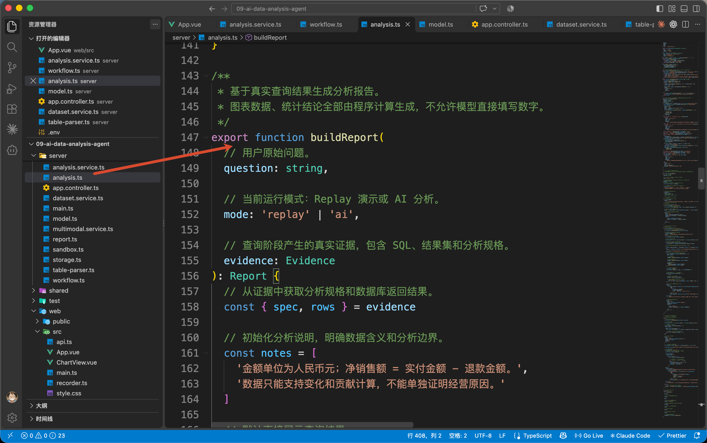

函数先从 `evidence` 中取出 `spec` 和 `rows`。本次 `spec.kind` 是 `contribution`，因此会进入商品贡献分支：

```typescript
// 获取完整月份范围。
    const months = monthSequence(spec.start, spec.end)
```

`monthSequence()` 会按照日期范围生成月份数组。本例得到的是：

```javascript
['2026-07', '2026-08', '2026-09']
```

随后，代码取出最后两个月：

```typescript
// 只比较最后两个连续月份。
const [before, after] = months.slice(-2)
```

因此，`before` 是 8 月，`after` 是 9 月。

月份确定以后，函数会逐个找到商品在这两个月的金额，再计算差值。

以咖啡机为例：

```latex
8 月净销售额：14000 元
9 月净销售额：10000 元
降幅金额：14000 - 10000 = 4000 元
```

键盘则从 11000 元变成 10000 元，减少 1000 元。两种商品合起来减少了 5000 元，和前面查到的华东总降幅一致。

### 80% 和 20% 怎样算出来
仍然留在 `buildReport()` 的这个分支。

各商品的前后金额和差值，先保存在 `differences` 数组中。代码把这些差值相加，得到华东本次的净降幅 `drop`：

```typescript
// 计算整体净下降金额。
const drop = amount(
  differences.reduce((n, item) => n + item.降幅金额, 0)
)
```

其中 `amount()` 负责把金额处理到两位小数。本次 `drop` 就是 5000。

再用每种商品的降幅除以它：

```latex
咖啡机：4000 ÷ 5000 × 100% = 80%
键盘：1000 ÷ 5000 × 100% = 20%
```

代码将计算结果放进 `table`：

```typescript
// 重新组织表格，增加贡献比例。
table = differences.map(item => ({
  ...item,
  降幅金额: amount(item.降幅金额),
  '净降幅贡献(%)': drop > 0
    ? Math.round(item.降幅金额 / drop * 10000) / 100
    : null
}))
```

最终，页面“结果表”里显示的是：

| 商品 | 上月金额 | 本月金额 | 降幅金额 | 净降幅贡献(%) |
| --- | ---: | ---: | ---: | ---: |
| 咖啡机 | 14000 | 10000 | 4000 | 80 |
| 键盘 | 11000 | 10000 | 1000 | 20 |


这里的 80%，表示咖啡机贡献了华东这次净降幅的 80%。咖啡机自身的销售额下降比例，需要用 4000 除以它上个月的 14000，两者的分母不同。

计算这个贡献比例也有前提：两个月的数据必须齐全，净降幅必须大于零。

因此，同一个分支会先检查各商品是否有这两个月的记录。缺少记录时，返回提示，让用户核对明细。

到这里，咱们已经能说清“这 5000 元主要少在哪些商品上”。

## 图表、结果表和依据怎样对应起来
`buildReport()` 算完结果表以后，会接着准备 `chart`。这个对象描述图表类型、横轴内容和每根柱子的数值。

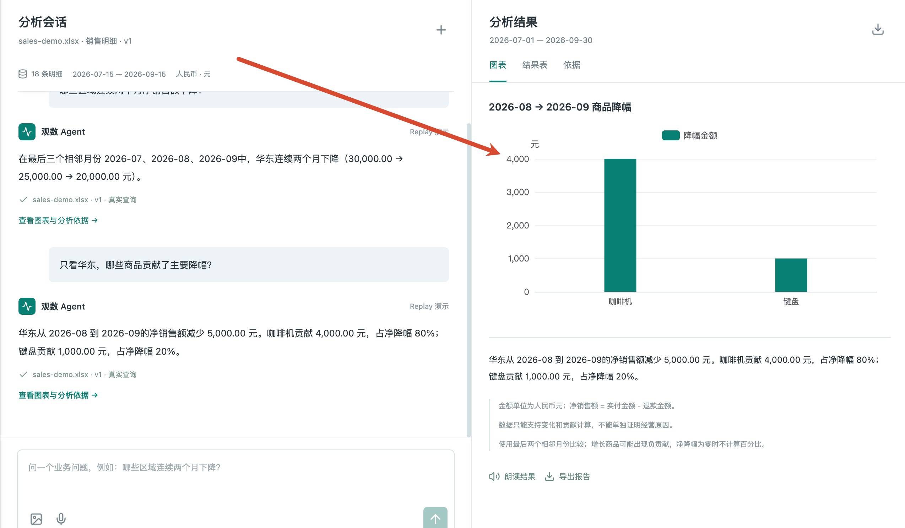

本例生成的图表数据是：

```javascript
{
  kind: 'bar',
  title: '2026-08 → 2026-09 商品降幅',
  categories: ['咖啡机', '键盘'],
  series: [
    { name: '降幅金额', values: [4000, 1000] }
  ],
  unit: '元'
}
```

里面的 `values` 从刚才的结果表读取：

```typescript
values: table.map(r => Number(r.降幅金额))
```

所以，柱状图展示的是 4000 元和 1000 元。

准备好这些内容后，`buildReport()` 返回一份报告。其中，和本节有关的字段可以简化为：

```javascript
{
  question, // 本次追问
  answer,   // 根据计算结果组织的回答
  table,    // 商品金额、降幅和贡献比例
  chart,    // 从 table 中取数的图表配置
  evidence  // 本次数据集、统计条件、SQL 和查询结果
}
```

这是同一份报告的不同部分。模型负责理解问题和生成查询，查询后的差值、比例、图表数值与回答文字由 `buildReport()` 按项目规则生成。

`prepare_report` 把报告写入 State，Graph 结束，执行就回到 `AnalysisService.analyze()` 的 `graph.invoke()` 后面。

和上一篇一样，服务把这份新报告追加到会话中，并用本轮的 `report.evidence.spec` 更新 `session.lastSpec`。下一次追问就能接着“华东、净销售额、商品降幅”继续处理。

随后，报告返回 Controller，经 `report` 事件传给前端。`App.vue` 的 `ask()` 收到它以后，更新 `report.value`，右侧默认切到“图表”。

### 在页面上核对这次分析
回到页面，先看右侧“图表”。

这里使用 `web/src/ChartView.vue` 显示 `report.chart`。组件把 `categories` 交给横轴，把 `series` 里的数值交给 ECharts，最终画出两根柱子。

这部分前端绘图代码不需要逐行展开，大家知道它使用的是服务端计算好的 `report.chart` 就可以了。

然后点击“结果表”，看到的是 `report.table`，可以核对两种商品的金额和贡献比例。

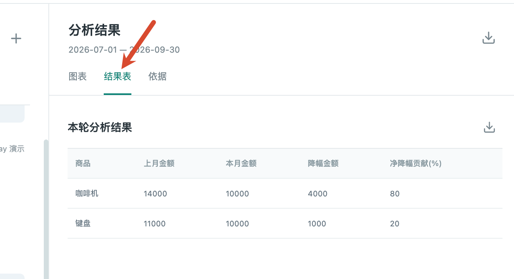

如果想知道这份结果用了哪些数据，再点击“依据”。

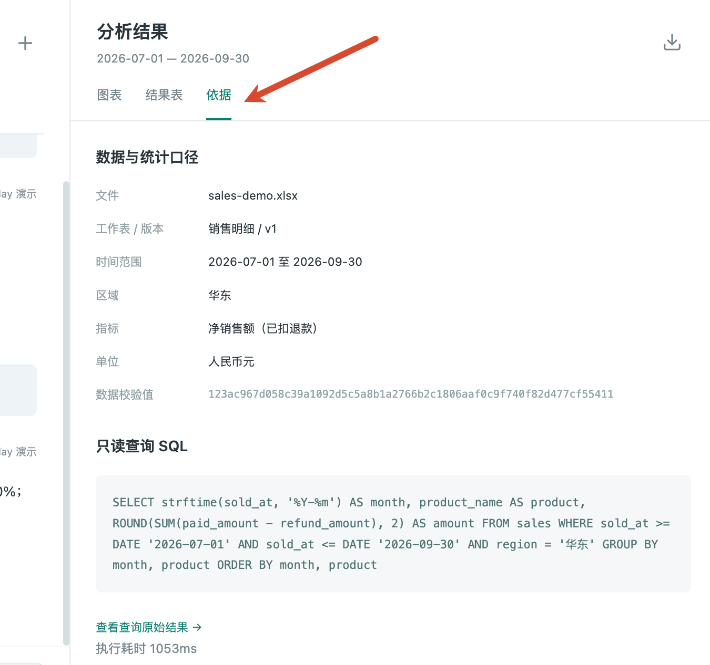

页面从同一份报告的 `report.evidence` 中读取：

+ 数据文件、工作表和版本。
+ 日期范围、区域、金额指标与单位。
+ 文件 Checksum，以及实际执行的 SQL。

在 SQL 下面点击“查看查询原始结果”

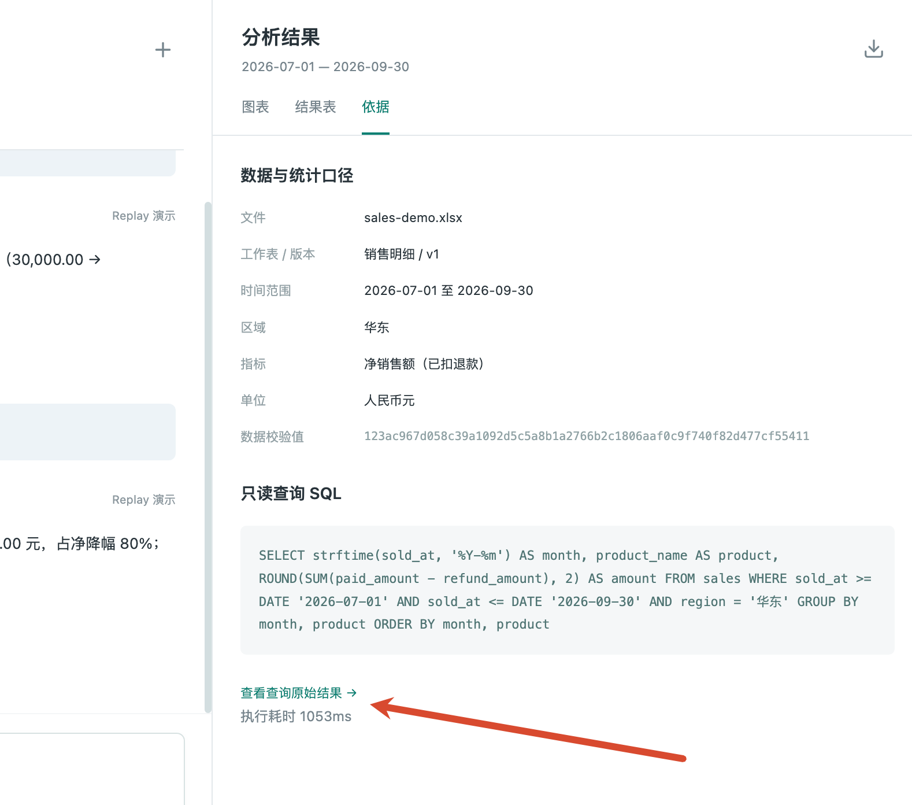

就会显示 `report.evidence.rows`，也就是前面那六行按月、按商品汇总的数据。

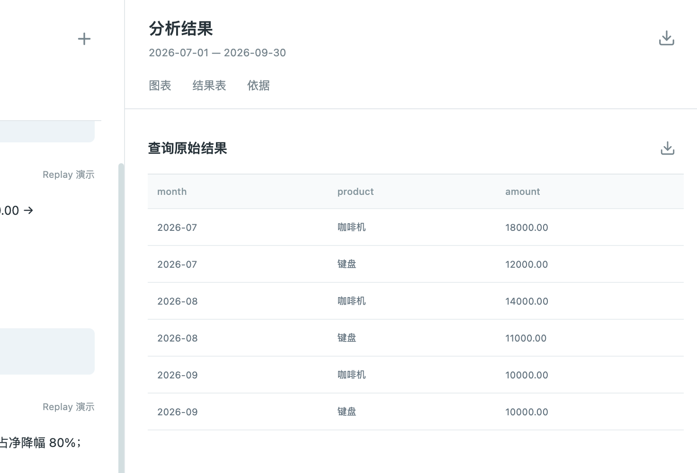


## 点击“导出报告”，保存本轮分析
现在，选中刚才的商品降幅报告，点击右侧“导出报告”。

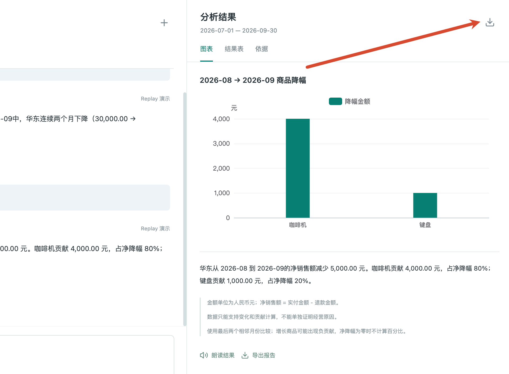

按钮会调用 `App.vue` 中的 `download('export')`。这个方法会取出当前会话 ID 和当前选中的报告 ID，打开下面的地址：

```latex
GET /api/sessions/{会话ID}/reports/{报告ID}/export
```

这里带上报告 ID，是为了让服务端明确导出哪一轮。当前选中商品降幅报告，导出的就是这一轮，前一轮的区域趋势仍然保留在会话里。

### 服务端怎样生成文件
打开 `server/app.controller.ts`，找到：

```typescript
@Get('sessions/:id/reports/:reportId/export')
```

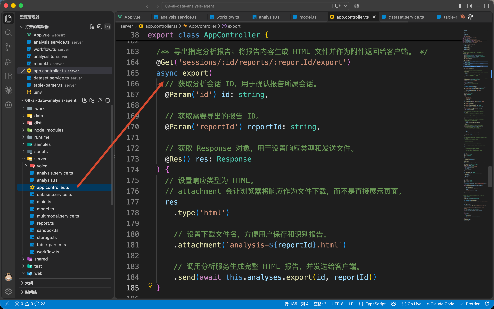

这个接口的 `export()` 会调用 `this.analyses.export(id, reportId)`。

继续进入 `server/analysis.service.ts` 的 `AnalysisService.export()`，

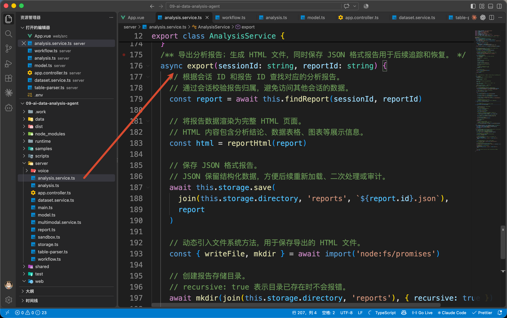

前两步是：

```typescript
// 根据会话 ID 和报告 ID 查找对应的分析报告。
// 通过会话校验报告归属，避免访问其他会话的数据。
const report = await this.findReport(sessionId, reportId)

// 将报告数据渲染为完整 HTML 页面。
// HTML 内容包含分析结论、数据表格、图表等展示信息。
const html = reportHtml(report)
```

`findReport()` 从已保存的会话中找到指定报告。`reportHtml()` 则使用这份报告生成 HTML 内容。

因此，这次导出的数据直接来自刚才保存的分析结果，导出过程不会重新请求模型或执行 SQL。

接着到 `server/report.ts`，查看 `reportHtml()`。这个代码看着挺多，但是逻辑非常简单

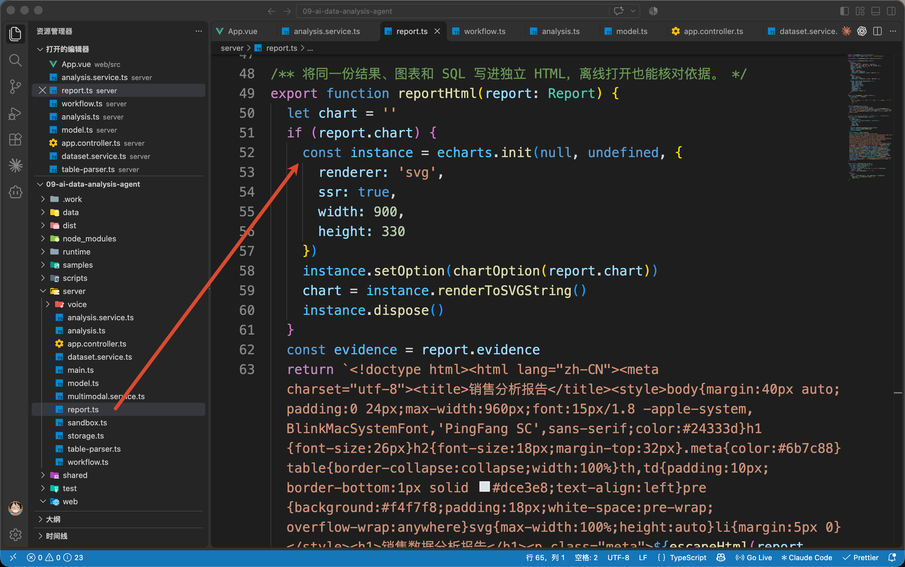

它会把问题、回答、结果表、数据版本、统计条件、SQL 和查询结果写进同一个 HTML 里面。

为此，函数使用 ECharts 的 [SVG 服务端渲染](https://echarts.apache.org/handbook/en/how-to/cross-platform/server/#server-side-svg-rendering)，把 `report.chart` 渲染成可以放进 HTML 的矢量图：

```typescript
const instance = echarts.init(null, undefined, {
  renderer: 'svg',
  ssr: true,
  width: 900,
  height: 330
})
instance.setOption(chartOption(report.chart))
chart = instance.renderToSVGString()
instance.dispose()
```

其中 `chartOption()` 也在 `report.ts` 中，负责把图表数据转换成 ECharts 配置。`renderToSVGString()` 得到图形内容，随后嵌入报告 HTML。

这样下载后的文件就包含真实图表，离线打开也能查看。

`reportHtml()` 返回后，执行回到 `AnalysisService.export()`。这个方法会在项目目录下保存两份文件：

```latex
data/reports/{报告ID}.json
data/reports/{报告ID}.html
```

JSON 保存结构化报告，HTML 用于打开阅读。写入完成以后，方法把 HTML 内容返回 Controller。

### 浏览器怎样下载
回到 `app.controller.ts` 的导出接口，它会把刚才生成的 HTML 发送给浏览器：

```typescript
res
  .type('html')
  .attachment(`analysis-${reportId}.html`)
  .send(await this.analyses.export(id, reportId))
```

`type('html')` 指定内容类型，`attachment()` 告诉浏览器按附件下载，并设置文件名，`send()` 发送文件内容。

所以，点击一次导出按钮，同一个请求就会完成“找到报告、生成文件、返回下载内容”这几步。

下载完成后，直接打开 `analysis-{报告ID}.html`。这份文件里应该能核对到：华东、8 月到 9 月的商品降幅、4000 元与 1000 元、80% 与 20%，以及对应的查询 SQL 了。

## 总结
这一篇，咱们接着“华东连续下降”的结果，完成了一次商品降幅分析。

程序把上一轮条件和近期问答交给模型，模型确定本轮需要补查的商品数据；数据库返回真实金额后，应用计算差值和贡献比例，再用同一份结果生成回答、图表和报告。

这样，用户既可以继续追问，也可以核对数字，最后把这轮分析下载下来。

下一篇，咱们再把看板截图和语音接进来，让它们使用这条已经完成的数据分析流程。

> 更新：2026-10-11 19:54 · 原文：<https://www.yuque.com/lgdsunday/ab1dy3/uc42g3ggrwketxgn>
