# 12-实战（下）：接入图片与语音，完成多模态分析体验

上一小节，咱们已经可以连续提问，查询商品数据，再把分析结果整理成图表和报告。

那么最后咱们就再来看看这个项目里面的图片解析和语音的处理。

## 上传看板截图，怎样核对原表金额
先点击左侧“课程样例”中的“销售看板.png”下载图片，也可以直接使用项目里的 `samples/dashboard.png`。

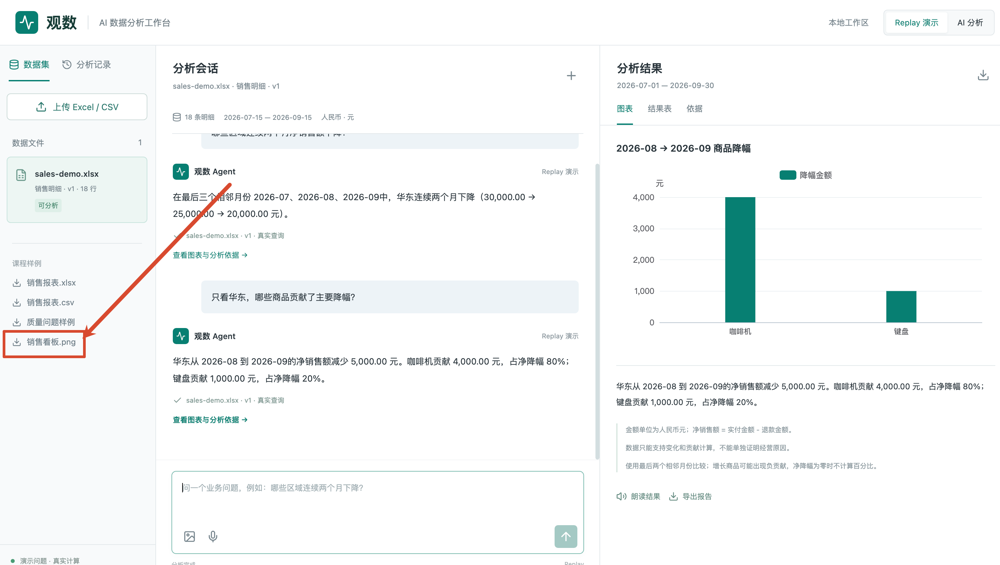

下载的这张图大家也可以再看下：

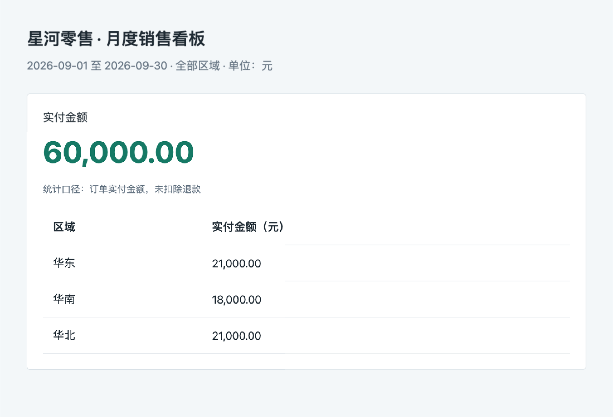

然后咱们点击输入框下方的图片图标，也就是“上传看板截图”，选择这张图片。

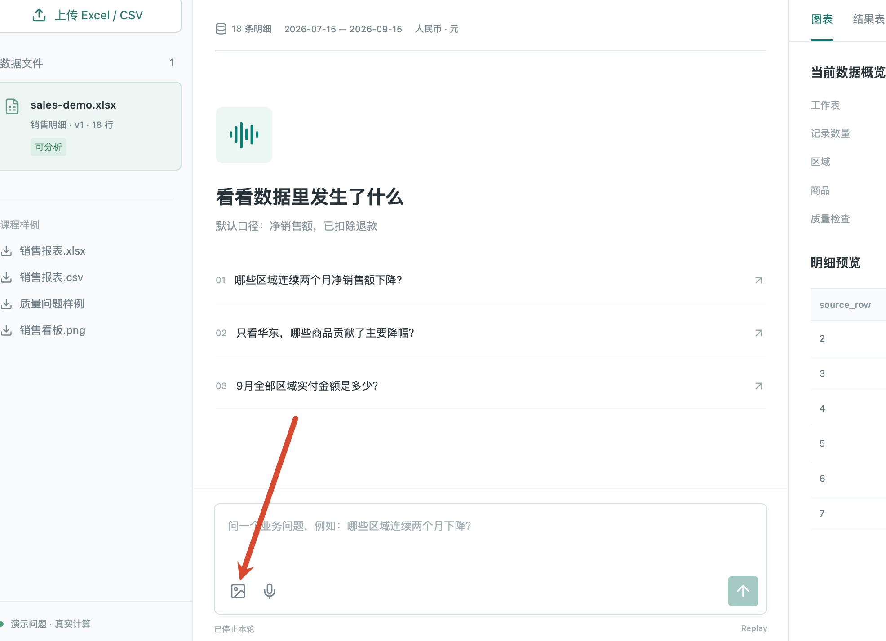

识别完成后，页面会弹出“核对截图口径”，里面同时展示原图和识别出来的日期、指标、单位、金额与区域。

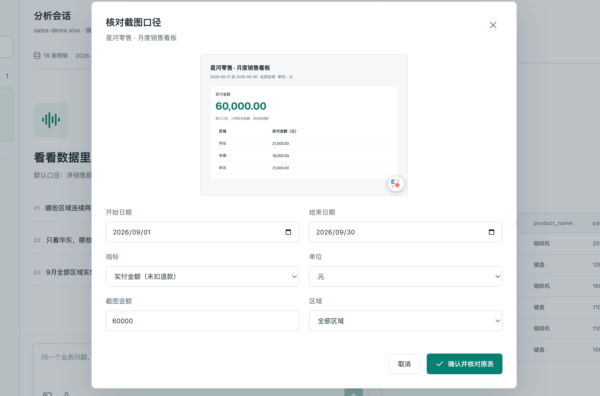

然后咱们就顺着这次上传，看一下这些字段是怎样出现在弹窗里的。

### 图片怎样变成可以核对的字段
选择图片以后，执行的是 `web/src/App.vue` 中的 `inspectImage()`。它把图片和当前模式放进 `FormData`：

```typescript
const form = new FormData()
form.append('file', file)
form.append('mode', mode.value)

picture.value = await api<PictureFacts>('/images', {
  method: 'POST',
  body: form
})
```

这里的 `api()` 会补上 `/api` 前缀，因此实际请求是 `POST /api/images`。

请求进入 `server/app.controller.ts` 的 `image()`，再把文件内容和类型交给 `server/multimodal.service.ts` 的 `MultimodalService.inspect()`。

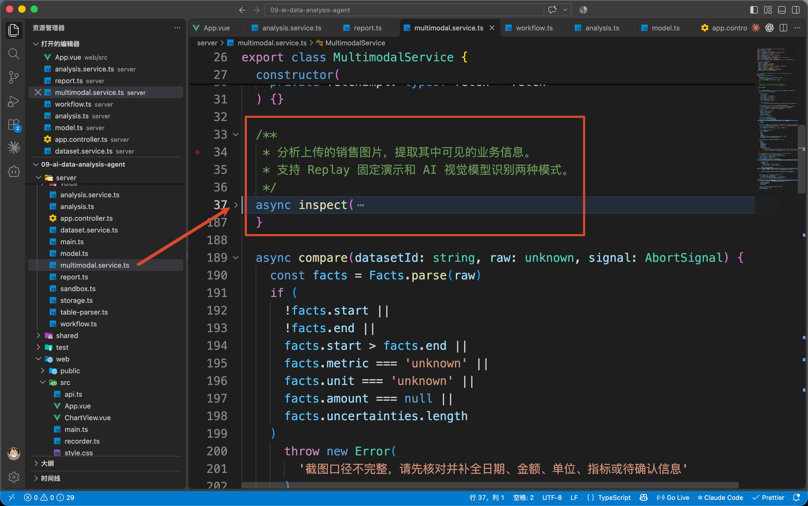

`inspect()` 先检查图片大小和格式。

检查通过以后，AI 模式会调用 `qwen3-vl-flash`。它收到的用户消息中包含图片本身，关键代码片段是：

```typescript
{
  type: 'image_url',
  image_url: {
    url: `data:${mime};base64,${bytes.toString('base64')}`
  }
}
```

`bytes` 就是刚才上传的图片内容。程序将它转成 Base64，按照百炼的[视觉理解接口](https://help.aliyun.com/zh/model-studio/vision)发送给模型。

同一次请求里的 System Prompt，要求模型提取日期、指标、单位和金额，并且明确规定：

```latex
无法辨认或未明确的值用 null/unknown，把疑问放入 uncertainties。
禁止猜测日期和扣退款口径。
```

按照这张样例图，咱们需要核对的结果应该是下面这些内容：

```javascript
{
  title: '星河零售 · 月度销售看板',
  start: '2026-09-01',
  end: '2026-09-30',
  metric: 'paid',
  unit: '元',
  region: null,
  amount: 60000,
  uncertainties: []
}
```

其中，`paid` 表示未扣退款的实付金额；`region: null` 在本项目中表示全部区域；`uncertainties` 保存仍然需要确认的问题。

模型实际返回的内容会先经过 `Facts.parse()` 校验，再作为接口响应返回。前端将它赋给刚才的 `picture.value`，弹窗里的输入框就从这个对象读取数据。

### 点击确认以后，用哪些条件查询
然后咱们点击「确认并核对原表」

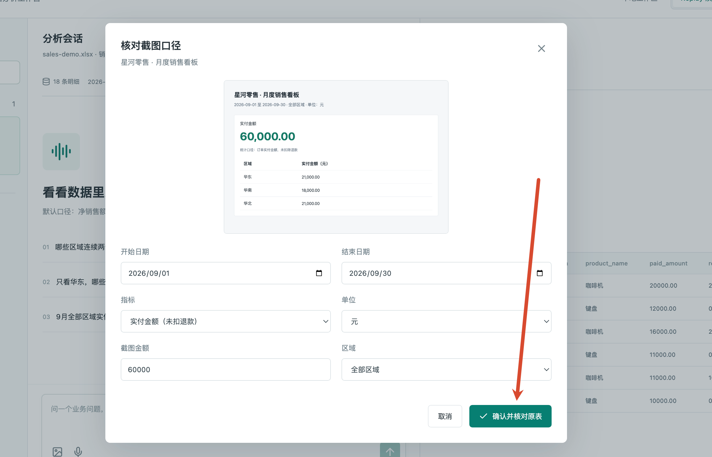

这次按钮调用 `App.vue` 的 `comparePicture()`，发送：

```typescript
comparison.value = await api('/images/compare', {
  method: 'POST',
  body: JSON.stringify({
    datasetId: selected.value!.id,
    facts: picture.value
  })
})
```

`datasetId` 指向左侧选中的 Excel 数据集。`facts` 就是用户刚才核对、修改过的截图字段。

请求到达 `app.controller.ts` 的 `compare()`，继续调用 `MultimodalService.compare()`。

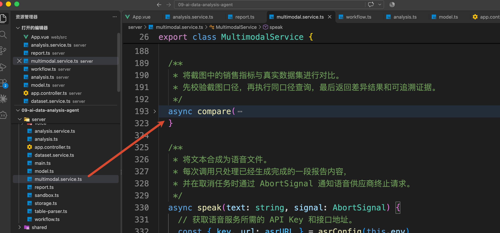

这个方法先检查字段是否完整、是否还有未确认的疑问，以及所选区域是否存在于当前数据集中。满足这些条件后，才从 `facts` 整理本次查询条件：

```typescript
const spec = {
  kind: 'summary' as const,
  metric: facts.metric,
  start: facts.start,
  end: facts.end,
  region: facts.region
}
```

所以，这次 `spec` 表达的是：**汇总 9 月全部区域的实付金额。**

紧接着，`compare()` 调用 `analysis.ts` 的 `buildSql(spec)` 生成查询，再调用 `sandbox.ts` 的 `executeQuery()`，读取当前数据集的 `data.duckdb`。

这部分复用了前面讲过的受限查询能力。由于用户已经在弹窗里确认了所有统计条件，这里可以直接按固定规则生成 SQL，无需再让 Agent 推断一次。

对于课程原始样例，查询得到三个区域的金额：

| 区域 | 实付金额（元） |
| --- | ---: |
| 华东 | 21000.00 |
| 华南 | 18000.00 |
| 华北 | 21000.00 |


`compare()` 把这三行相加，得到原表金额 `total = 60000`。接着把截图金额也统一换算为元，再计算差额：

```typescript
const imageAmount = amount(
  facts.amount * (facts.unit === '万元' ? 10000 : 1)
)
const difference = amount(imageAmount - total)
```

这里的 `amount()` 沿用项目的金额处理函数。`imageAmount` 来自用户确认的截图，`total` 来自刚才的真实查询

服务端把金额、差额、查询 SQL 和说明一起返回，前端保存到 `comparison.value`，随后切换到右侧“截图核对”。

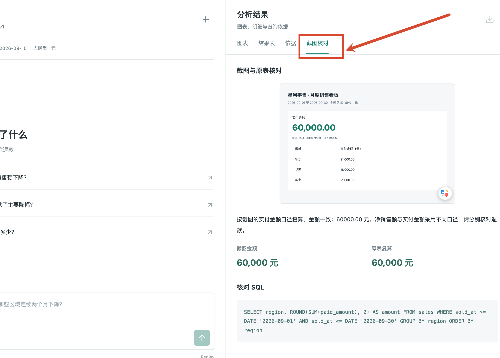

这就是咱们整个上传看板截图的流程

## 录音提问，怎样进入已有分析流程
截图核对完成以后，咱们再试一次语音输入。

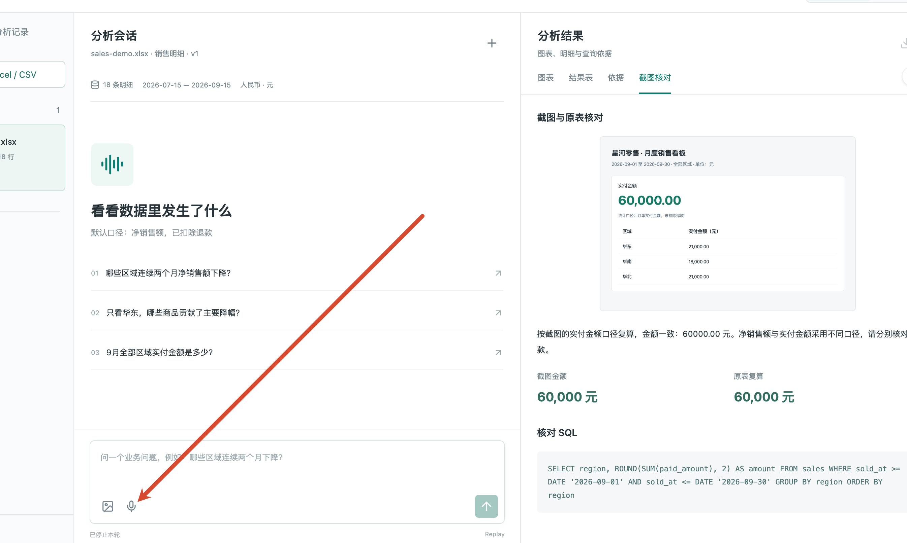

点击输入框下方的麦克风图标“语音提问”，允许浏览器使用麦克风，等页面开始计时后说：

> 9 月全部区域实付金额是多少？
>

说话时，识别出来的文字会逐步出现在输入框里。说完后点击同一位置的“结束录音”，等页面提示“转写已完成，请核对后确认分析”。

此时可以修改识别错误的文字，再点击输入框右侧的“确认分析”。

### 点击麦克风以后，音频传给了谁
点击“语音提问”，执行的是 `App.vue` 的 `record()`。

它先调用 `web/src/recorder.ts` 中的 `Microphone.prepare()`，申请麦克风权限并准备音频采集。然后创建连接，目标是本项目的 `/voice` WebSocket 服务。

连接建立后，浏览器发送下面这条消息：

```typescript
{
  event: 'listen',
  data: { turnId: id }
}
```

`id` 是 `record()` 为本次录音生成的随机 ID，`turnId` 用来区分不同次录音。`listen` 则是本项目约定的“开始识别”事件。

服务端的入口在 `server/voice/voice.gateway.ts`。`VoiceGateway.listen()` 接收这条消息，再调用 `server/voice/asr.ts` 的 `openRecognition()`，连接百炼的 `qwen3-asr-flash-realtime`。

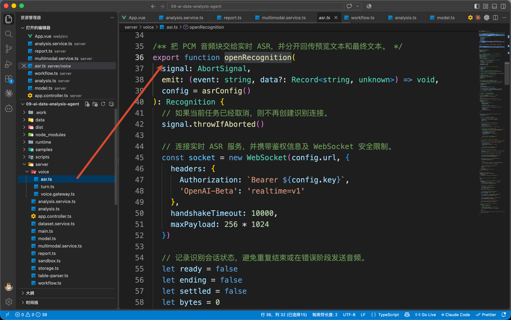

因此，音频需要经过两段连接 NestJS 服务 + 百炼的服务：

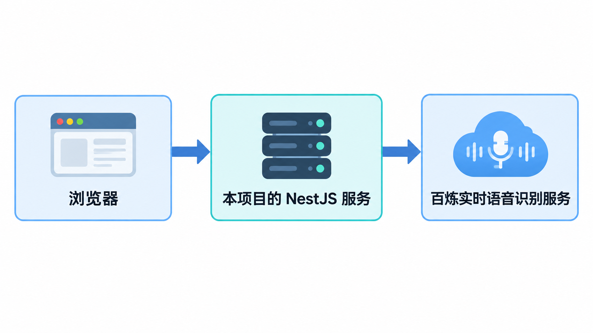

等百炼识别连接准备完成，`openRecognition()` 会通过 Gateway 向页面发送 `asr.ready`。`App.vue` 收到它以后，才调用 `microphone.start()`，开始持续采集并发送音频。

`Microphone` 会把声音整理成 16 kHz、单声道的 PCM16 数据，大约每 100 毫秒发送一小段。前端发送的位置仍然在 `record()` 中，关键代码是：

```typescript
recognitionSocket?.send(
  JSON.stringify({
    event: 'audio',
    data: { turnId: id, audio: pcm }
  })
)
```

这里的 `pcm` 是这一小段音频编码后的 Base64 字符串。

Gateway 收到 `audio` 事件，会先核对录音 ID，再交给 `openRecognition()` 返回的 `append()` 方法，由它继续发送给百炼。

百炼陆续返回文字后，服务端把当前识别内容整理为本项目的 `asr.partial` 事件，再发回页面。

`App.vue` 收到它时执行：

```typescript
if (packet.event === 'asr.partial') {
  question.value = packet.data.text
}
```

`question` 就是输入框绑定的变量。因此，说话时看到的文字，会直接出现在原来的提问框里。

## 点击“朗读结果”，把分析报告读出来
刚才的分析完成以后，在右侧“图表”页签中点击“朗读结果”。

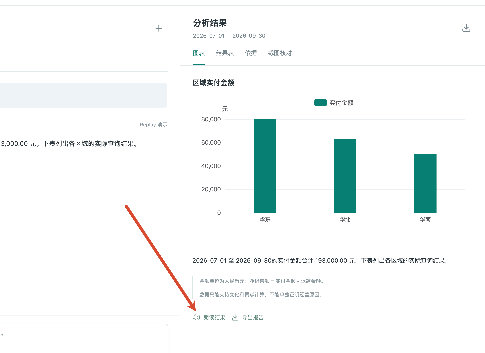

这个按钮调用 `App.vue` 中的 `speak()`，请求地址包含当前会话 ID 和报告 ID：

```latex
POST /api/sessions/{会话ID}/reports/{报告ID}/speech
```

服务端收到以后，会进入 `app.controller.ts` 的 `speak()`。这里先通过 `AnalysisService.findReport()` 读取对应的报告：

```typescript
const report = await this.analyses.findReport(id, reportId)
```

上一节已经讲过，报告中的 `answer` 保存了最终分析文字。因此，这次朗读直接使用 `report.answer`，声音和页面上的分析结果使用同一份内容。

继续往下看，Controller 会把 `report.answer` 按句号、问号、感叹号或换行拆成几段，保存在 `sentences` 中。

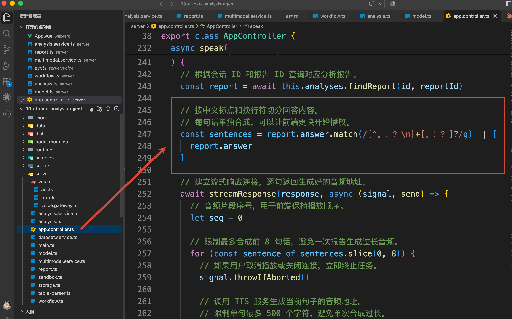

Controller 要把每段合成结果及时发回页面，因此接下来调用 `streamResponse()`，在它的回调里逐段处理。回调提供的 `send()` 用于发送结果，`signal` 用于接收取消通知。

下面是 `seq` 记录音频的顺序编号：

```typescript
// 建立流式响应连接，逐句返回生成好的音频地址。
await streamResponse(response, async (signal, send) => {
  // 音频片段序号，用于前端保持播放顺序。
  let seq = 0

  // 限制最多合成前 8 句话，避免一次报告生成过长音频。
  for (const sentence of sentences.slice(0, 8)) {
    // 如果用户取消播放或关闭连接，立即终止任务。
    signal.throwIfAborted()

    // 调用 TTS 服务生成当前句子的音频地址。
    // 限制单句最多 500 个字符，避免单次合成过长。
    const audioUrl = await this.multimodal.speak(
      [...sentence].slice(0, 500).join(''),
      signal
    )

    // 将当前音频片段推送给客户端。
    // 前端收到后即可加入播放队列。
    send('audio', {
      seq: seq++,
      audioUrl
    })
  }

  // 所有句子处理完成，通知客户端结束。
  send('done', {})
})
```

其中的 `this.multimodal.speak()`，位于 `server/multimodal.service.ts`。

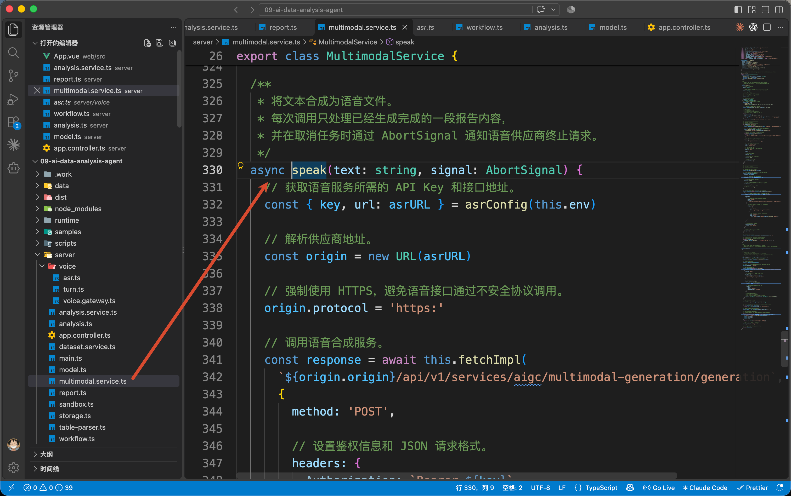

它调用百炼的[语音合成接口](https://help.aliyun.com/zh/model-studio/qwen-tts-api)，请求中的核心内容是：

```typescript
{
  model: 'qwen3-tts-flash',
  input: {
    text,
    voice: 'Cherry',
    language_type: 'Chinese'
  }
}
```

`text` 来自循环里正在处理的那一句。服务返回音频地址后，`MultimodalService.speak()` 检查地址并返回给 Controller，Controller 再通过刚才的 `send('audio', ...)` 发给前端。

所以，本项目的播放流程是：**分析报告先完成，再逐句合成音频，每得到一段就交给页面播放。**

### 多段音频怎样按顺序播放
音频地址返回以后，接着看 `App.vue` 的 `speak()` 怎样接收它。

这个方法会为本次请求创建一个 `AbortController`，保存在变量 `controller` 中，用来控制这一轮请求的取消。收到 `audio` 事件时，它会把音频地址加入队列，并将这个控制器一起交给播放方法：

```typescript
if (event === 'audio') {
  queue.push(data.audioUrl)
  void playNext(controller)
}
```

`queue` 是前端保存待播放音频地址的数组。收到一段，就把地址放到数组末尾，再尝试调用 `playNext()`。

`playNext()` 会先检查是否已经有音频正在播放。当前一段还没结束，就让新地址继续留在队列里等待。

轮到下一段时，它从队列头部取出地址，创建播放器：

```typescript
audio = new Audio(queue.shift())
```

随后调用播放器的 `play()`。当前音频播放结束，`onended` 回调会再次执行 `playNext()`，继续取下一段。

因此，即使后面的音频提前合成完成，也会按报告顺序播放，不会几段声音一起响。

## 点击“停止播放”，怎样停掉这一轮声音
播放过程中，用户可能已经听到了自己需要的信息，想停下来继续提问。

这时点击“停止播放”，执行的是 `App.vue` 中的 `stopSpeech()`。

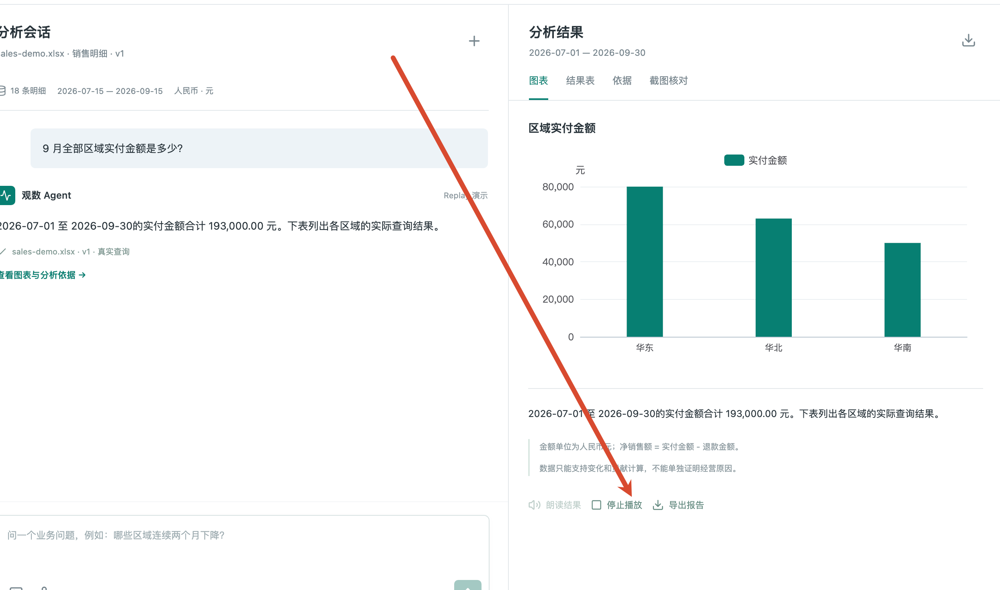

刚才的声音涉及三部分：当前正在播放的音频、队列里还没播放的音频，以及服务端可能还在继续合成的内容。所以，停止时也要分别处理。

下面节选这个方法里的关键操作：

```typescript
speechAbort?.abort()
speechAbort = undefined
queue = []

if (audio) {
  audio.pause()
  audio.removeAttribute('src')
  audio.load()
  audio = undefined
}
```

其中，`speechAbort` 是刚才 `speak()` 发起请求时保存的 `AbortController`。调用 `abort()` 会取消本轮朗读请求；清空 `queue`，会丢弃尚未播放的地址；后面的代码则暂停当前播放器并移除音频来源。

这样，当前声音停止后，队列中的下一段也不会继续响起来。

### 浏览器取消以后，服务端会怎样处理
前面 Controller 使用的 `streamResponse()`，定义在 `app.controller.ts` 底部。

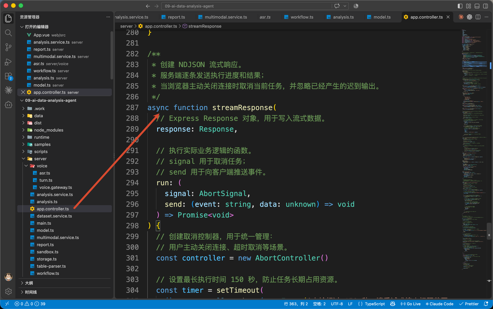

它会监听响应连接的关闭。如果浏览器在处理结束前断开连接，服务端就会取消本轮的 `signal`。

这个 `signal`，正是刚才 Controller 传给 `MultimodalService.speak()` 的参数。语音合成请求会把它继续传给 `fetch()`；逐句合成循环也会在开始下一句以前检查它。

所以，用户停止朗读以后，应用会尝试取消正在等待的合成请求，并停止继续提交后面的句子。

## 总结
到这里，图片和语音就接到了咱们的数据分析项目里。

+ 上传截图时，视觉模型负责提取看板字段，用户确认统计口径，再由程序查询原表进行比较。
+ 录音提问时，ASR 把声音转成文字，用户核对以后，通过原来的 `ask()` 完成分析。查询结果、图表和依据继续按前两篇的方式生成。
+ 朗读结果时，TTS 使用已经保存的报告文字，逐段合成和播放；用户停止时，程序取消请求、清空队列，并忽略旧请求的迟到结果。

那么到这里，这个项目的主要功能就讲完了。

下一小节，咱们再把这一章学到的能力整理一下，看看怎样体现在简历和面试中。

> 更新：2026-10-11 20:28 · 原文：<https://www.yuque.com/lgdsunday/ab1dy3/dva9w7vxbpscrglr>
