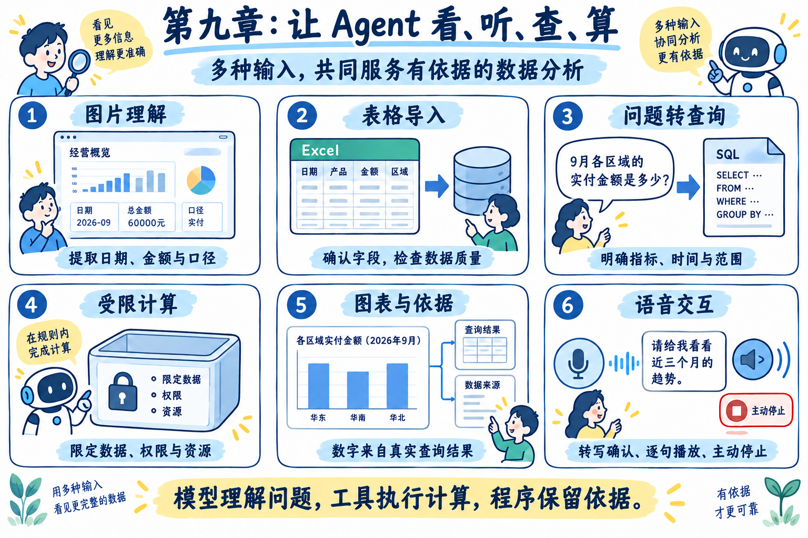
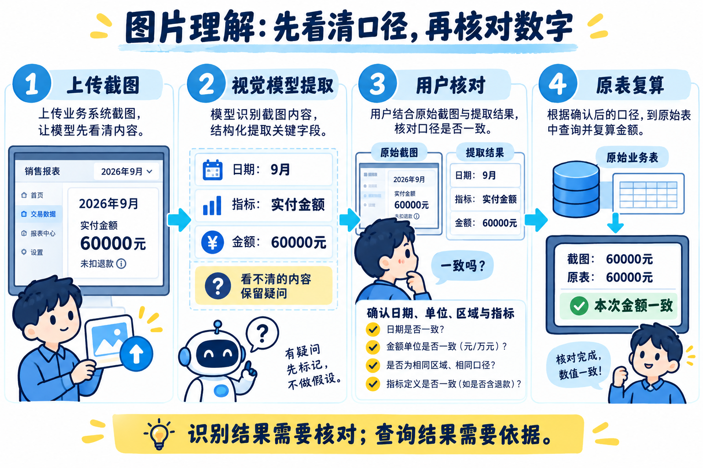
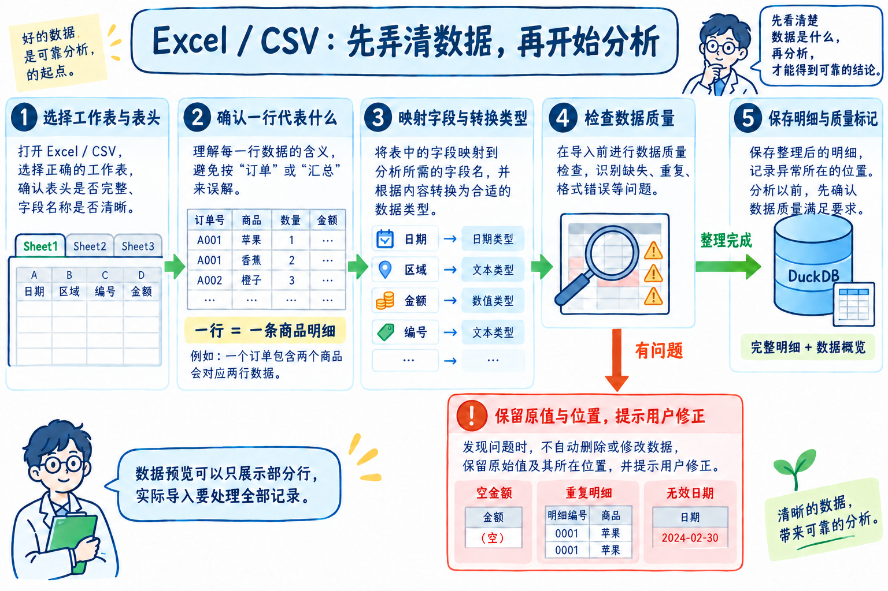
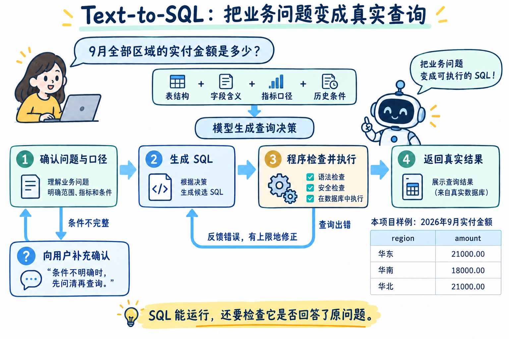
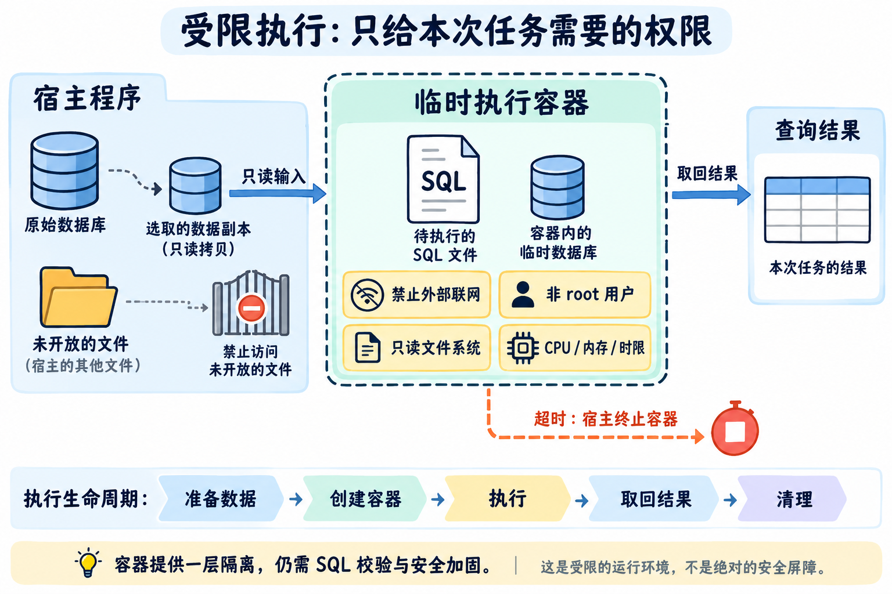
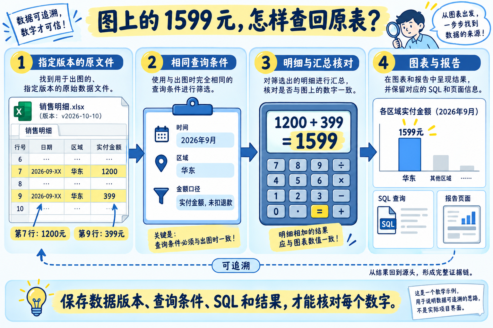
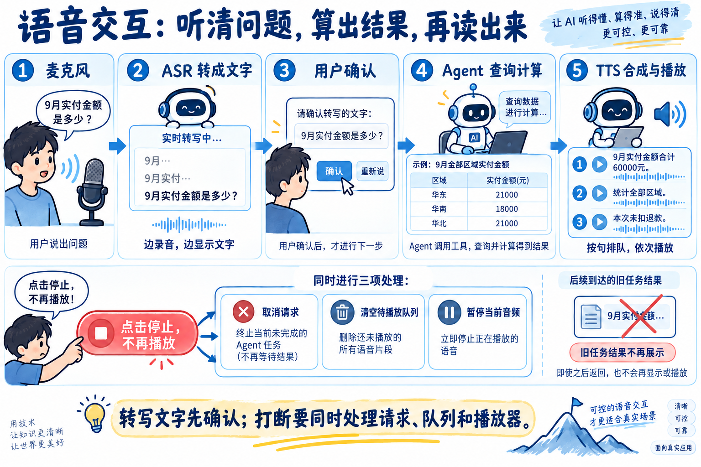
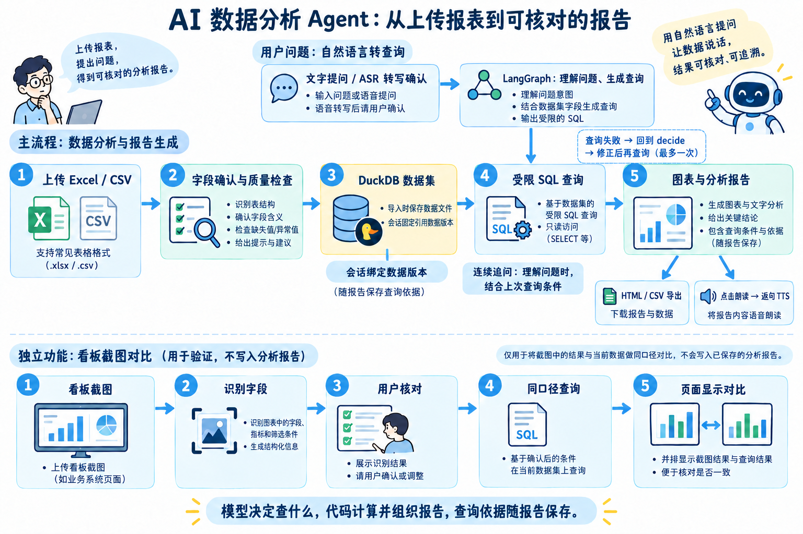

# 13-第九章总结：多模态与数据分析能力如何在简历和面试中体现

好了，到这里，第九章也全部学完了。

这一章，咱们做出了一个可以上传 Excel、通过文字或语音提问、连续追问并生成图表报告的 AI 数据分析 Agent。拿到一张销售看板截图，还可以让它识别统计条件，再和导入的数据核对。

这些功能看起来各不相同，最后都要回答同一个问题：**用户看到的数字，到底是根据什么算出来的？**

图片可能看错，语音可能听错，表格可能缺数据。即使 SQL 正常执行了，也可能算错时间范围，或者把实付金额当成扣除退款后的净额。

所以，这一章除了接入图片和语音，还把数据解析、查询计算、执行限制和结果核对串了起来。

最后这一小节，咱们先回顾这些能力，再整理成简历写法和面试回答。

## 第九章都学了啥
先把这一章的主要内容放到一起看：



图里的六部分是不同的能力。用户可以直接上传表格提问，也可以补充截图，或者把文字输入换成语音输入。具体使用哪些能力，要看当前任务需要。

### 01-让 Agent 看懂图片、听懂问题，并完成数据分析
第一小节先确定了本章的项目目标。

过去的案例主要通过文字提出要求。这一次，用户手里可能有一份 Excel、一张看板截图，也可能希望直接说出问题。

这些信息需要分别处理。图片交给视觉模型识别，语音经过 ASR 转成文字，表格由程序解析成可以查询的数据。Agent 再根据问题决定查什么，调用工具完成计算。

因此，一个多模态应用可以组合多个模型和服务。课程中，DeepSeek 负责理解分析问题，千问的视觉和语音服务分别处理图片、转写与合成，DuckDB 负责查询数据。

本章要学的，就是怎样让这些能力共同完成一次有依据的分析。

### 02-图片理解：截图里的信息怎样进入 Agent
第二小节先完成了一次独立的图片读取。

咱们把图片内容和用户问题一起提交给视觉模型，让它识别截图里的时间范围、金额、单位和统计口径。例如，画面上写着一个销售额，模型还需要结合标题和说明，判断它统计的是哪个月、有没有扣除退款。

这里使用的是百炼的[视觉理解能力](https://help.aliyun.com/zh/model-studio/vision)。图片需要以接口支持的格式实际发送，单独给模型一个本机文件路径，它读不到电脑里的图片。

识别以后，程序把结果整理成明确的字段，方便后续读取。但是，字段格式正确，仍然可能存在金额看错、单位漏看等问题。截图中没有写清的信息，也应该保留为未知。

到了最后的项目，咱们在识别后增加了用户确认。用户核对时间、区域、金额和指标，再使用这些条件查询原始数据，比较两个结果是否一致。

下面这张图把图片识别和项目里的确认、核对连了起来：



图片提供了需要核对的信息，最终计算仍然使用导入的数据。两者不一致时，要继续检查日期、范围、单位和指标，不能直接认定其中一方正确。

### 03-Excel 与 CSV：先弄清数据，再开始分析
第三小节开始处理真正参与计算的表格。

读出单元格以后，要先弄清楚工作表、表头和每一行的含义。例如，一个订单买了两件不同商品，可能对应两条销售明细。按订单数统计和按明细数统计，结果就会不同。

接着，程序把原始列映射成统一字段，再处理日期、金额和编号。订单编号需要保留前导零，金额需要明确单位，退款金额为空也不能直接当成没有退款。

数据质量检查同样发生在这个阶段。重复明细、无效日期和缺失金额都要保留问题位置，方便回到原文件核对。静默删除异常行，可能让后面的统计看起来正常，却少算了一部分数据。



整理以后，咱们使用 DuckDB 保存和查询明细，并保留原始文件、字段说明和质量问题。模型只需要了解有哪些字段、每个字段表示什么、数据覆盖什么范围，就可以准备查询。

最后的项目还为导入数据保存了版本和校验值。相同文件使用相同工作表与字段映射，可以复用已有数据集；内容发生变化，再保存新版本，避免旧报告的依据被后续上传覆盖。

### 04-Text-to-SQL：把问题转换成明确的查询
第四小节开始让模型根据业务问题生成 SQL。

例如，“9 月各区域销售额是多少”，至少涉及三个条件：统计时间是 9 月，按区域分组，以及“销售额”具体使用哪个指标。

所以，模型输入中需要有真实的表结构、字段含义和指标定义。用户条件不完整时，可以先询问；数据范围不支持问题时，也需要明确说明。

模型生成查询以后，程序检查并执行，取得数据库真实返回的结果。查询报错时，可以把具体错误交回模型进行有限次修正。这也是 [LangChain SQL Agent 文档](https://docs.langchain.com/oss/javascript/langchain/sql-agent)所展示的基本工作过程。



上图用的是最终项目的销售样例，帮助回顾这条流程

### 05-受限执行：查询和代码可以操作什么
第五小节继续处理执行权限。

模型可以生成 SQL，也可以生成计算代码。应用准备执行这些内容时，需要规定它能读取哪些数据、能不能联网、能不能修改文件，以及最多使用多少资源。

咱们通过临时 Docker 容器演示这种受限环境。程序只提供本次需要的数据，配置只读文件系统、网络限制、非 root 用户及 CPU、内存等资源额度，再由外层程序管理超时和清理。

正常实验中，一个容器执行查询，另一个容器根据查询结果计算金额占比。越界实验尝试读取应用没有提供的宿主文件，超时实验则让计算一直不结束，观察程序能否拒绝访问、终止任务并清理资源。



### 06-图表与分析依据：数字怎样查回去
第六小节解决的是 “别人质疑这个数字时，怎样拿出依据”。

案例中的华东销售额是 1599 元。咱们可以继续查回参与统计的两条明细：原始工作表第 7 行的 1200 元和第 9 行的 399 元。同时，还要说明统计的是哪个月、哪个区域，以及是否扣除退款。

因此，一份分析结果需要保留数据版本、查询条件、实际执行的 SQL 和返回结果。需要追到原始明细时，再结合导入时保存的行号等来源信息进行核对。



图表和表格也要使用同一份结果数据。图表配置负责指定横轴、纵轴和图形类型，数值直接来自已经计算完成的结果，不再交给模型重新填写。ECharts 的 [dataset](https://echarts.apache.org/handbook/en/concepts/dataset/)就是用来组织这类图表数据的能力。

### 07～08-语音交互、流式返回与打断
第七小节先把一次完整的语音问答跑通。

用户录音以后，ASR 将声音转成文字，用户可以检查并修改。确认的问题继续进入原有分析流程，查询完成后，再由 TTS 把回答合成为音频。

ASR 负责听清问题，Agent 负责理解问题并调用查询能力，TTS 负责读出已经生成的内容。这三个环节有各自的输入和输出，对应接口可以回看百炼的[实时语音识别](https://help.aliyun.com/zh/model-studio/qwen-asr-realtime-interaction-process)和[语音合成](https://help.aliyun.com/zh/model-studio/qwen-tts-api)文档。

第八小节继续减少等待。浏览器持续发送音频片段，ASR 返回中间转写和最终转写；查询完成以后，模型逐步返回解读文字，程序按句子组织 TTS 请求，让已经准备好的句子先进入播放队列。

这时就出现了一个新的问题：用户点击停止，后面的请求可能还没结束，已经排队的音频也可能还没播完。

因此，停止操作需要同时取消未完成请求、清空待播放队列并停止当前音频。对于稍后才返回的旧任务结果，还要根据任务标识丢弃，避免它重新出现在页面或播放器里。



### 09～12-AI 数据分析 Agent
最后四篇实战，把这些能力接入了同一个销售数据分析项目。

用户上传表格，选择工作表并确认字段映射。程序完成数据检查，通过以后生成可以查询的 DuckDB 数据集；存在质量问题时，先展示问题，暂不开放查询。

用户创建分析会话后，这个会话就绑定了当前数据版本。提出问题时，服务端把数据概览、最近问答和上次查询条件交给模型，再由 LangGraph 串起决策、查询和报告生成。

例如，先问“近三个月哪些区域净额连续下降”，接着追问“只看华东，哪些商品贡献了主要降幅”。第二个问题可以沿用前面的净额口径，再增加华东范围，并转换成商品降幅分析。

模型需要给出明确的查询条件和 SQL。程序在受限环境中执行，并针对项目支持的分析类型，根据条件生成核对查询，比较两份结果。查询出现错误时，允许带着错误再修正一次，仍然失败就返回说明。

取得有效结果以后，`buildReport()` 根据真实数据计算变化、组织结论、准备图表和表格，查询依据随报告保存。这个项目中的报告主体由普通代码生成，能够直接核对每一个数字的计算过程。



图片和语音从不同入口接入这套流程。看板截图经过识别和确认，使用独立查询与当前数据核对，语音转写经过用户确认，按普通问题提交。报告生成以后，可以逐句朗读，也可以导出 HTML 报告或 CSV 结果。

这里还要分清小案例与完整项目的范围：第 05 小节演示了受限 JavaScript 计算，最终项目主要执行 SQL；第 08 小节演示了模型边生成解读、程序边准备语音，最终项目则在报告完成以后，由用户点击朗读。

掌握这些区别，讲项目时就能准确说明自己完成了什么。

## 简历怎么写？
### 技能特长怎么写
这一章可以重点体现多模态接入、自然语言查询、受限执行与分析结果核对。理解相应机制并完成案例以后，可以参考下面的写法，按目标岗位选择其中几条：

```latex
• 熟悉多模态 Agent 的应用开发，能够接入视觉理解、ASR 与 TTS，将图片识别、语音转写及用户确认接入已有业务流程，并处理识别不确定性与输入校验。

• 掌握 Excel/CSV 数据解析与 Text-to-SQL 实现，能够结合字段映射、数据质量检查、指标定义和查询上下文，将自然语言问题转换为可执行查询，处理条件澄清、连续追问和有限次错误修正。

• 理解模型生成内容的受限执行，能够结合 SQL 语法树检查、只读数据、Docker 网络与资源限制、执行超时和任务清理，约束查询与分析代码的运行范围。

• 能够构建有依据的分析报告，使用真实查询结果生成图表与表格，保留数据版本、查询条件、SQL 和结果，支持数值核对与报告导出。

• 熟悉语音交互与流式响应处理，能够实现实时转写、句子分段、音频顺序播放与手动打断，通过请求取消和任务标识防止旧结果继续展示或播放。
```

### 项目经历怎么写
这里可以直接写企业销售数据分析 Agent，不用单独在做额外的包装了，这个场景在很多 2C 业务的公司里面还是非常常见的。

```markdown
项目名称： 企业销售数据分析 Agent

技术栈： TypeScript、NestJS、Vue 3、DeepSeek、LangGraph、DuckDB、Docker、千问视觉与语音服务、ECharts、Zod

项目介绍： 面向销售与运营团队的报表分析需求，构建支持 Excel/CSV 上传、自然语言查询和连续追问的 AI 数据分析工作台。系统能够完成销售趋势、区域变化与商品降幅贡献分析，生成附带查询依据的图表报告；支持看板截图核对、语音提问、逐句朗读及 HTML/CSV 导出，方便业务人员获取结果并核对统计口径。

主要职责：

- 实现 Excel/CSV 上传、工作表选择与字段映射，检查日期、金额、缺失值和重复记录等数据问题；保留原始文件及问题位置，对通过检查的数据生成独立 DuckDB 文件，并通过内容校验值与版本号管理重复导入和数据更新。
- 基于 DeepSeek 与 LangGraph 构建决策、受限查询和报告生成流程，结合真实字段、指标定义与数据范围生成结构化查询决策，支持条件澄清、资料不足提示和查询失败后的一次修正。
- 建立 SQL 执行约束，结合语法树检查、表与函数白名单、只读数据库及临时 Docker 容器，限制文件访问、网络、资源和执行时间，并在结束或取消后清理容器与临时输入。
- 针对趋势、区域下降和商品降幅贡献等分析类型，根据结构化查询条件生成核对 SQL，与模型查询结果进行比较，拦截查询实现与分析条件不一致的结果。
- 设计绑定数据版本的分析会话，持久化问答、历史报告和最近查询条件，连续追问时结合当前问题继承指标与筛选范围，并使用本轮明确条件覆盖旧条件。
- 基于真实查询结果计算变化并生成报告，统一图表与表格的数据来源，随报告保存数据版本、校验值、统计条件、SQL 和返回结果，支持 HTML 报告及 CSV 数据导出。
- 接入千问视觉模型提取看板截图中的时间、范围、金额和指标，由用户确认后执行同口径查询，独立展示截图与数据的差异，避免图片核对改变当前分析会话的追问条件。
- 接入实时 ASR 与 TTS，使用 WebSocket 传输录音和转写结果，确认后提交分析；报告完成后按句合成并顺序播放音频，通过请求取消、队列清理和旧任务结果检查实现手动打断。
```

## 面试可能会被问到什么
### 多模态 Agent 一定要使用同一个模型吗？
不一定。多模态描述的是系统能够处理的输入和输出形式，可以使用一个支持多种模态的模型，也可以组合不同服务。

我的项目把职责分开：视觉模型提取截图信息，ASR 转写语音，DeepSeek 理解分析问题并生成查询，DuckDB 计算数据，TTS 朗读最终报告。

这些能力通过明确的数据结构和流程连接。语音先变成用户确认过的问题，图片先变成可以核对的统计条件，后续都可以复用已有的分析能力。

选择统一模型还是多个服务，需要结合任务效果、延迟、成本和控制要求判断。

### 为什么不把整份 Excel 交给模型，让它直接算？
表格里的问题首先是数据问题。一行代表订单还是商品明细，空金额应该怎样处理，日期和单位是否一致，都需要先确认。直接把表格正文发给模型，并不会自动解决这些问题。

全量统计还需要覆盖符合条件的全部记录。模型可能漏掉行、算错金额，数据较大时也会受到上下文限制。向量检索只取部分相关记录，同样不适合代替完整的求和与分组统计。

我的做法是先解析和检查表格，把明细保存到 DuckDB。模型根据字段与业务说明生成查询，数据库完成计算，程序再根据返回结果生成报告。

这样，模型负责理解问题，计算过程则可以重复执行和核对。

### 怎样减少 Text-to-SQL 答非所问？
先把业务口径交代清楚。比如销售额是实付金额还是扣除退款后的净额，统计哪段时间，按区域还是商品分组。这些信息需要来自指标定义、用户本轮要求和明确的历史条件。

项目让模型同时返回结构化查询条件与 SQL。条件缺失时先询问，数据范围无法支持时返回说明。SQL 执行后，还会针对已支持的分析类型，根据条件生成核对查询，比较结果是否一致。

但这个检查有边界：两条查询都依据同一份条件。如果模型把用户说的“华东”理解成“华南”，它们仍然可能算出一致的结果。

所以，报告要展示本次指标、时间和范围，让用户可以检查。后续还需要用明确的测试问题验证模型对业务要求的理解。

### 连续追问时，Agent 怎样知道沿用哪些条件？
项目为每个分析会话保存当前数据集、历史报告和最近一次成功查询的条件。新问题到来时，把最近问答和这些条件一起交给模型。

例如，上一次分析近三个月的净额，用户接着说“只看华东”。本轮可以沿用净额和时间范围，同时增加华东筛选。如果用户明确改成实付金额，就使用新的指标。

成功完成查询并保存报告以后，再更新最近查询条件。条件不清楚、没有执行查询，或者查询失败时，保留之前的条件，不把本轮尚未完成的决策当成下一轮依据。

当前实现把这些会话信息保存在 JSON 文件中，每个问题启动一次新的分析 Graph。它支持继续分析已有会话；正在执行到一半的 Graph 断点恢复，则需要另行接入持久化执行机制。

### ASR、Agent 与 TTS 分别做什么？
ASR 把声音转成文字，Agent 根据文字理解任务并调用工具，TTS 把已经准备好的回答转成声音。

以销售分析为例，用户说“9 月实付金额是多少”，ASR 返回转写文本。用户确认以后，Agent 生成查询并取得真实结果，报告完成后再交给 TTS 朗读。

实时 ASR 可能先返回中间文字，后续继续修正，所以不能把每次中间结果都立即当成最终问题提交。

项目保留用户确认，就是让日期、区域、指标这些容易影响查询的内容，先有一次检查机会。

### 流式返回和打断，分别需要处理什么？
流式返回让已经准备好的内容先到达用户。录音可以分片发送，转写可以逐步展示，模型解读也可以逐段返回，再按完整句子准备语音。

这些是不同阶段的流式处理。SQL 需要完整生成并通过检查以后才能执行，不能收到半句 SQL 就开始查询。

打断则需要同时处理正在进行的请求、等待播放的音频和当前播放器。用户点击停止后，取消后续工作、清空队列并停止播放；迟到的旧结果也要根据任务标识丢弃。

第 08 小案例实现了查询后边生成解读、边准备语音。完整项目采用报告完成后逐句朗读，同时保留实时转写和手动停止。介绍项目时需要说清具体实现到了哪一步。

## 下一章讲什么
这一章，咱们已经可以通过具体问题验证功能：某个区域的金额对不对，追问有没有继承条件，截图核对是否使用同一口径，停止以后还会不会继续播放。

接下来还有一个问题：换了模型、修改了 Prompt，或者调整了工作流以后，怎样确认这些功能没有变差？

第十章就会围绕 Agent Evaluation 与 AgentOps，把这些检查整理成能够重复执行的评测。用同一组任务比较不同版本，结合执行轨迹查看错误发生在哪一步，再一起考虑质量、成本、延迟和安全边界。

> 更新：2026-10-12 17:17 · 原文：<https://www.yuque.com/lgdsunday/ab1dy3/fa23fe6v44nql1dn>
