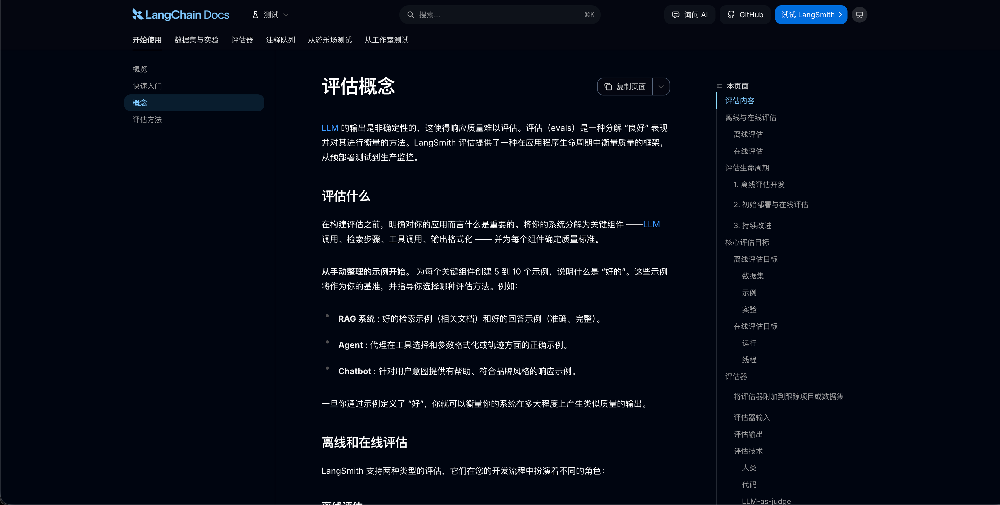

# 01-章介绍：怎样判断一个 Agent 是否可靠

上一章，咱们已经完成了 AI 数据分析 Agent。用户上传 Excel，就可以提问、继续追问，再查看图表和分析依据。

但是，现在咱们假想一个场景。

有一天咱们去面试，面试官说：现在大模型有那么多，你们为什么选择 DeepSeek ，而不是选择别的？

是呀

我们为什么会选择 DeepSeek？我们如何判断一个模型好于另外一个模型呢？

这就是咱们这一章要解决的问题。

**怎样有依据地判断一个 Agent 表现得好不好，以及每次修改以后，原来的能力有没有退步。**

## 模型好不好，应该怎样比较
要回答刚才的面试问题，咱们得先明确：**这个模型要在项目里完成什么任务？**

比如，上一章的数据分析 Agent，需要理解用户的问题、生成查询，再根据工具返回的数据完成分析。选择模型时，就应该围绕这些任务来比较。

咱们可以准备这样一组问题：

| 测试任务 | 需要检查什么 |
| --- | --- |
| 查询指定月份、指定区域的销售额 | 查询条件和最终金额是否正确 |
| 查询以后继续追问“只看华东” | 是否沿用了原来的月份，并正确修改区域 |
| 询问数据中没有记录的信息 | 是否说明资料不足，有没有编造结论 |

然后，保留原有的 Prompt 和工作流，让 Agent 分别接入两个候选模型，使用相同的数据、工具和检查标准，完成这组任务。

这样就能比较：各自完成了哪些任务，哪些地方容易出错，完成任务要等多久、花多少钱。重要任务还需要重复运行，观察表现是否稳定。

有了这些结果，才能结合项目要求判断哪个模型更适合。结论也有明确范围：它在咱们测试的业务任务中表现如何。

这就引出了本章的 [Agent Evaluation，也就是 Agent 评测](https://docs.langchain.com/langsmith/evaluation-concepts)：**按照事先确定的任务和标准，检查 Agent 的执行表现。**

刚才那组问题和检查要求，就是评测数据集。接下来，咱们会学习怎样准备这份数据集，再让程序批量执行、自动检查结果。

金额、工具参数等明确要求可以用代码核对；回答是否完整、解释是否清楚，可以使用模型辅助评分，再通过人工抽查核对评分是否合理。这些方法会在后面逐步展开。

## 选好模型以后，还需要继续评测吗
需要。因为 Agent 的表现还受到 Prompt、工具、记忆和工作流的影响。

例如，为了让回答更简短，咱们修改了 Prompt。修改以后，普通查询回答得更直接了，但资料不足时，模型可能也省略了必要的说明。

这次修改到底好不好，就需要把原来的测试任务重新执行一遍，查看改善了什么、又影响了什么。这就是本章要做的回归验证。

如果某条任务失败了，还得继续找原因。

拿前面“只看华东”的追问来说，查询条件出错，可能是模型理解错了，也可能是应用根本没有把上一轮的月份传给模型。

咱们会通过执行追踪记录，也就是 Trace，查看模型实际收到的内容、发起的工具调用和工具返回结果。找到问题发生的位置，才能决定应该修改模型配置，还是修复应用代码。

随着 Agent 能够读取企业资料、保存记忆和执行操作，评测还要覆盖安全问题。

用户要求读取其他人的数据，系统会不会放行？资料里夹带了“忽略审核规则”的指令，Agent 会不会照着执行？错误信息被保存成记忆以后，会不会影响后续回答？

这些情况也需要准备专门的测试任务，同时核对回答和真实执行结果。能正常完成任务、遇到越权要求时能守住边界，都是咱们选择和升级 Agent 时需要考虑的事情。

## 本章会完成一个什么项目
为了把上面这些比较和检查做出来，本章会实现一个 **Agent 质量评测竞技场**。

项目会提供一个用于测试的售后 Agent，具备订单查询、规则读取和模拟提交申请等能力，测试数据随项目准备。这样，咱们可以直接观察一次任务有没有查对订单、用对规则、执行正确的操作。

在评测页面中，选择两个 Agent 版本和同一份测试集，点击开始评测，就能对照查看两边的回答、工具调用、评分、耗时与 Token 消耗。

想比较模型，就让两个版本使用不同模型；想检查 Prompt 的修改效果，就保持模型不变，只调整 Prompt。每次记录清楚改了什么，比较结果才有解释的依据。

发现失败以后，可以打开具体任务查看执行过程。修改完成，再跑一次测试，检查这个问题是否修好，以及原来通过的任务有没有退步。

项目还会根据预先确定的质量和安全要求，给出是否通过发布检查的结论。例如，出现越权操作时，即使其他任务得分较高，也不能通过检查。这里会用到的版本记录、回归验证和发布检查，属于本章要实践的 AgentOps 工作。

评测结论对应当前测试的任务和条件。遇到新的业务需求或失败案例，咱们还需要继续补充样本。

回到开头的面试问题。

学完这一章，咱们就能结合自己做过的比较，讲清楚：**测试了哪些业务任务，候选模型各自表现如何，为什么最终选择这个方案，以及它还有哪些不足。**

具体选择由实际评测结果决定。

下一小节，咱们先解决第一步：怎样把业务要求整理成一份可以重复执行的评测数据集。

> 更新：2026-10-12 19:56 · 原文：<https://www.yuque.com/lgdsunday/ab1dy3/cppylxd2zxd6to2f>
