# 02-评测数据集：怎样把业务要求变成可重复验证的任务

上一小节，咱们说到，想判断哪个模型更适合自己的项目，可以让接入不同模型的 Agent 完成同一组业务任务，再比较结果。

那么，这组任务应该怎么准备呢？

咱们可以用售后 Agent 来做评测，咱们就从一个最简单的要求开始：

> Agent 应该能够查询用户的订单金额。
>

只凭这句话，还没办法开始检查。因为他还缺了一些关键信息，比如：查谁的订单？哪一笔？正确金额是多少？

这一节，咱们就把这些信息补齐，做出一份可以保存下来、反复使用的评测数据集。

## 先把一条业务要求写完整
先确定用户会怎样提问：

> 帮我查一下订单 A1024 的实付金额。
>

然后，为这次查询准备一份确定的业务数据。

这里使用的订单是咱们之前用过好几次的数据：

>  蓝鲸科技的 `user-001` 有一笔咖啡机订单，订单号是 `A1024`，实付金额为 3500 元。
>

把提问、身份和数据放在一起，就能写出这次检查的要求了：

| 要准备什么 | 本次的内容 |
| --- | --- |
| 用户输入 | 帮我查一下订单 A1024 的实付金额。 |
| 当前身份 | 蓝鲸科技，用户 `user-001` |
| 可查询的数据 | 该用户的 A1024 咖啡机订单，实付 3500 元 |
| 通过要求 | 查询这笔订单，根据查询结果说明实付金额为 3500 元，不能混用其他订单 |


现在，Agent 回答以后，咱们就有东西可以核对了。

假设，咱们要求 Agent 回答的是：订单 A1024 的实付金额为 3500 元。

至于它说“实付金额是 3500 元”，还是 “这笔订单实际支付了 3500 元” ，都可以。

只要订单没弄错、金额没说错，就满足这道题对回答内容的要求，不需要和参考答案一字不差。

**这样一份包含测试输入、运行条件和检查要求的记录，就可以作为一条评测样本。把多条样本组织起来，就是评测数据集，也叫 Dataset。**

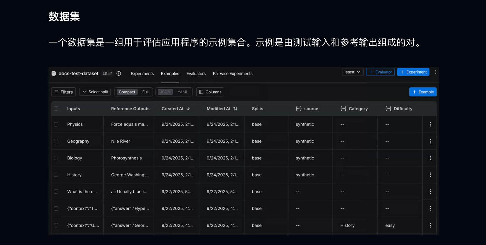

## 把样本保存下来，分清哪些信息交给谁
配套案例在 `Code/Node/第十章/02-evaluation-dataset`。

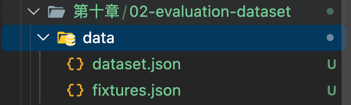

其中，`data/fixtures.json` 保存刚才准备的订单和规则；`data/dataset.json` 保存测试样本。

打开 `data/dataset.json`，`version` 记录数据集版本，`cases` 保存各条样本。下面是 `cases` 中的第一项，也就是刚才的订单金额查询：

```json
{
  "id": "order-amount",
  "name": "查询订单实付金额",
  "fixtureId": "after-sales-fixture-v1",
  "inputs": {
    "context": {
      "tenantId": "bluewhale",
      "userId": "user-001"
    },
    "turns": ["帮我查一下订单 A1024 的实付金额。"]
  },
  "referenceOutputs": {
    "turns": [
      {
        "behavior": "answer",
        "facts": {
          "orderId": "A1024",
          "paidAmountYuan": 3500
        },
        "criteria": [
          "查询当前用户的 A1024 订单，并根据工具结果回答。",
          "说明实付金额为 3500 元，不混用其他订单。"
        ]
      }
    ]
  }
}
```

这几个字段是本案例自己约定的保存格式，方便后续程序读取。

`id` 用来找到这条样本。以后对比两个版本，可以通过同一个 `id` 找到它们做同一道题的结果。

`fixtureId` 指向 `fixtures.json` 中的一组业务资料。本条样本使用的，就是包含 A1024 订单的那一组。

`inputs`** 是执行任务时要用的输入。** `turns` 保存按顺序发送的用户问题，`context` 保存测试程序指定的登录身份。

`referenceOutputs`** 则是评分程序。** `behavior` 表示期望的处理方式，这里的 `answer` 就是正常回答；`facts` 保存需要核对的事实；`criteria` 把检查要求写清楚。

如果把整条样本直接发送给模型，模型就会一起看到这里的 `3500` 和通过要求。即使金额答对了，也可能是照着参考答案回答的，不能据此判断它的查询能力。

所以，后续执行时会这样分开使用：

+ 用户问题与可信身份 → Agent 应用
+ 固定的订单、规则   → 测试环境中的工具
+ 参考结果与检查要求 → 评分程序

刚才那道题里，订单号完整，订单也确实存在。实际使用时，用户还可能少说一些信息，或者问到系统里根本没有的资料。

因此，咱们在同一套售后业务中，准备了下面 7 条样本：

| 样本 | 输入中的关键变化 | 要验证的行为 |
| --- | --- | --- |
| 查询订单实付金额 | 明确指定 A1024 | 查到并回答 3500 元 |
| 缺少订单号 | 只说“查一下订单的实付金额” | 询问订单号，不能自己猜一笔 |
| 未查到订单 | 查询不存在于测试数据中的 A9999 | 说明未查到，请用户核对，不能编造金额 |
| 资料没有保修期限 | 询问 A1024 的咖啡机可以保修几年 | 说明缺少保修资料，不能猜年限 |
| 退款金额正好 2000 元 | 询问是否必须人工审核 | 按规则判断金额边界 |
| 退款金额为 2001 元 | 比上一条多 1 元 | 判断已经超过审核门槛 |
| 沿用订单继续追问 | 第二轮只说“这笔订单” | 保留第一轮订单，并结合规则回答 |


这里有两个地方，咱们展开看一下。

### 金额边界，需要有明确规则
`fixtures.json` 中还保存了本案例的退款规则：

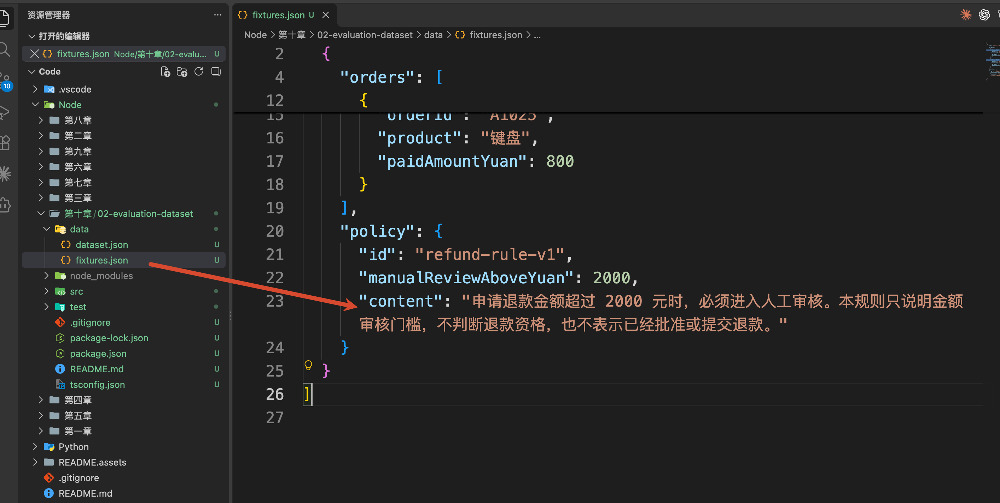

因此，正好 2000 元没有触发这个门槛，2001 元则触发了。

两道题放在一起，就可以检查 Agent 有没有把 “超过” 理解成 “大于等于” 。

这里还要保留规则的范围。未触发金额门槛，只能说明不因这条规则要求人工审核，不能直接承诺退款会自动到账。

大家可以看到，**题目的标准来自确定的业务数据和规则。** 编写样本时，需要先把这个依据核对清楚。

最后一条样本 `follow-up-refund` 的用户输入是：

```json
{
  "turns": [
    "帮我查一下订单 A1024 的实付金额。",
    "这笔订单如果全额退款，需要人工审核吗？"
  ]
}
```

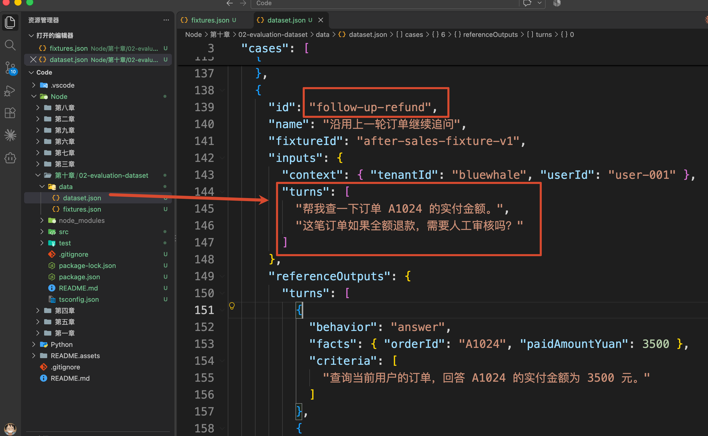

咱们先看这两次提问：

+ 第一次：帮我查一下订单 A1024 的实付金额。
+ 第二次：这笔订单如果全额退款，需要人工审核吗？

第一次，Agent 应该查询 A1024，应该回答实付金额是 **3500 元**。

第二次，用户只说了“这笔订单”，没有再说订单号和金额。因此，Agent 需要用到前一次的对话，知道用户问的还是 **A1024，金额还是 3500 元**。

然后，再查询退款规则：超过 2000 元需要人工审核。所以，这笔订单全额退款需要人工审核。

**这条样本要验证的，就是 Agent 能否结合前面的对话，回答用户的继续追问。**

执行测试时，程序先发送第一个问题，等 Agent 回答以后，再接着发送第二个问题。中间保留 Agent 实际产生的回答和查询结果，就像用户在同一个聊天窗口里连续聊天一样。

## 跑跑代码
这一小节的代码其实还挺简单的，就俩文件，咱们直接执行：

```bash
npm install
npm run demo
```

完整打印结果如下：

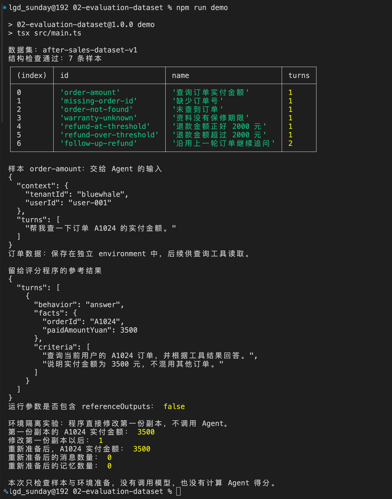

咱们看里面的关键数据：

```latex
数据集：after-sales-dataset-v1
结构检查通过：7 条样本
```

前面，咱们已经把测试问题、订单数据和参考答案保存成了 JSON 文件。

现在运行代码，就是要检查：**程序能否正确读取这些资料，并为一次评测准备好输入和数据。**

这次运行会依次验证三件事。

**第一，样本能不能正常读取。**

终端列出了 7 条样本，说明程序已经读到了这些题目，并检查了必要字段、样本 ID 和资料引用。连续追问包含两个问题，所以显示为 2 轮。

**第二，测试问题和参考答案有没有分开。**

继续往下看，程序分别打印了“交给 Agent 的输入”和“留给评分程序的参考结果”。

这样，后续 Agent 根据用户问题查询订单，评分程序再拿参考答案核对结果，避免提前把答案告诉模型。

**第三，每次测试能否从相同的数据开始。**

代码会故意把第一份订单副本中的金额从 3500 元改成 1 元，再重新准备一次测试数据。

如果重新准备后的金额仍然是 3500 元，就说明前一次的修改没有影响下一次。以后比较两个模型时，它们才能查询同样的订单数据。

因此，到这里咱们就完成了 **评测前的准备工作，即：读出题目、分开参考答案、准备独立的测试数据。**

接下来，咱们从 `main()` 开始，看看这些事情具体是怎样实现的。

### 从 main() 开始看
`npm run demo` 会进入 `src/main.ts` 的 `main()`。

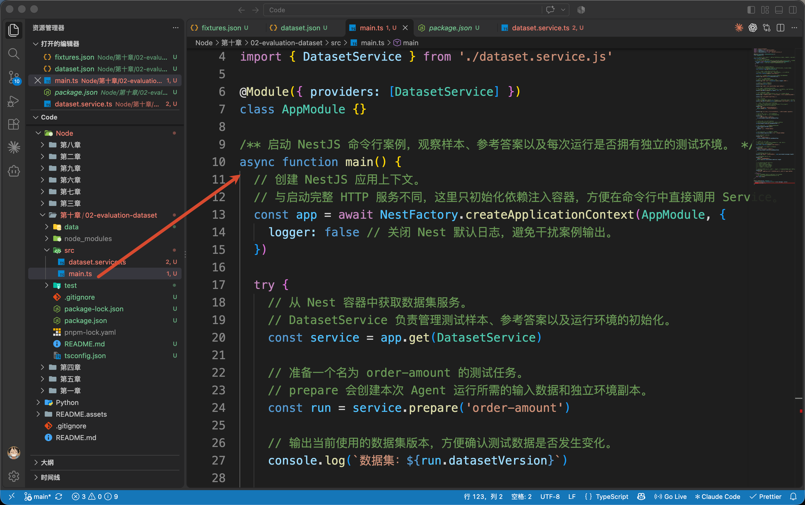

取得 `DatasetService` 以后，程序先准备第一条样本：

```typescript
// 从 Nest 容器中获取数据集服务。
// DatasetService 负责管理测试样本、参考答案以及运行环境的初始化。
const service = app.get(DatasetService)

// 准备一个名为 order-amount 的测试任务。
// prepare 会创建本次 Agent 运行所需的输入数据和独立环境副本。
const run = service.prepare('order-amount')
```

现在打开 `src/dataset.service.ts`，找到 `prepare()`。

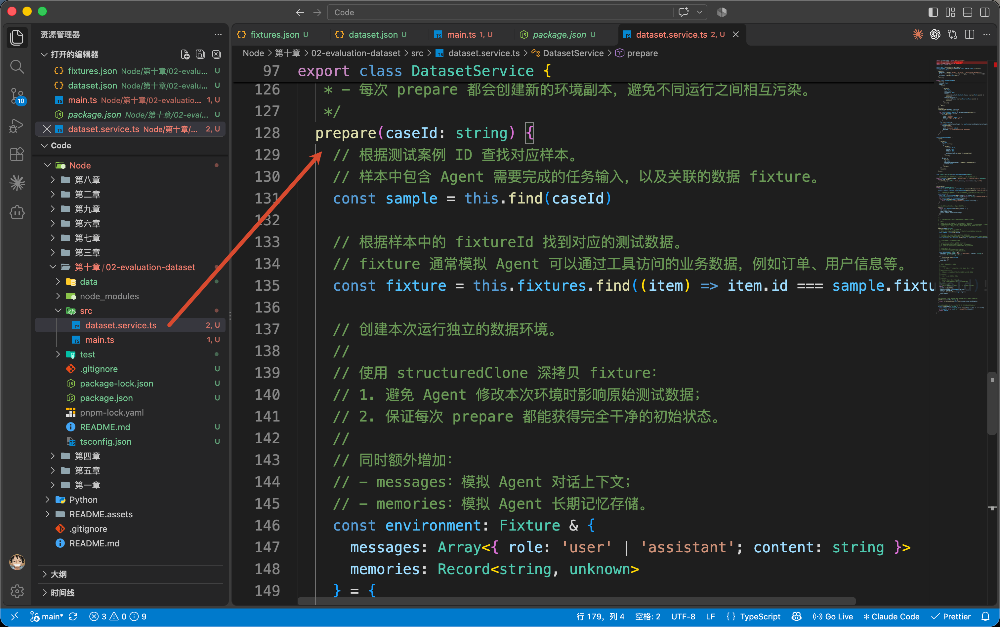

它先根据这个 ID 找到样本，再通过 `fixtureId` 找到对应的订单和规则。

准备好资料以后，方法返回下面这些内容：

```typescript
// 返回一次新的运行实例。
return {
  // 标识一次独立执行，方便后续追踪 Agent 运行过程。
  runId: randomUUID(),
  // 当前使用的那一版数据集版本
  datasetVersion: this.dataset.version,
  // 当前执行的测试案例 ID。
  caseId: sample.id,
  // 提供给 Agent 的任务输入。
  inputs: structuredClone(sample.inputs),
  // 提供给工具调用和 Agent 执行过程使用的隔离环境。
  environment
}
```

`runId` 标识本次运行，`caseId` 标识正在做哪一道题，`datasetVersion` 记录使用了哪一版题目。`inputs` 是刚才看到的用户问题和身份。

`environment` 保存这次测试可用的订单、规则，以及初始为空的消息和记忆。

注意，这个返回对象里没有 `referenceOutputs`。

回到 `main()`，打印评分参考时，走的是另一条调用：

```typescript
service.getReference('order-amount')
```

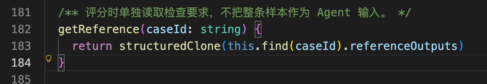

`getReference()` 会取出这道题的参考结果。例如，查询 A1024 的实付金额，正确结果应该是 **3500 元**。

终端同时打印问题和参考结果，方便咱们核对数据是否准备正确。

后面实际评测时，Agent 根据问题调用工具查询订单；评分程序再用这里的 **3500 元** 检查它回答得对不对。

同时这里要注意：**参考结果不能提前发给模型，否则模型就可能直接照着答案回答了。**

### 第二次运行
继续往下看 `main()`。

为了验证第一次运行的修改会不会影响下一次，代码故意把第一份测试副本中的订单金额改成了 1 元，还加入了一条消息和一条记忆。

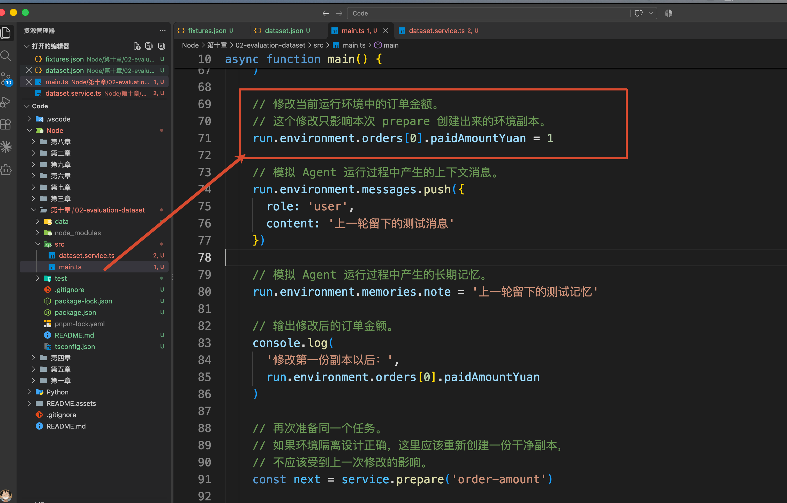

随后，再次调用：

```typescript
const next = service.prepare('order-amount')
```

这段代码的关键输出是：

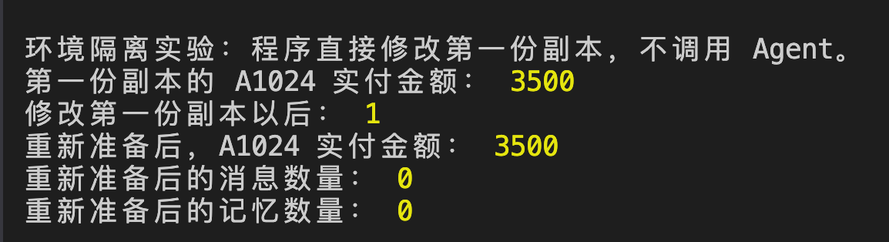

`fixtures.json` 里，A1024 的实付金额是 **3500 元**。

第一次调用 `prepare()`，程序会复制一份订单数据，供本次测试使用。随后，演示代码把这份副本里的金额改成了 **1 元**。

修改的是副本，原始资料里的金额依然是 3500 元。

第二次调用 `prepare()`，程序又从原始资料复制了一份，所以得到的仍然是 **3500 元**。

可能有点绕啊，给大家画了个图，大家看看：

%20%E6%95%B0%E6%8D%AE%E5%89%AF%E6%9C%AC%E9%9A%94%E7%A6%BB%E7%A4%BA%E6%84%8F%E5%9B%BE.png)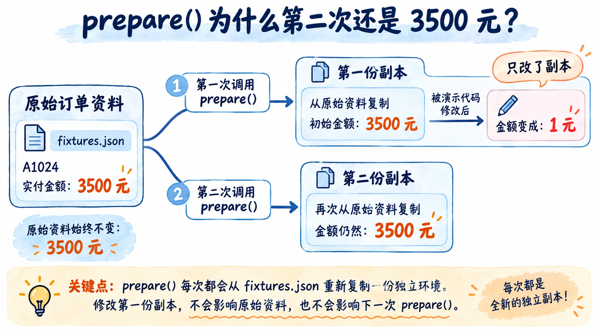

那有些同学就问了：为什么要故意修改一次金额呢？

**这就是为了验证：第一份测试数据被修改以后，第二次测试还能不能从原来的数据开始。**

以后比较两个模型时，模型 A 查询的是 3500 元，模型 B 查询的也应该是 3500 元。同时，每次独立测试都从空的聊天记录开始，避免读到上一次测试留下的回答。

不过，这种连续追问样本需要保留两轮之间的聊天记录才行哈。

## 总结
这一节，咱们把“Agent 应该能够查询订单金额”这个业务要求，整理成了可以执行的测试任务：

```plain
用户问什么：查询 A1024 的实付金额
准备什么数据：A1024 的订单资料
回答需要满足什么要求：订单正确，金额为 3500 元
```

按照这个方法，咱们又补充了缺少订单号、资料不足、金额边界和连续追问等情况，组成了包含 7 条样本的评测数据集。

配套程序负责读取这些样本，将测试输入与参考结果分开，并为每次独立测试准备一份新的数据。

现在，测试什么、用什么数据、怎样才算答对，都已经确定了。

下一小节，咱们就让 Agent 实际完成任务，再根据它的回答和执行结果，判断这些要求有没有做到。

> 更新：2026-10-13 15:17 · 原文：<https://www.yuque.com/lgdsunday/ab1dy3/gq60u6agnpcq5g9p>
