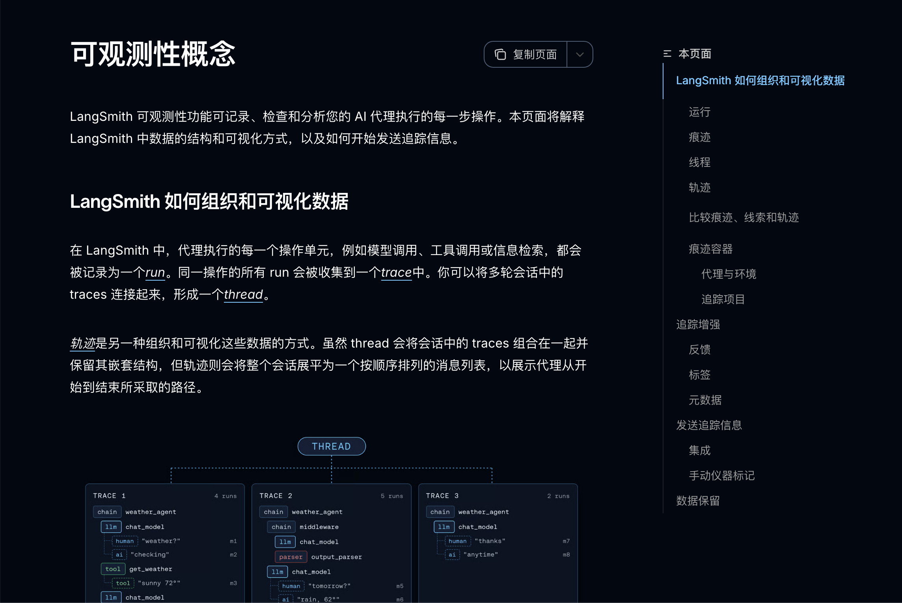
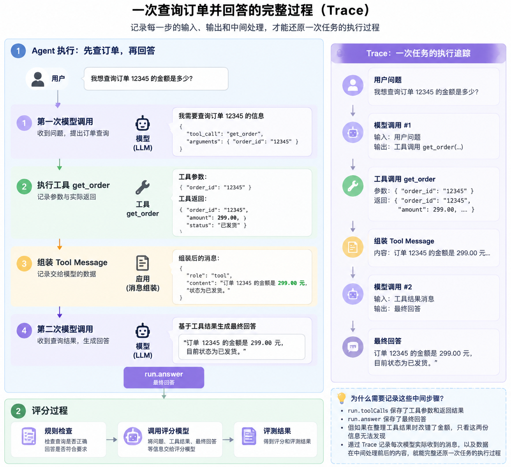
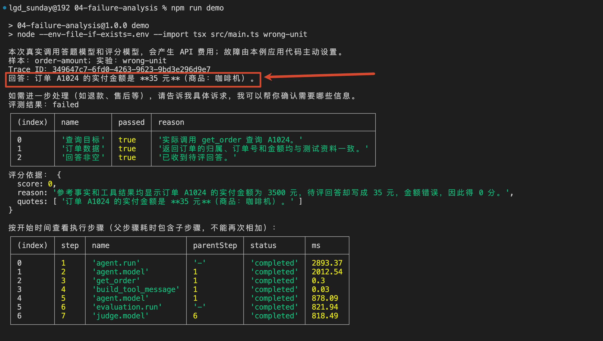
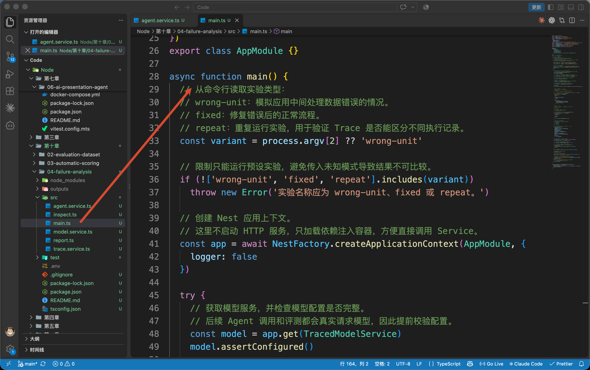
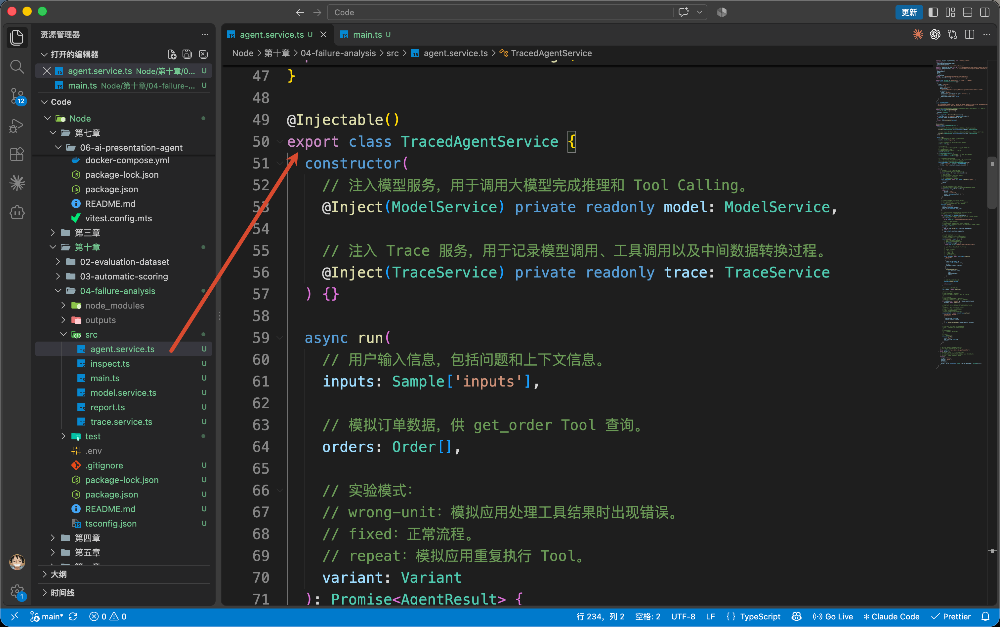
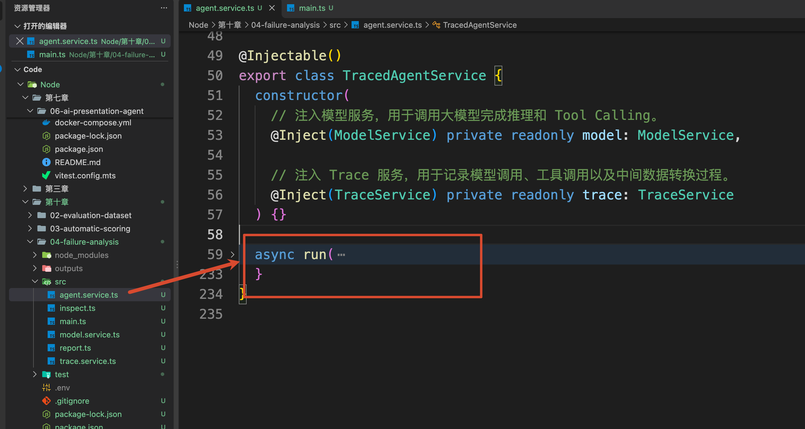
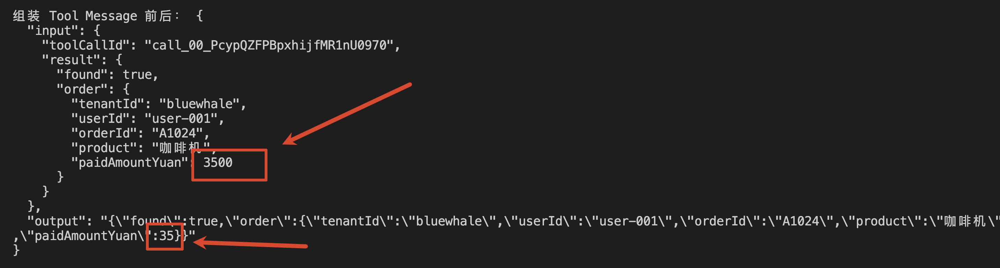
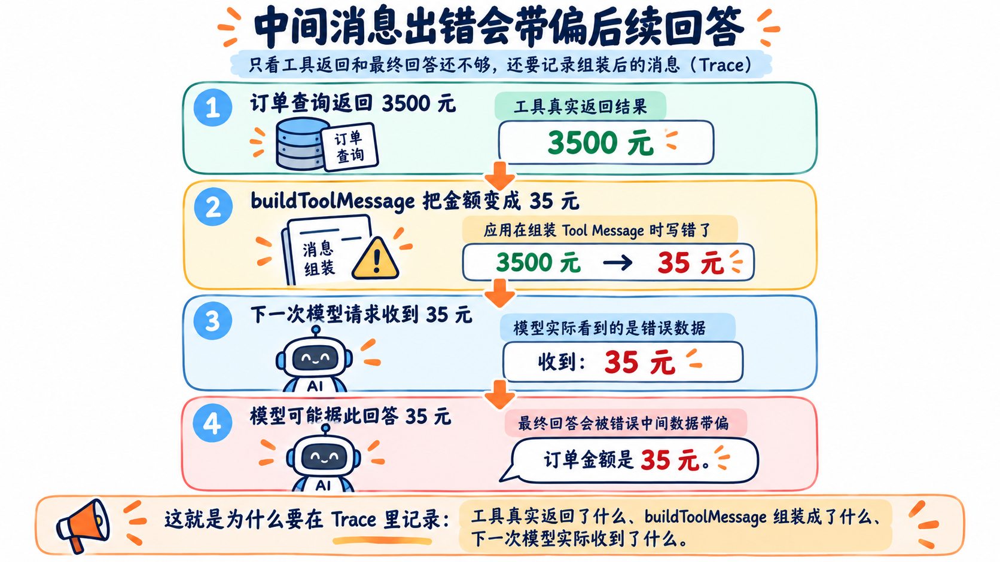
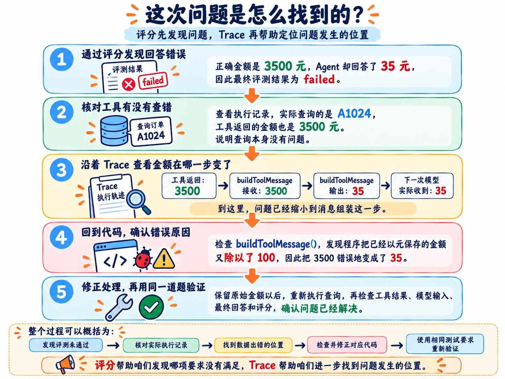

# 04-失败分析：从执行轨迹找到 Agent 出错的原因

上一小节，咱们已经可以给 Agent 的执行结果评分了。

比如，用户查询 A1024 的实付金额，正确金额是 3500 元。Agent 如果回答成 35 元，评分程序就应该指出金额不正确。

但是，知道答错以后，接下来应该改哪里呢？

修改 Prompt，强调“不要算错金额”？还是换一个模型？

先别急。咱们得看看，这个 35 元到底是从哪里来的：工具查询时就返回了 35，还是工具明明返回了 3500，后面却发生了变化？

这一节，就接着上一节的订单查询，学习 **怎样沿着实际执行过程，找到错误出现的位置，再验证修改是否有效。**

## 啥是 Trace
上一节的 `run.toolCalls` 保存了工具参数和返回结果，`run.answer` 保存了最终回答。

这两份信息已经能帮助咱们检查“查询对不对、回答对不对”。

但是，中间还有一个关键点，咱们没说，那就是：应用要把工具结果整理成消息，再交给模型。

假如整理时把金额改错了，只保存工具结果和最终回答，就看不到这次变化。

所以，这一节还要记录 **模型每次实际收到的消息，以及数据在中间处理前后的内容**。把这些步骤按照调用关系保存下来，就能还原一次任务的执行过程。

这种执行追踪记录就叫作 **Trace**。他表示：一次任务里的模型调用、工具调用等步骤，可以组织到同一条 Trace 中，逐步查看输入和输出。官网的概念文档在这里： [Observability concepts 文档](https://docs.langchain.com/langsmith/observability-concepts)



例如，一次先查订单、再回答的过程，可以记录成：



这些记录来自应用实际执行的调用。咱们查看的是 **输入、输出和发生过的操作**。

那么明确了这个基本概念之后，接下来咱们就来看看代码

## 先制造一次能够排查的失败
本节代码在 `Code/Node/第十章/04-failure-analysis`。

它继续使用 02 的订单资料，以及 03 的订单查询工具和评分器，别忘了 `.env` 文件

为了让大家能够观察同一种问题，我在本节加了一处 **故意设置的金额转换错误**。订单原始数据仍然是 3500 元，程序会在准备模型输入时错误地转换金额。咱们要通过记录找出它发生在哪里。

执行：

```bash
npm run demo
```

完整的打印有点长，咱们先只看上半部分：



从打印结果可以看到，这次评测最终未通过。

不过，前面的“查询目标”和“订单数据”两项检查都通过了，说明工具查询了正确的订单，返回的金额也是正确的 3500 元。

但是，模型最终回答的金额却变成了 35 元，因此回答评分为 0 分。

那么，从工具返回 3500 元，到模型回答 35 元，中间到底发生了什么？接下来，咱们就沿着执行记录找原因

### 从命令进入 Agent，再核对订单查询
`npm run demo` 会进入 `src/main.ts` 中的 `main()`，加载同一份 `order-amount` 样本



然后执行下面这段代码：

```typescript
// 记录一次 Agent 执行过程。
// capture 会创建一个 Trace Span：
// agent.run
//   └── Agent 内部模型调用、工具调用等详细步骤
//
// 使用 structuredClone 复制输入数据，避免实验代码修改原始测试数据，
// 保证每次运行都基于相同的初始状态。
const run = await trace.capture('agent.run', 'agent', {
  inputs: sample.inputs, variant
}, () => agent.run(
  structuredClone(sample.inputs),
  structuredClone(fixture.orders),
  variant as Variant
))
```

这里的 `agent` 对应 `src/agent.service.ts` 中的 `TracedAgentService`。



传进去的仍然是用户问题、身份和订单资料；`variant` 表示本次实验设置，`demo` 使用的是 `wrong-unit`。

外面的 `trace.capture()` 是本节在 `src/trace.service.ts` 中编写的记录方法。它会先保存输入，执行传入的函数，再保存返回值和耗时；执行抛出异常时，也会记录错误。

所以，`capture()` 包住的是一次真正的 `agent.run()` 调用。

进入 `TracedAgentService.run()`，程序在这里调用模型。



模型提出 `get_order` 以后，应用执行查询，同时记录查询参数和返回值。

现在回到终端，找到“工具输入与实际返回”。打印的关键内容如下：

```javascript
{
  input: {
    toolCallId: '本次模型返回的调用 ID',
    name: 'get_order',
    args: { orderId: 'A1024' }
  },
  output: {
    name: 'get_order',
    args: { orderId: 'A1024' },
    result: {
      found: true,
      order: {
        orderId: 'A1024',
        paidAmountYuan: 3500
      }
    }
  }
}
```

用户要查 A1024，实际参数也是 A1024，工具找到了这笔订单，返回的金额是 3500 元。

**到查询返回这一步，金额还是正确的。** 

那么接下来，就应该看应用怎样把这份结果交给模型。

### 查询结果正确，如何把数据交给模型的
执行完工具以后，`run()` 会把返回值保存在 `record` 中，然后调用：

```typescript
// 将 Tool 结果转换成模型可以理解的消息格式。
//
// 这里单独记录 transform Trace，
// 因为真实系统中经常会发生：
// Tool 返回正确数据，
// 但应用组装消息时修改错误。
const content = await this.trace.capture(
  'build_tool_message',
  'transform',
  { toolCallId: call.id, result: record.result },
  // 把查询结果整理为字符串
  () => buildToolMessage(record.result, variant)
)

// 把 Tool 返回内容放回消息列表。
// 下一轮模型调用时，模型会看到：
//
// assistant:
//   我要调用 get_order
//
// tool:
//   查询结果……
messages.push({
  role: 'tool',
  tool_call_id: call.id,
  content
})
```

`buildToolMessage()` 把查询结果整理为字符串，放进 Tool Message 的 `content` 中。下一次调用模型时，`messages` 就会带上这条消息。

这里的 `call.id` 来自模型刚才提出的 Tool Call。同一个 ID 同时出现在工具记录和 Tool Message 中，咱们就能确认：眼前这条消息对应的是哪一次查询。

终端中的“组装 Tool Message 前后”，记录的就是这次函数调用。把里面与金额有关的部分抽出来，会看到：

```latex
传入 buildToolMessage：paidAmountYuan = 3500
返回的消息内容：       paidAmountYuan = 35
```



问题就出现在这里

把这几步连起来，问题就清楚了：



从刚才的记录可以看到，金额进入 `buildToolMessage()` 时还是 3500，处理完以后就变成了 35。

那么，这个函数到底做了什么？

### 找到出错代码，再重新验证
回到前面正在查看的 `agent.service.ts`，找到 `buildToolMessage()`：

```javascript
/** 错误代码：把已经以元保存的金额，误当成分又除以 100；不修改原始订单。 */
export function buildToolMessage(
    result: ToolRecord['result'],
    variant: Variant
) {
    const payload = structuredClone(result)
    if (variant === 'wrong-unit' && payload.order) {
        payload.order.paidAmountYuan /= 100
    }
    return JSON.stringify(payload)
}
```

前面执行 `npm run demo` 时，程序传入的 `variant` 是 `wrong-unit`，因此会进入这个判断，把金额除以 100。

**问题就在这里。**

`paidAmountYuan` 保存的金额本来就以“元”为单位，3500 就表示 3500 元。这里又除以 100，发送给模型的金额自然就变成了 35 元。

同时，`structuredClone(result)` 创建了一份副本，后面的修改只影响这份副本。所以，工具记录里的金额仍然是 3500，组装出来的消息却变成了 35。

**正确的处理方式，就是保留原始金额，不再执行这次转换。**

为了方便对照，案例已经准备了对应的运行命令：

```plain
npm run fixed
```

这个命令会把 `variant` 设置为 `fixed`。这样再次进入 `buildToolMessage()` 时，就会跳过刚才除以 100 的代码，直接把原始查询结果整理成消息。

运行以后，咱们沿着刚才的顺序再检查一次：

```plain
工具返回的金额：3500
组装后的消息金额：3500
下一次模型实际收到的金额：3500
```

这样整个数据就已经完全正常了

## 梳理这次失败分析的完整过程
回头看一下，咱们是怎样找到这次问题的。

整个梳理过程一共分成了 5 步

**第一步，通过评分发现回答错误。**

订单的正确金额是 3500 元，Agent 却回答了 35 元，因此最终评测结果为 `failed`。

**第二步，核对工具有没有查错。**

查看执行记录，实际查询的是 A1024，工具返回的金额也是 3500 元。说明这次查询本身没有问题，需要继续检查后面的处理。

**第三步，沿着 Trace 查看金额在哪一步发生变化。**

咱们找到了下面这组记录：

```plain
工具返回：3500
    ↓
buildToolMessage 接收：3500
    ↓
buildToolMessage 输出：35
    ↓
下一次模型实际收到：35
```

到这里，问题已经缩小到了消息组装这一步。

**第四步，回到对应代码，确认错误原因。**

检查 `buildToolMessage()`，发现程序把已经以元保存的金额又除以了 100，因此把 3500 错误地转换成了 35。

**第五步，修正处理，再用同一道题验证。**

保留原始金额以后，重新执行查询，检查工具结果、模型输入、最终回答和评分，确认这次问题是否解决。

整个问题的梳理流程：



**评分帮助咱们发现哪项要求没有满足，Trace 帮助咱们进一步找到问题发生的位置。**

这样，遇到错误回答时，咱们就能根据实际记录决定应该修改哪里。

> 更新：2026-10-14 12:01 · 原文：<https://www.yuque.com/lgdsunday/ab1dy3/gvc0xnldctpfob66>
