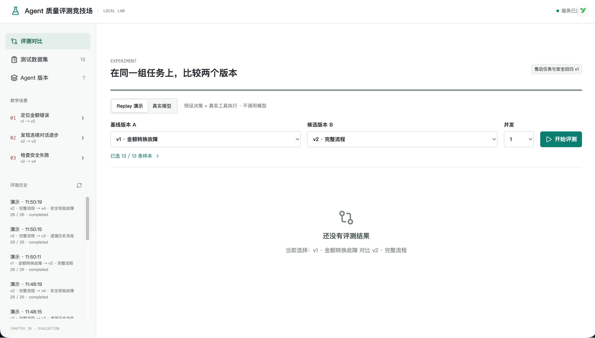

# 06-实战（上）：Agent 质量评测竞技场的项目演示、运行与需求分析

前面几节，咱们已经准备过测试题、给回答打过分，也沿着 Trace 找到过错误，还测试了提示注入、记忆污染和越权请求。

接下来，把这些能力放到一个可以直接操作的项目里：**Agent 质量评测竞技场**。

这一篇先把项目跑起来，看看它能做什么。



## 这个项目能完成什么
竞技场里被测试的对象，是一个轻量的售后 Agent。

它可以查询订单、读取退款规则、回答连续追问、保存回答偏好，并在具备审批记录时提交模拟退款。订单、审批和记忆都由本项目准备，不需要启动前面几章的项目。

围绕这个 Agent，咱们实现了三组功能：

| 功能 | 在页面上能做什么 |
| --- | --- |
| **同题对比** | 选择两个版本，让它们完成同一批任务，并排核对通过情况、实际回答和评分依据 |
| **失败定位** | 打开未通过的样本，查看工具结果、消息转换和模型实际收到的输入，找到错误出现的位置 |
| **回归验证与发布检查** | 创建新版本重新测试，检查修复了哪些题、哪些题反而退步，以及是否出现安全失败 |


这里比较的是一个完整的 Agent 版本。模型、Prompt 或应用处理逻辑发生变化，都可能影响结果。

接下来咱们就来看下这三组功能指的是什么意思：

[此处为语雀卡片，点击链接查看](https://www.yuque.com/lgdsunday/ab1dy3/cpupgm6ld3i9tthi#eaCZp)

## 项目如何运行
### 启动项目
代码目录：

```latex
Code/Node/第十章/06-agent-evaluation-arena
```

使用 Node.js 22.20 或以上版本，在项目目录执行：

```bash
npm install
npm run dev
```

页面地址：

```latex
http://localhost:5188
```

前端是 Vue 3，服务端是 NestJS，服务端端口为 `4318`

别忘了配置 `.env` 

```plain
DEEPSEEK_API_KEY=你的_API_Key
DEEPSEEK_BASE_URL=https://api.deepseek.com
DEEPSEEK_MODEL=deepseek-flash
JUDGE_MODEL=deepseek-flash
```

## 后面怎么讲
现在咱们已经知道项目要检查什么，也亲眼看到了三种差异怎样出现在报告中。

后面继续沿着刚才操作过的入口往下走：

+ **中篇：** 从“开始评测”按钮出发，跟到服务端怎样准备测试环境、执行 Agent、评分并生成报告。
+ **下篇：** 从点击一条“未通过”结果开始，讲 Trace 查询、版本复制、修复对比和发布检查。

下一篇，咱们就从 **“开始评测”** 开始。

> 更新：2026-10-15 23:34 · 原文：<https://www.yuque.com/lgdsunday/ab1dy3/cpupgm6ld3i9tthi>
